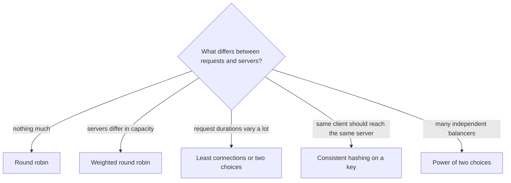
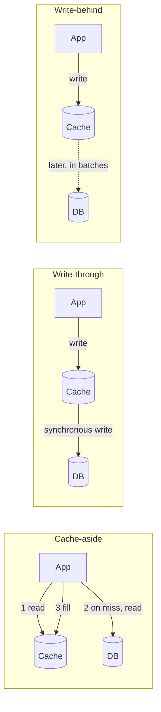
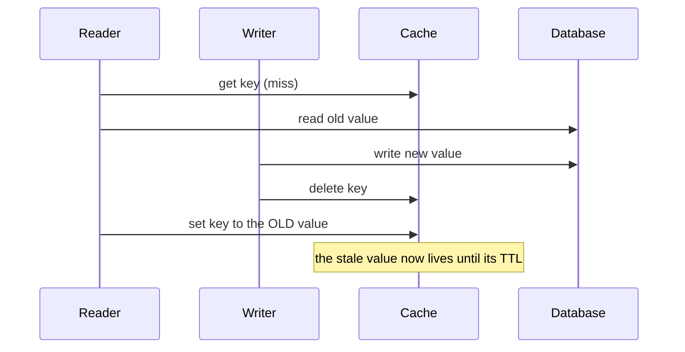
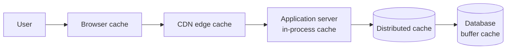

# Building blocks I: load balancing algorithms and caching strategies

## Before this lesson

You should have read [The five building blocks](#/lesson/system-design/core-components), which introduces the load balancer and the cache, and [Scaling from zero I](#/lesson/system-design/scale-single-to-replicated). Consistent hashing is used here and taught in [its own module](#/lesson/system-design/consistent-hashing-ring). For the network side of load balancers see [Load balancers, reverse proxies and health checks](#/lesson/networking/load-balancers-proxies) in the Networking track, and for a real cache server see the [Redis track](#/track/redis).

## In plain words

The first module described a load balancer as "the host at the restaurant door" and a cache as "the shelf of ready-made sauces". That was enough to read a diagram. This lesson is the detail an interviewer asks for next.

For the host at the door, the questions are: by what rule does the host choose a table, what happens when a waiter is slow or absent, and who replaces the host if they fall ill?

For the shelf, the questions are: who puts the sauce on the shelf and when, what happens when the recipe changes while an old batch is still on the shelf, and what happens on the morning the shelf is empty and every cook runs to the stove at once?

These two components appear in almost every design in this track, so having precise answers pays off repeatedly.

## 1. Load balancing: where it sits and what it sees

A load balancer can work at two different layers of the network, and the layer decides how clever it can be.

| | Layer 4 (transport) | Layer 7 (application) |
|---|---|---|
| Sees | IP addresses and ports | The full HTTP request: path, headers, cookies |
| Decides by | Connection | Request |
| Speed | Very fast; little work per packet | Slower; must parse the request and usually terminates TLS |
| Can do | Spread connections | Route `/api` and `/images` to different server groups, retry a failed request on another server, rate limit, rewrite |
| Typical use | The outermost tier, databases, non-HTTP protocols | Web and API traffic |

**TLS termination** means the load balancer decrypts incoming HTTPS so that it can read the request, and usually forwards plain or re-encrypted traffic to the servers. Large systems often chain the two kinds: a layer 4 balancer spreads connections across a fleet of layer 7 balancers.

## 2. Load balancing algorithms

**Round robin.** Send requests to the servers in turn. Simple and even, provided servers are identical and requests cost about the same.

**Weighted round robin.** Give each server a weight proportional to its capacity; a server of weight 3 receives three times the requests of a server of weight 1. Also used to introduce a new version gradually: weight 1 against 99.

**Least connections.** Send the request to the server with the fewest requests in progress. This adapts to requests of very different durations, because a server stuck with slow requests accumulates connections and stops receiving new ones.

**Least response time.** Prefer the server that has been answering fastest, usually combined with connection count.

**Hashing.** Choose the server by a hash of something in the request, such as the client's IP address or a user id. The same client always reaches the same server, which helps when servers keep per-user caches. Use **consistent hashing** so that adding or removing a server remaps only a small share of clients.

**Random and "power of two choices".** Pick two servers at random and send the request to the less loaded of the two. This sounds too simple to be good, and it is surprisingly close to least connections, while needing only two load readings instead of a full, always-current table. It also avoids a trap of exact least-connections with several balancers: if every balancer sees the same "least loaded" server, they all send to it at once, a **herd effect**.

```python-run
import random
random.seed(3)

SERVERS, REQUESTS = 10, 20_000

def simulate(policy):
    """Each request is long (rarely) or short. Returns the highest queue length seen and the average wait."""
    busy_until = [0.0] * SERVERS          # when each server will have finished its current backlog
    clock, worst, total_wait, rr = 0.0, 0.0, 0.0, 0
    for _ in range(REQUESTS):
        clock += random.expovariate(8.0)                     # about 8 requests arrive per time unit
        service = 5.0 if random.random() < 0.1 else 0.5      # 10% of requests are ten times heavier
        backlog = [max(0.0, b - clock) for b in busy_until]
        if policy == "round robin":
            s = rr = (rr + 1) % SERVERS
        elif policy == "random":
            s = random.randrange(SERVERS)
        elif policy == "two choices":
            a, b = random.sample(range(SERVERS), 2)
            s = a if backlog[a] <= backlog[b] else b
        else:                                                # least loaded
            s = min(range(SERVERS), key=lambda i: backlog[i])
        total_wait += backlog[s]
        worst = max(worst, backlog[s])
        busy_until[s] = max(busy_until[s], clock) + service
    return total_wait / REQUESTS, worst

print(f"{'policy':14s} {'average wait':>13s} {'worst wait':>11s}")
for policy in ("random", "round robin", "two choices", "least loaded"):
    avg, worst = simulate(policy)
    print(f"{policy:14s} {avg:>13.2f} {worst:>11.1f}")
```

With requests of mixed sizes, random and round-robin assignment both let backlogs build up on unlucky servers. Choosing the better of two random servers removes most of that, at almost no cost, and exact least-loaded is only a little better still.



### Health checks and the balancer's own availability

A balancer must know which servers are alive.

- **Active checks:** the balancer sends a probe (for example `GET /healthz`) every few seconds and removes a server after several consecutive failures. A good health endpoint checks that the server can do useful work, not merely that the process is running, but should not fail because a shared dependency is down, or every server will be removed at once.
- **Passive checks:** the balancer watches real traffic and ejects a server that returns many errors or timeouts.

When a server is removed for maintenance, **connection draining** lets it finish requests in progress while receiving no new ones.

The balancer itself must not be a single point of failure. Common arrangements are an active and a standby balancer sharing a floating IP address, or several active balancers reached through DNS or anycast routing.

> [!INTERVIEW]
> If asked "which algorithm?", avoid naming one in the abstract. Tie it to the workload: "requests here vary from 5 ms to several seconds, so round robin would overload unlucky servers; I would use least connections, or power of two choices since we run many balancers."

## 3. Caching: who loads the cache, and when

A **caching strategy** defines how data gets into the cache and how the cache stays in step with the database.



**Cache-aside (lazy loading).** The application reads the cache; on a miss it reads the database and fills the cache. On a write it updates the database and deletes the cache entry. Only requested data is cached, and a cache failure is survivable because the application can always read the database. The first read of anything is slow, and there is a window for stale data.

**Read-through.** The same idea, but the cache library or service loads from the database on a miss, so application code stays simpler.

**Write-through.** Every write goes to the cache, which writes to the database before confirming. The cache is always fresh for written keys. Writes are slower (two writes), and data that is written and never read fills the cache for nothing.

**Write-behind (write-back).** The write goes to the cache and is acknowledged at once; the cache writes to the database later, often in batches. Writes are very fast and the database is shielded from bursts. If the cache fails before flushing, those writes are lost, so this is only for data you can afford to lose or rebuild, such as counters and analytics.

**Refresh-ahead.** The cache reloads popular entries shortly before they expire, so readers never see the miss.

| Strategy | Read after write | Write latency | Risk | Good for |
|---|---|---|---|---|
| Cache-aside | May be stale briefly | Normal | Stale window; stampede on miss | The general default |
| Read-through | Same as cache-aside | Normal | Same | Simpler application code |
| Write-through | Fresh | Higher | Unused entries; cache on the write path | Read-heavy data that must be fresh |
| Write-behind | Fresh in cache | Lowest | Data loss if the cache dies | Counters, metrics |
| Refresh-ahead | Fresh for hot keys | Normal | Wasted refreshes | Very hot, expensive entries |

## 4. Invalidation: keeping the copy correct

When the database changes, the cached copy is wrong. There are four tools.

**Expiry (TTL).** Every entry carries a time to live. Staleness is bounded by the TTL, with no extra code. It is the safety net under every other method.

**Delete on write.** After updating the database, delete the cache key so the next read reloads it. Prefer deleting to updating the cached value: two concurrent writers updating the cache can leave the older value in place, whereas deletes are harmless in any order.

**Versioned keys.** Put a version in the key (`user:42:v17`). A change bumps the version; old entries are never read again and expire by themselves. This is how static files with hashed names behave on a CDN.

**Change events.** The database's change stream (change data capture) drives a consumer that invalidates or updates cache entries. This catches every change, whichever code path made it. The [Databases track](#/lesson/databases/cdc-event-sourcing) covers change data capture.

Even "update the database, then delete the key" has a narrow race:



A reader that missed the cache reads the old value, the writer updates and deletes, and then the slow reader writes the old value back. It is rare, since it needs a read slower than a whole write, and the TTL limits the damage. Where it matters, delete the key a second time after a short delay, or have the reader set the value only if no newer version exists.

> [!WARNING]
> Never design a cache without a TTL "because we invalidate explicitly". Explicit invalidation has bugs and races; the TTL is what guarantees that a wrong entry eventually goes away.

## 5. Four ways a cache hurts you

**Cache stampede (thundering herd).** A popular entry expires, and every request that misses rebuilds it at the same time, overwhelming the database. Remedies: let only one request rebuild while the others wait or are given the old value (**single flight**); refresh hot keys before they expire; add **jitter** to TTLs so that entries created together do not expire together.

```python-run
def run(requests_during_load, protection):
    """A hot key expires. `requests_during_load` requests arrive while the first rebuild is in progress."""
    db_queries, in_flight = 0, False
    for _ in range(requests_during_load):
        if protection and in_flight:
            continue                      # wait for the rebuild that is already running
        db_queries += 1                   # this request queries the database
        in_flight = True
    return db_queries

for n in (10, 1_000, 50_000):
    print(f"{n:>6} concurrent misses -> without protection: {run(n, False):>6} DB queries, "
          f"with single flight: {run(n, True)}")
```

Fifty thousand simultaneous misses become one database query.

**Cache penetration.** Requests for keys that do not exist (typing errors, or an attacker inventing ids) always miss and always hit the database. Remedies: cache the "not found" result for a short time (**negative caching**), or keep a Bloom filter of existing keys and reject the rest immediately.

**Cache avalanche.** Many keys expire together, or the whole cache tier restarts empty, and the database receives everything. Remedies: TTL jitter, several cache nodes so that one loss is partial, warming a new cache before sending it traffic, and limiting how fast rebuilds may hit the database.

**Hot key.** One key takes so many requests that its cache node is saturated. Remedies: a small in-process cache on each application server for the hottest keys, or several copies of the key (`item:9#0` to `item:9#7`) chosen at random.

## 6. Eviction, and what to cache

When memory is full, something is removed:

| Policy | Removes | Suits |
|---|---|---|
| **LRU** (least recently used) | The entry untouched for longest | The general case |
| **LFU** (least frequently used) | The entry used least often | Stable popularity; resists one-off scans |
| **FIFO** | The oldest entry | Simple, rarely the best |
| **TTL-based** | Entries nearest expiry | Mixed lifetimes |

Decide what to cache by asking three questions: is it read much more often than it changes, is it expensive to compute or fetch, and can a slightly old value be shown without harm? Cache at the layer that saves the most work: a rendered page fragment saves more than a database row, and a response cached at the CDN saves a request to your servers entirely.



Every arrow in that chain is a chance to answer early, and every layer is one more place where a stale copy can live. The [Networking track](#/lesson/networking/http-caching-cookies) covers the HTTP headers that control the first two layers.

> [!TIP]
> Quote a hit rate and its consequence: "with a 95% hit rate the database sees one twentieth of the reads; if the cache disappears it sees twenty times its normal load, so I either size the database for that or protect it with a limiter while the cache warms."

## Common mistakes

- **Round robin for requests of very different cost.**
- **A health check that depends on a shared dependency**, so one outage removes every server.
- **A single load balancer.**
- **Updating the cached value on write** instead of deleting it.
- **No TTL.**
- **Ignoring the cold-cache case** after a restart.
- **Write-behind for data that must not be lost.**
- **Caching per-user data in a shared cache key**, leaking one user's data to another.

## Summary

- Layer 4 balancers route connections quickly by address and port; layer 7 balancers understand requests and can route, retry and terminate TLS.
- Choose the algorithm from the workload: round robin for uniform work, weights for unequal servers, least connections or two choices for varied durations, consistent hashing for affinity.
- Health checks, connection draining and a redundant balancer make the tier reliable.
- Cache-aside is the default; write-through keeps the cache fresh at a cost in write latency; write-behind is fast and can lose data.
- Invalidate with TTL as a safety net plus delete-on-write, versioned keys or change events.
- Defend against stampedes, penetration, avalanches and hot keys; pick an eviction policy; cache where it saves the most work.

## Glossary

- **Layer 4 / layer 7**: the transport layer (connections) and the application layer (requests).
- **TLS termination**: decrypting HTTPS at the load balancer.
- **Least connections**: choosing the server with the fewest requests in progress.
- **Power of two choices**: choosing the less loaded of two randomly picked servers.
- **Herd effect**: many deciders choosing the same target at once.
- **Active / passive health check**: probing servers, or judging them from real traffic.
- **Connection draining**: letting a server finish current requests while receiving no new ones.
- **Cache-aside / read-through**: the application, or the cache itself, loads from the database on a miss.
- **Write-through / write-behind**: writing to the database synchronously via the cache, or asynchronously later.
- **Refresh-ahead**: reloading an entry before it expires.
- **Single flight**: allowing only one concurrent rebuild of a cache entry.
- **Negative caching**: caching the fact that something does not exist.
- **Cache penetration / avalanche**: load from requests for non-existent keys, or from many keys expiring at once.
- **LRU / LFU**: evicting the least recently, or least frequently, used entry.
- **Change data capture**: a stream of the changes made to a database.

## Check yourself

```quiz
[
  {"q": "Requests vary from a few milliseconds to several seconds. Which algorithm adapts best?",
   "options": ["Round robin", "Least connections", "Weighted round robin with equal weights", "FIFO"],
   "answer": 1,
   "explain": "A server occupied by slow requests holds more open connections and so receives fewer new ones. Round robin ignores current load."},
  {"q": "What can a layer 7 load balancer do that a layer 4 one cannot?",
   "options": ["Forward TCP connections", "Route by URL path or header and retry a failed request on another server", "Use IP addresses", "Work faster per packet"],
   "answer": 1,
   "explain": "Layer 7 balancers parse the request, which allows content-based routing, retries and other request-level features."},
  {"q": "Why is 'power of two choices' attractive when many balancers run in parallel?",
   "options": ["It needs no servers", "It gives results close to least-loaded with little state and avoids all balancers picking the same server", "It guarantees session affinity", "It removes the need for health checks"],
   "answer": 1,
   "explain": "Sampling two servers and taking the better one is cheap and avoids the herd effect of everyone chasing one least-loaded server."},
  {"q": "On a write with cache-aside, what is the recommended treatment of the cache entry?",
   "options": ["Update it with the new value", "Delete it so the next read reloads it", "Leave it until the TTL", "Double its TTL"],
   "answer": 1,
   "explain": "Concurrent updates can leave an older value in the cache. Deleting is safe in any order."},
  {"q": "Which strategy risks losing acknowledged writes if the cache server fails?",
   "options": ["Cache-aside", "Write-through", "Write-behind", "Read-through"],
   "answer": 2,
   "explain": "Write-behind confirms before the database has the data. Anything not yet flushed is lost with the cache."},
  {"q": "A very popular key expires and thousands of requests rebuild it at once. What is this, and what fixes it?",
   "options": ["Cache penetration; a Bloom filter", "Cache stampede; let one request rebuild while others wait", "Hot key; a larger TTL", "Split brain; a quorum"],
   "answer": 1,
   "explain": "Single flight, early refresh and TTL jitter prevent a crowd of simultaneous misses from hitting the database."},
  {"q": "Attackers request millions of ids that do not exist. Which defence applies?",
   "options": ["Write-through", "Negative caching or a Bloom filter of valid keys", "Least connections", "Longer connection draining"],
   "answer": 1,
   "explain": "This is cache penetration. Remembering 'not found' or rejecting impossible keys stops the misses reaching the database."},
  {"q": "Why keep a TTL even when you invalidate explicitly on every write?",
   "options": ["TTLs make reads faster", "It bounds the lifetime of entries left stale by bugs or races", "It is required by the load balancer", "It increases the hit rate"],
   "answer": 1,
   "explain": "Explicit invalidation can miss a path or lose a race. Expiry guarantees that a wrong entry eventually disappears."}
]
```

> **Source:** Xu, *System Design Interview: An Insider's Guide*, ch. 1 (load balancer, cache tier) as a topic guide; System Design Primer sections "Load balancer" and "Cache", https://github.com/donnemartin/system-design-primer ; Mitzenmacher, "The Power of Two Choices in Randomized Load Balancing" (IEEE Transactions on Parallel and Distributed Systems, 2001)
