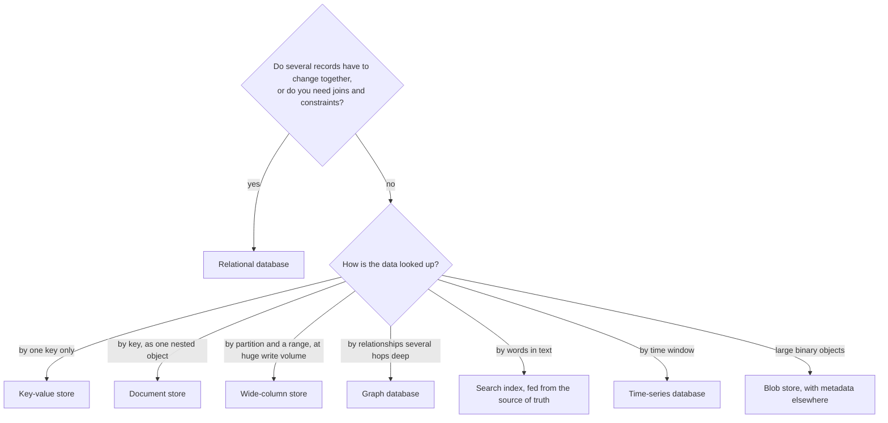
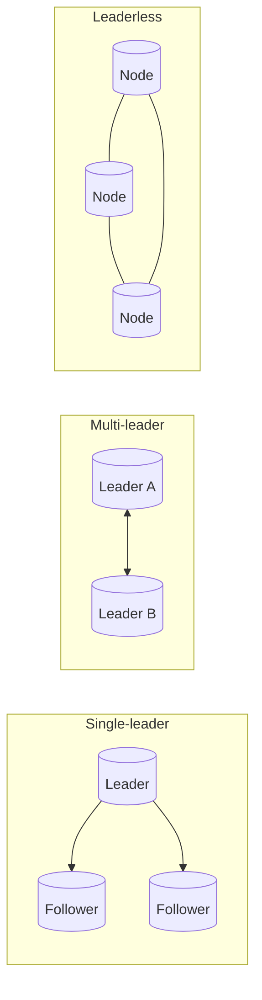
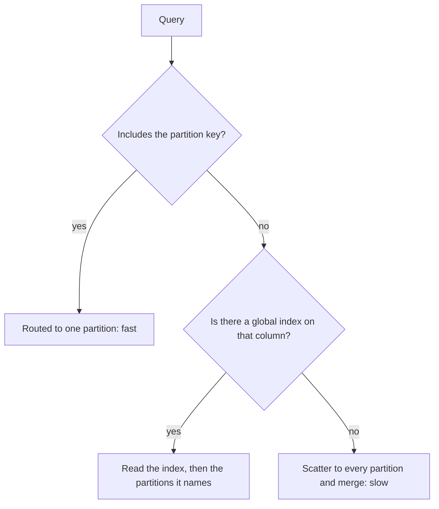

# Building blocks II: database choice, indexing, replication and partitioning

## Before this lesson

You should have read [The five building blocks](#/lesson/system-design/core-components) (what a database and an index are), [Scaling from zero I](#/lesson/system-design/scale-single-to-replicated) (replication) and [Scaling from zero II](#/lesson/system-design/scale-stateless-to-sharded) (sharding). This lesson goes one level deeper on each. The [Databases track](#/lesson/databases/relational-vs-document) treats every topic here at full length, and its lesson [Choosing a database and the system-design playbook](#/lesson/databases/choosing-system-design) is a good companion.

## In plain words

In every design so far there was a moment when you had to say "and the data lives in …". This lesson is about finishing that sentence well.

Four questions always follow:

1. **Which kind of database?** Choosing storage is like choosing furniture for an office. A filing cabinet with labelled folders, a wall of pigeonholes, a card index and a whiteboard of connections all hold information, and each suits a different way of looking things up. The right choice depends on how you will ask for the data, not on which is fashionable.
2. **How will lookups be fast?** With an **index**: the alphabetical tabs that let you open the cabinet at the right place instead of leafing through every folder.
3. **How does it survive a machine dying, and serve more readers?** With **replication**: photocopies of the cabinet kept in other rooms.
4. **What when it no longer fits in one room?** With **partitioning**: several cabinets, and a rule saying which folder goes in which.

Interviewers probe each one. A candidate who says "I will use a NoSQL database and shard it" without being able to say which, why, on what key and with what consequences has not answered.

## 1. Choosing a database: start from the access pattern

The **access pattern** is the list of ways the application reads and writes the data: which fields it looks things up by, whether it needs ranges, whether several records must change together, and in what volume. Write it down before naming a product.

| Family | Shape | Strong at | Weak at | Typical uses |
|---|---|---|---|---|
| **Relational (SQL)** | Tables, rows, fixed columns | Joins, transactions across rows and tables, ad hoc queries, constraints | Scaling writes beyond one primary without sharding | Users, orders, payments, bookings, most metadata |
| **Key-value** | Key to opaque value | Very fast lookups by key; simple horizontal scaling | Queries by anything other than the key | Sessions, caches, carts, feature flags |
| **Document** | Key to a nested JSON-like document | Flexible structure; reading a whole aggregate in one go | Joins across documents; cross-document transactions | Catalogues, profiles, content |
| **Wide-column** | Partition key plus sorted rows | Huge write volumes; range reads within a partition | Flexible queries; joins | Chat history, time series, event logs |
| **Graph** | Nodes and edges | Multi-hop relationship queries | Bulk analytics; simple lookups at scale | Social graphs, fraud rings, recommendations |
| **Search index** | Inverted index over text | Full-text search, relevance ranking, filtering | Being the source of truth | Product search, log search |
| **Time-series** | Timestamped measurements | Append-heavy writes; time-window aggregation; compression | General-purpose queries | Metrics, sensor data |
| **Blob store** | Key to a large object | Cheap, durable storage of big files | Querying contents; small frequent updates | Images, video, backups |
| **Vector index** | Embeddings | Nearest-neighbour similarity search | Exact filtering by itself | Semantic search, retrieval for language models |



Three rules of thumb:

- **Default to relational** unless something specific pushes you away. It handles the widest range of access patterns, and most data in most products is small.
- **Use more than one store when the data differs.** A video platform has relational metadata, blobs for video and a search index for titles. Using several stores, each for what it does best, is called **polyglot persistence**. Each extra store is also an extra thing to operate and keep in step.
- **Keep one source of truth.** Caches, search indexes and analytics stores are **derived data**: copies that can be rebuilt. Decide which store is authoritative for each piece of data.

> [!INTERVIEW]
> Justify the choice from the access pattern in one sentence: "messages are written at 23,000 per second and read as 'the latest 50 in this channel', so a wide-column store partitioned by channel and sorted by message id fits; user accounts need transactions and are small, so they stay relational."

## 2. Indexing

An **index** is an extra data structure that the database maintains so that it can find rows without reading the whole table. Without one, a lookup is a **full table scan**: read every row and test it.

The most common index is a **B-tree**: a balanced tree that keeps keys in sorted order, with many keys per node, so that even a billion rows need only three or four steps from the root to the right place. Because it is sorted, it also answers range queries ("orders between 1 and 31 March") and returns rows already ordered.

```python-run
import bisect, random, time
random.seed(1)

N = 200_000
rows = [{"id": i, "email": f"user{i}@example.com", "age": random.randint(18, 80)} for i in range(N)]
random.shuffle(rows)                                   # rows are stored in no useful order

def scan(email):
    """No index: look at every row."""
    steps = 0
    for row in rows:
        steps += 1
        if row["email"] == email:
            return row, steps
    return None, steps

# Building an index: a sorted list of (email, position of the row).
index = sorted((row["email"], pos) for pos, row in enumerate(rows))
keys = [k for k, _ in index]

def indexed(email):
    i = bisect.bisect_left(keys, email)                # binary search: about log2(N) steps
    if i < len(keys) and keys[i] == email:
        return rows[index[i][1]], N.bit_length()
    return None, N.bit_length()

target = "user123456@example.com"
t0 = time.perf_counter(); _, steps_scan = scan(target); t_scan = time.perf_counter() - t0
t0 = time.perf_counter(); _, steps_idx = indexed(target); t_idx = time.perf_counter() - t0
print(f"full scan : {steps_scan:>7,} rows examined, {t_scan * 1000:8.3f} ms")
print(f"with index: {steps_idx:>7,} steps,         {t_idx * 1000:8.3f} ms")

# Because the index is sorted, a prefix or range query is a contiguous slice.
lo, hi = bisect.bisect_left(keys, "user1999"), bisect.bisect_left(keys, "user2000")
print(f"emails starting 'user1999': {hi - lo} found by slicing the sorted index")
```

The scan examines over a hundred thousand rows; the index needs about eighteen steps. That gap grows with the table.

Indexes are not free:

- **Every write must update every index** on the table. More indexes mean slower inserts and updates.
- **Indexes take space**, often comparable to the table itself.

So index for the queries you actually run. Useful vocabulary:

| Term | Meaning | Example |
|---|---|---|
| **Primary index** | The index on the primary key; often decides the physical order of rows | `orders(order_id)` |
| **Secondary index** | An index on any other column | `orders(customer_id)` |
| **Composite index** | An index on several columns in order | `orders(customer_id, created_at)` |
| **Covering index** | An index that contains every column a query needs, so the table is never touched | `(customer_id, created_at, total)` for a query selecting those three |
| **Unique index** | An index that also forbids duplicates | `users(email)` |

Column order in a composite index matters. An index on `(customer_id, created_at)` serves "orders of customer 7, newest first" in one step: jump to customer 7 and read in date order. It also serves "all orders of customer 7". It does **not** help "all orders created yesterday", because rows are sorted by customer first. The rule: **put equality columns first, then the range or sort column.**

Other index kinds exist for other questions: hash indexes for exact matches only, inverted indexes for words in text, spatial indexes for "near this point", and LSM-based structures that favour writes. The Databases track lessons on [B-trees](#/lesson/databases/btrees) and [indexes in practice](#/lesson/databases/postgres-indexes) go through them.

> [!TIP]
> When you write a table in an interview, write its indexes on the next line and say which query each one serves. An unindexed lookup on a table of a billion rows is the kind of detail that separates a design from a sketch.

## 3. Replication

**Replication** keeps copies of the same data on several machines, for availability, durability and read capacity. There are three arrangements.



| | Single-leader | Multi-leader | Leaderless |
|---|---|---|---|
| Writes go to | One leader | Any of several leaders | Any replica |
| Write conflicts | None: one writer orders everything | Possible; must be resolved | Possible; resolved with versions and quorums |
| Read scaling | Followers | Followers of each leader | All replicas |
| Typical use | Most relational databases | Multiple regions each accepting local writes; offline-capable apps | Dynamo-style stores |
| Main risk | Leader failure and failover | Conflict resolution | Stale reads; conflict handling |

**Synchronous or asynchronous.** With synchronous replication the leader waits for a follower before confirming, so no confirmed write is lost, at the cost of latency and of blocking when the follower is unreachable. With asynchronous replication the leader confirms at once; the newest writes can be lost if it fails, and followers lag. A common middle way is one synchronous follower and the rest asynchronous.

**Problems caused by replication lag**, and their remedies:

| Symptom | Name | Remedy |
|---|---|---|
| I post a comment, refresh and it is missing | No read-your-own-writes | Read the user's own recent writes from the leader |
| A value appears, then disappears on refresh | Non-monotonic reads | Pin each user to one replica |
| A reply shows before the question it answers | Causality violated | Keep related writes in one partition, or track causal order |

```python-run
LAG_MS = 400                                    # followers are this far behind the leader
READ_OWN_WRITES_WINDOW_MS = 1_000

last_write_at = {}                              # user -> time of that user's latest write

def write(user, now):
    last_write_at[user] = now
    return "leader"

def choose_replica(user, now, policy):
    if policy == "always follower":
        return "follower"
    recent = now - last_write_at.get(user, -10**9) < READ_OWN_WRITES_WINDOW_MS
    return "leader" if recent else "follower"

def sees_own_write(user, now, replica):
    age = now - last_write_at[user]
    return replica == "leader" or age >= LAG_MS

for policy in ("always follower", "leader after own write"):
    write("mina", now=0)
    results = []
    for t in (50, 200, 500, 2_000):
        replica = choose_replica("mina", t, policy)
        results.append(f"t={t}ms {replica}:{'ok' if sees_own_write('mina', t, replica) else 'STALE'}")
    print(f"{policy:24s} " + "  ".join(results))
```

Reading from a follower immediately after writing shows a stale page for the first 400 ms. Routing the author's reads to the leader for one second after their own write removes it, and other users continue to read from followers.

**Failover** in a single-leader system needs detection (missed heartbeats), election of the most up-to-date follower, and redirection of writes. Its hazards are lost writes under asynchronous replication and **split brain**, where the old leader keeps accepting writes. The Databases track lesson on [single-leader replication](#/lesson/databases/leader-follower) covers this in depth.

## 4. Partitioning

Replication copies the same data to several machines. **Partitioning** (sharding) puts *different* data on different machines, so that each holds part of the whole. The two are combined: each partition is itself replicated.

Three ways to decide which partition holds a record:

**Range partitioning.** Each partition holds a contiguous range of keys: `A`-`F`, `G`-`M`, and so on. Range scans are efficient, because adjacent keys are stored together. The risk is skew: some ranges are much busier than others. A key that only increases, such as a timestamp, sends every new write to the last partition, creating a **hot spot**.

**Hash partitioning.** The partition is chosen by a hash of the key. Data spreads evenly, and the timestamp problem disappears. The cost: range scans are lost, because adjacent keys land on different partitions.

**Directory (lookup) partitioning.** A table maps each key, or each range or bucket of keys, to a partition. This is the most flexible, allowing individual tenants or hot ranges to be moved, at the price of maintaining and consulting the directory.

```python-run
import hashlib
from collections import Counter

PARTITIONS = 4
# Event keys: a timestamp prefix, as in logs or orders created over a morning.
keys = [f"2026-11-21T{9 + i // 3600:02d}:{(i // 60) % 60:02d}:{i % 60:02d}" for i in range(0, 4 * 3600, 7)]

def by_range(key):
    hour = int(key[11:13])
    return min(PARTITIONS - 1, (hour - 9))               # one partition per hour of the morning

def by_hash(key):
    return int(hashlib.md5(key.encode()).hexdigest(), 16) % PARTITIONS

latest = keys[-200:]                                      # the most recent writes
for name, fn in (("range by time", by_range), ("hash of key", by_hash)):
    spread_all = Counter(fn(k) for k in keys)
    spread_new = Counter(fn(k) for k in latest)
    print(f"{name:14s} all data: {dict(sorted(spread_all.items()))}")
    print(f"{'':14s} newest 200 writes: {dict(sorted(spread_new.items()))}")
```

Both schemes store the data evenly. But with range partitioning by time, all 200 of the newest writes fall on the last partition: the hot spot. Hashing spreads them. A common compromise for time-ordered data is a **compound key**: hash a prefix such as the user or device id to choose the partition, and sort by time within it. That keeps "one user's events in time order" efficient while spreading the write load.

### What partitioning makes harder

**Secondary indexes.** An index on a non-partition column has two possible designs. A **local index** (each partition indexes its own rows) is cheap to write, but a query on that column must ask every partition: scatter-gather. A **global index** (one index covering all partitions, itself partitioned) answers the query from one place, but each write must also update the index elsewhere, usually asynchronously, so it can lag.

**Rebalancing.** As data grows, partitions must be split or moved. Never use `hash mod N` with a changing N; almost every key would move. Use a fixed number of small partitions assigned to nodes (moving whole partitions), consistent hashing, or dynamic splitting of ranges that grow too large.

**Request routing.** Something has to know which node holds which partition: a routing tier, the clients themselves, or any node forwarding to the right one, with the mapping kept in a coordination service.

**Transactions and joins across partitions.** A transaction touching two partitions needs a distributed protocol such as **two-phase commit**, which is slow and blocks on failures. Designs avoid it by choosing a partition key that keeps data which changes together in one partition, and by denormalising.



The Databases track lessons on [partitioning keys](#/lesson/databases/partitioning-keys) and [secondary indexes and rebalancing](#/lesson/databases/partitioning-ops) expand on each of these.

> [!WARNING]
> Choosing a partition key is close to irreversible: changing it means rewriting all the data. Pick it from the dominant query, check that it spreads both data and traffic, and say which queries will become scatter-gather.

## 5. Putting the four decisions together

A compact way to present data storage in any design:

| Step | Say | Example for an order system |
|---|---|---|
| 1. Access patterns | Reads and writes, by which fields, in what volume | Create order; get order by id; list a customer's orders newest first |
| 2. Store | Which family and why | Relational: orders and payments change together |
| 3. Schema and indexes | Keys and the index for each query | PK `order_id`; index `(customer_id, created_at DESC)` |
| 4. Replication | Arrangement, sync or async, lag handling | Single leader, one synchronous follower, own-writes from leader |
| 5. Partitioning | Key, scheme, what becomes scatter-gather | By `customer_id` hash; "all orders today" goes to an analytics copy |
| 6. Derived stores | Caches, search, analytics and how they are fed | Order search index fed by change data capture |

## Common mistakes

- **Naming a database product before stating the access pattern.**
- **"NoSQL because it scales"** with no key, no model and no mention of what is given up.
- **Tables with no indexes listed**, or an index on every column.
- **Wrong column order in a composite index.**
- **Reading from replicas without addressing lag.**
- **Range partitioning on a monotonically increasing key.**
- **A partition key that the main query does not include.**
- **Treating a search index or cache as the source of truth.**
- **Assuming cross-partition transactions are cheap.**

## Summary

- Choose a store from the access pattern: relational by default; key-value, document, wide-column, graph, search, time-series, blob or vector when a specific pattern calls for it; keep one source of truth.
- Indexes turn scans into a few steps and keep range reads ordered; they cost write time and space; composite index order is equality columns first, then range or sort.
- Replication can be single-leader, multi-leader or leaderless, synchronous or asynchronous; plan for lag (read-your-own-writes, monotonic reads) and for failover.
- Partitioning by range keeps range scans and risks hot spots; by hash spreads load and loses ranges; a directory gives control at the cost of a lookup; compound keys combine the benefits.
- Partitioning complicates secondary indexes, rebalancing, routing and cross-partition transactions; choose the key to keep related data together.

## Glossary

- **Access pattern**: the ways an application reads and writes its data.
- **Polyglot persistence**: using several kinds of data store in one system.
- **Source of truth / derived data**: the authoritative store, and copies that can be rebuilt from it.
- **Full table scan**: reading every row to answer a query.
- **B-tree**: a balanced, sorted tree used for most database indexes.
- **Secondary / composite / covering index**: an index on a non-key column, on several columns, or containing everything a query needs.
- **Single-leader / multi-leader / leaderless**: replication with one writer, several writers, or any replica accepting writes.
- **Monotonic reads**: a user never sees data go backwards in time.
- **Range / hash / directory partitioning**: assigning records by key range, by hash, or by a lookup table.
- **Hot spot**: a partition receiving a disproportionate share of load.
- **Compound key**: a key whose first part chooses the partition and whose second part orders rows within it.
- **Local / global secondary index**: an index kept per partition, or one spanning all partitions.
- **Rebalancing**: moving data between nodes as the cluster changes.
- **Two-phase commit**: a protocol for committing a transaction across several nodes.

## Check yourself

```quiz
[
  {"q": "A workload writes 30,000 small events per second and reads 'the latest 100 events of device X'. Which store and key fit best?",
   "options": ["Relational, primary key event_id", "Wide-column, partitioned by device id and sorted by time", "Graph database", "Blob store, one object per event"],
   "answer": 1,
   "explain": "High write volume with range reads inside one partition is the wide-column pattern. Co-locating a device's events in time order makes the read one sequential scan."},
  {"q": "An index exists on (customer_id, created_at). Which query can it not serve efficiently?",
   "options": ["Orders of customer 7, newest first", "All orders of customer 7", "All orders created yesterday, for any customer", "The most recent order of customer 7"],
   "answer": 2,
   "explain": "Rows in the index are sorted by customer first. Without the leading column the database cannot jump to the right place."},
  {"q": "What is the cost of adding many indexes to a table?",
   "options": ["Reads become slower", "Every write must update each index, and the indexes use storage", "Joins become impossible", "The primary key is lost"],
   "answer": 1,
   "explain": "Indexes speed reads and slow writes. Each insert or update maintains all of them."},
  {"q": "A user posts and immediately reloads, and the post is missing. Which remedy is standard?",
   "options": ["Add more followers", "Serve that user's reads from the leader for a short time after their own write", "Switch to range partitioning", "Remove the index"],
   "answer": 1,
   "explain": "This is the read-your-own-writes anomaly caused by replication lag. Routing the author's reads to the leader briefly removes it."},
  {"q": "Why is range partitioning on a timestamp key risky for writes?",
   "options": ["Timestamps cannot be compared", "All new writes land on the partition holding the latest range, creating a hot spot", "It prevents replication", "It needs a hash function"],
   "answer": 1,
   "explain": "A steadily increasing key always falls in the last range. Hashing a prefix or using a compound key spreads the load."},
  {"q": "A table is hash-partitioned by user_id with local secondary indexes on email. How is 'find the user with this email' answered?",
   "options": ["By one partition", "By asking every partition and merging the results", "It cannot be answered", "By the leader only"],
   "answer": 1,
   "explain": "A local index covers only its own partition. Without the partition key, the query must scatter to all partitions unless a global index exists."},
  {"q": "Which statement about multi-leader replication is correct?",
   "options": ["It removes the need for conflict handling", "Two leaders can accept conflicting writes to the same record, which must be resolved", "It cannot span regions", "It makes all reads strongly consistent"],
   "answer": 1,
   "explain": "Accepting writes in several places gives local write latency and availability at the price of write conflicts."},
  {"q": "Why should a search index not be the source of truth for orders?",
   "options": ["It cannot store text", "It is derived data, updated asynchronously and without the transactional guarantees of the primary store", "It is too fast", "It has no API"],
   "answer": 1,
   "explain": "Search indexes are fed from the authoritative store and may lag or be rebuilt. Authoritative data belongs in a transactional database."}
]
```

> **Source:** Xu, *System Design Interview: An Insider's Guide*, ch. 1 (which databases to use, database replication, database scaling and sharding) and ch. 6 as a topic guide; Kleppmann, *Designing Data-Intensive Applications*, ch. 2, 3, 5 and 6 (covered in this site's Databases track); System Design Primer section "Database", https://github.com/donnemartin/system-design-primer
