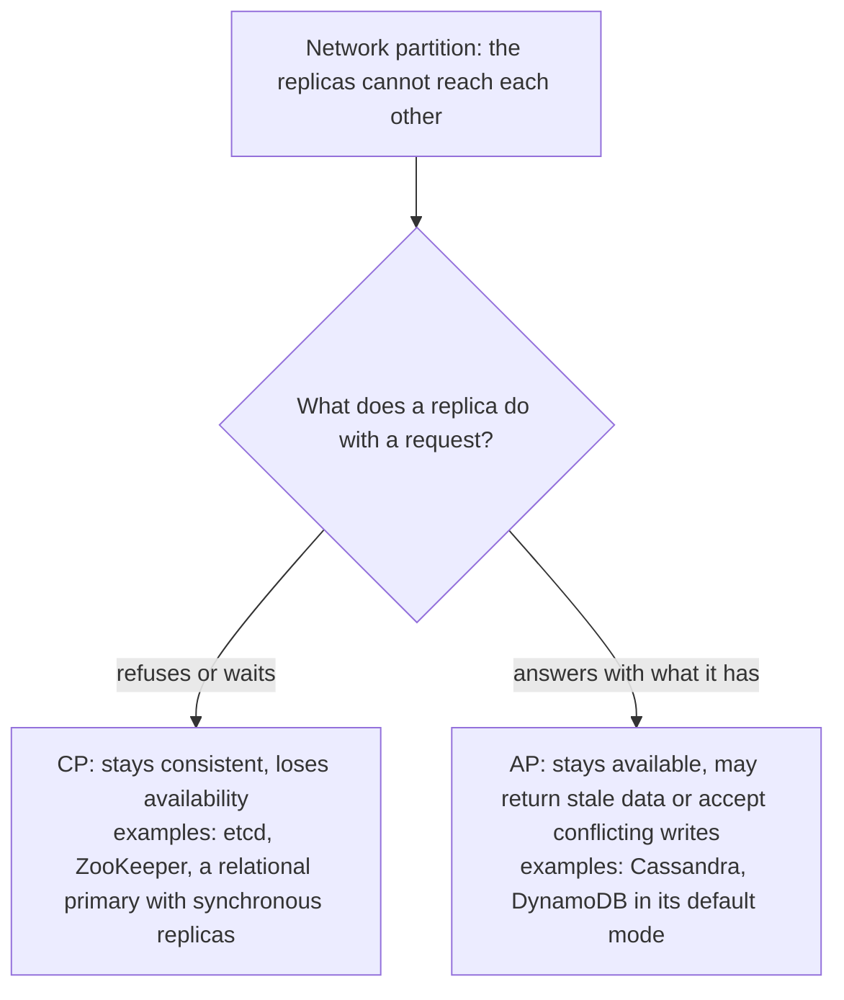
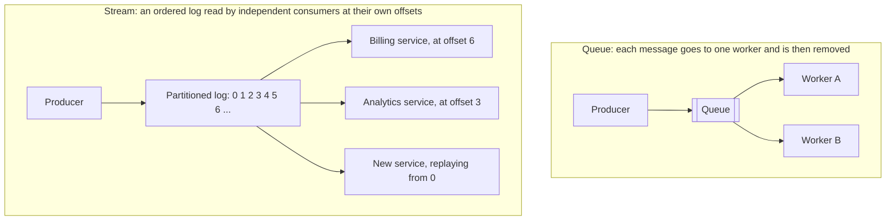
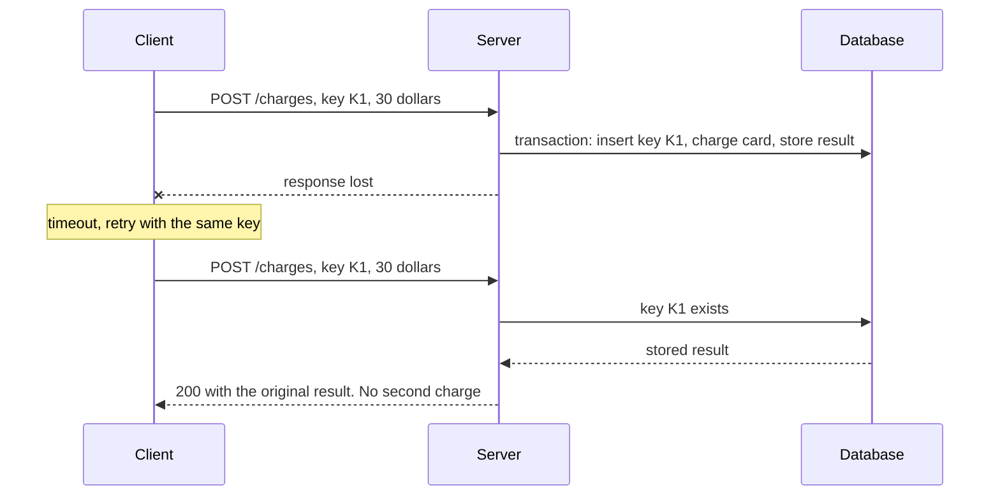
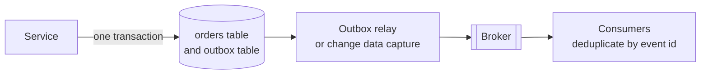

# Building blocks III: CAP and PACELC, queues vs streams, and idempotency

## Before this lesson

You should know replicas, strong and eventual consistency ([The vocabulary of scale](#/lesson/system-design/core-vocabulary)), quorums and the first look at CAP ([Design a key-value store I](#/lesson/system-design/kv-store-cap-replication)), message queues and acknowledgements ([Scaling from zero II](#/lesson/system-design/scale-stateless-to-sharded)), and retries and deduplication from [Design a notification system II](#/lesson/system-design/notification-reliability). The Databases track covers the theory rigorously in [Linearizability and the CAP theorem](#/lesson/databases/linearizability) and [Message brokers and partitioned logs](#/lesson/databases/brokers-logs).

## In plain words

Three ideas come up in nearly every design discussion, usually as a follow-up question:

- **"Is this system CP or AP?"** That is a question about what the system does when its machines cannot talk to each other. Two bank branches lose their phone line. Either they stop handing out cash until the line is back (customers are turned away, but the books always agree), or they keep serving (customers are happy, but someone may withdraw the same money twice). There is no third option while the line is down.
- **"Would you use a queue or a stream here?"** A queue is a to-do list: each task is taken by one worker and crossed off. A stream is a ship's logbook: entries are written in order and never removed, and any number of readers can read it from wherever they left off, or from the beginning again.
- **"What happens if that message is processed twice?"** In a distributed system it will be, sooner or later. Pressing a lift button five times does not call five lifts. Operations built so that repeats are harmless are called **idempotent**, and making operations idempotent is how real systems get correct results from unreliable delivery.

## 1. CAP, stated carefully

For a system that stores data on several machines:

- **Consistency (C)** here means **linearizability**: the system behaves as if there were a single copy of the data, so every read reflects the most recent completed write.
- **Availability (A):** every request that reaches a working machine gets a non-error response.
- **Partition tolerance (P):** the system keeps working when the network drops or delays messages between machines.

**The theorem:** when a network partition occurs, a system cannot be both consistent and available. It must give up one for the duration.



Three clarifications that interviewers listen for:

1. **P is not a choice.** Networks fail. A design can only choose between C and A *when* a partition happens. Describing a distributed system as "CA" means it has no stated behaviour for partitions.
2. **The choice is per operation, not per company.** A shop can use an AP store for the cart and a CP store for payment.
3. **CAP's "consistency" is not ACID's "consistency".** In ACID the word means "the data's rules hold". In CAP it means "the replicas behave like one copy".

## 2. PACELC: the trade-off on a normal day

CAP speaks only about partitions, which are rare. The **PACELC** formulation adds what happens the rest of the time:

> If there is a **P**artition, choose between **A**vailability and **C**onsistency; **E**lse, choose between **L**atency and **C**onsistency.

The second half matters every millisecond. To be consistent, a write must reach several replicas (or a read must check several) before the client gets an answer, which takes time, especially across regions. To be fast, a replica answers from its local copy, which may be slightly behind.

| System | During a partition | Otherwise | Label |
|---|---|---|---|
| Dynamo-style store with W = 1, R = 1 | Available | Low latency | PA/EL |
| The same store with quorum reads and writes | Leans consistent | Consistent, slower | PC/EC by configuration |
| Single-leader database, asynchronous followers, reads from followers | Leader side stays consistent | Low latency, stale reads possible | PC/EL |
| Consensus-based store (etcd, Spanner-like) | Consistent | Consistent, pays latency | PC/EC |

The simulation makes the "else" half concrete: with three replicas at different distances, waiting for more acknowledgements costs latency.

```python-run
import random
random.seed(9)

# Round-trip time from the coordinator to each replica, in milliseconds.
REPLICAS = {"same data centre": 1, "nearby region": 35, "far region": 140}

def write_latency(acks_required, trials=5_000):
    """Time until `acks_required` replicas have acknowledged."""
    samples = []
    for _ in range(trials):
        times = sorted(base * random.uniform(0.8, 1.6) for base in REPLICAS.values())
        samples.append(times[acks_required - 1])
    samples.sort()
    return samples[len(samples) // 2], samples[int(len(samples) * 0.99)]

print(f"{'acknowledgements awaited':26s} {'p50':>8s} {'p99':>8s}   what a crash can lose")
for w, risk in ((1, "writes held by one replica only"), (2, "nothing, unless two replicas fail"), (3, "nothing")):
    p50, p99 = write_latency(w)
    print(f"{w:<26d} {p50:>6.0f}ms {p99:>6.0f}ms   {risk}")
```

Waiting for one acknowledgement takes about a millisecond. Waiting for all three takes as long as the slowest region. Every replicated system sits somewhere on this line, and PACELC is the vocabulary for saying where.

> [!INTERVIEW]
> A strong answer names the choice per data type and gives the reason: "for the cart I accept eventual consistency, because adding to a cart must never fail and conflicts can be merged; for payments I want a consistent store and accept that a partition makes it unavailable, because a duplicate charge is worse than an error."

## 3. Queues and streams

Both sit between a producer and a consumer and both decouple them. They differ in what happens to a message after it is read.

**A message queue** holds messages until a consumer takes one and acknowledges it; then the message is **deleted**. Each message is handled by **one** consumer. Adding consumers spreads the work. Examples: RabbitMQ, Amazon SQS.

**A stream** (an append-only **log**) keeps messages in order and **does not delete them when read**. Each consumer remembers its own position, an **offset**. Many independent consumers can read the same stream, and a consumer can go back and **replay** from an earlier offset. Examples: Apache Kafka, Amazon Kinesis, Redis Streams.



| | Queue | Stream |
|---|---|---|
| After consumption | Message removed | Message retained (for a period or for ever) |
| Consumers | Compete: one gets each message | Each consumer group reads everything |
| Replay | No | Yes, by resetting an offset |
| Ordering | Usually not guaranteed with several consumers | Guaranteed within a partition |
| Scaling consumers | Add workers freely | Up to one consumer per partition within a group |
| Per-message handling | Individual acknowledgement, delay, priority, dead-letter queue | Offset commit; a failing message blocks its partition unless skipped |
| Typical use | Background jobs: send email, resize image | Event pipelines, change data capture, analytics, audit logs, feeding several systems |

A stream is divided into **partitions** for scale. Messages with the same **key** (for example the same user id) go to the same partition, so their order is preserved. Within a **consumer group**, each partition is read by one member, which is what allows parallel reading without breaking per-key order.

```python-run
class Log:
    """A tiny stream: an append-only list plus one offset per consumer group."""
    def __init__(self):
        self.entries, self.offsets = [], {}
    def append(self, event):
        self.entries.append(event)
        return len(self.entries) - 1                 # the offset of the new entry
    def poll(self, group, max_items=10):
        start = self.offsets.get(group, 0)
        batch = self.entries[start:start + max_items]
        self.offsets[group] = start + len(batch)     # commit the new offset
        return batch
    def rewind(self, group, offset):
        self.offsets[group] = offset

log = Log()
for event in ("order 1 placed", "order 2 placed", "order 1 paid", "order 2 cancelled"):
    log.append(event)

print("billing   reads:", log.poll("billing"))
print("analytics reads:", log.poll("analytics", max_items=2))
log.append("order 3 placed")
print("billing   reads:", log.poll("billing"), " <- only what is new for this group")
print("analytics reads:", log.poll("analytics"))

print("a bug is fixed in analytics; rewind and reprocess everything")
log.rewind("analytics", 0)
print("analytics reads:", log.poll("analytics"))
print("the log still holds", len(log.entries), "entries; nothing was removed by reading")
```

Each group advanced through the log independently, and the rewind let one consumer reprocess history without the producer doing anything. A queue cannot do that: once acknowledged, a message is gone.

**Choosing.** Use a queue when messages are tasks to be done once by any worker. Use a stream when messages are facts that several systems care about, when order matters per key, or when you may need to replay.

### Delivery guarantees

| Guarantee | Meaning | How |
|---|---|---|
| **At-most-once** | Never duplicated; may be lost | Acknowledge before processing |
| **At-least-once** | Never lost; may be duplicated | Acknowledge after processing; redeliver on timeout |
| **Exactly-once** | Processed once | Not achievable for delivery in general; achievable for the *effect*, by combining at-least-once delivery with idempotent processing |

Most systems choose at-least-once. The duplicates are then handled by the third topic of this lesson.

### Back-pressure

If producers are faster than consumers for long enough, the buffer between them grows without limit. **Back-pressure** means signalling the producer to slow down. The options are to block the producer when the buffer is full, to drop messages (newest or oldest, depending on which is worth more), or to shed load at the edge with a rate limiter. An unbounded queue is not a solution; it converts an overload into a longer delay followed by a larger failure. Always monitor queue depth and the age of the oldest message.

## 4. Idempotency

An operation is **idempotent** if performing it several times has the same effect as performing it once.

| Operation | Idempotent? | Why |
|---|---|---|
| Set the address to "5 High Street" | Yes | The end state is the same |
| Delete order 42 | Yes | Already gone the second time |
| Add 10 to the balance | No | Each repeat adds again |
| Send an email | No | Each repeat sends another |
| Create an order | No, unless identified | Each repeat makes a new order |

In HTTP, `GET`, `PUT` and `DELETE` are defined as idempotent; `POST` is not.

Why this matters: networks lose replies, clients time out and retry, and queues redeliver. The receiver cannot prevent duplicates from arriving. It can make them harmless.

**Technique 1: idempotency keys.** The client attaches a unique key to each logical operation and reuses it on every retry. The server stores the key with the result. A repeated key returns the stored result without redoing the work. Stripe's API works this way, using an `Idempotency-Key` header.



Two details make it correct. The key record and the side effect must be written **in the same transaction**, so that a crash cannot leave one without the other. And if a retry arrives with the same key and *different* parameters, the server must reject it, because that indicates a client bug.

**Technique 2: natural idempotency.** Rewrite the operation so that repeats do nothing: "set balance to 70 if the version is 12" instead of "subtract 30"; "insert order with id X if absent" instead of "insert an order"; "mark as shipped" instead of "increase the shipped count".

**Technique 3: deduplication by message id.** A consumer records the ids of messages it has processed and skips repeats.

```python-run
class Account:
    def __init__(self, balance):
        self.balance, self.processed = balance, {}

    def credit_naive(self, message_id, amount):
        self.balance += amount                       # every delivery adds again

    def credit_idempotent(self, message_id, amount):
        if message_id in self.processed:             # seen before: return the earlier outcome
            return self.processed[message_id]
        self.balance += amount                       # in a real system this line and the next
        self.processed[message_id] = self.balance    # are one database transaction
        return self.balance

# A broker with at-least-once delivery hands message m2 to the consumer twice.
deliveries = [("m1", 10), ("m2", 25), ("m2", 25), ("m3", 5)]

naive, safe = Account(100), Account(100)
for message_id, amount in deliveries:
    naive.credit_naive(message_id, amount)
    safe.credit_idempotent(message_id, amount)

print("expected balance      : 140")
print("naive consumer        :", naive.balance)
print("idempotent consumer   :", safe.balance)
```

The naive consumer credits the duplicate and ends with 165. The idempotent one ends with the correct 140. Delivery was at-least-once; the *effect* was exactly-once.

### The dual-write problem and the outbox

A service often has to do two things: change its database and publish an event. If it does them one after the other, a crash between the two leaves them out of step: an order saved with no event, or an event with no order. This is the **dual-write problem**.

The **transactional outbox** pattern solves it. In one database transaction, the service writes the business change and a row in an `outbox` table describing the event. A separate relay reads the outbox and publishes to the broker, marking rows as sent. If the relay crashes, it publishes again on restart, so events are delivered at least once, and consumers deduplicate by event id.



The [Databases track](#/lesson/databases/cdc-event-sourcing) describes change data capture, which can play the relay's role.

> [!TIP]
> Whenever you draw an arrow that crosses a network and causes a side effect, ask aloud: "what if this is delivered twice?" If the answer is "an idempotency key" or "the write is a conditional upsert", say it. Interviewers reward the habit more than any single technique.

> [!WARNING]
> "Exactly-once delivery" claims in product documentation refer to exactly-once *processing* within that system's boundaries. The moment a message causes an effect in an outside system, such as charging a card or sending an email, you are back to at-least-once and need idempotency at that boundary.

## Common mistakes

- **Calling a distributed system "CA".**
- **One CAP label for the whole product** instead of per data type.
- **Forgetting the latency cost of consistency** when there is no partition.
- **A queue where several independent systems need the same events**, or a stream where simple one-off tasks need individual retries and priorities.
- **Assuming a queue with several consumers preserves order.**
- **Unbounded queues with no depth alarm.**
- **Retries without idempotency.**
- **Storing the idempotency key outside the transaction that performs the effect.**
- **Writing to the database and publishing an event as two separate steps.**

## Summary

- CAP: during a network partition a replicated system must choose between linearizable consistency and availability; partition tolerance is not optional, and the choice is made per kind of data.
- PACELC adds the everyday trade-off: without a partition, consistency costs latency.
- A queue delivers each message to one consumer and removes it; a stream is a retained, ordered, partitioned log that many consumer groups read at their own offsets and can replay.
- Delivery is in practice at-least-once; back-pressure and queue-depth monitoring prevent unbounded growth.
- Idempotency makes duplicates harmless: idempotency keys stored transactionally, naturally idempotent operations, and deduplication by message id.
- The transactional outbox removes the dual-write problem between a database and a broker.

## Glossary

- **Linearizability**: behaving as if there were one copy of the data and every operation took effect at a single moment.
- **CP / AP**: favouring consistency, or availability, during a partition.
- **PACELC**: the extension of CAP that adds the latency versus consistency trade-off in normal operation.
- **Message queue**: a buffer from which each message is consumed once and then removed.
- **Stream (log)**: an append-only, ordered sequence of messages that is retained after reading.
- **Offset**: a consumer's position in a stream.
- **Partition (of a stream)**: an independently ordered sub-log; messages with the same key share one.
- **Consumer group**: a set of consumers that share the work of reading a stream.
- **Replay**: reprocessing a stream from an earlier offset.
- **At-most-once / at-least-once / exactly-once**: the three delivery guarantees.
- **Back-pressure**: a signal that makes producers slow down when consumers cannot keep up.
- **Idempotent**: having the same effect whether applied once or many times.
- **Idempotency key**: a client-chosen identifier that lets a server recognise retries.
- **Dual-write problem**: two systems getting out of step when updated separately.
- **Transactional outbox**: writing events to a table in the same transaction as the data change, then relaying them.

## Check yourself

```quiz
[
  {"q": "During a network partition, a store refuses writes on the side that cannot reach a majority. How is it classified?",
   "options": ["AP", "CP", "CA", "PA/EL"],
   "answer": 1,
   "explain": "Refusing requests to avoid divergence keeps consistency and gives up availability during the partition."},
  {"q": "Why is 'CA' not a meaningful description of a distributed database?",
   "options": ["Consistency and availability are the same thing", "Partitions cannot be ruled out, so the system must define what it does when one occurs", "CA systems are too slow", "The theorem forbids availability"],
   "answer": 1,
   "explain": "Network faults happen. A design can only choose how to behave during them, not opt out of them."},
  {"q": "What does the 'ELC' part of PACELC describe?",
   "options": ["Behaviour during a partition", "The trade-off between latency and consistency when there is no partition", "Encryption, logging and compression", "The election of a leader"],
   "answer": 1,
   "explain": "Else (no partition), a system chooses between low Latency and Consistency, because coordinating replicas takes time."},
  {"q": "Three services each need to see every 'order placed' event, and a new service next month must process the past year. Which fits?",
   "options": ["A queue with three workers", "A stream with one consumer group per service and retained history", "A cache", "A load balancer"],
   "answer": 1,
   "explain": "A stream retains messages, lets each group read everything at its own offset, and allows a new consumer to replay from the start."},
  {"q": "In a partitioned stream, how is the order of one user's events preserved?",
   "options": ["By sorting on the consumer", "By using the user id as the message key so all their events go to one partition", "By using a single consumer for the whole stream", "It cannot be preserved"],
   "answer": 1,
   "explain": "Ordering is guaranteed within a partition. Keying by user keeps that user's events together and in order."},
  {"q": "A consumer acknowledges a message only after processing it. What delivery guarantee results?",
   "options": ["At-most-once", "At-least-once", "Exactly-once", "No guarantee"],
   "answer": 1,
   "explain": "A crash after processing and before acknowledging causes redelivery, so nothing is lost and duplicates are possible."},
  {"q": "Which operation is idempotent as written?",
   "options": ["Subtract 30 from the balance", "Set order 42's status to shipped", "Append a row to the audit log", "Send a text message"],
   "answer": 1,
   "explain": "Setting a field to a fixed value yields the same state however many times it is applied."},
  {"q": "Why must the idempotency key and the side effect be written in one transaction?",
   "options": ["To make the request faster", "So a crash cannot record the key without the effect, or the effect without the key", "Because keys are large", "To allow the key to be changed later"],
   "answer": 1,
   "explain": "If the two can diverge, a retry either repeats the effect or is wrongly treated as already done."}
]
```

> **Source:** Xu, *System Design Interview: An Insider's Guide*, ch. 1 (message queue) and ch. 6 (CAP theorem) as a topic guide; Abadi, "Consistency Tradeoffs in Modern Distributed Database System Design" (IEEE Computer, 2012) for PACELC; Stripe engineering blog, "Designing robust and predictable APIs with idempotency", https://stripe.com/blog/idempotency ; System Design Primer sections "Availability vs consistency" and "Asynchronism", https://github.com/donnemartin/system-design-primer
