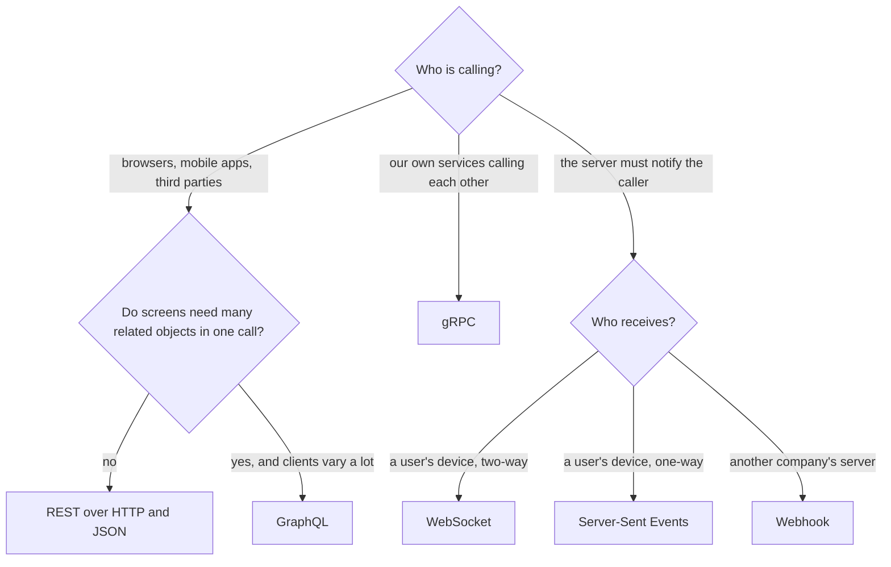
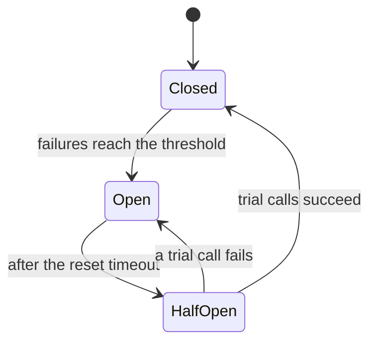
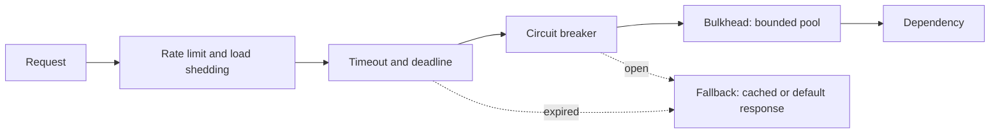
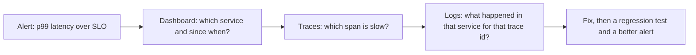

# Building blocks IV: API styles, resilience patterns and observability

## Before this lesson

You should know HTTP methods and status codes ([Clients, servers and requests](#/lesson/system-design/clients-servers-requests)), percentiles and availability ([The vocabulary of scale](#/lesson/system-design/core-vocabulary)), retries with backoff ([Design a notification system II](#/lesson/system-design/notification-reliability)) and idempotency ([Building blocks III](#/lesson/system-design/bb-cap-queues-idempotency)). Related lessons elsewhere on the site: [gRPC, service discovery and API gateways](#/lesson/networking/grpc-discovery-vpc) and [Timeouts, retries, pools, rate limits and idempotency](#/lesson/networking/resilience-patterns) in the Networking track, and the [Microservices track](#/track/microservices) for service boundaries and communication between services.

## In plain words

This lesson covers three things that sit *around* a system instead of inside it.

**APIs are the counters where customers are served.** A bank can offer a counter with a fixed menu of forms (deposit, withdraw, transfer), a private line on which staff phone each other with precise instructions, or a personal banker to whom you say exactly what you want in one conversation. Those correspond roughly to REST, RPC and GraphQL. None is best; they suit different callers.

**Resilience patterns are the building's fuses, fire doors and sprinklers.** They do not prevent faults. They stop one fault from taking down the whole building.

**Observability is the dashboard and the black-box recorder.** A pilot does not walk out onto the wing to check the engine. Instruments report what is happening, alarms sound when a limit is crossed, and a recording explains afterwards what went wrong.

In an interview these appear as the API you write in step 2, the "what if this dependency is slow?" follow-up, and the wrap-up question "how would you monitor this?".

## 1. API styles

### REST

**REST** (representational state transfer) organises an API around **resources**, things with addresses, and uses HTTP's own methods to act on them.

```
GET    /v1/orders/8841          read one order
GET    /v1/orders?customer=42   list orders, with filters
POST   /v1/orders               create an order
PATCH  /v1/orders/8841          change part of an order
DELETE /v1/orders/8841          remove an order
```

**For:** universally understood; works with every client, browser, cache and proxy; `GET` responses can be cached by browsers and CDNs; easy to explore and debug with ordinary tools.
**Against:** a screen that needs data from several resources makes several round trips (**under-fetching**), or receives fields it does not need (**over-fetching**); payloads are text (JSON), which is larger and slower to parse than binary formats; operations that are not "create, read, update, delete" sometimes fit awkwardly.

### RPC and gRPC

**RPC** (remote procedure call) presents the API as functions to call: `ReserveSeats(show_id, seats)`. **gRPC** is a widely used RPC framework: services and messages are defined in a schema language (Protocol Buffers), code for clients and servers is generated from the schema, messages are compact binary, and it runs over HTTP/2 with support for streaming in both directions.

**For:** fast and compact; a strict, typed contract checked at build time; generated clients in many languages; streaming.
**Against:** not readable without tools; browsers cannot call it directly without a proxy; the tight coupling of generated code needs disciplined schema evolution.

### GraphQL

**GraphQL** exposes a single endpoint and a typed schema; the client sends a query describing exactly the fields it wants, across related objects, and receives that shape in one response.

```
query { user(id: 42) { name  orders(last: 3) { id total items { name } } } }
```

**For:** one round trip for a whole screen; no over- or under-fetching; different clients (phone, web, watch) each ask for what they need without new endpoints.
**Against:** HTTP caching is harder because requests are usually `POST` to one URL; an innocent-looking query can be very expensive on the server, so query cost must be limited; resolving nested fields naively causes the **N+1 problem** (one query for the list, then one more per item), which needs batching.

### Pushing data: WebSocket, Server-Sent Events and webhooks

When the server must speak first: **WebSocket** for two-way real-time traffic and **Server-Sent Events** for one-way streams to a client (both covered in [Design a chat system I](#/lesson/system-design/chat-design)); **webhooks** for server-to-server notification, where your system makes an HTTP call to a URL the other party registered when an event happens.



A common overall shape: REST or GraphQL at the edge for outside clients, gRPC between internal services, and asynchronous messages (queues or streams) where the caller does not need an immediate answer.

### Details that apply to any style

| Concern | Good practice |
|---|---|
| **Pagination** | Cursor-based for lists that change; always a maximum page size |
| **Versioning** | A version in the path (`/v1/`) or a header; add fields freely, never remove or change the meaning of existing ones within a version |
| **Idempotency** | Idempotency keys on non-idempotent calls such as creating a payment |
| **Errors** | Correct status codes plus a machine-readable error code and a human-readable message |
| **Authentication** | Identity from a token, never from a user id sent by the client |
| **Rate limiting** | Per caller, with `429` and `Retry-After` |
| **Asynchronous work** | Return `202 Accepted` with a status URL for long operations |
| **Filtering large responses** | Let callers select fields or use sparse responses |

> [!INTERVIEW]
> You are rarely asked to compare API styles in the abstract. You are asked to write an API. Default to REST for public and client-facing endpoints, and mention gRPC for service-to-service calls if it comes up. What earns credit is the detail: cursor pagination, idempotency keys on writes, sensible status codes, and identity taken from the token.

## 2. Resilience: surviving a failing dependency

A request usually depends on several other services. If one of them slows down, the caller's threads fill with waiting requests, the caller slows down, its callers slow down, and the failure spreads. This is a **cascading failure**. Four patterns contain it.

**Timeouts.** Every network call needs a deadline. A missing timeout turns a slow dependency into a stuck caller. Set timeouts from the dependency's normal p99, not from guesswork, and pass the remaining time budget down the call chain so that a service does not keep working on a request its caller has already abandoned.

**Retries, with limits.** Retry only failures that may be transient, only for idempotent operations, with exponential backoff and jitter, and with a cap. Unlimited or immediate retries multiply load on a service that is already struggling: if three layers each retry three times, one user request becomes 27 calls at the bottom, a **retry storm**.

**Circuit breaker.** A wrapper around calls to a dependency that tracks failures. In the **closed** state calls pass through. After too many failures it **opens**: calls fail immediately without touching the dependency, which gives it time to recover and frees the caller's resources. After a waiting period it becomes **half-open** and lets a few trial calls through; success closes it again, failure reopens it.



```python-run
class CircuitBreaker:
    def __init__(self, threshold=3, reset_after=10):
        self.threshold, self.reset_after = threshold, reset_after
        self.state, self.failures, self.opened_at = "closed", 0, 0

    def call(self, dependency_is_up, now):
        if self.state == "open":
            if now - self.opened_at < self.reset_after:
                return "rejected instantly (breaker open)"
            self.state = "half-open"                     # time to test the dependency
        if dependency_is_up:
            self.state, self.failures = "closed", 0
            return "ok"
        self.failures += 1
        if self.state == "half-open" or self.failures >= self.threshold:
            self.state, self.opened_at = "open", now
        return "failed after waiting for a timeout"

breaker = CircuitBreaker()
# The dependency is down from t=3 to t=19, then recovers.
for t in range(0, 32, 2):
    up = not (3 <= t <= 19)
    result = breaker.call(up, t)
    print(f"t={t:>2}  dependency {'up  ' if up else 'DOWN'}  -> {result:38s} state={breaker.state}")
```

After three slow failures the breaker opens and the next calls are rejected at once, costing the caller nothing. At t = 18 the reset timeout has passed, a trial call is allowed, it fails, and the breaker opens again; at t = 28 a trial succeeds and normal service resumes. Without the breaker, every call while the dependency was down would have waited for a full timeout. The price is visible too: between t = 20 and t = 26 the dependency was healthy again and calls were still rejected, which is why the reset timeout should be short.

**Bulkheads.** A ship is divided into watertight compartments so that one hole does not sink it. In software: give each dependency its own limited pool of connections or threads, so that one slow dependency can exhaust only its own pool and not the whole service.

**Graceful degradation and fallbacks.** Decide in advance what to show when a dependency is unavailable: cached or default recommendations instead of personalised ones, a feed without like counts, a "try again shortly" for the one feature that failed while the rest of the page works. Combined with **load shedding** (rejecting low-priority requests early when overloaded), this keeps the core function alive.



> [!WARNING]
> Retries and timeouts interact. If a caller's timeout is shorter than the callee's total retry time, the callee keeps retrying on behalf of a caller that has already given up. Retry at one layer, usually the one nearest the user, and let the layers below fail fast.

## 3. Observability

**Observability** is the ability to understand what a system is doing from the data it emits. Three kinds of data, often called the three pillars, answer three different questions.

| Signal | What it is | Answers | Cost |
|---|---|---|---|
| **Metrics** | Numbers sampled over time: counters, gauges, histograms | *Is* something wrong? How much, since when? | Cheap; fixed size regardless of traffic |
| **Logs** | Timestamped records of individual events, ideally structured as key-value pairs | *What exactly* happened in this request? | Grows with traffic; needs sampling and retention limits |
| **Traces** | The path of one request through every service, as a tree of timed **spans** | *Where* did the time go, and which service failed? | Sampled; needs an id passed between services |

### Which metrics?

Two short checklists cover most needs.

For every **service** (the **RED** method): **R**ate (requests per second), **E**rrors (failed requests per second), **D**uration (latency distribution, as p50, p95, p99).

For every **resource** such as a CPU, disk or connection pool (the **USE** method): **U**tilisation (how busy), **S**aturation (how much is queued waiting), **E**rrors.

Google's site reliability engineering practice names four **golden signals** that combine the two: latency, traffic, errors and saturation.

Add the component-specific numbers this track has pointed out along the way: cache hit rate, replication lag, queue depth and the age of the oldest message, and business metrics such as orders per minute, which often reveal a problem before any technical metric does.

### SLIs, SLOs and error budgets

- A **service level indicator (SLI)** is a measured number that reflects user experience, such as "the share of requests answered successfully within 300 ms".
- A **service level objective (SLO)** is the target for it: "99.9% over 30 days".
- A **service level agreement (SLA)** is a contractual promise to customers, usually looser than the internal SLO, with penalties.
- The **error budget** is what the SLO allows to go wrong: with 99.9%, one request in a thousand may fail. While budget remains, the team can release quickly; when it is spent, the priority shifts to reliability.

```python-run
def error_budget(slo, requests_per_day, failed_requests, days_elapsed, window_days=30):
    month_allowance = requests_per_day * window_days * (1 - slo)     # failures the SLO permits in the window
    used = failed_requests / month_allowance                         # share of the whole budget already spent
    pace = used / (days_elapsed / window_days)                       # 1.0 means exactly on budget
    return month_allowance, used, pace

slo = 0.999
requests_per_day = 50_000_000
for label, days, failed in [("quiet month so far", 10, 200_000),
                            ("after a 40-minute outage", 10, 1_600_000)]:
    allowance, used, pace = error_budget(slo, requests_per_day, failed, days)
    print(f"{label:26s}: {failed:>9,} failures in {days} days; the month's budget is {allowance:,.0f}")
    print(f"{'':26s}  {used:5.0%} of the budget spent, burning at {pace:.1f} times the sustainable pace")
    print()
```

In the quiet case the service has spent 13% of the month's budget in a third of the month, well under the sustainable pace. After the outage it has spent more than the whole month's budget in ten days, which is the signal to slow down releases and fix reliability first.

### Alerts

Alert on **symptoms that users feel** (error rate, latency, availability against the SLO), not on every internal cause. High CPU is not a problem by itself; slow responses are. Every alert that wakes someone should be urgent, actionable and rare. Causes belong on dashboards, where the person who was woken looks next.

### Tracing a request

In a system of many services, one user action fans out into dozens of calls. A **trace id** is created at the edge and passed along with every call (in a header). Each service records a **span**: its name, start time, duration and the id of its parent span. Collected together, the spans form a tree that shows exactly where the time went.

```python-run
# Spans collected for one request: (span, parent, start_ms, duration_ms)
spans = [
    ("api-gateway: GET /feed", None, 0, 412),
    ("auth-service: verify token", "api-gateway: GET /feed", 2, 9),
    ("feed-service: build feed", "api-gateway: GET /feed", 12, 395),
    ("feed-cache: get ids", "feed-service: build feed", 14, 3),
    ("post-service: multi-get", "feed-service: build feed", 19, 41),
    ("user-service: multi-get", "feed-service: build feed", 19, 35),
    ("ranking-service: score", "feed-service: build feed", 62, 340),
]
children = {}
for name, parent, start, duration in spans:
    children.setdefault(parent, []).append((start, name, duration))

def show(parent, depth):
    for start, name, duration in sorted(children.get(parent, [])):
        bar = "#" * max(1, duration // 12)
        print(f"{'  ' * depth}{name:<34s} {start:>4} ms +{duration:>4} ms  {bar}")
        show(name, depth + 1)

show(None, 0)
slowest = max((s for s in spans if s[0] not in {p for _, p, _, _ in spans}), key=lambda s: s[3])
print(f"\nslowest leaf span: {slowest[0]} ({slowest[3]} ms of the request's {spans[0][3]} ms)")
```

The tree makes the diagnosis immediate: the request took 412 ms and 340 of them were spent in the ranking service. Metrics would have said "the feed is slow"; logs from seven services would have been hard to line up; the trace points at the culprit. Notice also that the post and user lookups start at the same moment: they ran in parallel, which the trace shows directly.

### How the three work together



Put the trace id in every log line, so that you can jump from a slow trace to the exact log records of that request.

> [!TIP]
> In the wrap-up of a design, three sentences are enough: "Each service emits rate, errors and latency percentiles. I would alert on the SLO, on queue depth and on replication lag. Requests carry a trace id through every service and into the logs." Add the one or two metrics specific to the design, such as cache hit rate or fan-out lag.

## Common mistakes

- **No pagination, or offset pagination, on a list that changes.**
- **Trusting a user id supplied by the client.**
- **Breaking changes inside an API version.**
- **Network calls with no timeout.**
- **Retries at every layer**, without backoff, jitter or a cap.
- **Retrying non-idempotent operations.**
- **A circuit breaker with no fallback behaviour defined.**
- **Alerting on causes (CPU) instead of symptoms (errors, latency).**
- **Averages on dashboards** instead of percentiles.
- **Logs without a request or trace id**, which cannot be correlated across services.

## Summary

- REST suits public and client-facing APIs; gRPC suits internal service-to-service calls; GraphQL suits varied clients that need many related objects per screen; WebSocket, SSE and webhooks cover server-initiated communication.
- Whatever the style: cursor pagination, versioning, idempotency keys, clear errors, identity from tokens, rate limits, and 202 for long work.
- Contain failures with timeouts and deadlines, bounded retries with backoff and jitter, circuit breakers, bulkheads, fallbacks and load shedding.
- Observe with metrics (is something wrong?), traces (where?) and logs (what exactly?), linked by a trace id.
- Use RED for services and USE for resources; define SLIs and SLOs and manage an error budget; alert on user-visible symptoms.

## Glossary

- **REST**: an API style built on resources and HTTP methods.
- **RPC / gRPC**: calling a remote function; a binary, schema-based RPC framework over HTTP/2.
- **GraphQL**: an API style in which the client specifies the exact data shape it needs.
- **Over-fetching / under-fetching**: receiving more than needed, or needing several calls.
- **N+1 problem**: one query for a list followed by one query per item.
- **Webhook**: an HTTP call made to a registered URL when an event occurs.
- **Cascading failure**: a failure spreading from a dependency to its callers.
- **Deadline**: the time by which a whole request must finish, passed down the call chain.
- **Retry storm**: load multiplied by retries at several layers.
- **Circuit breaker**: a component that stops calls to a failing dependency for a time.
- **Bulkhead**: isolating resources so that one failure cannot exhaust them all.
- **Graceful degradation**: providing reduced functionality instead of failing.
- **Load shedding**: rejecting some requests early to protect the rest.
- **Metric / log / trace**: a number over time, a record of an event, the path of a request.
- **Span**: one timed operation within a trace.
- **RED / USE**: rate, errors, duration; utilisation, saturation, errors.
- **SLI / SLO / SLA**: a measured indicator, its target, and a contractual promise.
- **Error budget**: the amount of failure an SLO permits.

## Check yourself

```quiz
[
  {"q": "A mobile screen needs a user, their last three orders and each order's items. Which API style returns all of it in one round trip with only the requested fields?",
   "options": ["REST with separate resources", "GraphQL", "Webhooks", "Server-Sent Events"],
   "answer": 1,
   "explain": "A GraphQL query describes the nested shape and the server returns exactly that, avoiding several REST calls."},
  {"q": "Which style is the usual choice for calls between internal services that need speed and a strict typed contract?",
   "options": ["gRPC", "GraphQL", "Webhooks", "HTML forms"],
   "answer": 0,
   "explain": "gRPC uses compact binary messages and generated clients from a shared schema, which suits service-to-service communication."},
  {"q": "What is the main purpose of a circuit breaker?",
   "options": ["To encrypt calls", "To stop calling a failing dependency for a while, failing fast and letting it recover", "To cache responses", "To balance load"],
   "answer": 1,
   "explain": "Opening the breaker frees the caller's resources and removes load from the struggling dependency."},
  {"q": "Three layers of services each retry a failed call three times. How many calls can one user request cause at the bottom layer?",
   "options": ["3", "9", "27", "81"],
   "answer": 2,
   "explain": "Retries multiply: 3 x 3 x 3 = 27. This is why retries should be limited to one layer with backoff."},
  {"q": "Which signal best answers 'which service made this request slow?'",
   "options": ["A CPU metric", "A distributed trace", "A business metric", "An SLA"],
   "answer": 1,
   "explain": "A trace shows the timed spans of one request across all services, pointing at where the time was spent."},
  {"q": "What does the RED method measure for a service?",
   "options": ["Replication, eviction, durability", "Rate, errors, duration", "Requests, endpoints, databases", "Retries, exceptions, deadlines"],
   "answer": 1,
   "explain": "Request rate, error rate and latency distribution describe a service's health from the caller's point of view."},
  {"q": "A service has a 99.9% SLO. What is its error budget?",
   "options": ["99.9% of requests", "0.1% of requests may fail within the window", "No failures are allowed", "One failure per day"],
   "answer": 1,
   "explain": "The budget is the complement of the objective. Spending it faster than planned signals that reliability work should take priority."},
  {"q": "Which is the better thing to page an engineer about?",
   "options": ["CPU at 85% on one server", "The share of requests failing or exceeding the latency target is above the SLO threshold", "A log line containing the word warning", "A disk at 60%"],
   "answer": 1,
   "explain": "Alerts should fire on symptoms users experience. Internal causes are for dashboards and investigation."}
]
```

> **Source:** Xu, *System Design Interview: An Insider's Guide*, ch. 1 (logging, metrics, automation) as a topic guide; Beyer et al., *Site Reliability Engineering* (Google), "Monitoring Distributed Systems" and "Service Level Objectives", https://sre.google/sre-book/monitoring-distributed-systems/ ; gRPC documentation, https://grpc.io/docs/what-is-grpc/introduction/ ; GraphQL documentation, https://graphql.org/learn/ ; System Design Primer section "Communication", https://github.com/donnemartin/system-design-primer
