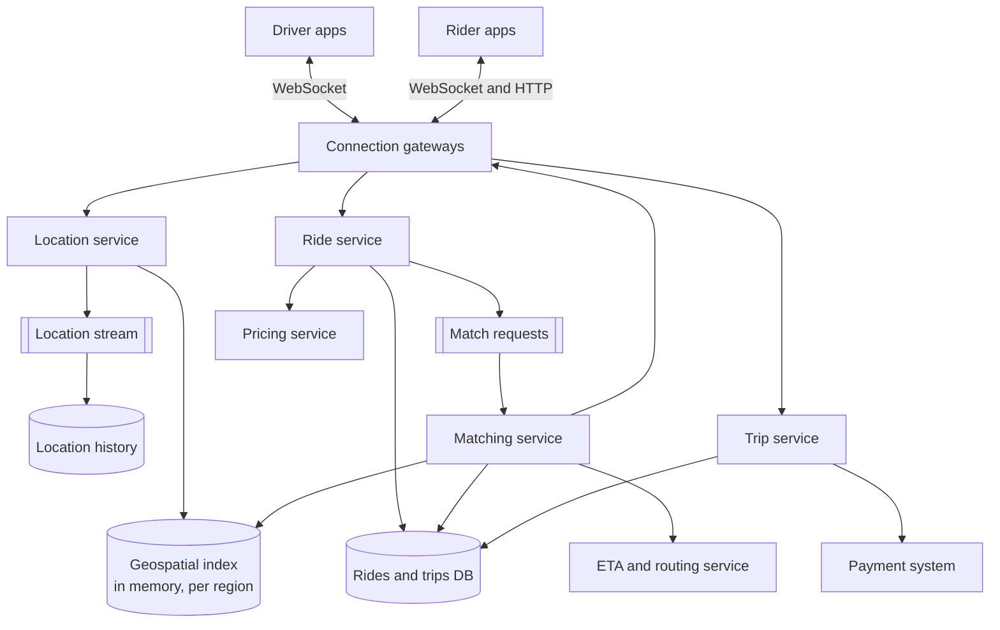
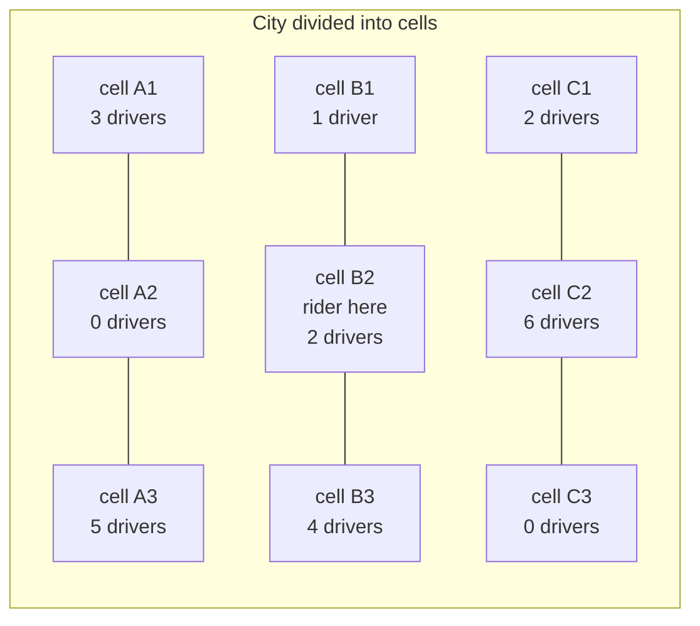
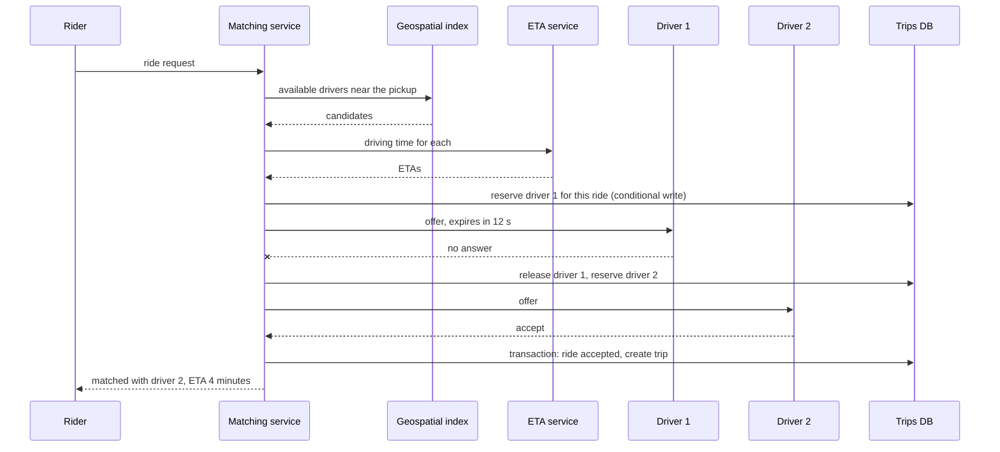
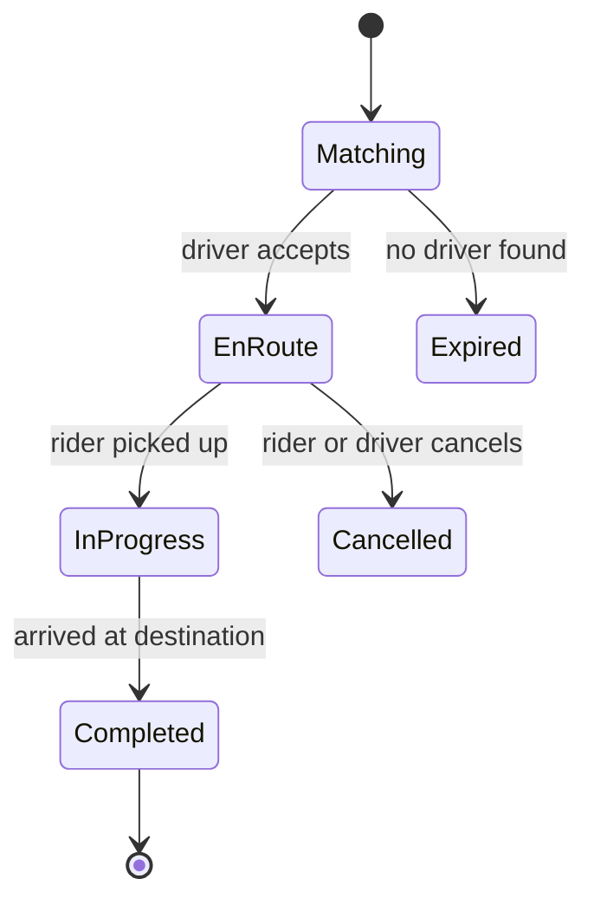

# Design ride-hailing dispatch

## Before this lesson

You should know the four-step framework ([Framework I](#/lesson/system-design/framework-four-steps)), estimation ([Estimation II](#/lesson/system-design/estimation-worked)), WebSocket connections and presence ([Design a chat system](#/lesson/system-design/chat-design)), sharding and hot spots ([Building blocks II](#/lesson/system-design/bb-databases-replication-partitioning)) and idempotency ([Building blocks III](#/lesson/system-design/bb-cap-queues-idempotency)).

## In plain words

A **ride-hailing** service connects a person who wants a ride with a nearby driver, then follows the trip to its end. Uber, Lyft, Grab and Bolt are examples. The part that does the connecting is called **dispatch**.

Picture a taxi company's radio room in the days before apps. Drivers called in their positions; a dispatcher kept a map with a pin for each cab. When a customer phoned, the dispatcher looked for the pins nearest the caller, radioed the closest free driver, and if that driver did not answer, tried the next. The dispatcher also had to make sure not to send two cabs to one customer, or one cab to two customers.

The system automates that radio room for a whole planet. Three things make it hard:

1. **The map changes constantly.** Every driver's phone reports its position every few seconds. That is a torrent of small writes.
2. **"Who is near this point?" is not an ordinary database question.** Ordinary indexes sort by one value. Location has two (latitude and longitude). A special **geospatial index** is needed.
3. **Matching must be correct under contention.** Many riders want the same few drivers at the same moment, and each driver must be offered to one rider at a time.

This is a popular interview problem because it combines a write-heavy real-time stream, a non-standard index and a concurrency problem in one design.

## 1. Requirements and the scope questions to ask

| Question | Assumed answer |
|---|---|
| Which features? | Rider requests a ride; nearby drivers are matched; both see each other's position during the trip; fare is computed at the end |
| Scheduled rides, pooling, food delivery? | Out of scope |
| How many users? | 20 million daily riders, 2 million drivers online at peak, worldwide |
| How often do drivers report position? | Every 4 seconds |
| How fast must matching be? | A driver assigned within a few seconds, typically under 10 |
| Payments? | Treated as a separate system (see [Design a payment system](#/lesson/system-design/payment-system)) |

**Functional requirements**

1. Drivers report their location and availability continuously.
2. A rider requests a ride from a pickup point to a destination and sees an estimated fare and arrival time.
3. The system finds suitable nearby drivers and assigns exactly one.
4. Rider and driver see each other's live position until pickup, and the trip's progress afterwards.
5. The trip is recorded and a fare calculated.

**Non-functional requirements**

1. **Low latency** for matching and location lookups.
2. **Correctness of assignment:** a driver is on at most one trip; a ride request gets at most one driver.
3. **High availability** of the matching path, per city. A failure in one region must not affect others.
4. **Scalability** for a very high rate of location updates.
5. **Durability of trip records**, since they are the basis of payment. Live location data, by contrast, may be lost without harm.

## 2. Estimates

```python-run
drivers_online_peak = 2_000_000
update_every_s = 4
rides_per_day = 20_000_000
location_bytes = 100                      # driver id, lat, lon, heading, speed, timestamp
trip_minutes = 15

location_qps = drivers_online_peak / update_every_s
ride_qps = rides_per_day / 86_400
print(f"driver location updates : {location_qps:,.0f} per second")
print(f"ride requests           : {ride_qps:,.0f} per second average, perhaps {ride_qps * 4:,.0f} at peak")
print(f"ratio                   : {location_qps / ride_qps:,.0f} location writes per ride request")

live_memory = drivers_online_peak * location_bytes
print(f"\nlatest position of every online driver: {live_memory / 1e6:,.0f} MB  (fits in memory)")

history_day = rides_per_day * trip_minutes * 60 / update_every_s * location_bytes
print(f"trip route history, if every point is kept: {history_day / 1e12:,.1f} TB per day")
print(f"trip records at 2 KB each: {rides_per_day * 2_000 / 1e9:,.0f} GB per day")
```

Conclusions:

- **Location updates dominate everything:** half a million writes per second, thousands of times the rate of ride requests.
- **The live state is tiny.** The current position of every online driver fits in a few hundred megabytes. It belongs in memory, not in a disk-based database, and each write overwrites the previous position.
- **History is a different matter.** Storing every point of every trip is terabytes per day; it goes to cheap, append-only storage through a stream, off the hot path.
- Ride requests are a small, ordinary workload. The trip records they produce must be durable and consistent.

So the system has two very different kinds of data: ephemeral, high-volume locations, and durable, low-volume trips.

## 3. API

Riders and drivers keep a persistent connection (WebSocket) for real-time updates, and use HTTP for the rest.

```
Driver app
  WS  -> {"type":"location","lat":48.8566,"lon":2.3522,"heading":90,"ts":...}      every 4 s
  WS  -> {"type":"status","value":"available" | "offline"}
  WS  <- {"type":"offer","ride_id":"r_71","pickup":{...},"expires_in":12}
  POST /v1/rides/{ride_id}/accept        headers: Idempotency-Key
  POST /v1/rides/{ride_id}/decline
  POST /v1/trips/{trip_id}/pickup | /complete

Rider app
  POST /v1/rides/estimate   {"pickup":{...},"dropoff":{...}}   -> {"fare_range":..., "eta_minutes":...}
  POST /v1/rides            {"pickup":{...},"dropoff":{...}}   headers: Idempotency-Key
       -> 202 {"ride_id":"r_71","status":"matching"}
  WS  <- {"type":"matched","driver":{...},"eta_minutes":4}
  WS  <- {"type":"driver_location","lat":...,"lon":...}
  DELETE /v1/rides/{ride_id}                                    -> cancel
```

The ride request returns `202`: matching is asynchronous and the result arrives over the open connection. Idempotency keys make "request ride" and "accept" safe to retry on a poor mobile network.

## 4. Data model

```
Live driver state          in-memory store, sharded by region, each entry with a short TTL
  driver:{id} -> {lat, lon, cell, status, updated_at}
  cell:{cell_id} -> set of driver ids currently in that cell

rides(ride_id PK, rider_id, pickup, dropoff, status, requested_at, idempotency_key UNIQUE)
      status: matching | offered | accepted | cancelled | expired

trips(trip_id PK, ride_id UNIQUE, driver_id, rider_id, status, started_at, ended_at,
      distance_m, fare_cents, version)
      status: en_route_to_pickup | in_progress | completed | cancelled

driver_assignment(driver_id PK, ride_id, state, expires_at)      -- at most one row per driver

location_history   append-only stream, then cheap storage, keyed by trip and time
```

Rides and trips go in a relational database (transactions, modest volume), partitioned by city or region, since a trip never spans regions. The `driver_assignment` table, with the driver as primary key, is what enforces "one trip per driver".

## 5. High-level design



- **Connection gateways** hold the persistent connections, as chat servers do.
- The **location service** receives position updates, writes the latest position into the geospatial index and publishes each update to a stream for history and analytics.
- The **ride service** validates a request, records it and puts a match request on a queue.
- The **matching service** finds candidate drivers, ranks them, offers the ride and handles accept, decline and timeout.
- The **ETA service** estimates driving time using the road network and traffic.
- The **trip service** runs the trip's lifecycle and produces the record used for payment.

Everything is deployed **per region** (a city or a group of cities). Rides are local by nature: a rider in Paris is never matched with a driver in Tokyo. That gives a natural partition key and limits the damage of any failure to one region.

## 6. Deep dive: the geospatial index

The question is: "which available drivers are within about two kilometres of this point?" Scanning two million drivers per request is too slow, and a normal index on latitude alone, or longitude alone, still returns a long strip of the world.

The standard idea is to **divide the map into cells** and record which cell each driver is in. To answer a query, look only at the rider's cell and its neighbours.



Three common ways to define cells:

| Scheme | Idea | Notes |
|---|---|---|
| **Geohash** | Repeatedly halve the world by longitude and latitude; write the choices as a short string. Nearby points usually share a prefix | Simple; rectangular cells; cells sharing an edge can have different prefixes, so always check neighbours |
| **Quadtree** | A tree in which each square splits into four when it holds too many points | Adapts to density: small cells in city centres, large cells in the countryside |
| **Hexagonal grid (H3)** | The surface is covered with hexagons at several resolutions | Every neighbour is at the same distance, which suits radius searches; published by Uber |

```python-run
import math, random
random.seed(2)

CELL_DEG = 0.01                    # a cell of about 1.1 km on each side

def cell_of(lat, lon):
    return (math.floor(lat / CELL_DEG), math.floor(lon / CELL_DEG))

def distance_km(a, b):
    """Rough distance for short ranges: treat the area as flat."""
    dlat = (a[0] - b[0]) * 111.0
    dlon = (a[1] - b[1]) * 111.0 * math.cos(math.radians(a[0]))
    return math.hypot(dlat, dlon)

# 200,000 drivers scattered over a city about 55 km across.
drivers = {i: (48.60 + random.random() * 0.5, 2.10 + random.random() * 0.5) for i in range(200_000)}
index = {}
for driver_id, position in drivers.items():
    index.setdefault(cell_of(*position), set()).add(driver_id)

def nearby(point, radius_km=1.0):
    row, col = cell_of(*point)
    reach = 1 + int(radius_km / 1.1)                       # how many rings of cells to look at
    candidates = []
    for r in range(row - reach, row + reach + 1):
        for c in range(col - reach, col + reach + 1):
            candidates.extend(index.get((r, c), ()))
    exact = [(distance_km(point, drivers[d]), d) for d in candidates]
    return sorted(x for x in exact if x[0] <= radius_km), len(candidates)

rider = (48.8566, 2.3522)
found, examined = nearby(rider)
print(f"drivers in the city        : {len(drivers):,}")
print(f"candidates examined        : {examined:,}  (from 9 cells)")
print(f"drivers within 1 km        : {len(found)}")
print("three nearest (km, driver) :", [(round(d, 2), i) for d, i in found[:3]])

# A driver moves: remove from the old cell, add to the new one.
def move(driver_id, new_position):
    old, new = cell_of(*drivers[driver_id]), cell_of(*new_position)
    if old != new:
        index[old].discard(driver_id)
        index.setdefault(new, set()).add(driver_id)
    drivers[driver_id] = new_position
```

The query examined a few hundred drivers instead of two hundred thousand, then computed exact distances only for those. A location update is cheap: most updates stay within the same cell and change only the stored position; crossing a cell boundary is one removal and one insertion.

**Keeping the index fresh.** Entries carry a short TTL, such as 30 seconds. A driver whose app stops reporting disappears automatically, which is the same heartbeat idea as presence in the chat design. Because the latest positions are small and rebuilt within seconds by incoming updates, this index needs no durability: if a node is lost, it refills as drivers report.

**Sharding.** The index is partitioned by region, and within a large region by cell ranges. A hot city centre is a hot shard; smaller cells and more replicas for dense areas address that.

## 7. Deep dive: matching

A naive match picks the driver with the shortest straight-line distance. That is often wrong: the nearest driver may be across a river with no bridge nearby, or facing the wrong way on a motorway. Matching works in stages:

1. **Candidates:** query the geospatial index for available drivers within a radius, widening it if too few are found.
2. **Rank:** ask the ETA service for each candidate's driving time to the pickup, and rank by that (possibly adjusted for fairness, driver ratings or how long a driver has been idle).
3. **Offer:** send the ride to the best candidate, who has a short time, such as 12 seconds, to accept.
4. **Resolve:** on acceptance, create the trip. On decline or timeout, offer to the next candidate.



### Preventing double assignment

Two riders near each other request at the same instant, and the same driver is the best candidate for both. Two matching workers must not both offer that driver.

The fix is to **reserve the driver atomically before offering**. The reservation is a conditional write: "set this driver's assignment to ride X only if the driver has no current assignment". Whichever worker's write succeeds proceeds; the other moves on to its next candidate. The reservation has an expiry so that a worker that crashes mid-offer does not strand the driver.

```python-run
class Assignments:
    """driver_id -> (ride_id, expires_at). One row per driver enforces one job per driver."""
    def __init__(self):
        self.rows = {}

    def reserve(self, driver, ride, now, hold_s=15):
        current = self.rows.get(driver)
        if current is not None and current[1] > now:          # still held by another ride
            return False
        self.rows[driver] = (ride, now + hold_s)              # this check-and-set is ONE atomic step
        return True

    def release(self, driver, ride):
        if self.rows.get(driver, (None,))[0] == ride:
            del self.rows[driver]

assignments = Assignments()
ranked_for = {"ride-A": ["driver-7", "driver-3"], "ride-B": ["driver-7", "driver-9"]}

# Two matching workers act at the same moment; both rank driver-7 first.
for ride in ("ride-A", "ride-B"):
    for driver in ranked_for[ride]:
        if assignments.reserve(driver, ride, now=100):
            print(f"{ride}: reserved {driver} and sent the offer")
            break
        print(f"{ride}: {driver} is already reserved, trying the next candidate")

print("\ndriver-7's offer is not answered; at t=116 the hold has expired")
print("ride-C can reserve driver-7:", assignments.reserve("driver-7", "ride-C", now=116))
```

Ride B finds driver 7 reserved and falls through to driver 9. In production the reservation is a conditional update in the database or an atomic set-if-absent in an in-memory store, and the accept step is a transaction that checks the reservation is still valid before creating the trip.

**Batching.** Matching each request the instant it arrives is "greedy" and can be poor overall: the nearest driver to rider A might be the only driver near rider B. Many systems collect requests for a second or two and solve the assignment for the whole batch, reducing total waiting time. Mention it as an improvement; the reservation logic is the same.

## 8. Deep dive: the trip lifecycle and pricing

A trip is a **state machine**: a fixed set of states with allowed transitions.



Each transition is a conditional update ("set status to in_progress only if it is en_route"), which makes repeated messages harmless and prevents impossible jumps. The completed trip, with distance and duration computed from the recorded route, is handed to the payment system with an idempotency key so the rider is charged once.

**Dynamic (surge) pricing** raises prices in an area when requests outnumber available drivers. It is computed per cell from the recent ratio of demand to supply, smoothed over a few minutes, and the price shown in an estimate is held for a short time so the fare does not change between estimate and request.

## 9. Bottlenecks and failure handling

| Failure or bottleneck | Effect | Mitigation |
|---|---|---|
| Location service node lost | Positions in its shard vanish | Rebuilt within seconds from incoming updates; replicas for continuity |
| Driver's phone loses signal | Stale position | TTL removes the driver from the index; reappears on the next update |
| Matching worker crashes mid-offer | Driver held but no offer live | Reservation expires; ride request is redelivered from the queue |
| Driver accepts as the offer expires | Two outcomes race | Accept is a transaction that checks the reservation; exactly one side wins |
| Duplicate ride request from a retry | Two rides | Idempotency key on the request |
| ETA service slow | Matching slows | Timeout and fall back to straight-line distance |
| A stadium empties | Request spike in one cell | Queue buffers requests; surge pricing rebalances; widen search radius |
| Region outage | That region cannot match | Regions are independent; fail over to a standby for that region. Other regions unaffected |
| Trips database primary fails | Trip updates stall | Promote a replica; apps retry with idempotency keys |

## 10. Trade-offs and alternatives

| Decision | Chosen | Alternative | When the alternative fits |
|---|---|---|---|
| Live locations | In memory, ephemeral, TTL | Durable database | Never for the hot path; history goes elsewhere |
| Spatial index | Grid, geohash or hexagons | Database spatial index (for example PostGIS) | Lower update rates, richer spatial queries |
| Matching | Offer to one driver at a time | Broadcast to several, first to accept wins | Low driver density; costs driver experience and adds contention |
| Ranking | Driving time | Straight-line distance | Fallback only |
| Assignment timing | Greedy, per request | Batched optimisation every second or two | Dense markets where global efficiency matters |
| Consistency | Strong for assignments and trips, eventual for locations | Strong everywhere | Not feasible at the location update rate |
| Update rate | Fixed 4 seconds | Adaptive: faster when moving or on a trip | Saves battery and traffic |

## 11. What a strong answer sounds like

> **Interviewer:** Design the dispatch system for a ride-hailing app.
>
> **Candidate:** Let me confirm scope: drivers report location, riders request rides, we match them and track the trip; payments are a separate system. Roughly how many drivers online and how often do they report?
>
> **Interviewer:** Two million at peak, every four seconds.
>
> **Candidate:** That is 500,000 location writes per second, against a few hundred ride requests, so the design has two halves. Live locations are ephemeral and small, about 200 MB for everyone's latest position, so I keep them in memory in a geospatial index, partitioned by region, with a TTL so silent drivers drop out. Rides and trips are low volume and must be correct, so they go in a relational store.
>
> **Interviewer:** How do you find nearby drivers?
>
> **Candidate:** I divide the map into cells, with a geohash or a hexagonal grid, and keep a set of driver ids per cell. A query reads the rider's cell and its neighbours, then ranks those candidates by driving time from an ETA service, since the nearest driver in a straight line may be on the wrong side of a river.
>
> **Interviewer:** Two riders request at the same time and the same driver is best for both.
>
> **Candidate:** Before offering, the matcher reserves the driver with a conditional write: assign only if unassigned, with an expiry. One request wins; the other moves to its next candidate. Accepting is a transaction that checks the reservation is still valid and creates the trip, so a late accept cannot produce two trips.
>
> **Interviewer:** What if the matching worker dies after reserving?
>
> **Candidate:** The reservation expires in about fifteen seconds and the ride request is redelivered from the queue, so the rider is matched by another worker. All region-level components are independent, so a failure is confined to one city.

## Common mistakes

- **Writing every location update to a durable database** on the hot path.
- **A latitude index and a longitude index** in place of a spatial index.
- **Forgetting neighbouring cells**, missing a driver ten metres away across a cell border.
- **Ranking by straight-line distance only.**
- **Offering a driver without reserving**, allowing double dispatch.
- **Reservations with no expiry.**
- **A single global deployment** for data that is inherently local.
- **Treating locations and trips with the same consistency requirements.**

## Summary

- Dispatch has two halves: a torrent of ephemeral location updates and a trickle of durable, correctness-critical rides and trips.
- Latest positions live in memory in a geospatial index (grid, geohash, quadtree or hexagons), sharded by region with TTLs; history flows through a stream to cheap storage.
- Matching finds candidates from nearby cells, ranks by driving time, reserves a driver atomically, offers with a timeout and falls through to the next.
- Conditional writes with expiry prevent double assignment; the trip is a state machine with conditional transitions.
- Regions are independent; failures of live state heal themselves within seconds.

## Glossary

- **Dispatch**: assigning drivers to ride requests.
- **Geospatial index**: an index that answers "what is near this point?".
- **Cell**: one tile of a map divided into a grid.
- **Geohash**: a short string that encodes a rectangular cell; nearby places often share a prefix.
- **Quadtree**: a tree that splits a square into four where points are dense.
- **H3**: a hexagonal grid system for indexing locations.
- **ETA**: estimated time of arrival.
- **Candidate**: a driver considered for a ride.
- **Offer**: a ride proposed to one driver for a limited time.
- **Reservation**: a temporary, exclusive claim on a driver.
- **Conditional write**: a write that succeeds only if a stated condition holds.
- **State machine**: a set of states and the allowed moves between them.
- **Surge (dynamic) pricing**: prices that rise when demand exceeds supply in an area.
- **Ephemeral data**: data that can be lost and quickly rebuilt.

## Check yourself

```quiz
[
  {"q": "Two million drivers report their position every 4 seconds. What does that imply for storage of live locations?",
   "options": ["Use a relational table with a row per update", "Keep only the latest position per driver in memory; it is small and constantly overwritten", "Store them on the client only", "Send them through the payments system"],
   "answer": 1,
   "explain": "500,000 writes per second of data that is replaced seconds later belongs in memory. The whole live state is a few hundred megabytes."},
  {"q": "Why does a query read the rider's cell and its neighbouring cells?",
   "options": ["To increase the price", "A driver very close by may be on the other side of a cell boundary", "Cells are too small to hold drivers", "To reduce memory use"],
   "answer": 1,
   "explain": "Proximity does not respect cell borders. Checking adjacent cells ensures nearby drivers are not missed."},
  {"q": "Why rank candidates by driving time instead of straight-line distance?",
   "options": ["Driving time is easier to compute", "Roads, one-way streets and barriers can make the geometrically nearest driver the slowest to arrive", "Distance cannot be computed from coordinates", "It reduces the number of candidates"],
   "answer": 1,
   "explain": "What matters to the rider is arrival time, which depends on the road network and traffic."},
  {"q": "Two requests select the same best driver at the same moment. What prevents both from being offered that driver?",
   "options": ["A longer TTL on locations", "An atomic conditional reservation: assign only if the driver has no current assignment", "Sorting the requests alphabetically", "A larger search radius"],
   "answer": 1,
   "explain": "Exactly one conditional write succeeds. The loser proceeds to its next candidate."},
  {"q": "Why does the reservation carry an expiry time?",
   "options": ["To charge the rider", "So a crashed matcher or an unanswered offer does not hold the driver indefinitely", "To speed up the geospatial index", "To delete the trip"],
   "answer": 1,
   "explain": "Without an expiry a failure between reserving and resolving would leave the driver unavailable for ever."},
  {"q": "A node holding part of the live location index crashes. What is lost?",
   "options": ["All trip records", "Nothing lasting: positions are re-reported within seconds and the index refills", "Rider payment details", "The road map"],
   "answer": 1,
   "explain": "Live locations are ephemeral. Durable data, rides and trips, is stored separately in a transactional database."},
  {"q": "Why is the system deployed and partitioned per region?",
   "options": ["Regulations forbid global systems", "Rides are local, so region is a natural partition key and failures stay contained", "It reduces the number of drivers", "Geohashes only work in one city"],
   "answer": 1,
   "explain": "A rider is only ever matched with drivers nearby. Independent regional stacks scale and fail separately."}
]
```

> **Source:** beyond the book; Xu, *System Design Interview: An Insider's Guide*, ch. 3 framework applied. Uber Engineering, "H3: Uber's Hexagonal Hierarchical Spatial Index", https://www.uber.com/blog/h3/ ; System Design Primer, https://github.com/donnemartin/system-design-primer
