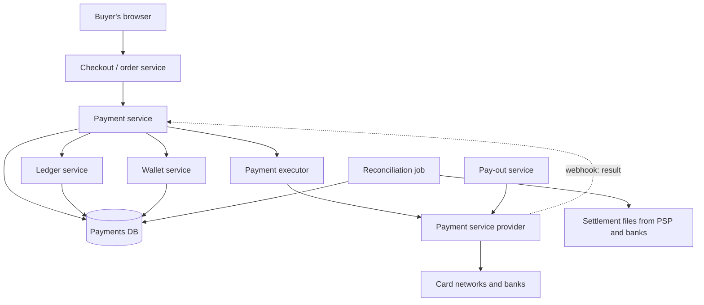
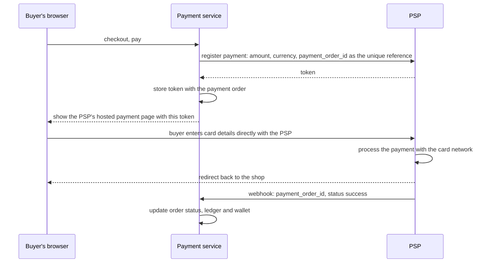
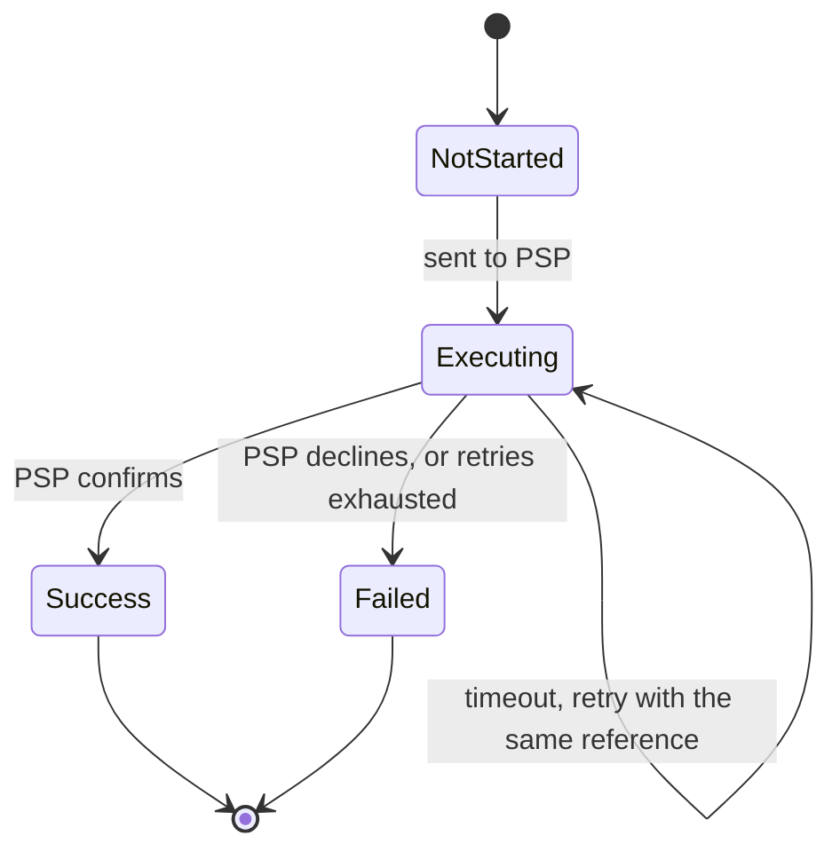

# Design a payment system: idempotency and ledgers

## Before this lesson

You should know idempotency keys, the outbox pattern and delivery guarantees ([Building blocks III](#/lesson/system-design/bb-cap-queues-idempotency)), transactions and ACID ([Design file storage and sync II](#/lesson/system-design/file-sync-deep-dive)), retries with backoff and dead-letter queues ([Design a notification system II](#/lesson/system-design/notification-reliability)), and webhooks ([Building blocks IV](#/lesson/system-design/bb-apis-observability)).

## In plain words

A **payment system** moves money from a buyer to a seller when something is bought online, and keeps a trustworthy record that it did so.

It helps to forget computers for a moment and think of an old-fashioned bookkeeper with a bound ledger. Three habits made that bookkeeper trustworthy:

1. **Every transaction is written twice**, once as money leaving one account and once as money arriving in another. If the two columns do not add up, there is a mistake, and it is found the same day.
2. **Nothing is ever erased.** A mistake is corrected by writing a new, opposite line, never by scratching one out. The book is a complete history.
3. **Each instruction has a reference number.** If the same instruction turns up twice, the bookkeeper recognises the number and does not pay twice.

Those three habits are, in technical words, a **double-entry ledger**, an **append-only** record, and **idempotency**. A payment system is mostly those three ideas applied with great care, plus the fact that the money itself is moved by outside companies that you call over an unreliable network.

Interviewers use this problem to see whether a candidate can switch priorities. In a feed or a chat system, a rare error is tolerable and speed is everything. Here the scale is modest and **correctness is everything**: never charge twice, never lose a payment, and always be able to explain every cent.

## 1. Requirements and the scope questions to ask

| Question | Assumed answer |
|---|---|
| What kind of payment system? | The back end for an e-commerce marketplace: buyers pay, sellers are paid out later |
| Which payment methods? | Cards and digital wallets, through third-party processors |
| Do we handle card numbers ourselves? | No. Card data is collected by the processor, so it never touches our servers |
| Do we store sensitive card data? | No |
| Which currencies? | Several; one currency per payment |
| How many payments? | 1 million per day |
| Pay-in and pay-out? | Both: charge buyers (pay-in), pay sellers (pay-out) |
| Is reconciliation needed? | Yes, against processor and bank records |

Two terms from that table. A **payment service provider (PSP)** is a company such as Stripe, Adyen or PayPal that connects merchants to card networks and banks. And handling raw card numbers brings a demanding security standard called **PCI DSS**; using a PSP's hosted payment form keeps almost all of that burden off your system.

**Functional requirements**

1. **Pay-in:** charge a buyer for an order.
2. **Pay-out:** transfer money owed to sellers.
3. Record every movement of money in a ledger.
4. Support refunds.

**Non-functional requirements**

1. **Correctness:** no double charges, no lost payments, balances always add up.
2. **Reliability and fault tolerance:** failed payments are handled carefully, with retries and clear final states.
3. **Auditability:** every change is traceable; records are never altered.
4. **Reconciliation:** internal records are checked against external ones, and differences are found.
5. **Security and compliance.**
6. Availability and latency matter, but less than correctness. A payment that takes two seconds is acceptable; a wrong one is not.

## 2. Estimates

```python-run
payments_per_day = 1_000_000
qps = payments_per_day / 86_400
print(f"average payments per second : {qps:.1f}")
print(f"peak, sale day (x10)        : {qps * 10:.0f}")

rows_per_payment = 1 + 1 + 4         # payment event, payment order, ledger entries (charge and fee, two lines each)
bytes_per_row = 500
per_year = payments_per_day * rows_per_payment * bytes_per_row * 365
print(f"storage per year            : {per_year / 1e12:.1f} TB, kept for many years")

# The cost of being wrong, which is the real constraint.
avg_payment = 60.0
for error_rate in (1e-3, 1e-5, 1e-7):
    wrong = payments_per_day * error_rate
    print(f"error rate {error_rate:.0e}: {wrong:10.1f} wrong payments per day, ${wrong * avg_payment:,.0f} to investigate")
```

Twelve payments per second is tiny. A single well-run relational database handles the load with room to spare. That is itself a design conclusion: **do not shard, do not reach for eventual consistency, do not optimise for throughput.** Spend the complexity budget on correctness. The last lines show why: at a million payments a day, even an error rate of one in a hundred thousand produces ten incidents a day, each of which is somebody's money.

## 3. API

```
POST /v1/payments
  headers: Idempotency-Key: checkout-7f3a2b
  body: {
    "buyer_id": "u_42",
    "checkout_id": "co_9001",
    "payment_orders": [
      {"payment_order_id": "po_1", "seller_id": "s_7", "amount": "49.90", "currency": "EUR"},
      {"payment_order_id": "po_2", "seller_id": "s_9", "amount": "12.00", "currency": "EUR"}
    ]
  }
  returns: 202 {"payment_id": "pay_55", "status": "processing"}

GET  /v1/payments/{payment_id}            -> status and details
POST /v1/payments/{payment_id}/refunds    headers: Idempotency-Key      body: {"amount": "12.00"}
POST /v1/webhooks/psp                     <- the PSP calls this to report results
```

Details that matter:

- **The amount is a string (or an integer number of minor units, such as cents), never a floating-point number.** Binary floating-point cannot represent most decimal fractions exactly: `0.1 + 0.2` is not `0.3`. Money arithmetic uses integers or decimal types.
- **Every write carries an idempotency key.**
- **One checkout can pay several sellers**, so a payment event contains several payment orders.
- **The response is 202.** The final result arrives asynchronously from the PSP.

## 4. Data model

```
payment_events(checkout_id PK, buyer_id, total_amount, currency, is_payment_done, created_at)

payment_orders(payment_order_id PK, checkout_id, buyer_id, seller_id, amount, currency,
               status, psp_token, psp_reference, ledger_updated, wallet_updated,
               retry_count, created_at, updated_at)
     status: NOT_STARTED | EXECUTING | SUCCESS | FAILED

idempotency_keys(key PK, request_hash, response, created_at)

ledger_entries(entry_id PK, transaction_id, account_id, direction, amount, currency, created_at)
     direction: DEBIT | CREDIT          -- rows are never updated or deleted

accounts(account_id PK, owner_type, owner_id, currency)          -- buyer, seller, platform fees, PSP clearing

wallet_balances(account_id PK, balance, version)                 -- a cache of the ledger, for fast reads
```

All of this lives in a relational database with ACID transactions, replicated synchronously to at least one standby, preferably in another availability zone. The data is too valuable for anything looser.

`payment_order_id` is unique and doubles as the idempotency key towards the PSP. The `status` column is a state machine; the booleans `ledger_updated` and `wallet_updated` record which downstream steps have completed, so that a retry knows where to resume.

## 5. High-level design



**Pay-in flow:**

1. The buyer clicks "pay". The checkout service sends a payment event to the **payment service**.
2. The payment service stores the event and its payment orders, after risk checks (fraud screening is usually a third-party service).
3. For each order, the **payment executor** asks the PSP to charge.
4. When the PSP reports success, the payment service updates the **wallet** (how much each seller is owed) and the **ledger** (the permanent record).

**Pay-out flow** is the mirror image, run on a schedule: for each seller, move the owed balance to their bank account through a pay-out provider, and record it in the ledger.

### How the buyer actually pays: the hosted payment page

Because we never want to see a card number, the card form is provided by the PSP.



Two channels report the result: the browser redirect and the **webhook**. Only the webhook is trusted, because a browser can close before redirecting, and a redirect could be forged. The webhook itself can be delivered more than once or out of order, so its handler must be idempotent and must verify the PSP's signature.

## 6. Deep dive: never charge twice

Double charges come from two sources.

**The buyer clicks "pay" twice, or the client retries after a timeout.** The request carries an idempotency key, generated once per checkout attempt. The payment service inserts the key into a table with a unique constraint. The first insert succeeds and processing continues. A second request with the same key violates the constraint; the service returns the stored result of the first.

**Our call to the PSP times out.** We do not know whether the charge happened. We must retry, and the retry must not charge again. The `payment_order_id` is sent to the PSP as its idempotency reference (called a *nonce* when registering the payment). The PSP recognises the repeated reference and returns the original outcome.

```python-run
import random
random.seed(12)

class PSP:
    """An outside processor: sometimes its reply is lost, though the charge went through."""
    def __init__(self, honour_idempotency):
        self.honour, self.charges, self.results = honour_idempotency, [], {}
    def charge(self, reference, amount):
        if self.honour and reference in self.results:
            return self.results[reference]                 # a repeat: return the first outcome
        self.charges.append((reference, amount))           # money actually moves here
        self.results[reference] = "success"
        return "success"

def pay(psp, order_id, amount, lose_reply):
    """Our payment executor: retry on timeout, using the SAME reference every time."""
    for attempt in range(1, 6):
        outcome = psp.charge(order_id, amount)
        if lose_reply():                                   # the reply never reaches us
            continue                                       # timeout: we cannot know, so we retry
        return outcome, attempt
    return "unknown", 5

for honour in (False, True):
    psp = PSP(honour)
    for i in range(1000):
        pay(psp, f"po_{i}", 50, lose_reply=lambda: random.random() < 0.10)
    extra = len(psp.charges) - 1000
    print(f"PSP honours idempotency reference = {honour!s:5}: {len(psp.charges)} charges for 1000 orders "
          f"({extra} customers charged more than once)")
```

With retries and no idempotency reference, about one customer in ten is charged twice. With the reference, every order is charged exactly once however many times the request is repeated. Retries give "at least once"; idempotency turns that into "exactly once" in effect.

A timeout from a PSP leaves a payment in an **unknown** state. It must never be treated as a failure (the buyer may have been charged) or as a success (they may not have been). The order stays `EXECUTING` until a retry, the webhook or a status query to the PSP settles it.

## 7. Deep dive: the double-entry ledger

Every movement of money is recorded as a **transaction** made of two or more **entries** whose debits and credits are equal. A **debit** and a **credit** are the two sides of an entry; for our purposes it is enough to know that money leaves one account and arrives in another, and the two amounts must match.

For a 50.00 purchase with a 2.50 platform fee:

| Account | Debit | Credit |
|---|---|---|
| Buyer (via PSP clearing) | 50.00 | |
| Seller | | 47.50 |
| Platform fees | | 2.50 |
| **Total** | **50.00** | **50.00** |

Two rules make the ledger trustworthy:

- **Balanced:** in every transaction, total debits equal total credits. Across the whole ledger the sum is zero. Money is never created or destroyed inside the system, only moved.
- **Immutable and append-only:** entries are never changed or deleted. A refund is a *new* transaction with the directions reversed. The complete history can always be replayed, which is what auditors and regulators require.

```python-run
from decimal import Decimal as D

ledger = []                                  # append-only list of (transaction, account, signed amount)

def post(transaction_id, lines):
    """lines: [(account, amount)], negative = money leaving. Must sum to zero."""
    if sum(amount for _, amount in lines) != 0:
        raise ValueError(f"{transaction_id} is not balanced")
    for account, amount in lines:
        ledger.append((transaction_id, account, amount))

def balance(account):
    return sum(amount for _, acc, amount in ledger if acc == account)

post("pay_55",    [("buyer:u_42", D("-50.00")), ("seller:s_7", D("47.50")), ("platform:fees", D("2.50"))])
post("pay_56",    [("buyer:u_43", D("-20.00")), ("seller:s_7", D("19.00")), ("platform:fees", D("1.00"))])
post("refund_55", [("seller:s_7", D("-47.50")), ("platform:fees", D("-2.50")), ("buyer:u_42", D("50.00"))])

for account in ("buyer:u_42", "buyer:u_43", "seller:s_7", "platform:fees"):
    print(f"{account:15s} {balance(account):>8}")
print("sum of all entries:", sum(a for _, _, a in ledger), " (always zero)")

try:
    post("bad_1", [("buyer:u_44", D("-10.00")), ("seller:s_7", D("9.00"))])
except ValueError as error:
    print("rejected:", error)

print("float arithmetic :", 0.1 + 0.2, "   decimal arithmetic:", D("0.1") + D("0.2"))
```

The refund did not delete the original payment; it added an opposite transaction, and buyer 42's balance returned to zero. The unbalanced transaction was refused. The last line shows why money is never stored in floating-point numbers.

The **wallet balance** table is a cached sum of the ledger for quick reads ("how much is this seller owed?"). It is updated in the same database transaction as the ledger entries, and can be recomputed from the ledger at any time. If the two ever disagree, the ledger is right.

## 8. Deep dive: the payment state machine and retries



Every transition is a conditional update ("set to SUCCESS only if currently EXECUTING"), so a webhook delivered twice changes nothing the second time.

Failures are classified, as in the notification system:

- **Retryable** (network error, PSP timeout, PSP temporarily unavailable): retry with exponential backoff and jitter, through a **retry queue**.
- **Non-retryable** (card declined, insufficient funds, invalid data): mark `FAILED` and tell the buyer.
- **Exhausted** (still failing after the limit): move to a **dead-letter queue** for investigation by a person.

After the PSP confirms, three things must happen: the order status changes, the ledger is written, the wallet is updated. Putting them in **one database transaction** makes them atomic. If they are in separate services with separate databases, they are driven by events with an outbox, and each step is idempotent and recorded by its flag so a crashed process resumes where it stopped.

## 9. Deep dive: reconciliation

Even with all of the above, our records and the outside world's can drift: a webhook is never delivered, a PSP applies a fee we did not expect, a bank reverses a payment weeks later (a **chargeback**). **Reconciliation** is the last line of defence.

Every day the PSP and the banks provide a **settlement file**: their list of every transaction and its final status. A batch job compares it, line by line, with our ledger.

```python-run
ours = {"po_1": ("SUCCESS", 4990), "po_2": ("SUCCESS", 1200), "po_3": ("EXECUTING", 2500),
        "po_4": ("FAILED", 800),   "po_5": ("SUCCESS", 3000)}
psp_file = {"po_1": ("SUCCESS", 4990), "po_2": ("SUCCESS", 1150), "po_3": ("SUCCESS", 2500),
            "po_4": ("FAILED", 800),   "po_6": ("SUCCESS", 700)}

for order in sorted(set(ours) | set(psp_file)):
    mine, theirs = ours.get(order), psp_file.get(order)
    if mine == theirs:
        continue
    if theirs is None:
        print(f"{order}: we recorded {mine}, the PSP has no record        -> investigate, likely reverse")
    elif mine is None:
        print(f"{order}: the PSP has {theirs}, we have no record        -> investigate, possible lost request")
    elif mine[0] != theirs[0]:
        print(f"{order}: status differs, ours {mine[0]}, PSP {theirs[0]}       -> fix automatically (missed webhook)")
    else:
        print(f"{order}: amount differs, ours {mine[1]}, PSP {theirs[1]}        -> classify (fee?) or manual review")
```

Differences fall into three groups: those that can be classified and fixed automatically (a missed webhook), those that can be classified but need a person, and those that cannot be explained and go to a finance team's queue. Reconciliation is what turns "we believe our records are right" into "we have checked".

## 10. Bottlenecks and failure handling

| Failure | Risk | Handling |
|---|---|---|
| Client retries or double click | Double charge | Idempotency key with a unique constraint |
| PSP call times out | Unknown outcome | Keep `EXECUTING`; retry with the same reference; query status; wait for the webhook |
| Webhook lost | Order stuck in `EXECUTING` | Poll the PSP for stale orders; reconciliation catches the rest |
| Webhook duplicated or out of order | Double processing | Conditional state transitions; idempotent handler; signature check |
| Crash after PSP success, before ledger write | Money taken, not recorded | One transaction for status, ledger and wallet, or outbox with resumable steps |
| Database primary fails | Lost writes | Synchronous replication; promote the standby; no acknowledged write is lost |
| PSP outage | Cannot take payments | Route to a second PSP; queue and retry where the product allows |
| Poison payment | Endless retries | Retry limit, then dead-letter queue and alert |
| Internal bug writes wrong amounts | Silent corruption | Balanced-entry check on every transaction; daily zero-sum check; reconciliation |
| Fraud | Chargebacks | Risk scoring before execution; velocity limits |

## 11. Trade-offs and alternatives

| Decision | Chosen | Alternative | When the alternative fits |
|---|---|---|---|
| Card handling | PSP-hosted page | Collect cards ourselves | Only with the scale and compliance staff to justify it |
| Communication | Synchronous call to PSP, asynchronous result | Fully asynchronous through queues | Very high volume, or many downstream consumers of payment events |
| Atomicity of status, ledger, wallet | One database, one transaction | Separate services with events (a **saga**: a sequence of local transactions, each with a compensating action if a later one fails) | When organisational scale forces separate services |
| Cross-service commit | Sagas with idempotent steps | Two-phase commit | Rarely; it blocks on failures and outside PSPs cannot take part |
| Consistency | Strong | Eventual | Not for balances and ledgers |
| Balance storage | Ledger as truth, balance as cache | Mutable balance only | Never: no audit trail |
| Scale | One primary with synchronous standby | Sharding by account | Only at far larger volume |

## 12. What a strong answer sounds like

> **Interviewer:** Design the payment back end for our marketplace. About a million payments a day.
>
> **Candidate:** That is around twelve per second, so throughput is not the problem; correctness is. I will state the goals as: never charge twice, never lose a payment, and be able to account for every cent. Do we handle card numbers?
>
> **Interviewer:** No, use a payment provider.
>
> **Candidate:** Good, that keeps us out of most of PCI DSS. The buyer enters card details on the provider's hosted page; we register the payment first with our payment order id as a unique reference, and we trust the provider's signed webhook for the result, not the browser redirect.
>
> **Interviewer:** The buyer double-clicks pay, and separately your call to the provider times out. What happens?
>
> **Candidate:** Both are handled by idempotency. The client sends an idempotency key that I insert under a unique constraint; the second request gets the first one's result. Towards the provider, I retry with the same payment order id, which it treats as the same payment. A timeout leaves the order in an executing state, neither failed nor successful, until a retry, a status query or the webhook resolves it.
>
> **Interviewer:** How do you record the money?
>
> **Candidate:** In a double-entry ledger: each payment is a transaction whose entries sum to zero, the rows are append-only, and a refund is a new reversing transaction. Seller balances are a cached sum, updated in the same database transaction as the ledger and the order status, so they cannot diverge. Amounts are integers of minor units, never floats.
>
> **Interviewer:** And if your records still disagree with the provider's?
>
> **Candidate:** A nightly reconciliation job compares the provider's settlement file with our ledger and classifies each mismatch: fixable automatically, needs a person, or unexplained. That is the final safety net.

## Common mistakes

- **Optimising for throughput** when the load is a dozen requests per second.
- **Treating a timeout as a failure**, then charging again with a new reference.
- **Floating-point money.**
- **A single mutable balance column** with no ledger.
- **Updating or deleting ledger rows** instead of posting reversals.
- **Trusting the browser redirect** as proof of payment.
- **Non-idempotent webhook handlers.**
- **No reconciliation.**
- **Eventual consistency for balances.**
- **Storing card numbers.**

## Summary

- A payment system is small in scale and strict in correctness: no double charges, no lost payments, complete auditability.
- Card data stays with the PSP via a hosted page; results are taken from signed, idempotently handled webhooks.
- Idempotency keys (client to us) and unique payment references (us to the PSP) make retries safe; a timeout means "unknown", never "failed".
- Money is recorded in a balanced, append-only double-entry ledger using integer or decimal amounts; balances are a rebuildable cache; refunds are reversing transactions.
- Payment orders move through a state machine with conditional transitions, retry queues and a dead-letter queue.
- Status, ledger and wallet change in one transaction, or through a saga with idempotent, resumable steps.
- Daily reconciliation against settlement files catches whatever slipped through.

## Glossary

- **Payment service provider (PSP)**: a company that processes card and wallet payments for merchants.
- **Pay-in / pay-out**: collecting money from a buyer; sending money to a seller.
- **PCI DSS**: the security standard for systems that handle card data.
- **Hosted payment page**: a card form provided and operated by the PSP.
- **Idempotency key**: a unique identifier that lets a server recognise repeated requests.
- **Nonce**: a unique reference registered with the PSP for one payment.
- **Double-entry ledger**: a record in which each transaction has entries that sum to zero.
- **Debit / credit**: the two sides of a ledger entry.
- **Append-only**: only new rows are added; existing rows are never changed.
- **Minor unit**: the smallest unit of a currency, such as a cent.
- **Settlement file**: an external party's list of transactions and final statuses.
- **Reconciliation**: comparing internal records with external ones and resolving differences.
- **Chargeback**: a payment reversed by the cardholder's bank.
- **Saga**: a sequence of local transactions with compensating actions for failures.
- **Wallet**: the record of how much each party is owed.

## Check yourself

```quiz
[
  {"q": "A system handles about 12 payments per second. What should the design prioritise?",
   "options": ["Sharding for throughput", "Correctness: no double charges, no lost payments, auditability", "Eventual consistency for speed", "A CDN"],
   "answer": 1,
   "explain": "The load is small. The cost of an incorrect payment is high, so complexity is spent on correctness."},
  {"q": "The call to the PSP times out. What is the correct treatment of the payment order?",
   "options": ["Mark it failed and ask the buyer to pay again", "Mark it successful", "Keep it in an executing state and retry with the same unique reference", "Delete it"],
   "answer": 2,
   "explain": "A timeout means the outcome is unknown. Retrying with the same reference lets the PSP return the original result without charging again."},
  {"q": "Why are monetary amounts stored as integers of minor units or as decimals?",
   "options": ["They use less space", "Binary floating-point cannot represent most decimal fractions exactly, causing rounding errors", "Databases cannot store floats", "PSPs reject floats"],
   "answer": 1,
   "explain": "0.1 + 0.2 is not exactly 0.3 in binary floating-point. Financial arithmetic must be exact."},
  {"q": "How is a refund recorded in a double-entry ledger?",
   "options": ["By deleting the original entries", "By updating the original amounts to zero", "By appending a new transaction with the directions reversed", "By editing the wallet balance only"],
   "answer": 2,
   "explain": "Ledger rows are immutable. A reversing transaction preserves the full history."},
  {"q": "What property must every ledger transaction satisfy?",
   "options": ["It has exactly one entry", "Its debits equal its credits, so the entries sum to zero", "It is stored in a cache", "It includes a card number"],
   "answer": 1,
   "explain": "A balanced transaction means money only moves between accounts and is never created or destroyed inside the system."},
  {"q": "Why is the PSP's webhook trusted over the browser redirect?",
   "options": ["Webhooks are faster", "The browser may never redirect or could be forged; the webhook is a signed server-to-server message", "Redirects cannot carry data", "Webhooks never repeat"],
   "answer": 1,
   "explain": "A redirect depends on the buyer's browser. The signed webhook is authoritative, though it must still be handled idempotently."},
  {"q": "What is reconciliation for?",
   "options": ["Speeding up payments", "Comparing internal records with settlement files from PSPs and banks to find and resolve mismatches", "Encrypting card numbers", "Load balancing"],
   "answer": 1,
   "explain": "It is the final check that the system's view of money matches the outside world's."},
  {"q": "Status, ledger and wallet must all change after a successful charge. What is the simplest way to keep them consistent?",
   "options": ["Three separate asynchronous jobs", "One database transaction covering all three", "A cache with a long TTL", "A CDN purge"],
   "answer": 1,
   "explain": "A single ACID transaction makes the three changes atomic. Splitting them requires sagas with idempotent, resumable steps."}
]
```

> **Source:** beyond the book; Xu, *System Design Interview: An Insider's Guide*, ch. 3 framework applied. Stripe engineering blog, "Designing robust and predictable APIs with idempotency", https://stripe.com/blog/idempotency ; Stripe documentation, "Idempotent requests", https://docs.stripe.com/api/idempotent_requests ; PCI Security Standards Council, https://www.pcisecuritystandards.org/
