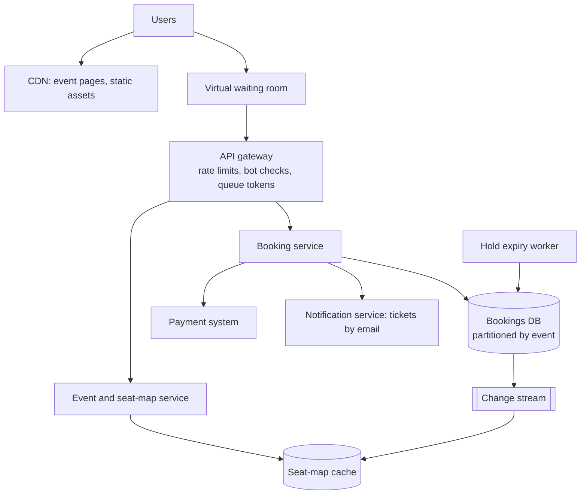
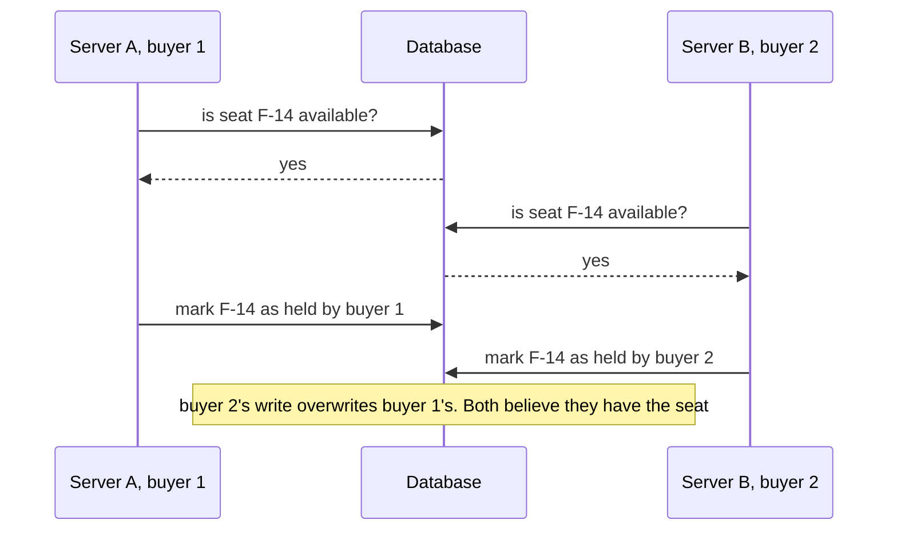
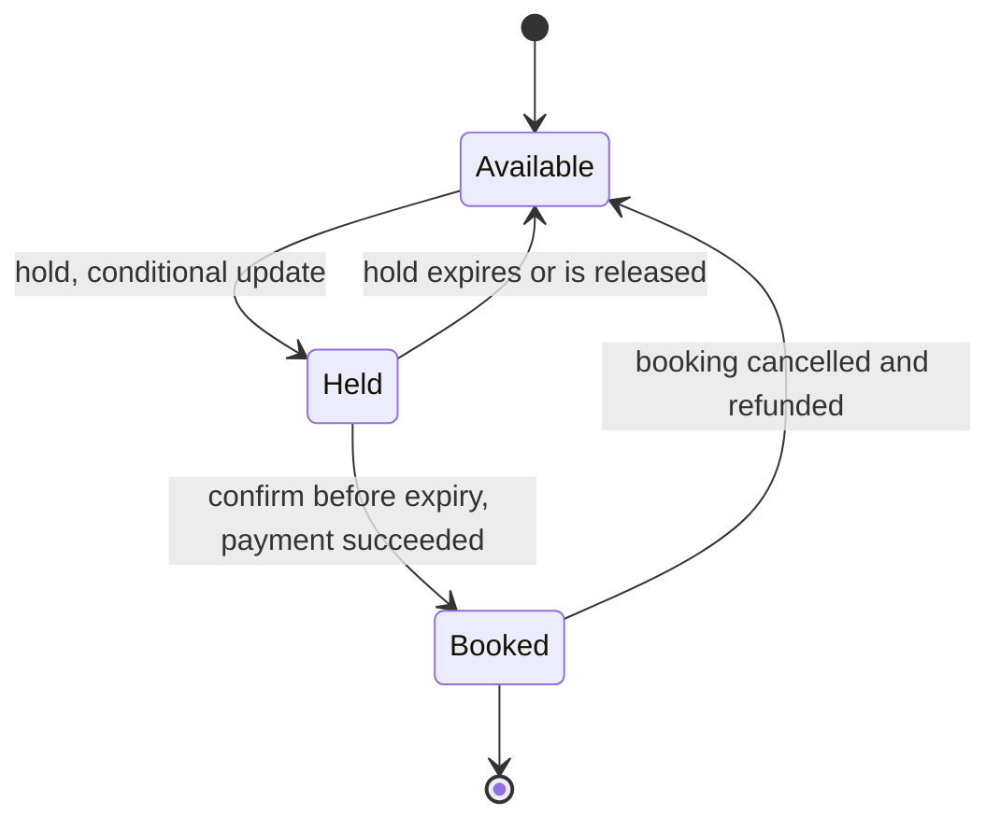
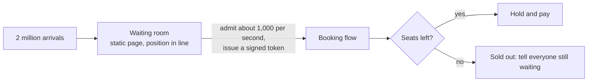

# Design a ticket-booking system: seat holds and overselling

## Before this lesson

You should know transactions and conditional updates ([Design file storage and sync II](#/lesson/system-design/file-sync-deep-dive)), race conditions and atomic operations ([Design a rate limiter II](#/lesson/system-design/rate-limiter-distributed)), idempotency ([Building blocks III](#/lesson/system-design/bb-cap-queues-idempotency)), queues and back-pressure, caching ([Building blocks I](#/lesson/system-design/bb-load-balancing-caching)) and the payment flow from [Design a payment system](#/lesson/system-design/payment-system).

## In plain words

A **ticket-booking system** sells a limited number of specific things, such as seat 14 in row F for Saturday's concert, to people who all want them at the same moment. Cinema, concert, train and airline bookings all have this shape.

Think of the last cake in a bakery window. Two customers point at it at the same instant. A good shop assistant does three things. They say "one moment" to one customer and serve the other (only one person can have the cake). They put the cake behind the counter while the first customer finds their purse (it is **held**, so nobody else can take it meanwhile). And if the customer discovers they have no money, the cake goes back in the window (the hold **expires**).

A booking system does the same, with three complications. There are fifty thousand cakes. There are two million customers pointing at once, at the second the sale opens. And the "shop assistants" are hundreds of servers that cannot see each other.

The single failure that defines this problem is **overselling**: selling the same seat to two people. It is the reason the design leans on the database's strongest guarantees, where a feed or a chat system would happily relax them. The second defining feature is the **flash crowd**: almost no traffic for weeks, then an enormous spike for a few minutes.

## 1. Requirements and the scope questions to ask

| Question | Assumed answer |
|---|---|
| What is being booked? | Seats for events at venues: specific numbered seats |
| Can a user choose seats, or are they assigned? | Users choose from a seat map |
| How many seats per event? | Up to 50,000 |
| How many users at once? | Normal: a few thousand browsing. On-sale for a popular event: 2 million arriving within minutes |
| How long may a seat be held during checkout? | 8 minutes |
| Payment? | Through the payment system; out of scope beyond the integration |
| Limits per user? | At most 6 tickets per event |
| Is overselling ever acceptable? | No |

**Functional requirements**

1. Browse events and see which seats are available.
2. Select seats and hold them for a limited time.
3. Pay, and receive confirmed tickets.
4. Release seats automatically if payment is not completed in time.

**Non-functional requirements**

1. **No overselling.** A seat is sold at most once. This is the top requirement and needs strong consistency.
2. **Fairness** under a flash crowd: roughly first come, first served, with protection against automated buying (bots).
3. **Survive the spike:** the system stays up when demand is far beyond capacity.
4. **Fast browsing.** The seat map may be a second or two out of date; the booking step may not.
5. **Availability:** browsing should stay available; booking prefers correctness over availability.

Notice the two consistency levels. *Viewing* availability is a read that can be slightly stale. *Claiming* a seat is a write that must be exact. Separating them is the key to the design.

## 2. Estimates

```python-run
seats = 50_000
arrivals = 2_000_000                  # people who turn up when the sale opens
arrival_window_s = 120                # most arrive in the first two minutes
booking_capacity_qps = 1_000          # hold-and-pay transactions the database path can do safely
seats_per_order = 2.5

arrival_qps = arrivals / arrival_window_s
orders_needed = seats / seats_per_order
print(f"arrival rate at on-sale        : {arrival_qps:,.0f} people per second")
print(f"booking path capacity          : {booking_capacity_qps:,} per second")
print(f"overload factor                : {arrival_qps / booking_capacity_qps:.0f}x")
print(f"orders that can ever succeed   : {orders_needed:,.0f}  ({orders_needed / arrivals:.1%} of the people who came)")
print(f"time to sell out at capacity   : {orders_needed / booking_capacity_qps:.0f} seconds")

page_views = arrivals * 5             # everyone refreshes the seat map a few times
print(f"seat-map views in that window  : {page_views:,}  = {page_views / arrival_window_s:,.0f} per second")
```

The numbers tell the story of the whole design:

- **Demand exceeds capacity by more than an order of magnitude**, and it must: only one visitor in a hundred can possibly get a ticket. There is no point in building a booking path that handles 17,000 transactions per second, because there are only 20,000 orders to place in total.
- So the job of most of the system is to **say "wait" or "sold out" cheaply** to 99% of visitors, and to protect the small, strict booking path.
- Seat-map views are far more numerous than bookings and tolerate staleness, so they are served from caches.

## 3. API

```
GET  /v1/events/{event_id}                       -> event details                       (cached, CDN)
GET  /v1/events/{event_id}/seats                 -> seat map with availability          (cached about 1 s)

POST /v1/events/{event_id}/holds
  headers: Idempotency-Key, Queue-Token
  body:    {"seat_ids": ["F-14", "F-15"]}
  returns: 201 {"hold_id": "h_81", "expires_at": "...", "amount": "180.00"}
           409 {"unavailable": ["F-15"]}          -- nothing is held if any seat is taken

POST /v1/holds/{hold_id}/confirm
  headers: Idempotency-Key
  body:    {"payment_id": "pay_55"}
  returns: 200 {"booking_id": "b_301", "tickets": [...]}
           410 hold expired

DELETE /v1/holds/{hold_id}                        -> release the seats early
```

Three details. Holding is **all or nothing**: a group wants adjacent seats or none. Every write has an **idempotency key**, because mobile networks at a crowded on-sale are unreliable and people press buttons twice. And the **queue token** proves the caller was admitted from the waiting room, which is described below.

## 4. Data model

```
events(event_id PK, venue_id, name, starts_at, on_sale_at)

seats(event_id, seat_id, section, row, price_cents,
      status, hold_id, hold_expires_at, booking_id, version)
    PK (event_id, seat_id)
    status: AVAILABLE | HELD | BOOKED

holds(hold_id PK, event_id, user_id, seat_ids, status, expires_at, idempotency_key UNIQUE)
    status: ACTIVE | CONFIRMED | EXPIRED | RELEASED

bookings(booking_id PK, hold_id UNIQUE, user_id, event_id, payment_id, total_cents, created_at)

tickets(ticket_id PK, booking_id, event_id, seat_id, barcode)
    UNIQUE (event_id, seat_id)                   -- the last line of defence against overselling
```

All of this is in a relational database. The row per seat per event is the unit of contention: every rule about "one buyer per seat" is enforced on that row. The unique constraint on `tickets(event_id, seat_id)` means that even if every layer above had a bug, the database would refuse to create a second ticket for the same seat.

Data for one event lives on one database shard (partition by `event_id`), so that holding several seats is a single local transaction.

## 5. High-level design



- The **waiting room** absorbs the crowd and admits people to the booking flow at a controlled rate.
- The **event and seat-map service** is read-only and cache-backed.
- The **booking service** is the strict part: holds, confirmations and releases, all as database transactions.
- A **change stream** from the database keeps the seat-map cache close to the truth.
- An **expiry worker** returns seats whose holds have lapsed.

## 6. Deep dive: preventing overselling

Here is the bug in its simplest form. Two servers handle two buyers for the same seat:



The check and the update are two separate steps, and another request slipped between them. This is a **race condition**, the same shape as the token-bucket race in the rate limiter. There are three standard cures.

**Pessimistic locking.** Lock the seat row before reading it (`SELECT ... FOR UPDATE`). A second transaction that wants the same row waits until the first commits or rolls back. Simple and safe. Under heavy contention, waiting transactions pile up and hold database connections; and locking several rows in different orders in different transactions can **deadlock** (each waits for a lock the other holds), so always lock rows in a fixed order such as by seat id.

**Optimistic concurrency control.** Do not lock. Read the row with its `version` number, and make the update conditional: "set held where seat is F-14 and version is 7". If someone else changed the row first, the version no longer matches, zero rows are updated, and the request fails cleanly. Good when conflicts are uncommon; under a flash crowd many requests fail and retry.

**A conditional update on the state itself.** Fold the check into the write:

```sql
UPDATE seats
SET status = 'HELD', hold_id = :hold, hold_expires_at = :expires
WHERE event_id = :event AND seat_id = :seat
  AND (status = 'AVAILABLE' OR (status = 'HELD' AND hold_expires_at < now()));
```

The database executes this as one atomic step. If it reports one row changed, the seat is yours. If zero, somebody else has it. There is no gap for another request to slip into, and no separate read.

```python-run
import random
random.seed(6)

def run_sale(strategy, buyers=2000, seats=50):
    seat_owner = {s: None for s in range(seats)}
    sold_twice, winners = 0, 0
    # Each buyer picks a seat; requests interleave: several buyers may 'read' before any 'write'.
    wanted = [(b, random.randrange(seats)) for b in range(buyers)]
    for i in range(0, buyers, 4):                         # four requests overlap at a time
        batch = wanted[i:i + 4]
        if strategy == "check then write":
            saw_free = [(b, s) for b, s in batch if seat_owner[s] is None]      # all read first
            claimed = {}
            for b, s in saw_free:                                               # then all write
                if s in claimed:
                    sold_twice += 1                       # a second buyer was also told "yours"
                claimed[s] = b
                seat_owner[s] = b
                winners += 1
        else:                                             # atomic conditional update
            for b, s in batch:
                if seat_owner[s] is None:                 # check and write are one indivisible step
                    seat_owner[s] = b
                    winners += 1
    return winners, sold_twice

for strategy in ("check then write", "atomic conditional update"):
    winners, twice = run_sale(strategy)
    print(f"{strategy:26s}: {winners} buyers told 'the seat is yours' for 50 seats; {twice} seats double-sold")
```

With separate check and write, more than fifty buyers are told they have a seat. With the atomic update, exactly fifty are. The fix costs nothing in performance; it is a matter of expressing the operation as one statement.

**Holding several seats** is one transaction: apply the conditional update to each seat (in seat-id order); if any reports zero rows, roll back the whole transaction and return 409 with the unavailable seats. Nothing is half-held.

> [!INTERVIEW]
> Draw the two-buyer race before offering a fix. Then give the conditional update as your default, mention pessimistic locks and optimistic versions as alternatives with their costs, and finish with the unique constraint on tickets as a backstop. That sequence shows you understand the problem and not only a pattern.

## 7. Deep dive: holds and expiry

A seat cannot stay locked in a database transaction for the eight minutes a person spends typing card details: transactions must be short. So the hold is **data, not a lock**: the seat row's status becomes `HELD`, with a `hold_id` and an expiry time. The transaction that sets it finishes in milliseconds.



**Expiry has two parts**, as in the snippet service of the framework lesson:

- **Lazy, for correctness.** The conditional update above already treats a hold whose expiry has passed as available. No timer is needed for a seat to become claimable again.
- **Active, for tidiness.** A background worker periodically marks expired holds and resets their seats, so that the seat map shows them as free promptly.

**Confirmation** must also be conditional: "set BOOKED where hold_id is h_81 and status is HELD and hold_expires_at is in the future". Consider a payment that completes ten seconds after the hold expired, when someone else may already hold the seat. The confirm fails, and the payment must be refunded automatically. To make this rare, the hold shown to the user ends slightly before the real expiry, and the payment step is given a deadline.

An alternative is to keep holds in an in-memory store with a built-in TTL (a key per seat set only if absent, with an expiry). It is very fast and removes load from the database, but it creates two sources of truth that must agree at confirmation. If used, the final booking must still pass a conditional write in the database.

## 8. Deep dive: surviving the flash crowd

Seventeen thousand people per second cannot all be allowed to hit the booking path. The standard answer is a **virtual waiting room**: a deliberately simple, very scalable front that holds people in a queue and admits them at the rate the booking path can serve.



- On arrival, each user is given a place in line (randomised among those who arrived before the sale opened, so that refreshing at the exact second gives no advantage).
- The waiting page is static and served from a CDN, polling a tiny endpoint for "is it my turn?". It costs almost nothing per user.
- When admitted, the user receives a signed, short-lived **queue token**. The API gateway rejects booking requests without a valid one.
- The admission rate is tied to what is happening downstream: admit more as holds complete or expire.
- When the event sells out, everyone still waiting is told immediately, without touching the database.

```python-run
def simulate(admit_per_s, arrivals=2_000_000, window_s=120, seats=50_000, seats_per_order=2.5, capacity=1_000):
    waiting, sold, rejected_overload, t = 0, 0.0, 0, 0
    while sold < seats and t < 3600:
        if t < window_s:
            waiting += arrivals / window_s
        admitted = min(waiting, admit_per_s)
        waiting -= admitted
        served = min(admitted, capacity)                 # what the booking path can process this second
        rejected_overload += admitted - served           # the rest get errors and timeouts
        sold = min(seats, sold + served * seats_per_order)
        t += 1
    return t, rejected_overload

for label, rate in (("no waiting room (admit everyone)", 10**9), ("waiting room, admit 1,000/s", 1_000)):
    seconds, failed = simulate(rate)
    print(f"{label:34s}: sold out in {seconds:>3} s, {failed:>12,.0f} requests hit an overloaded booking path")
```

Both runs sell the event in the same twenty seconds, because the booking path's capacity is the limit either way. The difference is what the other 1.98 million people experience: errors and timeouts from an overloaded service, or an orderly "you are number 41,208 in line" followed by "sorry, sold out". In practice the difference is larger still, because an unprotected booking path does not degrade gracefully at seventeen times its capacity; it falls over, and then nobody can buy.

**The seat map under load.** Availability is read from a cache refreshed from the database's change stream, perhaps a second behind. A user may click a seat that was taken a moment ago; the hold request then fails with 409 and the client refreshes the map. That is acceptable and much cheaper than reading the database for every view. For very hot events the map can show coarse availability by section instead of by seat.

**Bots and fairness.** Per-account and per-payment-card ticket limits, rate limits by account and device, challenge tests for suspicious traffic, and verified accounts for the most contested sales.

## 9. Bottlenecks and failure handling

| Failure | Effect | Mitigation |
|---|---|---|
| Two requests for one seat | Overselling | Conditional update; unique constraint on tickets as backstop |
| Client retries a hold | Seats held twice by the same user | Idempotency key on the hold |
| User abandons checkout | Seats stuck | Hold expiry, lazy and active |
| Payment succeeds after the hold expired | Money taken, no seat | Conditional confirm fails; automatic refund; payment deadline shorter than the hold |
| Payment result unknown (timeout) | Hold may expire meanwhile | Extend the hold while a payment is in an executing state; resolve by webhook |
| Booking service crashes between payment and confirm | Paid, not booked | Confirm is idempotent and retried from the payment webhook; reconciliation finds stragglers |
| Database primary fails | Booking halts | Synchronous standby; promote; in-flight holds retried with idempotency keys |
| Hot event on one shard | That shard saturated | Waiting room limits admission to that event's capacity; isolate hot events on dedicated shards |
| Cache stale | Users click taken seats | Hold fails cleanly; client refreshes |
| Waiting room overloaded | Cannot join the line | Static pages on a CDN; the per-user check is a tiny request |

## 10. Trade-offs and alternatives

| Decision | Chosen | Alternative | When the alternative fits |
|---|---|---|---|
| Concurrency control | Conditional update | Pessimistic row locks | Complex multi-step checks in one transaction, moderate contention |
| | | Optimistic version check | Low contention |
| Hold storage | Database row state | In-memory store with TTL | Extreme hold rates; needs a database check at confirm |
| Crowd control | Waiting room with admission tokens | Let everyone race | Small events |
| Seat choice | User picks seats | Best-available assignment | Much less contention per seat and simpler; common for general admission or the highest-demand sales |
| Inventory model | Row per seat | Counter per section | General admission: a conditional decrement "where remaining >= n" |
| Read consistency | Cached, about a second stale | Read from the primary | Never for browsing at this scale |
| Overbooking | Forbidden | Allowed by policy | Airlines, which sell a few more seats than exist on purpose and compensate |

The general-admission case is worth a sentence, because interviewers switch to it: with no specific seats, inventory is a single number, and the atomic operation is `UPDATE inventory SET remaining = remaining - 2 WHERE event_id = :e AND remaining >= 2`. The same principle applies, with a single hot row, which is another reason to throttle admissions.

## 11. What a strong answer sounds like

> **Interviewer:** Design a ticketing system for concerts. Popular events sell out in seconds.
>
> **Candidate:** The requirement I will not compromise on is no overselling. Second is surviving the on-sale spike. Suppose 50,000 seats and two million people arriving in two minutes: that is about 17,000 arrivals per second for roughly 20,000 possible orders. So nearly everyone must be told to wait or that it is sold out, cheaply, and the strict booking path should be protected.
>
> **Interviewer:** How do you stop two people buying the same seat?
>
> **Candidate:** The bug is a check followed by a separate write. I make it one atomic statement: update the seat to held where it is available or its hold has expired. One row changed means success, zero means someone else has it. Several seats are one transaction, rolled back if any fails. Bookings also have a unique constraint on event and seat as a backstop.
>
> **Interviewer:** The user takes five minutes to pay.
>
> **Candidate:** The hold is a state on the row with an expiry, not an open transaction. Expiry is lazy, since the conditional update treats an expired hold as free, plus a sweeper so the seat map updates. Confirmation is conditional on the hold still being valid; if payment lands late, the confirm fails and the payment is refunded automatically.
>
> **Interviewer:** And the two million people?
>
> **Candidate:** A virtual waiting room: a static page on a CDN with a position in line, admitting about as many per second as the booking path can serve and issuing signed tokens that the gateway requires. The seat map is served from a cache about a second behind; a stale click fails cleanly at the hold step.

## Common mistakes

- **Check-then-write** for seat availability.
- **Holding a database transaction or lock open** while the user pays.
- **Holds with no expiry.**
- **Confirming without rechecking the hold.**
- **Scaling the booking path to match arrivals** instead of throttling arrivals.
- **Reading availability from the primary database for every page view.**
- **Eventual consistency for the seat inventory itself.**
- **No idempotency on hold and confirm.**
- **No answer for payment succeeding after expiry.**
- **Partial holds** for a group that wanted seats together.

## Summary

- The defining requirement is no overselling; the defining load is a flash crowd many times larger than the number of orders that can succeed.
- Viewing availability may be slightly stale and is cached; claiming a seat must be exact and goes through the database.
- Overselling is prevented by making check-and-claim one atomic conditional update (or by row locks or version checks), within a single-shard transaction, with a unique constraint as a backstop.
- A hold is a row state with an expiry, released lazily and by a sweeper; confirmation rechecks the hold, and a late payment is refunded.
- A virtual waiting room meters admission to the booking path's capacity and tells the rest to wait or that the event is sold out.
- Idempotency keys cover retries; the payment integration handles unknown outcomes.

## Glossary

- **Overselling**: selling the same seat, or more seats than exist.
- **Hold (reservation)**: a temporary claim on a seat while the buyer pays.
- **Flash crowd**: a sudden surge of visitors far above normal traffic.
- **Race condition**: an error caused by the timing of overlapping operations.
- **Pessimistic locking**: locking a row before reading it so others must wait.
- **Optimistic concurrency control**: proceeding without locks and rejecting the write if the row changed.
- **Conditional update**: an update that applies only if the row is in the expected state.
- **Deadlock**: two transactions each waiting for a lock held by the other.
- **Lazy expiry**: treating an expired hold as free when it is next examined.
- **Virtual waiting room**: a queue in front of the system that admits users at a controlled rate.
- **Queue token**: a signed proof that a user was admitted.
- **General admission**: tickets without specific seats, tracked as a count.
- **Backstop**: a final safeguard, such as a unique constraint.
- **Bot**: an automated program acting as a buyer.

## Check yourself

```quiz
[
  {"q": "Two requests each check that seat F-14 is available and then each mark it as held. What went wrong?",
   "options": ["The seat map cache was stale", "The check and the write were separate steps, so both saw the seat as free", "The database was too slow", "The hold expired"],
   "answer": 1,
   "explain": "This is a check-then-write race. The fix is to make the check part of one atomic conditional update."},
  {"q": "An UPDATE that sets a seat to HELD only where its status is AVAILABLE reports zero rows changed. What does that mean?",
   "options": ["The database failed", "Another request already claimed the seat, so this request did not get it", "The seat does not exist", "The hold succeeded"],
   "answer": 1,
   "explain": "The condition no longer held. Zero affected rows is the clean signal that the seat is taken."},
  {"q": "Why is a hold stored as row state with an expiry instead of keeping a transaction open while the user pays?",
   "options": ["Transactions cannot update rows", "Long transactions hold locks and connections for minutes, which does not scale", "Expiry is not possible in a database", "To avoid using indexes"],
   "answer": 1,
   "explain": "Transactions must be short. A hold that lasts minutes is data, recorded and then committed in milliseconds."},
  {"q": "A payment completes 10 seconds after the hold expired and another user now holds the seat. What should happen?",
   "options": ["Give the seat to the payer anyway", "The conditional confirm fails and the payment is refunded automatically", "Charge the second user as well", "Delete both holds"],
   "answer": 1,
   "explain": "Confirmation requires a still-valid hold. Without one, no booking is created and the money is returned."},
  {"q": "Two million people arrive for 20,000 possible orders. What is the purpose of a virtual waiting room?",
   "options": ["To sell more tickets", "To admit users at the booking path's capacity and tell the rest to wait or that it is sold out, cheaply", "To cache seat maps", "To process payments faster"],
   "answer": 1,
   "explain": "Most visitors cannot succeed. The waiting room protects the strict path and gives everyone else an orderly experience."},
  {"q": "The seat map shown to users may be a second out of date. Why is that acceptable?",
   "options": ["Users never click seats", "The authoritative check happens at the hold step, which fails cleanly if the seat was taken", "The cache is strongly consistent", "Seats cannot change status"],
   "answer": 1,
   "explain": "Browsing can be approximate because claiming is exact. A stale click results in a 409 and a refreshed map."},
  {"q": "What is the role of the unique constraint on tickets(event_id, seat_id)?",
   "options": ["It speeds up seat-map reads", "It is a backstop: the database refuses a second ticket for the same seat even if application logic has a bug", "It expires holds", "It limits tickets per user"],
   "answer": 1,
   "explain": "Defence in depth. The constraint makes overselling impossible at the storage level."},
  {"q": "For general-admission tickets tracked as a count, what is the atomic operation?",
   "options": ["Read the count, subtract, write it back", "Decrement where remaining is at least the number requested, and check that a row was updated", "Insert a row per ticket without checks", "Cache the count for an hour"],
   "answer": 1,
   "explain": "The condition and the decrement are one statement, so the count cannot go below zero."}
]
```

> **Source:** beyond the book; Xu, *System Design Interview: An Insider's Guide*, ch. 3 framework applied. PostgreSQL documentation, "Explicit Locking" and "UPDATE", https://www.postgresql.org/docs/current/explicit-locking.html ; System Design Primer, https://github.com/donnemartin/system-design-primer
