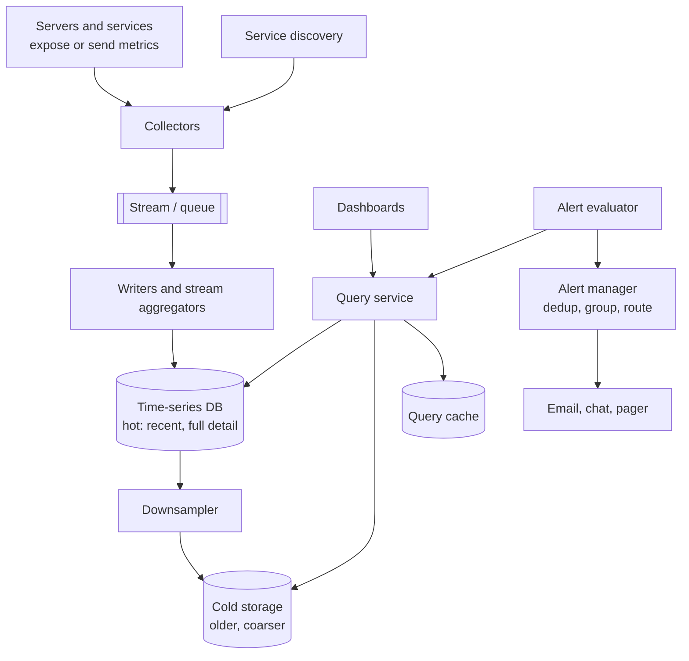
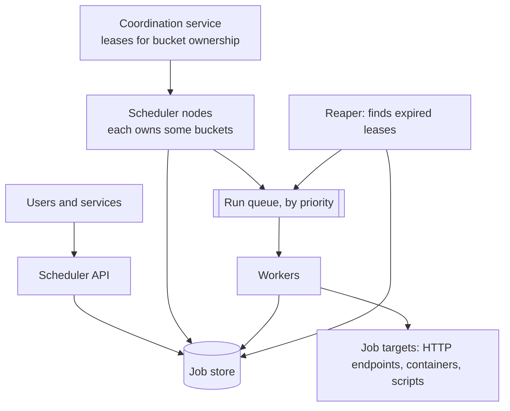

# Design a metrics and monitoring system, and a distributed job scheduler

## Before this lesson

You should know metrics, alerts and SLOs ([Building blocks IV](#/lesson/system-design/bb-apis-observability)), queues, streams and idempotency ([Building blocks III](#/lesson/system-design/bb-cap-queues-idempotency)), partitioning ([Building blocks II](#/lesson/system-design/bb-databases-replication-partitioning)), leases and machine-ID assignment ([Design a unique ID generator II](#/lesson/system-design/unique-id-snowflake)) and heartbeats ([Design a chat system II](#/lesson/system-design/chat-deep-dive)).

## In plain words

This lesson covers two pieces of internal infrastructure that every engineering organisation runs and that both come up as interview questions.

A **metrics and monitoring system** is the instrument panel of a data centre. Thousands of machines and services each report numbers every few seconds: how busy, how slow, how many errors. The system collects them, keeps them, draws charts, and raises an alarm when a number crosses a line. A hospital ward works the same way: each patient is wired to monitors, a central desk shows every patient's readings, the readings are kept so a doctor can look at the last week, and a buzzer sounds when a heart rate goes out of range.

A **distributed job scheduler** runs tasks at set times or on demand: "send the weekly report every Monday at 08:00", "recompute recommendations every night", "charge this subscription on the 1st". It is an alarm clock for programs, with one difficult requirement: the alarm must go off even if the clock itself breaks, and it must not go off twice.

Both are covered with the track's usual design structure, in a compact form.

---

# Part A: a metrics and monitoring system

## A1. Requirements and scope

| Question | Assumed answer |
|---|---|
| What is monitored? | Infrastructure and service metrics: CPU, memory, request counts, error counts, latencies |
| Logs and traces too? | Out of scope; metrics only |
| Scale? | 100,000 servers and containers, about 100 metrics each, reported every 10 seconds |
| Retention? | 1 year, with coarser detail for older data |
| Consumers? | Dashboards, ad hoc queries by engineers, and automatic alerts |
| How fresh? | Visible on dashboards within about 30 seconds |

**Functional:** collect metrics, store them as time series, query and chart them, evaluate alert rules and notify people.

**Non-functional:** very high write throughput; fast queries over recent data; **highly available**, since the monitoring system is needed most when other things are failing; tolerant of losing a few data points (unlike payments); cost-efficient storage.

## A2. Estimates

```python-run
sources = 100_000
metrics_per_source = 100
interval_s = 10
bytes_raw = 16                       # an 8-byte timestamp and an 8-byte value
bytes_compressed = 1.5               # typical for time-series compression

series = sources * metrics_per_source
points_per_s = series / interval_s
per_day = points_per_s * 86_400
print(f"active time series      : {series:,}")
print(f"data points per second  : {points_per_s:,.0f}")
print(f"data points per day     : {per_day / 1e9:,.0f} billion")
print(f"raw, one year           : {per_day * 365 * bytes_raw / 1e12:,.0f} TB")
print(f"compressed, one year    : {per_day * 365 * bytes_compressed / 1e12:,.0f} TB")

# With downsampling: 10-second detail for 7 days, 1-minute for 30 days, 1-hour for the rest of the year.
tiers = [(7, 10), (30, 60), (328, 3600)]
points = sum(days * 86_400 / step * series for days, step in tiers)
print(f"with downsampling tiers : {points * bytes_compressed / 1e12:,.1f} TB")
```

A million data points per second: this is a **write-heavy** system, and writes are steady, not bursty. Reads are comparatively rare and mostly ask for recent data. Raw storage for a year would be hundreds of terabytes; compression and **downsampling** (keeping less detail for older data) reduce that by two orders of magnitude.

## A3. Data model

A **time series** is a sequence of (timestamp, value) pairs identified by a **metric name** and a set of **labels** (also called *tags*): key-value pairs that say where the number came from.

```
http_requests_total{service="checkout", region="eu-west", status="500"}   ->  (t1, 1027) (t2, 1031) (t3, 1040) ...
```

Each distinct combination of name and label values is one series. The number of distinct series is called **cardinality**, and it is the main cost driver. A label with unbounded values, such as a user id or a request id, creates a new series for every value and can bring a metrics system down. Labels must have a small, bounded set of values.

The access pattern is unusual and specific: writes are appends of the newest point to each of millions of series; reads are "these series over this time window, aggregated". A general-purpose relational database handles this poorly at scale. A **time-series database** (Prometheus, InfluxDB, M3, VictoriaMetrics and others) is built for exactly this pattern.

## A4. API

```
Write   POST /v1/write        a batch of (series id or name plus labels, timestamp, value)
Query   GET  /v1/query?expr=rate(http_requests_total{service="checkout",status="500"}[5m])&start=...&end=...&step=30s
Alerts  PUT  /v1/rules/{id}   {"expr": "error_ratio > 0.01", "for": "5m", "severity": "page", "notify": "team-checkout"}
```

## A5. High-level design



## A6. Deep dives

**Pull or push.** In the **pull** model, collectors fetch metrics from each target's HTTP endpoint on a schedule, finding targets through service discovery. In the **push** model, an agent on each machine sends metrics to the collectors.

| | Pull | Push |
|---|---|---|
| Knowing a target is down | Immediate: the scrape fails | Ambiguous: silence could be a network problem |
| Short-lived jobs | May finish before being scraped | Send their numbers before exiting |
| Networks with firewalls | Collector must reach every target | Targets only need outbound access |
| Control of load | Collector sets the rate | Senders can overwhelm; needs limits |
| Debugging | Open the target's endpoint in a browser | Inspect the agent |

Both work at scale; large organisations often use both. State the trade-off and pick one.

**A queue between collection and storage.** If collectors write straight to the database, a database slowdown loses data. A stream in between (partitioned by metric name or series, so one series stays ordered) buffers data during outages, lets several consumers read the same data (the database, a real-time alerting path, an analytics job), and decouples the tiers.

**Storage: why time series compress so well.** Consecutive timestamps are evenly spaced, and consecutive values are usually close. Storing the *difference* from the previous point, and the difference of differences for timestamps, turns most data points into one or two bits. This is the idea behind the compression in Facebook's Gorilla paper, which most time-series databases adopt.

```python-run
import random
random.seed(1)

# One hour of a metric sampled every 10 seconds: a slowly wandering value.
timestamps = [1_700_000_000 + 10 * i for i in range(360)]
values, v = [], 500
for _ in timestamps:
    v += random.choice([-1, 0, 0, 0, 1])
    values.append(v)

def bits_needed(n):
    return 1 if n == 0 else 2 * (abs(n).bit_length() + 1)        # a crude variable-length code

raw_bits = len(timestamps) * (64 + 64)
ts_deltas = [b - a for a, b in zip(timestamps, timestamps[1:])]
ts_delta_of_delta = [b - a for a, b in zip(ts_deltas, ts_deltas[1:])]
value_deltas = [b - a for a, b in zip(values, values[1:])]
compressed = 128 + sum(bits_needed(d) for d in ts_delta_of_delta) + sum(bits_needed(d) for d in value_deltas)

print(f"raw       : {raw_bits / 8:,.0f} bytes  ({raw_bits / len(timestamps) / 8:.0f} bytes per point)")
print(f"compressed: {compressed / 8:,.0f} bytes  ({compressed / len(timestamps) / 8:.2f} bytes per point)")
print("timestamp differences of differences:", set(ts_delta_of_delta), " <- all zero for a regular interval")

# Downsampling: keep one summary point per minute instead of six raw points.
per_minute = [values[i:i + 6] for i in range(0, len(values), 6)]
rollup = [(min(c), max(c), sum(c) / len(c)) for c in per_minute]
print(f"downsampled {len(values)} points to {len(rollup)} (min, max, avg) summaries; first three: {rollup[:3]}")
```

A regular series shrinks from 16 bytes per point to a fraction of a byte. Downsampling keeps a minimum, maximum and average per coarser interval, so a spike is still visible a year later even though individual points are gone.

**Tiered storage.** Recent data (hours to days) stays on fast disks or in memory, at full detail, because nearly all queries ask for it. Older data is rolled up and moved to cheap object storage.

**Query path.** Dashboards repeat the same queries every few seconds across many viewers, so query results are cached, and common aggregations are precomputed (**recording rules**).

**Alerting.** An evaluator runs each rule's query on a schedule. To avoid alarms from momentary blips, a rule fires only if its condition holds for a duration (`for: 5m`). The alert manager then **deduplicates** (one alert, not one per server), **groups** related alerts, **silences** during planned maintenance, and **routes** to the right team and channel. Alerts are retried until acknowledged.

**Who watches the watcher?** If the monitoring system fails silently, nobody is told. Run a second, independent, very simple monitor that checks only that the main one is alive (a "dead man's switch": an alert that fires when an expected regular signal stops arriving).

## A7. Failures and trade-offs

| Failure | Mitigation |
|---|---|
| Collector fails | Several collectors; targets assigned by consistent hashing; a brief gap in data is acceptable |
| Database node fails | Replicated shards; the stream buffers until writes resume |
| Cardinality explosion from a bad label | Per-tenant series limits; reject or drop offending labels; alert on series growth |
| Query of death (a huge time range across millions of series) | Query limits on series, points and time; timeouts |
| Alert storm during a large outage | Grouping and inhibition (suppress downstream alerts when the root cause is already alerting) |
| Network partition between regions | Each region has its own collection and alerting; a global view is aggregated later |

| Decision | Chosen | Alternative |
|---|---|---|
| Collection | Pull with service discovery | Push from agents, for short-lived jobs and restricted networks |
| Ingestion | Through a stream | Direct to the database: simpler, less resilient |
| Store | Purpose-built time-series database | General database: acceptable only at small scale |
| Consistency | Eventual; occasional lost points tolerated | Strong: unnecessary and expensive here |
| Aggregation | At query time plus recording rules | Pre-aggregate at ingestion: cheaper queries, less flexibility |

---

# Part B: a distributed job scheduler

## B1. Requirements and scope

| Question | Assumed answer |
|---|---|
| Kinds of job? | One-off jobs at a given time, and recurring jobs on a schedule (**cron**-style: "every day at 02:00") |
| Scale? | 10 million scheduled jobs; up to 10,000 due per second at the top of the hour |
| Timing accuracy? | Start within a few seconds of the scheduled time |
| What if a job fails? | Retry with backoff, up to a limit |
| What if a run is missed during an outage? | Configurable: run late, or skip |
| May a job run twice? | It must be very rare; jobs should be idempotent |

**Functional:** create, update, delete, pause jobs; trigger them on time; run them on workers; record every run and its result; retry failures.

**Non-functional:** **reliability** (a scheduled job is not silently skipped), **no double execution** as far as possible, **scalability** in both the number of jobs and the trigger rate, and **high availability** of the scheduler itself.

## B2. Estimates

```python-run
jobs = 10_000_000
daily_fraction, hourly_fraction = 0.6, 0.3          # the rest run every minute or are one-off
runs_per_day = jobs * (daily_fraction * 1 + hourly_fraction * 24 + 0.1 * 60)
print(f"job runs per day      : {runs_per_day / 1e6:,.0f} million  (average {runs_per_day / 86_400:,.0f} per second)")

# Humans schedule on round numbers: half of the daily jobs are set for exactly 00:00.
midnight_burst = jobs * daily_fraction * 0.5 + jobs * hourly_fraction
print(f"jobs due at 00:00:00  : {midnight_burst / 1e6:,.1f} million")
workers, avg_job_s = 2_000, 5
print(f"time for {workers:,} workers to clear that burst at {avg_job_s}s per job: "
      f"{midnight_burst * avg_job_s / workers / 60:,.0f} minutes")
print(f"run history, 1 KB per run, 90 days: {runs_per_day * 1_000 * 90 / 1e12:,.1f} TB")
```

The average rate is modest and the **peak is extreme**: people schedule on the hour, so millions of jobs become due in the same second. The design needs a buffer between "due" and "running", worker capacity that scales, and ways to spread the load (jitter, priorities).

## B3. API and data model

```
POST   /v1/jobs      {"name": "weekly-report", "schedule": "0 8 * * MON", "timezone": "Europe/Paris",
                      "target": {"type": "http", "url": "..."}, "max_retries": 3, "timeout_s": 300,
                      "on_missed": "run_once"}                      -> 201 {job_id}
PATCH  /v1/jobs/{id}     pause, resume, change schedule
DELETE /v1/jobs/{id}
GET    /v1/jobs/{id}/runs        -> history
```

```
jobs(job_id PK, owner, schedule, timezone, target, max_retries, timeout_s, status, next_run_at, version)
     index on (bucket, next_run_at)          -- "which jobs are due?", bucket = hash(job_id) mod B

job_runs(run_id PK, job_id, scheduled_for, status, attempt, worker_id,
         lease_expires_at, started_at, finished_at, result)
     UNIQUE (job_id, scheduled_for)          -- one run per job per scheduled time
     status: QUEUED | RUNNING | SUCCEEDED | FAILED | DEAD
```

The unique constraint on `(job_id, scheduled_for)` is the core of duplicate prevention: however many schedulers notice that a job is due, only one can insert the run.

## B4. High-level design



1. **Scheduler nodes** repeatedly ask "which jobs have `next_run_at` in the past?", insert a run for each, enqueue it, and advance `next_run_at` to the following occurrence, all in one transaction per job.
2. **Workers** take runs from the queue, execute them, and record the result.
3. A **reaper** finds runs whose worker has stopped responding and puts them back on the queue.

## B5. Deep dives

**Finding due jobs without scanning everything.** With an index on `next_run_at`, "due now" is a small range read, not a scan of ten million rows. Each scheduler node polls every second for jobs due within the next few seconds and holds them in memory in a **min-heap** ordered by time (or a **timing wheel**, a circular array of time slots) to fire them at the right moment.

**Several schedulers without duplicates.** One scheduler is a single point of failure; several schedulers reading the same due jobs would trigger each one several times. Two protections are combined:

- **Partition the work.** Jobs are hashed into buckets. Each bucket is owned by one scheduler node at a time, through a **lease** held in a coordination service. If a node dies, its leases expire and other nodes take over its buckets.
- **Make triggering idempotent.** A lease can briefly have two believers (a paused node that wakes up still thinking it is the owner). The unique constraint on `(job_id, scheduled_for)` makes the second insert fail harmlessly.

**Workers, leases and heartbeats.** When a worker takes a run it records a **lease** with an expiry and renews it with heartbeats while working. If the worker crashes, the lease lapses and the reaper re-queues the run.

```python-run
import heapq

class Scheduler:
    def __init__(self, lease_s=10):
        self.due = []                    # min-heap of (run_at, job)
        self.runs = {}                   # (job, run_at) -> {"status", "worker", "lease"}
        self.queue, self.lease_s = [], lease_s

    def add(self, job, run_at):
        heapq.heappush(self.due, (run_at, job))

    def tick(self, now):
        while self.due and self.due[0][0] <= now:                 # everything that has become due
            run_at, job = heapq.heappop(self.due)
            key = (job, run_at)
            if key not in self.runs:                              # the unique constraint
                self.runs[key] = {"status": "QUEUED", "worker": None, "lease": None}
                self.queue.append(key)
        for key, run in self.runs.items():                        # the reaper
            if run["status"] == "RUNNING" and run["lease"] <= now:
                print(f"  t={now}: lease of {run['worker']} on {key[0]} expired, re-queued")
                run.update(status="QUEUED", worker=None)
                self.queue.append(key)

    def take(self, worker, now):
        if not self.queue:
            return None
        key = self.queue.pop(0)
        self.runs[key].update(status="RUNNING", worker=worker, lease=now + self.lease_s)
        return key

    def finish(self, key, worker, now):
        run = self.runs[key]
        if run["worker"] != worker or run["status"] != "RUNNING":   # a stale worker must not win
            return False
        run["status"] = "SUCCEEDED"
        return True

s = Scheduler()
s.add("report", 5); s.add("backup", 5); s.add("report", 5)        # a duplicate trigger of 'report'
s.tick(5)
print("queued at t=5:", [k[0] for k in s.queue], " (the duplicate was dropped)")
a = s.take("worker-A", 5); b = s.take("worker-B", 5)
print("worker-B finishes", b[0], "->", s.finish(b, "worker-B", 8))
print("worker-A crashes while running", a[0])
s.tick(16)
c = s.take("worker-C", 16)
print("worker-C finishes", c[0], "->", s.finish(c, "worker-C", 19))
print("worker-A wakes up and reports late ->", s.finish(a, "worker-A", 30), "(rejected: it no longer holds the lease)")
```

The duplicate trigger was dropped, the crashed worker's run was recovered, and the late report from the old worker was rejected.

**Why "exactly once" is still not guaranteed.** Worker A might not have crashed; it might have been slow, and actually completed the job's side effect before worker C ran it again. The scheduler guarantees **at-least-once execution with rare duplicates**. The remaining protection is on the job's side: jobs should be **idempotent**, and the scheduler passes a stable run id that the job can use as an idempotency key. For resources that must not be written by a stale worker, pass a **fencing token** (a number that increases each time the lease is granted) and have the resource reject older tokens.

**Retries and poison jobs.** Failed runs are retried with exponential backoff up to `max_retries`, then marked `DEAD` and reported. A per-run timeout stops a hung job from holding a worker for ever.

**Missed schedules.** After an outage, a job set to run every minute has sixty missed runs. Running all sixty at once is rarely wanted. The policy is per job: run once to catch up, run all, or skip.

**Smoothing the peak.** Offer and encourage **jitter** ("some time between 02:00 and 02:15"), use priority queues so short, important jobs are not stuck behind long, low-priority ones, limit concurrent runs per tenant, and autoscale workers on queue depth.

**Time is tricky.** Store schedules with a time zone and compute `next_run_at` in UTC. Daylight saving changes mean 02:30 may not exist on one day and may occur twice on another; define the behaviour.

## B6. Failures and trade-offs

| Failure | Mitigation |
|---|---|
| Scheduler node dies | Bucket leases expire; another node takes over; due jobs fire late by seconds |
| Two schedulers trigger one job | Unique constraint on (job, scheduled time) |
| Worker dies mid-run | Lease expiry; reaper re-queues |
| Slow worker finishes after re-queue | Stale completion rejected; job idempotency; fencing token |
| Queue backlog at the top of the hour | Autoscaling, priorities, jitter |
| Job store unavailable | Scheduler pauses; on recovery, apply each job's missed-run policy |
| Target system down | Retries with backoff; dead state and alert after the limit |

| Decision | Chosen | Alternative |
|---|---|---|
| Scheduler topology | Several nodes with leased buckets | Single leader with a standby: simpler, lower throughput |
| Due-job discovery | Indexed polling plus in-memory heap | Delay queues or per-job timers: fine for small numbers |
| Execution guarantee | At-least-once plus idempotent jobs | At-most-once (acknowledge before running): for jobs where a repeat is worse than a miss |
| Dispatch | Queue between scheduler and workers | Scheduler calls workers directly: no buffer for bursts |

## What a strong answer sounds like

> **Interviewer:** Design a metrics system for 100,000 servers.
>
> **Candidate:** At a hundred metrics each every ten seconds that is a million points per second: steady, write-heavy, and tolerant of losing an occasional point. I would pull metrics from targets found by service discovery, buffer them in a stream, and write to a time-series database, because the pattern is "append to millions of series, read recent windows". Storage uses delta compression and downsampling tiers: full detail for a week, minutes for a month, hours for a year. I would watch label cardinality closely, since an unbounded label is the usual way such systems die. Alerts are rules evaluated on a schedule with a "for" duration, then deduplicated, grouped and routed; and a separate tiny monitor checks that the monitoring system itself is alive.
>
> **Interviewer:** Now a scheduler for ten million cron jobs.
>
> **Candidate:** The average rate is low and the top of the hour is brutal, so I separate triggering from running with a queue. Scheduler nodes each own a set of job buckets through leases, poll an index on next-run time, and insert a run row with a unique key of job and scheduled time, so a duplicate trigger fails harmlessly. Workers take runs with a lease renewed by heartbeat; a reaper re-queues runs whose lease expired. That gives at-least-once execution, so jobs must be idempotent and receive the run id as a key. Failed runs retry with backoff, and each job declares what to do about runs missed during an outage.

## Common mistakes

**Metrics:** unbounded labels; a general-purpose database for a million writes per second; keeping full detail for ever; alerting on every server individually; no monitoring of the monitoring system; treating data points as precious and paying for strong consistency.

**Scheduler:** scanning all jobs every second; one scheduler with no failover; several schedulers with no duplicate protection; no leases on running jobs; promising exactly-once execution; ignoring the top-of-the-hour burst; ignoring time zones and missed runs.

## Summary

- A metrics system ingests a steady flood of small data points; it pulls or pushes them through a stream into a time-series database, compresses and downsamples them, serves cached queries, and evaluates alert rules that are deduplicated, grouped and routed.
- Cardinality is the main cost and risk; occasional data loss is acceptable; availability during incidents matters most.
- A job scheduler separates deciding that a job is due from running it: leased scheduler nodes find due jobs through an index, create runs under a unique constraint, and enqueue them; workers execute under renewable leases, and a reaper recovers abandoned runs.
- Execution is at-least-once, so jobs must be idempotent; fencing tokens protect shared resources from stale workers.
- Peaks at round times call for queues, autoscaling, priorities and jitter.

## Glossary

- **Time series**: a sequence of timestamped values for one metric and label set.
- **Label (tag)**: a key-value pair identifying the source of a metric.
- **Cardinality**: the number of distinct time series.
- **Time-series database**: a database built for appending and querying time series.
- **Pull / push model**: the collector fetches metrics, or the source sends them.
- **Scrape**: one fetch of metrics from a target.
- **Downsampling (rollup)**: replacing detailed old data with coarser summaries.
- **Recording rule**: a precomputed query result stored as a new series.
- **Alert manager**: the component that deduplicates, groups, silences and routes alerts.
- **Dead man's switch**: an alert that fires when an expected signal stops.
- **Cron**: a notation for recurring schedules.
- **Run**: one execution of a job for one scheduled time.
- **Lease**: a time-limited claim that must be renewed.
- **Reaper**: a process that recovers work whose owner has disappeared.
- **Timing wheel**: a circular array of time slots used to fire timers efficiently.
- **Fencing token**: an increasing number that lets a resource reject stale holders.
- **Jitter**: random spread added to a schedule or a delay.

## Check yourself

```quiz
[
  {"q": "A developer adds a user_id label to a request counter. What is the danger?",
   "options": ["The metric becomes less accurate", "Cardinality explodes: one time series per user, overwhelming the metrics system", "Dashboards cannot show labels", "Compression stops working on timestamps"],
   "answer": 1,
   "explain": "Every distinct label value creates a new series. Unbounded labels multiply series without limit."},
  {"q": "Why do regularly sampled metrics compress so well?",
   "options": ["They are stored as text", "Consecutive timestamps differ by a constant and consecutive values are close, so differences need very few bits", "They are sampled rarely", "The database discards most points"],
   "answer": 1,
   "explain": "Delta and delta-of-delta encoding turn most points into a bit or two."},
  {"q": "What is a benefit of the pull model for collecting metrics?",
   "options": ["Short-lived jobs are always captured", "A failed scrape immediately shows that a target is down", "Targets need no network access", "It needs no service discovery"],
   "answer": 1,
   "explain": "The collector knows which targets it expected to reach. Silence in a push model is ambiguous."},
  {"q": "Why does an alert rule include a duration such as 'for 5 minutes'?",
   "options": ["To delay all alerts", "So brief blips do not page people; the condition must persist", "Because queries take five minutes", "To reduce storage"],
   "answer": 1,
   "explain": "Requiring the condition to hold for a period filters out momentary spikes and reduces noise."},
  {"q": "Three scheduler nodes all notice that a job is due. What ensures it is triggered once?",
   "options": ["The nodes sleep for random times", "A unique constraint on (job_id, scheduled_for): only one insert of the run succeeds", "The queue removes duplicates by content", "Workers compare notes"],
   "answer": 1,
   "explain": "The database accepts the first run row for that job and time and rejects the others."},
  {"q": "A worker crashes while running a job. How is the run recovered?",
   "options": ["It is lost", "Its lease expires without renewal and a reaper puts the run back on the queue", "The scheduler deletes the job", "The user must resubmit"],
   "answer": 1,
   "explain": "Heartbeat-renewed leases let the system detect abandoned runs and retry them."},
  {"q": "Why should scheduled jobs be idempotent?",
   "options": ["Idempotent jobs run faster", "A slow worker may complete the job after it was re-queued, so the same run can execute twice", "The queue requires it", "Cron syntax demands it"],
   "answer": 1,
   "explain": "The scheduler provides at-least-once execution. Idempotency on the job's side makes a rare repeat harmless."},
  {"q": "Millions of jobs are scheduled for exactly midnight. Which combination addresses the burst?",
   "options": ["A single faster scheduler", "A queue between triggering and running, autoscaled workers, priorities and jitter", "Deleting some jobs", "Running them all in the scheduler process"],
   "answer": 1,
   "explain": "The queue absorbs the spike, workers scale on its depth, priorities protect important jobs and jitter spreads start times."}
]
```

> **Source:** beyond the book; Xu, *System Design Interview: An Insider's Guide*, ch. 3 framework applied. Pelkonen et al., "Gorilla: A Fast, Scalable, In-Memory Time Series Database" (VLDB 2015), https://www.vldb.org/pvldb/vol8/p1816-teller.pdf ; Prometheus documentation, "Overview" and "Alerting", https://prometheus.io/docs/introduction/overview/ ; Beyer et al., *Site Reliability Engineering*, "Distributed Periodic Scheduling with Cron", https://sre.google/sre-book/distributed-periodic-scheduling/
