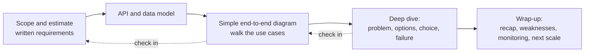
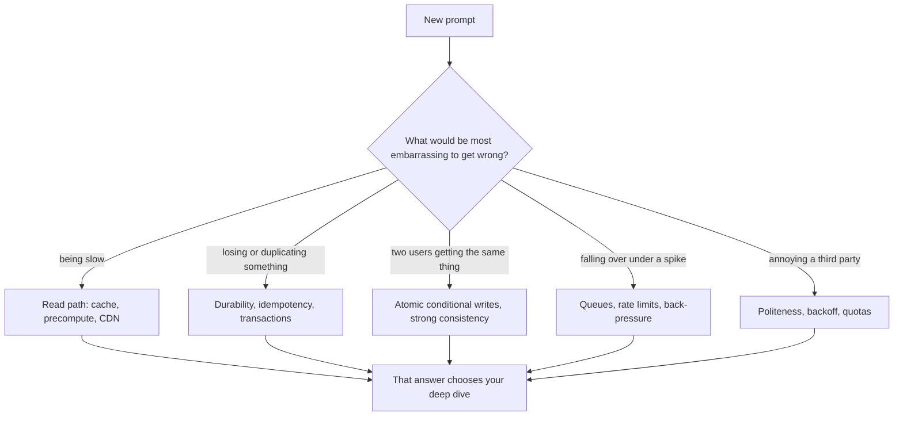
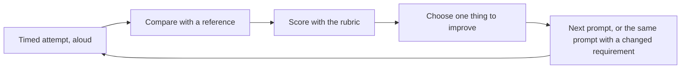

# Checklist, level expectations and how to practise

## Before this lesson

This lesson pulls the track together. You will get the most from it after the [framework lessons](#/lesson/system-design/framework-four-steps), at least a few of the classic designs (for example the [URL shortener](#/lesson/system-design/url-shortener-design), the [news feed](#/lesson/system-design/news-feed-design) and the [chat system](#/lesson/system-design/chat-design)) and the [building blocks module](#/lesson/system-design/bb-load-balancing-caching).

## In plain words

Knowing how systems work and performing well in a 45-minute design interview are related skills, not the same skill. The first is knowledge. The second is a performance, closer to a driving test or a piano recital: you already know the material, and you are judged on doing it fluently, in order, under time pressure, while talking.

Performances improve with three things: a **checklist** so that nothing important is forgotten when you are nervous, a clear idea of **what the examiner expects at your level**, and **deliberate practice** with feedback. Pilots use checklists for exactly this reason. They know how to fly; the checklist is there for the day they are tired or distracted.

This lesson gives you all three. The two lessons after it supply sixty practice prompts with outline answers.

## 1. The one-page checklist

Copy this somewhere you can see it while practising. In the interview you will not have it, which is why you rehearse until it is habit.

### Step 1: scope (about 5 to 8 minutes)

- [ ] Who are the users and what are the two or three core actions?
- [ ] What is explicitly **out of scope**?
- [ ] Scale: daily active users, actions per user, read to write ratio.
- [ ] Sizes: bytes per item, media or not, retention period.
- [ ] Latency target for the key operation, as a percentile.
- [ ] Availability target, and which matters more for this data: consistency or availability.
- [ ] Any special constraints: regions, privacy, cost, existing systems.
- [ ] Write the requirements down. Confirm them.
- [ ] Quick estimate: QPS (read and write), storage per year, one unusual number (connections, bandwidth, fan-out). **End with a conclusion.**

### Step 2: high-level design (about 10 to 15 minutes)

- [ ] API: three to six calls with methods, key parameters and responses.
- [ ] Data model: entities, primary keys, the index for each query, and which store holds each.
- [ ] Diagram: client, entry point, services, stores. Start with the smallest design that works.
- [ ] Add a cache, queue, CDN or blob store only with a stated reason.
- [ ] Walk each core use case through the diagram aloud.
- [ ] Check in: "Does this look reasonable? Where would you like me to go deeper?"

### Step 3: deep dive (about 15 to 20 minutes)

For each of two or three components:

- [ ] State the problem precisely, with a number.
- [ ] Offer two or three options.
- [ ] Compare them against the requirements.
- [ ] Choose, and name what the choice costs.
- [ ] Say how it fails and what happens then.

Run this list of probes over your own design before the interviewer does:

- [ ] What is the bottleneck at ten times the load?
- [ ] What is the single point of failure?
- [ ] What happens if this message or request arrives twice?
- [ ] What happens if this dependency is slow or down?
- [ ] Where can data be stale, and does it matter there?
- [ ] Where is the hot key or hot partition?
- [ ] What happens when the cache is empty?

### Step 4: wrap-up (about 3 to 5 minutes)

- [ ] Recap the design in four or five sentences.
- [ ] Name the weakest part and what you would do next.
- [ ] Monitoring: rate, errors, latency percentiles, plus the one or two metrics specific to this design.
- [ ] What changes at the next order of magnitude.



## 2. A map from problem features to techniques

Most interview problems are new combinations of a few recurring features. When you recognise the feature, you know which technique to reach for and which lesson to recall.

| If the problem has… | Think of… | Covered in |
|---|---|---|
| Reads far outnumbering writes | Caching, replicas, precomputation | [Scaling from zero I](#/lesson/system-design/scale-single-to-replicated) |
| Writes too many for one machine | Partitioning, append-only storage, queues | [Building blocks II](#/lesson/system-design/bb-databases-replication-partitioning) |
| One item delivered to many recipients | Fan-out on write or read, hybrid | [News feed II](#/lesson/system-design/news-feed-deep-dive) |
| The server must speak first | WebSocket, long polling, SSE, push | [Chat I](#/lesson/system-design/chat-design) |
| A burst far above the average | Queues, back-pressure, waiting room, rate limits | [Ticket booking](#/lesson/system-design/ticket-booking) |
| "Exactly one winner" (a seat, a username, a driver) | Atomic conditional write, unique constraint, strong consistency | [Ticket booking](#/lesson/system-design/ticket-booking) |
| Money or anything that must not repeat | Idempotency keys, ledger, reconciliation | [Payment system](#/lesson/system-design/payment-system) |
| Large files | Blob store, chunking, pre-signed URLs, CDN | [File sync I](#/lesson/system-design/file-sync-design) |
| "Near me" | Geospatial index | [Ride-hailing](#/lesson/system-design/ride-hailing) |
| Search by prefix or by words | Trie; inverted index | [Autocomplete I](#/lesson/system-design/autocomplete-design) |
| "Have I seen this before?" at huge scale | Bloom filter, content hashing | [Web crawler II](#/lesson/system-design/web-crawler-deep-dive) |
| Data spread over nodes that come and go | Consistent hashing | [Consistent hashing I](#/lesson/system-design/consistent-hashing-ring) |
| Must stay writable during failures | Leaderless replication, quorums, conflict resolution | [Key-value store](#/lesson/system-design/kv-store-cap-replication) |
| Unique, sortable identifiers from many machines | Snowflake-style IDs | [Unique ID II](#/lesson/system-design/unique-id-snowflake) |
| Work to run later or on a schedule | Queue, scheduler with leases | [Job scheduler](#/lesson/system-design/metrics-and-job-scheduler) |
| Protecting a service from callers | Rate limiter, load shedding, circuit breaker | [Rate limiter](#/lesson/system-design/rate-limiter-algorithms), [Building blocks IV](#/lesson/system-design/bb-apis-observability) |
| An outside provider you do not control | Queues, retries with backoff, dedup, failover provider | [Notification II](#/lesson/system-design/notification-reliability) |
| Expensive computation per request | Batching, caching, asynchronous results | [Model serving](#/lesson/system-design/model-serving-and-rag) |



## 3. What is expected at each level

The same prompt is given to candidates at different levels, and the bar moves. Titles vary between companies; the progression does not. Use this to aim your practice.

| Area | Junior / new graduate | Mid-level | Senior | Staff and above |
|---|---|---|---|---|
| **Scoping** | Asks basic questions when prompted | Asks about features and scale unprompted | Drives scoping; identifies which requirement shapes the design | Reframes the problem; surfaces requirements the interviewer did not state |
| **High-level design** | A working design with guidance | A complete, sensible design independently | A clean design with justified choices and clear data flow | The same, plus organisational and evolutionary considerations |
| **Depth** | Explains how one component works | Goes deep on one or two areas | Goes deep on several; knows real failure modes | Depth drawn from experience; can discuss what breaks in production |
| **Trade-offs** | Recognises a trade-off when pointed out | States trade-offs for main choices | Compares alternatives with numbers; knows when each wins | Weighs technical against cost, team and time; knows what not to build |
| **Scale and failure** | Mentions scaling ideas | Identifies bottlenecks when asked | Finds bottlenecks and failure modes unprompted | Designs for operations: rollout, migration, incident response |
| **Driving the interview** | Follows the interviewer | Shares the lead | Leads; manages time | Leads and adapts to the interviewer's interests fluidly |

What this means in practice:

- **Junior.** The bar is fundamentals and clear thinking. You are not expected to know how a wide-column store compacts files. You are expected to know what a cache, a queue and a replica are for, to reason sensibly, and to respond well to hints. Many companies give new graduates a lighter design round or none.
- **Mid-level.** Produce a complete, reasonable design without being led, and go deep in at least one place. Typical gaps: missing the hard part of the problem, and few alternatives.
- **Senior.** The interview is yours to run. Find the hard problems yourself, compare options quantitatively, raise failure handling and operations without being asked, and finish on time. A senior candidate who needs to be led through the deep dive is usually marked down a level.
- **Staff and above.** Depth and breadth are assumed. The differentiators are judgement about complexity, how the system evolves and is migrated, cost, how the work divides between teams, and the ability to simplify.

> [!INTERVIEW]
> The commonest way to be "down-levelled" is not a wrong design. It is a correct design delivered passively: waiting for the interviewer to ask about failures, bottlenecks and trade-offs instead of raising them. Ownership of the conversation is itself what is being graded at senior level.

## 4. How to practise

Reading solutions feels productive and builds recognition, not recall. The interview needs recall under time pressure, in speech. Practise that.

**A session, about an hour:**

1. Pick a prompt. Set a timer for 40 minutes.
2. Work on paper or a whiteboard, speaking aloud, following the four steps. Record yourself if you are alone.
3. Stop when the timer ends, finished or not.
4. Spend 15 minutes comparing with a reference (a lesson in this track, or an engineering blog post about a real system). List what you missed.
5. Score yourself with the rubric from [Framework II](#/lesson/system-design/framework-dos-donts).
6. Write down one thing to do differently next time. One.

**A four-week plan:**

| Week | Focus | Sessions |
|---|---|---|
| 1 | Foundations and estimation. Redo the estimates in this track from memory. Practise the first two steps only, on five prompts | 5 short |
| 2 | Classic designs, one per session, full length | 4 to 5 |
| 3 | Classic and "more" designs with a partner; alternate interviewer and candidate | 4 to 5 |
| 4 | Unseen prompts from the next two lessons under strict timing; review weak areas | 5 |

**Techniques that work:**

- **Vary a requirement.** After any design, change one thing ("make it global", "now strongly consistent", "ten thousand times more writes") and see what must change. Interviewers do this to test whether you understand or memorised.
- **Be the interviewer.** Asking the follow-up questions teaches you which ones are coming.
- **Explain a building block in two minutes** without notes: consistent hashing, a token bucket, quorum reads, a Bloom filter. If you cannot, reread that lesson.
- **Do the problems attached to this track.** Implementing a rate limiter, a hash ring or an LRU cache fixes the mechanism in memory in a way that reading does not.
- **Read how real systems were built.** Engineering blogs from companies that run large systems show the trade-offs that were made and why. Keep a short note per article: the problem, the chosen design, one thing that surprised you.
- **Space it out.** Four sessions a week for a month beats twenty in one weekend.



> [!TIP]
> If you have only a week, do not try to cover everything. Do the two framework lessons, estimation, and three contrasting designs properly: one read-heavy (news feed), one real-time (chat), one correctness-critical (payments or ticket booking). Then practise unseen prompts aloud.

> [!WARNING]
> Do not memorise architectures. Interviewers change the requirements precisely to break memorised answers, and a recited design with no reasoning behind it is easy to spot and scores poorly.

## 5. On the day

- **Bring a default structure, not a default design.** Requirements, estimate, API, data model, diagram, deep dive, wrap-up.
- **Write as you talk.** Requirements at the top of the board; numbers beside them; they are your reference for every later choice.
- **Narrate decisions in one pattern:** "I need X because of requirement Y; the options are A and B; I choose A because…; the cost is…".
- **Watch the clock at two points:** requirements written by about minute 8, diagram complete by about minute 20.
- **When interrupted, answer.** Then return: "coming back to the data model".
- **When you do not know, say so and reason.** "I have not used that system; the property I need is… and I would get it by…"
- **When you see a mistake in your own design, fix it aloud.** Catching your own error counts for you.
- **Leave two minutes for the recap.**

For remote interviews: test the drawing tool beforehand, type requirements into the shared document so the interviewer has them, and say more than you would in person, because the interviewer cannot see you thinking.

## 6. Where to go from here

The book this track follows closes by pointing to real-world systems and engineering blogs as the next step, and that advice is sound. Useful continuing sources:

- The site's own deeper tracks: [Databases and data-intensive systems](#/track/databases), [Networking](#/track/networking), [Redis](#/track/redis) and [Microservices](#/track/microservices).
- The System Design Primer's collection of real-world architectures and company engineering blogs.
- Papers behind the designs in this track: Dynamo (key-value stores), the Google File System and MapReduce (storage and batch processing), Bigtable (wide-column stores), Kafka (logs and streams), and the Gorilla paper (time-series compression).
- Your own work. Draw the architecture of a system you use, estimate its load, and ask where it would break at ten times the scale. That exercise, repeated, is what builds design judgement.

## Common mistakes

- **Practising silently, or only by reading.**
- **Never timing yourself.**
- **Practising only prompts you already like.**
- **Preparing a design instead of a method.**
- **Aiming at the wrong level:** deep internals when fundamentals are being assessed, or fundamentals only when ownership and depth are expected.
- **No feedback loop:** attempts with no comparison and no single concrete improvement.
- **Cramming the night before** instead of spacing sessions.

## Summary

- A design interview is a performance; a checklist, level awareness and deliberate practice improve it.
- The checklist follows the four steps: scope with numbers and a conclusion; API, data model and a simple diagram; deep dives using problem, options, choice, failure; a recap with weaknesses and monitoring.
- Most prompts combine recurring features, each with a known technique; ask what would be most embarrassing to get wrong to find the deep dive.
- Expectations rise from fundamentals with guidance (junior), to an independent complete design (mid-level), to driving the conversation with quantified trade-offs and unprompted failure handling (senior), to judgement about evolution, cost and simplicity (staff).
- Practise aloud, timed, with a reference to compare against and one improvement per session; vary requirements; play the interviewer.

## Glossary

- **Checklist**: a short list of steps used to avoid omissions under pressure.
- **Rubric**: the criteria and weights used to score a performance.
- **Level**: the seniority at which a candidate is being assessed.
- **Down-levelling**: being offered a role at a lower level than the one interviewed for.
- **Deliberate practice**: practice aimed at a specific weakness, with feedback.
- **Recognition / recall**: knowing something when you see it, versus producing it from memory.
- **Mock interview**: a practice interview with a partner playing the interviewer.
- **Follow-up question**: a question that probes a choice you made.
- **Probe**: a standard question used to test a design, such as "what if this fails?".
- **Spaced practice**: spreading sessions over time instead of concentrating them.

## Check yourself

```quiz
[
  {"q": "Why is reading worked solutions insufficient preparation by itself?",
   "options": ["Solutions are usually wrong", "It builds recognition, while the interview requires recall and structured speaking under time pressure", "Interviewers never use known problems", "Reading takes too long"],
   "answer": 1,
   "explain": "The skill tested is producing a design aloud against the clock. That is trained by timed, spoken attempts with feedback."},
  {"q": "According to the checklist, what should a quick estimate always end with?",
   "options": ["A precise number to four digits", "A conclusion about what the numbers mean for the design", "A list of technologies", "A database schema"],
   "answer": 1,
   "explain": "Numbers exist to drive decisions. An estimate with no 'therefore' is unfinished."},
  {"q": "Which behaviour most distinguishes a senior candidate from a mid-level one?",
   "options": ["Knowing more product names", "Driving the conversation and raising bottlenecks, failures and trade-offs without being asked", "Drawing more boxes", "Finishing faster"],
   "answer": 1,
   "explain": "Ownership of the discussion and unprompted reasoning about what can go wrong are core senior signals."},
  {"q": "A prompt involves many users competing for the last few items. Which technique from the feature map applies first?",
   "options": ["Fan-out on write", "Atomic conditional writes with strong consistency", "A CDN", "A trie"],
   "answer": 1,
   "explain": "'Exactly one winner' problems need the check and the claim to be one atomic step."},
  {"q": "After finishing a practice design, what does 'vary a requirement' mean?",
   "options": ["Start a different problem", "Change one requirement, such as making it global, and work out what must change in the design", "Add more servers", "Rewrite the API in another style"],
   "answer": 1,
   "explain": "It tests understanding instead of memory and mirrors what interviewers do."},
  {"q": "What question helps you find the right deep dive for an unfamiliar prompt?",
   "options": ["Which database is most popular?", "What would be most embarrassing to get wrong in this system?", "How many boxes can I draw?", "Which cloud provider is cheapest?"],
   "answer": 1,
   "explain": "The answer points to the defining risk: slowness, loss, double allocation, overload or impoliteness, and so to the component worth examining."},
  {"q": "You realise mid-interview that part of your design is wrong. What is the best response?",
   "options": ["Hope the interviewer does not notice", "Say so, explain why, and correct it", "Start again from the requirements", "Change the subject"],
   "answer": 1,
   "explain": "Catching and fixing your own error demonstrates the judgement being assessed."}
]
```

> **Source:** Xu, *System Design Interview: An Insider's Guide*, ch. 3 (framework) and ch. 16 ("The learning continues": real-world systems and engineering blogs) as a topic guide; System Design Primer, "How to approach a system design interview question" and "Real world architectures", https://github.com/donnemartin/system-design-primer
