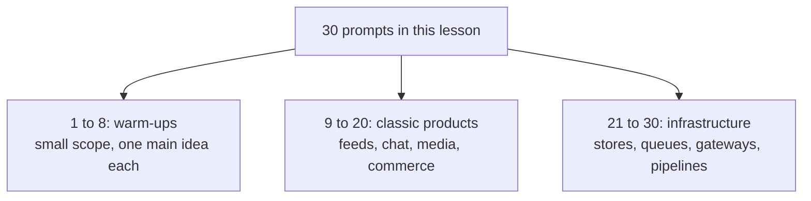

# Practice prompts 1 to 30 with outline answers

## Before this lesson

Read [Checklist, level expectations and how to practise](#/lesson/system-design/essentials-checklist-levels) first: it explains how to use these prompts. You should have worked through the [framework](#/lesson/system-design/framework-four-steps) and at least some of the classic designs.

## In plain words

This lesson is a set of exercises, like the problems at the end of a mathematics chapter. Each one is a prompt of the kind an interviewer gives, followed by a hidden **outline answer**.

An outline is a skeleton, not a full solution: the scope questions that matter most, the core of a reasonable design, the hard part the interviewer is likely to push on, and the usual traps. It is there for checking your own attempt, in the way an answer key is there for checking your working, not for reading instead of doing the work.

**How to use each prompt**

1. Read only the prompt. Do not open the outline.
2. Set a timer for 35 to 40 minutes and work through the four steps, aloud, on paper.
3. Open the outline. Compare. Note what you missed.
4. If a prompt maps to a lesson in this track, the outline links to it for the full treatment.


Each outline uses the same four headings:

- **Ask:** the scope questions that most change the design.
- **Core:** the central data model and flow.
- **Hard part:** where the deep dive should go.
- **Traps:** common mistakes on this prompt.

The prompts are grouped into three sets: warm-ups, classic products and infrastructure components.



## Warm-ups (1 to 8)

Small problems with one main idea each. Good for practising the first two steps of the framework quickly.

<details>
<summary><strong>1. Design a text-snippet sharing service (a pastebin)</strong></summary>

- **Ask:** maximum size, expiry, editing, private or public, read to write ratio.
- **Core:** `POST /snippets` returns a random 8-character id; `GET /snippets/{id}`. Metadata row (id, blob key, expiry) in a database; text in a blob store; cache in front for reads.
- **Hard part:** id generation (random with uniqueness check versus counter; guessability), and expiry (check on read, clean up in the background, cache TTL bounded by the time left).
- **Traps:** sequential ids that can be enumerated; writing metadata before the blob; over-engineering for a few requests per second.
- **See:** [Framework II](#/lesson/system-design/framework-dos-donts), which works this prompt in full.

</details>

<details>
<summary><strong>2. Design a URL shortener</strong></summary>

- **Ask:** links per day, retention, custom aliases, analytics, whether the same URL must return the same code.
- **Core:** key-value table `code -> long URL`, partitioned by code; derive code length from volume (62^7 is about 3.5 trillion); `GET /{code}` answers with a redirect.
- **Hard part:** code generation: unique counter plus base 62 (no collisions, predictable unless scrambled) versus truncated hash (collisions to resolve). 301 versus 302.
- **Traps:** ignoring collisions; counting clicks by updating the row on the read path; no handling of unknown codes.
- **See:** [URL shortener I](#/lesson/system-design/url-shortener-design) and [II](#/lesson/system-design/url-shortener-deep-dive).

</details>

<details>
<summary><strong>3. Design an in-memory cache with eviction (single node)</strong></summary>

- **Ask:** capacity in items or bytes, eviction policy, TTL support, concurrency.
- **Core:** a hash map for O(1) lookup plus a doubly linked list ordered by recency for O(1) LRU eviction; each entry stores an expiry time.
- **Hard part:** expiry without scanning (lazy check on access plus periodic sampling); thread safety (one lock, or striped locks per shard of the key space); memory accounting.
- **Traps:** O(n) eviction; forgetting that `get` changes recency; treating TTL and LRU as the same thing.
- **See:** [Building blocks I](#/lesson/system-design/bb-load-balancing-caching), and the problem "LRU Cache with TTL".

</details>

<details>
<summary><strong>4. Design a rate limiter for a public API</strong></summary>

- **Ask:** limit by what key, single server or distributed, are bursts allowed, hard or soft limit, what is returned when limited.
- **Core:** middleware in the gateway; token bucket per key; counters in a shared in-memory store with TTLs; `429` with `Retry-After`.
- **Hard part:** the read-modify-write race between gateways (atomic script or single atomic increment); behaviour when the store is down (fail open or closed, per rule); multi-region accuracy.
- **Traps:** local counters per gateway; fixed windows without mentioning the boundary burst; no timeout on the check.
- **See:** [Rate limiter I](#/lesson/system-design/rate-limiter-algorithms) and [II](#/lesson/system-design/rate-limiter-distributed).

</details>

<details>
<summary><strong>5. Design a unique ID generator for a sharded database</strong></summary>

- **Ask:** 64-bit or not, numeric, must sort by time, throughput, tolerance for gaps.
- **Core:** Snowflake layout: 41 bits of milliseconds from a custom epoch, 10 bits of machine id, 12 bits of sequence.
- **Hard part:** clock moving backwards (detect, wait or fail; prefer slewing), sequence overflow within a millisecond, unique machine ids via leases.
- **Traps:** UUIDs when 64-bit sortable ids were required; a single ticket server with no failover; claiming strict global order.
- **See:** [Unique ID I](#/lesson/system-design/unique-id-options) and [II](#/lesson/system-design/unique-id-snowflake).

</details>

<details>
<summary><strong>6. Design a real-time leaderboard for a game</strong></summary>

- **Ask:** number of players, update rate, what is shown (top 10, my rank, players around me), reset period, exactness.
- **Core:** a sorted structure keyed by score: an in-memory sorted set gives update, top-k and rank in O(log n). Durable score history in a database; the sorted set can be rebuilt from it.
- **Hard part:** scale beyond one node: partition by score range or by shard and merge the top-k from each shard; approximate rank for the long tail; ties (break by time achieved).
- **Traps:** `ORDER BY score` over millions of rows per request; treating the in-memory structure as the only copy.
- **See:** the [Redis track](#/track/redis) for sorted sets.

</details>

<details>
<summary><strong>7. Design a system that counts likes or views at very high rates</strong></summary>

- **Ask:** exact or approximate, how fresh, must each user count once, peak rate on a single item.
- **Core:** append events to a stream; aggregate in small time windows; keep counters in an in-memory store with atomic increments; flush periodically to durable storage.
- **Hard part:** the hot key (one viral item): split the counter into several sub-counters and sum; deduplicating a user's repeated like (a set per item, or a uniqueness constraint on user and item); idempotent increments on retry.
- **Traps:** a database row update per like; counting duplicates after retries; demanding exact, strongly consistent counts where nobody needs them.
- **See:** [News feed II](#/lesson/system-design/news-feed-deep-dive) on counters.

</details>

<details>
<summary><strong>8. Design an online voting or polling system</strong></summary>

- **Ask:** one vote per user or per device, can votes change, live results, peak rate (a television vote is a flash crowd), audit needs.
- **Core:** `votes(poll_id, user_id, option)` with a primary key on (poll, user) so a second vote is rejected or replaces the first; results from aggregated counters updated through a stream.
- **Hard part:** the spike: accept votes into a queue and acknowledge quickly; exactly one vote per user via the uniqueness constraint or an idempotency key; fraud and bots.
- **Traps:** incrementing a counter without recording who voted; computing results by scanning all votes on every page load.
- **See:** [Ticket booking](#/lesson/system-design/ticket-booking) for flash crowds.

</details>

## Classic products (9 to 20)

<details>
<summary><strong>9. Design a news feed</strong></summary>

- **Ask:** chronological or ranked, follower limits, daily users, media, freshness.
- **Core:** two flows. Publishing: store the post, fan out post ids to followers' feed caches through a queue. Retrieval: read ids from the feed cache, hydrate posts and authors in parallel batches.
- **Hard part:** accounts with millions of followers: hybrid fan-out (push for most, pull and merge for the largest). Cursor pagination. Skipping inactive users.
- **Traps:** a join over followees on every read; fan-out inside the request; full posts stored in every feed.
- **See:** [News feed I](#/lesson/system-design/news-feed-design) and [II](#/lesson/system-design/news-feed-deep-dive).

</details>

<details>
<summary><strong>10. Design a chat application (one-to-one and small groups)</strong></summary>

- **Ask:** group size, multiple devices, history retention, presence, end-to-end encryption.
- **Core:** WebSocket to stateful chat servers; session registry of who is connected where; messages in a wide-column store partitioned by channel, sorted by a per-channel sequence; per-recipient sync queues; push notifications when offline.
- **Hard part:** ordering and deduplication (server-assigned sequence, client message id), multi-device sync by cursor, presence with heartbeats, a chat server crash and the reconnection storm.
- **Traps:** polling; acknowledging before storing; presence tied to socket state.
- **See:** [Chat I](#/lesson/system-design/chat-design) and [II](#/lesson/system-design/chat-deep-dive).

</details>

<details>
<summary><strong>11. Design a notification service (push, SMS, email)</strong></summary>

- **Ask:** channels, volume and bursts, opt-outs, urgency classes, acceptable duplicates.
- **Core:** API accepts and returns 202; one queue and worker pool per channel; workers render templates and call third-party providers; a delivery log.
- **Hard part:** at-least-once delivery with deduplication by event id; retries with backoff and jitter; dead-letter queue; priorities so campaigns do not delay login codes; per-user frequency caps.
- **Traps:** calling providers synchronously; one queue for all channels; retrying permanent errors.
- **See:** [Notification I](#/lesson/system-design/notification-design) and [II](#/lesson/system-design/notification-reliability).

</details>

<details>
<summary><strong>12. Design a photo-sharing app</strong></summary>

- **Ask:** upload size, feed or profile grid only, daily users, filters or processing, global audience.
- **Core:** upload directly to blob storage with a pre-signed URL; a queue triggers workers that create thumbnails and several sizes; metadata (owner, keys, caption) in a database; images served through a CDN; the feed as in prompt 9.
- **Hard part:** storage and egress dominate (estimate them); image processing pipeline and its failure handling; the feed fan-out.
- **Traps:** images in the database; serving originals to phones; routing image bytes through application servers.
- **See:** [Estimation II](#/lesson/system-design/estimation-worked) and [Video platform I](#/lesson/system-design/video-design).

</details>

<details>
<summary><strong>13. Design a video-sharing platform</strong></summary>

- **Ask:** upload size, devices, daily watch time, live or on demand only.
- **Core:** resumable upload to blob storage; transcoding pipeline (a DAG) producing a bitrate ladder cut into segments with a manifest; delivery by CDN; small metadata service.
- **Hard part:** parallel transcoding by GOP chunks; adaptive bitrate decided by the player; CDN cost and the long tail of rarely watched videos.
- **Traps:** video through API servers; serving the original file; ignoring delivery cost.
- **See:** [Video platform I](#/lesson/system-design/video-design) and [II](#/lesson/system-design/video-deep-dive).

</details>

<details>
<summary><strong>14. Design a file storage and sync service</strong></summary>

- **Ask:** file size limit, devices, sharing, version history, encryption.
- **Core:** files split into content-addressed blocks in blob storage; a version is an ordered list of block hashes; metadata in a transactional database; clients notified by long polling and sync by cursor.
- **Hard part:** delta sync and content-defined chunking; all-or-nothing commits (pending then uploaded); conflicts (parent-version check, conflicted copy); reference-counted deletion.
- **Traps:** whole-file uploads; last write wins; eventual consistency for metadata.
- **See:** [File sync I](#/lesson/system-design/file-sync-design) and [II](#/lesson/system-design/file-sync-deep-dive).

</details>

<details>
<summary><strong>15. Design search autocomplete</strong></summary>

- **Ask:** prefix only, number of suggestions, ranking signal, freshness, languages.
- **Core:** offline pipeline aggregates query logs into frequencies and builds a trie with the top k cached at each node; suggestion servers answer from memory; responses cached by browser and CDN.
- **Hard part:** why not update in real time; sharding by data-balanced prefix ranges; removing bad suggestions at once with a filter layer; trending queries via a streaming path.
- **Traps:** `LIKE 'prefix%'` at scale; one path for updating and serving; no client debounce.
- **See:** [Autocomplete I](#/lesson/system-design/autocomplete-design) and [II](#/lesson/system-design/autocomplete-deep-dive).

</details>

<details>
<summary><strong>16. Design a web crawler</strong></summary>

- **Ask:** purpose, pages per month, content types, recrawl, storage period.
- **Core:** frontier, downloader with DNS cache, parser, content-seen check, link extractor, URL filter, URL-seen check, back to the frontier; content in blob storage.
- **Hard part:** politeness (one queue per host, a heap of next-allowed times); priority; Bloom filter for seen URLs; spider traps; hosts assigned to nodes by consistent hashing; checkpoints.
- **Traps:** depth-first search; a plain FIFO queue; ignoring robots.txt.
- **See:** [Web crawler I](#/lesson/system-design/web-crawler-design) and [II](#/lesson/system-design/web-crawler-deep-dive).

</details>

<details>
<summary><strong>17. Design a comment system with replies</strong></summary>

- **Ask:** nesting depth, sort orders (newest, top), volume per item, moderation, live updates.
- **Core:** `comments(comment_id, item_id, parent_id, author, text, created_at, score)` partitioned by `item_id`; index on (item, parent, sort key); cursor pagination; counts cached.
- **Hard part:** fetching a thread efficiently (limit depth, load children lazily, or store a materialised path); the hot item with a million comments; ranking by votes with cached scores; soft deletion that keeps the thread shape.
- **Traps:** recursive queries per page view; offset pagination on a list that changes; loading the whole tree.
- **See:** [Building blocks II](#/lesson/system-design/bb-databases-replication-partitioning) on indexes.

</details>

<details>
<summary><strong>18. Design a question-and-answer site</strong></summary>

- **Ask:** read to write ratio (very read-heavy), search, voting, reputation, tags.
- **Core:** relational data (questions, answers, votes, tags) with replicas; heavy caching of rendered question pages; a search index fed by change data capture; CDN for static assets.
- **Hard part:** search relevance and freshness; vote integrity (one vote per user per post, idempotent); cache invalidation when an answer or vote arrives; hot questions.
- **Traps:** sharding prematurely (this workload fits a few strong machines for a long time); treating the search index as the source of truth.
- **See:** [Scaling from zero I](#/lesson/system-design/scale-single-to-replicated).

</details>

<details>
<summary><strong>19. Design a product catalogue and shopping cart</strong></summary>

- **Ask:** catalogue size, attribute variety, search and filters, guest carts, stock reservation or not.
- **Core:** catalogue in a document or relational store with a search index for filtering; carts in a key-value store keyed by user or session, merged at login; prices and stock checked again at checkout.
- **Hard part:** the cart must always accept writes (favour availability; merge on conflict); stock accuracy at checkout (conditional decrement); price changes between adding and paying.
- **Traps:** strong consistency for cart contents; trusting the cart's stored price; decrementing stock when an item is added to a cart.
- **See:** [Key-value store I](#/lesson/system-design/kv-store-cap-replication).

</details>

<details>
<summary><strong>20. Design a hotel or room reservation system</strong></summary>

- **Ask:** rooms by type or specific rooms, overbooking policy, search by date and location, payment timing.
- **Core:** inventory as `(hotel, room_type, date, total, reserved)`; a booking decrements each night of the stay in one transaction with a condition `reserved + n <= total`; search served from a cached, slightly stale index.
- **Hard part:** no double booking across a range of dates (all nights or none); holds with expiry during payment; idempotent booking requests; time zones and check-in dates.
- **Traps:** check-then-write; one row per booking with overlap queries on every request; ignoring payment arriving after the hold expired.
- **See:** [Ticket booking](#/lesson/system-design/ticket-booking).

</details>

## Infrastructure components (21 to 30)

<details>
<summary><strong>21. Design a distributed key-value store</strong></summary>

- **Ask:** value size, consistency needs, availability target, total data, read and write mix.
- **Core:** consistent hash ring with virtual nodes; each key on N nodes; tunable quorums W and R; any node coordinates.
- **Hard part:** conflicting writes (vector clocks and siblings, or last write wins); failure handling (gossip, sloppy quorum with hinted handoff, Merkle-tree repair, read repair); storage engine (commit log, memtable, SSTables, Bloom filters).
- **Traps:** saying "CA"; treating W as the number of copies; deleting without tombstones.
- **See:** [Key-value store I](#/lesson/system-design/kv-store-cap-replication) and [II](#/lesson/system-design/kv-store-versioning-failures).

</details>

<details>
<summary><strong>22. Design a distributed cache cluster</strong></summary>

- **Ask:** data size, eviction policy, consistency expectations, what happens on node loss.
- **Core:** many cache nodes; clients route keys with consistent hashing; each node an LRU with TTLs; optional replicas per shard.
- **Hard part:** adding and removing nodes without mass misses; hot keys; stampede protection; cold start after a restart; stale data on a node that returns after being removed.
- **Traps:** modulo hashing; treating the cache as durable; no TTL.
- **See:** [Consistent hashing II](#/lesson/system-design/consistent-hashing-virtual-nodes) and [Building blocks I](#/lesson/system-design/bb-load-balancing-caching).

</details>

<details>
<summary><strong>23. Design a message queue</strong></summary>

- **Ask:** queue or log semantics, ordering, delivery guarantee, retention, throughput.
- **Core:** topics split into partitions, each an append-only log on disk replicated to followers; producers append; consumers track offsets; consumer groups share partitions.
- **Hard part:** durability and replication (acknowledge after a quorum of replicas); ordering only within a partition; consumer rebalancing; at-least-once delivery and idempotent consumers; retention and compaction.
- **Traps:** promising global order and exactly-once delivery; keeping messages only in memory.
- **See:** [Building blocks III](#/lesson/system-design/bb-cap-queues-idempotency) and the Databases lesson [Message brokers and partitioned logs](#/lesson/databases/brokers-logs).

</details>

<details>
<summary><strong>24. Design a distributed lock service</strong></summary>

- **Ask:** mutual exclusion strength needed (efficiency or correctness), lock duration, number of clients, behaviour on client crash.
- **Core:** a small strongly consistent store run by a consensus protocol; locks as leases with expiry and renewal; sessions with heartbeats.
- **Hard part:** a paused client that still believes it holds the lock: fencing tokens checked by the protected resource; clock assumptions; availability during a partition (the minority side cannot grant locks).
- **Traps:** a lock with no expiry; a single-node lock server; trusting the lock without fencing for correctness-critical work.
- **See:** the Databases lesson [Truth, majorities and fencing tokens](#/lesson/databases/truth-fencing), and the problem "Leader Election by Lease".

</details>

<details>
<summary><strong>25. Design an API gateway</strong></summary>

- **Ask:** which cross-cutting features, traffic, protocols, how routes are configured.
- **Core:** a stateless layer 7 proxy fleet: routing by path and host, TLS termination, authentication, rate limiting, request and response transformation, observability; configuration pushed from a control plane.
- **Hard part:** adding almost no latency; configuration changes without restarts and with safe rollout; protecting backends (timeouts, circuit breakers, load shedding); not becoming a single point of failure.
- **Traps:** business logic in the gateway; state in the gateway; one instance.
- **See:** [Building blocks IV](#/lesson/system-design/bb-apis-observability).

</details>

<details>
<summary><strong>26. Design a load balancer</strong></summary>

- **Ask:** layer 4 or layer 7, connections per second, session affinity, health checking.
- **Core:** a data plane that forwards connections or requests to a pool chosen by an algorithm; health checks; a control plane managing the pool.
- **Hard part:** the balancer's own availability (active and standby with a floating address, or several behind anycast); connection draining; choosing an algorithm for varied request costs (least connections, two choices); keeping connections stable when the balancer set changes (consistent hashing).
- **Traps:** a single balancer; round robin for very uneven work; health checks that depend on a shared dependency.
- **See:** [Building blocks I](#/lesson/system-design/bb-load-balancing-caching).

</details>

<details>
<summary><strong>27. Design a content delivery network</strong></summary>

- **Ask:** content types, global reach, cache control needs, purge speed.
- **Core:** edge caches in many locations; users routed to a near edge by DNS or anycast; on a miss the edge fetches from the origin and stores according to cache headers.
- **Hard part:** routing users to a healthy nearby edge; tiered caches to protect the origin; invalidation (purge propagation, versioned URLs); stampede on a popular miss; cache keys and variation by header.
- **Traps:** long TTLs with no invalidation plan; caching personal responses; forgetting the origin's capacity on a cold cache.
- **See:** [The five building blocks](#/lesson/system-design/core-components) and the Networking lesson on [CDNs](#/lesson/networking/measuring-cdn-compression).

</details>

<details>
<summary><strong>28. Design an object storage service</strong></summary>

- **Ask:** object sizes, durability target, consistency after write, listing needs.
- **Core:** a metadata service mapping bucket and key to the location of the data; data nodes storing object bytes; large objects in parts; replication or erasure coding across failure domains.
- **Hard part:** durability (how many copies, where, repair after disk loss); erasure coding versus replication (less storage, more work to rebuild); metadata scalability and listing by prefix; multipart uploads; integrity checksums.
- **Traps:** one metadata database with no partitioning plan; ignoring background repair; storing small and huge objects identically.
- **See:** [File sync I](#/lesson/system-design/file-sync-design).

</details>

<details>
<summary><strong>29. Design a centralised logging and log-search system</strong></summary>

- **Ask:** volume per day, retention, query patterns (search by text, by time, by service), freshness.
- **Core:** agents ship logs to a stream; indexers parse and write time-partitioned indexes; hot recent data on fast storage, old data compressed in object storage; a query service fans out by time range.
- **Hard part:** ingestion bursts during incidents (the buffer and back-pressure); index cost against search speed; retention tiers; multi-tenant limits so one noisy service does not starve others.
- **Traps:** indexing every field of everything for ever; no sampling or quotas; a design with no buffer between agents and indexers.
- **See:** [Building blocks IV](#/lesson/system-design/bb-apis-observability) and [Metrics system](#/lesson/system-design/metrics-and-job-scheduler).

</details>

<details>
<summary><strong>30. Design a configuration and feature-flag service</strong></summary>

- **Ask:** how fast changes must propagate, number of clients, targeting rules (by user, by percentage), audit needs.
- **Core:** a small strongly consistent store of versioned configuration; clients fetch and cache locally, then receive updates by long polling or streaming; evaluation happens in the client library from the local copy.
- **Hard part:** availability: services must keep running on their last known configuration if the service is down; safe rollout of a change (staged, with automatic rollback); consistent percentage targeting (hash of user id); audit history.
- **Traps:** a network call per flag evaluation; no local cache; pushing a bad configuration to every client at once.
- **See:** [Autocomplete II](#/lesson/system-design/autocomplete-deep-dive) on atomic swaps, and [Building blocks IV](#/lesson/system-design/bb-apis-observability).

</details>

## Patterns across these thirty

After working through a set, look across them. The same few moves keep appearing:

| Move | Appears in prompts |
|---|---|
| Large bytes bypass application servers (pre-signed upload, CDN delivery) | 1, 12, 13, 14, 28 |
| Accept fast, process later through a queue | 7, 8, 11, 12, 13, 29 |
| Precompute for a read-heavy path | 6, 9, 15, 18 |
| Atomic conditional write for a contended resource | 8, 19, 20, 24 |
| Consistent hashing to place data on changing nodes | 16, 21, 22, 26 |
| A derived store fed from the source of truth | 6, 15, 18, 19, 29 |
| Idempotency for retries | 7, 8, 11, 20, 23 |
| Stay usable on stale data when a dependency is down | 4, 15, 27, 30 |

If you can name which moves a new prompt needs within the first few minutes, the rest of the interview is filling in details you already know.

> [!TIP]
> For warm-ups, practise only the first twenty minutes: scope, estimate, API, data model, diagram. Doing that five times in an evening builds the opening fluency that many candidates lack.

> [!INTERVIEW]
> Interviewers frequently rename a known problem. "Design a system to share code snippets", "design a link service for marketing campaigns" and "design a coupon-code generator" are prompts 1, 2 and 5 in different clothes. Train yourself to recognise the shape under the wording.

> [!WARNING]
> An outline is not the bar. In a real interview each "hard part" line expands into ten minutes of options, comparison and failure handling. If you could not have produced that discussion, go back to the linked lesson.

## Summary

- Thirty prompts in three groups: warm-ups with one main idea, classic products, and infrastructure components.
- Use each as a timed, spoken exercise first, and as an answer key second.
- Each outline gives the decisive scope questions, the core design, the hard part and the usual traps.
- A small set of moves recurs across prompts: bypassing application servers for large bytes, accepting then processing asynchronously, precomputing for reads, atomic conditional writes, consistent hashing, derived stores, idempotency, and degrading gracefully.

## Glossary

- **Prompt**: the one-line problem statement given by an interviewer.
- **Outline answer**: a skeleton of a solution: key questions, core design, hard part and traps.
- **Warm-up**: a small problem used to practise the opening steps.
- **Hard part**: the aspect of a problem that deserves the deep dive.
- **Trap**: a mistake commonly made on a particular prompt.
- **Materialised path**: storing each node's full ancestry so a subtree can be fetched with one range query.
- **Erasure coding**: storing data as fragments with redundancy so that it survives the loss of some fragments using less space than full copies.
- **Anycast**: announcing one IP address from many locations so that traffic reaches the nearest.
- **Control plane / data plane**: the part that manages configuration, and the part that handles traffic.
- **Soft deletion**: marking a record as deleted without removing it.

## Check yourself

```quiz
[
  {"q": "What is the recommended way to use an outline answer?",
   "options": ["Read it before attempting the prompt", "Attempt the prompt under a timer first, then compare and note what was missed", "Memorise it", "Skip it"],
   "answer": 1,
   "explain": "The outline is an answer key. The learning comes from producing your own attempt and then finding the gaps."},
  {"q": "A prompt asks for a coupon-code generator producing short unique codes. Which earlier design is it closest to?",
   "options": ["News feed", "URL shortener and unique ID generator", "Web crawler", "Chat system"],
   "answer": 1,
   "explain": "Generating compact, unique, hard-to-guess codes and resolving them is the same shape as short links and ID generation."},
  {"q": "For a real-time leaderboard, why is ORDER BY score on every request a poor design?",
   "options": ["SQL cannot sort", "It sorts millions of rows per request; a sorted structure gives rank and top-k in logarithmic time", "Scores are not numbers", "It breaks consistency"],
   "answer": 1,
   "explain": "A sorted set maintains order incrementally, so reads do not repeat the sort."},
  {"q": "In the reservation prompt, why must all nights of a stay be reserved in one transaction?",
   "options": ["To make the query shorter", "So a booking never holds some nights and not others", "Because hotels require it", "To avoid indexes"],
   "answer": 1,
   "explain": "Availability must hold for every date in the range. All-or-nothing prevents partial bookings."},
  {"q": "Why should feature-flag evaluation happen in the client library from a local copy?",
   "options": ["To avoid storing flags", "A network call per evaluation adds latency and makes every service depend on the flag service being up", "Clients cannot make network calls", "Flags never change"],
   "answer": 1,
   "explain": "Local evaluation is fast and keeps services running on the last known configuration during an outage."},
  {"q": "Which move is shared by the photo-sharing, video and object-storage prompts?",
   "options": ["Fan-out on write", "Large bytes bypass application servers", "Vector clocks", "Tries"],
   "answer": 1,
   "explain": "Uploads go straight to storage with pre-signed URLs and downloads come from a CDN or the store, keeping application servers small."},
  {"q": "A distributed lock is used to protect a correctness-critical write. What is needed beyond a lease with expiry?",
   "options": ["A longer expiry", "A fencing token checked by the protected resource, so a paused former holder is rejected", "A second lock", "Nothing"],
   "answer": 1,
   "explain": "A client can believe it holds an expired lease. The resource must refuse writes carrying an older token."}
]
```

> **Source:** Xu, *System Design Interview: An Insider's Guide*, ch. 3 to 15 as a topic guide for the classic prompts; System Design Primer, "System design interview questions with solutions", https://github.com/donnemartin/system-design-primer
