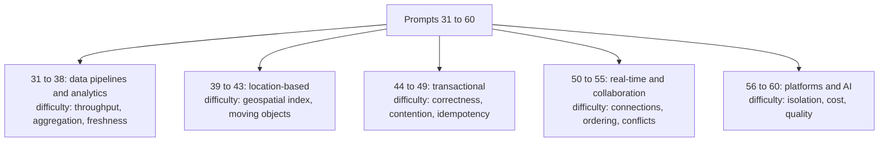
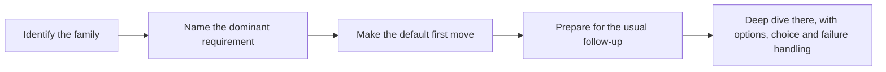

# Practice prompts 31 to 60 with outline answers

## Before this lesson

Read [Checklist, level expectations and how to practise](#/lesson/system-design/essentials-checklist-levels) and try some of [Practice prompts 1 to 30](#/lesson/system-design/practice-prompts-1) first. The prompts here lean on the [building blocks module](#/lesson/system-design/bb-cap-queues-idempotency) and the [more designs module](#/lesson/system-design/ride-hailing).

## In plain words

The first thirty prompts were mostly problems this track solved in full. These thirty are further from the worked examples. That is deliberate: a real interview is rarely a problem you have seen, and the skill being tested is carrying what you know to somewhere new.

A musician who has learned ten pieces by heart can play ten pieces. A musician who has learned scales, chords and how pieces are put together can play something unfamiliar at sight. The lessons were the pieces. These prompts are sight-reading.

For each prompt, before designing anything, decide which **family** it belongs to, because the family tells you where the difficulty lies.



Use each prompt as before: read only the prompt, attempt it against a timer, aloud, then open the outline. The headings are the same: **Ask**, **Core**, **Hard part**, **Traps**.

## Data pipelines and analytics (31 to 38)

<details>
<summary><strong>31. Design a metrics and monitoring system</strong></summary>

- **Ask:** number of sources and metrics, reporting interval, retention, alerting, query freshness.
- **Core:** collectors (pull or push) feed a stream; writers store into a time-series database; a query service serves dashboards; rule evaluation feeds an alert manager.
- **Hard part:** write volume and compression; downsampling tiers; label cardinality; alert deduplication and routing; monitoring the monitor.
- **Traps:** unbounded labels; a general-purpose database; full detail kept for ever.
- **See:** [Metrics and job scheduler](#/lesson/system-design/metrics-and-job-scheduler).

</details>

<details>
<summary><strong>32. Design a distributed job scheduler</strong></summary>

- **Ask:** one-off or recurring, number of jobs, timing accuracy, retry policy, missed-run policy.
- **Core:** jobs with an indexed next-run time; scheduler nodes owning buckets by lease; runs inserted under a unique key and placed on a queue; workers with heartbeat leases; a reaper for abandoned runs.
- **Hard part:** no duplicate triggers; recovering from worker and scheduler failure; at-least-once execution and idempotent jobs; the top-of-the-hour burst.
- **Traps:** scanning all jobs; a single scheduler; promising exactly-once execution.
- **See:** [Metrics and job scheduler](#/lesson/system-design/metrics-and-job-scheduler).

</details>

<details>
<summary><strong>33. Design an ad-click aggregation system</strong></summary>

- **Ask:** clicks per second, which aggregates (clicks per ad per minute, top ads), how fresh, how exact (billing depends on it), late events.
- **Core:** click events into a stream; a stream processor aggregates in one-minute windows keyed by ad; results in an analytics store; raw events archived to cheap storage for recomputation.
- **Hard part:** exactly-once counting for billing (deduplicate by click id; idempotent writes of window results); late and out-of-order events (event time, watermarks, corrections); a nightly batch recomputation reconciling the stream's results; fraud filtering.
- **Traps:** counting by processing time; no raw data to recompute from; a hot ad overloading one partition.
- **See:** the Databases lesson [Processing streams](#/lesson/databases/processing-streams).

</details>

<details>
<summary><strong>34. Design a "trending now" (top-k) service</strong></summary>

- **Ask:** trending over which window, how many items, exact or approximate, per region or global, update frequency.
- **Core:** events into a stream; counts per item per small time bucket; a sliding window sums recent buckets; a heap keeps the top k; results cached and served.
- **Hard part:** memory for counting millions of distinct items (approximate structures such as a count-min sketch, or exact counts per partition merged afterwards); "trending" as growth rate versus plain volume; manipulation and filtering.
- **Traps:** recomputing from all history per request; one global counter map on one machine; ignoring decay of old events.
- **See:** [Autocomplete II](#/lesson/system-design/autocomplete-deep-dive) on trending.

</details>

<details>
<summary><strong>35. Design an analytics event ingestion pipeline</strong></summary>

- **Ask:** events per second, schema control, latency to dashboards, retention, who queries and how.
- **Core:** SDKs batch events to collectors; collectors validate and write to a stream; consumers land raw data in object storage (the data lake) and load a column-oriented warehouse; a stream path feeds real-time dashboards.
- **Hard part:** schema evolution and validation; duplicates from client retries (event ids); late data and partitioning by event time; back-pressure during spikes; cost of storage and queries.
- **Traps:** writing events straight into the warehouse; no raw copy; unbounded client-side buffers.
- **See:** the Databases lessons [OLTP vs OLAP](#/lesson/databases/olap-column-stores) and [Encoding and schema evolution](#/lesson/databases/encoding-formats).

</details>

<details>
<summary><strong>36. Design a web search engine</strong></summary>

- **Ask:** corpus size, query rate, freshness, ranking depth expected (usually keep it simple).
- **Core:** crawler feeds an indexing pipeline that builds an **inverted index** (term to list of documents); the index is sharded by document; a query fans out to all shards, each returns its top results, and a merger ranks them.
- **Hard part:** index size and compression; the scatter-gather query and its tail latency; incremental index updates; ranking signals; caching popular queries.
- **Traps:** scanning documents at query time; sharding by term without discussing hot terms; ignoring tail latency from fan-out.
- **See:** [Web crawler I](#/lesson/system-design/web-crawler-design) and [The vocabulary of scale](#/lesson/system-design/core-vocabulary) on tail latency.

</details>

<details>
<summary><strong>37. Design the serving side of a recommendation system</strong></summary>

- **Ask:** what is recommended, latency budget, how fresh, cold start for new users and items.
- **Core:** two stages: **candidate generation** retrieves a few hundred items quickly (precomputed lists, nearest neighbours in an embedding index); **ranking** scores them with a heavier model; then business rules and deduplication.
- **Hard part:** latency of feature lookup and model scoring (feature store, batching, caching); freshness of user activity; fallbacks when a stage times out (popular items); evaluation by experiment.
- **Traps:** scoring the whole catalogue per request; no fallback; ignoring training-serving skew.
- **See:** [Model serving and RAG](#/lesson/system-design/model-serving-and-rag).

</details>

<details>
<summary><strong>38. Design real-time fraud detection for card transactions</strong></summary>

- **Ask:** decision latency (often under 100 ms, inline with the payment), transaction rate, tolerance for false declines, how feedback arrives.
- **Core:** the payment path calls a risk service; it fetches features (velocity counters, device and account history) from a low-latency store, applies rules and a model, and returns approve, decline or review; events also flow to a stream that updates features.
- **Hard part:** features over sliding windows updated in real time; a strict deadline with a safe default if the service is slow; labels that arrive weeks later (chargebacks); explaining decisions.
- **Traps:** a synchronous dependency with no timeout or fallback; features computed differently offline and online.
- **See:** [Payment system](#/lesson/system-design/payment-system) and [Model serving and RAG](#/lesson/system-design/model-serving-and-rag).

</details>

## Location-based (39 to 43)

<details>
<summary><strong>39. Design ride-hailing dispatch</strong></summary>

- **Ask:** drivers online, update interval, matching time target, regions.
- **Core:** ephemeral driver locations in an in-memory geospatial index per region; ride requests through a queue to a matcher that ranks nearby drivers by driving time; trips in a relational store.
- **Hard part:** the write rate of location updates; preventing double assignment with an atomic, expiring reservation; offer timeouts; the trip state machine.
- **Traps:** persisting every location on the hot path; straight-line distance only; no reservation expiry.
- **See:** [Ride-hailing dispatch](#/lesson/system-design/ride-hailing).

</details>

<details>
<summary><strong>40. Design a food-delivery platform</strong></summary>

- **Ask:** which part: ordering, restaurant side, courier dispatch, tracking. Scale per city.
- **Core:** three parties and an order state machine (placed, accepted, preparing, picked up, delivered); menus as cached catalogue data; courier dispatch as in prompt 39 with a pickup and a drop-off; live tracking over WebSocket.
- **Hard part:** dispatch timing (assign a courier so that arrival matches food readiness); batching several orders per courier; estimated delivery time; payment split between restaurant, courier and platform.
- **Traps:** treating it as ride-hailing with no preparation time; one synchronous flow across all three parties.
- **See:** [Ride-hailing dispatch](#/lesson/system-design/ride-hailing).

</details>

<details>
<summary><strong>41. Design a "nearby places" service</strong></summary>

- **Ask:** number of places, search radius options, filters (category, open now), read to write ratio (very read-heavy; places rarely change).
- **Core:** places stored with a geohash or cell id; a query computes the cells covering the radius, fetches candidates, filters by exact distance and attributes; results cached by cell.
- **Hard part:** choosing cell precision for the radius; cell boundaries (always include neighbours); dense city centres versus empty countryside (quadtree or multi-resolution cells); read replicas and caching.
- **Traps:** separate indexes on latitude and longitude; the same design as moving drivers (here the data is static, so it can live in a replicated database and be cached heavily).
- **See:** [Ride-hailing dispatch](#/lesson/system-design/ride-hailing) on geospatial indexes.

</details>

<details>
<summary><strong>42. Design a maps service with routing and arrival-time estimates</strong></summary>

- **Ask:** map rendering, routing, live traffic, or all three; scale; freshness of traffic.
- **Core:** map images as pre-rendered **tiles** at several zoom levels served from a CDN; the road network as a graph partitioned into regions; routing by shortest-path search with precomputed shortcuts between regions; traffic from aggregated location reports adjusting edge weights.
- **Hard part:** routing across a continent quickly (hierarchical precomputation instead of plain search); updating travel times from live data; recomputing a route when the driver deviates.
- **Traps:** rendering tiles per request; running an unpartitioned shortest-path search over the whole graph.
- **See:** the [DSA track](#/track/neet-heap-graphs) for shortest-path algorithms.

</details>

<details>
<summary><strong>43. Design a "friends nearby" feature</strong></summary>

- **Ask:** update frequency, friends per user, precision and privacy controls, battery constraints.
- **Core:** clients send locations over a persistent connection; latest location per user in an in-memory store with a TTL; each update is published to the user's friends who are online and within range.
- **Hard part:** fan-out of location updates to friends (publish and subscribe per user, with subscribers filtering by distance); scaling the pub/sub layer; reducing updates when stationary; privacy and opt-in.
- **Traps:** polling all friends' locations; storing location history by default; ignoring battery.
- **See:** [Chat II](#/lesson/system-design/chat-deep-dive) on presence.

</details>

## Transactional systems (44 to 49)

<details>
<summary><strong>44. Design a payment system for a marketplace</strong></summary>

- **Ask:** payment methods, whether card data is handled, pay-in and pay-out, volume, reconciliation.
- **Core:** payment service with payment orders as a state machine; a PSP-hosted page; signed webhooks for results; a double-entry, append-only ledger; wallet balances as a cache of the ledger.
- **Hard part:** no double charge (idempotency keys and a unique reference to the PSP); the unknown state after a timeout; atomic update of status, ledger and wallet; daily reconciliation.
- **Traps:** floating-point money; treating a timeout as failure; a mutable balance with no ledger.
- **See:** [Payment system](#/lesson/system-design/payment-system).

</details>

<details>
<summary><strong>45. Design a digital wallet with transfers between users</strong></summary>

- **Ask:** transfer rate, whether both accounts can be on different shards, limits and fraud checks, audit requirements.
- **Core:** accounts and a double-entry ledger; a transfer debits one account and credits another atomically, with an idempotency key.
- **Hard part:** atomicity across two accounts: one database transaction if both are on one shard; otherwise a saga (debit, then credit, with a compensating reversal) or routing each transfer through a ledger that records both entries in one place; no negative balances under concurrency (conditional update or row lock, locking accounts in a fixed order to avoid deadlock).
- **Traps:** read balance then write; two-phase commit as a first resort; no reversals.
- **See:** [Payment system](#/lesson/system-design/payment-system), and the problem "Idempotent Transfers with a Double-Entry Ledger".

</details>

<details>
<summary><strong>46. Design a stock exchange matching engine</strong></summary>

- **Ask:** order types, latency expectations (microseconds), fairness rules, throughput, recovery requirements.
- **Core:** an **order book** per symbol: buy orders sorted by price descending and sell orders ascending, each price level a first-in, first-out queue; an incoming order matches against the best opposite price.
- **Hard part:** strict ordering and determinism: one thread per symbol processes a sequenced input log, so there is no locking and a replica replaying the same log reaches the same state; durability by logging every input before processing; publishing trades and market data.
- **Traps:** a database transaction per match; several writers to one book; relying on wall-clock time for order priority.
- **See:** the Databases lessons on [ordering and total order broadcast](#/lesson/databases/ordering).

</details>

<details>
<summary><strong>47. Design a ticket-booking system</strong></summary>

- **Ask:** numbered seats or general admission, hold time, peak arrivals at on-sale, limits per user.
- **Core:** a row per seat per event; atomic conditional update to hold; hold as row state with expiry; conditional confirm after payment; cached seat map.
- **Hard part:** overselling; the flash crowd (virtual waiting room with admission tokens); payment arriving after the hold expired.
- **Traps:** check-then-write; holding a transaction open during payment; scaling the booking path to match arrivals.
- **See:** [Ticket booking](#/lesson/system-design/ticket-booking).

</details>

<details>
<summary><strong>48. Design a flash sale for limited stock</strong></summary>

- **Ask:** stock quantity, expected visitors, one per customer or not, payment window.
- **Core:** a static, cached sale page; at the start, requests pass a gate that admits little more than the stock; stock as a counter decremented atomically where remaining is positive; successful decrements become orders through a queue.
- **Hard part:** rejecting most traffic cheaply (rate limits, a token gate, an in-memory stock counter in front of the database); exactly one unit per user (uniqueness on user and sale); returning stock when payment is not completed.
- **Traps:** every request reaching the database; decrementing without a condition (negative stock); no purchase limit, inviting bots.
- **See:** [Ticket booking](#/lesson/system-design/ticket-booking).

</details>

<details>
<summary><strong>49. Design an online auction system</strong></summary>

- **Ask:** bid rate near closing time, proxy bidding, extension rules, how winners are notified.
- **Core:** each item has a current highest bid; a new bid is accepted with a conditional update "where amount is greater than the current highest and the auction is open"; bids appended to a history; watchers updated over WebSocket.
- **Hard part:** contention in the final seconds on a single item (serialise bids per item: single writer or the conditional update); a precise, server-side closing time and anti-sniping extensions; fan-out of updates to many watchers.
- **Traps:** trusting client timestamps; read-then-write for the highest bid; closing by a client-side timer.
- **See:** [Ticket booking](#/lesson/system-design/ticket-booking) on atomic conditional writes.

</details>

## Real-time and collaboration (50 to 55)

<details>
<summary><strong>50. Design a collaborative document editor</strong></summary>

- **Ask:** concurrent editors per document, offline editing, rich text or plain, history and comments.
- **Core:** clients hold a local copy and send small operations over WebSocket; a server per document orders operations and broadcasts them; periodic snapshots plus an operation log for storage.
- **Hard part:** merging concurrent edits so that all clients converge: **operational transformation** (a central server transforms operations against concurrent ones) or **CRDTs** (data structures that merge without a central order); cursor presence; routing all editors of one document to the same server.
- **Traps:** last write wins on the whole document; locking the document for one editor; sending the full text on every keystroke.
- **See:** the Databases lesson [Detecting concurrent writes](#/lesson/databases/concurrent-writes).

</details>

<details>
<summary><strong>51. Design a live-streaming platform</strong></summary>

- **Ask:** latency target (seconds versus sub-second), viewers per stream, chat, recording.
- **Core:** the broadcaster pushes a stream to an ingest server; it is transcoded in real time into a small bitrate ladder and cut into short segments; segments are distributed through a CDN; players use adaptive bitrate.
- **Hard part:** the trade-off between latency and stability (shorter segments, low-latency protocol variants); a viral stream with millions of viewers (CDN capacity, origin protection); live chat fan-out; failover of ingest.
- **Traps:** reusing the on-demand pipeline with long segments; one ingest point; chat messages pushed individually to millions.
- **See:** [Video platform II](#/lesson/system-design/video-deep-dive).

</details>

<details>
<summary><strong>52. Design a video-conferencing system</strong></summary>

- **Ask:** participants per call, latency requirement (well under half a second), recording, screen sharing.
- **Core:** a signalling service sets up calls; media flows over UDP-based real-time protocols; for groups, a **selective forwarding unit (SFU)** receives each participant's stream and forwards it to the others without decoding.
- **Hard part:** topology (peer-to-peer for two, SFU for groups, mixing only for very large calls); adapting quality per receiver (several encodings of each stream); getting through firewalls with relay servers; choosing a media server near participants.
- **Traps:** TCP and buffering for interactive media; a full mesh for twenty participants; treating it like on-demand video.
- **See:** the Networking lesson [WebSocket, WebRTC and choosing a transport](#/lesson/networking/websocket-webrtc).

</details>

<details>
<summary><strong>53. Design matchmaking and session servers for a multiplayer game</strong></summary>

- **Ask:** players per match, skill matching, regions and latency limits, session length, reconnects.
- **Core:** players join a matchmaking queue with skill and region; a matcher forms groups, widening the allowed skill range as waiting time grows; a fleet manager assigns a game server; clients connect directly to it; results are written back when the match ends.
- **Hard part:** balancing match quality against waiting time; allocating stateful game servers and scaling the fleet; reconnecting a dropped player to the same session; authoritative server state to prevent cheating.
- **Traps:** stateless assumptions for game servers; matching across regions with poor latency; trusting clients.
- **See:** [Chat I](#/lesson/system-design/chat-design) on stateful servers.

</details>

<details>
<summary><strong>54. Design an email service</strong></summary>

- **Ask:** sending, receiving, or both; mailbox size; search; attachments; spam filtering.
- **Core:** inbound mail servers accept messages and queue them; processing (spam and virus checks) then stores message metadata per user in a wide-column store sorted by time, bodies and attachments in blob storage; outbound through a queue with retries; a search index per user.
- **Hard part:** durability (never lose accepted mail); storage layout for "list a folder newest first"; attachment deduplication; outbound reputation and retries over days; search.
- **Traps:** bodies and attachments in a relational database; synchronous delivery; ignoring spam.
- **See:** [Chat I](#/lesson/system-design/chat-design) on storage choice and [Notification II](#/lesson/system-design/notification-reliability) on retries.

</details>

<details>
<summary><strong>55. Design a calendar with meeting scheduling</strong></summary>

- **Ask:** recurring events, time zones, shared calendars, free and busy lookup, reminders, room booking.
- **Core:** events stored per calendar with start and end in UTC plus the original time zone; recurring events stored as a rule and expanded when read; invitations as per-attendee copies or references with a response status; reminders through a job scheduler.
- **Hard part:** recurrence with exceptions ("every Tuesday except this one"); time zones and daylight saving; finding a free slot across many attendees (merge busy intervals); double-booking a room (conditional insert on the room's time range).
- **Traps:** materialising infinite recurrences; storing local times only; check-then-book for rooms.
- **See:** [Metrics and job scheduler](#/lesson/system-design/metrics-and-job-scheduler) for reminders.

</details>

## Platforms and AI systems (56 to 60)

<details>
<summary><strong>56. Design an online code judge</strong></summary>

- **Ask:** languages, submissions per second (contest spikes), time and memory limits, result latency.
- **Core:** submissions stored and placed on a queue; workers run each in an isolated **sandbox** (container or virtual machine with no network and strict limits) against test cases; verdicts written back and pushed to the user.
- **Hard part:** security of running untrusted code (isolation, resource limits, no outbound access, discard the sandbox afterwards); fairness of timing across machines; the spike at the end of a contest (queue, autoscaled workers, priorities); test-case storage and caching.
- **Traps:** executing code on the web server; sharing a sandbox between submissions; synchronous execution in the request.
- **See:** [Scaling from zero II](#/lesson/system-design/scale-stateless-to-sharded) on queues and workers.

</details>

<details>
<summary><strong>57. Design a continuous integration and deployment system</strong></summary>

- **Ask:** repositories and builds per day, build duration, isolation between tenants, artefact storage, deployment strategy.
- **Core:** a webhook from the code host creates a pipeline (a DAG of jobs); a scheduler queues jobs; runners execute each job in a fresh container; logs stream to storage and to the user; artefacts go to blob storage; a deploy stage rolls out gradually.
- **Hard part:** runner capacity and autoscaling; caching dependencies and build layers; isolating secrets and untrusted pull requests; streaming logs; safe deployment (canary, automatic rollback).
- **Traps:** long-lived shared runners; secrets exposed to builds from forks; no cache, so every build starts from nothing.
- **See:** the [CI/CD track](#/track/cicd), and [Video platform II](#/lesson/system-design/video-deep-dive) on DAG pipelines.

</details>

<details>
<summary><strong>58. Design a platform for serving machine-learning models</strong></summary>

- **Ask:** online or batch, number of models and versions, latency target, CPU or GPU.
- **Core:** a gateway and router in front of per-version model server pools loading immutable artefacts from a registry; an online feature store; a prediction log.
- **Hard part:** dynamic batching against the latency target; shadow and canary rollouts; autoscaling on queue depth with warm replicas; drift monitoring.
- **Traps:** no batching on GPUs; scaling on CPU; replacing a version all at once.
- **See:** [Model serving and RAG](#/lesson/system-design/model-serving-and-rag).

</details>

<details>
<summary><strong>59. Design a question-answering assistant over internal documents</strong></summary>

- **Ask:** corpus size and update rate, permissions, latency, hosted or self-hosted model, citation requirement.
- **Core:** ingestion (parse, chunk, embed, index with access lists); query (rewrite, hybrid retrieval filtered by permissions, rerank, prompt with passages, stream the answer with citations).
- **Hard part:** access control at retrieval time; grounding and the "I do not know" path; prompt injection from documents; token cost and time to first token; evaluation as a release gate.
- **Traps:** filtering after generation; no evaluation set; whole documents in the prompt.
- **See:** [Model serving and RAG](#/lesson/system-design/model-serving-and-rag).

</details>

<details>
<summary><strong>60. Design a multi-tenant gateway in front of large language models</strong></summary>

- **Ask:** tenants, models and providers behind it, what is limited (requests, tokens, spend), streaming, logging and privacy rules.
- **Core:** a stateless gateway authenticates the tenant, checks quotas, routes to a model or provider, streams the response, and records usage (tokens in and out, latency, cost).
- **Hard part:** rate limiting by tokens when the output length is unknown in advance (reserve an estimate, then settle the difference); fairness between tenants sharing limited capacity (per-tenant queues, weighted scheduling); failover between providers; caching identical requests; budgets and alerts on spend; redacting sensitive data in logs.
- **Traps:** limiting requests only, when cost is per token; buffering whole responses instead of streaming; one tenant consuming all capacity.
- **See:** [Rate limiter II](#/lesson/system-design/rate-limiter-distributed) and [Model serving and RAG](#/lesson/system-design/model-serving-and-rag).

</details>

## Reading the families

Looking back over the five families shows where the deep dive almost always lands.

| Family | Typical requirement that dominates | Default first move | The follow-up to expect |
|---|---|---|---|
| Data pipelines | Throughput and freshness | A stream between producers and processing; keep raw data | "What about late or duplicate events?" |
| Location-based | "Near this point", often with moving objects | Cells (geohash, quadtree, hexagons); static data in a database, moving data in memory | "What about cell borders and dense areas?" |
| Transactional | Correctness under contention | An atomic conditional write inside one transaction; idempotency keys | "What if it times out or arrives twice?" |
| Real-time | Many long-lived connections; ordering | Persistent connections to stateful servers; a registry; server-assigned order | "What if that server dies?" |
| Platforms and AI | Isolation, cost, measured quality | Queues and sandboxes or pools per tenant; budgets; evaluation | "How do you know it is working?" |



> [!TIP]
> When a prompt seems to belong to two families, such as a food-delivery platform (location-based and transactional), say so and ask which part the interviewer wants. Splitting a large problem and choosing a part is itself a senior behaviour.

> [!INTERVIEW]
> Unfamiliar prompts are not a signal to panic; they are the intended test. Say what the problem resembles ("this is contention on a single item, like the last seat in a booking system"), carry the technique across, and then adjust for what differs. Interviewers score that reasoning highly.

> [!WARNING]
> Several of these prompts have whole books written about them (search engines, exchanges, collaborative editing). You are not expected to know them in depth. You are expected to find the defining difficulty, propose a sound approach to it, and be clear about what you would need to learn.

## Summary

- Thirty prompts in five families: data pipelines and analytics, location-based, transactional, real-time and collaboration, and platforms and AI.
- Identify the family first; it tells you the dominant requirement, the default first move and the follow-up question to prepare for.
- Data pipelines turn on streams, windows and duplicates; location problems on geospatial cells; transactional problems on atomic conditional writes and idempotency; real-time problems on stateful connections and ordering; platforms on isolation, cost and evaluation.
- For unfamiliar prompts, name the resemblance to something you know, carry the technique across and adjust.

## Glossary

- **Inverted index**: a mapping from each term to the documents that contain it.
- **Watermark**: a stream processor's estimate of how far event time has progressed, used to decide when a window is complete.
- **Event time / processing time**: when an event happened, versus when the system handled it.
- **Count-min sketch**: a compact structure that estimates how often items occur.
- **Candidate generation**: quickly retrieving a manageable set of items before ranking.
- **Map tile**: a pre-rendered square image of a map at one zoom level.
- **Order book**: the sorted lists of outstanding buy and sell orders for one instrument.
- **Saga**: a sequence of local transactions with compensating actions for failures.
- **Operational transformation**: adjusting concurrent edits against each other so that all copies converge.
- **CRDT**: a data structure whose replicas can always be merged automatically.
- **Selective forwarding unit (SFU)**: a media server that forwards participants' streams without decoding them.
- **Sandbox**: an isolated environment for running untrusted code.
- **Multi-tenant**: serving many independent customers from shared infrastructure.
- **Anti-sniping extension**: extending an auction when a bid arrives in its final moments.

## Check yourself

```quiz
[
  {"q": "For an ad-click aggregation system used for billing, why keep the raw click events?",
   "options": ["They are small", "So results can be recomputed and reconciled when stream results are late, duplicated or wrong", "To serve dashboards faster", "Raw events are required by the CDN"],
   "answer": 1,
   "explain": "The stream gives fast, approximate results. A batch recomputation from raw data corrects them and supports audits."},
  {"q": "A 'nearby restaurants' service and a ride-hailing driver index both use geospatial cells. What is the key difference in design?",
   "options": ["Restaurants need no index", "Restaurant locations are static, so they can live in a replicated database with heavy caching; driver locations change every few seconds and live in memory", "Drivers do not need neighbouring cells", "Restaurants need WebSockets"],
   "answer": 1,
   "explain": "The update rate decides the storage. Static data is read-heavy and cacheable; moving objects are write-heavy and ephemeral."},
  {"q": "In an auction's final seconds, many bids arrive for one item. What makes acceptance correct?",
   "options": ["Sorting bids by client timestamp", "A conditional update that accepts a bid only if it exceeds the current highest and the auction is still open on the server's clock", "A larger cache", "Offset pagination"],
   "answer": 1,
   "explain": "The check and the write must be one atomic step, and the closing time must be the server's, not the client's."},
  {"q": "Why does a matching engine typically process all orders for a symbol on a single thread from a sequenced log?",
   "options": ["Threads are expensive", "It gives a strict, deterministic order with no locking, and a replica replaying the log reaches the same state", "Databases cannot store orders", "To reduce memory"],
   "answer": 1,
   "explain": "Fairness and recovery both depend on a single agreed order of inputs. One writer per book provides it."},
  {"q": "What is the central difficulty of a collaborative document editor?",
   "options": ["Storing the document", "Merging concurrent edits so that every client converges to the same text", "Rendering fonts", "Sending push notifications"],
   "answer": 1,
   "explain": "Operational transformation or CRDTs exist to make concurrent edits converge without losing anyone's changes."},
  {"q": "In an online code judge, what is the most important property of the execution environment?",
   "options": ["It must be the fastest machine available", "Isolation: untrusted code runs in a sandbox with strict limits and no network access", "It must share state between submissions", "It must run on the web server"],
   "answer": 1,
   "explain": "Submitted code is untrusted. Isolation and resource limits protect the platform and other users."},
  {"q": "An LLM gateway limits tenants by tokens, but the length of a response is unknown when the request arrives. What is a workable approach?",
   "options": ["Ignore output tokens", "Reserve an estimate from the tenant's budget, then settle the difference when the response completes", "Reject all streaming requests", "Limit by IP address only"],
   "answer": 1,
   "explain": "Reserving then reconciling keeps limits meaningful without waiting for the full response before admitting the request."},
  {"q": "You are given a prompt you have never seen. What is the best first step after clarifying requirements?",
   "options": ["Say you cannot do it", "Identify which family it belongs to and which known problem it resembles, then carry that technique across", "Draw as many boxes as possible", "Pick the newest technology"],
   "answer": 1,
   "explain": "Recognising the shape of a problem tells you the dominant requirement and the first move, which is the skill being tested."}
]
```

> **Source:** beyond the book; Xu, *System Design Interview: An Insider's Guide*, ch. 3 (framework) and ch. 16 ("The learning continues") as a topic guide; System Design Primer, "System design interview questions with solutions" and "Real world architectures", https://github.com/donnemartin/system-design-primer
