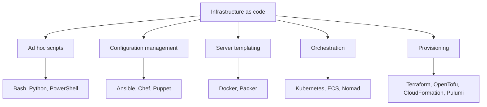
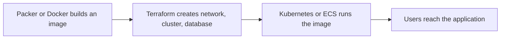

# From clicking to code: DevOps and infrastructure as code

## In plain words

Think about how a restaurant keeps its food consistent. A cook who works from memory makes a slightly different soup every night, and when that cook is ill nobody else can make it at all. A restaurant that writes the recipe down gets the same soup from any cook, can fix a mistake by correcting one line on the card, and can open a second branch by photocopying the card.

**Infrastructure** is the equipment a piece of software needs in order to run: servers, networks, databases, load balancers, storage and the rules that connect them. For years this equipment was set up by people clicking through web pages or typing commands by hand, from memory. **Infrastructure as code**, shortened to **IaC**, is the written recipe: you describe the equipment in text files, and a tool reads those files and builds exactly what they say.

**Terraform** is the most widely used tool for the "build the equipment" part of that job, and it is the subject of this track.

Why this matters for a job: almost every team that runs software in the cloud manages its infrastructure with code. Job adverts for backend, platform, DevOps and site reliability roles list Terraform by name, and interviewers routinely ask why IaC exists before they ask how any tool works. This lesson gives you the "why" and a map of the tool landscape. The next lesson shows how Terraform itself works.

> **Before this lesson:** you should have clicked around a cloud console at least once and know roughly what a virtual server is. The AWS track's [What cloud computing is, and the AWS global map](#/lesson/aws/what-is-cloud) covers that, and [What a container is](#/lesson/docker/what-is-a-container) is helpful background for the section on server templates. No programming experience with Terraform is assumed.

## The world before: two teams and a wall

Twenty years ago, a company that wanted to run a website bought physical computers, put them in a room called a **data centre**, and plugged in cables. Two separate groups of people were involved:

- **Developers**, often shortened to **Dev**, wrote the application: the program that customers use.
- **Operations**, shortened to **Ops**, looked after the hardware and installed the developers' program on it.

The hand-over between the two groups was the weak point. Developers finished a version and "threw it over the wall". Operations then installed it by hand, following a document, on servers that each had been set up by hand at some earlier date. Three things went wrong again and again:

1. **Every server was a little different.** One had a newer library because somebody fixed a problem at 2 a.m. and never wrote it down. A server that has drifted into a unique, undocumented state is called a **snowflake server**, because no two are alike. When the differences between servers pile up over time, the effect is called **configuration drift**.
2. **Releases were rare and frightening.** Because installing by hand was slow and error-prone, teams released a few times a year, which made each release large, which made it more likely to fail.
3. **Nobody could rebuild from scratch.** If the room flooded, the knowledge of how the servers were set up lived in a few people's heads.

Then two changes arrived close together. First, **cloud computing**: companies such as Amazon Web Services (AWS), Microsoft Azure and Google Cloud began renting out servers by the hour. A server stopped being a metal box and became something you request through an **API**, an application programming interface, which is a way for one program to ask another program to do something. Second, because hardware could now be requested by a program, operations work started to look like software work: writing instructions for a machine to carry out.

The **DevOps** movement grew out of that shift. DevOps is not a job title or a product. It is a way of working in which the people who write software and the people who run it share responsibility, automate the path from a code change to a running system, and use the same engineering habits on both sides. The usual shorthand for its values is four ideas: a shared culture, automation of repetitive work, measurement of what happens, and sharing of knowledge. Infrastructure as code is the automation pillar applied to equipment.

## What "infrastructure as code" means

The definition has three parts, and each one matters:

- You **write** what you want in text files.
- You keep those files in **version control**, a system such as Git that records every change, who made it and why. The Git track's lessons cover this in depth.
- A **tool executes** the files to create, change or remove real infrastructure.

Here is the smallest useful taste of what such a file looks like in Terraform. Do not worry about the syntax yet; the next module walks through it slowly.

```hcl
resource "aws_instance" "reading_room" {
  ami           = "ami-0abc1234def567890"
  instance_type = "t3.micro"
}
```

Line by line:

- `resource "aws_instance" "reading_room" {` says "I want one piece of infrastructure to exist". `aws_instance` is the kind of thing (a virtual server on AWS) and `reading_room` is a nickname you choose so other parts of your files can refer to it.
- `ami = "ami-0abc1234def567890"` picks the **machine image**, the saved disk the server boots from. AMI stands for Amazon Machine Image.
- `instance_type = "t3.micro"` picks the size of the server.
- `}` ends the description.

Notice what the file does *not* say. It does not say "click Launch", "wait", "check whether one already exists". It states the result you want. That difference has a name, and it is the single most important idea in this track.

## Imperative versus declarative

An **imperative** (also called **procedural**) description is a list of steps: do this, then this, then this. A **declarative** description states the end result and leaves the steps to the tool.

A taxi makes the difference concrete. Imperative: "go straight for two streets, turn left, go 400 metres, stop". Declarative: "take me to the central station". The first only works if you start from the right place. The second works from anywhere, because the driver works out the route from where the car is now.

For infrastructure the "where you are now" matters a great deal. Suppose you want five servers.

- An imperative script says "create five servers". Run it once: five servers. Run it again by accident: ten servers.
- A declarative file says "there should be five servers". Run it once: five servers. Run it again: the tool sees five already exist and does nothing.

An operation that gives the same result whether you run it once or many times is called **idempotent**. Declarative tools are idempotent by design; imperative scripts are idempotent only if the author works hard at it.

The simulation below makes the difference visible. Press Run, then change the numbers and run it again.

```python-run
# A toy "cloud": a list of server names that currently exist.
cloud = []

def imperative_script(n):
    """Step-by-step instructions: always creates n more servers."""
    for i in range(n):
        cloud.append(f"server-{len(cloud)}")

def declarative_apply(desired_count):
    """States the goal. Looks at what exists and closes the gap."""
    current = len(cloud)
    if current < desired_count:
        for i in range(desired_count - current):
            cloud.append(f"server-{len(cloud)}")
        return f"created {desired_count - current}"
    if current > desired_count:
        removed = current - desired_count
        del cloud[desired_count:]
        return f"removed {removed}"
    return "nothing to do"

print("--- imperative, run twice ---")
imperative_script(3); print("after run 1:", len(cloud), "servers")
imperative_script(3); print("after run 2:", len(cloud), "servers   <-- oops")

cloud.clear()
print("--- declarative, run three times ---")
print("run 1:", declarative_apply(3), "->", len(cloud), "servers")
print("run 2:", declarative_apply(3), "->", len(cloud), "servers")
print("change goal to 5:", declarative_apply(5), "->", len(cloud), "servers")
print("change goal to 2:", declarative_apply(2), "->", len(cloud), "servers")
```

Read the output carefully. The imperative script doubled the fleet on its second run. The declarative function compared the goal with reality each time and did only the difference, including removing servers when the goal shrank. That compare-then-act loop is what Terraform does, and you will see it under the name **plan** in the next module.

There is one more benefit hiding here. With a declarative file, the file *is* the description of what exists. With an imperative script you have to replay every script ever run, in order, in your head to know the current state.

## What you gain from infrastructure as code

Interviewers like to ask for the benefits of IaC, and "it is faster" is the weakest answer. A complete answer has these parts:

| Benefit | What it means in practice |
|---|---|
| Self-service | Anyone on the team can deploy by running the tool, instead of waiting for the one person who knows the steps. |
| Speed and safety | A machine performs the steps faster than a person and performs them the same way every time. |
| Documentation | The files describe the infrastructure precisely. A new joiner reads the code instead of asking around. |
| Version control | Every change has an author, a date and a reason. A bad change can be found by reading the history and undone by reverting it. |
| Validation | A change can be reviewed by a colleague, checked by automated tests and scanned by security tools before it touches anything real. |
| Reuse | A well-tested piece (a "module") can be used by many teams, so a lesson learned once is not relearned. |
| Reproducibility | A test environment can be an exact copy of production, and a lost environment can be rebuilt. |

There is also a human benefit that is easy to overlook. Deploying by hand is tedious, stressful work, usually done late at night to avoid customers. Automating it removes a large source of burnout and frees people for work that needs judgement.

> [!INTERVIEW]
> "What are the benefits of infrastructure as code?" A strong answer names consistency (no snowflakes), a reviewable history in version control, the ability to test and scan changes before they apply, reproducible environments, and reuse through modules. Then add one honest cost: it takes real time to learn and to write, and a mistake in code can be applied to many resources at once.

## Five families of tools

"Infrastructure as code" covers several different jobs. Beginners often ask "should I use Terraform or Ansible or Docker?" as if they were rivals. Mostly they are not: they do different jobs and are frequently used together. Here are the five families.



### 1. Ad hoc scripts

An **ad hoc script** is a file of commands written for one specific task, in a general-purpose language such as Bash or Python. For example:

```bash
#!/usr/bin/env bash
# install-web.sh: run by hand on a fresh Ubuntu server
set -euo pipefail
apt-get update
apt-get install -y nginx
cp ./site.conf /etc/nginx/conf.d/site.conf
systemctl restart nginx
```

- `#!/usr/bin/env bash` tells the operating system to run the file with the Bash shell.
- `set -euo pipefail` makes the script stop at the first error instead of carrying on in a broken state.
- `apt-get update` refreshes the list of available software packages; `apt-get install -y nginx` installs the nginx web server without asking for confirmation.
- `cp ...` copies a configuration file into place and `systemctl restart nginx` restarts the web server so it reads that file.

Scripts are the right tool for small, one-off jobs. They become a problem as they grow, because a general-purpose language gives you no structure: every author invents their own layout, their own error handling and their own way of checking whether a step has already been done. Ten people produce ten styles, and a large pile of such scripts is hard to maintain.

### 2. Configuration management tools

A **configuration management** tool installs and manages software *on servers that already exist*. Ansible, Chef and Puppet are the well-known ones. They improve on scripts in three ways: they enforce a consistent layout, their building blocks are idempotent, and they are built to talk to hundreds of servers at once.

A fragment of an Ansible file, called a **playbook**, shows the style:

```yaml
- name: Install and start the web server
  hosts: webservers
  become: true
  tasks:
    - name: nginx is installed
      ansible.builtin.apt:
        name: nginx
        state: present
    - name: nginx is running
      ansible.builtin.service:
        name: nginx
        state: started
```

- `hosts: webservers` names the group of machines to act on.
- `become: true` means "use administrator rights".
- Each task states a condition that should be true: `state: present` means "make sure it is installed", which does nothing if it already is. That is idempotence built into the tool.

The typical way of working with these tools keeps servers alive for a long time and updates them in place. A server that is changed after it was created is called **mutable infrastructure** ("mutable" means "can be changed"). Mutable servers are where configuration drift comes from: each one accumulates its own history of updates.

### 3. Server templating tools

A **server templating** tool takes the opposite approach. Instead of starting many servers and configuring each one, you build a single **image**: a complete snapshot of an operating system with your software already installed. Then you start as many identical copies of that image as you need.

There are two kinds of image:

- A **virtual machine image** contains a whole operating system and runs on virtual hardware. Packer is the usual tool for building these; on AWS the result is an AMI.
- A **container image** contains the application and its libraries but shares the host's operating system core, so it is smaller and starts faster. Docker is the usual tool. The Docker track explains this from zero.

Server templating leads to **immutable infrastructure**: once a server is started from an image, you never change it. To deploy a new version you build a new image, start new servers from it and remove the old ones. Because every server came from the same image and was never touched afterwards, drift cannot happen, and what you tested is exactly what runs.

### 4. Orchestration tools

Once you have images, something has to run them: start the right number of copies, spread them across machines, restart ones that crash, roll out new versions gradually, and let copies find each other on the network. A tool that does this is an **orchestration** tool. Kubernetes is the best known; Amazon ECS and HashiCorp Nomad do similar jobs. The Kubernetes track starts with [What orchestration solves](#/lesson/kubernetes/what-orchestration-solves).

### 5. Provisioning tools

Everything above assumes servers, networks and databases already exist. A **provisioning** tool creates them. "To provision" means "to set up and make available". Terraform, OpenTofu, AWS CloudFormation and Pulumi are provisioning tools: they call a cloud provider's API to create virtual networks, firewalls, servers, databases, storage buckets, DNS records (the entries that map a website name to an address), user permissions and nearly anything else the provider offers.

### How the families fit together

A very common combination looks like this:



Terraform builds the stage; the image is the actor; the orchestrator is the stage manager. Some teams add Ansible for the software on long-lived servers. The categories overlap at the edges (Ansible can create cloud resources, Terraform can run a script on a server), but each tool is at its best in its own family, and you will have a calmer life if you use each for what it was designed to do.

> [!TIP]
> When a question asks "Terraform or Ansible?", first ask which job is being discussed. Creating the servers is provisioning. Installing software on them is configuration management. Many teams use both, and many teams skip configuration management entirely by baking software into images.

## Honest costs of infrastructure as code

IaC is not free, and a beginner should hear the costs early:

- **A learning curve.** There is a new language, a new tool and new habits.
- **Slower first steps.** Clicking a button takes one minute; writing, reviewing and applying code for the same thing takes longer the first time. The payoff arrives on the second, tenth and hundredth time.
- **Mistakes scale too.** A typing error in a file that manages fifty servers affects fifty servers. This is why review, automated checks and a preview step matter so much, and why later modules spend so long on them.
- **Discipline is required.** If one person changes something by hand in the console after the code was applied, the code no longer describes reality. That gap is called **drift**, and a team has to agree not to create it.

> [!WARNING]
> The moment a team adopts IaC for a system, manual changes to that system in the cloud console become harmful. The next run of the tool will either undo the manual change or fail in a confusing way. Treat the console as read-only for anything managed by code.

## Pitfalls

- **Treating DevOps as a tool purchase.** Buying Terraform does not remove the wall between teams. The wall is removed by shared ownership; the tools support it.
- **Automating a mess.** If the manual process is not understood, scripting it produces a fast mess. Write down what should exist first.
- **One giant script.** Starting with ad hoc scripts is fine; staying with them as the system grows is the trap.
- **Mixing mutable and immutable habits.** Building images *and* logging in to patch running servers gives you the drawbacks of both.
- **Thinking one tool covers everything.** A provisioning tool is not an orchestrator, and an orchestrator does not build networks.

## Cheat sheet

| Term | One-line meaning | Example tools |
|---|---|---|
| Ad hoc script | Hand-written steps for one task | Bash, Python |
| Configuration management | Install and manage software on existing servers | Ansible, Chef, Puppet |
| Server templating | Build one image, start identical copies | Docker, Packer |
| Orchestration | Run, scale, heal and update copies of an image | Kubernetes, ECS, Nomad |
| Provisioning | Create the servers, networks and databases themselves | Terraform, OpenTofu, CloudFormation, Pulumi |
| Imperative | A list of steps | Scripts |
| Declarative | A statement of the desired result | Terraform, Kubernetes manifests |
| Idempotent | Same result no matter how many times it runs | Declarative tools |
| Mutable | Changed in place after creation | Long-lived patched servers |
| Immutable | Never changed; replaced by a new copy | Image-based deployments |

## Summary

- Before the cloud, developers and operations worked apart, servers were configured by hand, and the result was snowflake servers, drift and rare, risky releases.
- Cloud APIs turned infrastructure into something a program can request, and DevOps applied software habits to operations work.
- Infrastructure as code means writing infrastructure in text files, keeping them in version control, and letting a tool execute them.
- Declarative descriptions state the goal; the tool compares the goal with reality and performs only the difference, which makes runs idempotent.
- There are five families of IaC tools. Terraform belongs to the provisioning family and is commonly combined with image builders and an orchestrator.
- IaC has costs: learning time, slower first steps, and mistakes that scale. The rest of this track is largely about managing those costs.

## Glossary

- **Infrastructure:** the servers, networks, databases and related equipment software runs on.
- **Infrastructure as code (IaC):** managing that equipment through text files executed by a tool.
- **DevOps:** a way of working where development and operations share ownership and automate delivery.
- **API:** an interface that lets one program ask another to do something.
- **Snowflake server:** a server whose setup is unique and undocumented.
- **Configuration drift:** servers, or code and reality, slowly becoming different.
- **Imperative / procedural:** described as a sequence of steps.
- **Declarative:** described as a desired end result.
- **Idempotent:** safe to run repeatedly with the same outcome.
- **Mutable / immutable infrastructure:** servers changed in place versus servers replaced on every change.
- **Image:** a snapshot of a system with software installed, used to start identical copies.
- **Provisioning:** creating infrastructure resources.
- **Orchestration:** running and managing many copies of an application.

## Check yourself

```quiz
[
  {"q": "A script contains the line 'create 4 servers'. It is run three times by mistake. A declarative file says 'there should be 4 servers' and is applied three times. How many servers exist in each case?",
   "options": ["12 and 12", "12 and 4", "4 and 4", "4 and 12"], "answer": 1,
   "explain": "The script repeats its steps each time, so 3 x 4 = 12. The declarative tool compares the goal with what exists and does nothing on the second and third runs."},
  {"q": "Which family of tools is Terraform in?",
   "options": ["Configuration management", "Server templating", "Provisioning", "Orchestration"], "answer": 2,
   "explain": "Terraform creates the infrastructure itself (networks, servers, databases) by calling provider APIs. That is provisioning."},
  {"q": "A team builds a new machine image for every release and replaces all servers instead of patching them. What is this approach called?",
   "options": ["Mutable infrastructure", "Immutable infrastructure", "Configuration drift", "Ad hoc scripting"], "answer": 1,
   "explain": "Servers are never changed after they start; a new version means new servers. That is immutable infrastructure, and it prevents drift between servers."},
  {"q": "What does 'idempotent' mean for a deployment tool?",
   "options": ["It runs faster each time", "Running it again when nothing changed makes no further changes", "It can only be run once", "It needs no credentials"], "answer": 1,
   "explain": "An idempotent operation gives the same end result whether it is run once or many times."},
  {"q": "Someone edits a firewall rule by hand in the cloud console for a system managed by code. What is the resulting mismatch called?",
   "options": ["A snowflake", "Drift", "Orchestration", "A template"], "answer": 1,
   "explain": "Drift is a difference between what the code says and what really exists. The next run of the tool will try to remove the difference."},
  {"q": "Which pairing of tool and job is correct?",
   "options": ["Kubernetes builds machine images", "Packer schedules containers across machines", "Ansible installs software on existing servers", "Docker creates virtual networks in AWS"], "answer": 2,
   "explain": "Ansible is a configuration management tool. Packer builds images, Kubernetes orchestrates containers, and creating cloud networks is a provisioning job."},
  {"q": "Which of these is a real cost of adopting infrastructure as code?",
   "options": ["Environments can no longer be copied", "Changes can no longer be reviewed", "A mistake in one file can be applied to many resources at once", "History of changes is lost"], "answer": 2,
   "explain": "Automation scales mistakes as well as good changes, which is why previews, reviews and tests matter. The other three are things IaC improves."}
]
```

> **Source:** Brikman, Terraform: Up & Running 3e, ch. 1 (the rise of DevOps, what infrastructure as code is, benefits). Documentation: https://developer.hashicorp.com/terraform/intro and https://opentofu.org/docs/intro/
