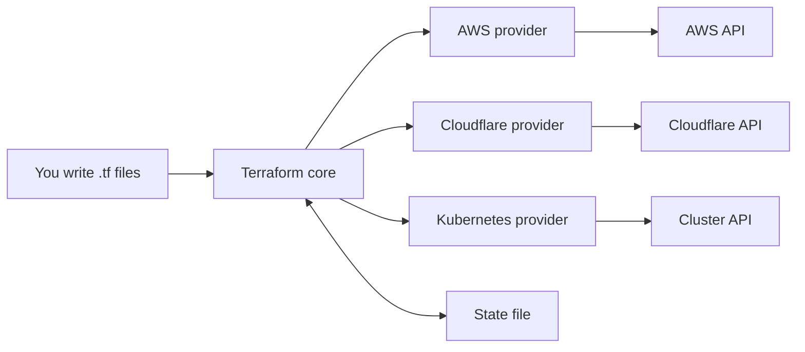
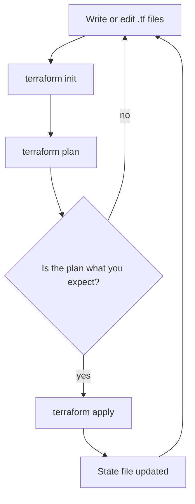

# How Terraform works, and how it compares with the alternatives

## In plain words

Imagine hiring a building contractor. You hand over an architect's drawing of the house you want. The contractor walks around the plot, notes what is already built, and writes you a quote: "I will add a garage, widen this window and remove the old shed". You read the quote, and only when you say yes does any work start. Afterwards the contractor files a record of everything that was built, so that next time the comparison is quick.

Terraform works the same way:

- the **drawing** is a set of text files you write, called the **configuration**;
- the **walk around the plot** is Terraform asking the cloud what exists;
- the **quote** is called the **plan**;
- saying yes is called **apply**;
- the **filed record** is called the **state**.

Why this matters for a job: you will run this cycle many times a day, and nearly every Terraform interview question ("what does plan do?", "what is state?", "why Terraform and not CloudFormation?") is a question about one of the five items in that list. This lesson explains the machinery at a high level and then compares Terraform with the tools you are most likely to be asked about.

> **Before this lesson:** read [From clicking to code: DevOps and infrastructure as code](#/lesson/terraform/devops-and-iac) for the meaning of declarative, idempotent, provisioning and immutable. Nothing needs to be installed yet.

## The pieces of Terraform

Terraform is a single program that you run from a **terminal**, the text window where you type commands. It was created by a company called HashiCorp and is written in the Go programming language. When you download it you get one file, an **executable** (a program ready to run), named `terraform`.

That one program does not itself know how to talk to AWS, Azure, Google Cloud or anything else. It delegates that to **providers**.

A **provider** is a separate plug-in program that knows one platform's API. There is a provider for AWS, one for Azure, one for Google Cloud, one for Kubernetes, one for GitHub, one for Cloudflare, and thousands more. Each provider teaches Terraform a list of **resource types** it can manage: for the AWS provider, things such as `aws_instance` (a virtual server), `aws_s3_bucket` (a storage bucket) and `aws_db_instance` (a managed database).

So there are two layers:



- **Terraform core** reads your files, works out what depends on what, compares the goal with the recorded state, and decides the order of operations.
- **Providers** turn each operation ("create this server") into the right API calls and report the result.
- The **state file** is Terraform's notebook, recording which real-world objects it created for which blocks in your files.

The files themselves are written in **HCL**, the HashiCorp Configuration Language, and end in `.tf`. HCL is declarative: you describe objects and their settings. It is deliberately not a full programming language, although it has variables, loops and conditions, all covered later in this track.

## One complete cycle, step by step

Here is a small configuration. It describes a storage bucket for a fictional bookshop, Harbour Books.

```hcl
terraform {
  required_providers {
    aws = {
      source  = "hashicorp/aws"
      version = "~> 6.0"
    }
  }
}

provider "aws" {
  region = "eu-west-1"
}

resource "aws_s3_bucket" "invoices" {
  bucket = "harbour-books-invoices-demo"
}
```

Block by block:

- The `terraform { ... }` block holds settings for Terraform itself. Inside it, `required_providers` lists the plug-ins this configuration needs. `source = "hashicorp/aws"` is the plug-in's address in the public **registry** (an online catalogue of providers), and `version = "~> 6.0"` means "any 6.x release". Version rules are explained fully in the modules lesson.
- The `provider "aws" { ... }` block configures that plug-in. `region = "eu-west-1"` chooses the AWS Region (a geographic group of data centres, here Ireland) that requests go to.
- The `resource "aws_s3_bucket" "invoices" { ... }` block declares one object that should exist: an S3 bucket. `bucket = "..."` is its real name in AWS.

You would then run four commands. The output below is shortened sample output so you can see the shape of each step. Nothing here needs to be run yet; the next lesson does it for real, with safety checks.

```bash
$ terraform init
Initializing provider plugins...
- Installing hashicorp/aws v6.4.0...
Terraform has been successfully initialized!
```

`init` (short for "initialise") prepares the folder. Its main job is to download the providers named in `required_providers` into a hidden folder called `.terraform`. You run it once per folder, and again whenever you add a provider or module.

```bash
$ terraform plan

Terraform will perform the following actions:

  # aws_s3_bucket.invoices will be created
  + resource "aws_s3_bucket" "invoices" {
      + arn    = (known after apply)
      + bucket = "harbour-books-invoices-demo"
      + id     = (known after apply)
    }

Plan: 1 to add, 0 to change, 0 to destroy.
```

`plan` is the quote. Terraform compares three things: your configuration, its state file, and what the provider reports as really existing. It prints the difference and changes nothing. Read the symbols:

- `+` in front of a block or line means "will be created".
- `(known after apply)` means the value does not exist yet. AWS assigns an **ARN** (Amazon Resource Name, a unique identifier) only when the bucket is created, so Terraform cannot show it in advance.
- The last line is the summary. Get in the habit of reading it first.

```bash
$ terraform apply
...
Do you want to perform these actions?
  Enter a value: yes

aws_s3_bucket.invoices: Creating...
aws_s3_bucket.invoices: Creation complete after 2s [id=harbour-books-invoices-demo]

Apply complete! Resources: 1 added, 0 changed, 0 destroyed.
```

`apply` shows the plan again, waits for you to type `yes`, then calls the provider to make the changes and writes the results into the state file.

```bash
$ terraform plan
No changes. Your infrastructure matches the configuration.
```

Running `plan` again shows the idempotence from the previous lesson: goal and reality agree, so there is nothing to do.

```bash
$ terraform destroy
Plan: 0 to add, 0 to change, 1 to destroy.
```

`destroy` plans and, after confirmation, removes everything this configuration manages.



## How a plan is computed

The plan is not magic. For each resource Terraform holds two descriptions, the desired one from your files and the recorded one from state, and it compares them. There are five possible outcomes:

| Situation | Action | Symbol in the plan |
|---|---|---|
| In the configuration, not in state | Create | `+` |
| In state, not in the configuration | Destroy | `-` |
| In both, identical | No-op (nothing) | not shown |
| In both, a setting differs and the API can change it on a live object | Update in place | `~` |
| In both, a setting differs and the API cannot change it on a live object | Replace: destroy the old one and create a new one | `-/+` |

The last row surprises newcomers. Some settings cannot be edited after creation. You cannot rename an S3 bucket, and you cannot change the machine image of a running server. For those settings the only route to the new value is a new object. Providers mark such settings as **force-new** attributes, and the plan flags them with the comment `# forces replacement`.

The simulation below is a tiny version of the plan engine. Change the desired values and re-run to see each of the five actions appear.

```python-run
# Attributes that cannot be changed on a live object, per resource type.
FORCE_NEW = {"server": {"image"}, "bucket": {"name"}}

state = {  # what Terraform recorded last time
    "server.web":    {"image": "img-1", "size": "small"},
    "bucket.logs":   {"name": "hb-logs"},
    "server.legacy": {"image": "img-0", "size": "small"},
}
desired = {  # what the .tf files say now
    "server.web":   {"image": "img-2", "size": "small"},   # image changed
    "bucket.logs":  {"name": "hb-logs"},                   # unchanged
    "server.batch": {"image": "img-2", "size": "large"},   # new
}

def plan(desired, state):
    actions = []
    for addr in sorted(set(desired) | set(state)):
        rtype = addr.split(".")[0]
        if addr not in state:
            actions.append((addr, "create"))
        elif addr not in desired:
            actions.append((addr, "destroy"))
        else:
            changed = {k for k in set(desired[addr]) | set(state[addr])
                       if desired[addr].get(k) != state[addr].get(k)}
            if not changed:
                actions.append((addr, "no-op"))
            elif changed & FORCE_NEW.get(rtype, set()):
                actions.append((addr, "replace"))
            else:
                actions.append((addr, "update"))
    return actions

symbols = {"create": "+", "destroy": "-", "update": "~", "replace": "-/+", "no-op": " "}
add = change = destroy = 0
for addr, act in plan(desired, state):
    print(f"{symbols[act]:>3} {addr:15} {act}")
    add += act in ("create", "replace")
    change += act == "update"
    destroy += act in ("destroy", "replace")
print(f"\nPlan: {add} to add, {change} to change, {destroy} to destroy.")
```

Notice that a replace counts once under "to add" and once under "to destroy". A summary of "1 to add, 0 to change, 1 to destroy" for a single database is a loud warning, not a small edit.

> [!WARNING]
> Always read the plan before approving it, and search it for `-/+`, `forces replacement` and any `-` line you did not expect. A replace on a database or a disk deletes its data. The summary line can hide one dangerous replacement among forty harmless additions.

## Design choices that shape daily work

Each of these choices is a comparison point with other tools, so learn them as a set.

**Declarative.** You write the end state and Terraform works out the steps, as covered in the previous lesson.

**Provisioning, leaning towards immutable infrastructure.** Terraform's natural move, when something fundamental about a server changes, is to replace the server. It pairs well with image-based deployment, where a new version means new servers started from a new image.

**No central server and no agents.** Some tools need a permanently running control server (a "master") and a small helper program (an "agent") installed on every machine they manage. Both must be installed, patched, secured and kept alive. Terraform needs neither: the program runs on your laptop or in an automated pipeline, talks directly to cloud APIs, and exits. The only shared piece a team needs is a safe place for the state file, covered in the state module.

**Cloud-agnostic workflow, not cloud-agnostic code.** One tool, one language and one workflow cover AWS, Azure, Google Cloud and thousands of other platforms, and a single configuration can use several at once. That does *not* mean the same code runs on any cloud. An `aws_instance` is not an Azure virtual machine; moving clouds means rewriting resources for the other provider. What carries over is your skill and your process.

**A general-purpose configuration language.** HCL is easier to read than large files of raw YAML or JSON, and stricter than a full programming language. The cost is that complicated logic can feel awkward in it.

> [!INTERVIEW]
> "Is Terraform cloud-agnostic?" The precise answer: the tool and workflow are, the code is not. Resources are provider-specific, so a configuration written for AWS cannot be pointed at Azure. Teams benefit from one workflow for many platforms and from managing cross-platform pieces (for example AWS servers plus Cloudflare DNS) in one place.

## Terraform and OpenTofu

For most of its life Terraform was released under an **open-source** licence, meaning anyone could read, change and redistribute the code freely. In August 2023 HashiCorp changed the licence to the Business Source License (BSL), which keeps the code readable but restricts using it to build a product that competes with HashiCorp. For someone using Terraform to manage their own company's infrastructure, nothing practical changed.

In response, a group of companies and community members copied the last open-source version and continued it under the name **OpenTofu**, hosted by the Linux Foundation. Making an independent continuation of a project is called a **fork**. HashiCorp itself was later bought by IBM.

What a learner needs to know:

- The language, the workflow and the vast majority of providers and modules work the same in both. The command is `tofu` instead of `terraform`, so `tofu init`, `tofu plan`, `tofu apply`.
- The two have slowly grown different features. OpenTofu added built-in encryption of state files, for example; Terraform added its own features on its own schedule. This track notes the differences where they matter.
- Everything in this track applies to both unless stated otherwise. When you join a team, ask which one they use and which version.

## Comparing Terraform with the alternatives

### AWS CloudFormation

CloudFormation is AWS's own provisioning service. You write a **template** in YAML or JSON, upload it, and AWS creates a **stack**, the group of resources from that template. The AWS track covers it in [Infrastructure as code with CloudFormation and the CDK](#/lesson/aws/cloudformation-cdk).

| Point | Terraform / OpenTofu | CloudFormation |
|---|---|---|
| Platforms | Thousands of providers | AWS (third-party extensions exist but are rare) |
| Where state lives | A file you store and protect | Held by AWS inside the service; nothing for you to store |
| Where it runs | Your machine or pipeline | Inside AWS |
| Failed change | Stops; what succeeded stays; you fix and re-apply | Rolls the stack back automatically by default |
| Preview | `plan` | Change sets |
| Language | HCL | YAML or JSON |
| New AWS features | Usually within days through the provider | Usually quick, sometimes later than the API |

Choose CloudFormation when a company is AWS-only and wants the vendor to hold the state and support the tool. Choose Terraform when more than one platform is involved or when the team wants one tool and a large library of community modules.

### AWS CDK and Pulumi

These tools let you describe infrastructure in a general-purpose programming language such as TypeScript, Python or Go. The **CDK** (Cloud Development Kit) generates CloudFormation templates; **Pulumi** has its own engine and its own state, much like Terraform. The attraction is real loops, functions, classes, a proper editor experience and ordinary unit tests. The cost is that a full programming language allows unlimited cleverness: two files that create the same thing can look nothing alike, and a reviewer has to run code in their head to know what will be built. HCL's limits are, for many teams, a feature.

### Ansible, Chef and Puppet

These are configuration management tools, described in the previous lesson. Ansible is the one most often compared with Terraform because it also has modules that create cloud resources. The key differences:

- Ansible is mainly **procedural**: a playbook is an ordered list of tasks, even though each task is idempotent. To go from ten servers to fifteen you write "add five", and the playbook no longer tells you the total.
- Ansible keeps **no state file**. It cannot notice that a resource was deleted from the playbook and therefore should be removed; you have to write an explicit removal task.
- Ansible is at its best configuring what is *inside* a server. Terraform is at its best creating the server and everything around it.

A common division of labour is Terraform for infrastructure, and Ansible (or an image built by Packer or Docker) for what goes on the servers.

### Kubernetes manifests and Helm

Kubernetes files are declarative too, and a control loop inside the cluster keeps reality matching them. They describe what runs *in* a cluster. Terraform typically creates the cluster and the cloud resources around it (network, database, DNS), and the workloads inside are deployed with Kubernetes-native tools. A later lesson shows the Kubernetes provider and where to draw that line.

### Maturity and community

A final practical point for any comparison: how big is the community? A large community means more providers, more ready-made modules, more answered questions and more engineers who already know the tool. Terraform's HCL has one of the largest ecosystems in this field, which lowers the cost of hiring and of getting unstuck.

## When Terraform is not the right tool

- **Deploying application versions many times a day.** Terraform can do it, but a deployment tool or an orchestrator does it better. Use Terraform for the platform and something else for the releases on top.
- **Configuring the inside of a long-lived server.** Use configuration management or build an image.
- **One-off experiments.** If you will delete it in ten minutes and never rebuild it, the console is fine.
- **Anything without an API.** Terraform can only manage what a provider can reach.

## Pitfalls

- **Approving plans without reading them.** The plan is the safety mechanism; skipping it removes the safety.
- **Believing "multi-cloud" means portable code.** It does not.
- **Losing or hand-editing the state file.** Without state, Terraform no longer knows what it owns. The state module explains how to protect it.
- **Assuming a failed apply rolls back.** It does not. Resources created before the failure remain, and they are recorded in state. You fix the cause and apply again.
- **Mixing `terraform` and `tofu` on the same state without checking versions.** State written by a newer release of one may not be readable by the other.

## Cheat sheet

| Item | Meaning |
|---|---|
| Configuration | Your `.tf` files: the desired result |
| HCL | The language those files are written in |
| Provider | Plug-in that talks to one platform's API |
| Resource | One object to manage, such as a server or bucket |
| State | Terraform's record of what it created |
| `terraform init` | Download providers and prepare the folder |
| `terraform plan` | Show what would change; change nothing |
| `terraform apply` | Show the plan, ask, then make the changes |
| `terraform destroy` | Remove everything in this configuration |
| `+`, `~`, `-`, `-/+` | Create, update in place, destroy, replace |
| `(known after apply)` | Value assigned by the platform at creation time |
| OpenTofu | Open-source fork of Terraform; command is `tofu` |

## Summary

- Terraform core reads HCL files and coordinates providers, which are plug-ins that call each platform's API.
- The working cycle is write, `init`, `plan`, `apply`, with `destroy` to remove everything.
- A plan is the difference between desired and recorded state, expressed as create, update, replace, destroy or no-op. Replacement happens when a force-new attribute changes.
- Terraform is declarative, agentless, needs no central server, and works across many platforms with one workflow, though the code itself is provider-specific.
- OpenTofu is a compatible open-source fork with the `tofu` command.
- CloudFormation holds state for you and is AWS-only; Pulumi and the CDK use programming languages; Ansible configures servers and keeps no state.

## Glossary

- **Configuration:** the set of `.tf` files describing what should exist.
- **HCL:** HashiCorp Configuration Language, the syntax of those files.
- **Provider:** a plug-in that manages one platform through its API.
- **Registry:** the online catalogue from which providers and modules are downloaded.
- **Resource:** one managed infrastructure object.
- **State:** the stored mapping between resources in the configuration and real objects.
- **Plan:** the list of actions needed to make reality match the configuration.
- **Apply:** carrying out a plan.
- **Force-new attribute:** a setting that cannot be changed in place, so changing it replaces the object.
- **ARN:** Amazon Resource Name, AWS's unique identifier for an object.
- **Agent:** helper software installed on each managed machine by some tools; Terraform needs none.
- **Fork:** an independent continuation of a software project.
- **Stack:** CloudFormation's name for the resources created from one template.

## Check yourself

```quiz
[
  {"q": "State contains a server with image `img-1`. The configuration now says image `img-2`, and image is a force-new attribute. Nothing else changed. What will the plan summary show?",
   "options": ["Plan: 0 to add, 1 to change, 0 to destroy.", "Plan: 1 to add, 0 to change, 1 to destroy.", "Plan: 1 to add, 0 to change, 0 to destroy.", "No changes."], "answer": 1,
   "explain": "A force-new attribute cannot be edited on a live object, so the server is replaced. A replacement counts as one add and one destroy."},
  {"q": "Which component knows how to call the AWS API?",
   "options": ["Terraform core", "The AWS provider", "The state file", "HCL"], "answer": 1,
   "explain": "Core plans and orders operations; providers translate each operation into API calls for one platform."},
  {"q": "You run `terraform plan` immediately after a successful `terraform apply`, with no edits. What do you expect?",
   "options": ["Every resource is recreated", "An error because the resources already exist", "No changes", "A prompt to type yes"], "answer": 2,
   "explain": "Configuration and reality match, so the difference is empty. This is idempotence."},
  {"q": "An apply creates 3 of 5 resources and then fails on the fourth. What is the situation afterwards?",
   "options": ["Terraform deletes the 3 it created", "The 3 exist and are recorded in state; fix the cause and apply again", "The state file is erased", "The 3 exist but Terraform has forgotten them"], "answer": 1,
   "explain": "Terraform does not roll back. Completed resources stay and are saved to state, and the next apply continues with what remains."},
  {"q": "A resource block is deleted from the configuration but the object is still recorded in state. What does the next plan show for it?",
   "options": ["`+` create", "`~` update in place", "`-` destroy", "Nothing"], "answer": 2,
   "explain": "In state but not in the configuration means Terraform should no longer keep it, so it plans a destroy."},
  {"q": "Which statement about Terraform and multiple clouds is accurate?",
   "options": ["The same resource blocks run unchanged on any cloud", "The workflow and language are shared, but resources are written per provider", "Terraform only supports AWS", "A separate copy of Terraform is needed per cloud"], "answer": 1,
   "explain": "One tool and workflow cover many platforms, but `aws_instance` and an Azure virtual machine are different resource types."},
  {"q": "What is the main practical difference in where state lives between Terraform and CloudFormation?",
   "options": ["Terraform has no state", "CloudFormation keeps stack state inside AWS; Terraform keeps a state file you must store and protect", "Both store state in your Git repository", "CloudFormation stores state on your laptop"], "answer": 1,
   "explain": "CloudFormation is a managed service that holds stack state for you. With Terraform the state file is your responsibility."},
  {"q": "In a plan, an attribute shows `(known after apply)`. What does that mean?",
   "options": ["The attribute is secret", "The value is an error", "The platform assigns the value when the object is created", "The attribute will be deleted"], "answer": 2,
   "explain": "Identifiers such as ARNs and IP addresses do not exist until the object does, so Terraform cannot show them in advance."}
]
```

> **Source:** Brikman, Terraform: Up & Running 3e, ch. 1 (how Terraform works, comparison with other IaC tools). Documentation: https://developer.hashicorp.com/terraform/intro, https://developer.hashicorp.com/terraform/cli/commands/plan and https://opentofu.org/docs/intro/
