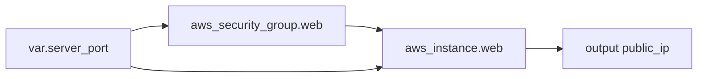

# Variables, outputs, references and a configurable web server

## In plain words

A printed form letter has blanks: "Dear ____, your order number ____ has shipped." The letter is written once and filled in differently for each customer. A Terraform configuration with every value typed directly into it is a letter with no blanks: to use it for a second environment you would have to copy it and edit the copy.

This lesson adds three things that turn a fixed description into a reusable one:

- **Input variables** are the blanks: values supplied from outside.
- **Outputs** are the reply slip: values the configuration hands back, such as the address of the server it created.
- **References** are cross-links between parts of the description: "attach *that* firewall to *this* server". From those links Terraform works out what must be built first.

Why this matters for a job: every real configuration is built from these three pieces, and "in what order does Terraform create things, and how does it know?" is a standard interview question whose answer is the dependency graph introduced here.

> **Before this lesson:** complete [Installing Terraform, signing in safely and creating a first resource](#/lesson/terraform/install-auth-first-resource). You should know what a security group is from [Security groups versus network ACLs](#/lesson/aws/vpc-firewalls), and that a port is a numbered door on a server through which one kind of network traffic arrives.

> [!WARNING]
> **Cost and safety.** The example creates one small server and opens a network port to the internet. Use a sandbox account, keep the instance type small, and run `terraform destroy` when you finish. Never copy the "open to everyone" firewall rule into a real system without understanding it.

## The goal

One server that answers web requests. Three things are needed:

1. a **security group**, AWS's name for a firewall attached to a server, that allows incoming web traffic;
2. the server itself, started with a small script that launches a web server;
3. the server's public address printed at the end, so you can test it.

## References: connecting one resource to another

Here are the two resources. Read the code first; the explanation follows.

```hcl
resource "aws_security_group" "web" {
  name        = "bookshelf-web"
  description = "Allow HTTP to the bookshelf server"

  ingress {
    description = "HTTP from anywhere"
    from_port   = 8080
    to_port     = 8080
    protocol    = "tcp"
    cidr_blocks = ["0.0.0.0/0"]
  }
}

resource "aws_instance" "web" {
  ami                    = "ami-0abc1234def567890" # placeholder: use a current AMI
  instance_type          = "t3.micro"
  vpc_security_group_ids = [aws_security_group.web.id]

  user_data = <<-EOF
    #!/bin/bash
    mkdir -p /srv/site && cd /srv/site
    echo "Harbour Books is open" > index.html
    nohup python3 -m http.server 8080 &
  EOF

  user_data_replace_on_change = true

  tags = {
    Name = "bookshelf-web"
  }
}
```

The security group:

- `name` and `description` are what the AWS console shows.
- `ingress { ... }` is a **nested block**: a block inside a resource. "Ingress" means incoming traffic. This one allows traffic arriving on port 8080.
- `from_port` and `to_port` give a range of ports; using the same number for both means one port.
- `protocol = "tcp"` selects TCP, the protocol web traffic uses.
- `cidr_blocks = ["0.0.0.0/0"]` lists who may connect. Square brackets make a **list**, an ordered sequence of values. A CIDR block is a way of writing a range of IP addresses, and `0.0.0.0/0` is the range containing every address: the whole internet.

The instance:

- `vpc_security_group_ids = [aws_security_group.web.id]` is the important line. It is a list with one element, and that element is not a quoted string. It is a **reference**: an expression of the form `<type>.<name>.<attribute>`. It means "the `id` attribute of the security group whose address is `aws_security_group.web`". The ID does not exist until AWS creates the group, so you could not type it in advance even if you wanted to.
- `user_data = <<-EOF ... EOF` is a **heredoc**, a way to write a multi-line string. Everything between the two `EOF` markers is the text, and the `-` after `<<` strips the leading indentation. **User data** is a script AWS runs once, the first time the server boots. This one writes a one-line web page and serves it on port 8080 with Python's built-in web server.
- `user_data_replace_on_change = true` tells the provider that when the script changes, the server should be replaced. Since the script only runs on first boot, editing it on a live server would otherwise have no effect.

Port 8080 is used instead of the standard web port 80 because ports below 1024 need administrator rights on the server, and a learning script should not run as administrator.

## The dependency graph

Because the instance's arguments mention `aws_security_group.web`, Terraform knows the group must exist before the instance. A relationship discovered from a reference is an **implicit dependency**. Terraform collects every such relationship into a **dependency graph**: a diagram where each resource is a dot and each "needs" relationship is an arrow.



Three consequences follow from the graph:

- **Creation order.** A resource is created only after everything it points to has been created.
- **Destruction order.** The reverse: the instance is removed before the group it uses.
- **Parallelism.** Resources with no path between them are handled at the same time (ten at once by default), which is why large applies finish quickly.

The order of blocks in your files is irrelevant. You may write the instance above the security group, or put them in different files; the graph decides.

The simulation below builds a graph from references and prints a valid creation order. It uses the same idea Terraform does: repeatedly pick resources whose dependencies are all finished.

```python-run
import re

config = {
    "aws_vpc.main":            "cidr = 10.0.0.0/16",
    "aws_subnet.public":       "vpc_id = aws_vpc.main.id",
    "aws_security_group.web":  "vpc_id = aws_vpc.main.id",
    "aws_instance.web":        "subnet = aws_subnet.public.id  sg = aws_security_group.web.id",
    "aws_eip.web":             "instance = aws_instance.web.id",
}

# 1. Find references: any "type.name" that is also a declared address.
deps = {addr: set() for addr in config}
for addr, body in config.items():
    for ref in re.findall(r"[a-z_]+\.[a-z_]+", body):
        if ref in config and ref != addr:
            deps[addr].add(ref)

# 2. Walk the graph in "waves": everything in one wave can run in parallel.
done, wave = set(), 1
while len(done) < len(config):
    ready = sorted(a for a in config if a not in done and deps[a] <= done)
    if not ready:
        raise SystemExit("Cycle: nothing is ready, resources depend on each other in a loop")
    print(f"wave {wave}: {', '.join(ready)}")
    done.update(ready)
    wave += 1

print("\ndestroy order is the reverse: last wave first")
```

The subnet and the security group appear in the same wave: neither needs the other, so they are created in parallel. Try adding `sg = aws_security_group.web.id` to the VPC line to create a loop and watch the cycle error. Terraform reports the same condition as `Error: Cycle`.

Occasionally one resource needs another without mentioning any of its attributes, for example a server that needs a permission policy to be attached before it boots. For those cases there is an **explicit dependency**:

```hcl
  depends_on = [aws_iam_role_policy.read_invoices]
```

`depends_on` takes a list of addresses. Use it sparingly; a reference is clearer and more precise whenever one is possible.

You can ask Terraform to print the graph with `terraform graph`, which produces text in the DOT format for diagram tools.

## Input variables: removing repeated values

The port number 8080 appears three times above: twice in the firewall rule and once in the script. If someone changes one and not the others, the server becomes unreachable. Repeating a value in several places breaks the **DRY** principle, "don't repeat yourself": every piece of knowledge should have one home.

An **input variable** gives the value one home. Create a file named `variables.tf`:

```hcl
variable "server_port" {
  description = "TCP port the web server listens on"
  type        = number
  default     = 8080

  validation {
    condition     = var.server_port >= 1024 && var.server_port <= 65535
    error_message = "server_port must be between 1024 and 65535."
  }
}

variable "instance_type" {
  description = "EC2 instance size"
  type        = string
  default     = "t3.micro"
}

variable "owner" {
  description = "Team or person responsible, used in tags"
  type        = string
}
```

- `variable "server_port" { ... }` declares a variable named `server_port`.
- `description` documents it. Terraform shows this text when it asks for a value, and documentation tools read it.
- `type = number` is a **type constraint**: Terraform rejects a value that is not a number. The simple types are `string` (text), `number` and `bool` (true or false). Collection types include `list(string)`, `map(string)`, `set(string)`, and `object({ ... })` for a fixed group of named fields.
- `default = 8080` is used when nobody supplies a value. A variable without a default, such as `owner`, is **required**.
- The `validation` block adds a custom rule. `condition` is an expression that must be true; `&&` means "and". If the condition is false, Terraform stops with the `error_message` before planning anything.

To use a variable, write `var.<name>`:

```hcl
  ingress {
    description = "HTTP from anywhere"
    from_port   = var.server_port
    to_port     = var.server_port
    protocol    = "tcp"
    cidr_blocks = ["0.0.0.0/0"]
  }
```

Inside a string, a value is inserted with **interpolation**, written `${ ... }`:

```hcl
  user_data = <<-EOF
    #!/bin/bash
    mkdir -p /srv/site && cd /srv/site
    echo "Harbour Books is open" > index.html
    nohup python3 -m http.server ${var.server_port} &
  EOF
```

When Terraform evaluates the string, `${var.server_port}` is replaced by `8080`. The port now lives in exactly one place.

## Supplying values, and which source wins

There are several ways to give a variable a value. When more than one supplies the same variable, the later item in this list wins:

| Priority | Source | Example |
|---|---|---|
| 1 (lowest) | The `default` in the variable block | `default = 8080` |
| 2 | An environment variable named `TF_VAR_<name>` | `export TF_VAR_server_port=9000` |
| 3 | A file named `terraform.tfvars` | `server_port = 9000` |
| 4 | A file named `terraform.tfvars.json` | the same in JSON |
| 5 | Files ending `.auto.tfvars` or `.auto.tfvars.json`, in alphabetical order | `network.auto.tfvars` |
| 6 (highest) | `-var` and `-var-file` on the command line, in the order written | `-var="server_port=9000"` |

If a required variable has no value from any source, an interactive run asks you to type one, and an automated run fails.

A **variable definitions file**, ending in `.tfvars`, holds plain assignments:

```hcl
# sandbox.tfvars
owner         = "platform-team"
instance_type = "t3.micro"
server_port   = 8080
```

```bash
terraform plan -var-file="sandbox.tfvars"
terraform plan -var="server_port=9000" -var-file="sandbox.tfvars"
```

In the second command the file is written after the `-var` flag, so for `server_port` the file's `8080` wins. Order on the command line matters.

> [!TIP]
> Keep the `variable` declarations (name, type, description) in `variables.tf` and the values for each environment in separate `.tfvars` files. The declarations are the same everywhere; only the values differ.

## Outputs: getting values back

After the apply you want the server's address without hunting through the console. An **output value** publishes it. Create `outputs.tf`:

```hcl
output "public_ip" {
  description = "Public IP address of the web server"
  value       = aws_instance.web.public_ip
}

output "site_url" {
  description = "URL to test in a browser"
  value       = "http://${aws_instance.web.public_ip}:${var.server_port}"
}
```

- `value` is any expression. The first is a plain reference; the second builds a string from two interpolations.
- Outputs are printed at the end of `apply` and can be read later.

```bash
$ terraform apply -var="owner=platform-team"
...
Apply complete! Resources: 2 added, 0 changed, 0 destroyed.

Outputs:

public_ip = "54.170.12.88"
site_url = "http://54.170.12.88:8080"

$ terraform output site_url
"http://54.170.12.88:8080"

$ terraform output -raw site_url
http://54.170.12.88:8080

$ curl "$(terraform output -raw site_url)"
Harbour Books is open
```

- `terraform output` with no argument lists every output; with a name it prints one.
- `-raw` removes the quotation marks so the value can be fed to another command.
- `curl` fetches a web page from the terminal. `$( ... )` runs the inner command and substitutes its result. Give the server a minute to boot before testing.

Marking a variable or output with `sensitive = true` hides its value in plan and apply output, shown as `(sensitive value)`. It does not hide it in the state file. The secrets module returns to this.

## Data sources: looking things up

The AMI ID in the example is still a hand-pasted placeholder. A **data source** asks the provider a question and returns the answer without creating anything.

```hcl
data "aws_ami" "al2023" {
  most_recent = true
  owners      = ["amazon"]

  filter {
    name   = "name"
    values = ["al2023-ami-2023.*-x86_64"]
  }
}
```

- `data "aws_ami" "al2023"` declares a lookup of type `aws_ami` with the local name `al2023`.
- `owners = ["amazon"]` restricts results to images published by Amazon.
- The `filter` block narrows by name pattern, where `*` matches any characters. This pattern matches Amazon Linux 2023 images for the common 64-bit processor type.
- `most_recent = true` picks the newest match.

Refer to it with the prefix `data.`:

```hcl
  ami = data.aws_ami.al2023.id
```

Be aware of the trade-off: with `most_recent = true`, a newly published image changes the result, and because `ami` is a force-new attribute, your next plan will propose replacing the server. Production code often pins a specific image ID instead and updates it deliberately.

## What the plan shows now

With variables and a data source in place, the plan for a fresh folder has more unknowns:

```bash
$ terraform plan -var="owner=platform-team"

data.aws_ami.al2023: Reading...
data.aws_ami.al2023: Read complete after 1s [id=ami-07c1b39b7b3d2525d]

  # aws_instance.web will be created
  + resource "aws_instance" "web" {
      + ami                    = "ami-07c1b39b7b3d2525d"
      + instance_type          = "t3.micro"
      + public_ip              = (known after apply)
      + vpc_security_group_ids = (known after apply)
      ...
    }

  # aws_security_group.web will be created
  + resource "aws_security_group" "web" {
      + id   = (known after apply)
      + name = "bookshelf-web"
      ...
    }

Plan: 2 to add, 0 to change, 0 to destroy.

Changes to Outputs:
  + public_ip = (known after apply)
  + site_url  = (known after apply)
```

- The data source is read during planning, so the AMI ID is already filled in.
- `vpc_security_group_ids` is unknown because it depends on the group's ID.
- Outputs get their own section. Both depend on the public IP, so both are unknown until apply.

## Pitfalls

- **Opening ports to `0.0.0.0/0` by habit.** Acceptable for a public web port on a demo, dangerous for SSH (port 22) or a database port. Restrict the range to what needs access.
- **Editing user data and expecting a live server to change.** The script runs on first boot only. Replace the server.
- **Quoting a reference.** `"aws_security_group.web.id"` in quotes is ordinary text, not a reference, and creates no dependency. References are written without quotes, or inside `${ }` within a string.
- **Forgetting that command-line order matters** for `-var` and `-var-file`.
- **Putting secrets in `.tfvars` files and committing them.** Treat those files like any other code file unless they are excluded from version control.
- **Overusing `depends_on`.** It hides the real relationship and can force unnecessary updates. Prefer references.
- **Relying on block order.** Terraform ignores it; the graph is what counts.

## Cheat sheet

| Construct | Syntax | Purpose |
|---|---|---|
| Input variable | `variable "x" { type = ..., default = ... }` | A value supplied from outside |
| Use a variable | `var.x` | Read it in an expression |
| Interpolation | `"port ${var.x}"` | Insert a value into a string |
| Output | `output "y" { value = ... }` | Publish a value after apply |
| Resource reference | `aws_instance.web.id` | Read another resource's attribute; creates a dependency |
| Data source | `data "aws_ami" "n" { ... }` then `data.aws_ami.n.id` | Look something up without creating it |
| Explicit dependency | `depends_on = [type.name]` | Order resources that share no attribute |
| Values file | `-var-file="sandbox.tfvars"` | Supply a set of variable values |
| Single value | `-var="x=1"` | Supply one value on the command line |
| Environment | `TF_VAR_x=1` | Supply a value from the environment |
| Show graph | `terraform graph` | Print the dependency graph |

## Summary

- A reference such as `aws_security_group.web.id` reads another resource's attribute and tells Terraform the order of creation.
- All references together form the dependency graph. Terraform creates in dependency order, destroys in reverse, and runs independent resources in parallel.
- Input variables give each value one home; type constraints and validation blocks reject bad values early.
- Variable values come from defaults, `TF_VAR_` environment variables, `.tfvars` files and command-line flags, with later sources overriding earlier ones.
- Outputs publish results such as addresses, and `terraform output -raw` feeds them to other commands.
- Data sources look up existing information, such as the newest machine image.

## Glossary

- **Security group:** a firewall attached to AWS resources.
- **Port:** a numbered entry point for network traffic on a machine.
- **CIDR block:** a notation for a range of IP addresses.
- **List:** an ordered sequence of values in square brackets.
- **Nested block:** a block inside another block.
- **Reference:** an expression that reads an attribute of another object.
- **Implicit / explicit dependency:** an ordering found from a reference, or stated with `depends_on`.
- **Dependency graph:** the map of which resources need which.
- **Heredoc:** a multi-line string written between markers.
- **User data:** a script run on a server's first boot.
- **DRY:** "don't repeat yourself", one home for each value.
- **Input variable:** a named value supplied from outside the configuration.
- **Type constraint:** a rule on what kind of value a variable accepts.
- **Interpolation:** inserting an expression's value into a string with `${ }`.
- **Output value:** a value a configuration publishes.
- **Data source:** a read-only lookup against a provider.

## Check yourself

```quiz
[
  {"q": "An instance has `vpc_security_group_ids = [aws_security_group.web.id]`. In a fresh folder, in what order does Terraform create the two resources?",
   "options": ["The instance first", "The security group first", "Whichever block is higher in the file", "Alphabetical order of the file names"], "answer": 1,
   "explain": "The reference makes the instance depend on the group, so the group is created first. Position in the files is ignored."},
  {"q": "`server_port` has `default = 8080`. `terraform.tfvars` sets it to 9000 and the command is `terraform plan -var=\"server_port=7000\"`. Which value is used?",
   "options": ["8080", "9000", "7000", "Terraform reports a conflict"], "answer": 2,
   "explain": "Command-line `-var` has the highest priority, above terraform.tfvars, which is above the default."},
  {"q": "The configuration has one security group and one instance, neither yet created, and two outputs that use the instance's public IP. What does the plan show?",
   "options": ["Plan: 2 to add, and both outputs as (known after apply)", "Plan: 4 to add", "Plan: 2 to add, and the outputs with their final values", "Plan: 1 to add"], "answer": 0,
   "explain": "Outputs are not resources, so only two things are added. The public IP is assigned by AWS at creation, so the outputs are unknown until apply."},
  {"q": "What does a data source do?",
   "options": ["Creates a resource in a second Region", "Reads existing information from the provider without creating anything", "Stores variable values", "Encrypts the state file"], "answer": 1,
   "explain": "A data block is a read-only query, for example the ID of the newest machine image."},
  {"q": "You edit the `user_data` script of a running instance that has `user_data_replace_on_change = true`. What does the plan propose?",
   "options": ["An in-place update", "No changes", "A replacement of the instance", "Only a restart"], "answer": 2,
   "explain": "User data runs once at first boot. The setting tells the provider to treat a change as requiring a new server, shown as -/+."},
  {"q": "Two resources have no reference path between them. How does Terraform treat them during apply?",
   "options": ["One after the other, alphabetically", "In parallel", "It refuses to apply", "The second waits for a manual confirmation"], "answer": 1,
   "explain": "Independent nodes in the dependency graph are processed concurrently, up to the parallelism limit of ten by default."},
  {"q": "A variable has `type = number` and a validation `var.server_port >= 1024`. You pass 80. When does it fail?",
   "options": ["After the server is created", "During apply, when AWS rejects the port", "Before planning, with the validation error message", "It does not fail"], "answer": 2,
   "explain": "Validation rules are evaluated when variables are processed, so the run stops before any plan is produced."},
  {"q": "Which line creates a dependency on the security group?",
   "options": ["`vpc_security_group_ids = [\"aws_security_group.web.id\"]`", "`vpc_security_group_ids = [aws_security_group.web.id]`", "`# aws_security_group.web.id`", "`description = \"uses aws_security_group.web\"`"], "answer": 1,
   "explain": "Only an unquoted reference is an expression. Text in quotes or in a comment is not evaluated and creates no dependency."}
]
```

> **Source:** Brikman, Terraform: Up & Running 3e, ch. 2 (deploying a single web server, deploying a configurable web server). Documentation: https://developer.hashicorp.com/terraform/language/values/variables, https://developer.hashicorp.com/terraform/language/values/outputs, https://developer.hashicorp.com/terraform/language/data-sources and https://developer.hashicorp.com/terraform/internals/graph
