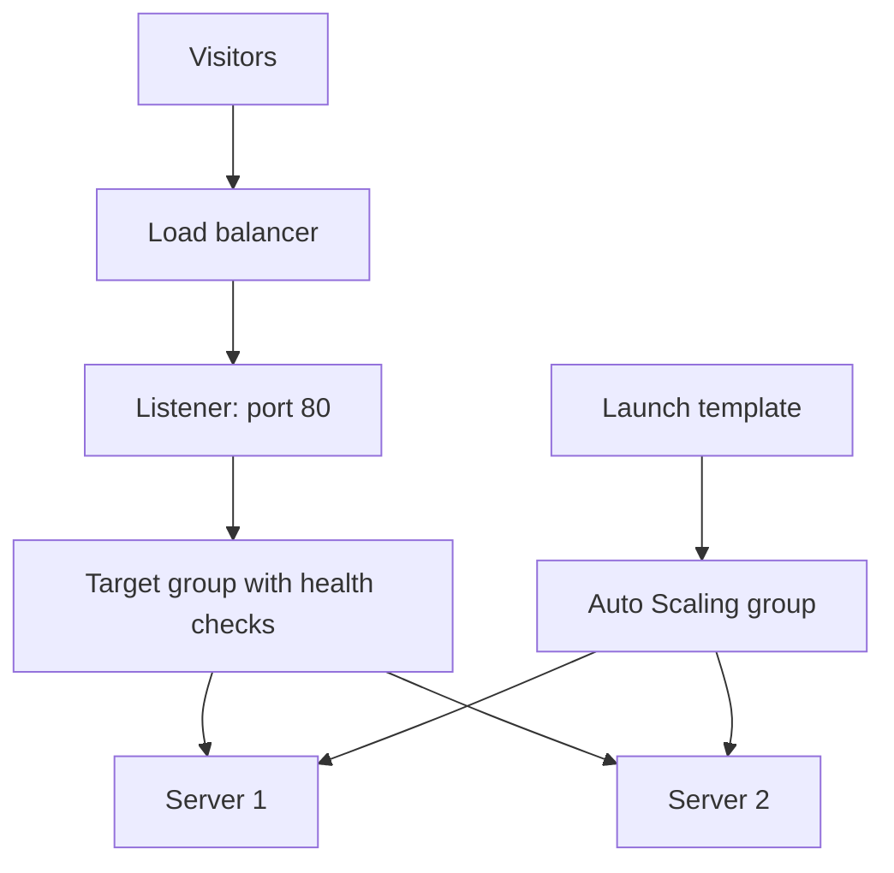

# A cluster of web servers behind a load balancer

## In plain words

A shop with one till works until that till breaks or a queue forms. A supermarket solves both problems the same way: several tills, a member of staff who directs each customer to a free one, and a manager who opens more tills when the queue grows and replaces a cashier who goes home ill.

The server from the previous lesson is the shop with one till. If it crashes, the site is down. If too many visitors arrive, it slows to a crawl. In this lesson you describe the supermarket version in Terraform:

- several identical servers, called a **cluster**;
- an **Auto Scaling group**, the manager, which keeps the right number of servers running and replaces broken ones;
- a **load balancer**, the member of staff at the front, which receives every request and passes it to a healthy server.

Why this matters for a job: "servers in an Auto Scaling group behind a load balancer" is the most common shape of a web system on AWS, and writing it is the first time a Terraform configuration has enough moving parts for the dependency graph, data sources and lifecycle settings to earn their keep.

> **Before this lesson:** complete [Variables, outputs, references and a configurable web server](#/lesson/terraform/variables-outputs-web-server). The AWS track explains the services used here: [Elastic Load Balancing: ALB, NLB and health checks](#/lesson/aws/load-balancing), [EC2 Auto Scaling: groups, launch templates and scaling policies](#/lesson/aws/auto-scaling) and [VPCs, CIDR planning, subnets, route tables and gateways](#/lesson/aws/vpc-basics). You do not need to have built them by hand.

> [!WARNING]
> **Cost and safety.** A load balancer is billed for every hour it exists, whether or not it receives traffic, and it is generally not covered by long-term free allowances. Together with two small servers this example costs on the order of a few US cents per hour. That is small, but a forgotten stack left for a month becomes a real bill. Work in a sandbox account with a budget alert, keep `max_size` low, and run `terraform destroy` as soon as you have tested it.

## The pieces and how they connect



New terms, each defined once:

- A **launch template** is the recipe for one server: image, size, firewall and startup script. It creates nothing by itself.
- An **Auto Scaling group** (ASG) uses the launch template to keep between a minimum and a maximum number of servers alive.
- An **Application Load Balancer** (ALB) accepts web requests on a public address.
- A **listener** is the load balancer's ear: it waits on one port and decides where requests go.
- A **target group** is the list of servers that can receive requests. It runs a **health check**, a small request sent to each server every few seconds; servers that stop answering are taken out of rotation.
- A **VPC** (Virtual Private Cloud) is your private network inside AWS, divided into **subnets**. Each subnet lives in one **Availability Zone**, a physically separate data centre. Spreading servers over subnets in different zones keeps the site alive if one zone fails.

## Step 1: look up the network with data sources

Every AWS account starts with a default VPC. For a first cluster, using it avoids building a network from scratch (the worked project later builds a proper one). Two data sources find it:

```hcl
data "aws_vpc" "default" {
  default = true
}

data "aws_subnets" "default" {
  filter {
    name   = "vpc-id"
    values = [data.aws_vpc.default.id]
  }
}
```

- `data "aws_vpc" "default"` asks for the VPC whose "default" flag is true.
- `data "aws_subnets" "default"` asks for all subnets matching a filter. The filter says the subnet's `vpc-id` must equal the ID found by the first lookup. That is a reference from one data source to another, so Terraform reads the VPC first.
- The result is available as `data.aws_subnets.default.ids`, a list of subnet IDs.

## Step 2: variables

```hcl
variable "name" {
  description = "Prefix for the names of all resources in this stack"
  type        = string
  default     = "bookshelf"
}

variable "server_port" {
  description = "Port the application listens on inside each server"
  type        = number
  default     = 8080
}

variable "min_size" {
  description = "Smallest number of servers the group may run"
  type        = number
  default     = 2
}

variable "max_size" {
  description = "Largest number of servers the group may run"
  type        = number
  default     = 4
}
```

Nothing new here; the `name` variable lets two copies of the stack live in one account without name clashes.

## Step 3: two security groups

The servers should accept traffic only from the load balancer, and the load balancer should accept traffic from the internet. That takes two firewalls.

```hcl
resource "aws_security_group" "alb" {
  name   = "${var.name}-alb"
  vpc_id = data.aws_vpc.default.id
}

resource "aws_vpc_security_group_ingress_rule" "alb_http" {
  security_group_id = aws_security_group.alb.id
  cidr_ipv4         = "0.0.0.0/0"
  from_port         = 80
  to_port           = 80
  ip_protocol       = "tcp"
}

resource "aws_vpc_security_group_egress_rule" "alb_out" {
  security_group_id = aws_security_group.alb.id
  cidr_ipv4         = "0.0.0.0/0"
  ip_protocol       = "-1"
}

resource "aws_security_group" "servers" {
  name   = "${var.name}-servers"
  vpc_id = data.aws_vpc.default.id
}

resource "aws_vpc_security_group_ingress_rule" "servers_from_alb" {
  security_group_id            = aws_security_group.servers.id
  referenced_security_group_id = aws_security_group.alb.id
  from_port                    = var.server_port
  to_port                      = var.server_port
  ip_protocol                  = "tcp"
}
```

- This time each rule is its own resource instead of a nested `ingress` block. The modules lesson explains why separate rule resources are the safer style; for now, read each one as "attach this rule to that group".
- `alb_http` lets anyone reach the load balancer on port 80, the standard port for unencrypted web traffic.
- `alb_out` is an **egress** (outgoing) rule. `ip_protocol = "-1"` means "all protocols". The load balancer needs outgoing access so it can reach the servers and run health checks. When Terraform manages a security group's rules, AWS's usual "allow all outgoing" default is removed, so you must state it.
- `servers_from_alb` uses `referenced_security_group_id` instead of an address range. It means "allow traffic whose source is anything wearing the load balancer's security group". No address on the internet can reach the servers directly.

## Step 4: the launch template

```hcl
data "aws_ami" "al2023" {
  most_recent = true
  owners      = ["amazon"]

  filter {
    name   = "name"
    values = ["al2023-ami-2023.*-x86_64"]
  }
}

resource "aws_launch_template" "web" {
  name_prefix            = "${var.name}-"
  image_id               = data.aws_ami.al2023.id
  instance_type          = "t3.micro"
  vpc_security_group_ids = [aws_security_group.servers.id]

  user_data = base64encode(<<-EOF
    #!/bin/bash
    mkdir -p /srv/site && cd /srv/site
    echo "Served by $(hostname)" > index.html
    nohup python3 -m http.server ${var.server_port} &
  EOF
  )

  lifecycle {
    create_before_destroy = true
  }
}
```

- `name_prefix` asks AWS to generate a unique name starting with the prefix. A fixed `name` would clash if a new template had to exist alongside the old one for a moment.
- `image_id` uses the AMI lookup from the previous lesson.
- `user_data = base64encode(...)` calls a **function**. Terraform has many built-in functions, written `name(arguments)`. Launch templates require the startup script in base64, an encoding that turns any data into plain letters and digits, and `base64encode` does the conversion.
- Inside the script, `$(hostname)` is run by the server's shell at boot, not by Terraform. Terraform only interprets `${ ... }` with braces. The page each server writes therefore contains its own name, which will let you see the load balancer spreading requests.
- The `lifecycle` block changes how Terraform handles this resource. `create_before_destroy = true` means that when a replacement is needed, Terraform creates the new one first and removes the old one afterwards. The default is the opposite order. Without this setting, replacing the template would try to delete one that the Auto Scaling group still points to.

`lifecycle` is a **meta-argument**: a setting understood by Terraform core for every resource type, not by the provider. `depends_on` was the first one you met.

## Step 5: the Auto Scaling group

```hcl
resource "aws_autoscaling_group" "web" {
  name_prefix         = "${var.name}-"
  vpc_zone_identifier = data.aws_subnets.default.ids
  min_size            = var.min_size
  max_size            = var.max_size

  target_group_arns = [aws_lb_target_group.web.arn]
  health_check_type = "ELB"

  launch_template {
    id      = aws_launch_template.web.id
    version = aws_launch_template.web.latest_version
  }

  tag {
    key                 = "Name"
    value               = "${var.name}-web"
    propagate_at_launch = true
  }
}
```

- `vpc_zone_identifier` lists the subnets servers may be placed in. Passing all default subnets spreads servers across zones.
- `min_size` and `max_size` bound the fleet. The group starts at the minimum.
- `target_group_arns` registers every server the group starts with the load balancer's target group, and removes it when the server is terminated.
- `health_check_type = "ELB"` tells the group to trust the load balancer's health check. The default only notices a server that has stopped entirely; this setting also replaces a server whose application has stopped answering.
- The nested `launch_template` block points to the recipe and to its newest version.
- `tag { ... propagate_at_launch = true }` puts a Name tag on each server the group starts.

## Step 6: the load balancer, listener and target group

```hcl
resource "aws_lb" "web" {
  name               = "${var.name}-alb"
  load_balancer_type = "application"
  subnets            = data.aws_subnets.default.ids
  security_groups    = [aws_security_group.alb.id]
}

resource "aws_lb_target_group" "web" {
  name     = "${var.name}-tg"
  port     = var.server_port
  protocol = "HTTP"
  vpc_id   = data.aws_vpc.default.id

  health_check {
    path                = "/"
    matcher             = "200"
    interval            = 15
    timeout             = 3
    healthy_threshold   = 2
    unhealthy_threshold = 2
  }
}

resource "aws_lb_listener" "http" {
  load_balancer_arn = aws_lb.web.arn
  port              = 80
  protocol          = "HTTP"

  default_action {
    type             = "forward"
    target_group_arn = aws_lb_target_group.web.arn
  }
}

output "alb_dns_name" {
  description = "Public DNS name of the load balancer"
  value       = aws_lb.web.dns_name
}
```

- `aws_lb.web` is the load balancer. `load_balancer_type = "application"` selects the kind that understands web requests. It is placed in the same subnets and wears the `alb` security group.
- `aws_lb_target_group.web` says servers receive traffic on `var.server_port`. Its `health_check` requests the path `/` every 15 seconds, expects the status code 200 (the web's code for "OK") within 3 seconds, and needs two consecutive successes or failures to change a server's status.
- `aws_lb_listener.http` listens on port 80 and, by default, forwards every request to the target group.
- The output publishes the load balancer's **DNS name**, a generated domain name that is its public address.

## Plan, apply, test

```bash
$ terraform plan
...
Plan: 11 to add, 0 to change, 0 to destroy.

Changes to Outputs:
  + alb_dns_name = (known after apply)
```

Make a habit of reconciling the summary against your own count before reading further. The blocks written so far are two security groups, three rules, a launch template, an Auto Scaling group, a load balancer, a target group and a listener: ten. The plan says eleven because the full configuration has one more rule that was left out of step 3 to keep it short. It gives the servers outgoing access so they can download packages:

```hcl
resource "aws_vpc_security_group_egress_rule" "servers_out" {
  security_group_id = aws_security_group.servers.id
  cidr_ipv4         = "0.0.0.0/0"
  ip_protocol       = "-1"
}
```

Data sources are never counted in the summary, and neither are the servers themselves: Terraform manages the *group*, and the group manages the servers.

```bash
$ terraform apply
...
aws_lb.web: Still creating... [2m10s elapsed]
aws_lb.web: Creation complete after 2m43s
aws_lb_listener.http: Creating...
aws_autoscaling_group.web: Creation complete after 48s

Apply complete! Resources: 11 added, 0 changed, 0 destroyed.

Outputs:

alb_dns_name = "bookshelf-alb-1182930421.eu-west-1.elb.amazonaws.com"

$ for i in 1 2 3 4; do curl -s "http://$(terraform output -raw alb_dns_name)"; done
Served by ip-172-31-14-201.eu-west-1.compute.internal
Served by ip-172-31-38-77.eu-west-1.compute.internal
Served by ip-172-31-14-201.eu-west-1.compute.internal
Served by ip-172-31-38-77.eu-west-1.compute.internal
```

- A load balancer takes a few minutes to create. The listener waited for it because the listener references its ARN.
- The `for` loop sends four requests. Two different host names answer in turn: the load balancer is alternating between servers.

Now test the self-healing. In the EC2 console, terminate one of the two servers by hand. Within a minute the health check marks it unhealthy, the load balancer stops sending it traffic, and the Auto Scaling group starts a replacement. During all of this `curl` keeps working. Then run `terraform plan`: it reports no changes, because the group still matches its description even though an individual server was replaced. This is the split of duties to remember: **Terraform describes the group; the group looks after the servers.**

Finish with `terraform destroy` and wait for it to complete.

## What happens when you change the startup script

Edit the `echo` line in the user data and plan again:

```bash
  # aws_launch_template.web will be updated in-place
  ~ resource "aws_launch_template" "web" {
      ~ latest_version = 1 -> (known after apply)
      ~ user_data      = "IyEvYmluL2Jhc2gK..." -> "IyEvYmluL2Jhc2gKbWtk..."
    }

  # aws_autoscaling_group.web will be updated in-place
  ~ resource "aws_autoscaling_group" "web" {
      ~ launch_template {
          ~ version = "1" -> (known after apply)
        }
    }

Plan: 0 to add, 2 to change, 0 to destroy.
```

Both are in-place updates. Applying this changes the recipe, but the two running servers were made from the old recipe and keep running it. New servers get the new script only when the group next starts one. To roll the change across the fleet, add an `instance_refresh` block to the group, which tells AWS to replace servers gradually whenever the template changes:

```hcl
  instance_refresh {
    strategy = "Rolling"
    preferences {
      min_healthy_percentage = 50
    }
  }
```

`min_healthy_percentage = 50` keeps at least half of the servers in service while the others are replaced. The tips and tricks module returns to zero-downtime deployment in detail.

## Pitfalls

- **Forgetting egress rules.** Terraform-managed security groups do not keep AWS's default "allow all outgoing" rule. A load balancer that cannot reach its targets shows every server as unhealthy.
- **Health check path or port mismatch.** If the check asks for a page the application does not serve, every server is "unhealthy" and visitors see a 503 error although the servers are fine.
- **Opening the servers to the internet.** Reference the load balancer's security group instead of `0.0.0.0/0`.
- **Fixed names on replaceable resources.** With `create_before_destroy`, old and new must exist together briefly, which is impossible if both need the same name. Use `name_prefix`.
- **Expecting running servers to pick up a new template.** They do not without an instance refresh.
- **Changing `desired_capacity` in code while autoscaling also changes it.** Terraform and the scaling policy will fight. Leave it unset or ignore it with `lifecycle { ignore_changes = [desired_capacity] }`.
- **Leaving the load balancer running.** It bills by the hour with zero traffic.

## Cheat sheet

| Resource | Role |
|---|---|
| `data "aws_vpc"` / `data "aws_subnets"` | Find the network to deploy into |
| `aws_security_group` plus rule resources | Firewalls for the load balancer and the servers |
| `aws_launch_template` | Recipe for one server |
| `aws_autoscaling_group` | Keeps `min_size` to `max_size` servers alive |
| `aws_lb` | The load balancer and its public DNS name |
| `aws_lb_target_group` | Servers that receive traffic, with health checks |
| `aws_lb_listener` | Port the load balancer listens on and where it forwards |
| `lifecycle { create_before_destroy = true }` | Build the replacement before removing the original |
| `base64encode(...)` | Built-in function used for launch template user data |
| `name_prefix` | Let AWS generate a unique name |

## Summary

- A cluster behind a load balancer removes the single point of failure of one server.
- Data sources find existing infrastructure such as the default VPC and its subnets.
- The launch template is the recipe, the Auto Scaling group keeps the fleet at size and replaces failures, and the load balancer, listener and target group route requests to healthy servers.
- Security groups can refer to each other, so servers accept traffic only from the load balancer.
- `lifecycle` is a meta-argument; `create_before_destroy` reverses the default replacement order.
- Terraform manages the group, not individual servers, so a server replaced by the group causes no plan changes.
- Updating a launch template does not touch running servers unless an instance refresh is configured.

## Glossary

- **Cluster:** a group of identical servers doing the same job.
- **Launch template:** a saved recipe for starting a server.
- **Auto Scaling group (ASG):** a service that keeps a chosen number of servers running.
- **Load balancer:** a service that spreads incoming requests over servers.
- **Listener:** the port and rule set on which a load balancer accepts requests.
- **Target group:** the set of servers a load balancer can send requests to.
- **Health check:** a repeated test request that decides whether a server may receive traffic.
- **VPC / subnet / Availability Zone:** a private network, a slice of it, and a physically separate data centre.
- **Egress:** outgoing network traffic.
- **Function:** a built-in operation called as `name(arguments)`.
- **Base64:** an encoding of arbitrary data as plain text characters.
- **Meta-argument:** a setting handled by Terraform core on any resource, such as `lifecycle` or `depends_on`.
- **DNS name:** a human-readable address that resolves to IP addresses.

## Check yourself

```quiz
[
  {"q": "An Auto Scaling group with min_size 2 is managed by Terraform. One of its servers crashes and the group replaces it. What does `terraform plan` show afterwards?",
   "options": ["1 to add", "1 to change", "1 to add, 1 to destroy", "No changes"], "answer": 3,
   "explain": "Terraform manages the group, not the individual servers. The group still matches its configuration, so there is nothing to change."},
  {"q": "What does `lifecycle { create_before_destroy = true }` change?",
   "options": ["The resource can never be destroyed", "On replacement, the new object is created before the old one is removed", "The resource is created before all others", "Changes to the resource are ignored"], "answer": 1,
   "explain": "The default replacement order is destroy then create. This setting reverses it so the old object keeps working until the new one exists."},
  {"q": "You edit only the user data in the launch template and run plan. The group has no instance_refresh block. What is planned, and what happens to running servers?",
   "options": ["2 to change; running servers keep the old script", "2 to add, 2 to destroy; all servers are replaced at once", "No changes", "1 to destroy; the group is deleted"], "answer": 0,
   "explain": "The template gets a new version and the group is updated to point at it, both in place. Existing servers were started from the old version and are untouched."},
  {"q": "Why does the servers' security group reference the load balancer's security group instead of 0.0.0.0/0?",
   "options": ["It is cheaper", "So only traffic coming from the load balancer can reach the servers", "Because address ranges are not allowed on port 8080", "To make health checks optional"], "answer": 1,
   "explain": "Referencing a security group as the source allows only resources in that group. The servers are then unreachable directly from the internet."},
  {"q": "Every server shows as unhealthy in the target group although the application works when tested from inside the server. Which cause is most likely?",
   "options": ["The lock file is missing", "The health check path or port does not match the application, or a security group rule blocks the load balancer", "The state file is too large", "The output is marked sensitive"], "answer": 1,
   "explain": "Health checks fail when they ask for the wrong port or path, or when the firewall between load balancer and servers does not allow the traffic."},
  {"q": "Which of these is counted in the plan summary line?",
   "options": ["`data.aws_vpc.default`", "The individual EC2 servers started by the group", "`aws_lb_listener.http`", "`output \"alb_dns_name\"`"], "answer": 2,
   "explain": "Only managed resources are counted. Data sources are read-only, outputs are values, and the servers belong to the Auto Scaling group."},
  {"q": "Inside a heredoc used for user data, which expression is evaluated by Terraform before the script reaches the server?",
   "options": ["`$(hostname)`", "`${var.server_port}`", "`$HOME`", "None of them"], "answer": 1,
   "explain": "Terraform interpolates `${ ... }` with braces. `$(...)` and `$NAME` pass through unchanged and are evaluated by the shell on the server."}
]
```

> **Source:** Brikman, Terraform: Up & Running 3e, ch. 2 (deploying a cluster of web servers, deploying a load balancer, cleanup). Documentation: https://registry.terraform.io/providers/hashicorp/aws/latest/docs/resources/autoscaling_group, https://registry.terraform.io/providers/hashicorp/aws/latest/docs/resources/lb and https://developer.hashicorp.com/terraform/language/meta-arguments/lifecycle
