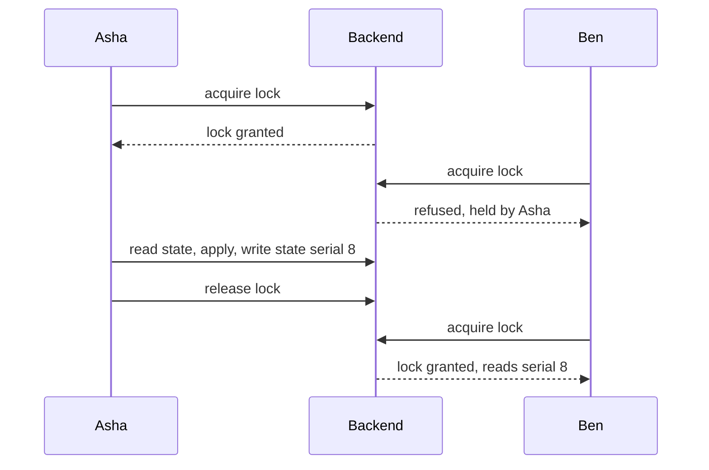

# Terraform state, remote backends and locking

## In plain words

A library keeps a catalogue: for every book, a card saying which shelf it is on and who borrowed it. The catalogue is not the books, but without it the librarians cannot find anything, cannot tell which books belong to the library, and might buy a second copy of something they already own.

**Terraform state** is that catalogue. It is a file in which Terraform records, for every resource in your code, which real object in the cloud it corresponds to. This lesson explains what is in the file, why keeping it on one laptop stops working the moment a second person joins, where to keep it instead, and how a **lock** stops two people from updating the catalogue at the same moment.

Why this matters for a job: "what is Terraform state and why does it matter?" is the single most common Terraform interview question. In daily work, nearly every serious Terraform incident (duplicated resources, a corrupted file, a stuck lock, a leaked password) is a state incident.

> **Before this lesson:** complete the getting started module, ending with [A cluster of web servers behind a load balancer](#/lesson/terraform/cluster-load-balancer). You should know what an S3 bucket is, including versioning and encryption, from [S3 buckets, objects, storage classes and lifecycle rules](#/lesson/aws/s3-basics) and [S3 versioning, encryption, replication, access control and presigned URLs](#/lesson/aws/s3-protection).

## What is in the state file

After your first `apply`, a file named `terraform.tfstate` appeared in the folder. It is written in **JSON**, a plain-text format for structured data. A shortened example:

```json
{
  "version": 4,
  "terraform_version": "1.13.4",
  "serial": 7,
  "lineage": "3f2c9a1e-8d41-7b60-a0c2-5e7d19b4c6aa",
  "resources": [
    {
      "mode": "managed",
      "type": "aws_instance",
      "name": "web",
      "provider": "provider[\"registry.terraform.io/hashicorp/aws\"]",
      "instances": [
        {
          "attributes": {
            "id": "i-0f3a9c1e27b4d5a60",
            "ami": "ami-07c1b39b7b3d2525d",
            "instance_type": "t3.micro",
            "private_ip": "172.31.14.201"
          },
          "dependencies": ["aws_security_group.web"]
        }
      ]
    }
  ]
}
```

Field by field:

- `version` is the format of the file itself; `terraform_version` is the release that last wrote it.
- `serial` is a counter that goes up by one on every write. Terraform uses it to refuse an older copy overwriting a newer one.
- `lineage` is a random identifier created with the state. Two states with different lineages are unrelated, and Terraform refuses to mix them.
- Each entry in `resources` ties an address (`aws_instance.web`) to a real object (`i-0f3a9c1e27b4d5a60`) and stores every attribute the provider reported, plus the dependencies needed to destroy things in the right order.

State does four jobs:

1. **Mapping.** Your code says `aws_instance.web`. AWS knows only `i-0f3a9c1e27b4d5a60`. State links the two. Without it, Terraform cannot tell "my server" from any other server in the account.
2. **Detecting deletions.** When you remove a block from the code, the only evidence that something should be destroyed is its entry in state.
3. **Remembering details.** Dependency order for destroy, and values the API does not return again.
4. **Speed.** Recorded attributes let Terraform compute a plan without rediscovering everything from nothing.

Two rules follow, and they are worth memorising:

- **The state file is an internal record. Do not edit it by hand.** Its format is private and changes between releases. Use the commands in the state surgery lesson.
- **The state file contains secrets in plain text.** If a resource has a password, a private key or a connection string as an attribute, that value is stored unencrypted in the JSON.

## Why a file on a laptop is not enough

By default the state lives next to your code. This is called the **local backend**. For one person learning, it is fine. For a team it fails in three ways:

- **Sharing.** Every teammate needs the latest state before running Terraform. If two people have different copies, each one's plan is computed against a stale catalogue.
- **Locking.** If two people run `apply` at the same moment, both read the same state, both make changes, and the second write overwrites the first. Resources created by the first run are forgotten. Two processes interfering like this is called a **race condition**.
- **Secrets and isolation.** The file holds secrets, and one shared file for everything means a mistake anywhere can damage everything.

The tempting fix is to commit the state file to Git. Do not. Git has no locking, so the race remains; people forget to pull before applying; and every secret in the state would be stored in the repository's history forever, readable by everyone with access.

## Remote backends

A **backend** is the setting that decides where Terraform loads state from and saves it to. A **remote backend** keeps state in a shared service instead of on disk. Common choices are an Amazon S3 bucket, Azure Blob Storage, Google Cloud Storage, and HashiCorp's hosted service HCP Terraform (formerly called Terraform Cloud).

A remote backend fixes all three problems:

- Terraform fetches the state before every `plan` or `apply` and uploads it after every `apply`, with no manual step.
- Most backends support **locking**: before changing anything, Terraform takes a lock; a second run waits or fails until the lock is released.
- Storage services offer encryption, access control and **versioning** (keeping every old copy), so a damaged state can be rolled back.



## Building an S3 backend, step by step

There is a small chicken-and-egg puzzle: the bucket that stores state must exist before any configuration can use it. The usual answer is a tiny, separate configuration, often called the **bootstrap**, that creates the bucket and keeps its own state locally (or is migrated into the bucket afterwards).

> [!WARNING]
> **Cost and safety.** An S3 bucket holding a few small state files costs well under one US cent a month, so cost is not the concern. Safety is. This bucket becomes the most sensitive object in your account: it maps and can contain secrets for all your infrastructure. Block all public access, encrypt it, restrict who can read it, and never delete it casually.

### The bootstrap configuration

```hcl
provider "aws" {
  region = "eu-west-1"
}

resource "aws_s3_bucket" "tfstate" {
  bucket = "harbour-books-tfstate-eu-west-1"

  lifecycle {
    prevent_destroy = true
  }
}

resource "aws_s3_bucket_versioning" "tfstate" {
  bucket = aws_s3_bucket.tfstate.id

  versioning_configuration {
    status = "Enabled"
  }
}

resource "aws_s3_bucket_server_side_encryption_configuration" "tfstate" {
  bucket = aws_s3_bucket.tfstate.id

  rule {
    apply_server_side_encryption_by_default {
      sse_algorithm = "aws:kms"
    }
  }
}

resource "aws_s3_bucket_public_access_block" "tfstate" {
  bucket                  = aws_s3_bucket.tfstate.id
  block_public_acls       = true
  block_public_policy     = true
  ignore_public_acls      = true
  restrict_public_buckets = true
}
```

- `aws_s3_bucket.tfstate` creates the bucket. Bucket names are unique across all of AWS, so yours must differ. `prevent_destroy = true` is a lifecycle setting that makes Terraform refuse any plan that would delete this resource; it is a seat belt against an accidental `destroy`.
- `aws_s3_bucket_versioning` turns on versioning, so every write of the state keeps the previous copy. This is your undo button.
- `aws_s3_bucket_server_side_encryption_configuration` makes S3 encrypt every object as it is stored. `aws:kms` uses a key from AWS Key Management Service.
- `aws_s3_bucket_public_access_block` switches on all four protections against the bucket ever being exposed publicly.

Apply this once. Its own tiny state can stay local on an administrator's machine or be migrated into the bucket with the steps below.

### Pointing a configuration at the backend

In the configuration that manages real infrastructure, add a `backend` block inside the `terraform` block:

```hcl
terraform {
  backend "s3" {
    bucket       = "harbour-books-tfstate-eu-west-1"
    key          = "sandbox/web-cluster/terraform.tfstate"
    region       = "eu-west-1"
    encrypt      = true
    use_lockfile = true
  }
}
```

- `backend "s3"` selects the S3 backend.
- `bucket` and `region` say where the bucket is.
- `key` is the path of the state object inside the bucket. Every configuration needs its own unique key; two configurations sharing a key would overwrite each other.
- `encrypt = true` asks for encryption of the stored object.
- `use_lockfile = true` turns on locking. When a run starts, Terraform writes a small lock object next to the state (the key with `.tflock` added) using a conditional write that fails if the object already exists. That gives exactly one writer at a time.

> [!NOTE]
> Older tutorials and many existing codebases lock with a DynamoDB table instead, using a `dynamodb_table` argument and a table whose primary key is `LockID`. That method works but is deprecated in current Terraform in favour of `use_lockfile`. You will meet both; the idea is identical, only the place the lock is stored differs.

Then run `init` again:

```bash
$ terraform init

Initializing the backend...
Do you want to copy existing state to the new backend?
  Pre-existing state was found while migrating the previous "local" backend to the
  newly configured "s3" backend. No existing state was found in the newly
  configured "s3" backend. Do you want to copy this existing state to the new
  backend? Enter "yes" to copy and "no" to start with an empty state.

  Enter a value: yes

Successfully configured the backend "s3"! Terraform will automatically
use this backend unless the backend configuration changes.
```

Terraform noticed the backend changed, found the local state and offered to copy it. Answer `yes` and the local file is emptied; the bucket now holds the truth. From here on every `plan` and `apply` starts with `Acquiring state lock. This may take a few moments...`.

### A backend block cannot use variables

It would be natural to write `bucket = var.state_bucket`. In Terraform that is an error: the backend is set up during `init`, before variables are evaluated. Two workarounds exist.

The first is **partial configuration**: leave arguments out of the block and supply them at `init` time from a small file.

```hcl
# backend.hcl  (shared by every configuration in the repository)
bucket       = "harbour-books-tfstate-eu-west-1"
region       = "eu-west-1"
encrypt      = true
use_lockfile = true
```

```hcl
terraform {
  backend "s3" {
    key = "sandbox/web-cluster/terraform.tfstate"
  }
}
```

```bash
terraform init -backend-config=backend.hcl
```

Only `key`, which must be unique per configuration, stays in the code. The repeated settings live in one file.

The second applies if you use OpenTofu: since version 1.8 it allows variables and locals in backend blocks ("early evaluation"), provided their values are known at `init` time.

## Locking in more detail

A lock records who holds it, on which machine, for which operation and since when. If a second run starts while the lock is held, it stops:

```bash
$ terraform apply

Error: Error acquiring the state lock

Error message: operation error S3: PutObject, StatusCode: 412
Lock Info:
  ID:        6f1c2a9e-0b7d-4c35-9e8a-2d4f5a6b7c8d
  Path:      harbour-books-tfstate-eu-west-1/sandbox/web-cluster/terraform.tfstate
  Operation: OperationTypeApply
  Who:       asha@build-runner-12
  Created:   2026-03-14 09:41:07 UTC
```

Read the lock information before doing anything. It tells you who is running what. Usually the right action is to wait. Adding `-lock-timeout=5m` makes Terraform retry for five minutes instead of failing at once.

Sometimes a lock is **stale**: the process that took it crashed, or a laptop lost its network connection mid-apply, and nobody is left to release it. Only then is the manual release appropriate:

```bash
terraform force-unlock 6f1c2a9e-0b7d-4c35-9e8a-2d4f5a6b7c8d
```

> [!WARNING]
> `force-unlock` removes the protection while possibly another run is still writing. First confirm with the person or pipeline named in the lock that the run is dead. Never pass `-lock=false` to skip locking on a shared state.

The simulation below models a lock with explicit timestamps, including a rule that treats a very old lock as stale. Real backends do not expire locks automatically, which is exactly why `force-unlock` exists; the simulation shows what a wrapper script or a careful human does.

```python-run
STALE_AFTER = 900  # seconds; a human or wrapper decides this, the backend does not

lock = None  # None, or {"id": ..., "who": ..., "at": ...}

def acquire(who, now):
    global lock
    if lock is None:
        lock = {"id": f"lock-{now}", "who": who, "at": now}
        return f"t={now:>4}  {who:5} acquired {lock['id']}"
    age = now - lock["at"]
    if age >= STALE_AFTER:
        return (f"t={now:>4}  {who:5} BLOCKED by {lock['who']} (held {age}s, looks stale: "
                f"verify, then force-unlock {lock['id']})")
    return f"t={now:>4}  {who:5} BLOCKED by {lock['who']} (held {age}s, wait)"

def release(who, now):
    global lock
    if lock and lock["who"] == who:
        lock = None
        return f"t={now:>4}  {who:5} released"
    return f"t={now:>4}  {who:5} cannot release: not the holder"

def force_unlock(lock_id, now):
    global lock
    if lock and lock["id"] == lock_id:
        lock = None
        return f"t={now:>4}  force-unlock {lock_id} ok"
    return f"t={now:>4}  force-unlock failed: id does not match"

print(acquire("asha", 0))
print(acquire("ben", 30))        # asha is still working
print(release("ben", 40))        # only the holder can release
print(release("asha", 95))
print(acquire("ben", 100))       # ben's laptop then loses its connection...
print(acquire("ci", 400))
print(acquire("ci", 1200))       # ...and the lock is never released
print(force_unlock("lock-0", 1210))    # wrong id: refused
print(force_unlock("lock-100", 1220))  # correct id
print(acquire("ci", 1230))
```

## Protecting and recovering state

A short checklist for any remote backend:

- **Encrypt** at rest and require encrypted connections.
- **Restrict access.** Reading state means reading its secrets. Most engineers need no direct access to the bucket; the pipeline does.
- **Turn on versioning.** If a state file is corrupted, restore the previous version of the object.
- **Log access** so that reads of the state can be audited.
- **Protect the bucket from deletion**, with `prevent_destroy` and with bucket policies.

OpenTofu adds a further layer: it can encrypt state and plan files on the client before they leave your machine, configured in an `encryption` block inside the `terraform` block. With that, even someone who can read the bucket sees only ciphertext. Terraform relies on the backend's own encryption instead.

To look at state without touching it:

```bash
terraform state list             # every address in the state
terraform state show aws_lb.web  # recorded attributes of one resource
terraform state pull > copy.json # download the raw state for inspection or backup
```

`state pull` writes the secrets to your disk, so delete the copy afterwards.

> [!INTERVIEW]
> "What is Terraform state and why do we need it?" Answer in three moves. It is the record that maps each resource in the configuration to a real object and stores its attributes. Terraform needs it to know what it owns, to notice that a removed block means a destroy, and to plan quickly. In a team it must live in a remote backend with locking, encryption and versioning, because it is shared, changed concurrently and contains secrets.

## Pitfalls

- **State in Git.** No locking, stale copies, secrets in history.
- **Two configurations with the same `key`.** Each overwrites the other's state. Make keys unique and derive them from the folder path.
- **No versioning on the bucket.** One bad write and there is nothing to restore.
- **Reaching for `force-unlock` first.** Read who holds the lock, ask, then act.
- **Deleting the state bucket with `destroy` in the bootstrap folder.** Every configuration loses its memory at once. Keep `prevent_destroy` on it.
- **Assuming encryption hides secrets from readers.** Server-side encryption protects the disks; anyone allowed to read the object still gets plain text.
- **Variables in the backend block** in Terraform. Use partial configuration.

## Cheat sheet

| Item | Meaning or command |
|---|---|
| State | Record linking addresses to real objects, with attributes |
| `serial` / `lineage` | Write counter / identity of a state history |
| Local backend | State in `terraform.tfstate` beside the code |
| Remote backend | State in a shared service such as S3 |
| `backend "s3" { key = ... }` | Where this configuration's state lives |
| `use_lockfile = true` | S3-native locking with a `.tflock` object |
| `dynamodb_table` | Older, deprecated locking method |
| `terraform init -backend-config=file` | Partial backend configuration |
| `terraform init -migrate-state` | Move state after changing the backend |
| `-lock-timeout=5m` | Wait for a lock instead of failing |
| `terraform force-unlock ID` | Remove a stale lock, after verifying |
| `terraform state list` / `show` / `pull` | Inspect state read-only |

## Summary

- State maps each resource address to a real object and stores its attributes; Terraform cannot work without it.
- It is private to Terraform and may contain plain-text secrets, so never edit it by hand and never commit it.
- Local state breaks down for teams: no sharing, no locking, no isolation.
- A remote backend such as S3 loads and saves state automatically and adds locking, encryption and versioning.
- The backend bucket is created by a small bootstrap configuration and protected with `prevent_destroy`, versioning and a public access block.
- Backend blocks cannot use variables in Terraform; partial configuration with `-backend-config` avoids repetition.
- A lock allows one writer at a time. Wait for held locks, and force-unlock only stale ones after checking.

## Glossary

- **State:** Terraform's stored record of the infrastructure it manages.
- **JSON:** a plain-text format for structured data.
- **Serial:** the state's write counter.
- **Lineage:** the unique identity of one state's history.
- **Backend:** the setting that decides where state is stored.
- **Local / remote backend:** state on disk beside the code, or in a shared service.
- **Lock:** a marker allowing only one run to modify a state at a time.
- **Race condition:** a fault caused by two processes acting at once on the same data.
- **Stale lock:** a lock left behind by a run that died.
- **Versioning:** keeping every previous copy of an object.
- **Bootstrap:** the small configuration that creates the backend's own storage.
- **Partial configuration:** supplying backend settings at `init` time.
- **`prevent_destroy`:** a lifecycle setting that rejects plans deleting the resource.

## Check yourself

```quiz
[
  {"q": "Which of these is NOT a job of the state file?",
   "options": ["Mapping resource addresses to real object IDs", "Letting Terraform notice that a removed block means a destroy", "Storing your AWS login credentials for the provider", "Recording dependencies for destroy order"], "answer": 2,
   "explain": "Provider credentials come from the environment or profiles, not from state. State may contain other secrets, such as database passwords set on resources."},
  {"q": "Two engineers run `terraform apply` at the same moment against a backend with locking. What happens?",
   "options": ["Both apply and the later write wins", "The second run fails or waits with a lock error naming the holder", "The state is split into two files", "Both are cancelled"], "answer": 1,
   "explain": "Only one run can hold the lock. The other receives 'Error acquiring the state lock' with the lock info, or waits if -lock-timeout is set."},
  {"q": "Why is committing terraform.tfstate to Git a bad idea?",
   "options": ["Git cannot store JSON", "No locking, easy to use a stale copy, and secrets end up in history", "The file is too large for Git", "Terraform refuses to read state from a Git folder"], "answer": 1,
   "explain": "Git offers no lock, relies on people pulling first, and keeps every secret in the state readable forever in the history."},
  {"q": "You write `bucket = var.state_bucket` inside a `backend \"s3\"` block in Terraform. What happens at init?",
   "options": ["It works", "An error: variables may not be used in backend configuration", "The variable is asked for interactively and then used", "The bucket is created automatically"], "answer": 1,
   "explain": "Backends are configured before variables are evaluated. Use partial configuration with -backend-config, or OpenTofu's early evaluation."},
  {"q": "A colleague's laptop crashed mid-apply an hour ago and the lock is still held. What is the correct sequence?",
   "options": ["Run apply with -lock=false", "Delete the state object", "Confirm the run is dead, then `terraform force-unlock <lock id>`, then plan to see what was left half done", "Wait; locks expire after 15 minutes"], "answer": 2,
   "explain": "Backends do not expire locks. After confirming nobody is still writing, force-unlock with the ID from the error, then run plan to reconcile."},
  {"q": "Two different configurations are given the same `key` in the same bucket. What is the risk?",
   "options": ["None; keys are only labels", "Each run overwrites or misreads the other's state, planning to destroy resources it does not recognise", "Locking stops working for both", "Encryption is disabled"], "answer": 1,
   "explain": "The key is the state's location. Sharing it makes each configuration treat the other's resources as not in its code, so it plans to destroy them."},
  {"q": "A state write is corrupted. Which backend feature lets you recover?",
   "options": ["Locking", "Versioning of the storage bucket", "The public access block", "The lineage field"], "answer": 1,
   "explain": "With versioning enabled, the previous copy of the state object can be restored."}
]
```

> **Source:** Brikman, Terraform: Up & Running 3e, ch. 3 (what is Terraform state, shared storage for state files, limitations with backends). Documentation: https://developer.hashicorp.com/terraform/language/state, https://developer.hashicorp.com/terraform/language/backend/s3, https://developer.hashicorp.com/terraform/language/state/locking and https://opentofu.org/docs/language/state/encryption/
