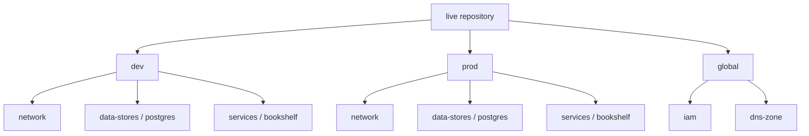
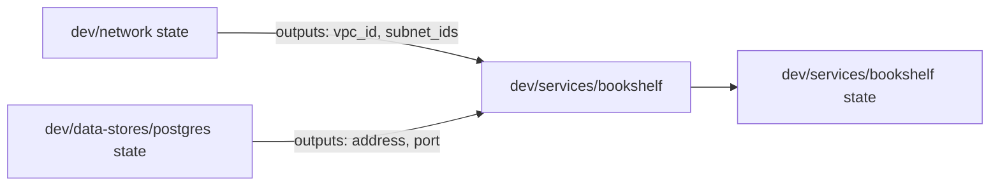

# Isolating state: workspaces, file layout and reading another state

## In plain words

A large ship is divided by watertight walls called bulkheads. If the hull is punctured, one compartment floods and the ship stays afloat. A ship built as one open space sinks from a single hole.

So far all of your infrastructure has lived in one configuration with one state file. That is the ship with no bulkheads: a single mistaken command, run in the wrong place, can damage the test systems and the live systems together. **State isolation** means splitting infrastructure across several separate state files so that a mistake in one cannot reach the others.

There are two ways to do the splitting, **workspaces** and **file layout**, and one way for the separated pieces to pass information to each other, a data source called `terraform_remote_state`. This lesson covers all three.

Why this matters for a job: how a team lays out its Terraform folders is the first thing you see when you join, and "how do you separate dev from prod?" and "workspaces or directories?" are routine interview questions.

> **Before this lesson:** read [Terraform state, remote backends and locking](#/lesson/terraform/state-and-backends). You should know that a backend `key` is the location of one state file, and what a lock is.

## Environments and blast radius

An **environment** is a complete, separate copy of a system used for a particular purpose. Typical names:

- **dev** (development): where engineers try changes;
- **staging** (or "stage"): a rehearsal copy that resembles the live system;
- **prod** (production): the live system real customers use.

The whole point of having environments is that a mistake in dev does not hurt prod. If all three share one state file, that protection is imaginary, because every `apply` evaluates and can modify all of them.

The amount of damage one mistake can cause is called its **blast radius**. Isolation is the practice of keeping the blast radius small.

## Option 1: workspaces

A **workspace** is a named, separate state for the *same* configuration folder. Every folder starts with one workspace called `default`. You can add more.

```bash
$ terraform workspace show
default

$ terraform workspace new dev
Created and switched to workspace "dev"!

$ terraform workspace new prod
Created and switched to workspace "prod"!

$ terraform workspace list
  default
  dev
* prod

$ terraform workspace select dev
Switched to workspace "dev".
```

- `workspace show` prints the current workspace.
- `workspace new NAME` creates a workspace and switches to it. Its state starts empty.
- `workspace list` shows them all; the asterisk marks the current one.
- `workspace select NAME` switches.

Each workspace has its own state, so running `apply` in `dev` and then in `prod` creates two independent copies of the infrastructure from the same code. With the S3 backend, the states are stored under a prefix:

| Workspace | Where the state object is stored |
|---|---|
| `default` | `<key>` |
| `dev` | `env:/dev/<key>` |
| `prod` | `env:/prod/<key>` |

Inside the code, the expression `terraform.workspace` gives the current name, so the configuration can vary slightly:

```hcl
resource "aws_instance" "worker" {
  ami           = data.aws_ami.al2023.id
  instance_type = terraform.workspace == "prod" ? "t3.large" : "t3.micro"

  tags = {
    Name = "worker-${terraform.workspace}"
  }
}
```

- `condition ? a : b` is the **conditional expression**: if the condition is true the result is `a`, otherwise `b`. Here production gets a larger server.
- The tag uses interpolation to include the workspace name.

Workspaces are quick, and they are good for one thing: **short-lived, disposable copies** of a configuration, such as spinning up your own copy of a module to test a change and destroying it an hour later.

They are a poor way to separate real environments, for four reasons:

1. **You cannot see them in the code.** A folder looks the same whether it has one workspace or nine. Nothing in the repository tells a newcomer that production exists.
2. **The current workspace is invisible state in your terminal.** The command `terraform destroy` is identical in dev and prod. Whether it is harmless or catastrophic depends on which workspace was selected an hour ago.
3. **All workspaces share one backend.** The same bucket and the same access rules cover dev and prod, so anyone who can touch dev state can touch prod state.
4. **The code must be identical**, apart from conditionals on the workspace name, which pile up and become hard to read.

> [!NOTE]
> The word "workspace" also appears in HCP Terraform, where it means something different and stronger: a separately configured unit with its own variables, permissions and run history. The criticism above is about workspaces in the command-line tool.

## Option 2: isolation by file layout

The sturdier method uses the file system itself:

- each environment gets its own **folder**;
- inside an environment, each **component** (network, database, application) gets its own folder;
- each of those folders is a separate Terraform configuration with its own backend `key`, and ideally each environment uses its own backend bucket and its own cloud account.



As a directory listing:

```bash
live/
├── dev/
│   ├── network/
│   │   ├── main.tf
│   │   ├── variables.tf
│   │   ├── outputs.tf
│   │   └── backend.tf        # key = "dev/network/terraform.tfstate"
│   ├── data-stores/
│   │   └── postgres/         # key = "dev/data-stores/postgres/terraform.tfstate"
│   └── services/
│       └── bookshelf/        # key = "dev/services/bookshelf/terraform.tfstate"
├── prod/
│   ├── network/
│   ├── data-stores/
│   │   └── postgres/
│   └── services/
│       └── bookshelf/
└── global/
    ├── iam/                  # users, roles: not tied to one environment
    └── dns-zone/
```

Reading the layout:

- The top level is the environment. `global` holds things shared by all environments, such as identity settings or the company's DNS zone.
- The second level is the component. The network changes perhaps twice a year; the application changes several times a day. Separating them means the frequent, routine change cannot touch the rare, dangerous one.
- A good convention is to make the backend `key` mirror the folder path, as in the comments. Then anyone can find the state for a folder, and keys never collide.

Inside each folder, a common file naming convention helps people find things:

| File | Contents |
|---|---|
| `main.tf` | Resources and module calls |
| `variables.tf` | Input variable declarations |
| `outputs.tf` | Output values |
| `providers.tf` or `versions.tf` | Provider configuration and version constraints |
| `backend.tf` | The backend block |

Terraform does not require these names. People do.

What you gain:

- **It is visible.** The repository shows what exists and where.
- **The dangerous command needs a deliberate `cd`.** To affect production you must be in a `prod` folder.
- **Access can differ.** Production state can live in a different bucket in a different account, readable only by the deployment pipeline.
- **Environments may legitimately differ**, and plans are faster because each state is small.

What it costs:

- **More folders to apply.** Building an environment from nothing means running `apply` in several folders in the right order. Wrapper tools such as Terragrunt, and features such as Terraform Stacks, exist to automate that.
- **Duplication.** `dev/services/bookshelf` and `prod/services/bookshelf` would contain nearly the same code. The next module removes that duplication with reusable modules: each environment folder shrinks to a short file that calls a shared module with different inputs.
- **Resources in different folders cannot reference each other directly.** `aws_vpc.main.id` only works inside one configuration. The answer is the next section.

The simulation below computes where state lives under each approach and makes the practical difference visible: with a file layout the path tells you everything, with workspaces you also need to know a hidden selection.

```python-run
def workspace_key(base_key, workspace):
    """S3 backend convention for CLI workspaces."""
    return base_key if workspace == "default" else f"env:/{workspace}/{base_key}"

def layout_key(folder):
    """File-layout convention: the key mirrors the folder path."""
    return f"{folder.strip('/')}/terraform.tfstate"

print("Workspaces: one folder, the state depends on a hidden selection")
for ws in ["default", "dev", "prod"]:
    print(f"  folder=services/bookshelf  workspace={ws:8} -> {workspace_key('services/bookshelf/terraform.tfstate', ws)}")

print("\nFile layout: the folder alone decides")
for folder in ["dev/network", "dev/services/bookshelf", "prod/network", "prod/services/bookshelf"]:
    print(f"  folder={folder:26} -> {layout_key(folder)}")

# Blast radius: how many resources can one apply touch?
resources = {"dev/network": 14, "dev/services/bookshelf": 9, "prod/network": 14,
             "prod/data-stores/postgres": 6, "prod/services/bookshelf": 11}
print("\nOne state for everything: an apply can touch", sum(resources.values()), "resources")
print("Isolated: the worst single apply can touch", max(resources.values()), "resources")
```

> [!TIP]
> A sensible rule for where to draw the lines: things that are changed together, by the same people, at the same pace, with the same risk, belong in one state. A network and an application fail all four tests, so they are split. Splitting every resource into its own state goes too far and makes ordinary work painful.

## Sharing data between states: `terraform_remote_state`

The application folder needs to know the ID of the subnets the network folder created, and the address of the database the data-store folder created. Since they are separate configurations, a plain reference is impossible.

The first half of the answer is **outputs**. A configuration's outputs are saved in its state. So the database folder publishes what others need:

```hcl
# live/dev/data-stores/postgres/outputs.tf
output "address" {
  description = "Host name clients use to connect"
  value       = aws_db_instance.bookshelf.address
}

output "port" {
  description = "Port the database listens on"
  value       = aws_db_instance.bookshelf.port
}
```

The second half is a data source that reads another configuration's state:

```hcl
# live/dev/services/bookshelf/main.tf
data "terraform_remote_state" "db" {
  backend = "s3"

  config = {
    bucket = "harbour-books-tfstate-eu-west-1"
    key    = "dev/data-stores/postgres/terraform.tfstate"
    region = "eu-west-1"
  }
}

locals {
  db_endpoint = "${data.terraform_remote_state.db.outputs.address}:${data.terraform_remote_state.db.outputs.port}"
}
```

- `data "terraform_remote_state" "db"` declares a read-only lookup of another state.
- `backend = "s3"` and the `config` map say where that state is. The `key` is the database folder's key.
- The other configuration's outputs are available under `.outputs.<name>`. Only outputs are exposed, not every resource attribute.
- The `locals` block defines a named helper value, `local.db_endpoint`, so the long expression is written once. Locals are covered properly in the modules lesson.

That endpoint can then be handed to the application, for example by rendering it into a server's startup script with the built-in `templatefile` function:

```hcl
  user_data = base64encode(templatefile("${path.module}/boot.sh.tftpl", {
    db_endpoint = local.db_endpoint
    server_port = var.server_port
  }))
```

- `templatefile(path, vars)` reads a file and replaces each `${name}` in it with the value from the map of variables in the second argument.
- `path.module` is the folder containing the current configuration, so the file is found regardless of where the command was started.



Three cautions about `terraform_remote_state`:

- **It needs read access to the whole state object**, including any secrets in it, even though only outputs are used. Granting an application team read access to the database state gives them the database password if it is stored there.
- **It creates an ordering between folders.** The database folder must be applied before the application folder, and destroyed after it.
- **It couples the two.** Renaming an output in the database folder breaks the application folder's next plan.

A looser alternative is to look the thing up directly with an ordinary data source, by name or tag:

```hcl
data "aws_db_instance" "bookshelf" {
  db_instance_identifier = "bookshelf-dev"
}
```

This asks AWS, not another state file, so it needs no access to the other state. Another alternative is for the producing folder to write values into a parameter store (such as AWS Systems Manager Parameter Store) and for consumers to read them from there.

## Putting it together: an order of operations

For the layout above, building `dev` from nothing looks like this:

```bash
cd live/global/iam                && terraform init && terraform apply
cd ../../dev/network              && terraform init && terraform apply
cd ../data-stores/postgres        && terraform init && terraform apply
cd ../../services/bookshelf       && terraform init && terraform apply
```

- `cd` changes folder; `&&` runs the next command only if the previous one succeeded.
- Each `apply` shows its own, smaller plan to review.

Tearing it down runs the same folders in reverse order with `destroy`.

> [!WARNING]
> **Cost and safety.** Each folder creates real resources, and a database is billed per hour whether or not it is used. In practice sessions, destroy in reverse order when you finish. In real environments, never run `destroy` in a `prod` folder; removals go through reviewed code changes.

> [!INTERVIEW]
> "Workspaces or separate directories for environments?" Separate directories (and ideally separate backends and accounts) for long-lived environments, because the separation is visible in the code, access can differ, and a destructive command cannot land on production through a forgotten workspace selection. CLI workspaces suit temporary copies for testing. Mention the cost of directories, which is duplication, and that modules remove it.

## Pitfalls

- **Running a command in the wrong workspace.** Put the workspace name in your terminal prompt if you use them, and prefer folders for anything that matters.
- **One enormous state "for convenience".** Plans slow down, every change risks everything, and one lock blocks the whole team.
- **Slicing too thin.** Dozens of tiny states turn each feature into a tour of folders.
- **Keys that do not follow the folder path.** Collisions and confusion follow.
- **Circular sharing.** If the network reads the application's state and the application reads the network's, neither can be created first.
- **Treating `terraform_remote_state` as harmless.** It requires read access to the entire source state.
- **Sharing one bucket and one account for dev and prod.** The isolation is then only as strong as everyone's care.

## Cheat sheet

| Topic | Command or syntax |
|---|---|
| Show / list workspaces | `terraform workspace show`, `terraform workspace list` |
| Create / switch | `terraform workspace new dev`, `terraform workspace select dev` |
| Delete a workspace | `terraform workspace delete dev` (state must be empty) |
| Current workspace in code | `terraform.workspace` |
| Conditional expression | `condition ? value_if_true : value_if_false` |
| State key convention | `<env>/<component>/terraform.tfstate` |
| Read another state | `data "terraform_remote_state" "x" { backend = "s3", config = {...} }` |
| Use its output | `data.terraform_remote_state.x.outputs.name` |
| Render a template file | `templatefile("${path.module}/f.tftpl", { k = v })` |

| | Workspaces | File layout |
|---|---|---|
| Separation visible in code | No | Yes |
| Different backends and access | No | Yes |
| Environments can differ | Only by conditionals | Freely |
| Duplication | None | Some, removed by modules |
| Best for | Temporary test copies | Long-lived environments |

## Summary

- Isolation keeps the blast radius of a mistake small by splitting infrastructure across separate states.
- CLI workspaces give one folder several states. They are convenient for throwaway copies and risky for real environments because the selection is hidden and the backend is shared.
- File layout gives each environment and each component its own folder, backend key and, ideally, account. It is explicit and safer, at the cost of more folders and some duplication.
- Separate configurations share data through outputs read with `terraform_remote_state`, or by looking resources up with ordinary data sources.
- `terraform_remote_state` needs read access to the entire source state and introduces an apply order between folders.

## Glossary

- **Environment:** a separate copy of a system for a purpose such as dev, staging or prod.
- **Blast radius:** how much can be damaged by one mistake.
- **Workspace:** a named, separate state for the same configuration folder.
- **Conditional expression:** `condition ? a : b`, which picks one of two values.
- **Component:** one part of a system managed as a unit, such as the network.
- **File layout isolation:** separating state by putting configurations in separate folders.
- **`terraform_remote_state`:** a data source that reads the outputs stored in another configuration's state.
- **Local value:** a named expression defined in a `locals` block.
- **`templatefile`:** a function that fills placeholders in a text file.
- **`path.module`:** the folder of the current configuration or module.

## Check yourself

```quiz
[
  {"q": "With the S3 backend, key `app/terraform.tfstate` and the workspace `stage` selected, where is the state stored?",
   "options": ["`app/terraform.tfstate`", "`stage/app/terraform.tfstate`", "`env:/stage/app/terraform.tfstate`", "`app/stage.tfstate`"], "answer": 2,
   "explain": "Non-default workspaces are stored under the prefix `env:/<workspace>/` followed by the configured key."},
  {"q": "You create a new workspace in a folder that already manages 6 resources in the default workspace, and immediately run `terraform plan`. What does it show?",
   "options": ["No changes", "Plan: 6 to add, 0 to change, 0 to destroy.", "Plan: 0 to add, 0 to change, 6 to destroy.", "Plan: 6 to add, 0 to change, 6 to destroy."], "answer": 1,
   "explain": "A new workspace starts with an empty state, so the same configuration looks entirely new and all six resources are planned for creation as a second copy."},
  {"q": "Which is the strongest reason to prefer separate directories over CLI workspaces for dev and prod?",
   "options": ["Directories use less disk space", "The separation is visible in the code and can use different backends and permissions", "Workspaces cannot use the S3 backend", "Directories make plans run in parallel"], "answer": 1,
   "explain": "With folders you can see what exists, production can have its own backend and access rules, and a destructive command needs a deliberate change of folder."},
  {"q": "What does `data.terraform_remote_state.db.outputs.address` give you?",
   "options": ["Any attribute of any resource in the other configuration", "The value of the output named `address` saved in the other configuration's state", "The backend bucket's URL", "A copy of the other configuration's variables"], "answer": 1,
   "explain": "Only root-level outputs of the other configuration are exposed, under `.outputs`."},
  {"q": "What access does a configuration need in order to use `terraform_remote_state` on another state?",
   "options": ["Read access to only the outputs", "Read access to the whole state object, including any secrets in it", "Write access to the other state", "No access; outputs are public"], "answer": 1,
   "explain": "The data source downloads the entire state and then exposes only the outputs, so the reader must be able to read all of it."},
  {"q": "The application folder reads the database folder's state. In what order must they be applied and destroyed?",
   "options": ["Apply app then database; destroy database then app", "Apply database then app; destroy app then database", "Any order", "Both at the same time"], "answer": 1,
   "explain": "The consumer needs the producer's outputs to exist, so the producer is applied first and destroyed last."},
  {"q": "For what are CLI workspaces a good fit?",
   "options": ["Separating production from development permanently", "Giving each team its own cloud account", "A short-lived extra copy of a configuration for testing", "Storing secrets"], "answer": 2,
   "explain": "They make a quick, disposable second state of the same code. For long-lived environments the hidden selection and shared backend are liabilities."}
]
```

> **Source:** Brikman, Terraform: Up & Running 3e, ch. 3 (state file isolation via workspaces and via file layout, the terraform_remote_state data source). Documentation: https://developer.hashicorp.com/terraform/language/state/workspaces, https://developer.hashicorp.com/terraform/language/state/remote-state-data and https://developer.hashicorp.com/terraform/language/functions/templatefile
