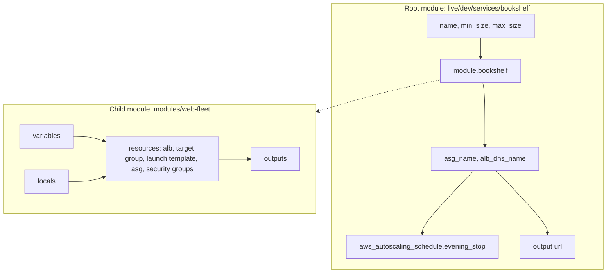

# Reusable modules: inputs, outputs and locals

## In plain words

A kitchen that makes the same sauce for twenty dishes does not write the sauce's recipe out twenty times. It writes the recipe once, gives it a name, and each dish says "add the house tomato sauce, medium spice". If the chef improves the sauce, every dish gets the improvement.

In the state isolation lesson, the `dev` and `prod` folders each needed the same set of resources: a load balancer, a group of servers, firewalls. Copying the files from one folder to the other works for a day. Then someone fixes a bug in dev and forgets prod, and the two environments quietly become different systems.

A Terraform **module** is the named recipe. You write the resources once in their own folder, declare which values may vary (the spice level), and each environment calls the module with its own values.

Why this matters for a job: almost all professional Terraform is modules calling modules. You will consume modules written by others from your first week, and "how do you structure a reusable module?" is a standard design question in interviews.

> **Before this lesson:** complete [A cluster of web servers behind a load balancer](#/lesson/terraform/cluster-load-balancer) and [Isolating state: workspaces, file layout and reading another state](#/lesson/terraform/state-isolation). You should be comfortable with variables, outputs and references.

## Every folder is already a module

A **module** is any folder containing `.tf` files. That means you have been writing modules all along. The folder in which you run `terraform apply` is called the **root module**. A module that another module uses is a **child module**, and using it is called **calling** it.

The comparison with ordinary programming is direct, and it helps to keep it in mind:

| Programming | Terraform |
|---|---|
| Function | Module |
| Parameters | Input variables |
| Return values | Outputs |
| Local variables | Local values |
| Calling the function | A `module` block |

## Step 1: move the code into a module folder

Take the cluster from the load balancer lesson and reorganise the repository like this:

```bash
infra/
├── modules/
│   └── web-fleet/            # the reusable recipe
│       ├── main.tf
│       ├── variables.tf
│       ├── outputs.tf
│       └── versions.tf
└── live/
    ├── dev/
    │   └── services/
    │       └── bookshelf/
    │           └── main.tf   # calls the module with dev values
    └── prod/
        └── services/
            └── bookshelf/
                └── main.tf   # calls the module with prod values
```

The resources from the earlier lesson go into `modules/web-fleet/main.tf`. Two things must be removed from a reusable module:

- **The `provider` block.** A module should use whatever provider configuration its caller passes down. If a module configures its own provider (its own Region, say), callers cannot place it elsewhere. The multiple providers lesson explains the mechanics.
- **The `backend` block.** State belongs to the root module, never to a child.

A module *should* still state which providers it needs, in `versions.tf`:

```hcl
terraform {
  required_version = ">= 1.6.0"

  required_providers {
    aws = {
      source  = "hashicorp/aws"
      version = ">= 5.0"
    }
  }
}
```

A shared module uses a loose lower bound (`>= 5.0`) so it does not fight with its callers over exact versions. The root module is the place for a tight constraint.

## Step 2: calling the module

In `live/dev/services/bookshelf/main.tf`:

```hcl
terraform {
  backend "s3" {
    bucket       = "harbour-books-tfstate-eu-west-1"
    key          = "dev/services/bookshelf/terraform.tfstate"
    region       = "eu-west-1"
    use_lockfile = true
  }
}

provider "aws" {
  region = "eu-west-1"
}

module "bookshelf" {
  source = "../../../../modules/web-fleet"
}
```

- `module "bookshelf" { ... }` calls a module. The label `bookshelf` is your name for this particular use of it.
- `source` says where the module's code is. Here it is a relative path on disk. The next lesson covers other sources, such as Git repositories and registries.

Whenever you add a module call or change its `source`, run `terraform init` again. `init` fetches or links the module into the `.terraform/modules` folder, and other commands fail with "Module not installed" until it has run.

At this point the module works but is rigid: every name inside it is fixed, so dev and prod would collide if they shared an account, and both get the same number of servers.

## Step 3: inputs

A module's **input variables** are its parameters. In `modules/web-fleet/variables.tf`:

```hcl
variable "name" {
  description = "Prefix for every resource name, for example bookshelf-dev"
  type        = string
}

variable "instance_type" {
  description = "EC2 instance size for each server"
  type        = string
  default     = "t3.micro"
}

variable "min_size" {
  description = "Smallest number of servers"
  type        = number
}

variable "max_size" {
  description = "Largest number of servers"
  type        = number

  validation {
    condition     = var.max_size <= 20
    error_message = "max_size above 20 needs a capacity review; raise the limit in the module on purpose."
  }
}

variable "server_port" {
  description = "Port the application listens on"
  type        = number
  default     = 8080
}

variable "extra_tags" {
  description = "Additional tags to apply to every resource"
  type        = map(string)
  default     = {}
}
```

These are ordinary variable blocks. Three design choices are worth pointing out:

- `name`, `min_size` and `max_size` have **no default**, so every caller must decide them. Values that differ by environment and matter for cost or safety should be required.
- `instance_type` and `server_port` have sensible defaults, so a caller with ordinary needs writes less.
- `extra_tags` has the type `map(string)`: a map whose values are all strings. Its default, `{}`, is an empty map.

Inside the module, replace each fixed value with `var.<name>`, exactly as in earlier lessons. The caller sets the inputs as arguments of the `module` block:

```hcl
# live/dev/services/bookshelf/main.tf
module "bookshelf" {
  source = "../../../../modules/web-fleet"

  name     = "bookshelf-dev"
  min_size = 1
  max_size = 2
}
```

```hcl
# live/prod/services/bookshelf/main.tf
module "bookshelf" {
  source = "../../../../modules/web-fleet"

  name          = "bookshelf-prod"
  instance_type = "t3.large"
  min_size      = 3
  max_size      = 12

  extra_tags = {
    CostCentre = "retail"
  }
}
```

Two environments, one implementation. The difference between dev and prod is now a handful of readable lines, which is what a reviewer wants to see.

Passing an argument the module did not declare is an error (`Unsupported argument`), and omitting a required one is an error (`Missing required argument`). Both are caught by `terraform validate`, before anything is planned.

## Step 4: locals

Some values are used repeatedly inside a module but should not be changeable by callers. The load balancer listens on port 80; "anywhere" is the address range `0.0.0.0/0`. Typing these repeatedly invites mistakes, and making them input variables would let a caller break the module's assumptions.

A **local value**, defined in a `locals` block, is a named expression private to the module:

```hcl
locals {
  http_port    = 80
  any_port     = 0
  any_protocol = "-1"
  tcp_protocol = "tcp"
  all_ips      = "0.0.0.0/0"

  common_tags = merge(var.extra_tags, {
    ManagedBy = "terraform"
    Module    = "web-fleet"
    Stack     = var.name
  })
}
```

- Each line names a value. Refer to it as `local.<name>`, singular, even though the block is `locals`.
- `common_tags` shows that a local can be any expression. `merge(a, b)` is a built-in function that combines maps; when a key appears in both, the later map wins. So the module's three standard tags are always present and cannot be overridden by a caller.

Used in a resource:

```hcl
resource "aws_vpc_security_group_ingress_rule" "alb_http" {
  security_group_id = aws_security_group.alb.id
  cidr_ipv4         = local.all_ips
  from_port         = local.http_port
  to_port           = local.http_port
  ip_protocol       = local.tcp_protocol
  tags              = local.common_tags
}
```

Choosing between a variable and a local is a question of who should control the value:

| | Input variable | Local value |
|---|---|---|
| Set by | The caller | The module's author |
| Visible outside the module | Yes, as an argument | No |
| Purpose | Things that differ between uses | Naming a repeated or computed expression |

## Step 5: outputs

A module's resources are hidden from its caller. From the root module, `module.bookshelf.aws_lb.web.dns_name` is not a legal reference. Whatever a caller may need must be published as an **output** of the module. In `modules/web-fleet/outputs.tf`:

```hcl
output "alb_dns_name" {
  description = "Public DNS name of the load balancer"
  value       = aws_lb.web.dns_name
}

output "asg_name" {
  description = "Name of the Auto Scaling group, for attaching schedules or alarms"
  value       = aws_autoscaling_group.web.name
}

output "servers_security_group_id" {
  description = "ID of the servers' security group, for adding extra rules"
  value       = aws_security_group.servers.id
}
```

A caller reads a module output with `module.<call name>.<output name>`:

```hcl
# live/dev/services/bookshelf/main.tf (continued)

# Scale the dev fleet to zero outside working hours to save money.
resource "aws_autoscaling_schedule" "evening_stop" {
  scheduled_action_name  = "evening-stop"
  autoscaling_group_name = module.bookshelf.asg_name
  recurrence             = "0 19 * * 1-5"
  min_size               = 0
  max_size               = 0
  desired_capacity       = 0
}

output "url" {
  value = "http://${module.bookshelf.alb_dns_name}"
}
```

- `module.bookshelf.asg_name` reads the module's output and, like any reference, creates a dependency: the schedule is created after the group.
- `recurrence` is in **cron** format, a compact way of writing a repeating time: minute 0, hour 19, any day of the month, any month, days 1 to 5 (Monday to Friday). Times are in UTC.
- The root module's own `output "url"` re-publishes the module's value. Outputs do not pass through automatically; only a root module's outputs are printed after apply and stored for `terraform_remote_state` to read.

This example also shows a design point. The dev environment wants a schedule; prod does not. Instead of adding an "enable schedule" switch to the module, the module exposes the group's name and lets the caller attach what it needs. Exposing the right outputs keeps a module small and its callers free.

## What the plan looks like with modules

```bash
$ terraform init
Initializing modules...
- bookshelf in ../../../../modules/web-fleet

$ terraform plan

  # aws_autoscaling_schedule.evening_stop will be created
  + resource "aws_autoscaling_schedule" "evening_stop" { ... }

  # module.bookshelf.aws_autoscaling_group.web will be created
  + resource "aws_autoscaling_group" "web" {
      + max_size = 2
      + min_size = 1
      ...
    }

  # module.bookshelf.aws_lb.web will be created
  + resource "aws_lb" "web" {
      + name = "bookshelf-dev-alb"
      ...
    }
  ...

Plan: 12 to add, 0 to change, 0 to destroy.

Changes to Outputs:
  + url = (known after apply)
```

The addresses now have a prefix. `module.bookshelf.aws_lb.web` means "the resource `aws_lb.web` inside the module call named `bookshelf`". If that module itself called another module, the path would grow: `module.bookshelf.module.alarms.aws_cloudwatch_metric_alarm.cpu`. You use these full addresses with state commands and with `-replace`.



## Checking the wiring

A module's interface can rot: a variable is declared and never used, or a caller passes something the module no longer accepts. The simulation below does the three checks a reviewer does by eye. Real tools perform them for you: `terraform validate` catches unknown and missing arguments, and the linter `tflint` reports declared-but-unused variables.

```python-run
import re

module = {
    "variables": {"name": None, "min_size": None, "max_size": None,
                  "instance_type": "t3.micro", "legacy_flag": False},   # None = required
    "body": """
        name_prefix   = var.name
        instance_type = var.instance_type
        min_size      = var.min_size
        max_size      = var.max_size
    """,
    "outputs": ["alb_dns_name", "asg_name"],
}
call_args = {"name": "bookshelf-dev", "min_size": 1, "instance_typ": "t3.small"}
root_refs = ["module.bookshelf.asg_name", "module.bookshelf.alb_arn"]

used = set(re.findall(r"var\.([a-z_]+)", module["body"]))
declared = module["variables"]

print("missing required arguments:", sorted(v for v, d in declared.items() if d is None and v not in call_args))
print("unsupported arguments:     ", sorted(a for a in call_args if a not in declared))
print("declared but never used:   ", sorted(set(declared) - used))
print("references to missing outputs:",
      sorted(r for r in root_refs if r.split(".")[-1] not in module["outputs"]))
```

A misspelt `instance_typ` is reported as unsupported, which also means the intended value was never set. Fix the call and re-run.

## Designing a module's interface

- **Expose intent, not every knob.** A module with sixty variables that mirror the provider's arguments one for one adds nothing over using the resources directly. Offer the few choices callers really need and decide the others for them.
- **Require what matters, default what does not.** If a wrong value would be costly or unsafe, make the caller choose.
- **Describe everything.** `description` on every variable and output is the module's documentation. The tool `terraform-docs` turns them into a README table.
- **Validate early.** A `validation` block that rejects a bad value with a clear message beats a cryptic API error ten minutes into an apply.
- **Output generously.** IDs, ARNs and names of the main resources let callers extend the module without changing it.

> [!TIP]
> Keep reusable modules and the live configurations that call them in separate folders, or better, separate repositories. The next lesson shows how that separation allows versioned releases of a module.

> [!WARNING]
> **Cost and safety.** A module multiplies whatever it contains. Calling a module three times creates three load balancers, each billed hourly. Read the "to add" count in the plan against what you expect, and destroy practice stacks when finished.

## Pitfalls

- **Forgetting `terraform init` after adding a module.** The error is "Module not installed".
- **A provider block inside a reusable module.** It locks callers into one Region or account and causes trouble when the module is removed.
- **Fixed names inside the module.** The second call fails with "already exists". Derive every name from an input such as `var.name`.
- **Trying to reach inside a module** with `module.x.aws_lb.web`. Only outputs are visible.
- **Expecting a child's outputs to appear after apply.** Only root outputs are printed; re-export what you want to see.
- **Wrapping one resource in a module for its own sake.** A module should represent a meaningful unit, not rename a single resource.
- **Moving existing resources into a module without `moved` blocks.** Their addresses change, so Terraform plans to destroy and recreate them.

## Cheat sheet

| Task | Syntax |
|---|---|
| Call a module | `module "x" { source = "../modules/thing" }` |
| Pass an input | An argument in the module block: `min_size = 2` |
| Declare an input | `variable "min_size" { type = number }` in the module |
| Define a local | `locals { http_port = 80 }` |
| Use a local | `local.http_port` |
| Declare an output | `output "asg_name" { value = ... }` in the module |
| Read a module output | `module.x.asg_name` |
| Full resource address | `module.x.aws_lb.web` |
| Install modules | `terraform init` (again after any change to `source`) |
| Merge maps | `merge(map_a, map_b)` |

## Summary

- Any folder of `.tf` files is a module; the one you run commands in is the root module, and modules it calls are child modules.
- A module is like a function: input variables are parameters, outputs are return values, locals are private helpers.
- Callers pass inputs as arguments of a `module` block and read results as `module.<name>.<output>`.
- Reusable modules contain no provider or backend blocks and derive every resource name from inputs.
- Locals name repeated or computed values that callers should not control.
- Good modules have small, documented, validated interfaces and generous outputs.

## Glossary

- **Module:** a folder of Terraform files used as a unit.
- **Root module:** the configuration in the folder where Terraform is run.
- **Child module:** a module called by another module.
- **Module call:** a `module` block that uses a module.
- **`source`:** the argument stating where a module's code is located.
- **Input variable:** a parameter of a module.
- **Output:** a value a module publishes to its caller.
- **Local value:** a named expression private to a module.
- **`merge`:** a function combining maps, later keys winning.
- **Cron format:** a five-field notation for repeating schedules.
- **Interface:** the set of inputs and outputs through which a module is used.

## Check yourself

```quiz
[
  {"q": "A root module calls `module \"shop\"`, which contains `aws_lb.web`. How is that resource addressed in a plan?",
   "options": ["`aws_lb.web`", "`shop.aws_lb.web`", "`module.shop.aws_lb.web`", "`module.aws_lb.shop`"], "answer": 2,
   "explain": "Resources inside a module call are prefixed with `module.<call name>.`."},
  {"q": "The same module with 5 resources is called twice in one root module with different `name` inputs, in a fresh state. What does the plan summary show?",
   "options": ["Plan: 5 to add", "Plan: 10 to add", "Plan: 2 to add", "An error: a module can be called once"], "answer": 1,
   "explain": "Each call creates its own instance of every resource in the module, so two calls create ten resources."},
  {"q": "A root module needs the Auto Scaling group name created inside a child module. How should it get it?",
   "options": ["Reference `module.x.aws_autoscaling_group.web.name`", "The module declares an output and the root reads `module.x.asg_name`", "Copy the name from the console into a variable", "Use a local in the root module"], "answer": 1,
   "explain": "A module's internals are hidden. Only values published as outputs are readable from outside."},
  {"q": "When should a value be a local instead of an input variable?",
   "options": ["When callers should be able to change it", "When it is a repeated or computed value the module author controls", "When it is secret", "When it differs per environment"], "answer": 1,
   "explain": "Locals are private to the module. Inputs are for values that vary between uses."},
  {"q": "You add a new `module` block and run `terraform plan` straight away. What happens?",
   "options": ["The plan includes the module's resources", "An error saying the module is not installed; run terraform init", "The module is silently skipped", "State is deleted"], "answer": 1,
   "explain": "Modules must be installed by `terraform init` before other commands can use them."},
  {"q": "A caller passes `instance_typ = \"t3.small\"` to a module whose variable is `instance_type` with a default. What is the result?",
   "options": ["The default is used silently", "An `Unsupported argument` error", "t3.small is used", "The variable becomes required"], "answer": 1,
   "explain": "Arguments that the module does not declare are rejected at validation time, which catches the misspelling."},
  {"q": "Why should a reusable module not contain its own `provider` block?",
   "options": ["Provider blocks are only allowed in files named main.tf", "It would fix the Region or account and prevent callers from choosing", "Modules cannot use providers", "It makes plans slower"], "answer": 1,
   "explain": "Provider configuration belongs to the root module and is passed down, so the same module can be used in any Region or account."},
  {"q": "Existing resources are moved from the root module into a new child module without any `moved` blocks. What does the plan show?",
   "options": ["No changes", "Each resource destroyed at its old address and created at its new address", "Only in-place updates", "An import for each resource"], "answer": 1,
   "explain": "Addresses changed from `aws_x.y` to `module.m.aws_x.y`. Without moved blocks Terraform sees deletions and new resources."}
]
```

> **Source:** Brikman, Terraform: Up & Running 3e, ch. 4 (module basics, module inputs, module locals, module outputs). Documentation: https://developer.hashicorp.com/terraform/language/modules, https://developer.hashicorp.com/terraform/language/values/locals and https://developer.hashicorp.com/terraform/language/modules/develop
