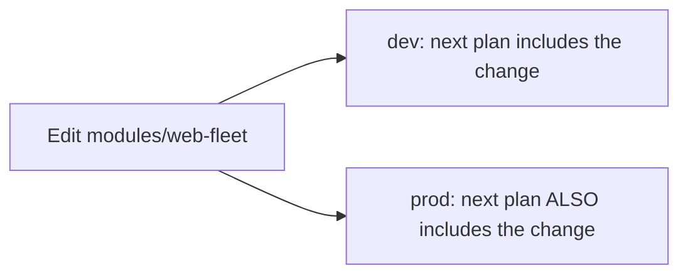
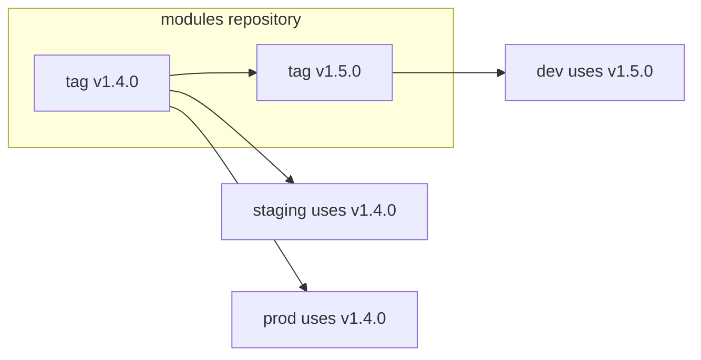

# Module gotchas and versioning: file paths, inline blocks and releases

## In plain words

Imagine a restaurant chain where head office improves a recipe and the change reaches every branch at the same instant, including the branch that is in the middle of serving a wedding. A sensible chain does it differently: the new recipe is numbered, one small branch tries it first, and each branch moves to the new number when it is ready.

The module from the previous lesson has the first problem. Dev and prod both read the same folder on disk, so the moment you edit the module to try something in dev, the change is also waiting in prod's next apply. This lesson fixes that with **module versioning**: publishing numbered releases of a module and letting each environment choose which release it uses.

Before that, it covers two traps that catch almost everyone writing their first module: how file paths behave inside a module, and why "inline blocks" make a module hard to extend.

Why this matters for a job: version pinning is how teams make infrastructure changes safely, and version constraint syntax such as `~> 5.2` appears in every Terraform file you will read. Interviewers ask about both the constraint operators and how a change is promoted from dev to prod.

> **Before this lesson:** complete [Reusable modules: inputs, outputs and locals](#/lesson/terraform/module-basics). Basic Git knowledge helps: what a repository, a commit and a tag are. The Git track covers these.

## Gotcha 1: file paths

Modules often need to read a file: a startup script, a policy document, a template. The built-in functions `file(path)` and `templatefile(path, vars)` do the reading. The question is: relative to *which folder* is the path resolved?

By default, a relative path is resolved against the **current working directory**: the folder where you ran `terraform`. That is the root module's folder, not the folder of the module containing the code. So this line, written inside `modules/web-fleet/main.tf`, breaks:

```hcl
  # WRONG inside a reusable module
  user_data = base64encode(templatefile("boot.sh.tftpl", { port = var.server_port }))
```

Run from `live/dev/services/bookshelf`, Terraform looks for `live/dev/services/bookshelf/boot.sh.tftpl`, which does not exist. The error is "no file exists at boot.sh.tftpl".

Terraform provides **path references** to say exactly which folder you mean:

| Expression | Folder it gives |
|---|---|
| `path.module` | The folder of the module where the expression is written |
| `path.root` | The folder of the root module |
| `path.cwd` | The folder the command was run from (normally the same as `path.root`) |

The fix is to anchor the path to the module:

```hcl
  user_data = base64encode(templatefile("${path.module}/boot.sh.tftpl", {
    port    = var.server_port
    message = var.greeting
  }))
```

And the template file, `modules/web-fleet/boot.sh.tftpl`:

```bash
#!/bin/bash
mkdir -p /srv/site && cd /srv/site
echo "${message}" > index.html
nohup python3 -m http.server ${port} &
```

- `templatefile` reads the file and replaces `${message}` and `${port}` with the values from the map.
- Only names given in the map are available inside the template. The template cannot see `var.` values or resources directly, which keeps it self-contained.
- A shell variable that should reach the server untouched must be escaped by doubling the dollar sign, `$${HOME}`, or written without braces, `$HOME`.

The rule: **inside a module, every file path starts with `${path.module}/`.**

## Gotcha 2: inline blocks versus separate resources

Some resource types let you describe a sub-part in two ways. A security group's rules can be written as nested `ingress` blocks inside the group (an **inline block**), or as separate rule resources that point at the group. You met both styles in the getting started module.

```hcl
# Style A: inline blocks
resource "aws_security_group" "servers" {
  name = "${var.name}-servers"

  ingress {
    from_port   = 8080
    to_port     = 8080
    protocol    = "tcp"
    cidr_blocks = ["10.0.0.0/16"]
  }
}
```

```hcl
# Style B: separate resources
resource "aws_security_group" "servers" {
  name = "${var.name}-servers"
}

resource "aws_vpc_security_group_ingress_rule" "app" {
  security_group_id = aws_security_group.servers.id
  cidr_ipv4         = "10.0.0.0/16"
  from_port         = 8080
  to_port           = 8080
  ip_protocol       = "tcp"
}
```

For a module, style B is the right choice, for two reasons.

**Inline blocks close the module to extension.** With style A, the group claims to own the *complete* list of rules. A caller who wants one extra rule (say, letting a monitoring server reach a metrics port) has no way to add it from outside; they would have to change the module. With style B, the module outputs the group's ID and the caller adds a rule resource of their own:

```hcl
# in the root module
resource "aws_vpc_security_group_ingress_rule" "metrics" {
  security_group_id = module.bookshelf.servers_security_group_id
  cidr_ipv4         = "10.0.50.0/24"
  from_port         = 9100
  to_port           = 9100
  ip_protocol       = "tcp"
}
```

**Mixing the two styles makes them fight.** If a group has inline rules *and* a separate rule resource targets it, each apply of the group removes the "unknown" separate rule, and each apply of the rule adds it back. The plan never settles. The provider documentation warns against mixing for exactly this reason.

The same choice appears elsewhere: route tables and their routes, IAM roles and their policies, network ACLs and their entries. The guidance is the same each time: in reusable code, prefer the separate resources.

## Why modules need versions

With `source = "../../../../modules/web-fleet"`, every environment reads the same files. Consider what happens when you change the module to try a new health check:



You wanted to test in dev. Prod will pick the change up the next time anyone applies there for an unrelated reason. The environments are isolated in state but not in code.

The remedy is to give the module a life of its own:

1. Put reusable modules in a **separate Git repository** from the live configurations.
2. Mark tested points in that repository's history with **tags**: permanent, named pointers to one commit.
3. In each environment, point `source` at a specific tag.



Now dev runs the new release while prod stays on the proven one. When dev looks healthy, a one-line change promotes staging, then prod. Each promotion is a reviewed commit, and rolling back is changing the number back.

## Module sources

The `source` argument accepts several kinds of location:

```hcl
# 1. A local path (starts with ./ or ../)
module "a" {
  source = "../../modules/web-fleet"
}

# 2. A Git repository, pinned to a tag, using a subfolder
module "b" {
  source = "git::https://github.com/harbour-books/infra-modules.git//web-fleet?ref=v1.5.0"
}

# 3. The same over SSH, for private repositories
module "c" {
  source = "git::ssh://git@github.com/harbour-books/infra-modules.git//web-fleet?ref=v1.5.0"
}

# 4. A module registry, with a version constraint
module "d" {
  source  = "terraform-aws-modules/vpc/aws"
  version = "~> 6.0"
}
```

Reading the Git form piece by piece:

- `git::` tells Terraform to fetch with Git.
- The URL identifies the repository.
- `//web-fleet` (a double slash) selects a subfolder inside the repository. One repository can hold many modules.
- `?ref=v1.5.0` selects what to check out: a tag, a branch name or a commit identifier. **Always pin a tag or a commit.** A branch name such as `main` moves, which brings back the original problem.

For private repositories, the SSH form uses the Git credentials already on the machine, so no password appears in code.

The registry form has the shape `namespace/name/provider`. The **Terraform Registry** (and OpenTofu's registry) is a public catalogue of modules. Registry modules support a separate `version` argument that takes a **constraint**, described below. The `version` argument does not work with Git or local sources; for Git, the `ref` is the pin.

After changing a `source` or `version`, run `terraform init -upgrade` so the new code is downloaded.

## Semantic versioning

Version numbers follow a convention called **semantic versioning**, or semver: three numbers written `MAJOR.MINOR.PATCH`, such as `1.5.2`. Each position carries a promise from the author to the users:

| Change | Which number goes up | Meaning for callers |
|---|---|---|
| A bug fix that changes no interface | PATCH: `1.5.2` to `1.5.3` | Safe to take |
| A new feature, existing uses still work | MINOR: `1.5.3` to `1.6.0` | Safe to take; new options available |
| Something that breaks existing callers | MAJOR: `1.6.0` to `2.0.0` | Read the notes; changes needed |

For a Terraform module, a **breaking change** includes removing or renaming an input or output, adding a required input, changing a default in a way that alters infrastructure, and renaming resources without `moved` blocks (which makes callers' plans destroy and recreate). Versions starting with `0.` are by convention unstable: anything may change.

Creating a release is two Git commands in the modules repository:

```bash
git tag -a v1.5.0 -m "web-fleet: configurable health check path"
git push origin v1.5.0
```

- `git tag -a NAME -m MESSAGE` creates an annotated tag on the current commit.
- `git push origin NAME` publishes the tag so others can use it.

## Version constraints

A **version constraint** is a rule describing which versions are acceptable. The same syntax is used for `required_version`, for providers in `required_providers`, and for registry modules.

| Constraint | Accepts | Example |
|---|---|---|
| `= 1.5.2` or `1.5.2` | Exactly that version | Only `1.5.2` |
| `!= 1.5.2` | Anything except that version | Skips a known bad release |
| `>= 1.5.0` | That version or newer | `1.5.0`, `1.9.3`, `4.0.0` |
| `< 2.0.0` | Older than that version | `1.9.9` yes, `2.0.0` no |
| `>= 1.5.0, < 2.0.0` | Both conditions (comma means "and") | Any `1.x` from `1.5.0` |
| `~> 1.5` | `>= 1.5.0` and `< 2.0.0` | Minor and patch may rise |
| `~> 1.5.2` | `>= 1.5.2` and `< 1.6.0` | Only the patch may rise |

The `~>` operator is called the **pessimistic constraint**. Its rule: only the *rightmost* number you wrote may increase. With two numbers, `~> 1.5`, the minor number may rise. With three, `~> 1.5.2`, only the patch may.

The simulation below implements these rules and picks the newest matching release, which is what `terraform init` does when nothing is locked.

```python-run
def parse(v):
    return tuple(int(x) for x in v.split("."))

def matches(version, constraint):
    v = parse(version)
    for part in constraint.split(","):
        part = part.strip()
        for op in ("~>", ">=", "<=", "!=", ">", "<", "="):
            if part.startswith(op):
                target = part[len(op):].strip()
                break
        else:
            op, target = "=", part
        t = parse(target)
        t3 = t + (0,) * (3 - len(t))
        if op == "~>":
            upper = t[:-2] + (t[-2] + 1,)            # bump the second-to-last number written
            upper = upper + (0,) * (3 - len(upper))
            ok = t3 <= v < upper
        else:
            ok = {"=": v == t3, "!=": v != t3, ">=": v >= t3, "<=": v <= t3,
                  ">": v > t3, "<": v < t3}[op]
        if not ok:
            return False
    return True

available = ["1.4.0", "1.5.0", "1.5.2", "1.5.9", "1.6.0", "1.9.3", "2.0.0", "2.1.0"]

for c in ["~> 1.5", "~> 1.5.2", ">= 1.5.0, < 1.9.0", "1.5.2", ">= 1.6.0, != 2.1.0", "~> 3.0"]:
    ok = [v for v in available if matches(v, c)]
    best = max(ok, key=parse) if ok else "NO MATCH -> init fails"
    print(f"{c:22} accepts {ok}\n{'':22} selects {best}")
```

Change `available` or the constraints and re-run until the behaviour of `~>` feels predictable.

### Who pins tightly and who pins loosely

- **Root modules** (live configurations) want reproducibility. Constrain providers with `~>` and commit `.terraform.lock.hcl`, which records the exact provider version selected. Pin modules to exact tags.
- **Reusable modules** want compatibility. Use a minimum (`>= 5.0`) for providers so that the module does not block its callers from upgrading.

Note one asymmetry: the lock file records exact versions and checksums for **providers** only. Module versions are not locked by it, which is another reason to pin modules exactly.

## Promoting a change through environments

Putting the pieces together, a change to the module travels like this:

```bash
# 1. In the modules repository: change, test, release
git checkout -b health-check-path
#    ...edit, review, merge...
git tag -a v1.5.0 -m "web-fleet: configurable health check path" && git push origin v1.5.0

# 2. In the live repository: dev takes the new release
#    live/dev/services/bookshelf/main.tf   ->   ?ref=v1.5.0
cd live/dev/services/bookshelf
terraform init -upgrade
terraform plan        # read it: only the health check should change
terraform apply

# 3. After dev has run happily, the same one-line change for staging, then prod
```

```bash
$ terraform plan
  # module.bookshelf.aws_lb_target_group.web will be updated in-place
  ~ resource "aws_lb_target_group" "web" {
      ~ health_check {
          ~ path = "/" -> "/healthz"
        }
    }

Plan: 0 to add, 1 to change, 0 to destroy.
```

The plan for the upgrade is small and matches the release note. If it showed a replacement nobody mentioned, you would stop and investigate before the change reached anything important.

> [!WARNING]
> **Cost and safety.** A module upgrade can replace resources if the new release renamed something or changed a force-new attribute. Before applying an upgrade to an important environment, read the module's changelog and the full plan, and look specifically for `-/+` and `forces replacement`. A major version bump with an empty changelog is a reason to pause.

> [!INTERVIEW]
> "How do you roll out a change to a shared module safely?" Release it as a tagged semantic version; point dev at the new tag and review the plan; promote the same version to staging and then prod with one-line pull requests; roll back by reverting the tag reference. Mention that pinning a branch defeats the scheme and that the provider lock file does not cover modules.

## Pitfalls

- **Relative file paths without `path.module`.** They resolve against the folder the command ran in.
- **Inline blocks in reusable modules, or mixing inline and separate rules.** Callers cannot extend the module, and mixed styles overwrite each other forever.
- **`?ref=main`.** A moving branch is not a version.
- **Using `version` with a Git source.** It is rejected; use `ref`.
- **Forgetting `terraform init -upgrade`** after changing a version; the old copy in `.terraform/modules` is still used.
- **Breaking changes in a minor release.** Callers who trusted `~>` get a surprise replacement.
- **Exact provider pins in shared modules.** Two modules pinning different exact versions cannot be used together.
- **Not committing the lock file.** Provider versions then vary between machines.

## Cheat sheet

| Item | Syntax or rule |
|---|---|
| Module folder | `path.module` |
| Root folder | `path.root` |
| Read a file in a module | `file("${path.module}/x.json")` |
| Render a template | `templatefile("${path.module}/x.tftpl", { k = v })` |
| Git source with tag | `git::https://host/org/repo.git//subdir?ref=v1.5.0` |
| Registry source | `source = "ns/name/provider"`, `version = "~> 6.0"` |
| Semver | `MAJOR.MINOR.PATCH`: breaking, feature, fix |
| `~> 1.5` | `>= 1.5.0, < 2.0.0` |
| `~> 1.5.2` | `>= 1.5.2, < 1.6.0` |
| Refresh downloaded code | `terraform init -upgrade` |
| Publish a release | `git tag -a v1.5.0 -m "..."` then `git push origin v1.5.0` |

## Summary

- File paths in a module must be anchored with `path.module`, because relative paths resolve against the working directory.
- Prefer separate resources over inline blocks in reusable modules so callers can extend them, and never mix the two styles on one object.
- A module read from a shared folder changes for every environment at once. Versioned releases let each environment choose when to upgrade.
- Module sources can be local paths, Git URLs pinned with `ref`, or registry addresses with a `version` constraint.
- Semantic versioning signals fixes, features and breaking changes; `~>` allows only the rightmost written number to rise.
- Root modules pin tightly and commit the lock file; shared modules constrain loosely.

## Glossary

- **Path reference:** an expression such as `path.module` naming a specific folder.
- **Working directory:** the folder a command is run from.
- **Inline block:** a nested block defining a sub-part inside its parent resource.
- **Tag (Git):** a permanent name for one commit, used to mark releases.
- **Registry:** an online catalogue of modules and providers.
- **Semantic versioning:** the `MAJOR.MINOR.PATCH` numbering convention.
- **Breaking change:** a change that requires callers to modify their code or that would alter their infrastructure unexpectedly.
- **Version constraint:** a rule stating which versions are acceptable.
- **Pessimistic constraint (`~>`):** allows only the rightmost specified number to increase.
- **Pin:** fixing a dependency to one exact version.
- **Promotion:** moving a tested version from one environment to the next.

## Check yourself

```quiz
[
  {"q": "Inside `modules/web-fleet`, the code calls `templatefile(\"boot.sh.tftpl\", {...})`. Terraform is run from `live/dev/app`. Where does it look for the file?",
   "options": ["modules/web-fleet/boot.sh.tftpl", "live/dev/app/boot.sh.tftpl", "The user's home folder", "The .terraform folder"], "answer": 1,
   "explain": "A bare relative path resolves against the working directory. Use `${path.module}/boot.sh.tftpl` to anchor it to the module."},
  {"q": "Available versions are 4.8.0, 4.9.1, 5.0.0 and 5.3.2. Which does `~> 4.8` select?",
   "options": ["4.8.0", "4.9.1", "5.0.0", "5.3.2"], "answer": 1,
   "explain": "`~> 4.8` means >= 4.8.0 and < 5.0.0. The newest matching version is 4.9.1."},
  {"q": "With the same available versions, which does `~> 4.8.0` select?",
   "options": ["4.8.0", "4.9.1", "5.0.0", "None"], "answer": 0,
   "explain": "With three numbers written, only the patch may rise: >= 4.8.0 and < 4.9.0. Only 4.8.0 qualifies."},
  {"q": "A module removes an input variable that callers were using. Under semantic versioning, which number must increase?",
   "options": ["PATCH", "MINOR", "MAJOR", "None; inputs are not part of the contract"], "answer": 2,
   "explain": "Removing an input breaks existing callers, so it is a breaking change and requires a new major version."},
  {"q": "Dev and prod both use `source = \"../../modules/web-fleet\"`. You edit the module and apply in dev only. Prod's code was not touched. What does prod's next plan show?",
   "options": ["No changes, because prod was not edited", "The same module change, because prod reads the same folder", "An error about version mismatch", "A destroy of the whole module"], "answer": 1,
   "explain": "A local path is shared by every caller. Without versioned sources the change is pending in every environment."},
  {"q": "A security group has inline `ingress` blocks and a separate rule resource also targets it. What happens over repeated applies?",
   "options": ["The rules merge cleanly", "The plan keeps showing changes as each side removes or re-adds the other's rule", "Terraform refuses to plan", "The separate rule is ignored"], "answer": 1,
   "explain": "The inline form claims the full rule list and deletes anything else; the separate resource adds its rule back. The two never converge."},
  {"q": "Which `source` pins a Git-hosted module correctly?",
   "options": ["`git::https://example.com/org/mods.git//vpc?ref=main`", "`git::https://example.com/org/mods.git//vpc?ref=v2.3.1`", "`git::https://example.com/org/mods.git//vpc` with `version = \"2.3.1\"`", "`https://example.com/org/mods/vpc`"], "answer": 1,
   "explain": "Pin a tag or commit with `ref`. A branch moves, and the `version` argument is only for registry modules."},
  {"q": "What does `.terraform.lock.hcl` pin?",
   "options": ["Exact module versions", "Exact provider versions and their checksums", "The Terraform CLI version", "The backend bucket"], "answer": 1,
   "explain": "The dependency lock file covers providers only. Modules must be pinned in their `source` or `version`."}
]
```

> **Source:** Brikman, Terraform: Up & Running 3e, ch. 4 (module gotchas: file paths and inline blocks; module versioning). Documentation: https://developer.hashicorp.com/terraform/language/modules/sources, https://developer.hashicorp.com/terraform/language/expressions/version-constraints, https://developer.hashicorp.com/terraform/language/expressions/references#filesystem-and-workspace-info and https://semver.org
