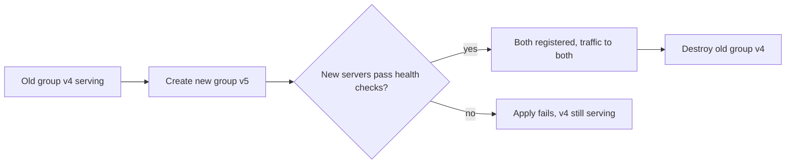

# Zero-downtime deployment, plans that fail and safe refactoring

## In plain words

A town needs to replace an old bridge. The careless way is to knock the old bridge down and then start building the new one; for months nobody can cross. The careful way is to build the new bridge alongside, check that it carries traffic, redirect the cars, and only then demolish the old one. Nobody is ever stuck on the wrong bank.

Terraform's default way of replacing a resource is the careless one: destroy, then create. This lesson shows how to switch to the careful order, how to roll a new version across a fleet of servers with no interruption, and what to do about two other sources of nasty surprises: plans that look fine and still fail when applied, and tidy-looking code changes that would quietly demolish something.

Why this matters for a job: the questions "how do you deploy without downtime?" and "what happens if you rename a resource?" separate people who have run Terraform against production from people who have only followed tutorials. The habits in this lesson are the ones that keep you out of incident reports.

> **Before this lesson:** complete [A cluster of web servers behind a load balancer](#/lesson/terraform/cluster-load-balancer), [State surgery: moving, removing, importing and repairing](#/lesson/terraform/state-surgery) and [For expressions, string directives and conditionals](#/lesson/terraform/for-expressions-conditionals). The CI/CD track's [Blue-green, canary and rolling deployments](#/lesson/cicd/release-strategies) gives the wider picture of release strategies.

## What "downtime" means and where it comes from

**Downtime** is any period in which users cannot use the service. A **zero-downtime deployment** changes the running version without such a period.

With Terraform, downtime usually comes from one place: a **replacement**. When a force-new attribute changes, Terraform's default sequence is:

1. destroy the existing object;
2. create the new object.

Between steps 1 and 2 nothing exists. If the new object fails to create, nothing exists for much longer.

## `create_before_destroy`

The lifecycle setting from the load balancer lesson reverses the order:

```hcl
resource "aws_launch_template" "web" {
  name_prefix   = "${var.name}-"
  image_id      = var.ami_id
  instance_type = var.instance_type

  lifecycle {
    create_before_destroy = true
  }
}
```

Now a replacement runs as:

1. create the new object;
2. update everything that pointed to the old object so it points to the new one;
3. destroy the old object.

In a plan the two orders are distinguished by their symbols:

```bash
-/+ destroy and then create replacement        # the default
+/- create replacement and then destroy        # with create_before_destroy
```

Three facts about this setting are worth knowing before you use it widely.

**Old and new exist at the same time.** Anything that must be unique, most commonly a name, will clash. This is why the example uses `name_prefix`, which lets AWS generate a unique name, instead of a fixed `name`. For resource types with no prefix option, include something that changes in the name, such as a short hash of the settings that force replacement.

**It spreads to dependencies.** If resource A has `create_before_destroy` and depends on resource B, Terraform treats B as having it too, because A's replacement could not otherwise be ordered correctly. You do not have to set it on B, but you should expect B's replacement order to change.

**It does not make stateful things safe.** Creating a new empty database before destroying the full one avoids a gap in *existence*, not a loss of *data*. Databases need a migration plan, not a lifecycle flag.

The simulation below traces both orders for a server referenced by a DNS record, and reports when the service is unavailable.

```python-run
def replace(create_before_destroy, new_fails=False):
    exists = {"old": True, "new": False}
    dns_points_to = "old"
    timeline = []

    def tick(step):
        up = exists[dns_points_to]
        timeline.append(f"  {step:42} DNS -> {dns_points_to:3}  service {'UP' if up else 'DOWN'}")

    tick("start")
    if create_before_destroy:
        if new_fails:
            tick("create new: FAILED (old one untouched)")
            return timeline
        exists["new"] = True;  tick("1. create new")
        dns_points_to = "new"; tick("2. repoint DNS to new")
        exists["old"] = False; tick("3. destroy old")
    else:
        exists["old"] = False; tick("1. destroy old")
        if new_fails:
            tick("2. create new: FAILED")
            return timeline
        exists["new"] = True;  tick("2. create new")
        dns_points_to = "new"; tick("3. repoint DNS to new")
    return timeline

for title, kwargs in [
    ("Default order (destroy, then create)", dict(create_before_destroy=False)),
    ("create_before_destroy", dict(create_before_destroy=True)),
    ("Default order, and creation fails", dict(create_before_destroy=False, new_fails=True)),
    ("create_before_destroy, and creation fails", dict(create_before_destroy=True, new_fails=True)),
]:
    print(title)
    print("\n".join(replace(**kwargs)), "\n")
```

The last two cases are the strongest argument for the setting: when creation fails under the default order, you are left with nothing; under the careful order, the old object is still serving.

## Rolling a new version across a fleet

For the cluster from earlier lessons, "deploying" means getting every server onto a new machine image or startup script. Remember what happened when the launch template changed: the template and the group were updated in place and the running servers stayed as they were. Two approaches turn that into a real rollout.

### Approach 1: instance refresh (the usual choice today)

Ask the Auto Scaling group to replace its own servers gradually whenever the template changes:

```hcl
resource "aws_autoscaling_group" "web" {
  name_prefix         = "${var.name}-"
  vpc_zone_identifier = var.subnet_ids
  min_size            = var.min_size
  max_size            = var.max_size

  target_group_arns         = [aws_lb_target_group.web.arn]
  health_check_type         = "ELB"
  health_check_grace_period = 90

  launch_template {
    id      = aws_launch_template.web.id
    version = aws_launch_template.web.latest_version
  }

  instance_refresh {
    strategy = "Rolling"

    preferences {
      min_healthy_percentage = 100
      max_healthy_percentage = 150
      instance_warmup        = 60
      auto_rollback          = true
    }
  }
}
```

- `health_check_grace_period = 90` gives a new server 90 seconds to boot before failed health checks count against it.
- `instance_refresh` with `strategy = "Rolling"` replaces servers in batches.
- `min_healthy_percentage = 100` means capacity never drops below the full fleet. Combined with `max_healthy_percentage = 150`, AWS starts extra servers first (up to one and a half times the fleet), waits for them to pass health checks, then removes old ones.
- `instance_warmup = 60` is how long a new server is given before it is counted as healthy capacity.
- `auto_rollback = true` returns to the previous template if the refresh fails.

The plan for a new image is two in-place updates, and the rollout happens inside AWS:

```bash
$ terraform plan -var="ami_id=ami-0feed5bead5cafe01"

  # aws_launch_template.web will be updated in-place
  ~ resource "aws_launch_template" "web" {
      ~ image_id       = "ami-07c1b39b7b3d2525d" -> "ami-0feed5bead5cafe01"
      ~ latest_version = 4 -> (known after apply)
    }

  # aws_autoscaling_group.web will be updated in-place
  ~ resource "aws_autoscaling_group" "web" {
      ~ launch_template {
          ~ version = "4" -> (known after apply)
        }
    }

Plan: 0 to add, 2 to change, 0 to destroy.
```

One thing to know: `terraform apply` returns as soon as the refresh has *started*. The rollout continues for several minutes afterwards, so "apply complete" does not mean "new version fully live". Check the refresh status in the console or with the AWS command-line tool before declaring success.

### Approach 2: replace the whole group (blue-green style)

Before instance refresh existed, the common technique was to replace the entire group. It is still used when you want old and new fleets side by side, a style called **blue-green deployment** (two complete copies, traffic switched from one to the other).

```hcl
resource "aws_autoscaling_group" "web" {
  name = "${var.name}-v${aws_launch_template.web.latest_version}"

  min_size          = var.min_size
  max_size          = var.max_size
  min_elb_capacity  = var.min_size
  target_group_arns = [aws_lb_target_group.web.arn]
  health_check_type = "ELB"
  # ...

  lifecycle {
    create_before_destroy = true
  }
}
```

- The group's `name` contains the template version. A group's name is a force-new attribute, so every new template version forces a **new group**.
- `create_before_destroy` makes Terraform create the new group first.
- `min_elb_capacity = var.min_size` makes Terraform wait until that many of the new group's servers are passing the load balancer's health checks before it considers creation complete. Only then is the old group destroyed.

The plan shows `+/-` on the group. If the new servers never become healthy, creation times out, the apply fails, and the old group is still serving. The costs are double capacity during the switch and one known wart: because the group is brand new, it starts at `min_size`, forgetting any larger size that autoscaling had reached.



> [!WARNING]
> **Cost and safety.** Both approaches temporarily run more servers than usual, and you pay for them. More importantly, a rollout is only as safe as the health check behind it. If the check passes on a server whose application is broken, the rollout will replace every healthy server with a broken one. Make the health check exercise something real.

## Valid plans can fail

A plan is a prediction made from what Terraform knows: your code, the state and what the provider read. It is not a guarantee. An apply can fail after a clean plan for several reasons.

**Something already exists that state does not know about.** The plan says `+ create` for an IAM user named `asha`. Somebody already made that user by hand. The plan cannot see it, because plan only examines resources in state. Apply fails:

```bash
Error: creating IAM User (asha): EntityAlreadyExists: User with name asha already exists.
```

The remedy is to import the existing object (with an `import` block, as in the state surgery lesson) or to remove the hand-made one. The prevention is the rule from the first lesson: once something is managed by code, stop changing it by hand.

**Eventual consistency.** Large cloud platforms are distributed systems. After an API call succeeds, it can take seconds for the change to be visible everywhere. Terraform may create a role and immediately try to use it elsewhere, and the second call fails with "not found". Running `terraform apply` again usually succeeds, because by then the change has spread. Providers contain retries for the common cases, but not all.

**Rules only the API knows.** Quota limits ("you may have 5 elastic IPs"), name clashes across accounts (bucket names are global), invalid combinations of settings, and missing permissions for one specific action are all discovered at apply time.

**Timeouts.** A resource takes longer to create than the provider is willing to wait.

What happens after a failure matters as much as why:

- Terraform **does not roll back**. Resources created before the error exist and are recorded in state.
- The resource that failed may have been partly created. Terraform marks it **tainted** if it was created but a later step failed, so the next plan replaces it.
- The correct response is: read the error, fix the cause, run `plan` again, read it, and `apply` again. The second plan contains only what remains to be done.

> [!TIP]
> Catch more at plan time. `validation` blocks on variables, `precondition` and `postcondition` blocks in a resource's `lifecycle`, and static analysis tools (covered in the testing module) all move failures earlier, when they are cheap.

A `precondition` example:

```hcl
resource "aws_launch_template" "web" {
  # ...

  lifecycle {
    create_before_destroy = true

    precondition {
      condition     = data.aws_ami.selected.architecture == "x86_64"
      error_message = "The selected AMI must be x86_64 to match the t3 instance family."
    }
  }
}
```

`precondition` is checked before the resource is created or changed; if `condition` is false the run stops with the message. A `postcondition` is checked after, and guards promises the resource makes to others.

## Refactoring is riskier than it looks

**Refactoring** means restructuring code without changing what it does: renaming things, moving them into modules, tidying. In ordinary programming a rename is harmless. In Terraform, an address is an identity, so some "tidy-ups" are destructive:

| Looks like | What Terraform sees | Result without precautions |
|---|---|---|
| Renaming a resource's local name | Old address gone, new address appears | Destroy and create |
| Moving a resource into a module | Address gains a `module.x.` prefix | Destroy and create |
| Renaming a module call | Every address inside changes | Everything in it recreated |
| Switching `count` to `for_each` | `[0]` becomes `["key"]` | Every instance recreated |
| Changing a `for_each` key | Old key gone, new key appears | That instance recreated |
| Renaming an input variable whose value feeds a `name` | A force-new attribute changes | Replacement |
| Changing a variable's default | Depends on the attribute | Update or replacement |

The defence has three parts.

**1. Use `moved` blocks for every address change.**

```hcl
moved {
  from = aws_security_group.instance
  to   = module.web.aws_security_group.servers
}

moved {
  from = module.app
  to   = module.bookshelf
}
```

The second block moves a whole module call at once; every resource inside follows.

**2. Let the plan be your test.** A pure refactor has a precise definition of success: after the change, `terraform plan` reports moves and **zero** additions, changes or destructions. Anything else means the refactor altered behaviour.

```bash
$ terraform plan
  # aws_security_group.instance has moved to module.web.aws_security_group.servers
  # module.app.aws_lb.web has moved to module.bookshelf.aws_lb.web
  ...
Plan: 0 to add, 0 to change, 0 to destroy.
```

**3. Add guard rails for the things that must never be recreated.**

```hcl
resource "aws_db_instance" "orders" {
  # ...
  deletion_protection = true

  lifecycle {
    prevent_destroy = true
  }
}
```

`prevent_destroy` makes Terraform reject any plan containing a destroy of this resource, including the destroy half of a replacement. `deletion_protection` is the cloud service's own refusal to delete. Use both on stateful resources: the first stops Terraform from trying, the second stops anyone.

And one more habit: when a resource has an **immutable** attribute, one that cannot be changed after creation, think before choosing its value. Names, Regions, encryption settings and many database options are immutable. A plan line ending in `# forces replacement` is Terraform telling you that you have touched one.

> [!INTERVIEW]
> "You need to move a set of resources into a module on a live system. How?" Add `moved` blocks mapping each old address to its new one (or move a whole module call), run plan and require zero infrastructure changes, apply in the least critical environment first, and keep the blocks until every environment has applied. Mention `prevent_destroy` on stateful resources as a backstop and that a plan showing `-/+` means stop.

## Pitfalls

- **Fixed names with `create_before_destroy`.** The new object cannot be created while the old one holds the name.
- **Assuming apply finished means rollout finished** with instance refresh.
- **Weak health checks.** A rollout faithfully replaces good servers with bad ones.
- **Re-running a failed apply without reading the error.** Sometimes it is eventual consistency; sometimes it is a quota, and retrying changes nothing.
- **Assuming Terraform rolled back.** Partially created infrastructure is real and billed.
- **Renames without `moved`.** The plan is destruction.
- **Removing `prevent_destroy` "temporarily"** to get a plan through. If Terraform wants to destroy your database, the plan is the problem.
- **Refactoring and changing behaviour in one commit.** A reviewer cannot tell which plan lines come from which.

## Cheat sheet

| Goal | Tool |
|---|---|
| New object before old is removed | `lifecycle { create_before_destroy = true }` |
| Avoid name clashes during replacement | `name_prefix`, or a changing value in `name` |
| Roll servers gradually | `instance_refresh { strategy = "Rolling" ... }` |
| Wait for healthy servers before finishing | `min_elb_capacity` |
| Plan symbols | `-/+` destroy then create; `+/-` create then destroy |
| Block deletion in Terraform | `lifecycle { prevent_destroy = true }` |
| Block deletion in the cloud | `deletion_protection = true` (where supported) |
| Check assumptions before create | `lifecycle { precondition { ... } }` |
| Rename or move safely | `moved { from = ..., to = ... }` |
| Success test for a refactor | Plan shows 0 to add, 0 to change, 0 to destroy |
| After a failed apply | Read error, fix, plan, apply again |

## Summary

- Terraform replaces by destroying first; `create_before_destroy` reverses the order, at the price of needing unique names and temporary double capacity.
- Fleets are rolled either by instance refresh inside the Auto Scaling group or by replacing the whole group and waiting for healthy servers.
- A health check that reflects real application health is the foundation of any safe rollout.
- A clean plan can still fail on apply: unknown existing resources, eventual consistency, quotas, permissions and timeouts. Terraform does not roll back; fix and re-apply.
- Addresses are identities, so renames and moves need `moved` blocks, and a refactor is correct only when the plan shows no infrastructure changes.
- Protect stateful resources with `prevent_destroy` and deletion protection.

## Glossary

- **Downtime:** a period when users cannot use the service.
- **Zero-downtime deployment:** changing the running version with no such period.
- **Replacement:** destroying an object and creating a new one in its place.
- **`create_before_destroy`:** a lifecycle setting that creates the replacement first.
- **Instance refresh:** an Auto Scaling feature that replaces servers gradually.
- **Blue-green deployment:** running old and new copies side by side and switching traffic.
- **Eventual consistency:** a change taking a short time to become visible everywhere in a distributed system.
- **Precondition / postcondition:** checks before and after a resource is changed.
- **Refactoring:** restructuring code without changing its behaviour.
- **Immutable attribute:** a setting that cannot be changed after creation.
- **`prevent_destroy`:** a lifecycle setting that rejects any plan destroying the resource.

## Check yourself

```quiz
[
  {"q": "A plan shows `+/-` next to a resource. What will happen?",
   "options": ["It is destroyed and then recreated", "The replacement is created first and the old object destroyed afterwards", "It is updated in place", "It is imported"], "answer": 1,
   "explain": "`+/-` is the symbol for create-then-destroy, used when create_before_destroy is set. `-/+` is the default destroy-then-create."},
  {"q": "A resource with a fixed `name = \"bookshelf\"` has create_before_destroy and a force-new attribute changes. What is the likely result of apply?",
   "options": ["A smooth replacement", "An error creating the new object because the name is already taken by the old one", "The old object is renamed automatically", "Nothing happens"], "answer": 1,
   "explain": "Both objects must exist at once. A unique fixed name cannot be shared, so creation fails. Use name_prefix or include a changing value in the name."},
  {"q": "The group has an instance_refresh block. You change only the AMI variable and run plan. What does the summary show?",
   "options": ["Plan: 2 to add, 0 to change, 2 to destroy.", "Plan: 0 to add, 2 to change, 0 to destroy.", "Plan: 1 to add, 0 to change, 1 to destroy.", "No changes."], "answer": 1,
   "explain": "The launch template gets a new version and the group is updated to use it, both in place. Server replacement is carried out by AWS, outside the plan."},
  {"q": "A plan says `+ create` for an IAM user, but apply fails with EntityAlreadyExists. Why did the plan not warn you?",
   "options": ["Plan does not contact AWS at all", "Plan only examines resources recorded in state, and this user was created outside Terraform", "The lock file was missing", "The user was tainted"], "answer": 1,
   "explain": "Terraform refreshes only what it tracks. An object made by hand is invisible to it until the create call collides."},
  {"q": "An apply creates 4 resources and fails on the fifth. What should you do?",
   "options": ["Run destroy to clean up, then start again", "Nothing; Terraform rolled back", "Read the error, fix the cause, run plan, then apply again", "Delete the state file"], "answer": 2,
   "explain": "The four created resources are in state. After fixing the cause, the next plan contains only the remaining work."},
  {"q": "You rename `module \"app\"` to `module \"bookshelf\"` and add `moved { from = module.app, to = module.bookshelf }`. The module contains 11 resources. What should a correct plan show?",
   "options": ["Plan: 11 to add, 0 to change, 11 to destroy.", "Eleven moves and Plan: 0 to add, 0 to change, 0 to destroy.", "Plan: 0 to add, 11 to change, 0 to destroy.", "An error: modules cannot be moved"], "answer": 1,
   "explain": "Moving a module call moves every address inside it. A pure refactor shows no infrastructure changes."},
  {"q": "A database has `lifecycle { prevent_destroy = true }`. A change to an immutable attribute would force replacement. What happens at plan?",
   "options": ["The database is replaced", "The plan fails with an error naming the protected resource", "The change is silently ignored", "The attribute is updated in place"], "answer": 1,
   "explain": "A replacement includes a destroy, and prevent_destroy rejects any plan that would destroy the resource."},
  {"q": "Why does create_before_destroy not make replacing a database safe?",
   "options": ["It is not allowed on databases", "The new database is empty; the old one's data is destroyed with it", "It doubles the storage cost permanently", "It disables backups"], "answer": 1,
   "explain": "The setting controls order of existence, not data. Replacing a stateful resource needs a migration, whichever order is used."}
]
```

> **Source:** Brikman, Terraform: Up & Running 3e, ch. 5 (zero-downtime deployment, Terraform gotchas: zero-downtime deployment has limitations, valid plans can fail, refactoring can be tricky). Documentation: https://developer.hashicorp.com/terraform/language/meta-arguments/lifecycle, https://developer.hashicorp.com/terraform/language/moved, https://developer.hashicorp.com/terraform/language/expressions/custom-conditions and https://registry.terraform.io/providers/hashicorp/aws/latest/docs/resources/autoscaling_group
