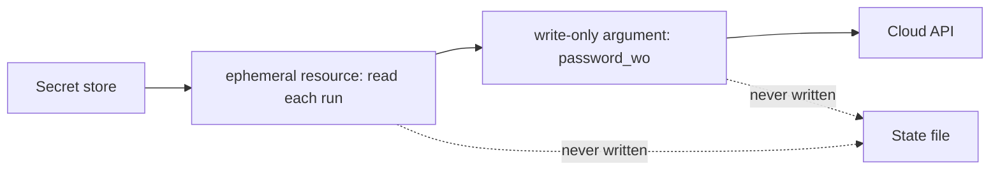

# Secrets, part 2: resources, data sources, state files and plan files

## In plain words

Suppose you whisper a safe combination to a locksmith so they can set the lock. You were careful: nothing was written down on your side. Then you discover the locksmith writes every combination into a job logbook that sits on the counter. Your care at the front door did not help, because the secret leaked out of the back.

Terraform is the locksmith. You can pass it a database password with great care, never typing it in a file, and Terraform will still write that password into its state file, in plain text, because recording resource attributes is what state is for.

This lesson covers both halves: three ways to get a secret *into* a resource without writing it in code, and what to do about the logbook, including newer features that keep some secrets out of state altogether.

Why this matters for a job: "does Terraform store secrets in state?" is a favourite interview question because many people who use Terraform daily do not know the answer is yes. Knowing it changes how you set up backends, who you give access to, and how you design modules.

> **Before this lesson:** read [Secrets, part 1: the rules, the tools and authenticating providers](#/lesson/terraform/secrets-basics-providers) and [Terraform state, remote backends and locking](#/lesson/terraform/state-and-backends). The example uses a managed database; [RDS and Aurora: managed relational databases](#/lesson/aws/rds-aurora) explains what that is.

> [!WARNING]
> **Cost and safety.** The examples describe a managed database. Even the smallest database class is billed per hour and is not something to leave running after practice. If you apply these examples, use a sandbox account and destroy afterwards. Never practise with a real production password.

## The problem

A managed database needs an administrator password at creation:

```hcl
resource "aws_db_instance" "orders" {
  identifier          = "orders-dev"
  engine              = "postgres"
  instance_class      = "db.t4g.micro"
  allocated_storage   = 20
  skip_final_snapshot = true

  username = "orders_admin"
  password = "???"
}
```

- `identifier` is the database's name in AWS; `engine` chooses PostgreSQL.
- `instance_class` is the size and `allocated_storage` the disk space in gigabytes.
- `skip_final_snapshot = true` lets the database be deleted without a final backup, acceptable only for throwaway practice.
- `password` is the question. Something must go there, and it must not be a literal string in this file.

There are three established techniques, in rising order of sophistication, and then two newer features that go further.

## Technique 1: a sensitive variable fed by the environment

Declare a variable with no default and mark it sensitive:

```hcl
variable "db_password" {
  description = "Administrator password for the orders database"
  type        = string
  sensitive   = true
}

resource "aws_db_instance" "orders" {
  # ...
  username = "orders_admin"
  password = var.db_password
}
```

- No `default` means the value must come from outside.
- `sensitive = true` tells Terraform to hide the value wherever it would print it.

Supply the value through an environment variable named `TF_VAR_` plus the variable's name:

```bash
export TF_VAR_db_password="$(op read 'op://infra/orders-dev/password')"
terraform plan
```

- `$( ... )` runs a command and uses its output. Here the command asks a password manager's command-line tool for the secret, so the value never appears on screen or in your shell history. Typing `export TF_VAR_db_password="hunter2"` directly would save it in the history file.

In the plan the value is masked:

```bash
  # aws_db_instance.orders will be created
  + resource "aws_db_instance" "orders" {
      + identifier = "orders-dev"
      + password   = (sensitive value)
      + username   = "orders_admin"
      ...
    }
```

Strengths: nothing secret in the code, works with any secret manager, no extra infrastructure. Weaknesses: the secret's real home is outside Terraform, so nothing in the code says where it comes from, and every person and pipeline must know the ritual for fetching it. Nothing is versioned or reviewed.

## Technique 2: an encrypted file in the repository

Keep the secrets in a file, encrypt the file with a key held in a key management service, commit the *encrypted* file, and let Terraform decrypt it at run time.

First, a key:

```hcl
resource "aws_kms_key" "secrets" {
  description         = "Encrypts infrastructure secret files"
  enable_key_rotation = true
}

resource "aws_kms_alias" "secrets" {
  name          = "alias/infra-secrets"
  target_key_id = aws_kms_key.secrets.key_id
}
```

- `aws_kms_key` creates an encryption key that never leaves AWS. `enable_key_rotation` asks AWS to refresh the underlying key material periodically.
- `aws_kms_alias` gives the key a readable name.

Then, on your machine, write the secrets to a temporary file and encrypt it:

```bash
cat > db-creds.yml <<'EOF'
username: orders_admin
password: (the real password, typed or pasted here)
EOF

aws kms encrypt \
  --key-id alias/infra-secrets \
  --plaintext fileb://db-creds.yml \
  --output text --query CiphertextBlob > db-creds.yml.encrypted

rm db-creds.yml
```

- The first command writes a small YAML file. YAML is a plain-text format of `name: value` lines.
- `aws kms encrypt` sends the file's contents to KMS and receives ciphertext, saved to a new file. `fileb://` means "read this file as raw bytes".
- `rm` deletes the plain-text file. Only the `.encrypted` file is committed.

Terraform reads it back with a data source:

```hcl
data "aws_kms_secrets" "db" {
  secret {
    name    = "creds"
    payload = file("${path.module}/db-creds.yml.encrypted")
  }
}

locals {
  db_creds = yamldecode(data.aws_kms_secrets.db.plaintext["creds"])
}

resource "aws_db_instance" "orders" {
  # ...
  username = local.db_creds.username
  password = local.db_creds.password
}
```

- `data "aws_kms_secrets"` asks KMS to decrypt the payload. The caller needs permission to use that key, which is where access control happens.
- `file()` reads the encrypted file from disk.
- `yamldecode()` turns YAML text into a Terraform object, so fields can be read with a dot.
- The provider marks the decrypted value as sensitive automatically.

Strengths: secrets are versioned, reviewed and deployed with the code, and access is governed by who may use the key. Weaknesses: editing is clumsy (decrypt, edit, re-encrypt, hoping no plain-text copy is left behind), there is no rotation, and a pull request shows only that a blob changed. The tool `sops` automates the editing and keeps the file's keys readable while encrypting the values.

## Technique 3: a centralised secret store

Put the secret in a service designed for it and read it with a data source:

```hcl
data "aws_secretsmanager_secret_version" "db" {
  secret_id = "orders-dev/db-admin"
}

locals {
  db_creds = jsondecode(data.aws_secretsmanager_secret_version.db.secret_string)
}

resource "aws_db_instance" "orders" {
  # ...
  username = local.db_creds.username
  password = local.db_creds.password
}
```

- `secret_id` is the name of a secret created beforehand in AWS Secrets Manager, holding a small JSON document.
- `secret_string` is the stored text; `jsondecode()` converts JSON text to an object.

Strengths: one authoritative place, fine-grained permissions, a log of every read, optional automatic rotation, and no secret material in the repository at all. Weaknesses: the store costs a little per secret, the secret is managed separately from the code, and reading it this way still copies it into state.

For this specific case, AWS offers something better still: let the service invent and keep the password, so that Terraform never sees it.

```hcl
resource "aws_db_instance" "orders" {
  # ...
  username                    = "orders_admin"
  manage_master_user_password = true
}

output "db_secret_arn" {
  value = aws_db_instance.orders.master_user_secret[0].secret_arn
}
```

- `manage_master_user_password = true` tells the database service to generate the password, store it in Secrets Manager and rotate it.
- The output exposes only the secret's ARN, an identifier. Applications fetch the password at run time using their own permissions.

This is the best kind of secret handling: the secret never passes through Terraform at all.

| Technique | Secret in code | Secret in state | Versioned with code | Audit and rotation |
|---|---|---|---|---|
| Environment variable | No | Yes | No | Depends on the source |
| Encrypted file + KMS | Ciphertext only | Yes | Yes | Key usage only; manual rotation |
| Secret store data source | No | Yes | No | Yes |
| Service-managed password | No | No (only an ARN) | n/a | Yes |

Look at the "secret in state" column. That is the back door.

## The back door: state files

Whatever technique you used, after `apply` the state contains this:

```json
{
  "type": "aws_db_instance",
  "name": "orders",
  "instances": [
    {
      "attributes": {
        "identifier": "orders-dev",
        "username": "orders_admin",
        "password": "Tr0ub4dor&3"
      },
      "sensitive_attributes": [[{"type": "get_attr", "value": "password"}]]
    }
  ]
}
```

The password is there in plain text. The `sensitive_attributes` entry is only a note telling Terraform to mask it when printing. **`sensitive = true` controls display, not storage.** Data sources are recorded too, so a secret read from Secrets Manager is stored a second time under the data source.

Anyone who can read the state object can therefore read every secret in it. Since Terraform has to store state somewhere, the defence is to treat the state as the most sensitive file you have:

- **Encrypt it at rest and in transit.** The backend settings from the state lesson (`encrypt = true`, a KMS key, TLS) protect against stolen disks and intercepted traffic.
- **Restrict who can read it.** This is the control that matters most. In many teams only the deployment pipeline's role can read production state; engineers see plans through the pipeline.
- **Never store it in version control** or copy it to laptops casually. `terraform state pull` writes all the secrets to your disk.
- **Log access** to the bucket so reads can be audited.
- **Remember `terraform_remote_state`** needs read access to the whole state. Prefer sharing through outputs published elsewhere when the source state holds secrets.

OpenTofu offers an extra layer: client-side encryption of state and plan files, configured in the `terraform` block.

```hcl
terraform {
  encryption {
    key_provider "aws_kms" "main" {
      kms_key_id = "alias/tofu-state"
      region     = "eu-west-1"
      key_spec   = "AES_256"
    }

    method "aes_gcm" "main" {
      keys = key_provider.aws_kms.main
    }

    state {
      method   = method.aes_gcm.main
      enforced = true
    }

    plan {
      method   = method.aes_gcm.main
      enforced = true
    }
  }
}
```

- `key_provider` says where the encryption key comes from, here AWS KMS.
- `method` chooses the encryption algorithm and links it to the key.
- The `state` and `plan` blocks apply the method to each kind of file; `enforced = true` refuses to write unencrypted data.

With this, the object in the bucket is ciphertext even to someone with read access to the bucket; they would also need permission to use the key. Terraform has no equivalent built in and relies on the backend's encryption.

## The other back door: plan files

A saved plan (`terraform plan -out=tfplan`) contains the full configuration, the variable values supplied and the planned attribute values. Secrets passed as variables are inside it, readable with `terraform show -json tfplan`.

So a plan file deserves the same care as state:

- do not commit it;
- in pipelines, store it as a short-lived, access-controlled artifact, encrypted if possible;
- do not paste full JSON plans into tickets or chat;
- be careful what a pipeline prints. The human-readable plan masks sensitive values, but the JSON form and debug logging (`TF_LOG=DEBUG`) can reveal more.

## Keeping secrets out of state: ephemeral values

Recent releases added a way for a value to exist only during a run and never be written down. A value like this is called **ephemeral**, meaning short-lived. Terraform introduced the pieces across versions 1.10 and 1.11, and OpenTofu added its own support later; check the version your team runs before relying on them.

There are three pieces.

An **ephemeral resource** is like a data source that is re-read on every run and never saved:

```hcl
ephemeral "aws_secretsmanager_secret_version" "db" {
  secret_id = "orders-dev/db-admin"
}
```

A **write-only argument** is a resource argument that the provider sends to the API and then forgets. By convention its name ends in `_wo`, and it comes with a companion version number:

```hcl
resource "aws_db_instance" "orders" {
  identifier          = "orders-dev"
  engine              = "postgres"
  instance_class      = "db.t4g.micro"
  allocated_storage   = 20
  skip_final_snapshot = true
  username            = "orders_admin"

  password_wo         = jsondecode(ephemeral.aws_secretsmanager_secret_version.db.secret_string).password
  password_wo_version = 1
}
```

- `ephemeral.aws_secretsmanager_secret_version.db` reads the secret during the run. Nothing about it is stored in state or in a plan file.
- `password_wo` receives the value. Because it is write-only, state records nothing for it.
- Since Terraform keeps no copy, it cannot notice that the password changed. `password_wo_version` is how you tell it: raise the number from 1 to 2 and Terraform sends the current value again.

An **ephemeral variable** or output (`ephemeral = true` in the block) lets such a value pass through module boundaries.

Ephemeral values may only flow into places that are themselves not persisted: write-only arguments, provider configuration, other ephemeral values and a few more. Assigning one to an ordinary argument is an error, which is the language protecting you.



## Redaction: what `sensitive` does and does not do

The simulation shows the gap between what Terraform prints and what it stores.

```python-run
import json

state_attrs = {
    "identifier": "orders-dev",
    "username": "orders_admin",
    "password": "Tr0ub4dor&3",
    "endpoint": "orders-dev.abc123.eu-west-1.rds.amazonaws.com",
}
sensitive = {"password"}
write_only = set()          # try: {"password"} to model password_wo

def cli_view(attrs):
    """What `terraform plan` or `terraform show` prints."""
    return {k: ("(sensitive value)" if k in sensitive else v)
            for k, v in attrs.items() if k not in write_only}

def stored_in_state(attrs):
    """What is written to the state file."""
    return {k: v for k, v in attrs.items() if k not in write_only}

print("Printed on screen:")
print(json.dumps(cli_view(state_attrs), indent=2))
print("\nStored in the state file:")
print(json.dumps(stored_in_state(state_attrs), indent=2))

leaked = [k for k in sensitive if k in stored_in_state(state_attrs)]
print("\nSecrets readable by anyone with state access:", leaked or "none")
```

Run it, then set `write_only = {"password"}` and run it again. With the write-only model the secret is in neither view.

A related rule concerns outputs. If an output's value comes from something sensitive, Terraform insists you acknowledge it:

```hcl
output "connection_string" {
  value     = "postgres://${local.db_creds.username}:${local.db_creds.password}@${aws_db_instance.orders.endpoint}/orders"
  sensitive = true
}
```

Without `sensitive = true` the plan fails with "Output refers to sensitive values". With it, `apply` prints `connection_string = <sensitive>`, while `terraform output -raw connection_string` and `terraform output -json` reveal the real value. Avoid outputs like this one; publish the endpoint and the secret's ARN and let consumers fetch the password themselves.

> [!INTERVIEW]
> "Does marking a variable sensitive keep it out of the state file?" No. `sensitive` only masks the value in plan, apply and output display. The value is still stored in plain text in state and in saved plan files. Protect it by encrypting the backend, restricting read access to state, and where possible keeping the secret out of Terraform entirely: service-managed passwords, or ephemeral resources with write-only arguments. On OpenTofu, add client-side state encryption.

## Pitfalls

- **Believing `sensitive = true` is encryption.** It is display masking.
- **Generating a password with a `random_password` resource and assuming it is safe.** The result is stored in state like any other attribute.
- **Typing the secret into the shell** with `export TF_VAR_x="..."`, which saves it to history.
- **Leaving the decrypted file on disk** after encrypting, or committing it by accident.
- **Giving broad read access to the state bucket** "so people can debug".
- **Uploading plan files or JSON plans as public pipeline artifacts.**
- **Putting secrets in outputs** for convenience.
- **Forgetting to raise the version number** of a write-only argument after rotating the secret; nothing is sent.
- **Using `nonsensitive()`** to silence an error without understanding why the value was marked.

## Cheat sheet

| Goal | Approach |
|---|---|
| Hide a value in CLI output | `sensitive = true` on the variable or output |
| Pass a secret without writing it | `TF_VAR_name` set from a secret manager command |
| Version secrets with code | Encrypted file + `data "aws_kms_secrets"` or sops |
| Read from a secret store | `data "aws_secretsmanager_secret_version"` |
| Keep the password out of Terraform | `manage_master_user_password = true` |
| Keep a value out of state and plan | `ephemeral` resource + `*_wo` write-only argument |
| Resend a write-only value | Increase `*_wo_version` |
| Protect state | Encrypt, restrict reads, version, log access |
| Client-side encryption | OpenTofu `encryption` block |
| Reveal a sensitive output on purpose | `terraform output -raw name` |

## Summary

- A secret reaches a resource through a sensitive variable set from the environment, an encrypted file decrypted with a KMS key, or a data source reading a secret store.
- In every one of those cases the secret is written to the state file in plain text; `sensitive` only masks display.
- Saved plan files contain secrets too.
- Protect state and plans with encryption, strict read access, no version control and access logging; OpenTofu can additionally encrypt them on the client.
- The strongest designs keep the secret out of Terraform: service-managed passwords, or ephemeral resources feeding write-only arguments.
- Do not expose secrets through outputs; publish identifiers and let consumers fetch the secret.

## Glossary

- **Sensitive value:** a value Terraform masks in its output.
- **`TF_VAR_name`:** an environment variable that sets the input variable `name`.
- **KMS key:** an encryption key held by a key management service.
- **`yamldecode` / `jsondecode`:** functions turning YAML or JSON text into Terraform values.
- **Secret store:** a service that stores secrets with access control and audit logs.
- **Service-managed password:** a password generated and kept by the cloud service itself.
- **Plan file:** a saved plan, which includes variable values.
- **Client-side encryption:** encrypting data before it leaves the machine that produced it.
- **Ephemeral:** existing only during a run and never persisted.
- **Ephemeral resource:** a read performed on every run whose result is not stored.
- **Write-only argument:** an argument sent to the provider and not recorded in state.

## Check yourself

```quiz
[
  {"q": "A variable is declared with `sensitive = true` and used as a database password. After apply, where can the plain-text password be found?",
   "options": ["Nowhere", "In the state file", "Only in the .tf files", "Only in the lock file"], "answer": 1,
   "explain": "Sensitive marking masks display only. The resource's attributes, including the password, are stored in state."},
  {"q": "A plan includes a new database whose password comes from a sensitive variable. How does the password line appear?",
   "options": ["`+ password = \"Tr0ub4dor&3\"`", "`+ password = (sensitive value)`", "`+ password = (known after apply)`", "The line is omitted"], "answer": 1,
   "explain": "Sensitive values are replaced by the placeholder `(sensitive value)` in plan and apply output."},
  {"q": "Which approach keeps the database password out of Terraform state entirely?",
   "options": ["Reading it from Secrets Manager with a data source", "Passing it with TF_VAR_db_password", "Letting the database service manage the password, or using an ephemeral resource with a write-only argument", "Decrypting a KMS-encrypted file"], "answer": 2,
   "explain": "The first, second and fourth options all place the value on an ordinary argument, which is stored. Service-managed passwords and write-only arguments never record it."},
  {"q": "A resource uses `password_wo` with `password_wo_version = 1`. The secret is rotated in the secret store, and nothing in the code changes. What does the next plan show?",
   "options": ["An in-place update of the password", "No changes, because Terraform keeps no copy to compare; raise the version to resend", "A replacement of the database", "An error"], "answer": 1,
   "explain": "Write-only values are not stored, so Terraform cannot detect a difference. Changing the version number is the trigger to send the new value."},
  {"q": "An output's value includes a sensitive variable and the output block has no `sensitive` argument. What happens?",
   "options": ["The value is printed", "The plan fails with an error about an output referring to sensitive values", "The output is skipped", "The value is masked automatically"], "answer": 1,
   "explain": "Terraform requires you to mark such an output as sensitive explicitly, so a secret is not exposed by accident."},
  {"q": "Why should a saved plan file be treated like a state file?",
   "options": ["It contains provider binaries", "It contains variable values and planned attributes, including secrets, readable with terraform show -json", "It holds the state lock", "It cannot be deleted"], "answer": 1,
   "explain": "A plan file embeds the inputs and the planned values. Sensitive masking applies to the human-readable view, not to the stored data."},
  {"q": "What does the most effective protection for secrets already in state rely on?",
   "options": ["Marking every variable sensitive", "Restricting who can read the state, together with encryption and access logging", "Committing state to a private repository", "Running terraform fmt"], "answer": 1,
   "explain": "Anyone who can read state can read its secrets, so limiting and auditing read access is the key control. Encryption at rest covers the storage layer."},
  {"q": "What does OpenTofu's `encryption` block add beyond backend encryption?",
   "options": ["It rotates database passwords", "State and plan files are encrypted on the client before upload, so bucket readers see ciphertext", "It removes secrets from state", "It disables state locking"], "answer": 1,
   "explain": "Client-side encryption means read access to the bucket is not enough; the reader also needs the key."}
]
```

> **Source:** Brikman, Terraform: Up & Running 3e, ch. 6 (resources and data sources: environment variables, encrypted files, secret stores; state files and plan files). Documentation: https://developer.hashicorp.com/terraform/language/state/sensitive-data, https://developer.hashicorp.com/terraform/language/resources/ephemeral, https://opentofu.org/docs/language/state/encryption/ and https://registry.terraform.io/providers/hashicorp/aws/latest/docs/resources/db_instance
