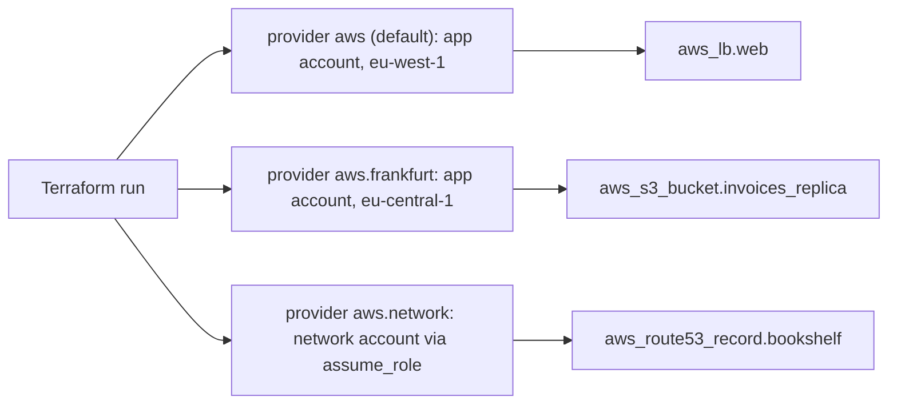

# Multiple providers, part 1: aliases, Regions and accounts

## In plain words

A company with one office needs one set of keys. A company with offices in Dublin and Frankfurt needs two sets, and whoever is sent to do a job must be told which office to go to and handed the right keys. "Go and fix the printer" is not enough; "take the Frankfurt keys and fix the printer there" is.

Until now every configuration in this track has had exactly one `provider "aws"` block: one office, one set of keys. Every resource silently used it. Real systems are spread out. Backups are copied to a second Region. Production lives in a different account from development. Some resources must be created in one specific Region whatever else you use.

This lesson shows how to give Terraform several sets of keys, called **provider configurations**, how to name them with an **alias**, and how to tell each resource and module which one to use.

Why this matters for a job: multi-Region and multi-account setups are normal in any company past its first year. Interview questions such as "how do you deploy to two Regions with Terraform?" and "how do you pass a provider to a module?" test exactly this lesson.

> **Before this lesson:** complete [Reusable modules: inputs, outputs and locals](#/lesson/terraform/module-basics) and [Secrets, part 1: the rules, the tools and authenticating providers](#/lesson/terraform/secrets-basics-providers). You should know what a Region and an account are from [What cloud computing is, and the AWS global map](#/lesson/aws/what-is-cloud), and what an IAM role is.

## A closer look at providers

It is worth being precise about three things that are easy to blur together.

**The provider plug-in** is a program, downloaded by `terraform init`, that knows one platform's API. You declare which plug-ins you need, and from where, in `required_providers`:

```hcl
terraform {
  required_providers {
    aws = {
      source  = "hashicorp/aws"
      version = "~> 6.0"
    }
  }
}
```

- The key on the left, `aws`, is the **local name**: how this module refers to the provider. It is also the prefix of the resource types it supplies (`aws_instance`, `aws_s3_bucket`).
- `source` is the address in the registry, in full `registry.terraform.io/hashicorp/aws`. The first part of the short form is the **namespace**, the organisation that publishes it.
- `version` is a constraint, as explained in the versioning lesson.

Always declare `required_providers`. If you leave it out, Terraform guesses that a resource type starting with `foo_` comes from `hashicorp/foo`, which is wrong for every provider not published by HashiCorp.

**A provider configuration** is a `provider` block: the settings for *using* the plug-in, such as Region and credentials.

```hcl
provider "aws" {
  region = "eu-west-1"
}
```

**One plug-in can have many configurations.** That is the key idea of this lesson. The plug-in is downloaded once; each `provider` block is a separately configured connection.

## Multiple Regions

Harbour Books runs in Ireland (`eu-west-1`) and wants a copy of its invoice archive in Frankfurt (`eu-central-1`). Write two provider blocks. Two blocks with the same name would clash, so every block after the first gets an **alias**:

```hcl
provider "aws" {
  region = "eu-west-1"
}

provider "aws" {
  alias  = "frankfurt"
  region = "eu-central-1"
}
```

- The block without `alias` is the **default configuration** for the `aws` provider. Any resource that does not say otherwise uses it.
- The block with `alias = "frankfurt"` is an additional configuration, referred to as `aws.frankfurt`.

To make a resource or data source use an aliased configuration, set the `provider` meta-argument:

```hcl
data "aws_region" "primary" {}

data "aws_region" "replica" {
  provider = aws.frankfurt
}

resource "aws_s3_bucket" "invoices" {
  bucket = "harbour-books-invoices"
}

resource "aws_s3_bucket" "invoices_replica" {
  provider = aws.frankfurt
  bucket   = "harbour-books-invoices-replica"
}

output "regions" {
  value = {
    primary = data.aws_region.primary.region
    replica = data.aws_region.replica.region
  }
}
```

- `provider = aws.frankfurt` is written without quotes. It is a reference to a provider configuration, in the form `<local name>.<alias>`.
- `data "aws_region"` returns the Region of whichever configuration it uses. It is a handy way to confirm that a resource is going where you think.
- The first bucket uses the default configuration and is created in Ireland; the second is created in Frankfurt.

```bash
$ terraform plan

  # aws_s3_bucket.invoices will be created
  + resource "aws_s3_bucket" "invoices" {
      + bucket = "harbour-books-invoices"
      + region = "eu-west-1"
      ...
    }

  # aws_s3_bucket.invoices_replica will be created
  + resource "aws_s3_bucket" "invoices_replica" {
      + bucket = "harbour-books-invoices-replica"
      + region = "eu-central-1"
      ...
    }

Plan: 2 to add, 0 to change, 0 to destroy.

Changes to Outputs:
  + regions = {
      + primary = "eu-west-1"
      + replica = "eu-central-1"
    }
```

The plan does not label resources with their provider alias, so the `region` attribute is what to check.

> [!NOTE]
> Recent major versions of the AWS provider also accept a `region` argument directly on many resources, which covers simple cases without an alias. Aliases remain the general mechanism: they work for every provider, and they are the only way to vary account or credentials.

### Region-specific values

Some values exist per Region. AMI IDs are the classic case: the same operating system image has a different ID in each Region. A hard-coded ID that works in Ireland fails in Frankfurt. Look it up with a data source through each configuration:

```hcl
data "aws_ami" "al2023_primary" {
  most_recent = true
  owners      = ["amazon"]
  filter {
    name   = "name"
    values = ["al2023-ami-2023.*-x86_64"]
  }
}

data "aws_ami" "al2023_replica" {
  provider    = aws.frankfurt
  most_recent = true
  owners      = ["amazon"]
  filter {
    name   = "name"
    values = ["al2023-ami-2023.*-x86_64"]
  }
}
```

Each lookup returns the right ID for its own Region.

### A common real case: certificates for CloudFront

Some AWS services insist on a particular Region. The content delivery service CloudFront only accepts TLS certificates stored in `us-east-1` (North Virginia), wherever the rest of your system lives. So a configuration based in Ireland typically has one extra alias for this single purpose:

```hcl
provider "aws" {
  alias  = "us_east_1"
  region = "us-east-1"
}

resource "aws_acm_certificate" "site" {
  provider          = aws.us_east_1
  domain_name       = "www.harbourbooks.example"
  validation_method = "DNS"
}
```

`aws_acm_certificate` requests a certificate from AWS Certificate Manager; `validation_method = "DNS"` proves you own the domain by creating a DNS record. See [CloudFront and Global Accelerator](#/lesson/aws/cloudfront).

## Multiple accounts

Many organisations give each environment its own AWS account: a mistake or a break-in in development then cannot touch production, because an account is the strongest wall AWS offers. The AWS track covers this in [Policy evaluation, STS, Organizations and SCPs](#/lesson/aws/iam-evaluation).

To act in another account, Terraform **assumes a role** there. You sign in to one account, and the provider exchanges your identity for temporary credentials in the other, provided the role in that account trusts you.

```hcl
provider "aws" {
  region = "eu-west-1"
}

provider "aws" {
  alias  = "network"
  region = "eu-west-1"

  assume_role {
    role_arn     = "arn:aws:iam::222222222222:role/terraform-network"
    session_name = "terraform-bookshelf"
  }
}

data "aws_caller_identity" "here" {}

data "aws_caller_identity" "network" {
  provider = aws.network
}

output "accounts" {
  value = {
    here    = data.aws_caller_identity.here.account_id
    network = data.aws_caller_identity.network.account_id
  }
}
```

- The `assume_role` block tells this configuration to assume the given role before making any call. `role_arn` identifies the role; the twelve-digit number in it is the account ID.
- `session_name` labels the session in the audit logs of the other account, so someone reading them can tell what was acting.
- `data "aws_caller_identity"` returns the account and identity of whichever configuration it uses. Outputting both is a cheap sanity check.

For this to work, two things must be true in AWS: the role in account 222222222222 must have a trust policy allowing your identity to assume it, and your identity must be allowed to call `sts:AssumeRole` on it.

A typical use is a resource that spans accounts, such as a DNS record in a shared networking account pointing at a load balancer in the application account:

```hcl
resource "aws_route53_record" "bookshelf" {
  provider = aws.network
  zone_id  = var.shared_zone_id
  name     = "bookshelf.harbourbooks.example"
  type     = "CNAME"
  ttl      = 300
  records  = [aws_lb.web.dns_name]
}
```

The record is created in the networking account, and its value comes from a load balancer created through the default configuration in the application account. Terraform handles the ordering through the reference as usual.



## Modules and providers

The modules lesson said a reusable module must not contain `provider` blocks. Here is the full reasoning and the mechanism that replaces them.

A provider block hidden inside a module causes three problems:

1. **The caller cannot choose.** The Region or account is fixed by the module's author.
2. **Performance.** Each provider configuration starts a separate plug-in process. Modules that each define their own multiply the processes.
3. **Removal breaks.** To destroy a resource, Terraform needs the provider configuration that created it. If you delete a module call, its provider block disappears with it, and Terraform can no longer destroy the module's resources. You get an error about a missing provider configuration.

Instead, provider configurations are defined only in the root module and **passed down**.

### Implicit passing: the default configuration

A child module automatically inherits the root's *default* (un-aliased) configuration for each provider. That is why modules have worked so far without any ceremony.

### Explicit passing: the `providers` argument

To make a module use an aliased configuration, map it in the module call:

```hcl
module "replica_archive" {
  source = "../../modules/archive-bucket"

  providers = {
    aws = aws.frankfurt
  }

  name = "harbour-books-invoices-replica"
}
```

- `providers` is a map. The key on the left is the name *inside the module*; the value on the right is a configuration *in the caller*.
- `aws = aws.frankfurt` means "wherever this module says `aws`, use my Frankfurt configuration". Every resource in the module is then created in Frankfurt, with no change to the module's code.

Calling the same module twice with different `providers` maps gives the same infrastructure in two Regions.

### Modules that need more than one configuration

A module that itself spans two Regions (a bucket and its replica, say) needs two configurations handed in. It declares the names it expects with `configuration_aliases`:

```hcl
# modules/replicated-bucket/versions.tf
terraform {
  required_providers {
    aws = {
      source                = "hashicorp/aws"
      version               = ">= 5.0"
      configuration_aliases = [aws.primary, aws.replica]
    }
  }
}
```

```hcl
# modules/replicated-bucket/main.tf
resource "aws_s3_bucket" "primary" {
  provider = aws.primary
  bucket   = var.name
}

resource "aws_s3_bucket" "replica" {
  provider = aws.replica
  bucket   = "${var.name}-replica"
}
```

- `configuration_aliases = [aws.primary, aws.replica]` declares that this module expects two configurations with those names. It configures nothing; it only names the slots.
- Each resource picks a slot with `provider`.

The caller fills the slots:

```hcl
module "invoices" {
  source = "../../modules/replicated-bucket"

  providers = {
    aws.primary = aws
    aws.replica = aws.frankfurt
  }

  name = "harbour-books-invoices"
}
```

`aws.primary = aws` maps the module's `primary` slot to the caller's default configuration.

The simulation below resolves which configuration each resource ends up using, following the same rules: an explicit `provider` argument wins, otherwise the default; and inside a module, names are translated through the `providers` map.

```python-run
root_configs = {
    "aws":           {"region": "eu-west-1",    "account": "111111111111"},
    "aws.frankfurt": {"region": "eu-central-1", "account": "111111111111"},
    "aws.network":   {"region": "eu-west-1",    "account": "222222222222"},
}

def resolve(resource, providers_map=None):
    """resource: (address, provider_ref or None). providers_map: module-local name -> root config."""
    address, ref = resource
    local = ref or address.split("_")[0]          # default: the type's prefix, e.g. "aws"
    if providers_map is None:                      # resource in the root module
        target = local
    elif local in providers_map:                   # explicitly passed to the module
        target = providers_map[local]
    elif "." not in local:                         # default config is inherited implicitly
        target = local
    else:
        return f"{address:38} ERROR: module needs {local} but caller did not pass it"
    if target not in root_configs:
        return f"{address:38} ERROR: no provider configuration {target}"
    c = root_configs[target]
    return f"{address:38} -> {target:14} ({c['region']}, account {c['account']})"

print("Root module")
for r in [("aws_lb.web", None), ("aws_s3_bucket.replica", "aws.frankfurt"),
          ("aws_route53_record.bookshelf", "aws.network"), ("aws_s3_bucket.x", "aws.tokyo")]:
    print("  ", resolve(r))

print("\nmodule.replica_archive  providers = { aws = aws.frankfurt }")
print("  ", resolve(("aws_s3_bucket.this", None), {"aws": "aws.frankfurt"}))

print("\nmodule.invoices  providers = { aws.primary = aws, aws.replica = aws.frankfurt }")
m = {"aws.primary": "aws", "aws.replica": "aws.frankfurt"}
for r in [("aws_s3_bucket.primary", "aws.primary"), ("aws_s3_bucket.replica", "aws.replica")]:
    print("  ", resolve(r, m))

print("\nmodule.invoices  with the replica mapping forgotten")
print("  ", resolve(("aws_s3_bucket.replica", "aws.replica"), {"aws.primary": "aws"}))
```

## A word of caution

Being able to span Regions and accounts from one configuration does not mean you should do it often.

- **Isolation is the reason Regions and accounts exist.** A configuration that manages Ireland and Frankfurt together has one state, one lock and one blast radius. An outage of the Ireland API can block you from changing Frankfurt at the very moment you need to. For genuinely independent copies of a system, use separate root modules, one per Region, calling the same reusable module.
- **Multi-Region is an application design problem first.** Creating the infrastructure twice is the easy part. Keeping data in sync, routing users and handling failover are the hard parts, and Terraform does not solve them. See [Reliability: resilient architectures, RTO, RPO and disaster recovery](#/lesson/aws/reliability-dr).
- **Reserve aliases for resources that truly cross a boundary:** a replica bucket, a certificate in `us-east-1`, a DNS record in a shared account, a peering connection between two networks.

> [!WARNING]
> **Cost and safety.** A second Region doubles what you create there, and data copied between Regions is billed as transfer. A second account means a mistake in the `provider` argument can create or destroy things in an account you were not thinking about. Before applying, check the plan's `region` attributes and output `aws_caller_identity` for each alias.

> [!INTERVIEW]
> "How do you use a module in two Regions?" Define two provider configurations in the root module, one default and one with an alias; call the module twice and pass `providers = { aws = aws.<alias> }` to the second call. The module itself contains no provider block, only `required_providers`. If the module needs both Regions internally, it declares `configuration_aliases` and the caller maps each one.

## Pitfalls

- **Forgetting `provider = aws.alias` on one resource.** It lands in the default Region, the plan succeeds, and the mistake is found weeks later.
- **Quoting the reference.** `provider = "aws.frankfurt"` is rejected; it is a reference, not a string.
- **Provider blocks inside reusable modules.** Removing the module then fails because the configuration needed for destroy is gone.
- **Removing an aliased provider block while its resources are still in state.** Destroy the resources first, then remove the block.
- **Hard-coding Region-specific values** such as AMI IDs or Availability Zone names.
- **Assuming a role without setting `session_name`**, which makes audit logs harder to read.
- **Managing whole independent Regions in one state.** Use aliases for the few cross-boundary resources and separate roots for the rest.

## Cheat sheet

| Task | Syntax |
|---|---|
| Declare a plug-in | `required_providers { aws = { source = "hashicorp/aws", version = "~> 6.0" } }` |
| Default configuration | `provider "aws" { region = "eu-west-1" }` |
| Additional configuration | `provider "aws" { alias = "frankfurt", region = "eu-central-1" }` |
| Use it on a resource | `provider = aws.frankfurt` |
| Another account | `assume_role { role_arn = "arn:aws:iam::ID:role/NAME" }` |
| Check Region | `data "aws_region" "x" {}` |
| Check account | `data "aws_caller_identity" "x" {}` |
| Pass to a module | `providers = { aws = aws.frankfurt }` |
| Module expecting several | `configuration_aliases = [aws.primary, aws.replica]` |
| Fill the slots | `providers = { aws.primary = aws, aws.replica = aws.frankfurt }` |

## Summary

- A provider plug-in is downloaded once; each `provider` block is a separate configuration of it.
- An un-aliased block is the default; additional blocks need an `alias` and are referenced as `aws.<alias>`.
- Resources and data sources choose a configuration with the `provider` meta-argument.
- Another account is reached with an `assume_role` block in the provider configuration.
- Reusable modules never define providers. They inherit the default implicitly or receive configurations through the `providers` map, declaring any extra slots with `configuration_aliases`.
- Use aliases for the few resources that cross a boundary, and separate root modules for independent Regions or accounts.

## Glossary

- **Provider plug-in:** the downloaded program that talks to one platform's API.
- **Provider configuration:** a `provider` block with settings for using a plug-in.
- **Local name:** the name by which a module refers to a provider.
- **Namespace:** the publisher part of a provider's registry address.
- **Alias:** a name given to an additional configuration of the same provider.
- **Default configuration:** the un-aliased provider block.
- **`provider` meta-argument:** the argument selecting a configuration for one resource.
- **Assume a role:** exchange your identity for temporary credentials of a role, often in another account.
- **`providers` argument:** the map in a module call that passes configurations into the module.
- **`configuration_aliases`:** a module's declaration of the provider configurations it expects to be given.

## Check yourself

```quiz
[
  {"q": "The root module has `provider \"aws\" { region = \"eu-west-1\" }` and `provider \"aws\" { alias = \"frankfurt\", region = \"eu-central-1\" }`. A bucket resource has no `provider` argument. In which Region does the plan show it?",
   "options": ["eu-central-1", "eu-west-1", "Both", "The plan fails"], "answer": 1,
   "explain": "A resource without a provider argument uses the default (un-aliased) configuration."},
  {"q": "Which line correctly selects the aliased configuration on a resource?",
   "options": ["`provider = \"aws.frankfurt\"`", "`provider = aws.frankfurt`", "`alias = frankfurt`", "`region = aws.frankfurt`"], "answer": 1,
   "explain": "The provider meta-argument takes an unquoted reference in the form local name dot alias."},
  {"q": "A module with 4 resources is called twice: once with no providers argument and once with `providers = { aws = aws.frankfurt }`. What does the plan show in a fresh state?",
   "options": ["4 to add, all in the default Region", "8 to add: 4 in the default Region and 4 in Frankfurt", "8 to add, all in Frankfurt", "An error: a module can use one provider"], "answer": 1,
   "explain": "The first call inherits the default configuration; the second maps the module's aws to the Frankfurt configuration. Each call creates its own four resources."},
  {"q": "A reusable module contains its own `provider \"aws\"` block. You delete the module call from the root and run plan. What is the likely result?",
   "options": ["The resources are destroyed normally", "An error: the provider configuration needed to destroy the module's resources no longer exists", "The resources are left running and forgotten", "No changes"], "answer": 1,
   "explain": "Destroying needs the configuration that created the resources. It vanished with the module, which is one reason providers belong in the root."},
  {"q": "What does `configuration_aliases = [aws.primary, aws.replica]` do in a module?",
   "options": ["Creates two provider configurations", "Declares that the caller must pass two configurations under those names", "Sets two Regions", "Downloads the provider twice"], "answer": 1,
   "explain": "It only names the slots the module expects. The caller fills them through the providers map."},
  {"q": "How does a provider configuration act in a different AWS account?",
   "options": ["By setting `account = \"...\"`", "With an `assume_role` block naming a role in that account that trusts the caller", "By using a different lock file", "It cannot"], "answer": 1,
   "explain": "The provider assumes the role and uses the temporary credentials it receives for all calls made through that configuration."},
  {"q": "Why look up the AMI with a data source per provider configuration instead of hard-coding one ID?",
   "options": ["Data sources are faster", "AMI IDs differ between Regions, so one ID is only valid in one of them", "Hard-coded IDs are not allowed", "To avoid needing an alias"], "answer": 1,
   "explain": "The same image has a different identifier in each Region. A lookup through each configuration returns the correct one."},
  {"q": "When is one configuration spanning two Regions a poor choice?",
   "options": ["For a replica bucket", "For a certificate CloudFront needs in us-east-1", "For two fully independent copies of a system that should fail separately", "For a DNS record in a shared account"], "answer": 2,
   "explain": "Independent copies should have independent state and blast radius. Use separate root modules that call the same reusable module."}
]
```

> **Source:** Brikman, Terraform: Up & Running 3e, ch. 7 (working with one provider, working with multiple copies of the same provider: multiple AWS Regions, multiple AWS accounts, creating modules that can work with multiple providers). Documentation: https://developer.hashicorp.com/terraform/language/providers/configuration, https://developer.hashicorp.com/terraform/language/modules/develop/providers and https://developer.hashicorp.com/terraform/language/providers/requirements
