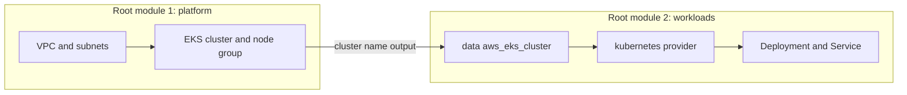

# Multiple providers, part 2: different providers, Docker and Kubernetes

## In plain words

A general contractor does not lay bricks, wire sockets and fit pipes personally. They hold one plan for the whole house and coordinate specialists: a bricklayer, an electrician, a plumber. The value of the contractor is that the plan is in one place and the order is right: walls before wiring, wiring before plaster.

Terraform is a general contractor for platforms. The previous lesson used several configurations of *one* specialist, the AWS provider. This lesson brings in *different* specialists in the same configuration: a provider for Docker, a provider for Kubernetes, and briefly others such as DNS or monitoring services. One plan, one dependency graph, several platforms.

You will run a container on your own machine with the Docker provider (free, no cloud account), deploy an application to a Kubernetes cluster with the Kubernetes provider, and then see how the pieces join up when the cluster itself is created in AWS, along with the traps in that last step.

Why this matters for a job: most real stacks are a cloud plus Kubernetes plus a handful of software-as-a-service products, and teams use Terraform to wire them together. Interviewers ask where you draw the line between Terraform and Kubernetes tooling; this lesson gives you an informed answer.

> **Before this lesson:** read [Multiple providers, part 1: aliases, Regions and accounts](#/lesson/terraform/provider-aliases-regions-accounts). You should know what a container and an image are from [What a container is](#/lesson/docker/what-is-a-container) and [Running containers](#/lesson/docker/running-containers), and have a first idea of Kubernetes from [What orchestration solves](#/lesson/kubernetes/what-orchestration-solves), [Pod basics](#/lesson/kubernetes/pod-basics) and [Deployments and ReplicaSets](#/lesson/kubernetes/deployments-replicasets). Docker Desktop (or another local Docker engine) should be installed for the hands-on parts.

## Using different providers together

Declaring more than one provider is an extension of what you already know: list each in `required_providers` and configure each with its own block.

```hcl
terraform {
  required_providers {
    aws = {
      source  = "hashicorp/aws"
      version = "~> 6.0"
    }
    cloudflare = {
      source  = "cloudflare/cloudflare"
      version = "~> 5.0"
    }
  }
}

provider "aws" {
  region = "eu-west-1"
}

provider "cloudflare" {
  # reads its API token from the CLOUDFLARE_API_TOKEN environment variable
}

resource "cloudflare_dns_record" "shop" {
  zone_id = var.cloudflare_zone_id
  name    = "shop"
  type    = "CNAME"
  content = aws_lb.web.dns_name
  ttl     = 300
}
```

- The `cloudflare` entry has a different **namespace**: it is published by Cloudflare, not HashiCorp, which is why `source` must be stated.
- Each provider authenticates in its own way, here with a token from the environment.
- The DNS record's `content` references an AWS load balancer. Terraform creates the load balancer first and then the record, across two unrelated companies' APIs. That cross-platform ordering is something no single vendor's tool does.

Registry providers are sorted into tiers: **official** (maintained by HashiCorp), **partner** (maintained by the technology's own company and verified) and **community** (maintained by individuals). A provider is a program that runs on your machine with your credentials, so check who publishes one before using it, exactly as you would for any software dependency.

### A realistic view of "multi-cloud"

Using several providers at once is common. Running the *same application* across AWS, Azure and Google Cloud at once is rare and expensive, because the resources are different on each and the code has to be written and maintained separately for each. What most companies mean by multi-cloud is one main cloud plus assorted other services. Terraform is well suited to that.

## The Docker provider: a container on your laptop

The Docker provider drives a Docker engine through its API. It is a good way to practise multi-provider ideas with nothing to pay for.

```hcl
terraform {
  required_providers {
    docker = {
      source  = "kreuzwerker/docker"
      version = "~> 3.0"
    }
  }
}

provider "docker" {}

resource "docker_image" "web" {
  name         = "nginx:1.27-alpine"
  keep_locally = true
}

resource "docker_container" "web" {
  name  = "bookshelf-web"
  image = docker_image.web.image_id

  ports {
    internal = 80
    external = 8088
  }

  env = ["SITE_NAME=Harbour Books"]
}

output "url" {
  value = "http://localhost:${docker_container.web.ports[0].external}"
}
```

- `source = "kreuzwerker/docker"` is a community-maintained provider; note the non-HashiCorp namespace.
- `provider "docker" {}` uses the local Docker engine with default settings.
- `docker_image.web` pulls the image `nginx:1.27-alpine` (the nginx web server, version 1.27, on the small Alpine Linux base). `keep_locally = true` leaves the image on disk when the resource is destroyed, which saves re-downloading.
- `docker_container.web` runs a container from that image. `image = docker_image.web.image_id` is a reference, so the image is pulled first.
- The `ports` block publishes the container's port 80 on port 8088 of your machine.
- `env` is a list of `NAME=value` environment variables passed to the container.

```bash
$ terraform init && terraform apply
...
docker_image.web: Creating...
docker_image.web: Creation complete after 6s [id=sha256:9f1c...nginx:1.27-alpine]
docker_container.web: Creating...
docker_container.web: Creation complete after 1s [id=4b7e0c...]

Apply complete! Resources: 2 added, 0 changed, 0 destroyed.

Outputs:

url = "http://localhost:8088"

$ curl -s http://localhost:8088 | head -n 4
<!DOCTYPE html>
<html>
<head>
<title>Welcome to nginx!</title>

$ docker ps --format '{{.Names}}  {{.Image}}  {{.Ports}}'
bookshelf-web  nginx:1.27-alpine  0.0.0.0:8088->80/tcp
```

Now change the external port to 8089 and plan:

```bash
  # docker_container.web must be replaced
-/+ resource "docker_container" "web" {
      ~ id   = "4b7e0c..." -> (known after apply)
        name = "bookshelf-web"
      ~ ports {
          ~ external = 8088 -> 8089 # forces replacement
        }
    }

Plan: 1 to add, 0 to change, 1 to destroy.
```

Published ports are fixed when a container is created, so the provider must replace it. The plan vocabulary is identical to what you learned on AWS; only the resource types changed. Finish with `terraform destroy`.

## A short Kubernetes refresher

**Kubernetes** is an orchestrator: you tell it what should run, and it keeps that true. The three objects used below:

- A **Pod** is one running copy of your application: one or more containers that share a network address.
- A **Deployment** says "keep N copies of this Pod running" and handles rolling out new versions.
- A **Service** gives a set of Pods one stable network address and spreads requests over them.

Pods carry **labels**, small key and value tags. A Deployment and a Service both find their Pods with a **selector**, a rule such as "Pods labelled `app = bookshelf`".

Kubernetes objects are normally written in YAML and sent to the cluster with the `kubectl` command. The Kubernetes provider lets you describe the same objects in HCL.

## The Kubernetes provider: deploying to a local cluster

Docker Desktop can run a one-machine Kubernetes cluster (switch it on in its settings), and tools such as `kind` and `minikube` do the same. Enabling one writes connection details into a file called the **kubeconfig**, usually at `~/.kube/config`, as a named **context**. See [kubectl and kubeconfig](#/lesson/kubernetes/kubectl-kubeconfig).

```hcl
terraform {
  required_providers {
    kubernetes = {
      source  = "hashicorp/kubernetes"
      version = "~> 2.30"
    }
  }
}

provider "kubernetes" {
  config_path    = "~/.kube/config"
  config_context = "docker-desktop"
}

locals {
  labels = { app = "bookshelf" }
}

resource "kubernetes_deployment_v1" "bookshelf" {
  metadata {
    name = "bookshelf"
  }

  spec {
    replicas = 2

    selector {
      match_labels = local.labels
    }

    template {
      metadata {
        labels = local.labels
      }

      spec {
        container {
          name  = "web"
          image = "nginx:1.27-alpine"

          port {
            container_port = 80
          }

          env {
            name  = "SITE_NAME"
            value = "Harbour Books"
          }
        }
      }
    }
  }
}

resource "kubernetes_service_v1" "bookshelf" {
  metadata {
    name = "bookshelf"
  }

  spec {
    type     = "LoadBalancer"
    selector = local.labels

    port {
      port        = 8088
      target_port = 80
    }
  }
}
```

Block by block:

- The provider block reads the kubeconfig file and selects the context named `docker-desktop`. Naming the context explicitly matters: it prevents an apply from landing on whichever cluster you happened to use last.
- `locals { labels = ... }` defines the labels once, because three places must agree on them.
- `kubernetes_deployment_v1` mirrors a Deployment's YAML structure. The top-level `metadata` names the object.
- `spec.replicas = 2` asks for two Pods.
- `spec.selector.match_labels` tells the Deployment which Pods are its own.
- `spec.template` is the Pod recipe. Its `metadata.labels` must match the selector, and its `spec.container` block gives the image, the port the container listens on and an environment variable.
- `kubernetes_service_v1` creates a Service of type `LoadBalancer`, which asks the platform for an externally reachable address. Its `selector` finds the same Pods, and its `port` block forwards port 8088 of the Service to port 80 of each Pod.

```bash
$ terraform apply
...
kubernetes_deployment_v1.bookshelf: Creation complete after 9s [id=default/bookshelf]
kubernetes_service_v1.bookshelf: Creation complete after 1s [id=default/bookshelf]

Apply complete! Resources: 2 added, 0 changed, 0 destroyed.

$ kubectl get deployments,pods,services
NAME                        READY   UP-TO-DATE   AVAILABLE
deployment.apps/bookshelf   2/2     2            2

NAME                             READY   STATUS
pod/bookshelf-7d9c5f6b8d-4xk2p   1/1     Running
pod/bookshelf-7d9c5f6b8d-q8zjm   1/1     Running

NAME                 TYPE           EXTERNAL-IP   PORT(S)
service/bookshelf    LoadBalancer   localhost     8088:31544/TCP
```

The IDs are `namespace/name`. Two Pods are running, managed by the Deployment, and the Service is reachable at `localhost:8088`.

Notice the same split of duties you saw with Auto Scaling groups: Terraform manages the Deployment; the Deployment manages the Pods. Delete a Pod with `kubectl delete pod ...` and Kubernetes replaces it; `terraform plan` reports no changes.

## Joining the pieces: a cluster in AWS

On AWS, the managed Kubernetes service is **EKS** (Elastic Kubernetes Service). See [Containers and platforms: ECS, EKS, Fargate, Elastic Beanstalk and Batch](#/lesson/aws/containers). Creating a cluster takes a network, roles and the cluster itself, usually through a module. The interesting part for this lesson is how the Kubernetes provider learns where the new cluster is and how to sign in.

> [!WARNING]
> **Cost and safety.** An EKS cluster is billed per hour for its control plane *in addition to* its worker servers and any load balancers that Services create, and it is not covered by free allowances. Treat the code below as something to read unless you have a budget for it. If you do create a cluster, destroy the Kubernetes resources first and the cluster second, then check the console for leftover load balancers and disks.

```hcl
data "aws_eks_cluster" "main" {
  name = var.cluster_name
}

provider "kubernetes" {
  host                   = data.aws_eks_cluster.main.endpoint
  cluster_ca_certificate = base64decode(data.aws_eks_cluster.main.certificate_authority[0].data)

  exec {
    api_version = "client.authentication.k8s.io/v1beta1"
    command     = "aws"
    args        = ["eks", "get-token", "--cluster-name", var.cluster_name]
  }
}
```

- `data "aws_eks_cluster"` looks up an existing cluster by name.
- `host` is the address of the cluster's API server.
- `cluster_ca_certificate` is the certificate used to verify that address is genuine. AWS returns it base64-encoded, so `base64decode` converts it back.
- The `exec` block tells the provider to obtain a login token by running a command, here the AWS command-line tool. The token is short-lived and fetched fresh on each run, so no credential is stored.

This configuration uses two different providers in a chain: the AWS provider reads cluster details, and those details configure the Kubernetes provider.

### The trap: creating the cluster and using it in one configuration

It is tempting to put the cluster *resource* and the Kubernetes resources in the same root module, with the Kubernetes provider configured from the cluster resource's attributes. It often works the first time. It is also the source of some of the most confusing errors in Terraform, for a structural reason:

- A provider must be configured **before** Terraform can plan any of its resources.
- If the provider's settings come from a resource that does not exist yet, they are unknown at plan time.
- On later changes that replace the cluster, or on destroy, the provider can end up pointing at a cluster that is gone, producing errors such as connection refused to `localhost`.

The reliable pattern is **two root modules**, applied in order:



The first creates the cluster and outputs its name. The second looks the cluster up with a data source, as in the code above, and manages what runs in it. Each has its own state, which matches the isolation advice from the state module: the cluster changes rarely, the workloads often.

## Where should the line be?

Should Terraform manage Deployments at all? There are two reasonable positions, and you should be able to argue both.

**Terraform for the platform, Kubernetes-native tools for applications.** Terraform creates the cluster, its add-ons, namespaces, cloud permissions and anything that touches the cloud account. Application teams deploy with Helm, Kustomize or a GitOps tool such as Argo CD, which are designed for frequent releases and understand Kubernetes rollouts. This is the most common arrangement. The CI/CD track's [GitOps with Argo CD](#/lesson/cicd/gitops-argocd) describes that side.

**Terraform for everything.** One tool and one workflow. It suits small teams and stable workloads. Its weaknesses: the HCL form of Kubernetes objects is wordier than YAML; `apply` returning does not mean the rollout succeeded unless the provider is told to wait; and Kubernetes changes objects after creation (adding defaults and annotations), which can show up as noise in plans.

A practical rule: let Terraform manage the things in a cluster that are *infrastructure* and change rarely, and let a deployment tool manage what changes with every release.

> [!INTERVIEW]
> "Would you deploy applications to Kubernetes with Terraform?" A balanced answer: Terraform is a good fit for the cluster and cluster-level setup, and can deploy simple workloads through the Kubernetes or Helm providers. For frequently released applications, Kubernetes-native tooling handles rollouts and drift better. Mention the provider-configuration trap and the two-root-module pattern.

## Pitfalls

- **Omitting `source` for a non-HashiCorp provider.** Terraform looks for `hashicorp/<name>` and fails to find it.
- **Relying on the current kubeconfig context.** State the context, or you will one day apply to the wrong cluster.
- **Creating a cluster and configuring a provider from it in the same root module.** Split into two.
- **Destroying the cluster before the Kubernetes resources.** Load balancers and disks created by Kubernetes outlive it and keep billing.
- **Labels that do not match the selector.** The Deployment is rejected, or the Service finds no Pods and returns nothing.
- **Managing the same object with Terraform and `kubectl apply`.** Two owners produce permanent drift.
- **Trusting an unknown community provider** with powerful credentials without checking its publisher.

## Cheat sheet

| Item | Syntax or fact |
|---|---|
| Non-HashiCorp provider | `source = "cloudflare/cloudflare"` must be declared |
| Docker image | `resource "docker_image" "x" { name = "nginx:1.27-alpine" }` |
| Docker container | `resource "docker_container" "x" { image = docker_image.x.image_id, ports { ... } }` |
| Kubernetes provider, local | `config_path`, `config_context` |
| Kubernetes provider, EKS | `host`, `cluster_ca_certificate`, `exec { ... }` |
| Deployment | `kubernetes_deployment_v1` with `spec.replicas`, `selector`, `template` |
| Service | `kubernetes_service_v1` with `selector` and `port` |
| Decode a certificate | `base64decode(...)` |
| Cluster and workloads | Separate root modules, platform first |
| Destroy order | Workloads first, cluster second |

## Summary

- A configuration can use several different providers; each is declared in `required_providers` and configured in its own block, and references between their resources create an ordering across platforms.
- Providers outside the `hashicorp` namespace need an explicit `source`, and deserve the scrutiny of any third-party program.
- The Docker provider manages images and containers on a local engine and is a free way to practise.
- The Kubernetes provider expresses Deployments, Services and other objects in HCL, connecting through a kubeconfig context or through a host, a certificate and an `exec` token command.
- Do not configure a provider from resources created in the same configuration; create the cluster in one root module and deploy into it from another.
- Terraform suits cluster-level infrastructure; frequently released applications are usually better served by Kubernetes-native deployment tools.

## Glossary

- **Namespace (registry):** the publisher part of a provider address, such as `hashicorp` or `cloudflare`.
- **Official / partner / community provider:** who maintains a provider: HashiCorp, the technology's vendor, or individuals.
- **Docker engine:** the program that runs containers on a machine.
- **Pod:** one running copy of an application in Kubernetes, made of one or more containers.
- **Deployment:** a Kubernetes object that keeps a number of identical Pods running and rolls out updates.
- **Service:** a stable network address in front of a set of Pods.
- **Label / selector:** a tag on an object, and a rule that picks objects by their tags.
- **kubeconfig / context:** the file of cluster connection details, and one named entry in it.
- **EKS:** Amazon's managed Kubernetes service.
- **`exec` block:** provider setting that runs a command to obtain a short-lived login token.
- **GitOps:** deploying by having a tool in the cluster continuously apply what is in a Git repository.

## Check yourself

```quiz
[
  {"q": "A configuration uses `cloudflare_dns_record` but has no `required_providers` entry for it. What happens at init?",
   "options": ["It works", "Terraform looks for hashicorp/cloudflare and fails to find the provider", "It downloads every provider", "The resource is skipped"], "answer": 1,
   "explain": "Without a declared source, Terraform assumes the hashicorp namespace. Providers published by others must be declared explicitly."},
  {"q": "You change the `external` port of a `docker_container` that is already running. What does the plan show?",
   "options": ["Plan: 0 to add, 1 to change, 0 to destroy.", "Plan: 1 to add, 0 to change, 1 to destroy.", "No changes.", "Plan: 1 to add, 0 to change, 0 to destroy."], "answer": 1,
   "explain": "Published ports are fixed at container creation, so the attribute forces replacement: one destroy and one create."},
  {"q": "A Deployment managed by Terraform has `replicas = 2`. You delete one Pod with kubectl, and Kubernetes starts a new one. What does `terraform plan` show?",
   "options": ["1 to add", "1 to change", "No changes", "1 to destroy"], "answer": 2,
   "explain": "Terraform manages the Deployment, and the Deployment still matches its configuration. Individual Pods are Kubernetes' responsibility."},
  {"q": "A DNS record in one provider references a load balancer created by another provider. How does Terraform order them?",
   "options": ["Alphabetically by provider", "The load balancer first, because the record references its attribute", "It cannot order across providers", "Both in parallel"], "answer": 1,
   "explain": "The dependency graph is built from references regardless of which provider owns each resource."},
  {"q": "Why is it risky to create an EKS cluster and configure the kubernetes provider from that resource's attributes in the same root module?",
   "options": ["Two providers cannot be used together", "Provider settings would be unknown or stale at plan time when the cluster is created, replaced or destroyed", "EKS does not support Terraform", "It doubles the cost"], "answer": 1,
   "explain": "Providers are configured before their resources are planned. Deriving the configuration from a resource in the same run leads to unknown values and errors."},
  {"q": "What does the `exec` block in the kubernetes provider do?",
   "options": ["Runs a container", "Runs a command to fetch a short-lived authentication token for the cluster", "Executes kubectl apply", "Starts the cluster"], "answer": 1,
   "explain": "It delegates authentication to an external command, such as the AWS CLI, which returns a temporary token."},
  {"q": "In what order should a cluster and its workloads be destroyed, and why?",
   "options": ["Cluster first, to save time", "Workloads first, so load balancers and disks created by Kubernetes are removed before the cluster disappears", "Order does not matter", "Both at once"], "answer": 1,
   "explain": "Cloud resources created by Services and volumes are cleaned up by Kubernetes. If the cluster goes first, they are orphaned and keep costing money."},
  {"q": "Which split of responsibilities is most common?",
   "options": ["kubectl for the VPC, Terraform for Pods", "Terraform for the cluster and cloud resources, Kubernetes-native tools for frequently released applications", "Terraform for nothing in Kubernetes", "Helm for IAM roles"], "answer": 1,
   "explain": "Terraform handles slowly changing infrastructure well; tools built for Kubernetes rollouts handle frequent application releases better."}
]
```

> **Source:** Brikman, Terraform: Up & Running 3e, ch. 7 (working with multiple different providers: a crash course on Docker, a crash course on Kubernetes, deploying Docker containers in AWS using EKS). Documentation: https://registry.terraform.io/providers/kreuzwerker/docker/latest/docs, https://registry.terraform.io/providers/hashicorp/kubernetes/latest/docs and https://developer.hashicorp.com/terraform/language/providers/requirements
