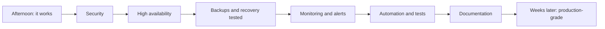

# Production-grade infrastructure: why it takes so long, and the checklist

## In plain words

Anyone can cook dinner for four friends in an hour. Opening a restaurant that serves four hundred people every night, safely, for years, takes months. The cooking is the same skill. Everything else is new: fire exits, hygiene inspections, supplier contracts, staff rotas, what happens when the fridge fails at 7 p.m. on a Saturday, and a way to know the fridge is failing before the food spoils.

The server you created in the first lessons is dinner for friends. **Production-grade infrastructure** is the restaurant: infrastructure you would bet your company on. It keeps working when traffic rises, when a data centre fails and when someone makes a mistake; it keeps data safe; and it can be operated by people who did not build it.

This lesson explains why the gap between the two is so much larger than people expect, and gives you a checklist for closing it. The next lesson turns the checklist into module design.

Why this matters for a job: estimating infrastructure work is where junior engineers lose credibility ("it will take two days" becomes two months). Interviewers ask "what does production-ready mean to you?" to hear whether you can list the unglamorous parts without prompting.

> **Before this lesson:** complete the modules module, ending with [Module gotchas and versioning: file paths, inline blocks and releases](#/lesson/terraform/module-gotchas-versioning). Familiarity with the AWS track's [Reliability: resilient architectures, RTO, RPO and disaster recovery](#/lesson/aws/reliability-dr) and [The security pillar, compliance and operational excellence](#/lesson/aws/security-opex) will make the checklist items more concrete.

## How long does it really take?

Rough figures from experienced teams, for building a piece of infrastructure to a production standard from scratch:

| What you are building | Example | Typical time |
|---|---|---|
| A managed service | A hosted database, set up properly | 1 to 2 weeks |
| A self-managed stateless system | A cluster of web servers behind a load balancer | 2 to 4 weeks |
| A self-managed stateful system | Your own database or message broker cluster | 2 to 4 months |
| A whole architecture | Everything for a product: network, data, apps, pipelines, monitoring | 6 to 36 months |

Some vocabulary for the table:

- A **managed service** is one the cloud provider operates for you: you ask for a database and they handle patching, backups and failover.
- **Stateless** means a server holds no data that matters; any copy can be thrown away and replaced. A web server is the usual example.
- **Stateful** means the system *is* the data. Lose a copy carelessly and you lose information. Databases are stateful.

These numbers shock people, especially since the first working version often appears in an afternoon. Both things are true: the afternoon version works on a good day, and the remaining weeks are about every other day.

## Why it takes so long

### 1. The field is young and the tools keep moving

Cloud platforms, container orchestration and tools like Terraform are all recent, and they change quickly. Documentation lags, behaviour differs between versions, and much of what you need to know lives in blog posts and other people's incident reports. You spend real time discovering how things behave.

### 2. Yak shaving

**Yak shaving** is engineering slang for a chain of small, apparently unrelated tasks you must finish before you can do the thing you set out to do. You want to deploy an application. For that you need a TLS certificate. The certificate needs a DNS record. The DNS zone is in another account, so you need a role. The role needs a policy that your pipeline is not allowed to create. Three days later you are editing permissions for a pipeline, a long way from the application.

Infrastructure is especially prone to this because everything is connected to everything. It helps to separate two kinds of difficulty:

- **Essential complexity** belongs to the problem itself. Serving users in two regions is hard whatever tools you use.
- **Accidental complexity** comes from the tools and choices: a quirk of an API, a missing feature, a confusing error.

A large share of infrastructure work is accidental complexity, which is why it is hard to predict.

### 3. The checklist is long

This is the main reason. A production system must do many things that have nothing to do with its main purpose, and most engineers know only some of them. Each team rediscovers its own missing items, usually after an incident. The checklist below exists so that you do not have to.



## The production-grade infrastructure checklist

Each row names a task, what it means in plain terms, and typical tools.

| Task | What it covers | Examples |
|---|---|---|
| Install | Getting the software and its dependencies onto the machine or image | Dockerfile, Packer, package managers |
| Configure | Settings at run time: ports, file paths, certificates, connection strings | Environment variables, config files, parameter stores |
| Provision | Creating the infrastructure: servers, load balancers, networks, permissions | Terraform, OpenTofu, CloudFormation |
| Deploy | Releasing new versions on top with no downtime: rolling, blue-green, canary | Auto Scaling instance refresh, Kubernetes, ECS |
| High availability | Surviving the loss of a process, a server, a zone or a region | Multiple zones, health checks, replicas |
| Scalability | Handling more load by adding servers (horizontal) or using bigger ones (vertical) | Auto scaling, read replicas, caches |
| Performance | Efficient use of processor, memory, disk and network; load testing | Profilers, benchmarks, right-sizing |
| Networking | IP ranges, subnets, routing, firewalls, DNS, private access, service discovery | VPC, security groups, Route 53, VPN |
| Security | Encryption in transit and at rest, authentication, authorisation, secrets, hardening | TLS, KMS, IAM, secret stores |
| Metrics | Numbers about availability, the business, the application and the servers; alerts | CloudWatch, Prometheus, Grafana |
| Logs | Collecting, rotating and searching logs in one place | CloudWatch Logs, Loki, Elasticsearch |
| Data backup | Scheduled backups, copies in another region or account, **tested restores** | Snapshots, replication, point-in-time recovery |
| Cost optimisation | Right instance sizes, purchasing options, auto scaling down, deleting leftovers | Budgets, tags, cost reports |
| Documentation | What the system is, how to use it, how to operate it when it breaks | READMEs, diagrams, runbooks |
| Tests | Automated checks of the infrastructure code, run on every change | `terraform test`, Terratest, policy checks |

Some terms from the table:

- **TLS** (Transport Layer Security) is the encryption used for data travelling over a network; it is what puts the padlock in a browser.
- **Encryption at rest** protects data stored on disk; **in transit** protects data moving between machines.
- A **runbook** is a written procedure for a specific operational situation, such as "the database is out of disk space".
- A **canary** deployment releases a new version to a small share of traffic first.

Two warnings about using the list.

**Not every item applies to every piece.** A module that creates a DNS record does not need a load-testing plan. The point is to *decide*: go down the list for each piece of infrastructure and consciously choose which items you will do, and write down which you are skipping and why. The damage comes from items nobody thought about, not from items someone deliberately postponed.

**Most teams know the first four rows and forget the rest.** Install, configure, provision and deploy get you to "it works". The remaining rows are what "production" means, and they are where the weeks go.

> [!TIP]
> Paste the checklist into the README of each service's infrastructure and fill in a status per row: done, not needed (with the reason), or planned. It becomes both an estimate and a hand-over document.

## Using the checklist to estimate

The simulation below turns the checklist into a rough estimate for a piece of work, and shows the gap between the "it works" subset and the full list. The day figures are placeholders; replace them with your own experience.

```python-run
# (task, days, part of "it works on a good day"?)
CHECKLIST = [
    ("install", 1, True), ("configure", 1, True), ("provision", 2, True), ("deploy", 2, True),
    ("high availability", 2, False), ("scalability", 2, False), ("performance", 2, False),
    ("networking", 3, False), ("security", 4, False), ("metrics", 2, False), ("logs", 1, False),
    ("data backup", 3, False), ("cost optimisation", 1, False), ("documentation", 2, False),
    ("tests", 4, False),
]

def estimate(skipped=()):
    rows = [(t, d, core) for t, d, core in CHECKLIST if t not in skipped]
    demo = sum(d for _, d, core in rows if core)
    total = sum(d for _, d, _ in rows)
    return demo, total, [t for t, _, core in rows if not core]

print("Stateless web service (no data of its own, so no backup work):")
demo, total, rest = estimate(skipped={"data backup"})
print(f"  'it works' subset: {demo} days")
print(f"  full checklist:    {total} days  ({total / demo:.1f}x the demo)")
print(f"  what the extra time buys: {', '.join(rest)}")

print("\nManaged database (provider handles install and most of deploy):")
demo, total, rest = estimate(skipped={"install", "deploy", "performance"})
print(f"  'it works' subset: {demo} days")
print(f"  full checklist:    {total} days  ({total / demo:.1f}x the demo)")

print("\nItems commonly forgotten until an incident:")
for t in ("data backup", "metrics", "documentation", "tests"):
    print("  -", t)
```

The multiplier is the lesson. When you hear yourself say "it already works, so we are nearly done", look at the ratio.

## What the checklist looks like in Terraform

Many checklist rows map directly onto arguments you set or forget to set. Here is a managed PostgreSQL database written as a demo, then to a production standard.

> [!WARNING]
> **Cost and safety.** The production settings below (a standby copy in a second zone, larger storage, retained backups) roughly double the hourly price of the database compared with the demo version. That is the cost of surviving failures. Apply this only in an account where that cost is intended, and never point practice code at a database that holds real data.

The demo:

```hcl
resource "aws_db_instance" "orders" {
  identifier          = "orders"
  engine              = "postgres"
  instance_class      = "db.t4g.micro"
  allocated_storage   = 20
  username            = "orders_admin"
  password            = var.db_password
  skip_final_snapshot = true
}
```

It creates a working database. It is also unencrypted, lives in one zone, loses everything if deleted, and nobody will know when it fills up.

The production version:

```hcl
resource "aws_db_instance" "orders" {
  identifier     = "${var.name}-orders"
  engine         = "postgres"
  engine_version = "17.4"
  instance_class = var.instance_class

  # Storage: start small, grow automatically, encrypt
  allocated_storage     = 50
  max_allocated_storage = 200
  storage_encrypted     = true
  kms_key_id            = var.kms_key_arn

  # High availability
  multi_az = true

  # Networking: private subnets only, no public address
  db_subnet_group_name   = aws_db_subnet_group.orders.name
  vpc_security_group_ids = [aws_security_group.orders_db.id]
  publicly_accessible    = false

  # Security: the service manages and rotates the password
  username                            = "orders_admin"
  manage_master_user_password         = true
  iam_database_authentication_enabled = true

  # Backups and recovery
  backup_retention_period   = 14
  backup_window             = "02:00-03:00"
  copy_tags_to_snapshot     = true
  deletion_protection       = true
  skip_final_snapshot       = false
  final_snapshot_identifier = "${var.name}-orders-final"

  # Maintenance and upgrades
  maintenance_window         = "sun:04:00-sun:05:00"
  auto_minor_version_upgrade = true

  # Metrics and logs
  monitoring_interval             = 60
  monitoring_role_arn             = aws_iam_role.rds_monitoring.arn
  performance_insights_enabled    = true
  enabled_cloudwatch_logs_exports = ["postgresql", "upgrade"]

  tags = local.common_tags

  lifecycle {
    prevent_destroy = true
  }
}

resource "aws_cloudwatch_metric_alarm" "orders_low_storage" {
  alarm_name          = "${var.name}-orders-low-storage"
  namespace           = "AWS/RDS"
  metric_name         = "FreeStorageSpace"
  statistic           = "Minimum"
  comparison_operator = "LessThanThreshold"
  threshold           = 10 * 1024 * 1024 * 1024
  period              = 300
  evaluation_periods  = 2
  alarm_actions       = [var.alerts_topic_arn]

  dimensions = {
    DBInstanceIdentifier = aws_db_instance.orders.identifier
  }
}
```

Group by group, with the checklist row each serves:

- **Storage.** `max_allocated_storage` lets the disk grow automatically up to 200 GB (scalability). `storage_encrypted` with a KMS key gives encryption at rest (security).
- **High availability.** `multi_az = true` keeps a synchronised standby copy in a second Availability Zone and fails over to it automatically.
- **Networking.** A subnet group of private subnets, a dedicated security group and `publicly_accessible = false` mean the database has no address on the internet.
- **Security.** The service generates and rotates the administrator password, as in the secrets lesson, so it never enters Terraform state. IAM authentication lets applications sign in with roles instead of passwords.
- **Backups and recovery.** Fourteen days of automated backups in a quiet-hours window, tags copied to snapshots so their cost can be traced, protection against deletion, and a final snapshot if the database is ever removed on purpose.
- **Maintenance.** A weekly window for patches, and automatic minor version upgrades so security fixes arrive.
- **Metrics and logs.** Operating-system metrics every 60 seconds, query-level performance data, and database logs shipped to CloudWatch.
- **Tags** serve cost optimisation: every resource carries its owner and cost centre.
- **`prevent_destroy`** stops Terraform itself from planning a deletion.
- **The alarm** fires when free disk space stays below 10 GB (the threshold is in bytes, hence the multiplication) and sends a notification to a topic that reaches a person.

Thirty lines instead of eight, and each line is a decision someone had to know to make. This is what the weeks are spent on. It is also the argument for the next lesson: a decision made once, inside a well-built module, does not have to be remembered by every team.

What the plan shows when a demo database is upgraded to these settings is instructive:

```bash
  # aws_db_instance.orders must be replaced
-/+ resource "aws_db_instance" "orders" {
      ~ storage_encrypted = false -> true # forces replacement
      ~ multi_az          = false -> true
      ...
    }

Plan: 1 to add, 0 to change, 1 to destroy.
```

Encryption cannot be switched on for an existing unencrypted database, so the plan is a replacement, which means a new, empty database. Several production properties must be chosen at creation. Retrofitting them later requires a data migration, which is one more reason to work through the checklist at the start.

> [!INTERVIEW]
> "What makes infrastructure production-ready?" Go beyond "it is deployed". Name security (encryption, least privilege, secrets), availability across zones, tested backups and restore, monitoring with alerts someone receives, automated and repeatable deployment, cost controls, documentation and runbooks, and automated tests for the infrastructure code. Then say that not every item applies to every component, but each should be a conscious decision.

## Pitfalls

- **Estimating from the demo.** The demo covers four rows of fifteen.
- **Backups that have never been restored.** An untested backup is a hope, not a backup. Schedule restore drills.
- **Alarms that notify nobody.** A metric without an alert, or an alert sent to an unread channel, changes nothing.
- **Deferring security "until launch".** Encryption and network placement often cannot be changed without replacement.
- **Treating the checklist as all-or-nothing.** Skipping an item with a written reason is fine; never considering it is the failure.
- **Building everything yourself.** A managed service usually ticks half the rows for you. Use one unless you have a specific reason not to.
- **No documentation.** If only the author can operate it, it is not production-grade.

## Cheat sheet

| Checklist row | First question to ask |
|---|---|
| Install / configure | Is the software and its configuration reproducible from code? |
| Provision / deploy | Can it be created and updated with no manual steps and no downtime? |
| High availability | What happens when one server or one zone disappears? |
| Scalability / performance | What happens at ten times the load? Has it been load tested? |
| Networking | Is anything reachable from the internet that does not need to be? |
| Security | Is data encrypted at rest and in transit? Who can do what? Where are the secrets? |
| Metrics / logs | How will we know it is broken, and where do we look? |
| Data backup | When did we last restore from a backup? |
| Cost optimisation | Who pays, how much, and what tells us if it doubles? |
| Documentation | Could a new teammate operate this at 3 a.m.? |
| Tests | What checks run automatically on every change? |

## Summary

- Production-grade infrastructure is infrastructure you would rely on for the business: secure, available, recoverable, observable and operable by others.
- It takes far longer than a working demo because the field is young, tasks hide chains of prerequisites, and the list of requirements is long.
- The checklist covers install, configure, provision, deploy, availability, scalability, performance, networking, security, metrics, logs, backup, cost, documentation and tests.
- Use the checklist to decide deliberately what each component needs, to estimate honestly and to document what was skipped.
- In Terraform, much of the checklist is arguments on resources; some, such as encryption, must be right at creation because changing them forces replacement.
- Encoding these decisions in modules means they are made once and reused.

## Glossary

- **Production-grade:** fit to run a real business on.
- **Managed service:** a service operated by the cloud provider on your behalf.
- **Stateless / stateful:** holding no important data, or holding data that must not be lost.
- **Yak shaving:** a chain of prerequisite tasks that pulls you away from the original goal.
- **Essential / accidental complexity:** difficulty inherent in the problem, or arising from tools and choices.
- **High availability:** continuing to work when components fail.
- **Horizontal / vertical scaling:** adding more servers, or using bigger ones.
- **Encryption at rest / in transit:** protecting stored data, or data travelling over a network.
- **TLS:** the standard protocol for encrypting network traffic.
- **Runbook:** a written procedure for an operational situation.
- **Multi-AZ:** running copies in more than one Availability Zone.

## Check yourself

```quiz
[
  {"q": "Which group of checklist items is most often already done when a team says 'it works'?",
   "options": ["Backups, metrics, documentation, tests", "Install, configure, provision, deploy", "Security, networking, cost, logs", "High availability, scalability, performance"], "answer": 1,
   "explain": "Getting software installed, configured, provisioned and deployed produces a working demo. The remaining rows are what make it production-grade."},
  {"q": "An unencrypted database exists. You set `storage_encrypted = true` and run plan. What does the summary show?",
   "options": ["Plan: 0 to add, 1 to change, 0 to destroy.", "Plan: 1 to add, 0 to change, 1 to destroy.", "No changes.", "Plan: 1 to add, 0 to change, 0 to destroy."], "answer": 1,
   "explain": "Storage encryption can only be set at creation, so the attribute forces replacement: a new empty database and the destruction of the old one."},
  {"q": "The same database also has `lifecycle { prevent_destroy = true }`. What happens when you run that plan?",
   "options": ["The replacement proceeds", "The plan fails with an error because it would destroy a protected resource", "Only encryption is applied", "The lifecycle block is ignored for replacements"], "answer": 1,
   "explain": "A replacement includes a destroy, which prevent_destroy rejects. That is the guard doing its job; the fix is a planned migration."},
  {"q": "What is 'yak shaving'?",
   "options": ["Removing unused resources to save cost", "A chain of prerequisite tasks that must be done before the real task", "Running load tests", "Rotating secrets"], "answer": 1,
   "explain": "It names the experience of being several unrelated-looking steps away from the thing you set out to do."},
  {"q": "Which statement about the checklist is correct?",
   "options": ["Every item must be implemented for every component", "Items can be skipped, but each should be a conscious, recorded decision", "It only applies to databases", "It replaces testing"], "answer": 1,
   "explain": "Not all items apply everywhere. The harm comes from items nobody considered, so decide and document."},
  {"q": "Why is a stateful system so much more time-consuming to run yourself than a stateless one?",
   "options": ["It needs more servers", "Its data must survive failures, upgrades and mistakes, so replacement is not a safe fix", "It cannot be created with Terraform", "It has no health checks"], "answer": 1,
   "explain": "A stateless server can be thrown away and recreated. With data, every operation must preserve it, which adds backups, replication and careful migrations."},
  {"q": "A team has nightly database backups configured but has never restored one. Which checklist row is incomplete?",
   "options": ["Provision", "Data backup: restores must be tested", "Deploy", "Install"], "answer": 1,
   "explain": "The purpose of a backup is recovery. Until a restore has been exercised, you do not know that it works or how long it takes."},
  {"q": "In the production database example, which setting keeps the administrator password out of Terraform state?",
   "options": ["`storage_encrypted = true`", "`manage_master_user_password = true`", "`deletion_protection = true`", "`multi_az = true`"], "answer": 1,
   "explain": "The service generates and stores the password in a secret store, so Terraform only sees the secret's identifier."}
]
```

> **Source:** Brikman, Terraform: Up & Running 3e, ch. 8 (why it takes so long to build production-grade infrastructure, the production-grade infrastructure checklist). Documentation: https://registry.terraform.io/providers/hashicorp/aws/latest/docs/resources/db_instance and https://docs.aws.amazon.com/wellarchitected/latest/framework/welcome.html
