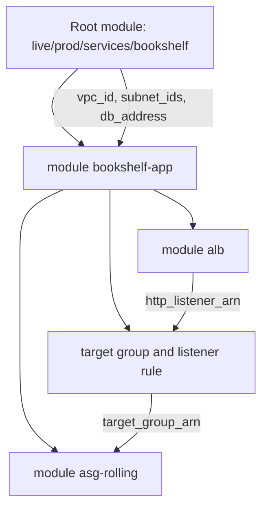

# Production-grade modules: small, composable, testable, versioned, and beyond

## In plain words

Think of how children build with plastic bricks. Nobody manufactures a single moulded castle. The factory makes small, plain bricks with a standard set of studs, and the castle, the spaceship and the bridge are all assembled from the same pieces. Because every brick is small, it is easy to check that it is the right shape. Because the studs are standard, any brick fits any other.

Good Terraform code is built the same way. The opposite, a single enormous configuration that describes a whole company's infrastructure, has a name in the trade: a **monolith**, a system built as one indivisible block. This lesson explains why monoliths hurt, and then four properties to aim for in every module: **small**, **composable**, **testable** and **versioned**. It ends with the escape hatches for the rare things Terraform cannot express on its own terms.

Why this matters for a job: you will spend far more time reading and changing modules than writing resources from scratch. "How do you structure Terraform for a large organisation?" is a senior-level interview question, and the answer is this lesson.

> **Before this lesson:** read [Production-grade infrastructure: why it takes so long, and the checklist](#/lesson/terraform/production-checklist), [Reusable modules: inputs, outputs and locals](#/lesson/terraform/module-basics) and [Module gotchas and versioning: file paths, inline blocks and releases](#/lesson/terraform/module-gotchas-versioning).

## Small modules

A large module, meaning a single state holding hundreds or thousands of resources across many concerns, is harmful in specific, measurable ways:

- **Slow.** Every plan refreshes every resource. A plan that takes fifteen minutes gets run less often, and feedback arrives too late to be useful.
- **Insecure.** To change anything, a person needs permission to change everything. Least privilege becomes impossible.
- **Risky.** One mistake can reach the whole system. The blast radius is total.
- **Hard to understand.** Nobody can hold thousands of lines in their head.
- **Hard to review.** A plan of several hundred lines is skimmed, not read, and the one dangerous line goes unnoticed.
- **Hard to test.** Testing requires deploying, and deploying everything takes too long.

The guideline from software design applies: a function should do one thing. A module should deploy one thing. For the web cluster from earlier lessons, "one thing" might mean three modules instead of one:

| Module | Responsibility |
|---|---|
| `asg-rolling` | An Auto Scaling group with rolling replacement, and nothing else |
| `alb` | A load balancer, its listener and its security group |
| `bookshelf-app` | The application: calls the two above and adds a target group and listener rule |

The first two are **generic**: any service in the company could use them. The third is specific to one application.

## Composable modules

**Composable** means modules can be combined freely, like the bricks. Two habits make that possible.

**Pass everything in through variables; pass everything out through outputs.** A module should not reach out and discover things by itself (reading another state, looking up a VPC by a hard-coded name). Lookups hidden inside a module tie it to one environment. Push them up to the caller:

```hcl
# modules/asg-rolling/variables.tf (excerpt)
variable "subnet_ids" {
  description = "Subnets to launch servers in"
  type        = list(string)
}

variable "target_group_arns" {
  description = "Target groups to register servers with; empty for none"
  type        = list(string)
  default     = []
}

variable "health_check_type" {
  description = "EC2 or ELB"
  type        = string
  default     = "EC2"

  validation {
    condition     = contains(["EC2", "ELB"], var.health_check_type)
    error_message = "health_check_type must be EC2 or ELB."
  }
}

variable "user_data" {
  description = "Startup script for each server; null for none"
  type        = string
  default     = null
}
```

- `subnet_ids` is supplied by the caller. The module no longer assumes the default VPC, so it works in any network, including a temporary one made for a test.
- `target_group_arns` defaults to an empty list, so the group can be used with or without a load balancer.
- The `validation` uses `contains(list, value)`, which is true when the value is in the list.
- `user_data` defaults to `null`, Terraform's "not set".

**Then compose.** The application module wires the generic pieces together through their outputs:

```hcl
# modules/bookshelf-app/main.tf
module "alb" {
  source     = "../alb"
  name       = var.name
  subnet_ids = var.public_subnet_ids
}

resource "aws_lb_target_group" "app" {
  name     = var.name
  port     = var.server_port
  protocol = "HTTP"
  vpc_id   = var.vpc_id

  health_check {
    path    = "/healthz"
    matcher = "200"
  }
}

resource "aws_lb_listener_rule" "app" {
  listener_arn = module.alb.http_listener_arn
  priority     = 100

  condition {
    path_pattern {
      values = ["/*"]
    }
  }

  action {
    type             = "forward"
    target_group_arn = aws_lb_target_group.app.arn
  }
}

module "fleet" {
  source = "../asg-rolling"

  name              = var.name
  subnet_ids        = var.private_subnet_ids
  min_size          = var.min_size
  max_size          = var.max_size
  health_check_type = "ELB"
  target_group_arns = [aws_lb_target_group.app.arn]

  user_data = templatefile("${path.module}/boot.sh.tftpl", {
    server_port = var.server_port
    db_address  = var.db_address
  })
}
```

- `module "alb"` creates the load balancer and exposes `http_listener_arn` as an output.
- The target group and the listener rule are specific to this application, so they live here.
- `module "fleet"` receives the target group's ARN as an input. That reference is what links the two generic modules, and it also gives Terraform the correct ordering.
- The database address arrives as `var.db_address`. Where it came from (another module, a remote state lookup, a parameter store) is the root module's business, not this module's.



Functions without side effects are easy to reuse and test; modules whose only connections to the world are their inputs and outputs are the infrastructure equivalent.

## Testable modules

You cannot test what you cannot deploy by itself. A module full of hidden lookups can only run in the real environment. A module with explicit inputs can be deployed into an empty sandbox with made-up values.

The standard layout for a module repository reflects this:

```bash
infra-modules/
├── modules/
│   ├── alb/
│   ├── asg-rolling/
│   └── bookshelf-app/
├── examples/
│   ├── alb/
│   │   └── main.tf
│   ├── asg-rolling/
│   │   └── main.tf
│   └── bookshelf-app/
│       └── main.tf
└── tests/
    ├── alb.tftest.hcl
    └── asg_rolling.tftest.hcl
```

- `modules/` holds the reusable code.
- `examples/` holds, for each module, a tiny root module that calls it with sensible values. An example is three things at once: executable documentation for users, a manual test harness for the author (`cd examples/alb && terraform apply`), and the target of automated tests.
- `tests/` holds automated tests, covered in the testing module.

An example for `asg-rolling`:

```hcl
# examples/asg-rolling/main.tf
provider "aws" {
  region = "eu-west-1"
}

data "aws_vpc" "default" {
  default = true
}

data "aws_subnets" "default" {
  filter {
    name   = "vpc-id"
    values = [data.aws_vpc.default.id]
  }
}

module "fleet" {
  source = "../../modules/asg-rolling"

  name       = var.name
  subnet_ids = data.aws_subnets.default.ids
  min_size   = 1
  max_size   = 1
}

variable "name" {
  description = "Unique name so parallel test runs do not collide"
  type        = string
  default     = "asg-example"
}
```

The example is where the provider block and the convenient lookups belong. The `name` variable lets two people, or two automated runs, deploy the example at the same time without clashing.

### Catching mistakes before deployment

Testability also means failing early with a clear message. Terraform has three built-in mechanisms, in increasing reach.

**Validation blocks** check a single input, as shown above.

**Preconditions and postconditions** check assumptions that involve other values:

```hcl
data "aws_ec2_instance_type" "chosen" {
  instance_type = var.instance_type
}

resource "aws_launch_template" "this" {
  name_prefix   = "${var.name}-"
  image_id      = var.ami_id
  instance_type = var.instance_type

  lifecycle {
    create_before_destroy = true

    precondition {
      condition     = data.aws_ec2_instance_type.chosen.memory_size >= 1024
      error_message = "The application needs at least 1 GiB of memory; choose a larger instance type."
    }
  }
}

resource "aws_autoscaling_group" "this" {
  # ...

  lifecycle {
    postcondition {
      condition     = length(self.availability_zones) > 1
      error_message = "The group must span more than one Availability Zone for high availability."
    }
  }
}
```

- The data source looks up facts about the chosen instance type, including its memory in megabytes.
- The `precondition` stops the run before creating the template if memory is too small.
- The `postcondition` checks a guarantee after the group is created. `self` refers to the resource the block is inside.

**Check blocks** assert something about the running system on every plan and apply, and produce a warning instead of stopping:

```hcl
check "site_responds" {
  data "http" "home" {
    url = "http://${module.alb.dns_name}/healthz"
  }

  assert {
    condition     = data.http.home.status_code == 200
    error_message = "The health endpoint did not return 200."
  }
}
```

A rule of thumb for choosing: validation for basic input checks, preconditions for assumptions the module relies on, postconditions for promises it makes, and check blocks for ongoing health.

## Versioned modules

The versioning lesson covered release tags and constraints for your own modules. A production-grade module also pins what *it* depends on, at three levels:

```hcl
terraform {
  required_version = ">= 1.6.0, < 2.0.0"

  required_providers {
    aws = {
      source  = "hashicorp/aws"
      version = ">= 5.0, < 7.0"
    }
  }
}
```

- `required_version` constrains the Terraform (or OpenTofu) release. A reusable module states a range it has been tested with.
- `required_providers` constrains each provider, again as a range in a shared module. Root modules constrain more tightly and commit the lock file.
- Module versions are pinned by the callers, with a tag in `source` or a `version` argument.

The purpose is **reproducibility**: the same code, with the same pinned versions, produces the same plan next month as it does today.

## Beyond Terraform modules

Occasionally the provider does not offer what you need: a brand-new API feature, a command that must run on your machine, a value that only a script can compute. Terraform has escape hatches. They are listed here from least to most harmful, with one instruction: reach for them last.

### External data source

The `external` data source runs a program and reads its answer. The program receives a JSON object on standard input and must print a JSON object of string values on standard output.

```hcl
data "external" "git" {
  program = ["bash", "${path.module}/git-info.sh"]

  query = {
    ref = "HEAD"
  }
}

locals {
  commit = data.external.git.result.commit
}
```

```bash
#!/usr/bin/env bash
# git-info.sh: reads {"ref": "..."} on stdin, prints {"commit": "..."}
set -euo pipefail
ref="$(python3 -c 'import json,sys; print(json.load(sys.stdin)["ref"])')"
printf '{"commit": "%s"}\n' "$(git rev-parse --short "$ref")"
```

- `program` is the command to run, as a list.
- `query` is sent to the program as JSON.
- `result` is the map the program returned. Here it is used to tag resources with the Git commit that deployed them.

The program runs on every plan, must have no side effects, and makes the module depend on whatever is installed on the machine (here Bash, Python and Git). That last point is the price: the module stops being portable.

### Provisioners

A **provisioner** runs a script when a resource is created (or, optionally, destroyed). `local-exec` runs a command on the machine running Terraform; `remote-exec` connects to the new server and runs commands there.

```hcl
resource "aws_instance" "tool" {
  ami           = var.ami_id
  instance_type = "t3.micro"

  provisioner "local-exec" {
    command = "echo ${self.private_ip} >> created-hosts.txt"
  }
}
```

The command runs once, immediately after the instance is created. `self.private_ip` reads an attribute of the resource the provisioner belongs to.

The official documentation calls provisioners **a last resort**, for good reasons:

- Terraform cannot plan what a script will do, so the plan no longer tells the whole story.
- They run only at creation. A later change to the script does nothing unless the resource is replaced.
- If the script fails, the resource is marked tainted and will be destroyed and recreated on the next apply.
- `remote-exec` needs network access and login credentials to the server from wherever Terraform runs.

For configuring a server at boot, prefer user data or a pre-built image. For running a step after deployment, prefer a pipeline step.

### Running a command without a real resource

When a script must run as part of an apply but belongs to no resource, attach the provisioner to `terraform_data`, a built-in resource that manages nothing:

```hcl
resource "terraform_data" "warm_cache" {
  triggers_replace = [aws_launch_template.this.latest_version]

  provisioner "local-exec" {
    command = "./scripts/warm-cache.sh ${module.alb.dns_name}"
  }
}
```

- `terraform_data` exists only in state. Older code uses `null_resource` from the `null` provider for the same purpose.
- `triggers_replace` lists values to watch. When any changes, the resource is replaced, and so the provisioner runs again. Here the script reruns for each new template version.

```bash
$ terraform plan
  # terraform_data.warm_cache must be replaced
-/+ resource "terraform_data" "warm_cache" {
      ~ id               = "c9f1d4e2-..." -> (known after apply)
      ~ triggers_replace = [
          ~ 4 -> (known after apply),
        ] # forces replacement
    }

Plan: 1 to add, 0 to change, 1 to destroy.
```

The plan shows that the placeholder will be replaced, not what the script will do. That gap is why these tools are escape hatches.

> [!WARNING]
> **Cost and safety.** Scripts run by provisioners and external data sources execute on the machine running Terraform with that machine's credentials. A script copied from the internet runs with your cloud permissions. Review them as carefully as the Terraform code itself, never interpolate untrusted values into a `command`, and remember that a destroy-time provisioner that fails can block the destroy.

## A scoring sheet for any module

The simulation below scores a module description against the properties in this lesson. It is a caricature of a code review, and a useful list of questions to ask about real code.

```python-run
def review(m):
    findings = []
    if m["resources"] > 40:
        findings.append(f"large: {m['resources']} resources in one state; split by responsibility")
    if m["provider_blocks"]:
        findings.append("defines its own provider block; pass providers from the root")
    if m["hidden_lookups"]:
        findings.append(f"hidden lookups {m['hidden_lookups']}; accept these as input variables")
    missing_desc = [v for v, d in m["variables"].items() if not d]
    if missing_desc:
        findings.append(f"variables without descriptions: {missing_desc}")
    if not m["has_example"]:
        findings.append("no examples/ folder; cannot be deployed or tested in isolation")
    if not m["version_constraints"]:
        findings.append("no required_version or required_providers constraints")
    if m["provisioners"]:
        findings.append(f"{m['provisioners']} provisioner(s); prefer user data, images or pipeline steps")
    return findings

monolith = dict(resources=310, provider_blocks=1, hidden_lookups=["default VPC", "prod database state"],
                variables={"env": ""}, has_example=False, version_constraints=False, provisioners=3)
asg_rolling = dict(resources=6, provider_blocks=0, hidden_lookups=[],
                   variables={"name": "Prefix", "subnet_ids": "Subnets", "min_size": "Minimum"},
                   has_example=True, version_constraints=True, provisioners=0)

for name, m in [("everything.tf", monolith), ("modules/asg-rolling", asg_rolling)]:
    f = review(m)
    print(f"{name}: {'OK' if not f else str(len(f)) + ' finding(s)'}")
    for line in f:
        print("   -", line)
```

> [!INTERVIEW]
> "How would you structure Terraform modules for a growing organisation?" Small single-purpose generic modules (network, load balancer, scaling group, database), composed by application modules, called from thin per-environment root modules. All dependencies in through variables and out through outputs; no provider blocks or hidden lookups in reusable code; an example and automated tests for each module; semantic version tags with promotion through environments. Provisioners only as a last resort.

## Pitfalls

- **The "terralith".** One state for everything, justified by convenience on day one.
- **Hidden dependencies inside modules.** They bind the module to one environment and make testing impossible.
- **Generic modules with application-specific details.** A scaling-group module that mentions the bookshelf database is not generic.
- **Over-splitting.** A module per resource adds indirection and no value.
- **Examples that rot.** If nothing runs them automatically, they stop working. Test against the examples.
- **Using provisioners for server configuration.** They run once, cannot be planned and fail untidily.
- **An `external` program with side effects.** It runs on every plan.
- **Exact provider pins in shared modules.** Use ranges; leave exact pins to the root and its lock file.

## Cheat sheet

| Property | Practice |
|---|---|
| Small | One responsibility per module; separate states by rate of change and risk |
| Composable | Inputs for every dependency, outputs for everything useful, no hidden lookups |
| Testable | An `examples/` folder per module; unique names from a variable |
| Fail early | `validation`, `precondition`, `postcondition`, `check` |
| Versioned | `required_version`, `required_providers` ranges, semantic version tags |
| Run a program for a value | `data "external"` with JSON in and out |
| Run a command at creation | `provisioner "local-exec"` (last resort) |
| Run a command with no resource | `terraform_data` with `triggers_replace` |
| In a provisioner or condition | `self.<attribute>` refers to the enclosing resource |

## Summary

- Large modules are slow, insecure, risky and hard to understand, review and test. Aim for modules that each do one thing.
- Composable modules receive every dependency as an input and expose results as outputs, so they can be wired together and reused in any environment.
- Testable modules can be deployed alone; each should have an example root module, and should fail early through validation, preconditions, postconditions and checks.
- Versioned modules constrain the Terraform release and providers they need and are themselves released with semantic version tags.
- External data sources, provisioners and `terraform_data` are escape hatches for what providers cannot do. They break planning and portability, so use them last.

## Glossary

- **Monolith:** a system built as one large indivisible unit.
- **Composable:** able to be combined freely with other pieces.
- **Generic module:** a module usable by many applications.
- **Example (module):** a small root module demonstrating and exercising a reusable module.
- **Precondition / postcondition:** a check before or after a resource is created or changed.
- **Check block:** an assertion evaluated on each run that produces a warning when false.
- **`self`:** a reference to the enclosing resource's own attributes.
- **Reproducibility:** getting the same result from the same code at a later time.
- **External data source:** a data source that runs a local program and reads JSON from it.
- **Provisioner:** a script run by Terraform when a resource is created or destroyed.
- **`terraform_data`:** a built-in resource that manages no infrastructure, used to hold values or trigger provisioners.

## Check yourself

```quiz
[
  {"q": "Which is NOT a typical problem of one very large Terraform state?",
   "options": ["Plans are slow", "Anyone changing anything needs permissions for everything", "Resources cannot reference each other", "A mistake can affect the whole system"], "answer": 2,
   "explain": "Within one configuration resources can reference each other freely; that is the convenience that tempts people. The costs are speed, permissions, risk and reviewability."},
  {"q": "A generic module looks up the default VPC with a data source inside itself. Why is that a design problem?",
   "options": ["Data sources are slow", "It ties the module to one network, so callers and tests cannot place it elsewhere", "Modules cannot contain data sources", "It makes the state larger"], "answer": 1,
   "explain": "Hidden lookups are hidden dependencies. Accepting `subnet_ids` as an input lets any caller, including a test, supply its own."},
  {"q": "A `terraform_data` resource has `triggers_replace = [aws_launch_template.this.latest_version]` and a local-exec provisioner. The template version changes. What does the plan show for it?",
   "options": ["No changes", "An in-place update", "A replacement: 1 to add, 1 to destroy", "The command's expected output"], "answer": 2,
   "explain": "A changed trigger forces replacement, which reruns the creation-time provisioner. The plan shows the replacement but cannot show what the script will do."},
  {"q": "What happens if a creation-time provisioner fails?",
   "options": ["The resource is deleted immediately", "The resource is marked tainted and replaced on the next apply", "Terraform rolls back everything", "Nothing; the failure is ignored"], "answer": 1,
   "explain": "The object exists but may be half-configured, so Terraform taints it and plans to recreate it."},
  {"q": "What is the role of the `examples/` folder in a module repository?",
   "options": ["It stores state files", "It gives each module a small root module that documents it and can be deployed manually or by automated tests", "It holds provider binaries", "It replaces the README"], "answer": 1,
   "explain": "An example is runnable documentation and the harness against which tests deploy the module."},
  {"q": "Which mechanism stops a run with an error before a resource is created when an assumption involving other values is false?",
   "options": ["A check block", "A precondition", "An output", "A provisioner"], "answer": 1,
   "explain": "Preconditions are evaluated before the resource is created or updated and halt the run. Check blocks only warn."},
  {"q": "What contract must a program used with the `external` data source follow?",
   "options": ["Read YAML and print YAML", "Read a JSON object on standard input and print a JSON object of string values on standard output", "Accept command-line flags only", "Write a .tfvars file"], "answer": 1,
   "explain": "The `query` map is sent as JSON on stdin, and the program's JSON object on stdout becomes `result`."},
  {"q": "How should provider versions be constrained in a reusable module compared with a root module?",
   "options": ["Exact pin in the reusable module, none in the root", "A compatible range in the reusable module; tighter constraints and a committed lock file in the root", "No constraints anywhere", "The same exact pin in both"], "answer": 1,
   "explain": "Shared modules should not block callers from upgrading. Reproducibility is the root module's job, through tight constraints and the lock file."}
]
```

> **Source:** Brikman, Terraform: Up & Running 3e, ch. 8 (production-grade infrastructure modules: small modules, composable modules, testable modules, versioned modules, beyond Terraform modules). Documentation: https://developer.hashicorp.com/terraform/language/expressions/custom-conditions, https://developer.hashicorp.com/terraform/language/checks, https://developer.hashicorp.com/terraform/language/resources/provisioners/syntax, https://developer.hashicorp.com/terraform/language/resources/terraform-data and https://registry.terraform.io/providers/hashicorp/external/latest/docs/data-sources/external
