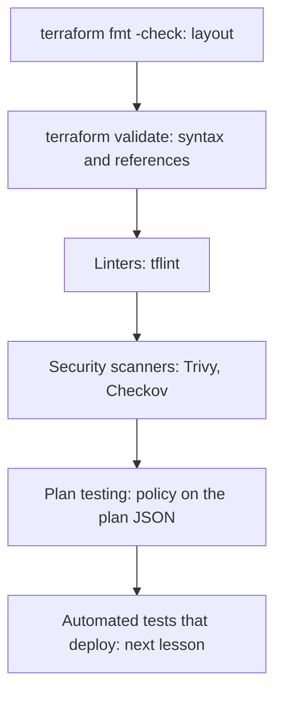

# Testing, part 1: manual tests, static analysis, policy and plan testing

## In plain words

A car maker does not find out whether a new model is safe by selling it and waiting for news. It checks the drawings for mistakes, tests individual parts on a bench, crashes prototypes on a private track, and only then lets the public drive one. Each stage is cheaper and faster than the next, and each catches a different kind of problem.

Infrastructure code deserves the same treatment, and for a stronger reason than most code: a bug in a web page shows the wrong colour, while a bug in infrastructure code can delete a database or open a firewall to the world. Yet many teams "test" Terraform by applying it to production and watching.

This lesson covers the cheaper end of the scale: testing by hand in a safe place, **static analysis** (reading the code with tools, without running it), **policy checks** (automatic rules such as "no public buckets") and **plan testing** (examining what Terraform says it will do). The next lesson covers automated tests that deploy real infrastructure.

Why this matters for a job: every professional Terraform pipeline runs the checks in this lesson on every change. Knowing what `fmt`, `validate`, `tflint`, a security scanner and a plan policy each catch, and what they miss, is expected of anyone who will write infrastructure code. "How do you test Terraform?" is a standard interview question.

> **Before this lesson:** read [Production-grade modules: small, composable, testable, versioned, and beyond](#/lesson/terraform/production-modules). You should be comfortable reading plans and know what an `examples/` folder is for. The CI/CD track's [Testing quadrants and the test pyramid](#/lesson/cicd/quadrants-pyramid) gives general background on kinds of tests.

## Why infrastructure is hard to test

When you test ordinary code, you run it on your own computer. A web application can be started on `localhost`, the name for "this machine". There is no localhost for AWS. You cannot start a real load balancer or a real managed database on a laptop.

This leads to the central fact of infrastructure testing: **to truly know that Terraform code works, you have to deploy it to a real environment.** Everything short of that checks the code's shape, its rules or its intentions, which is valuable and fast, but it is not the same as watching the thing run.

So the question becomes where to deploy.

## Manual testing in a sandbox

The basic manual test is the loop you already know: go to the module's example, `terraform apply`, check that it behaves, `terraform destroy`.

```bash
cd examples/alb
terraform init
terraform apply
curl -s -o /dev/null -w "%{http_code}\n" "http://$(terraform output -raw alb_dns_name)"
terraform destroy
```

- The `curl` options discard the page body (`-o /dev/null`) and print only the HTTP status code (`-w`). For a load balancer with no targets yet you might expect 404 or 503, and for a working application 200. Decide what "correct" is *before* you look.

Two rules make manual testing safe.

**Rule 1: test in a sandbox, never in production or shared environments.** A **sandbox** is an isolated place where mistakes cannot hurt anyone else. The strongest form is a separate cloud account. Good setups give every engineer their own sandbox account, so that two people testing do not collide, and a mistake's cost is limited to one person's playground. This is the practical reason modules must take a `name` input and must not hide lookups: both make it possible to deploy a private copy.

**Rule 2: clean up afterwards.** Test resources that are left running cost money and clutter the account. Always destroy what you created, and because people forget and tests crash, add an automatic sweep: a scheduled job that deletes everything in sandbox accounts older than a day or two. The open-source tools `cloud-nuke` and `aws-nuke` do this.

> [!WARNING]
> **Cost and safety.** Tools that delete everything in an account are exactly as dangerous as they sound. Run them only against dedicated sandbox accounts, protect production accounts with explicit exclusion lists and permission boundaries, and do a dry run first. Set a budget alert on every sandbox so a forgotten resource is noticed within a day.

Manual testing is slow and depends on a person remembering to do it. It remains essential while you are developing, and everything below exists to catch problems earlier and more reliably.

## The ladder of checks



Each rung costs more time than the one above it and catches things the earlier ones cannot. Run the cheap ones first so most mistakes never reach the slow ones.

## Static analysis

**Static analysis** means examining code without executing it. For Terraform that means without contacting the cloud, so it takes seconds and needs no credentials.

### Formatting and validation

```bash
$ terraform fmt -check -recursive
modules/alb/main.tf

$ terraform validate

Error: Reference to undeclared input variable

  on main.tf line 14, in resource "aws_lb" "this":
  14:   subnets = var.subnet_idz

An input variable with the name "subnet_idz" has not been declared.
```

- `terraform fmt -check -recursive` lists files that are not in the standard layout and exits with an error code, without changing them. Dropping `-check` rewrites them.
- `terraform validate` checks that the configuration is internally consistent: valid syntax, known argument names, correct types, references that point at things that exist. It caught a misspelt variable here. It needs `terraform init` to have run so that provider schemas are available, but it makes no API calls.

What `validate` cannot know is anything about the real world. `instance_type = "t3.gigantic"` passes, because to Terraform it is merely a string.

### Linting

A **linter** is a tool that looks for likely mistakes and bad habits. `tflint` is the usual one for Terraform, with plug-ins that know the rules of each cloud.

```bash
$ tflint --recursive

modules/asg-rolling/main.tf:9:19: Error: "t3.gigantic" is an invalid value as instance_type (aws_instance_invalid_type)
modules/asg-rolling/variables.tf:31:1: Warning: variable "legacy_flag" is declared but not used (terraform_unused_declarations)
modules/alb/versions.tf:1:1: Warning: terraform "required_version" attribute is required (terraform_required_version)
```

Three different kinds of finding: a value the cloud would reject, dead code, and a missing version constraint. None requires deploying anything.

### Security and compliance scanners

Scanners such as **Trivy** (which absorbed the older tfsec), **Checkov** and **KICS** carry hundreds of built-in rules about insecure configurations.

```bash
$ trivy config .

modules/archive-bucket/main.tf (terraform)

HIGH: Bucket does not have encryption enabled
 modules/archive-bucket/main.tf:1-3
   1 ┌ resource "aws_s3_bucket" "this" {
   2 │   bucket = var.name
   3 └ }

CRITICAL: Security group rule allows ingress from public internet
 modules/bastion/main.tf:22
  22 │   cidr_ipv4 = "0.0.0.0/0"
```

Each finding names the rule, the severity and the exact lines. When a finding is a deliberate choice (a public web port really should be open), you suppress that one rule on that one resource with a comment in the code, including the reason, so the exception is visible in review.

Static scanners have a blind spot: they read the code as written. They may not see through variables, modules and conditionals to the values that will be used. A bucket made public by `acl = var.acl` with the dangerous value supplied in a `.tfvars` file can slip past. That is what the next rung is for.

## Plan testing

A plan is Terraform's own statement of exactly what it intends to do, with every variable resolved and every module expanded. Testing the plan is therefore more accurate than testing the source, and still creates nothing.

### Getting a plan as data

```bash
terraform plan -out=tfplan
terraform show -json tfplan > plan.json
```

`terraform show -json` converts the binary plan file into JSON. The part that matters most is `resource_changes`, a list with one entry per resource:

```json
{
  "resource_changes": [
    {
      "address": "module.archive.aws_s3_bucket.this",
      "type": "aws_s3_bucket",
      "change": {
        "actions": ["create"],
        "before": null,
        "after": {
          "bucket": "harbour-books-archive",
          "tags": {"Team": "finance"}
        }
      }
    },
    {
      "address": "aws_db_instance.orders",
      "type": "aws_db_instance",
      "change": {
        "actions": ["delete", "create"],
        "before": {"instance_class": "db.t4g.micro", "storage_encrypted": false},
        "after": {"instance_class": "db.t4g.micro", "storage_encrypted": true}
      }
    }
  ]
}
```

- `address` is the full resource address.
- `change.actions` is a list: `["create"]`, `["update"]`, `["delete"]`, `["no-op"]`, or two entries for a replacement. `["delete", "create"]` is the default destroy-then-create order and `["create", "delete"]` is create-before-destroy.
- `before` and `after` are the attribute values on each side of the change. `before` is `null` for a new resource and `after` is `null` for a deleted one.

Remember from the secrets lesson that this JSON can contain secret values. Keep it out of logs and public artifacts.

### Writing rules against the plan

Tools that evaluate rules against structured data are called **policy engines**, and the practice is **policy as code**: the rules are text files, versioned and reviewed like everything else.

- **Open Policy Agent** (OPA) with its language Rego, usually run through the `conftest` command, is the common open-source choice.
- **Sentinel** is HashiCorp's policy language, built into HCP Terraform and Terraform Enterprise.
- Checkov and Trivy can also scan plan JSON with their built-in rules.

A small Rego policy, to show the flavour:

```bash
# policy/plan.rego
package main

deny contains msg if {
  some rc in input.resource_changes
  rc.type == "aws_db_instance"
  "delete" in rc.change.actions
  msg := sprintf("%s would be deleted or replaced; databases need a migration plan", [rc.address])
}

deny contains msg if {
  some rc in input.resource_changes
  "create" in rc.change.actions
  not rc.change.after.tags.Team
  msg := sprintf("%s is missing the required Team tag", [rc.address])
}
```

- Each `deny` rule adds a message when all of its conditions hold. `input` is the plan JSON.
- The first rule looks at every resource change, keeps those that are databases with a delete action, and produces a message.
- The second looks at every resource being created and complains when `tags.Team` is absent.

```bash
$ conftest test plan.json --policy policy/

FAIL - plan.json - main - aws_db_instance.orders would be deleted or replaced; databases need a migration plan
FAIL - plan.json - main - aws_db_instance.orders is missing the required Team tag

2 tests, 0 passed, 0 warnings, 2 failures
```

The pipeline stops, and the engineer sees the reason, before anything was applied.

### A plan checker you can run

The simulation below applies the same kinds of rules in Python to a plan in the JSON shape above. It is a working model of what a policy engine does: walk the list of changes, apply each rule, collect messages.

```python-run
plan = {"resource_changes": [
    {"address": "aws_s3_bucket.assets", "type": "aws_s3_bucket",
     "change": {"actions": ["create"], "before": None,
                "after": {"acl": "public-read", "tags": {"Team": "web"}}}},
    {"address": "aws_instance.batch", "type": "aws_instance",
     "change": {"actions": ["create"], "before": None,
                "after": {"instance_type": "m5.24xlarge", "tags": {}}}},
    {"address": "aws_db_instance.orders", "type": "aws_db_instance",
     "change": {"actions": ["delete", "create"],
                "before": {"storage_encrypted": False, "tags": {"Team": "shop"}},
                "after":  {"storage_encrypted": True,  "tags": {"Team": "shop"}}}},
    {"address": "aws_iam_user.asha", "type": "aws_iam_user",
     "change": {"actions": ["no-op"], "before": {"tags": {"Team": "ops"}}, "after": {"tags": {"Team": "ops"}}}},
]}

ALLOWED_SIZES = {"t3.micro", "t3.small", "t3.medium"}
PROTECTED_TYPES = {"aws_db_instance", "aws_s3_bucket"}

def check(plan):
    problems = []
    for rc in plan["resource_changes"]:
        actions, after = rc["change"]["actions"], rc["change"]["after"] or {}
        if actions == ["no-op"]:
            continue
        if "delete" in actions and rc["type"] in PROTECTED_TYPES:
            kind = "replaced" if "create" in actions else "deleted"
            problems.append(f"DENY {rc['address']}: stateful resource would be {kind}")
        if "create" in actions or "update" in actions:
            if after.get("acl", "private").startswith("public"):
                problems.append(f"DENY {rc['address']}: public ACL {after['acl']!r}")
            if not after.get("tags", {}).get("Team"):
                problems.append(f"DENY {rc['address']}: missing required tag Team")
            size = after.get("instance_type")
            if size and size not in ALLOWED_SIZES:
                problems.append(f"DENY {rc['address']}: instance type {size} not in allowed list")
    return problems

problems = check(plan)
print("\n".join(problems) if problems else "PASS")
print(f"\n{len(problems)} violation(s); pipeline {'blocked' if problems else 'may continue'}")
```

Add a rule of your own: for example, deny any plan with more than a set number of deletions.

### Plan-level tests in the language itself

Two built-in features also work at plan time, with no extra tools.

Variable `validation`, `precondition` and `postcondition` blocks, from the previous lessons, fail a plan when their condition is false.

And the native test framework can run assertions against a plan without applying. A file ending in `.tftest.hcl`:

```hcl
# tests/naming.tftest.hcl
variables {
  name     = "bookshelf-test"
  min_size = 1
  max_size = 2
}

run "names_follow_convention" {
  command = plan

  assert {
    condition     = startswith(aws_lb.web.name, "bookshelf-test")
    error_message = "Load balancer name must start with the name variable."
  }

  assert {
    condition     = aws_autoscaling_group.web.min_size == 1
    error_message = "min_size was not passed through to the group."
  }
}

run "rejects_oversized_fleet" {
  command = plan

  variables {
    max_size = 50
  }

  expect_failures = [var.max_size]
}
```

- The top-level `variables` block supplies inputs for every run in the file.
- Each `run` block is one test. `command = plan` means "produce a plan and stop"; nothing is created.
- An `assert` has a `condition` that must be true and an `error_message` shown otherwise. Conditions can refer to planned resource attributes.
- The second run overrides one variable and uses `expect_failures` to state that the validation rule on `var.max_size` *should* reject it. The test passes when the rule fires.

```bash
$ terraform test
tests/naming.tftest.hcl... in progress
  run "names_follow_convention"... pass
  run "rejects_oversized_fleet"... pass
tests/naming.tftest.hcl... tearing down
tests/naming.tftest.hcl... pass

Success! 2 passed, 0 failed.
```

Plan-mode tests are quick, cost nothing, and are the nearest thing Terraform has to conventional unit tests of logic. Their limit is that values marked `(known after apply)` cannot be asserted on.

## What each rung catches

| Check | Needs credentials? | Time | Catches | Misses |
|---|---|---|---|---|
| `terraform fmt -check` | No | Seconds | Inconsistent layout | Everything else |
| `terraform validate` | No | Seconds | Syntax, bad references, wrong types | Values the cloud would reject |
| `tflint` | No | Seconds | Invalid values, unused code, missing constraints | Anything depending on real state |
| Security scanner on code | No | Seconds | Known insecure patterns | Values hidden behind variables |
| Plan + policy | Yes, read-only | A minute or so | Destructive actions, rule violations in resolved values | Whether it works when applied |
| Plan-mode `terraform test` | Yes, read-only | A minute or so | Module logic, naming, validation rules | Unknown-until-apply values |
| Deploying tests | Yes, full | Minutes to hours | Whether it really works | Little, at a price |

The passing of every static and plan check does not prove that the infrastructure works. It proves the code is well formed, follows the rules and intends what you expect. The previous module's point stands: a valid plan can still fail on apply. That gap is what deploying tests close.

> [!TIP]
> Run `fmt`, `validate`, `tflint` and a scanner locally before every commit using the `pre-commit` framework, which runs a list of checks automatically when you commit. Problems found on your own machine in two seconds never become a failed pipeline.

> [!INTERVIEW]
> "How do you test Terraform code?" Describe layers. Static: `fmt`, `validate`, `tflint`, a security scanner. Plan: policy as code against the plan JSON (OPA or Sentinel) to block destructive or non-compliant changes, and plan-mode `terraform test` for module logic. Then real deployments in isolated sandbox accounts: automated unit tests per module, fewer integration tests, very few end-to-end tests, always with cleanup. Finish with the reason for the layering: cheap checks first, and only a real deployment proves it works.

## Pitfalls

- **Treating `validate` as a test.** It checks form, not behaviour.
- **Testing by hand in a shared environment.** Colleagues collide, and a mistake hurts real users.
- **No cleanup.** Sandboxes fill with forgotten, billable resources.
- **Scanning only the source.** Values resolved through variables are visible only in the plan.
- **Blanket suppression of scanner rules.** Suppress one rule on one resource, with a reason.
- **Publishing plan JSON.** It may contain secrets.
- **Policies nobody can read.** A rule that blocks a pipeline must print a message that says what is wrong and what to do.
- **Asserting on unknown values** in a plan-mode test; the test errors.

## Cheat sheet

| Goal | Command or tool |
|---|---|
| Check formatting | `terraform fmt -check -recursive` |
| Check consistency | `terraform validate` |
| Lint | `tflint --recursive` |
| Security scan of code | `trivy config .` or `checkov -d .` |
| Plan as JSON | `terraform plan -out=tfplan` then `terraform show -json tfplan` |
| Policy on a plan | `conftest test plan.json --policy policy/` |
| Plan-mode native test | `run "x" { command = plan  assert { ... } }` in `*.tftest.hcl` |
| Test a validation rule | `expect_failures = [var.name]` |
| Run native tests | `terraform test` |
| Local hooks | `pre-commit` |
| Sandbox cleanup | `cloud-nuke`, `aws-nuke` (sandbox accounts only) |

## Summary

- There is no local copy of a cloud, so only a real deployment proves infrastructure code works; do those deployments in isolated sandbox accounts and always clean up.
- Static analysis reads code without running it: `fmt` for layout, `validate` for consistency, linters for likely mistakes, scanners for insecure patterns.
- Plan testing examines the resolved plan as JSON, where every variable and module has been expanded, and policy engines turn rules into automatic gates.
- Plan-mode `terraform test` runs assertions on a plan and can verify that validation rules reject bad input.
- Each layer is cheaper than the next and catches different faults; run them in order and do not mistake passing static checks for working infrastructure.

## Glossary

- **Sandbox:** an isolated environment where mistakes harm nobody else.
- **Static analysis:** examining code without executing it.
- **Linter:** a tool that flags likely mistakes and poor style.
- **Security scanner:** a tool with built-in rules for insecure configurations.
- **Plan JSON:** the machine-readable form of a saved plan.
- **`resource_changes`:** the list in plan JSON describing each resource's actions and values.
- **Policy as code:** rules about infrastructure written as versioned text and evaluated automatically.
- **Policy engine:** a tool that evaluates such rules, such as OPA or Sentinel.
- **Rego:** the rule language of Open Policy Agent.
- **`.tftest.hcl`:** a native Terraform test file.
- **`run` block:** one test case in a native test file.
- **`expect_failures`:** a test setting stating which checks are expected to fail.
- **pre-commit:** a framework that runs checks automatically before each commit.

## Check yourself

```quiz
[
  {"q": "`instance_type = \"t3.gigantic\"` is written in a resource. Which check is the first that would catch it?",
   "options": ["terraform fmt -check", "terraform validate", "tflint with the AWS rules", "Only terraform apply"], "answer": 2,
   "explain": "fmt checks layout and validate sees only a string of the right type. tflint's provider rules know the list of valid instance types."},
  {"q": "In plan JSON, a resource has `\"actions\": [\"delete\", \"create\"]`. What will the text plan show for it?",
   "options": ["`~` update in place", "`-/+` replace: destroy then create", "`+/-` create then destroy", "`+` create"], "answer": 1,
   "explain": "Two actions mean a replacement. Delete listed first is the default order, shown as -/+. Create first would be +/-."},
  {"q": "A bucket is made public by `acl = var.acl`, with the value set in a tfvars file. Why might a scanner that reads only the source miss it, while a plan policy catches it?",
   "options": ["Scanners cannot read HCL", "The source shows a variable reference; the plan contains the resolved value", "Plans are encrypted", "tfvars files are ignored by Terraform"], "answer": 1,
   "explain": "Only the plan has every variable and module expanded to actual values, so rules on the plan see what will really be created."},
  {"q": "A native test has `command = plan` and `expect_failures = [var.max_size]`, and it sets max_size to a value the validation rule rejects. What is the test result?",
   "options": ["Fail, because the plan errored", "Pass, because the expected validation failure occurred", "Skipped", "It applies the infrastructure"], "answer": 1,
   "explain": "expect_failures inverts the outcome for the listed checks: the run passes when those checks fail as intended."},
  {"q": "Every static check and plan policy passes. What has been proven?",
   "options": ["The infrastructure works in production", "The code is well formed, follows the rules and plans what is expected, but not that it works when applied", "Nothing at all", "There are no security issues of any kind"], "answer": 1,
   "explain": "A valid plan can still fail at apply, and correct-looking infrastructure can still misbehave. Only a real deployment shows that."},
  {"q": "Where should manual test deployments be made?",
   "options": ["In production during quiet hours", "In a shared staging environment", "In an isolated sandbox account, ideally one per engineer, with automatic cleanup", "On localhost"], "answer": 2,
   "explain": "Isolation prevents collisions and limits damage, and automatic cleanup stops forgotten resources from running up costs."},
  {"q": "A plan-mode test asserts `aws_lb.web.dns_name == \"example\"` for a load balancer that does not exist yet. What happens?",
   "options": ["It passes", "It fails or errors because the value is unknown until apply", "The load balancer is created", "The assertion is skipped silently"], "answer": 1,
   "explain": "Attributes assigned at creation are unknown in a plan, so conditions on them cannot be evaluated in plan mode."},
  {"q": "What does `terraform validate` need in order to run, and what does it not do?",
   "options": ["It needs cloud credentials and creates a plan", "It needs init to have run and makes no calls to the cloud API", "It needs a state file and modifies it", "It needs nothing and checks formatting only"], "answer": 1,
   "explain": "Provider schemas must be installed by init, but validation is entirely local and never contacts the provider's remote API."}
]
```

> **Source:** Brikman, Terraform: Up & Running 3e, ch. 9 (manual tests: manual testing basics, cleaning up after tests; other testing approaches: static analysis, plan testing). Documentation: https://developer.hashicorp.com/terraform/cli/commands/validate, https://developer.hashicorp.com/terraform/internals/json-format, https://developer.hashicorp.com/terraform/language/tests, https://www.openpolicyagent.org/docs/latest/terraform/ and https://github.com/terraform-linters/tflint
