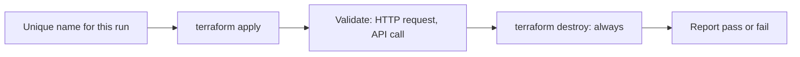
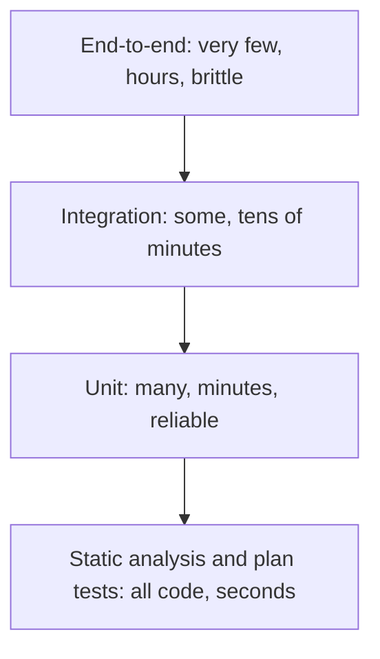

# Testing, part 2: automated unit, integration and end-to-end tests

## In plain words

A bridge inspector could read every drawing, measure every bolt and still not know whether the bridge holds. So before opening, engineers drive loaded lorries across it and measure how much it bends. That is the test that counts, and it is the expensive one, so they run the cheap inspections first and the lorries last.

The previous lesson covered the inspections: static analysis and plan checks. This lesson is the lorries. An **automated test** for infrastructure is a program that deploys real resources into a safe account, checks that they behave correctly, and removes them again, every time the code changes, with no person involved.

You will see two tools. Terraform's own `terraform test` command, where tests are written in HCL, and **Terratest**, a library for the Go programming language. Both follow the same four steps, and the ideas matter more than the tool.

Why this matters for a job: teams that test infrastructure code change it confidently and often; teams that do not are afraid to touch it. Being able to explain the test pyramid for infrastructure, and why you write many small tests and very few large ones, marks you as someone who has done this seriously.

> **Before this lesson:** read [Testing, part 1: manual tests, static analysis, policy and plan testing](#/lesson/terraform/manual-static-plan-testing) and [Production-grade modules: small, composable, testable, versioned, and beyond](#/lesson/terraform/production-modules). The CI/CD track's [Test doubles and strategy for real projects](#/lesson/cicd/test-doubles) explains mocks and fakes in general.

> [!WARNING]
> **Cost and safety.** Every test in this lesson, unless stated otherwise, creates real, billable resources. Run them only in dedicated sandbox or test accounts, never in an account that contains anything you care about. Give tests their own credentials with limited permissions, make every resource name unique per run, set budget alerts, and schedule an automatic cleanup job, because a test that crashes halfway leaves resources behind.

## The four steps of every infrastructure test

Whatever the tool, an infrastructure test does this:

1. **Deploy** real infrastructure (`terraform apply`) into a test account.
2. **Validate** that it works: send a web request, call an API, log in to a server.
3. **Clean up** (`terraform destroy`), whether the validation passed or failed.
4. **Report** pass or fail.



Step 3 is where infrastructure tests differ most from ordinary ones. The cleanup must run even when step 2 fails, or the account slowly fills with debris.

## Three sizes of test

The names come from general software testing. Applied to infrastructure:

| Size | What it deploys | Typical run time | How many you write |
|---|---|---|---|
| **Unit test** | One module, alone, with its dependencies stubbed or minimal | 1 to 20 minutes | Many |
| **Integration test** | Several modules that must work together | 10 to 60 minutes | Fewer |
| **End-to-end test** | The whole architecture as a user would experience it | 1 to several hours | Very few |

A warning about the word "unit". In ordinary programming a unit test runs in milliseconds with no network. For infrastructure, a "unit" is a single module, and the only way to know it works is to deploy it, so even unit tests talk to the real cloud. The name describes the *scope* of the test, not its speed.

The shape these numbers suggest is the **test pyramid**: a wide base of small tests, a narrower band of integration tests and a small tip of end-to-end tests.



The reasons are cost, speed and reliability, and they all point the same way. The more a test deploys, the longer it takes, the more it costs, and the more likely it is to fail for reasons unrelated to your change: a network blip, a quota, a slow API. The simulation below puts numbers on that last point.

```python-run
def suite_reliability(resources, per_resource_flake=0.0006):
    """Chance that a test passes when the code is correct, if each resource
    independently has a small chance of failing for unrelated reasons."""
    return (1 - per_resource_flake) ** resources

tests = [
    ("unit: one small module", 20, 4),
    ("integration: three modules", 80, 25),
    ("end-to-end: whole architecture", 600, 180),
]
print(f"{'test':34}{'resources':>10}{'minutes':>9}{'passes when code is right':>28}")
for name, resources, minutes in tests:
    print(f"{name:34}{resources:>10}{minutes:>9}{suite_reliability(resources):>27.1%}")

# What retries buy: one retry of a failed transient step
p = suite_reliability(600)
print(f"\nend-to-end with one whole-test retry: {1 - (1 - p) ** 2:.1%}")
print("A 30% false-failure rate teaches people to ignore red builds.")
```

With six hundred resources, roughly three runs in ten fail although nothing is wrong. People stop trusting a test like that. This is the arithmetic behind "many small, few large".

## Unit tests with `terraform test`

The native framework, available since Terraform 1.6 and in OpenTofu, was introduced in plan mode in the previous lesson. Its default mode is `apply`: it really creates the infrastructure, runs your assertions, then destroys everything it created.

Take the `alb` module. The test deploys the module's example and checks that the load balancer answers.

```hcl
# tests/alb.tftest.hcl
provider "aws" {
  region = "eu-west-1"
}

variables {
  name = "alb-test"
}

run "setup_network" {
  module {
    source = "./tests/fixtures/network"
  }
}

run "creates_load_balancer" {
  command = apply

  variables {
    subnet_ids = run.setup_network.public_subnet_ids
  }

  assert {
    condition     = aws_lb.this.load_balancer_type == "application"
    error_message = "Expected an application load balancer."
  }

  assert {
    condition     = length(aws_lb.this.subnets) >= 2
    error_message = "The load balancer must span at least two subnets."
  }
}

run "default_response_is_404" {
  command = apply

  module {
    source = "./tests/fixtures/http-probe"
  }

  variables {
    url = "http://${run.creates_load_balancer.alb_dns_name}"
  }

  assert {
    condition     = data.http.probe.status_code == 404
    error_message = "With no listener rules, the load balancer should answer 404."
  }
}
```

Block by block:

- The `provider` block configures the provider for the test. Test files are the one place outside a root module where this is normal.
- The file-level `variables` block sets inputs for every run.
- `run "setup_network"` uses a `module` block to run a *different* configuration from the one under test. A small helper configuration used only by tests is called a **fixture**. This one creates a throwaway network and outputs subnet IDs.
- `run "creates_load_balancer"` runs the module under test (the folder where `terraform test` was started) with `command = apply`. It reads the previous run's output through `run.setup_network.public_subnet_ids`. Runs execute in order and each can use earlier runs' outputs.
- Its `assert` blocks check attributes that only exist after creation.
- `run "default_response_is_404"` loads a second fixture containing a single `http` data source, which sends a real web request to the new load balancer. The assertion checks the response code. This is the "validate" step: proof that the thing works, not only that it exists.

```bash
$ terraform test
tests/alb.tftest.hcl... in progress
  run "setup_network"... pass
  run "creates_load_balancer"... pass
  run "default_response_is_404"... pass
tests/alb.tftest.hcl... tearing down
tests/alb.tftest.hcl... pass

Success! 3 passed, 0 failed.
```

"Tearing down" is the cleanup: Terraform destroys everything the runs created, in reverse order, including when an assertion failed. If the destroy itself fails, the command prints the resources left behind so you can remove them by hand. Check that list whenever a test run ends abnormally.

Useful options: `terraform test -filter=tests/alb.tftest.hcl` runs one file, and `-verbose` prints the plan or state for each run.

### Mocks: tests that deploy nothing

Since Terraform 1.7 and in OpenTofu, a test can replace a provider with a **mock**: a stand-in that creates nothing and returns made-up values.

```hcl
# tests/logic.tftest.hcl
mock_provider "aws" {
  mock_resource "aws_lb" {
    defaults = {
      arn      = "arn:aws:elasticloadbalancing:eu-west-1:000000000000:loadbalancer/app/mock/abc"
      dns_name = "mock.example.internal"
    }
  }
}

run "tags_are_merged" {
  variables {
    name       = "alb-test"
    subnet_ids = ["subnet-a", "subnet-b"]
    extra_tags = { Team = "web" }
  }

  assert {
    condition     = aws_lb.this.tags["Team"] == "web" && aws_lb.this.tags["ManagedBy"] == "terraform"
    error_message = "Caller tags and module tags should both be present."
  }
}
```

- `mock_provider "aws"` replaces the real AWS provider for this file. No credentials are needed and nothing is created.
- `mock_resource ... defaults` supplies values for attributes that the real provider would compute.
- The run can use `apply` mode safely, because apply against a mock is instant and free.

Mocked tests run in seconds and are ideal for a module's *logic*: conditionals, loops, naming, tag merging. They prove nothing about whether AWS accepts your configuration, so they complement real deployments and do not replace them.

## Unit tests with Terratest

**Terratest** is an open-source Go library that predates the native framework. A test is an ordinary Go test function that drives Terraform and then does anything a program can do: retry web requests, connect to servers, call cloud APIs. You do not need to know Go well to read one.

```go
package test

import (
	"fmt"
	"testing"
	"time"

	http_helper "github.com/gruntwork-io/terratest/modules/http-helper"
	"github.com/gruntwork-io/terratest/modules/random"
	"github.com/gruntwork-io/terratest/modules/terraform"
)

func TestBookshelfAppExample(t *testing.T) {
	t.Parallel()

	opts := &terraform.Options{
		TerraformDir: "../examples/bookshelf-app",
		Vars: map[string]interface{}{
			"name": fmt.Sprintf("bookshelf-%s", random.UniqueId()),
		},
	}

	defer terraform.Destroy(t, opts)
	terraform.InitAndApply(t, opts)

	url := fmt.Sprintf("http://%s/healthz", terraform.Output(t, opts, "alb_dns_name"))
	http_helper.HttpGetWithRetry(t, url, nil, 200, "ok", 30, 10*time.Second)
}
```

Line by line:

- `func TestBookshelfAppExample(t *testing.T)` declares a test. Go runs every function whose name starts with `Test`.
- `t.Parallel()` allows this test to run at the same time as others. Infrastructure tests are slow, so running them side by side is the main way to keep total time down.
- `terraform.Options` says which folder to run Terraform in (the module's example) and which variables to pass.
- `random.UniqueId()` produces a short random string, so the name differs on every run. **Unique names are what make parallel runs and repeated runs possible**; with a fixed name, two runs collide.
- `defer terraform.Destroy(t, opts)` schedules the destroy to run when the function ends, *however* it ends: success, failed check or crash. `defer` is Go's "do this on the way out".
- `terraform.InitAndApply` runs `init` and `apply` and fails the test if either fails.
- `terraform.Output` reads an output value.
- `HttpGetWithRetry` requests the URL and expects status 200 with the body `ok`, trying up to 30 times, 10 seconds apart.

The retries deserve a comment. After `apply` returns, servers are still booting and health checks are still settling. A single immediate request would usually fail. Infrastructure is asynchronous and eventually consistent, so tests must **wait and retry**, with a limit. Never use a fixed sleep and hope.

Run it with a generous timeout, because Go's default of ten minutes kills a long test without running the cleanup:

```bash
go test -v -timeout 45m -run TestBookshelfAppExample
```

| | `terraform test` | Terratest |
|---|---|---|
| Language | HCL | Go |
| Extra tooling | None | Go toolchain |
| Validation | Assertions on values, plus data sources for requests | Anything Go can do: retries, SSH, SDK calls |
| Mocks | Built in | Not applicable |
| Tests beyond Terraform | No | Yes: Packer, Docker, Kubernetes, Helm |
| Best for | Module logic and straightforward deploy-and-check | Complex validation and multi-tool pipelines |

Many teams use the native framework for most modules and Terratest where validation needs real programming.

## Integration tests

An **integration test** deploys two or more modules and checks they work *together*. For the bookshelf service: the database module and the application module, with the application's health endpoint reporting whether it can reach the database.

The shape, in Terratest terms:

```go
func TestBookshelfWithDatabase(t *testing.T) {
	t.Parallel()

	dbOpts := &terraform.Options{TerraformDir: "../examples/postgres", Vars: uniqueVars()}
	defer terraform.Destroy(t, dbOpts)
	terraform.InitAndApply(t, dbOpts)

	appOpts := &terraform.Options{
		TerraformDir: "../examples/bookshelf-app",
		Vars: map[string]interface{}{
			"name":       fmt.Sprintf("bookshelf-%s", random.UniqueId()),
			"db_address": terraform.Output(t, dbOpts, "address"),
		},
	}
	defer terraform.Destroy(t, appOpts)
	terraform.InitAndApply(t, appOpts)

	url := fmt.Sprintf("http://%s/healthz/db", terraform.Output(t, appOpts, "alb_dns_name"))
	http_helper.HttpGetWithRetry(t, url, nil, 200, "db ok", 40, 15*time.Second)
}
```

- The database is deployed first and its output is passed to the application as an input: the same wiring a real root module would do.
- Two `defer` lines schedule two destroys. Deferred calls run in reverse order, so the application is destroyed before the database, which is the correct dependency order.
- The check goes through the load balancer to an endpoint that only succeeds if the application reached the database.

Integration tests are slow, largely because of the database, which can take ten minutes to create. Two techniques help:

- **Stages.** Terratest's `test_structure` package lets you split a test into named stages (deploy database, deploy app, validate, teardown) and skip stages with environment variables. While developing, you deploy the database once and rerun only the application stages.
- **Retries of known transient errors.** Terratest's `RetryableTerraformErrors` option lists error messages that should cause `apply` to be tried again, such as a temporary API throttling message.

## End-to-end tests

An **end-to-end test** checks the whole system as a user meets it. Deploying an entire architecture from nothing for every change is rarely practical: it takes hours, and as the simulation showed, something unrelated will often fail.

The practical approach is different:

1. Keep one persistent, production-like environment (often called `stage` or `test`) running.
2. For each change, apply **only that change** to it, the same way it would be applied to production.
3. Run a small set of end-to-end checks against it: sign in, place an order, see it arrive.

This has a second benefit. It tests the *deployment process itself*, including that the change can be applied to a running system without downtime, which a build-from-nothing test never exercises.

## Testing what is on the servers

Some checks concern the inside of a server: is the right package installed, is the service running, is the port open? Tools for this are called **server testing** tools; InSpec, Goss and Serverspec are examples. A Goss file reads like a checklist:

```yaml
port:
  tcp:8080:
    listening: true
service:
  bookshelf:
    enabled: true
    running: true
http:
  http://localhost:8080/healthz:
    status: 200
```

These are most useful when you build machine images: run the checks against a server started from the new image before the image is released. With containers and managed services, there is less on the server to test, and a health check through the load balancer covers most of it.

## Making tests trustworthy

- **Isolate.** A separate account for tests, ideally several, so parallel runs do not hit each other's limits.
- **Namespace every resource.** A unique suffix per run on every name.
- **Always clean up,** and run a scheduled sweeper for whatever escapes.
- **Retry transient failures, with limits.** Distinguish "not ready yet" from "wrong".
- **Run in parallel.** Total time is what determines whether people run the tests.
- **Test the example, not the module directly.** Then the documentation is proven to work.
- **Keep credentials narrow.** A test role that cannot touch anything outside the test account.

> [!INTERVIEW]
> "Describe the test pyramid for infrastructure code." The base is static analysis and plan-level tests, run on all code in seconds. Above it, many unit tests that each deploy one module to a sandbox, validate it and destroy it. Fewer integration tests that deploy modules together. At the top, a handful of end-to-end checks against a persistent staging environment where changes are applied incrementally. The proportions follow from cost, duration and the false-failure rate, all of which grow with the amount deployed.

## Pitfalls

- **Fixed resource names in tests.** Parallel and repeated runs collide.
- **No guaranteed teardown.** A failed assertion leaves everything running.
- **Sleeping instead of retrying.** Too short fails randomly; too long wastes time.
- **A default timeout shorter than the test.** The runner kills the test and skips the cleanup.
- **Only end-to-end tests.** Slow, costly and unreliable; failures say little about where the fault is.
- **Only mocked tests.** They never ask the cloud whether the configuration is acceptable.
- **Running tests in an account with real workloads.** A bug in a test's destroy can remove more than the test created.
- **Asserting only that resources exist.** Check behaviour: a request that returns the expected answer.

## Cheat sheet

| Task | `terraform test` | Terratest |
|---|---|---|
| Test file | `tests/*.tftest.hcl` | `test/*_test.go` |
| Deploy | `run "x" { command = apply }` (the default) | `terraform.InitAndApply(t, opts)` |
| Check a value | `assert { condition = ..., error_message = ... }` | `assert.Equal(t, want, got)` |
| Check behaviour | A fixture with `data "http"` | `http_helper.HttpGetWithRetry(...)` |
| Cleanup | Automatic teardown | `defer terraform.Destroy(t, opts)` |
| Use another config | `module { source = "./tests/fixtures/x" }` | Another `terraform.Options` |
| Earlier results | `run.<name>.<output>` | `terraform.Output(t, opts, "name")` |
| No real resources | `mock_provider "aws" { ... }` | — |
| Unique names | A variable set per run | `random.UniqueId()` |
| Parallel | Runs in a file are sequential | `t.Parallel()` |
| Run | `terraform test [-filter=file] [-verbose]` | `go test -v -timeout 45m` |

## Summary

- An infrastructure test deploys real resources, validates behaviour, always cleans up and reports.
- Unit tests deploy one module, integration tests several together, end-to-end tests the whole system; cost, duration and false failures rise with size, so write many small tests and few large ones.
- `terraform test` writes tests in HCL with `run` and `assert` blocks, tears down automatically, and supports mocked providers for fast logic tests.
- Terratest writes tests in Go and suits complex validation, retries and tools beyond Terraform.
- End-to-end testing is best done by applying each change incrementally to a persistent staging environment.
- Trustworthy tests are isolated, uniquely named, parallel, retried with limits and always cleaned up.

## Glossary

- **Automated test:** a program that checks behaviour without a person.
- **Unit test (infrastructure):** a test that deploys and checks a single module.
- **Integration test:** a test that deploys several modules and checks they work together.
- **End-to-end test:** a test of the whole system from a user's point of view.
- **Test pyramid:** many small tests, fewer medium, very few large.
- **Fixture:** a small helper configuration used only by tests.
- **Teardown:** the cleanup that destroys what a test created.
- **Mock:** a stand-in that imitates a provider without creating anything.
- **Terratest:** a Go library for testing infrastructure code.
- **`defer`:** a Go statement that schedules a call to run when the function exits.
- **Flaky test:** a test that sometimes fails although the code is correct.
- **Server testing:** checking the software and services inside a machine.

## Check yourself

```quiz
[
  {"q": "What are the steps of an automated infrastructure test, in order?",
   "options": ["Plan, review, merge", "Deploy, validate, clean up, report", "Lint, scan, format", "Mock, assert, commit"], "answer": 1,
   "explain": "The test applies real infrastructure, checks that it behaves, destroys it regardless of the result, and reports pass or fail."},
  {"q": "Why does an infrastructure 'unit test' usually take minutes, unlike a unit test in ordinary code?",
   "options": ["HCL is slow to parse", "It deploys a real module to a real cloud, because there is no local copy to run against", "It runs every test twice", "It waits for a human approval"], "answer": 1,
   "explain": "'Unit' describes scope: one module. Verifying it still means creating real resources."},
  {"q": "In a Terratest function, `defer terraform.Destroy(t, opts)` is written before `terraform.InitAndApply(t, opts)`. The HTTP check then fails. What happens to the resources?",
   "options": ["They are left running", "They are destroyed, because the deferred call runs when the function exits for any reason", "Only half are destroyed", "The test is retried forever"], "answer": 1,
   "explain": "defer guarantees the destroy runs on the way out of the function, including after a failed check."},
  {"q": "Two copies of the same test run in parallel with `name = \"bookshelf-test\"`. What is the likely result?",
   "options": ["Both pass", "One fails with 'already exists' errors because names collide", "They share resources safely", "Terraform merges the states"], "answer": 1,
   "explain": "Fixed names collide. A unique suffix per run lets tests run in parallel and repeatedly."},
  {"q": "A `terraform test` file uses `mock_provider \"aws\"`. What can and cannot it tell you?",
   "options": ["Everything a real deployment tells you", "It can check module logic quickly, but not whether the cloud accepts the configuration", "Only formatting", "Nothing"], "answer": 1,
   "explain": "Mocks create nothing and return made-up values, so they test conditionals, naming and wiring, not real provider behaviour."},
  {"q": "Why do infrastructure tests retry their validation step instead of checking once?",
   "options": ["To raise the bill", "Because resources become ready some time after apply returns, and transient errors are common", "Because Terraform is non-deterministic", "Because assertions are slow"], "answer": 1,
   "explain": "Servers boot and health checks settle after creation. Bounded retries distinguish 'not ready yet' from 'broken'."},
  {"q": "What is the recommended way to run end-to-end tests of a large architecture?",
   "options": ["Deploy the whole architecture from nothing for every commit", "Apply each change incrementally to a persistent staging environment and run a small set of checks", "Skip them", "Run them only in production"], "answer": 1,
   "explain": "Building everything from scratch takes hours and fails often for unrelated reasons. Incremental application is faster and also tests the deployment process."},
  {"q": "In `terraform test`, what does `tearing down` in the output mean?",
   "options": ["The test file is being deleted", "Terraform is destroying the resources the runs created", "The provider is being uninstalled", "The state lock is being released"], "answer": 1,
   "explain": "After the runs in a file finish, the framework destroys everything they created, whether assertions passed or not."}
]
```

> **Source:** Brikman, Terraform: Up & Running 3e, ch. 9 (automated tests: unit tests, integration tests, end-to-end tests; other testing approaches: server testing). Documentation: https://developer.hashicorp.com/terraform/language/tests, https://developer.hashicorp.com/terraform/language/tests/mocking, https://opentofu.org/docs/cli/commands/test/ and https://terratest.gruntwork.io/docs/
