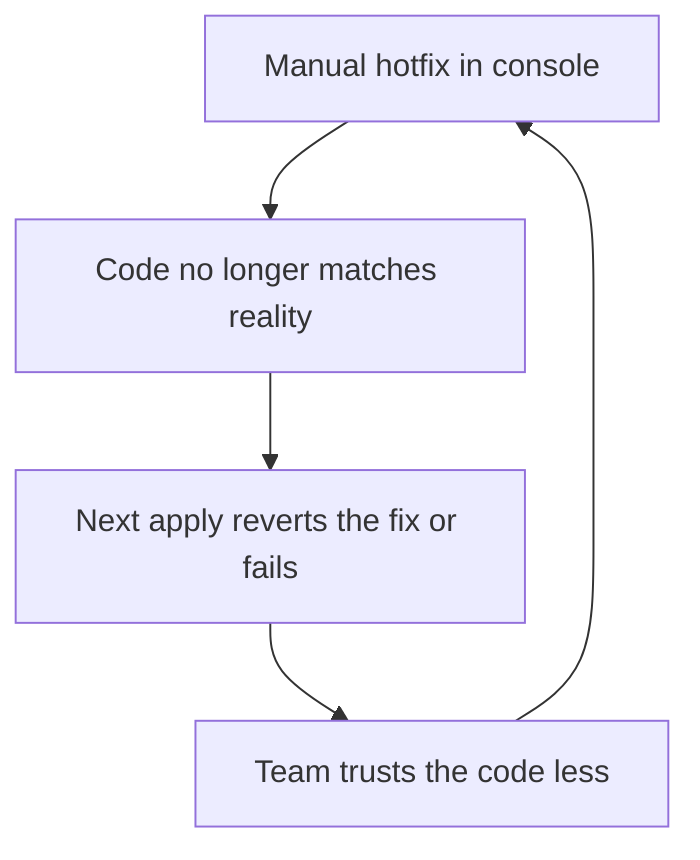

# Terraform as a team, part 1: adopting IaC and the two deployment workflows

## In plain words

One person can renovate a kitchen with nothing but their own judgement. Twenty people building a block of flats need something more than skill: an agreed sequence. Drawings are approved before concrete is poured. An inspector signs off the wiring before the walls are closed. Nobody knocks through a wall on their own initiative. The sequence is what stops twenty competent people from wrecking each other's work.

Using Terraform alone is the kitchen. Using it in a team is the block of flats. The tool is the same, and the hard part becomes the **workflow**: the agreed sequence of steps a change goes through from an idea to running in production.

This lesson has two halves. First, how to get a team to adopt infrastructure as code at all, which is a problem of people more than technology. Second, the workflow itself, built by taking the workflow teams already use for application code and seeing exactly where infrastructure code needs different handling.

Why this matters for a job: you will join a team with an existing workflow, or be asked to help create one. Interviewers ask "walk me through how a Terraform change gets to production at your company", and they are listening for review, a plan that someone reads, automated checks, promotion through environments and a sensible answer to "what if it fails halfway?".

> **Before this lesson:** complete the testing module, ending with [Testing, part 2: automated unit, integration and end-to-end tests](#/lesson/terraform/automated-tests), and the state and versioning lessons. From the CI/CD track, [Stages, gates and the flow of a change](#/lesson/cicd/pipeline-stages) and [Build once, promote artifacts, pipeline as code](#/lesson/cicd/build-once) describe the application side of what follows, and [Trunk-based development, feature branches and release branches](#/lesson/cicd/branching-models) covers branching.

## Adopting infrastructure as code in a team

Suppose you are convinced and your team is not. Tooling changes fail far more often because of people than because of technology. Three things make adoption work.

### Convince the people who decide

A manager hears "we should rewrite our infrastructure in Terraform" as "we will spend months producing nothing visible". That reaction is reasonable. Adoption has real costs:

- **A skills gap.** Operations staff must learn to write and review code; developers must learn infrastructure.
- **New tools** to learn, pay for and maintain.
- **A change of habits.** The quick fix in the console, which took thirty seconds, is no longer allowed.
- **Opportunity cost.** Time spent here is not spent on features.

So do not sell the tool. Find the problem the decision-maker already has and show how this solves it. "Deployments keep causing outages, and last quarter we lost two days of sales" is a problem. "We cannot open the Frankfurt region because nobody knows how the Dublin one was built" is a problem. "Terraform is declarative" is not.

### Work incrementally

The tempting plan is a big project: stop feature work, codify everything, switch over in six months. Such projects have a bad record. They deliver no value until the end, and they are usually cancelled or abandoned before then, leaving the team with two half-systems to maintain.

**Incrementalism** means arranging the work so that every step delivers something useful by itself, even if the later steps never happen. For infrastructure as code that looks like:

1. Pick **one** concrete, painful problem. For example, the load balancer configuration that nobody dares to touch.
2. Codify only that. Import the existing resources, as in the state surgery lesson, so nothing is rebuilt.
3. Show the result: the change that used to take a nervous afternoon now takes a reviewed pull request.
4. Choose the next most painful thing.

Each step pays for itself. If priorities change after step two, you still have two well-managed pieces instead of half of a grand migration.

### Give people time to learn

If the team is told to use Terraform but not given time to learn it, this is what happens. An outage occurs. The engineer on call does not yet trust their ability to fix it through code under pressure, so they fix it by hand in the console. Now the code and reality disagree. The next `apply` either undoes the fix or fails. Confidence in the tool drops, more people bypass it, and within months the code describes nothing real.

Preventing that takes deliberate investment: training, documentation, time for pairing, and a clear rule that the code is the only way to change managed infrastructure, with the support needed to make that rule livable.



## The workflow for application code

Most teams already have a mature workflow for application code. It has seven steps, and it is worth stating them precisely because the infrastructure workflow is the same seven with different contents.

1. **Use version control.** The code lives in a Git repository. A developer copies it locally and creates a **branch**, a separate line of work.
2. **Run the code locally.** The application runs on the developer's own machine, where they can try the change and run the tests in seconds.
3. **Make code changes.** Edit, run, test, repeat: a fast feedback loop.
4. **Submit changes for review.** The developer opens a **pull request**: a proposal to merge the branch, which colleagues read and comment on.
5. **Run automated tests.** A **continuous integration** (CI) server runs the test suite on every pull request and reports the result.
6. **Merge and release.** After approval, the branch is merged into the main branch, and a release **artifact** is built: one immutable, versioned package of the code, such as a container image tagged with a version number.
7. **Deploy.** The artifact is rolled out through environments, typically dev, then staging, then production, using a strategy such as a rolling or canary deployment. The *same* artifact is **promoted** from one environment to the next; it is never rebuilt on the way.

If a deployment goes wrong, the usual fix is a **rollback**: deploy the previous artifact again. Because application servers are stateless, this is quick and safe.

## The workflow for infrastructure code

Now the same seven steps for Terraform. At each step the question is: what is different, and why?

### 1. Use version control

Infrastructure code also lives in Git, with two additions.

**Two repositories.** As the versioning lesson explained, keep reusable modules in one repository (often called `modules`) and the per-environment configurations that call them in another (often called `live`). The `live` repository is a readable map of everything deployed.

**The golden rule of Terraform.** *The main branch of the live repository should be a one-to-one representation of what is actually deployed in production.* Take each word seriously:

- "what is actually deployed": nothing changed by hand outside the code.
- "one-to-one": every deployed resource has code, and every piece of code is deployed. No resources that exist only in the console, and no merged code waiting to be applied.
- "the main branch": one source of truth, not a branch per environment.

A quick test of whether a team follows the rule: run `terraform plan` on the main branch of any environment. It should report no changes.

**Branches are trouble for infrastructure.** For application code, a long-lived feature branch is only slow. For infrastructure it is dangerous, because there is only one real world. If two engineers each run `apply` from different branches against the same environment, each apply reverts the other's changes, since each branch's code describes a world without the other's work. State locking stops them corrupting the state file; it does nothing about this. The safe rule: **all applies to shared environments come from one branch.**

### 2. Run the code locally

There is no local copy of AWS. The equivalent of "run it on your machine" is "apply it in your own sandbox account", as described in the testing lessons. This is why personal sandbox accounts and modules with examples matter so much: they *are* the local development environment.

### 3. Make code changes

The loop is: edit, `terraform apply` in the sandbox, check, repeat. The loop is slower than for application code, since each turn takes minutes. Keep modules small to keep the loop short, and use the test stages from the previous lesson to avoid redeploying what has not changed.

### 4. Submit changes for review

A pull request for infrastructure needs one thing an application pull request does not: **the plan output**. The code diff says what was typed; the plan says what will happen. A one-line diff can produce a plan that replaces a database.

A reviewer of infrastructure code reads, in this order:

1. The plan summary line: do the counts match the stated intent?
2. Every `-` and every `-/+`: is each destruction expected?
3. Anything marked `forces replacement`.
4. Then the code: naming, style, tests, documentation.

Teams usually write their conventions down so reviews do not turn into arguments about taste: a style guide (enforced by `terraform fmt` and a linter), required documentation, and required tests for module changes.

### 5. Run automated tests

The CI server runs the checks from the testing module: `fmt`, `validate`, linting, security scanning, unit tests for changed modules. And for the live repository it does one more thing on every pull request: **it runs `terraform plan` and posts the output on the pull request.** That gives the reviewer the plan from step 4 without having to trust that the author ran it against the latest state.

### 6. Merge and release

For application code, the release artifact is a built package. Terraform code is not compiled, so what is the artifact?

- For the **modules repository**, the artifact is a **Git tag** on a specific commit, such as `v1.6.0`. The tag is immutable and versioned, which are the two properties that matter.
- For the **live repository**, a release is a commit that changes which module version an environment uses.

### 7. Deploy

Deployment is where the two workflows differ most. Five differences deserve separate treatment.

**Deployment tooling.** The command is `terraform apply`. Teams run it through a pipeline or a dedicated service (HCP Terraform, Atlantis, Spacelift, env0 and similar) so that it runs the same way every time.

**Deployment strategies.** Terraform has no built-in canary or blue-green switch for infrastructure as a whole. Zero-downtime techniques are per-resource, as in the zero-downtime lesson. Since you cannot easily route "five percent of traffic" to a new VPC, the main protection is catching problems *before* production through earlier environments.

**Errors and retries.** An application deployment that fails leaves the old version running. A Terraform apply that fails leaves a partly changed world. So the pipeline needs:
- retries for known transient errors;
- awareness that state may need attention after a crash: a lock left behind (`force-unlock`, after checking) or, rarely, an `errored.tfstate` file that Terraform writes locally when it could not save state to the backend, which you upload with `terraform state push`.

**No easy rollback.** There is no "previous artifact" to switch back to in general. Reverting the commit and applying again runs a *new* change in the opposite direction, which may itself destroy things: reverting the addition of a database deletes the database. The fix after a bad apply is almost always to **roll forward** with a corrected change. This is the reason so much effort goes into the steps before apply.

**The deployment server.** Whatever runs `apply` holds powerful, near-administrator credentials. It must be locked down: no inbound network access, credentials that are short-lived (the OIDC approach from the secrets lesson), and no way for an unreviewed pull request to make it run arbitrary commands with those credentials.

**Promotion across environments.** The principle of "build once, promote the same artifact" carries over directly: promote the **same module version** through environments.

```bash
# live/dev/services/bookshelf/main.tf        source = "...//bookshelf-app?ref=v1.6.0"   <- apply, verify
# live/staging/services/bookshelf/main.tf    source = "...//bookshelf-app?ref=v1.6.0"   <- apply, verify
# live/prod/services/bookshelf/main.tf       source = "...//bookshelf-app?ref=v1.6.0"   <- apply, verify
```

Each line is its own pull request with its own plan. If the plan for staging looks different from what dev's looked like, stop and find out why before going further: the environments have diverged.

## Side by side

| Step | Application code | Infrastructure code |
|---|---|---|
| 1. Version control | One repository per app; branches are cheap | `modules` and `live` repositories; main branch mirrors production; applies from one branch only |
| 2. Run locally | On localhost | In a personal sandbox account |
| 3. Make changes | Edit and rerun in seconds | Edit and `apply` in minutes |
| 4. Review | Read the code diff | Read the **plan**, then the diff |
| 5. Automated tests | Unit, integration, end-to-end | Static checks, plan, tests that deploy; plan posted on the pull request |
| 6. Release | Build a versioned artifact | Tag a module version |
| 7. Deploy | Rolling, canary, blue-green; roll back by redeploying the old artifact | `terraform apply` per environment; promote the same module version; roll forward on failure |

The simulation below models promotion of one module version through three environments, with the gate that matters: each environment's plan must match expectations before the next one starts.

```python-run
environments = ["dev", "staging", "prod"]
pinned = {"dev": "v1.5.0", "staging": "v1.5.0", "prod": "v1.5.0"}

# What the plan shows when each environment moves to the new version.
plans = {
    "v1.6.0": {"dev": (0, 1, 0), "staging": (0, 1, 0), "prod": (0, 1, 0)},
    "v1.7.0": {"dev": (0, 1, 0), "staging": (1, 0, 1), "prod": (0, 1, 0)},  # staging has drifted
}

def promote(version, expected):
    print(f"Promoting {version}; release notes say the plan should be {expected}")
    for env in environments:
        plan = plans[version][env]
        text = f"{plan[0]} to add, {plan[1]} to change, {plan[2]} to destroy"
        if plan != expected:
            print(f"  {env:8} plan: {text}   <-- unexpected: STOP, investigate before going on")
            break
        pinned[env] = version
        print(f"  {env:8} plan: {text}   applied, checks passed")
    print("  versions now:", pinned, "\n")

promote("v1.6.0", (0, 1, 0))
promote("v1.7.0", (0, 1, 0))
```

The second promotion stops at staging, with production untouched and still on the last good version. That is the whole value of promoting through environments: surprises are spent on environments that can afford them.

> [!WARNING]
> **Cost and safety.** A workflow is only as strong as its weakest shortcut. The two most damaging ones are applying to production from a laptop "this once" and fixing something by hand in the console during an incident without following up in code. If an emergency manual change is unavoidable, record it immediately and bring the code into line the same day, so the next apply does not undo the fix.

> [!INTERVIEW]
> "How does deploying infrastructure code differ from deploying application code?" Same seven steps, with these differences: there is no localhost, so development happens in sandbox accounts; reviewers must read the plan, not only the diff; the release artifact is a module version tag; all applies come from one branch because there is one real world; a failed apply leaves partial changes and there is rarely a true rollback, so you roll forward; and the system that runs apply holds very powerful credentials and must be tightly secured.

## Pitfalls

- **A big-bang migration.** Months of work with no value until the end, usually abandoned.
- **Mandating the tool without training.** People route around it under pressure, and the code drifts from reality.
- **Applying from feature branches to shared environments.** Each apply reverts the other's work.
- **Reviewing the diff without the plan.** The diff does not show replacements.
- **Rebuilding or re-pinning differently per environment.** Production then runs something that was never tested.
- **Treating `git revert` as a rollback.** The reverse change is a new change with its own destruction.
- **Merged but unapplied code.** The main branch no longer mirrors reality, and the next person's plan contains someone else's change.
- **A deployment runner that pull requests from anyone can drive.**

## Cheat sheet

| Principle | Meaning |
|---|---|
| Golden rule | The live repository's main branch matches what is deployed, one to one |
| One apply branch | Shared environments are applied only from main |
| Sandbox as localhost | Personal accounts for development and manual tests |
| Plan in review | Every infrastructure pull request shows its plan |
| Immutable artifact | A module version tag |
| Promotion | The same module version moves dev, staging, prod |
| Roll forward | Fix a bad apply with a corrected change |
| Incrementalism | Each step of adoption delivers value by itself |
| Quick health check | `terraform plan` on main shows no changes |

## Summary

- Adopting IaC succeeds when it is tied to a problem decision-makers already feel, done incrementally so each step pays for itself, and supported with time to learn.
- Without that support, manual hotfixes make the code diverge from reality and trust collapses.
- The application workflow has seven steps: version control, run locally, change, review, automated tests, release, deploy.
- The infrastructure workflow uses the same steps with important differences: sandbox accounts instead of localhost, plans in review, module tags as artifacts, applies from one branch, and roll-forward instead of rollback.
- The golden rule is that the main branch of the live repository mirrors production exactly.
- Promote one immutable module version through environments, and stop when a plan surprises you.

## Glossary

- **Workflow:** the agreed sequence of steps a change passes through.
- **Incrementalism:** splitting work so that each step delivers value even if later steps never happen.
- **Opportunity cost:** what you give up by spending time on one thing instead of another.
- **Branch:** a separate line of development in version control.
- **Pull request:** a proposal to merge a branch, reviewed by colleagues.
- **Continuous integration (CI):** automatically building and testing every change.
- **Artifact:** an immutable, versioned package produced by a release.
- **Promotion:** moving the same artifact from one environment to the next.
- **Rollback / roll forward:** returning to a previous version, or fixing by deploying a new corrected change.
- **Live repository:** the repository of per-environment configurations describing what is deployed.
- **Golden rule of Terraform:** the main branch of the live repository is a one-to-one representation of production.

## Check yourself

```quiz
[
  {"q": "A team follows the golden rule. You check out main and run `terraform plan` in a production folder. What should it show?",
   "options": ["Several pending additions", "No changes", "One resource to destroy", "It should fail without approval"], "answer": 1,
   "explain": "If main mirrors what is deployed one to one, there is nothing to change. Any diff means drift or merged-but-unapplied code."},
  {"q": "Asha applies branch A to the shared staging environment. Ben then applies branch B, which does not contain Asha's change. What does Ben's plan show for Asha's new resources?",
   "options": ["Nothing; they are ignored", "They will be destroyed, because they are in state but not in Ben's code", "They will be updated", "An error about the lock"], "answer": 1,
   "explain": "Ben's branch describes a world without Asha's resources. Since they are in state, Terraform plans to remove them. Locking does not prevent this."},
  {"q": "What is the release artifact for a reusable Terraform module?",
   "options": ["A compiled binary", "A Git tag marking a specific, immutable version", "The state file", "The plan file"], "answer": 1,
   "explain": "Terraform code is not built into a package. An immutable version tag gives the same two properties: fixed contents and a version number."},
  {"q": "A change that added a database was applied yesterday. Today someone reverts the commit and applies. What does the plan show?",
   "options": ["No changes", "The database will be destroyed", "The database will be updated in place", "A rollback to yesterday's data"], "answer": 1,
   "explain": "Reverting removes the block from the code, so the next plan destroys the resource. A revert is a new change in the opposite direction, not a restore."},
  {"q": "Why must an infrastructure pull request include the plan output and not only the code diff?",
   "options": ["The plan is shorter", "The diff shows what was typed; only the plan shows what will be created, changed, replaced or destroyed", "Reviewers cannot read HCL", "The diff is not stored in Git"], "answer": 1,
   "explain": "A one-line code change can force a replacement. The consequences are visible only in the plan."},
  {"q": "What is the infrastructure equivalent of running an application on localhost?",
   "options": ["terraform validate", "Applying the code in a personal sandbox account", "Reading the documentation", "Running the plan against production"], "answer": 1,
   "explain": "There is no local copy of a cloud, so development and manual testing happen in an isolated real account."},
  {"q": "Module v1.7.0 planned as `0 to add, 1 to change, 0 to destroy` in dev. In staging the same version plans `1 to add, 0 to change, 1 to destroy`. What should you do?",
   "options": ["Apply; staging is not important", "Skip staging and go to prod", "Stop and investigate why staging differs before continuing", "Force-unlock the state"], "answer": 2,
   "explain": "The same version should produce an equivalent plan in each environment. A different plan means the environments have diverged, and the replacement must be understood first."},
  {"q": "Which approach to adopting infrastructure as code is most likely to succeed?",
   "options": ["Freeze features for six months and convert everything", "Codify one painful, concrete problem, show the result, then choose the next", "Mandate the tool immediately with no training", "Wait until the whole team asks for it"], "answer": 1,
   "explain": "Incremental steps each deliver value and build trust. Large all-at-once migrations deliver nothing until the end and are often abandoned."}
]
```

> **Source:** Brikman, Terraform: Up & Running 3e, ch. 10 (adopting IaC in your team, a workflow for deploying application code, a workflow for deploying infrastructure code). Documentation: https://developer.hashicorp.com/terraform/tutorials/automation/automate-terraform and https://developer.hashicorp.com/terraform/cloud-docs/recommended-practices
