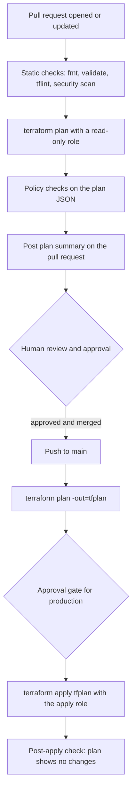

# Terraform as a team, part 2: golden rules and a CI/CD pipeline

## In plain words

An airline does not rely on each pilot remembering what to check before take-off. There is a printed checklist, the same for every flight, and the plane does not move until every line is ticked. The checklist is not there because pilots are careless. It is there because people under time pressure skip steps, and the cost of one skipped step is too high.

The previous lesson described the workflow a Terraform change should follow. A workflow that depends on people remembering it will be skipped the first time someone is in a hurry. This lesson turns the workflow into a machine that enforces it: a **CI/CD pipeline**, an automated sequence that checks every proposed change, shows reviewers exactly what it would do, and applies it only after approval.

It begins with a short list of rules that every healthy Terraform team follows, and then builds a complete pipeline for GitHub Actions, one block at a time.

Why this matters for a job: writing or repairing the Terraform pipeline is a common first substantial task for a platform or DevOps engineer. In interviews, "design a CI/CD pipeline for Terraform" is asked directly, and the expected answer has specific parts: plan on pull request, a saved plan applied after merge, least-privilege credentials, locking and a human gate for production.

> **Before this lesson:** read [Terraform as a team, part 1: adopting IaC and the two deployment workflows](#/lesson/terraform/adopting-iac-workflows), [Testing, part 1: manual tests, static analysis, policy and plan testing](#/lesson/terraform/manual-static-plan-testing) and [Secrets, part 1: the rules, the tools and authenticating providers](#/lesson/terraform/secrets-basics-providers). The CI/CD track explains pipelines in general: start with [A complete GitHub Actions pipeline, line by line](#/lesson/cicd/github-actions-workflow) and [Guardrails: branch protection, required checks and merge queues](#/lesson/cicd/guardrails).

## The golden rules

Each rule comes with a sign that a team is breaking it.

| Rule | Warning sign |
|---|---|
| 1. The main branch of the live repository matches what is deployed, one to one | `terraform plan` on main shows changes nobody recognises |
| 2. All changes to managed infrastructure go through code | Someone says "I fixed it in the console" |
| 3. Applies to shared environments come only from the main branch, through the pipeline | Someone runs `apply` to production from a laptop |
| 4. Every change is reviewed, and the reviewer reads the plan | Pull requests are approved in under a minute |
| 5. State is remote, locked, encrypted and isolated per environment and component | One state file for everything, or a state file in Git |
| 6. Changes reach production only after passing through earlier environments with the same module version | Production is the first place a change is applied |
| 7. Versions are pinned: Terraform, providers and modules | The same code produces a different plan next week |
| 8. Secrets never appear in code, logs or artifacts | An access key in a `.tfvars` file or a pipeline variable printed in a log |

Everything else in this lesson is machinery for making these rules hard to break.

## What the pipeline must do

**CI/CD** stands for continuous integration and continuous delivery: automatically checking every change, and automatically carrying approved changes to their destination.

A Terraform pipeline has two triggers, with different jobs and different permissions.



**On a pull request** the pipeline answers one question for the reviewer: *what would this change do?* It must not be able to change anything, because the code has not been reviewed yet.

**On a merge to main** the pipeline applies the reviewed change. This is the only place where powerful credentials are used.

Design decisions that follow from the golden rules:

- **Two roles.** A read-only role for pull requests and a write role usable only from the main branch, as the secrets lesson described, using OIDC so no long-lived keys are stored.
- **Apply a saved plan.** The apply job produces a plan file and applies that exact file, so what runs is what was shown. Applying without a saved plan computes a new plan at apply time, which may differ.
- **One run at a time per state.** The backend lock already prevents two writers, but queueing runs in the pipeline is cleaner than having the second one fail on the lock.
- **A human gate before production.** Automatic for dev, approval for prod.
- **Nothing sensitive in logs or public artifacts.** Plan files and plan JSON are treated as secrets.

## A complete pipeline, block by block

The file below lives at `.github/workflows/terraform.yml` in the live repository. It handles one configuration folder to keep the example readable; a note afterwards explains how to extend it to many.

> [!WARNING]
> **Cost and safety.** A pipeline that can apply Terraform can create, change and delete everything its role allows, with nobody watching. Before enabling the apply job: restrict the apply role's trust policy to the main branch of this one repository, turn on branch protection so nothing reaches main unreviewed, require approval on the production environment, and test the whole pipeline against a sandbox account first.

### Triggers, permissions and concurrency

```yaml
name: terraform

on:
  pull_request:
    paths: ["live/prod/services/bookshelf/**"]
  push:
    branches: [main]
    paths: ["live/prod/services/bookshelf/**"]

permissions:
  contents: read
  id-token: write
  pull-requests: write

concurrency:
  group: tf-prod-services-bookshelf
  cancel-in-progress: false

env:
  TF_IN_AUTOMATION: "true"
  TF_INPUT: "false"
  WORKDIR: live/prod/services/bookshelf
```

- `on` lists the triggers: pull requests, and pushes to `main`. The `paths` filter runs the workflow only when files in this folder change.
- `permissions` grants the job's built-in token the minimum it needs: read the code, request an OIDC identity token, and comment on pull requests.
- `concurrency` puts every run for this state in one queue. `cancel-in-progress: false` matters: a newer run must wait, not cancel an apply that is halfway through.
- `TF_IN_AUTOMATION` trims Terraform's interactive hints, and `TF_INPUT=false` makes Terraform fail instead of waiting for a question nobody can answer.

### The pull request job

```yaml
jobs:
  plan:
    if: github.event_name == 'pull_request'
    runs-on: ubuntu-latest
    defaults:
      run:
        working-directory: ${{ env.WORKDIR }}
    steps:
      - uses: actions/checkout@v4

      - uses: hashicorp/setup-terraform@v3
        with:
          terraform_version: 1.13.4

      - uses: aws-actions/configure-aws-credentials@v4
        with:
          role-to-assume: arn:aws:iam::123456789012:role/terraform-plan-readonly
          aws-region: eu-west-1

      - name: Static checks
        run: |
          terraform fmt -check -recursive
          terraform init -input=false
          terraform validate

      - name: Lint and scan
        run: |
          tflint --recursive
          trivy config --exit-code 1 --severity HIGH,CRITICAL .

      - name: Plan
        id: plan
        run: |
          set +e
          terraform plan -input=false -lock-timeout=5m -out=tfplan -detailed-exitcode
          echo "exitcode=$?" >> "$GITHUB_OUTPUT"
          set -e
          terraform show -no-color tfplan > plan.txt
          terraform show -json tfplan > plan.json

      - name: Fail if the plan errored
        if: steps.plan.outputs.exitcode == '1'
        run: exit 1

      - name: Policy checks
        run: conftest test plan.json --policy ../../../../policy

      - name: Comment plan on the pull request
        uses: actions/github-script@v7
        with:
          script: |
            const fs = require('fs');
            const plan = fs.readFileSync('${{ env.WORKDIR }}/plan.txt', 'utf8');
            const summary = plan.split('\n').filter(l => /^(Plan:|No changes)/.test(l)).join('\n');
            const body = `### Terraform plan: \`${{ env.WORKDIR }}\`\n\n**${summary}**\n\n<details><summary>Full plan</summary>\n\n\`\`\`\n${plan.slice(0, 60000)}\n\`\`\`\n</details>`;
            await github.rest.issues.createComment({ ...context.repo, issue_number: context.issue.number, body });
```

Step by step:

- `if: github.event_name == 'pull_request'` limits this job to pull requests.
- `actions/checkout` fetches the code; `setup-terraform` installs a **pinned** Terraform version (golden rule 7).
- `configure-aws-credentials` exchanges the job's OIDC token for temporary credentials of the **read-only** role.
- **Static checks** fail fast and cheaply before anything contacts the cloud API.
- **Lint and scan** run the linter and the security scanner; `--exit-code 1` makes high and critical findings fail the job.
- **Plan** needs explanation. `-detailed-exitcode` makes `terraform plan` exit with **0** when there are no changes, **1** on error and **2** when there are changes. Exit code 2 is not a failure, so the step switches off "stop on error" with `set +e`, records the code, and switches it back on. `-lock-timeout=5m` waits for a lock instead of failing immediately. The plan is then rendered as text for people and JSON for tools.
- **Policy checks** run the rules from the testing lesson against `plan.json`.
- **Comment** posts the summary line and the full plan, folded, on the pull request. The human-readable plan masks sensitive values; the JSON and the binary plan are deliberately *not* uploaded anywhere.

One caution about commenting plans: if your repository is public, or the plan might include values not marked sensitive, post only the summary and keep the full plan in access-restricted logs.

### The apply job

```yaml
  apply:
    if: github.event_name == 'push' && github.ref == 'refs/heads/main'
    runs-on: ubuntu-latest
    environment: production
    defaults:
      run:
        working-directory: ${{ env.WORKDIR }}
    steps:
      - uses: actions/checkout@v4

      - uses: hashicorp/setup-terraform@v3
        with:
          terraform_version: 1.13.4

      - uses: aws-actions/configure-aws-credentials@v4
        with:
          role-to-assume: arn:aws:iam::123456789012:role/terraform-apply
          aws-region: eu-west-1

      - name: Init and plan
        run: |
          terraform init -input=false
          terraform plan -input=false -lock-timeout=10m -out=tfplan

      - name: Apply the saved plan
        run: terraform apply -input=false -lock-timeout=10m tfplan

      - name: Verify nothing is left to do
        run: terraform plan -input=false -detailed-exitcode
```

- The `if` restricts this job to pushes on `main`.
- `environment: production` ties the job to a GitHub **environment**, a named deployment target with its own protection rules. Configure it to require approval from named reviewers, and the job pauses until one of them approves.
- The credentials step assumes the **apply** role. Its trust policy accepts only tokens from this repository's main branch, so even a modified workflow on another branch cannot obtain it.
- **Init and plan** makes a fresh plan against the current state and saves it.
- **Apply the saved plan** applies precisely that file. No `-auto-approve` flag is needed, because a saved plan is its own approval.
- **Verify** runs one more plan with `-detailed-exitcode`. Exit code 0 means the world now matches the code. A non-zero code here fails the job and tells you something did not converge.

Why re-plan at apply time instead of reusing the pull request's plan file? Time may have passed and other changes may have been merged, so the earlier file can be stale; Terraform would reject it. The combination of branch protection that requires pull requests to be up to date with main, the concurrency queue and the production approval keeps the applied plan equivalent to the reviewed one. Stricter setups store the pull request's plan as an encrypted artifact and apply exactly that; dedicated tools such as Atlantis and HCP Terraform manage this for you.

### Extending to many folders

A live repository has dozens of configuration folders. Two common approaches:

- A first job computes which folders changed and feeds the list into a **matrix**, which runs the plan job once per folder in parallel.
- A wrapper such as Terragrunt runs commands across folders in dependency order.

Whichever you choose, keep one concurrency group per state, so unrelated folders do not block each other.

## Reviewing plans at scale

A reviewer facing a 400-line plan needs help knowing where to look. Pipelines often add a short, computed summary: destructive actions, an estimated cost difference and a rough measure of risk. The simulation below produces such a summary from plan JSON. The prices are invented for the example.

```python-run
MONTHLY_PRICE = {   # invented prices per resource type and size, USD per month
    ("aws_instance", "t3.micro"): 8, ("aws_instance", "t3.large"): 60,
    ("aws_db_instance", "db.t4g.micro"): 13, ("aws_db_instance", "db.r6g.large"): 165,
    ("aws_lb", None): 18,
}
STATEFUL = {"aws_db_instance", "aws_s3_bucket", "aws_ebs_volume"}

plan = [   # (address, type, actions, before size, after size)
    ("aws_lb.web",                  "aws_lb",          ["create"],            None,           None),
    ("aws_instance.worker[0]",      "aws_instance",    ["update"],            "t3.micro",     "t3.large"),
    ("aws_instance.worker[1]",      "aws_instance",    ["update"],            "t3.micro",     "t3.large"),
    ("aws_db_instance.orders",      "aws_db_instance", ["delete", "create"],  "db.t4g.micro", "db.r6g.large"),
    ("aws_s3_bucket.tmp_exports",   "aws_s3_bucket",   ["delete"],            None,           None),
    ("aws_security_group.web",      "aws_security_group", ["no-op"],          None,           None),
]

def price(rtype, size):
    return MONTHLY_PRICE.get((rtype, size), 0)

add = change = destroy = 0
delta = 0
flags = []
for addr, rtype, actions, before, after in plan:
    add += "create" in actions
    change += actions == ["update"]
    destroy += "delete" in actions
    if "create" in actions or actions == ["update"]:
        delta += price(rtype, after)
    if "delete" in actions or actions == ["update"]:
        delta -= price(rtype, before)
    if "delete" in actions:
        kind = "REPLACE" if "create" in actions else "DESTROY"
        risk = "HIGH: stateful, data loss" if rtype in STATEFUL else "medium"
        flags.append(f"{kind:8} {addr:28} risk {risk}")

print(f"Plan: {add} to add, {change} to change, {destroy} to destroy.")
print(f"Estimated monthly cost change: {delta:+d} USD")
print("Destructive actions requiring explicit sign-off:")
for f in flags:
    print("  ", f)
print("\nVerdict:", "BLOCK until a named owner approves" if any("HIGH" in f for f in flags) else "ok for normal review")
```

Real pipelines use tools for the cost part, such as Infracost, which reads the plan and the cloud's published prices. The value of any such summary is to put the two or three lines that deserve attention at the top, above the hundreds that do not.

## Beyond plan and apply

A mature pipeline adds a few scheduled and supporting jobs:

- **Drift detection.** A nightly job runs `terraform plan -detailed-exitcode` on main for every folder. Exit code 2 means the real world no longer matches the code, either through a manual change or merged-but-unapplied code, and the job opens an issue or sends an alert. This is golden rule 1, checked automatically.
- **Module tests.** In the modules repository, the pipeline runs static checks on every pull request and the deploying tests from the testing lessons on changed modules, in a test account.
- **Dependency updates.** A bot such as Renovate or Dependabot opens pull requests when new provider or module versions appear, so upgrades are small and regular instead of rare and frightening.
- **Break-glass procedure.** A documented way to act in an emergency when the pipeline itself is down: who may do it, with which credentials, and the requirement to reconcile the code afterwards.

### Dedicated tools

You do not have to build all this yourself. **Atlantis** is an open-source server that listens to pull requests, runs `plan` automatically and runs `apply` when someone comments a command on the pull request. **HCP Terraform**, **Spacelift**, **env0** and **Scalr** are hosted services that provide remote runs, state storage, policy checks, approvals and drift detection as a product. The trade-off is the usual one between building and buying: less to maintain, at the price of a subscription and another system with powerful credentials.

> [!INTERVIEW]
> "Design a CI/CD pipeline for Terraform." On pull request: format, validate, lint, security scan, then plan with a read-only role obtained through OIDC, policy checks on the plan JSON, and the plan posted for reviewers. On merge to main: plan to a file, a manual approval gate for production, apply that saved plan with a separate write role restricted to the main branch, then verify with a no-change plan. Add one run at a time per state, remote locked state, pinned versions, promotion of the same module version through environments, nightly drift detection, and no secrets or plan files in logs.

## Pitfalls

- **`terraform apply -auto-approve` on pull requests.** Unreviewed code changes real infrastructure.
- **One powerful role for everything.** A pull request from any branch can then run arbitrary commands with write access.
- **Treating exit code 2 from `-detailed-exitcode` as a failure**, or forgetting that 1 is the real error.
- **`cancel-in-progress: true` on apply jobs.** Cancelling mid-apply leaves partial changes and possibly a stale lock.
- **Uploading plan files or plan JSON as ordinary artifacts.** They can contain secrets.
- **Unpinned Terraform or provider versions in the pipeline.** The plan changes without any code change.
- **Workflows triggered by pull requests from forks with access to secrets or roles.** Untrusted code must never reach credentials.
- **No drift detection.** Manual changes accumulate unseen until an unrelated apply reverts them.
- **Pipeline as the only path, with no emergency procedure.** When it breaks during an incident, people improvise.

## Cheat sheet

| Need | Technique |
|---|---|
| Non-interactive runs | `TF_IN_AUTOMATION=true`, `-input=false` |
| Detect "changes present" | `terraform plan -detailed-exitcode` (0 none, 1 error, 2 changes) |
| Wait for a lock | `-lock-timeout=10m` |
| Apply what was planned | `terraform plan -out=tfplan` then `terraform apply tfplan` |
| Plan for humans / tools | `terraform show -no-color tfplan` / `terraform show -json tfplan` |
| No stored cloud keys | OIDC with `id-token: write` and `configure-aws-credentials` |
| Separate permissions | Read-only role for plan, write role for apply on main only |
| One run per state | `concurrency` group, `cancel-in-progress: false` |
| Human gate | Protected `environment` with required reviewers |
| Drift detection | Scheduled plan on main; alert on exit code 2 |
| Cost visibility | A cost estimate from the plan (for example Infracost) |
| Buy instead of build | Atlantis, HCP Terraform, Spacelift, env0 |

## Summary

- The golden rules: main mirrors production; all changes through code; applies only from main through the pipeline; every plan reviewed; state remote, locked and isolated; changes promoted through environments; versions pinned; no secrets in code, logs or artifacts.
- A Terraform pipeline plans on pull requests with read-only credentials and applies on merge with separate, restricted credentials.
- The plan is checked by static tools and policy, then shown to reviewers; the apply job applies a saved plan after an approval gate and verifies that nothing remains to change.
- `-detailed-exitcode`, `-lock-timeout`, concurrency groups and protected environments are the mechanics that make this reliable.
- Summaries of destructive actions, cost and risk direct reviewers' attention to what matters.
- Scheduled drift detection, automated dependency updates and a break-glass procedure complete the system; dedicated tools provide much of it ready-made.

## Glossary

- **CI/CD:** continuous integration and continuous delivery, the automated checking and delivery of changes.
- **Pipeline:** an automated sequence of steps run on a change.
- **Trigger:** the event that starts a pipeline, such as a pull request or a push.
- **Read-only role / apply role:** separate identities for planning and for changing infrastructure.
- **`-detailed-exitcode`:** a plan option that signals "no changes", "error" or "changes" through the exit code.
- **Concurrency group:** a queue ensuring only one run of a kind executes at a time.
- **Environment (GitHub):** a named deployment target with protection rules such as required reviewers.
- **Approval gate:** a pause that needs a person's approval to continue.
- **Matrix:** a pipeline feature that runs the same job for each item in a list.
- **Drift detection:** a scheduled check that deployed infrastructure still matches the code.
- **Break-glass procedure:** a documented emergency path that bypasses normal controls.
- **Atlantis:** an open-source tool that runs Terraform from pull request comments.

## Check yourself

```quiz
[
  {"q": "A pipeline step runs `terraform plan -detailed-exitcode` and the command exits with code 2. What does that mean?",
   "options": ["The plan failed with an error", "The plan succeeded and there are changes to apply", "The plan succeeded with no changes", "The state is locked"], "answer": 1,
   "explain": "With -detailed-exitcode, 0 means no changes, 1 means error and 2 means the plan succeeded and contains changes."},
  {"q": "Why should the pull request job use a different role from the apply job?",
   "options": ["Plans need more permissions", "Unreviewed code should at most read; only reviewed code on main may change infrastructure", "GitHub requires two roles", "To make the state lock work"], "answer": 1,
   "explain": "A pull request's code has not been reviewed. Limiting it to a read-only role means a malicious or mistaken change cannot modify anything."},
  {"q": "The nightly drift job runs plan on main for production and gets `Plan: 0 to add, 1 to change, 0 to destroy`. Nobody merged anything. What is the most likely explanation?",
   "options": ["Terraform is non-deterministic", "Someone changed a resource by hand, so reality no longer matches the code", "The lock file is missing", "The backend was migrated"], "answer": 1,
   "explain": "With no code change, a pending update means the real resource differs from the configuration: drift from a manual change."},
  {"q": "Why does the apply job run `terraform apply tfplan` instead of `terraform apply -auto-approve`?",
   "options": ["It is faster", "A saved plan guarantees that exactly the planned actions are applied; -auto-approve computes and applies a fresh plan nobody saw", "tfplan skips state locking", "-auto-approve does not work in CI"], "answer": 1,
   "explain": "Applying a plan file executes precisely what was produced and inspected. Without it, the actions are decided at apply time."},
  {"q": "A concurrency group for apply jobs is set with `cancel-in-progress: true`. A second merge arrives while an apply is running. What is the danger?",
   "options": ["None", "The running apply is cancelled midway, leaving partial changes and possibly a stale lock", "Both applies run in parallel", "The second merge is rejected"], "answer": 1,
   "explain": "Interrupting an apply leaves infrastructure half changed and can leave the state lock held. Queue runs instead of cancelling."},
  {"q": "After applying, the pipeline runs one more plan and it shows changes. What does that indicate?",
   "options": ["Everything is fine", "The configuration did not converge: something is recomputed each run, was changed externally, or partially failed", "The plan file was applied twice", "The provider needs upgrading"], "answer": 1,
   "explain": "A correct apply leaves nothing to do. A non-empty follow-up plan points at a perpetual diff, outside interference or an incomplete apply."},
  {"q": "Which of these should NOT be uploaded as a general-access pipeline artifact?",
   "options": ["The linter's report", "The plan JSON", "The formatted list of changed files", "The policy rule files"], "answer": 1,
   "explain": "Plan JSON contains resolved values, including secrets. Treat it and the binary plan file as sensitive."},
  {"q": "A pull request changes one line and its plan summary reads `Plan: 1 to add, 0 to change, 1 to destroy` for `aws_db_instance.orders`. What should the reviewer do?",
   "options": ["Approve; one line is low risk", "Block: the database would be replaced, which destroys its data, so a migration plan is needed", "Ask for more tests of the linter", "Rerun the pipeline until the plan changes"], "answer": 1,
   "explain": "One add and one destroy on the same address is a replacement. For a stateful resource that means data loss, whatever the size of the diff."}
]
```

> **Source:** Brikman, Terraform: Up & Running 3e, ch. 10 (a workflow for deploying infrastructure code, putting it all together). Documentation: https://developer.hashicorp.com/terraform/tutorials/automation/github-actions, https://developer.hashicorp.com/terraform/cli/commands/plan, https://docs.github.com/en/actions/deployment/targeting-different-environments/using-environments-for-deployment and https://www.runatlantis.io/docs/
