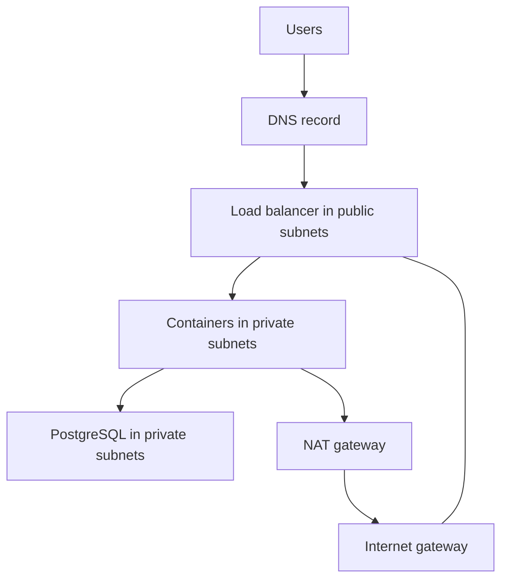

# Worked project, part 1: repository, remote state, network and security groups

## In plain words

Up to now each lesson has taught one tool in isolation, like practising chopping, frying and seasoning separately. A worked project is cooking a whole meal: the individual skills are the same, but now the order matters, things have to be ready at the same time, and you find out which of your habits hold up.

Over this lesson and the next you will codify a small but realistic production stack for the fictional shop Harbour Books:

- a private network (VPC) across two Availability Zones;
- security groups that allow only the traffic each tier needs;
- a container service running the web application behind a load balancer;
- a managed PostgreSQL database;
- a DNS name with a TLS certificate;
- remote state with locking;
- two environments, `dev` and `prod`, built from the same modules with different sizes.

This first part lays the foundations: the repository layout, the state backend, the network and the firewalls. Nothing in it is new syntax. What is new is seeing the pieces from the whole track fit together, and the reasoning behind each decision.

Why this matters for a job: take-home exercises and system design interviews ask for exactly this ("put a containerised app with a database on AWS using Terraform"). Being able to sketch the layout, the state boundaries and the order of operations from memory is a strong signal.

> **Before this lesson:** you should have completed the track up to [Terraform as a team, part 2: golden rules and a CI/CD pipeline](#/lesson/terraform/cicd-for-terraform). The AWS concepts come from [VPCs, CIDR planning, subnets, route tables and gateways](#/lesson/aws/vpc-basics) and [Security groups versus network ACLs](#/lesson/aws/vpc-firewalls), and the AWS track builds a similar system by hand in [Project part 1: from one Lightsail server to a VPC with RDS and S3](#/lesson/aws/project-foundations). Comparing the console version with this one is a good exercise.

> [!WARNING]
> **Cost and safety.** This project creates billable resources. In this part, the item to watch is the **NAT gateway**, which is charged for every hour it exists plus the data that passes through it, at a rate that adds up to tens of US dollars a month each. The dev environment below uses one; production uses one per zone. If you apply this for practice: use a dedicated sandbox account with a budget alert, apply only `dev`, and destroy everything, in reverse order, the same day. Do not apply any of it in an account that holds real systems.

## The design in one picture



Three tiers, each in its own subnets:

- The **public** subnets hold only the load balancer and the NAT gateway. A subnet is public when its route table sends internet-bound traffic to an **internet gateway**.
- The **private app** subnets hold the containers. They have no public addresses. To reach the internet (to download images, call external APIs) they go out through a **NAT gateway**, which lets private machines start outgoing connections while blocking incoming ones.
- The **private data** subnets hold the database, with no route to the internet at all.

## Decision 1: repository layout and state boundaries

Two repositories, following the versioning and team lessons. For a small project they can be two top-level folders of one repository, with a note to split them later.

```bash
harbour-infra/
├── modules/
│   ├── network/              # VPC, subnets, gateways, routes
│   ├── security-groups/      # the three firewalls and their rules
│   ├── postgres/             # managed database (part 2)
│   └── container-service/    # cluster, service, load balancer (part 2)
├── live/
│   ├── bootstrap/            # state bucket (applied once, by an administrator)
│   ├── global/
│   │   └── dns-zone/         # the hosted zone shared by all environments
│   ├── dev/
│   │   │   ├── network/
│   │   ├── data/
│   │   └── app/
│   └── prod/
│       ├── network/
│       ├── data/
│       └── app/
├── policy/                   # plan policies
└── .github/workflows/
```

Each folder under `live/<env>/` is a root module with its own state. The boundaries follow the rule from the state isolation lesson: split by rate of change and by risk.

| State | Changes | Risk if broken | Depends on |
|---|---|---|---|
| `bootstrap` | Almost never | Every state is lost | Nothing |
| `global/dns-zone` | Rarely | Site unreachable | Nothing |
| `<env>/network` | A few times a year | Everything in the environment | Nothing |
| `<env>/data` | Monthly | Data loss | network |
| `<env>/app` | Weekly or daily | A failed release | network, data, dns-zone |

The frequently changed, low-risk state (`app`) is separate from the rarely changed, high-risk ones. A routine release cannot plan a change to the database or the VPC, because they are not in its state.

## Decision 2: the state backend

Following the state lesson, a bootstrap configuration creates one bucket per environment tier. In a real organisation `dev` and `prod` would be separate AWS accounts with a bucket each; the code is the same, and only the credentials differ.

```hcl
# live/bootstrap/main.tf
terraform {
  required_version = ">= 1.10.0"

  required_providers {
    aws = {
      source  = "hashicorp/aws"
      version = "~> 6.0"
    }
  }
}

provider "aws" {
  region = "eu-west-1"

  default_tags {
    tags = {
      Project   = "harbour-books"
      ManagedBy = "terraform"
      Stack     = "bootstrap"
    }
  }
}

locals {
  buckets = toset(["dev", "prod"])
}

resource "aws_s3_bucket" "state" {
  for_each = local.buckets
  bucket   = "harbour-books-tfstate-${each.key}"

  lifecycle {
    prevent_destroy = true
  }
}

resource "aws_s3_bucket_versioning" "state" {
  for_each = aws_s3_bucket.state
  bucket   = each.value.id

  versioning_configuration {
    status = "Enabled"
  }
}

resource "aws_s3_bucket_server_side_encryption_configuration" "state" {
  for_each = aws_s3_bucket.state
  bucket   = each.value.id

  rule {
    apply_server_side_encryption_by_default {
      sse_algorithm = "aws:kms"
    }
  }
}

resource "aws_s3_bucket_public_access_block" "state" {
  for_each                = aws_s3_bucket.state
  bucket                  = each.value.id
  block_public_acls       = true
  block_public_policy     = true
  ignore_public_acls      = true
  restrict_public_buckets = true
}
```

Points worth noticing:

- `required_version = ">= 1.10.0"` because the S3 lock file used below needs that release or newer.
- `default_tags` in the provider block applies a set of tags to every taggable resource this provider creates. It is the easiest way to satisfy a "required tags" policy.
- `for_each = local.buckets` creates one bucket per environment, addressed as `aws_s3_bucket.state["dev"]` and `aws_s3_bucket.state["prod"]`.
- `for_each = aws_s3_bucket.state` on the three companion resources is a neat pattern called **chaining**: a resource that uses `for_each` is itself a map, so it can drive another `for_each`. `each.value` is then the whole bucket object, and `each.value.id` its name.
- `prevent_destroy` guards the buckets.

Every other root module then starts with a backend block whose `key` mirrors its folder path:

```hcl
# live/dev/network/backend.tf
terraform {
  backend "s3" {
    bucket       = "harbour-books-tfstate-dev"
    key          = "network/terraform.tfstate"
    region       = "eu-west-1"
    encrypt      = true
    use_lockfile = true
  }
}
```

## The network module

### Interface first

Design the inputs and outputs before the resources. The questions to ask are "what must differ between dev and prod?" and "what will other modules need from this one?".

```hcl
# modules/network/variables.tf
variable "name" {
  description = "Prefix for resource names, for example harbour-dev"
  type        = string
}

variable "cidr_block" {
  description = "IP range of the VPC, such as 10.20.0.0/16"
  type        = string

  validation {
    condition     = can(cidrhost(var.cidr_block, 0))
    error_message = "cidr_block must be a valid IPv4 CIDR range."
  }
}

variable "az_count" {
  description = "How many Availability Zones to spread across"
  type        = number
  default     = 2

  validation {
    condition     = var.az_count >= 2 && var.az_count <= 3
    error_message = "az_count must be 2 or 3."
  }
}

variable "single_nat_gateway" {
  description = "true: one shared NAT gateway (cheaper). false: one per zone (resilient)."
  type        = bool
  default     = true
}
```

- `can(expression)` returns true when the expression evaluates without an error. `cidrhost` fails on text that is not a valid range, so together they validate the format.
- `single_nat_gateway` is the one real difference between environments in this module: dev saves money with one, prod buys resilience with one per zone.

### Planning the address space with locals

```hcl
# modules/network/main.tf
data "aws_availability_zones" "available" {
  state = "available"
}

locals {
  azs = slice(data.aws_availability_zones.available.names, 0, var.az_count)

  # tier => first subnet number; each zone takes the next number
  tiers = {
    public = 0
    app    = 10
    data   = 20
  }

  subnets = merge([
    for tier, offset in local.tiers : {
      for i, az in local.azs : "${tier}-${az}" => {
        tier = tier
        az   = az
        cidr = cidrsubnet(var.cidr_block, 8, offset + i)
      }
    }
  ]...)

  nat_azs = var.single_nat_gateway ? [local.azs[0]] : local.azs
}
```

This is the densest block in the project, so take it slowly.

- The data source lists the zones available in the Region. `slice(list, 0, n)` takes the first `n`, giving for example `["eu-west-1a", "eu-west-1b"]`. Nothing is hard-coded to one Region.
- `local.tiers` assigns each tier a starting number.
- `local.subnets` builds one map entry per tier per zone. The outer `for` loops over tiers and produces a *list of maps*; `merge(...)` with the three dots after the list expands the list into separate arguments, combining them into one map. The keys look like `public-eu-west-1a` and `data-eu-west-1b`.
- `cidrsubnet(prefix, newbits, netnum)` carves a smaller range out of a larger one. With a `/16` VPC and 8 new bits, each subnet is a `/24` (256 addresses), and `netnum` picks which one: `10.20.0.0/24`, `10.20.1.0/24` for public, `10.20.10.0/24`, `10.20.11.0/24` for app, and so on.
- `local.nat_azs` is a list of one zone or all zones, depending on the flag.

Why a map keyed by name, and not `count`? Because of the index-shifting lesson. If a third zone is added later, the existing subnets keep their keys and are untouched.

You can check the arithmetic without deploying anything. The simulation reproduces `cidrsubnet` with Python's standard library.

```python-run
import ipaddress

def cidrsubnet(prefix, newbits, netnum):
    net = ipaddress.ip_network(prefix)
    return str(list(net.subnets(prefixlen_diff=newbits))[netnum])

vpc = "10.20.0.0/16"
azs = ["eu-west-1a", "eu-west-1b"]
tiers = {"public": 0, "app": 10, "data": 20}

subnets = {f"{tier}-{az}": {"tier": tier, "az": az, "cidr": cidrsubnet(vpc, 8, offset + i)}
           for tier, offset in tiers.items() for i, az in enumerate(azs)}

for key, s in sorted(subnets.items()):
    print(f"{key:22} {s['cidr']:16} {ipaddress.ip_network(s['cidr']).num_addresses} addresses")

# Adding a third zone must not change any existing subnet
azs3 = azs + ["eu-west-1c"]
subnets3 = {f"{tier}-{az}": cidrsubnet(vpc, 8, offset + i)
            for tier, offset in tiers.items() for i, az in enumerate(azs3)}
changed = [k for k in subnets if subnets3[k] != subnets[k]["cidr"]]
print("\nexisting subnets changed by adding a zone:", changed or "none")
print("new subnets:", sorted(set(subnets3) - set(subnets)))
```

### The resources

```hcl
resource "aws_vpc" "this" {
  cidr_block           = var.cidr_block
  enable_dns_support   = true
  enable_dns_hostnames = true

  tags = { Name = var.name }
}

resource "aws_subnet" "this" {
  for_each = local.subnets

  vpc_id                  = aws_vpc.this.id
  availability_zone       = each.value.az
  cidr_block              = each.value.cidr
  map_public_ip_on_launch = each.value.tier == "public"

  tags = {
    Name = "${var.name}-${each.key}"
    Tier = each.value.tier
  }
}

resource "aws_internet_gateway" "this" {
  vpc_id = aws_vpc.this.id
  tags   = { Name = var.name }
}

resource "aws_eip" "nat" {
  for_each = toset(local.nat_azs)
  domain   = "vpc"
  tags     = { Name = "${var.name}-nat-${each.key}" }
}

resource "aws_nat_gateway" "this" {
  for_each      = toset(local.nat_azs)
  allocation_id = aws_eip.nat[each.key].id
  subnet_id     = aws_subnet.this["public-${each.key}"].id
  tags          = { Name = "${var.name}-${each.key}" }

  depends_on = [aws_internet_gateway.this]
}
```

- The VPC enables DNS support so resources get resolvable names.
- One `aws_subnet` block creates all six subnets. `map_public_ip_on_launch` is true only for the public tier: an expression on `each.value` instead of three near-identical blocks.
- The internet gateway connects the VPC to the internet.
- A NAT gateway needs a fixed public address, an **Elastic IP** (`aws_eip`), and sits in a public subnet. Both use `for_each` over the one or several zones. The subnet is found by rebuilding its key, `"public-${each.key}"`.
- `depends_on` appears because a NAT gateway cannot work until the internet gateway is attached, yet it references no attribute of it. This is the legitimate use of an explicit dependency.

Routing ties it together:

```hcl
resource "aws_route_table" "public" {
  vpc_id = aws_vpc.this.id
  tags   = { Name = "${var.name}-public" }
}

resource "aws_route" "public_internet" {
  route_table_id         = aws_route_table.public.id
  destination_cidr_block = "0.0.0.0/0"
  gateway_id             = aws_internet_gateway.this.id
}

resource "aws_route_table" "app" {
  for_each = toset(local.azs)
  vpc_id   = aws_vpc.this.id
  tags     = { Name = "${var.name}-app-${each.key}" }
}

resource "aws_route" "app_nat" {
  for_each               = toset(local.azs)
  route_table_id         = aws_route_table.app[each.key].id
  destination_cidr_block = "0.0.0.0/0"
  nat_gateway_id = aws_nat_gateway.this[
    var.single_nat_gateway ? local.azs[0] : each.key
  ].id
}

resource "aws_route_table" "data" {
  vpc_id = aws_vpc.this.id
  tags   = { Name = "${var.name}-data" }
}

resource "aws_route_table_association" "this" {
  for_each  = local.subnets
  subnet_id = aws_subnet.this[each.key].id
  route_table_id = (
    each.value.tier == "public" ? aws_route_table.public.id :
    each.value.tier == "app" ? aws_route_table.app[each.value.az].id :
    aws_route_table.data.id
  )
}
```

- The public route table sends everything not local (`0.0.0.0/0`) to the internet gateway. Routes are separate `aws_route` resources, not inline blocks, following the modules lesson.
- Each zone gets its own app route table, pointing at a NAT gateway: the shared one when `single_nat_gateway` is true, otherwise the one in the same zone.
- The data route table has no extra routes: the database tier can reach only addresses inside the VPC.
- One association per subnet picks the right table with a chained conditional. Parentheses allow the expression to span lines.

### Outputs

```hcl
# modules/network/outputs.tf
output "vpc_id" {
  description = "ID of the VPC"
  value       = aws_vpc.this.id
}

output "subnet_ids" {
  description = "Subnet IDs grouped by tier: public, app, data"
  value = {
    for tier in keys(local.tiers) :
    tier => [for k, s in aws_subnet.this : s.id if local.subnets[k].tier == tier]
  }
}
```

The `subnet_ids` output is a map from tier to list of IDs, built with a nested `for`. Consumers write `module.network.subnet_ids["app"]`, which reads well and cannot be confused with another tier.

## The security groups module

Three firewalls, chained so each tier accepts traffic only from the tier in front of it.

```hcl
# modules/security-groups/main.tf
locals {
  groups = {
    alb = "Load balancer: HTTPS from the internet"
    app = "Application containers: traffic from the load balancer only"
    db  = "Database: PostgreSQL from the application only"
  }
}

resource "aws_security_group" "this" {
  for_each    = local.groups
  name_prefix = "${var.name}-${each.key}-"
  description = each.value
  vpc_id      = var.vpc_id

  tags = { Name = "${var.name}-${each.key}" }

  lifecycle {
    create_before_destroy = true
  }
}

resource "aws_vpc_security_group_ingress_rule" "alb_https" {
  security_group_id = aws_security_group.this["alb"].id
  cidr_ipv4         = "0.0.0.0/0"
  from_port         = 443
  to_port           = 443
  ip_protocol       = "tcp"
}

resource "aws_vpc_security_group_ingress_rule" "app_from_alb" {
  security_group_id            = aws_security_group.this["app"].id
  referenced_security_group_id = aws_security_group.this["alb"].id
  from_port                    = var.app_port
  to_port                      = var.app_port
  ip_protocol                  = "tcp"
}

resource "aws_vpc_security_group_ingress_rule" "db_from_app" {
  security_group_id            = aws_security_group.this["db"].id
  referenced_security_group_id = aws_security_group.this["app"].id
  from_port                    = 5432
  to_port                      = 5432
  ip_protocol                  = "tcp"
}

resource "aws_vpc_security_group_egress_rule" "alb_to_app" {
  security_group_id            = aws_security_group.this["alb"].id
  referenced_security_group_id = aws_security_group.this["app"].id
  from_port                    = var.app_port
  to_port                      = var.app_port
  ip_protocol                  = "tcp"
}

resource "aws_vpc_security_group_egress_rule" "app_out" {
  security_group_id = aws_security_group.this["app"].id
  cidr_ipv4         = "0.0.0.0/0"
  ip_protocol       = "-1"
}

output "ids" {
  description = "Security group IDs keyed by tier: alb, app, db"
  value       = { for k, g in aws_security_group.this : k => g.id }
}
```

- The three groups come from one block. `name_prefix` with `create_before_destroy` allows a group to be replaced without a name clash, as in the zero-downtime lesson.
- 443 is the port for HTTPS, encrypted web traffic. 5432 is PostgreSQL's port.
- Each ingress rule except the first names another security group as its source. The database accepts connections only from things wearing the `app` group; the app only from the load balancer.
- The load balancer's egress is restricted to the app port on the app group. The app needs general outgoing access for image downloads and external calls. The database gets no egress rule at all.
- Rules are separate resources, so a root module can add one more (for a monitoring agent, say) using the `ids` output.

## The root module for dev's network

With the modules written, the environment folder is short, which is the goal.

```hcl
# live/dev/network/main.tf
provider "aws" {
  region = "eu-west-1"

  default_tags {
    tags = {
      Project     = "harbour-books"
      Environment = "dev"
      ManagedBy   = "terraform"
      Stack       = "network"
    }
  }
}

module "network" {
  source = "../../../modules/network"

  name               = "harbour-dev"
  cidr_block         = "10.20.0.0/16"
  az_count           = 2
  single_nat_gateway = true
}

module "security_groups" {
  source = "../../../modules/security-groups"

  name     = "harbour-dev"
  vpc_id   = module.network.vpc_id
  app_port = 8080
}

output "vpc_id" {
  value = module.network.vpc_id
}

output "subnet_ids" {
  value = module.network.subnet_ids
}

output "security_group_ids" {
  value = module.security_groups.ids
}
```

The production version differs in four values: the name, a different address range (`10.30.0.0/16`, so the two networks could later be connected without overlapping), `az_count = 3` and `single_nat_gateway = false`. In a real setup `source` would be a Git URL pinned to a tag, and prod would move to a new tag only after dev.

## Plan and apply

```bash
$ cd live/dev/network
$ terraform init
$ terraform plan
...
  # module.network.aws_nat_gateway.this["eu-west-1a"] will be created
  # module.network.aws_subnet.this["app-eu-west-1a"] will be created
  # module.network.aws_subnet.this["app-eu-west-1b"] will be created
  # module.network.aws_subnet.this["data-eu-west-1a"] will be created
  ...
  # module.security_groups.aws_security_group.this["db"] will be created

Plan: 31 to add, 0 to change, 0 to destroy.

Changes to Outputs:
  + security_group_ids = {
      + alb = (known after apply)
      + app = (known after apply)
      + db  = (known after apply)
    }
  + subnet_ids         = (known after apply)
  + vpc_id             = (known after apply)
```

Count before trusting the number. Network: 1 VPC, 6 subnets, 1 internet gateway, 1 Elastic IP, 1 NAT gateway, 4 route tables (public, one per zone for app, data), 3 routes (public, one per zone for app) and 6 associations: 23. Security groups: 3 groups and 5 rules: 8. Total 31, which matches.

Make this prediction every time, before you read the plan body. If your count and the summary disagree, one of two things is true: the configuration is missing or duplicating something, or your understanding of it is wrong. Either is worth knowing before anything is created. To find a difference, list the planned addresses (`terraform show -json tfplan` piped through a filter, or a search of the plan text for `will be created`) and tick them off against your list.

Apply, then run `terraform plan` once more and confirm that nothing remains to change.

For production with three zones and separate NAT gateways the count grows: 9 subnets, 3 Elastic IPs, 3 NAT gateways, 5 route tables, 4 routes and 9 associations, plus the VPC and internet gateway make 35, plus 8 for security groups: 43.

> [!TIP]
> Before writing a network yourself in a real job, look at the widely used community VPC module in the public registry. Writing one by hand, as here, is how you learn what such a module must do, and how you become able to review one.

## Pitfalls

- **Overlapping address ranges between environments.** They can never be connected later without renumbering.
- **`count` for subnets.** Adding or removing a zone shifts indexes and replaces subnets, taking everything in them along.
- **One NAT gateway in production.** If its zone fails, every private subnet loses outgoing access.
- **Forgetting NAT gateways cost money while idle.** They are usually the largest line on a small environment's bill.
- **Giving the data tier a route to the internet.** It needs none.
- **Opening the database port to the VPC range instead of the app's security group.** Anything in the VPC could then connect.
- **Network and application in one state.** A routine release can then plan changes to the VPC.
- **Trusting the plan summary without predicting it.** An unexpected number is the cheapest warning you will ever get.

## Cheat sheet

| Item | Technique |
|---|---|
| State per component | `live/<env>/<component>` with matching backend `key` |
| Tags on everything | `default_tags` in the provider block |
| Zones without hard-coding | `data "aws_availability_zones"` and `slice(...)` |
| Carve subnets | `cidrsubnet(var.cidr_block, 8, n)` |
| Many subnets, stable keys | `for_each` over a map built with nested `for` and `merge([...]...)` |
| Chained `for_each` | `for_each = aws_s3_bucket.state` |
| Validate a CIDR | `can(cidrhost(var.cidr_block, 0))` |
| Cheaper dev, resilient prod | `single_nat_gateway` flag |
| Tier isolation | Security group rules that reference other groups |
| Review a plan | Predict the resource count, then reconcile |

## Summary

- The project separates reusable modules from per-environment root modules, and gives each component its own state according to how often it changes and how much damage a mistake would do.
- A bootstrap configuration creates versioned, encrypted, protected state buckets; every root module's backend key mirrors its folder.
- The network module computes its subnets from a CIDR range and a zone count using locals, `cidrsubnet` and `for_each` with stable keys, and exposes subnet IDs grouped by tier.
- Three security groups reference each other so that each tier accepts traffic only from the tier in front of it.
- Environment root modules are short: provider, backend, module calls with a few differing values, and outputs.
- Predicting the plan's resource count before reading it catches omissions early.

## Glossary

- **Tier:** a layer of a system with one role, such as public, application or data.
- **Internet gateway:** the VPC component that connects it to the internet.
- **NAT gateway:** a service that lets private subnets make outgoing internet connections without accepting incoming ones.
- **Elastic IP:** a fixed public IP address.
- **Route table:** the rules deciding where a subnet's traffic is sent.
- **`default_tags`:** provider setting that tags every resource it creates.
- **`cidrsubnet`:** a function that calculates a smaller address range inside a larger one.
- **`slice`:** a function returning part of a list.
- **`can`:** a function that reports whether an expression evaluates without error.
- **Chaining `for_each`:** using one `for_each` resource as the collection for another.
- **HTTPS:** web traffic encrypted with TLS, normally on port 443.

## Check yourself

```quiz
[
  {"q": "With a VPC range of 10.20.0.0/16, what does `cidrsubnet(var.cidr_block, 8, 11)` return?",
   "options": ["10.20.0.0/24", "10.20.11.0/24", "10.31.0.0/16", "10.20.0.11/32"], "answer": 1,
   "explain": "Adding 8 bits to a /16 gives /24 subnets, and network number 11 is the twelfth of them: 10.20.11.0/24."},
  {"q": "Subnets are created with `for_each` over a map keyed like `app-eu-west-1a`. A third zone is added. What does the plan show for the six existing subnets?",
   "options": ["All replaced", "No change to them; three new subnets are added", "All updated in place", "Only the app subnets replaced"], "answer": 1,
   "explain": "Existing keys and their CIDR ranges are unchanged, so those instances are untouched. Only the new keys are created."},
  {"q": "In dev, `single_nat_gateway` is changed from true to false with two zones. How many NAT gateways does the plan add?",
   "options": ["0", "1", "2", "3"], "answer": 1,
   "explain": "With true there is one, keyed by the first zone. With false there is one per zone, so the second zone's gateway (and its Elastic IP) is added, and that zone's route is updated to use it."},
  {"q": "Why does the database security group reference the app security group instead of the VPC's address range?",
   "options": ["Address ranges are not supported for databases", "So only resources in the app group can connect, not everything in the VPC", "It is cheaper", "To allow internet access"], "answer": 1,
   "explain": "A security-group reference restricts the source to members of that group. A CIDR for the whole VPC would let any resource in it reach the database."},
  {"q": "Why are the network and the application kept in separate states?",
   "options": ["Terraform cannot manage both at once", "They change at different rates and carry different risk, so a routine release cannot plan changes to the network", "To avoid using modules", "Because the network has no outputs"], "answer": 1,
   "explain": "Isolation keeps the blast radius of frequent, routine changes away from rarely changed, critical infrastructure."},
  {"q": "You predicted 31 resources and the plan says `30 to add`. What is the right reaction?",
   "options": ["Apply; one resource does not matter", "Find which expected resource is missing from the plan before applying", "Run destroy", "Delete the lock file"], "answer": 1,
   "explain": "A mismatch means the configuration or your understanding is wrong. Finding the missing address before applying is far cheaper than finding it in production."},
  {"q": "What does `default_tags` in the provider block do?",
   "options": ["Tags only the VPC", "Applies the listed tags to every taggable resource created through that provider configuration", "Sets default variable values", "Tags the state file"], "answer": 1,
   "explain": "It is a provider-level setting that merges those tags into every supported resource, which makes required-tag policies easy to satisfy."},
  {"q": "The NAT gateway has `depends_on = [aws_internet_gateway.this]`. Why is an explicit dependency used here?",
   "options": ["Terraform requires it on every resource", "The NAT gateway needs the internet gateway attached but references none of its attributes", "To make the plan faster", "To force replacement"], "answer": 1,
   "explain": "With no attribute reference there is no implicit dependency, so the ordering has to be stated."}
]
```

> **Source:** original worked project drawing on Brikman, Terraform: Up & Running 3e, ch. 3 (state isolation and file layout), ch. 4 (modules) and ch. 8 (composable modules). Documentation: https://registry.terraform.io/providers/hashicorp/aws/latest/docs/resources/vpc, https://developer.hashicorp.com/terraform/language/functions/cidrsubnet, https://registry.terraform.io/providers/hashicorp/aws/latest/docs#default_tags-configuration-block and https://docs.aws.amazon.com/vpc/latest/userguide/vpc-nat-gateway.html
