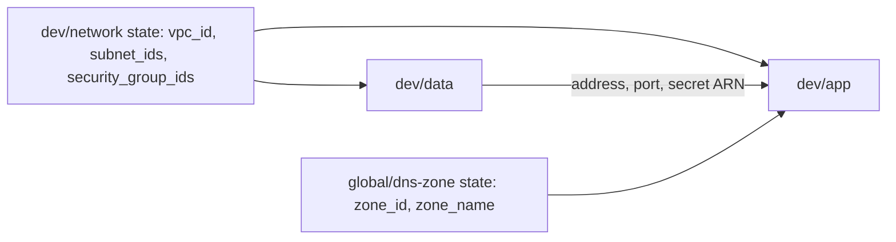

# Worked project, part 2: database, container service, DNS and environments

## In plain words

In part 1 you poured the foundations and put up the walls: a network with three tiers and firewalls between them. A building with only walls is not much use. This part moves the tenants in: a database that keeps the shop's orders, a service that runs the web application in containers, and a name on the door so customers can find it.

Then comes the step that shows why the earlier work was worth it. You will stand up a second copy of everything, production, by writing a few short files that call the same modules with larger numbers. If the modules were designed well, the second environment costs minutes, not days.

Why this matters for a job: the hard questions in a Terraform design interview are about the seams. How does the application learn the database's address? Who knows the password? In what order do things have to be created and destroyed? How do dev and prod differ, and how do you stop them drifting apart? This lesson answers each one with running code.

> **Before this lesson:** complete [Worked project, part 1: repository, remote state, network and security groups](#/lesson/terraform/project-foundations). The services used here are explained in the AWS track: [RDS and Aurora: managed relational databases](#/lesson/aws/rds-aurora), [Containers and platforms: ECS, EKS, Fargate, Elastic Beanstalk and Batch](#/lesson/aws/containers), [DNS and Route 53: records and routing policies](#/lesson/aws/route53) and [Elastic Load Balancing: ALB, NLB and health checks](#/lesson/aws/load-balancing). The AWS track's [Project part 2: load balancing, auto scaling, CloudFront, CI/CD and monitoring](#/lesson/aws/project-scale) builds a comparable system by hand.

> [!WARNING]
> **Cost and safety.** This part adds a managed database, a load balancer and running containers, each billed for every hour it exists. Together with the NAT gateway from part 1, a dev environment left running costs a few US dollars a day, and production with standby copies costs several times that. Practise in a sandbox account with a budget alert, apply only `dev`, and follow the teardown section at the end the same day. The database's deletion protection is deliberately off in dev and on in prod; do not copy the dev settings to anything real.

## How the pieces share information

Each component has its own state, so they need a way to pass values along. The project uses `terraform_remote_state`, reading only what each upstream root module publishes as outputs.



The arrows are also the apply order: network, then data, then app. Destroy runs the other way.

To avoid repeating the lookup, both downstream root modules contain the same small block:

```hcl
# live/dev/data/remote.tf  (and the same file in live/dev/app)
data "terraform_remote_state" "network" {
  backend = "s3"

  config = {
    bucket = "harbour-books-tfstate-dev"
    key    = "network/terraform.tfstate"
    region = "eu-west-1"
  }
}

locals {
  vpc_id     = data.terraform_remote_state.network.outputs.vpc_id
  subnet_ids = data.terraform_remote_state.network.outputs.subnet_ids
  sg_ids     = data.terraform_remote_state.network.outputs.security_group_ids
}
```

The app folder has two more blocks of the same shape, named `data` and `dns`, pointing at the keys `data/terraform.tfstate` and (in the shared bucket) the DNS zone's state. The locals give the long expressions short names. Remember the caution from the state isolation lesson: reading remote state requires read access to the *whole* upstream state. That is acceptable here because the network state contains no secrets. It is one reason the database password, below, is kept out of state entirely.

## The database module

The module applies the production checklist, with a few inputs so that dev can be cheaper.

```hcl
# modules/postgres/variables.tf
variable "name" {
  description = "Identifier prefix, for example harbour-dev"
  type        = string
}

variable "subnet_ids" {
  description = "Private data-tier subnets for the database"
  type        = list(string)
}

variable "security_group_id" {
  description = "Security group that controls access to the database"
  type        = string
}

variable "instance_class" {
  description = "Database instance size"
  type        = string
  default     = "db.t4g.micro"
}

variable "multi_az" {
  description = "Keep a standby copy in a second zone"
  type        = bool
  default     = false
}

variable "backup_retention_days" {
  description = "Days of automated backups to keep"
  type        = number
  default     = 1

  validation {
    condition     = var.backup_retention_days >= 1 && var.backup_retention_days <= 35
    error_message = "backup_retention_days must be between 1 and 35."
  }
}

variable "protect" {
  description = "Enable deletion protection and require a final snapshot"
  type        = bool
  default     = true
}
```

Notice which way the defaults lean. Cost-related inputs default to the cheap option, because forgetting them should not cause a surprise bill. The safety input, `protect`, defaults to the safe option, because forgetting it should not make a database deletable.

```hcl
# modules/postgres/main.tf
resource "aws_db_subnet_group" "this" {
  name_prefix = "${var.name}-"
  subnet_ids  = var.subnet_ids
}

resource "aws_db_instance" "this" {
  identifier_prefix = "${var.name}-"
  engine            = "postgres"
  engine_version    = "17.4"
  instance_class    = var.instance_class
  db_name           = "bookshelf"

  allocated_storage     = 20
  max_allocated_storage = 100
  storage_encrypted     = true

  db_subnet_group_name   = aws_db_subnet_group.this.name
  vpc_security_group_ids = [var.security_group_id]
  publicly_accessible    = false
  multi_az               = var.multi_az

  username                    = "bookshelf_admin"
  manage_master_user_password = true

  backup_retention_period   = var.backup_retention_days
  deletion_protection       = var.protect
  skip_final_snapshot       = !var.protect
  final_snapshot_identifier = var.protect ? "${var.name}-final" : null

  auto_minor_version_upgrade = true
}
```

- The subnet group lists the data-tier subnets the database may be placed in.
- `db_name` creates an initial database called `bookshelf` inside the server.
- Storage is encrypted from the start, because that cannot be changed later without replacement.
- `manage_master_user_password = true` has the service create and rotate the administrator password in Secrets Manager. Terraform never sees it, so it is in no state file and no plan.
- `!var.protect` uses `!`, the "not" operator: when protection is on, the final snapshot is *not* skipped.
- `final_snapshot_identifier` is `null`, meaning unset, when no final snapshot will be taken.

The outputs publish what the application needs, and nothing secret:

```hcl
# modules/postgres/outputs.tf
output "address" {
  description = "Host name of the database"
  value       = aws_db_instance.this.address
}

output "port" {
  description = "Port the database listens on"
  value       = aws_db_instance.this.port
}

output "db_name" {
  description = "Name of the initial database"
  value       = aws_db_instance.this.db_name
}

output "master_secret_arn" {
  description = "ARN of the Secrets Manager secret holding the administrator credentials"
  value       = aws_db_instance.this.master_user_secret[0].secret_arn
}
```

The root module is a few lines:

```hcl
# live/dev/data/main.tf
module "postgres" {
  source = "../../../modules/postgres"

  name              = "harbour-dev"
  subnet_ids        = local.subnet_ids["data"]
  security_group_id = local.sg_ids["db"]
  protect           = false
}

output "db" {
  description = "Connection details for the application"
  value = {
    address    = module.postgres.address
    port       = module.postgres.port
    name       = module.postgres.db_name
    secret_arn = module.postgres.master_secret_arn
  }
}
```

A single output that is an object keeps the interface tidy: the consumer reads `outputs.db.address`.

## The container service module

The application runs on **ECS** (Elastic Container Service) with **Fargate**, where AWS runs the containers without you managing servers. The vocabulary:

- A **cluster** is a named group that services belong to.
- A **task definition** is the recipe for one running copy: which image, how much processor and memory, which environment variables and secrets, which ports.
- A **service** keeps a chosen number of copies (called **tasks**) running and registers them with a load balancer.
- The **execution role** is the IAM role ECS itself uses to pull the image and fetch secrets on the task's behalf.

```hcl
# modules/container-service/main.tf (central parts)
resource "aws_ecs_cluster" "this" {
  name = var.name
}

resource "aws_cloudwatch_log_group" "this" {
  name              = "/ecs/${var.name}"
  retention_in_days = var.log_retention_days
}

resource "aws_ecs_task_definition" "this" {
  family                   = var.name
  requires_compatibilities = ["FARGATE"]
  network_mode             = "awsvpc"
  cpu                      = var.cpu
  memory                   = var.memory
  execution_role_arn       = aws_iam_role.execution.arn

  container_definitions = jsonencode([
    {
      name      = "web"
      image     = var.image
      essential = true

      portMappings = [{ containerPort = var.container_port }]

      environment = [
        for k, v in var.environment : { name = k, value = v }
      ]

      secrets = [
        for k, arn in var.secret_arns : { name = k, valueFrom = arn }
      ]

      logConfiguration = {
        logDriver = "awslogs"
        options = {
          awslogs-group         = aws_cloudwatch_log_group.this.name
          awslogs-region        = data.aws_region.current.region
          awslogs-stream-prefix = "web"
        }
      }
    }
  ])

  lifecycle {
    create_before_destroy = true
  }
}

resource "aws_ecs_service" "this" {
  name            = var.name
  cluster         = aws_ecs_cluster.this.id
  task_definition = aws_ecs_task_definition.this.arn
  desired_count   = var.desired_count
  launch_type     = "FARGATE"

  deployment_minimum_healthy_percent = 100
  deployment_maximum_percent         = 200

  deployment_circuit_breaker {
    enable   = true
    rollback = true
  }

  network_configuration {
    subnets         = var.subnet_ids
    security_groups = [var.security_group_id]
  }

  load_balancer {
    target_group_arn = aws_lb_target_group.this.arn
    container_name   = "web"
    container_port   = var.container_port
  }

  depends_on = [aws_lb_listener.https]
}
```

Reading the less familiar parts:

- The log group stores the containers' output; `retention_in_days` stops logs accumulating, and costing, forever.
- The `lifecycle` block registers a new revision before the old one is removed, so the service always has a valid task definition to point at.
- `cpu` and `memory` size each task. Fargate bills by these numbers per second of running time.
- `container_definitions` must be a JSON string. `jsonencode()` converts an HCL value to JSON, so you write ordinary HCL and get correct JSON, with references and `for` expressions working inside it.
- `environment` turns a map input into the list of name and value objects ECS expects, using a `for` expression.
- `secrets` does the same for secret references. Each entry names an environment variable and the ARN of a secret. **ECS fetches the secret's value when the task starts and injects it; Terraform handles only the ARN.** The password therefore never appears in the task definition, the plan or the state.
- In the service, `deployment_minimum_healthy_percent = 100` with a maximum of 200 gives a zero-downtime rolling release: new tasks start, pass health checks, and only then are old ones stopped.
- `deployment_circuit_breaker` with `rollback = true` returns to the previous task definition automatically if the new tasks fail to become healthy.
- `depends_on` appears because a service cannot register with a target group until a listener connects that target group to a load balancer, and no attribute expresses that.

The same module contains the load balancer, a target group with a health check, an HTTP listener that redirects to HTTPS, and an HTTPS listener using a certificate ARN passed in as an input. They follow the pattern from the cluster lesson. One difference: the target group has `target_type = "ip"`, because Fargate tasks are registered by IP address.

The execution role shows least privilege in practice:

```hcl
data "aws_iam_policy_document" "read_secrets" {
  statement {
    effect    = "Allow"
    actions   = ["secretsmanager:GetSecretValue"]
    resources = values(var.secret_arns)
  }
}

resource "aws_iam_role_policy" "read_secrets" {
  count  = length(var.secret_arns) > 0 ? 1 : 0
  name   = "read-secrets"
  role   = aws_iam_role.execution.id
  policy = data.aws_iam_policy_document.read_secrets.json
}
```

- The policy allows reading exactly the secrets passed to the module and no others. `values(map)` returns the map's values as a list.
- `count` with a condition creates the policy only when there is at least one secret, the conditional-resource idiom.

## DNS and the certificate

The hosted zone for the company's domain is shared by all environments, so it lives in `live/global/dns-zone` and outputs its ID and name. The app's root module requests a certificate and creates the records:

```hcl
# live/dev/app/dns.tf
locals {
  zone_id  = data.terraform_remote_state.dns.outputs.zone_id
  hostname = "shop.dev.${data.terraform_remote_state.dns.outputs.zone_name}"
}

resource "aws_acm_certificate" "site" {
  domain_name       = local.hostname
  validation_method = "DNS"

  lifecycle {
    create_before_destroy = true
  }
}

resource "aws_route53_record" "validation" {
  for_each = {
    for o in aws_acm_certificate.site.domain_validation_options :
    o.domain_name => o
  }

  zone_id = local.zone_id
  name    = each.value.resource_record_name
  type    = each.value.resource_record_type
  ttl     = 60
  records = [each.value.resource_record_value]
}

resource "aws_acm_certificate_validation" "site" {
  certificate_arn         = aws_acm_certificate.site.arn
  validation_record_fqdns = [for r in aws_route53_record.validation : r.fqdn]
}

resource "aws_route53_record" "site" {
  zone_id = local.zone_id
  name    = local.hostname
  type    = "A"

  alias {
    name                   = module.service.alb_dns_name
    zone_id                = module.service.alb_zone_id
    evaluate_target_health = true
  }
}
```

- `aws_acm_certificate` requests a TLS certificate. To prove you control the domain, the certificate service asks for specific DNS records.
- `aws_route53_record.validation` creates those records. The `for` expression converts the certificate's validation options into a map keyed by domain name, the standard list-to-map pattern for `for_each`.
- `aws_acm_certificate_validation` creates nothing in AWS. It makes Terraform *wait* until the certificate has been issued, so anything that depends on it gets a usable certificate.
- `aws_route53_record.site` is an **alias record**, a DNS record that points a name at an AWS resource such as a load balancer.

The listener in the service module takes `aws_acm_certificate_validation.site.certificate_arn`, not the certificate's own ARN. The value is the same, but referencing the validation resource makes the listener wait for issuance.

## The app root module: where everything meets

```hcl
# live/dev/app/main.tf
locals {
  db = data.terraform_remote_state.data.outputs.db
}

module "service" {
  source = "../../../modules/container-service"

  name              = "bookshelf-dev"
  image             = "123456789012.dkr.ecr.eu-west-1.amazonaws.com/bookshelf:${var.image_tag}"
  container_port    = 8080
  desired_count     = 1
  cpu               = 256
  memory            = 512
  log_retention_days = 7

  vpc_id                = local.vpc_id
  public_subnet_ids     = local.subnet_ids["public"]
  subnet_ids            = local.subnet_ids["app"]
  alb_security_group_id = local.sg_ids["alb"]
  security_group_id     = local.sg_ids["app"]
  certificate_arn       = aws_acm_certificate_validation.site.certificate_arn

  environment = {
    DB_HOST = local.db.address
    DB_PORT = tostring(local.db.port)
    DB_NAME = local.db.name
    APP_ENV = "dev"
  }

  secret_arns = {
    DB_CREDENTIALS = local.db.secret_arn
  }
}

variable "image_tag" {
  description = "Version of the application image to run"
  type        = string
}

output "url" {
  value = "https://${local.hostname}"
}
```

Follow the database's details through the system. The data root module publishes an address, a port, a name and a secret ARN. This module reads them from remote state. The address, port and name become plain environment variables. The secret ARN goes into `secret_arns`, and at start-up ECS replaces it with the credentials. At no point did a password pass through a variable, a file or a state.

`tostring()` converts the port number to text, because environment variables are strings. `var.image_tag` is supplied by the pipeline, so a release is `terraform apply -var="image_tag=1.8.3"`, and a rolling deployment follows.

## Production: the same modules, different numbers

Create `live/prod/` with the same three folders. Each file is a copy of dev's with a handful of changed values:

| Setting | dev | prod |
|---|---|---|
| State bucket | `harbour-books-tfstate-dev` | `harbour-books-tfstate-prod` |
| VPC range | `10.20.0.0/16` | `10.30.0.0/16` |
| Availability Zones | 2 | 3 |
| NAT gateways | 1 shared | 1 per zone |
| Database class | `db.t4g.micro` | `db.r6g.large` |
| Database standby (`multi_az`) | false | true |
| Backup retention | 1 day | 14 days |
| Database protection | false | true |
| Tasks (`desired_count`) | 1 | 3 |
| Task size | 256 CPU / 512 MB | 1024 CPU / 2048 MB |
| Log retention | 7 days | 90 days |
| Host name | `shop.dev.<zone>` | `shop.<zone>` |
| Module version | Newest tag | The tag proven in dev |

Everything else is identical because it is the same module code. That table is the complete difference between your environments, and it can be read in thirty seconds. If the two had been built by copying resource blocks, the real differences would be scattered through hundreds of lines.

The simulation below does what a careful reviewer does: compare the two environments' inputs and classify each difference as intended sizing or as a suspicious divergence.

```python-run
dev = {"cidr": "10.20.0.0/16", "az_count": 2, "single_nat": True, "db_class": "db.t4g.micro",
       "multi_az": False, "backups": 1, "protect": False, "tasks": 1, "container_port": 8080,
       "module_version": "v1.7.0", "engine_version": "17.4", "health_path": "/healthz"}
prod = {"cidr": "10.30.0.0/16", "az_count": 3, "single_nat": False, "db_class": "db.r6g.large",
        "multi_az": True, "backups": 14, "protect": True, "tasks": 3, "container_port": 8080,
        "module_version": "v1.6.0", "engine_version": "16.8", "health_path": "/health"}

EXPECTED_TO_DIFFER = {"cidr", "az_count", "single_nat", "db_class", "multi_az", "backups", "protect", "tasks"}
LAGS_BY_DESIGN = {"module_version"}      # prod follows dev after verification

print(f"{'setting':16}{'dev':16}{'prod':16}verdict")
for k in sorted(dev):
    if dev[k] == prod[k]:
        continue
    if k in EXPECTED_TO_DIFFER:
        verdict = "ok: sizing or isolation"
    elif k in LAGS_BY_DESIGN:
        verdict = "ok if prod is being promoted next"
    else:
        verdict = "INVESTIGATE: environments should match here"
    print(f"{k:16}{str(dev[k]):16}{str(prod[k]):16}{verdict}")
```

Two differences are flagged. A different database engine version and a different health check path mean dev is no longer a faithful rehearsal for prod, which defeats the purpose of having it.

## Order of operations

Building an environment from nothing:

```bash
# once, for the whole organisation
cd live/bootstrap        && terraform init && terraform apply
cd ../global/dns-zone    && terraform init && terraform apply

# per environment
cd ../../dev/network     && terraform init && terraform apply
cd ../data               && terraform init && terraform apply
cd ../app                && terraform init && terraform apply -var="image_tag=1.8.3"
```

What a routine release looks like afterwards, changing only the image tag:

```bash
$ cd live/dev/app && terraform plan -var="image_tag=1.8.4"

  # module.service.aws_ecs_task_definition.this must be replaced
+/- resource "aws_ecs_task_definition" "this" {
      ~ arn                   = "arn:aws:ecs:...:task-definition/bookshelf-dev:41" -> (known after apply)
      ~ container_definitions = jsonencode(
          ~ [
              ~ {
                  ~ image = ".../bookshelf:1.8.3" -> ".../bookshelf:1.8.4"
                    name  = "web"
                    # (6 unchanged attributes hidden)
                },
            ] # forces replacement
        )
      ~ revision              = 41 -> (known after apply)
    }

  # module.service.aws_ecs_service.this will be updated in-place
  ~ resource "aws_ecs_service" "this" {
      ~ task_definition = "arn:aws:ecs:...:task-definition/bookshelf-dev:41" -> (known after apply)
    }

Plan: 1 to add, 1 to change, 1 to destroy.
```

This is a replacement you *should* expect, and it is a good plan to learn to read. Task definitions are immutable: every change creates a new revision. The provider models that as a replacement, shown as `+/-` because the module sets `create_before_destroy`. The service is then updated in place to point at the new revision, and ECS performs the rolling deployment. The "1 to destroy" merely deregisters the old revision; no running infrastructure is destroyed. Reading a plan well means knowing which replacements are routine and which are alarming, and the resource type tells you: a task definition, yes; a database, never.

Notice too what the plan does *not* contain: nothing about the VPC, the subnets or the database. They are in other states. The separation chosen in part 1 has kept a daily release small and safe.

## Tearing down a practice environment

Destroy in reverse dependency order:

```bash
cd live/dev/app      && terraform destroy -var="image_tag=1.8.3"
cd ../data           && terraform destroy
cd ../network        && terraform destroy
```

- The app goes first because it uses the database and the network.
- The dev database was created with `protect = false`, so it can be destroyed. In prod the same command fails at plan, by design.
- Leave `bootstrap` and `global` alone unless you are deleting the whole exercise; the state buckets have `prevent_destroy`, which you would have to remove deliberately, after emptying the buckets.

Afterwards, check the billing console the next day. NAT gateways, load balancers, databases and Elastic IPs are the items that most often survive a careless teardown.

## What would come next

The project is production-shaped, not finished. Working down the checklist from the production lesson, a real system would add: autoscaling for the service, alarms on error rates and database storage with notifications to a person, a web application firewall, separate AWS accounts per environment, application-specific database users instead of the administrator account, automated tests for each module, and the pipeline from the team lessons applying each folder with OIDC roles. Each is an increment that fits the structure you already have.

> [!INTERVIEW]
> "How does your application get its database password?" A complete answer for this design: the database service generates and rotates the password in a secret store; Terraform passes only the secret's ARN to the container service; the task's execution role is allowed to read that one secret; the container platform injects the value at start-up. The password never appears in code, variables, plan or state.

## Pitfalls

- **Applying folders out of order.** The app's remote state lookup fails with "output not found" if the data folder has not been applied.
- **Putting the database password in an environment variable through Terraform.** It lands in the task definition and the state in plain text. Pass the ARN through `secrets`.
- **Referencing the certificate instead of its validation.** The listener is created before the certificate is issued and fails.
- **Panicking at the task definition replacement,** or the reverse: getting so used to "1 to destroy" that a database replacement slips by.
- **Dev and prod on different module versions for weeks.** Dev stops predicting prod.
- **Copying `protect = false` into production.**
- **Destroying the network before the app.** The destroy hangs on resources still in use.
- **Unbounded log retention.** Logs are stored, and billed, forever by default.

## Cheat sheet

| Need | Technique |
|---|---|
| Share values between states | Root outputs + `terraform_remote_state` + locals |
| Keep a password out of state | `manage_master_user_password = true`, pass only the ARN |
| Inject a secret into a container | `secrets = [{ name, valueFrom = arn }]` in the task definition |
| JSON from HCL | `jsonencode([...])` |
| Map to list of objects | `[for k, v in var.m : { name = k, value = v }]` |
| Zero-downtime release | Minimum healthy 100 percent, maximum 200 percent, circuit breaker with rollback |
| Wait for a certificate | `aws_acm_certificate_validation` and reference its `certificate_arn` |
| Point a name at a load balancer | Route 53 alias record |
| Release a new version | `terraform apply -var="image_tag=..."` in the app folder |
| Second environment | Same modules, different inputs, separate state and address range |
| Teardown | App, then data, then network |

## Summary

- Components in separate states exchange values through root outputs read with `terraform_remote_state`, which also defines the apply and destroy order.
- The database module encodes production settings, with cost inputs defaulting to cheap and safety inputs defaulting to safe; its password is managed by the service and never enters Terraform.
- The container service receives plain settings as environment variables and secrets as ARNs that the platform resolves at start-up.
- The certificate is validated through DNS records, and a validation resource makes dependants wait until it is issued.
- Production is the same modules with different inputs; the list of differences is short, deliberate and reviewable.
- A release changes only the app state: a new task definition revision and an in-place service update, with a rolling deployment and automatic rollback.

## Glossary

- **ECS:** Amazon's container orchestration service.
- **Fargate:** a way to run containers without managing servers.
- **Cluster (ECS):** a named grouping of services.
- **Task definition:** the recipe for one running copy of an application.
- **Task:** one running copy.
- **Service (ECS):** the object that keeps a number of tasks running behind a load balancer.
- **Execution role:** the IAM role the platform uses to pull images and read secrets for a task.
- **Circuit breaker:** a deployment setting that stops and reverses a release that fails to become healthy.
- **`jsonencode`:** a function converting an HCL value to a JSON string.
- **Hosted zone:** a container for the DNS records of one domain.
- **Alias record:** a DNS record pointing a name at an AWS resource.
- **Certificate validation:** proving control of a domain so a TLS certificate can be issued.

## Check yourself

```quiz
[
  {"q": "A release changes only `image_tag`. Which plan summary do you expect in the app folder?",
   "options": ["No changes", "Plan: 1 to add, 1 to change, 1 to destroy.", "Plan: 0 to add, 1 to change, 0 to destroy.", "Plan: 3 to add, 0 to change, 3 to destroy."], "answer": 1,
   "explain": "The task definition is immutable, so a new revision replaces the old one (one add, one destroy), and the service is updated in place to use it."},
  {"q": "In that plan, does the '1 to destroy' mean running containers or data are destroyed?",
   "options": ["Yes, all tasks stop at once", "No; the old task definition revision is deregistered while the service rolls tasks over gradually", "Yes, the database is replaced", "Yes, the load balancer is recreated"], "answer": 1,
   "explain": "Only the old revision record is removed. The service's rolling deployment keeps healthy tasks serving throughout."},
  {"q": "How does the container obtain the database password in this design?",
   "options": ["From a Terraform variable in the task definition's environment", "The platform reads the secret named by an ARN at start-up, using the execution role, and injects it", "From the state file", "It is hard-coded in the image"], "answer": 1,
   "explain": "Terraform passes only the secret's ARN. The value is fetched at task start, so it never appears in code, plan or state."},
  {"q": "The app folder is applied before the data folder in a fresh environment. What happens?",
   "options": ["It works with empty database settings", "The plan fails because the data state's outputs do not exist yet", "The database is created automatically", "The app is created in the default VPC"], "answer": 1,
   "explain": "The remote state lookup depends on outputs that are only written when the data folder is applied, so the order is network, data, app."},
  {"q": "Why does the HTTPS listener reference `aws_acm_certificate_validation.site.certificate_arn` and not `aws_acm_certificate.site.arn`?",
   "options": ["The values differ", "So the listener is created only after the certificate has been issued", "The certificate resource has no ARN", "To avoid needing DNS"], "answer": 1,
   "explain": "The validation resource completes only when the certificate is issued. Referencing it adds the necessary wait to the dependency graph."},
  {"q": "In the postgres module, why does `protect` default to true while `multi_az` defaults to false?",
   "options": ["Booleans must alternate", "Forgetting a safety input should leave things safe; forgetting a cost input should leave things cheap", "multi_az cannot be true in dev", "protect has no effect"], "answer": 1,
   "explain": "Defaults are chosen so that omitting an argument fails in the harmless direction for that kind of setting."},
  {"q": "You run `terraform destroy` in `live/prod/data`, where the module was called with protect = true. What happens?",
   "options": ["The database is deleted with a final snapshot", "The destroy fails because deletion protection is enabled on the database", "The database is deleted without a snapshot", "Only the subnet group is deleted"], "answer": 1,
   "explain": "Deletion protection makes the cloud API refuse the delete. Removing a production database requires deliberately turning protection off first."},
  {"q": "A comparison of dev and prod inputs shows different database engine versions that nobody chose on purpose. Why does it matter?",
   "options": ["It does not", "Dev no longer rehearses what will happen in prod, so tests there prove less", "It makes plans slower", "It breaks state locking"], "answer": 1,
   "explain": "Environments should differ only in deliberate sizing and isolation settings. Accidental differences undermine the value of testing in dev first."}
]
```

> **Source:** original worked project drawing on Brikman, Terraform: Up & Running 3e, ch. 3 (terraform_remote_state), ch. 6 (secrets), ch. 8 (production-grade modules) and ch. 10 (promotion across environments). Documentation: https://registry.terraform.io/providers/hashicorp/aws/latest/docs/resources/ecs_service, https://registry.terraform.io/providers/hashicorp/aws/latest/docs/resources/db_instance, https://registry.terraform.io/providers/hashicorp/aws/latest/docs/resources/acm_certificate_validation and https://docs.aws.amazon.com/AmazonECS/latest/developerguide/specifying-sensitive-data.html
