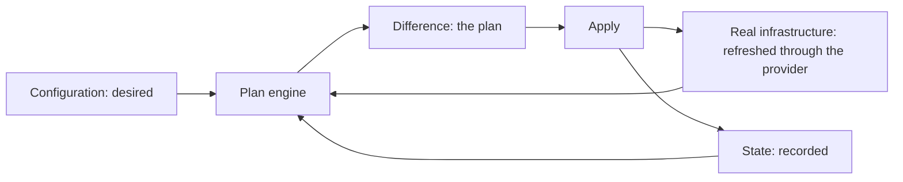
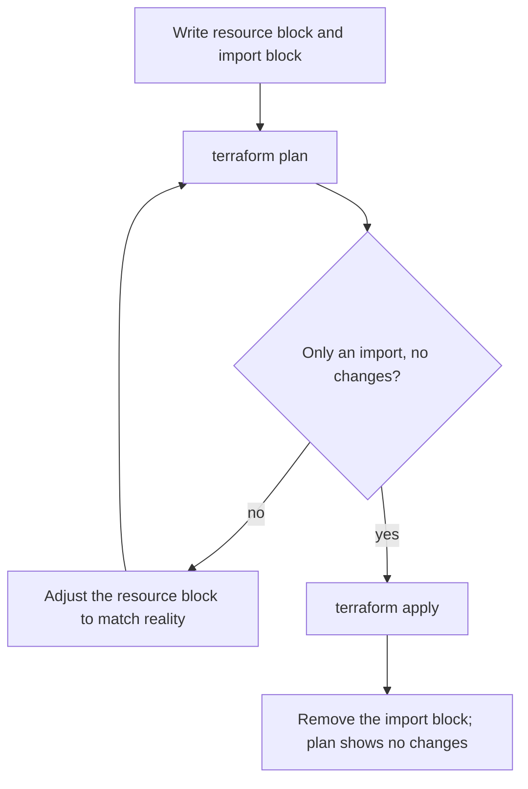

# Interview essentials, part 1: state, plan and apply, count and for_each, drift and import

## In plain words

A driving examiner does not ask you to recite the highway code. They sit beside you and watch what you do at a junction. Terraform interviews work the same way. The interviewer already assumes you can type `terraform apply`. What they are checking is whether you understand what happens underneath, because that understanding is what stops a person deleting a database on a Friday afternoon.

This lesson and the next collect the questions that come up again and again, with worked answers. Each answer is built the same way, and the structure is worth copying:

1. **A one-sentence definition**, in plain words.
2. **The mechanism**: how it works.
3. **The consequence**: why it matters or what goes wrong.
4. **A concrete example** from experience or a small scenario.

An answer with all four parts takes about a minute and sounds like experience. An answer with only the first sounds like a flashcard.

Why this matters for a job: Terraform appears in interviews for backend, platform, DevOps, SRE and cloud roles. The same six or seven questions account for most of what is asked, and this part covers the five that concern the core engine.

> **Before this lesson:** this is a review lesson. It assumes the whole track, especially [Terraform state, remote backends and locking](#/lesson/terraform/state-and-backends), [State surgery: moving, removing, importing and repairing](#/lesson/terraform/state-surgery) and [Loops: count, for_each and the index-shifting trap](#/lesson/terraform/loops-count-for-each). If an answer below feels unfamiliar, follow the link in that section back to the full lesson.

## Question 1: "What is Terraform state, and why does it matter?"

### Worked answer

> "State is Terraform's record of the infrastructure it manages. For every resource in the configuration, it stores which real object that resource corresponds to, by its ID, together with the object's attributes and its dependencies.
>
> Terraform needs it for three reasons. First, mapping: the code says `aws_instance.web`, the cloud only knows an instance ID, and state links them. Second, deletion: if I remove a block from the code, state is the only evidence that something should be destroyed. Third, performance and ordering: stored attributes make planning faster, and stored dependencies give the right destroy order.
>
> In a team it has to live in a remote backend, for example an S3 bucket, with locking so two applies cannot run at once, encryption and tight access control because state contains secrets in plain text, and versioning so a bad write can be rolled back. I also split state per environment and per component to keep the blast radius small."

### Why this answer works

It defines, explains the mechanism, and then moves without being asked to the operational consequences: remote, locked, encrypted, versioned, isolated. That last part is what distinguishes someone who has run Terraform in a team.

### Follow-ups to expect

**"What happens if the state file is lost?"** The infrastructure keeps running; Terraform forgets it. The next plan proposes to create everything again, which either fails on name clashes or produces duplicates. Recovery is restoring a previous version from the versioned bucket, or, failing that, importing every resource back, one by one.

**"Can you edit the state file by hand?"** You should not. The format is internal. Use `moved`, `import` and `removed` blocks, or the `terraform state` commands, and back up first.

**"Does state contain secrets?"** Yes, in plain text, whether or not the value is marked sensitive. Sensitive only masks display.

**"Why not store state in Git?"** No locking, stale copies when someone forgets to pull, and secrets in the repository's history forever.



## Question 2: "What is the difference between plan and apply?"

### Worked answer

> "`plan` is a dry run. Terraform refreshes its view of each resource by reading the real object through the provider, compares that with the configuration, and prints the actions needed to make them match: create, update in place, replace or destroy. It changes nothing.
>
> `apply` carries those actions out, in dependency order and in parallel where possible, and records the results in state. By default it computes a fresh plan and asks for confirmation.
>
> In a pipeline I save the plan with `terraform plan -out=tfplan` and run `terraform apply tfplan`, so what is applied is exactly what was reviewed. If state changed in between, Terraform rejects the saved plan as stale.
>
> Two cautions. A plan is a prediction: apply can still fail on things only the API knows, such as quotas or a name that already exists. And Terraform does not roll back; whatever was created before the failure stays and is in state, so the fix is to correct the cause and apply again."

### Reading a plan aloud

Interviewers often show a plan and ask what will happen. Practise on this one:

```bash
  # aws_db_instance.orders must be replaced
-/+ resource "aws_db_instance" "orders" {
      ~ arn               = "arn:aws:rds:eu-west-1:123456789012:db:orders" -> (known after apply)
      ~ identifier        = "orders" -> "orders-v2" # forces replacement
      ~ instance_class    = "db.t4g.micro" -> "db.t4g.small"
        engine            = "postgres"
        # (40 unchanged attributes hidden)
    }

  # aws_security_group.web will be updated in-place
  ~ resource "aws_security_group" "web" {
      ~ tags = {
          + "Team" = "web"
        }
    }

  # aws_iam_user.staff["ben"] will be destroyed
  # (because key ["ben"] is not in for_each map)

Plan: 1 to add, 1 to change, 2 to destroy.
```

A good spoken reading:

> "Three resources are affected. The database will be **replaced**, destroy then create, because its identifier changed and that attribute forces replacement. That deletes the data, so I would stop here: either the rename is a mistake, or it needs a migration plan. The instance class change alone would have been an in-place update. The security group gets one new tag, an in-place update with no risk. One IAM user, Ben, is destroyed because his key was removed from the for_each map, which I would confirm is intended. The summary checks out: one add and one destroy for the database, one change for the security group, one more destroy for the user."

Three habits are on show in that reading, and they are what the interviewer is listening for. You went to the dangerous line first. You separated the attribute that forces replacement from the one that does not. And you reconciled the summary line against the resources, instead of taking it on trust.

### Follow-ups to expect

**"What does `(known after apply)` mean?"** The value is assigned by the platform at creation, so it cannot be shown in advance.

**"What is `terraform refresh`?"** An older command that updates state from reality. It is replaced by `terraform apply -refresh-only`, which shows what it would record and asks first.

**"What does `-target` do, and should you use it?"** It limits a plan or apply to particular addresses and their dependencies. It is for emergencies and recovery. Routine use means the state boundaries are wrong, and it leaves the rest of the configuration unapplied.

**"What is `-auto-approve`?"** It skips the confirmation prompt. Acceptable in a sandbox; in a pipeline, apply a saved plan instead.

## Question 3: "count versus for_each?"

### Worked answer

> "Both are meta-arguments that create multiple instances of a resource or module. The difference is how instances are identified.
>
> `count` takes a number and identifies instances by index: `aws_iam_user.staff[0]`, `[1]`, `[2]`. `for_each` takes a map or a set of strings and identifies instances by key: `aws_iam_user.staff["asha"]`.
>
> The practical consequence is what happens when the collection changes. With `count` over a list, removing an element from the middle shifts every later index, so Terraform updates or replaces resources that did not conceptually change, and destroys the last one. With `for_each`, only the removed key is destroyed.
>
> So I use `for_each` for any collection of distinct things, and keep `count` for the on-or-off case, `count = var.enabled ? 1 : 0`, where there is nothing to shift. Constraints to remember: the count or the keys must be known at plan time, keys cannot be sensitive values, and converting from one to the other needs `moved` blocks or everything is recreated."

### Show it with numbers

If there is a whiteboard, draw this. If not, say it.

| | Before | After removing "ben" | Plan |
|---|---|---|---|
| `count` | `[0]`=asha, `[1]`=ben, `[2]`=chidi | `[0]`=asha, `[1]`=chidi | `[1]` changed ben to chidi; `[2]` destroyed |
| `for_each` | `["asha"]`, `["ben"]`, `["chidi"]` | `["asha"]`, `["chidi"]` | `["ben"]` destroyed |

The simulation below lets you produce the plan for any before-and-after pair, which is good practice for "what will this plan show?" questions.

```python-run
def count_plan(before, after, force_new=False):
    add = change = destroy = 0
    for i in range(max(len(before), len(after))):
        if i >= len(before):
            add += 1
        elif i >= len(after):
            destroy += 1
        elif before[i] != after[i]:
            if force_new:
                add += 1; destroy += 1
            else:
                change += 1
    return add, change, destroy

def for_each_plan(before, after):
    b, a = set(before), set(after)
    return len(a - b), 0, len(b - a)

cases = [
    ("remove from the middle", ["a", "b", "c", "d"], ["a", "c", "d"]),
    ("remove the first",       ["a", "b", "c", "d"], ["b", "c", "d"]),
    ("remove the last",        ["a", "b", "c", "d"], ["a", "b", "c"]),
    ("insert at the front",    ["a", "b", "c"],      ["z", "a", "b", "c"]),
    ("sort a list",            ["c", "a", "b"],      ["a", "b", "c"]),
]
fmt = lambda t: f"{t[0]} add, {t[1]} change, {t[2]} destroy"
for title, before, after in cases:
    print(title)
    print("   count, updatable attr :", fmt(count_plan(before, after)))
    print("   count, force-new attr :", fmt(count_plan(before, after, True)))
    print("   for_each              :", fmt(for_each_plan(before, after)))
```

Look at "sort a list". With `for_each` nothing happens, because sets have no order. With `count` every position holds a different value, so everything changes. Sorting a list for tidiness has caused real incidents.

### Follow-ups to expect

**"Why can't for_each take a list?"** A list is positional, which is the problem `for_each` exists to avoid. Convert with `toset()`, or build a map with a `for` expression.

**"What error do you get when keys depend on a resource that does not exist yet?"** "Invalid for_each argument": the keys cannot be determined until apply. Key by static values and put the unknown values in the map's values.

**"How do you create a resource conditionally?"** `count = condition ? 1 : 0`, and reference it with `[0]` under the same condition or with `one(resource[*].attr)`.

## Question 4: "What is drift, and how do you handle it?"

### Worked answer

> "Drift is a difference between what Terraform has recorded or what the code describes, and what really exists. It happens when someone changes a resource by hand in the console, when another tool or an automated process modifies it, or when something is deleted outside Terraform.
>
> Terraform detects it during the refresh at the start of every plan: it reads each managed resource's current attributes, and any difference from the configuration shows up as a proposed change to put it back.
>
> Handling it is a decision about which side is right. If the code is right, I apply and the manual change is reverted. If the manual change is right, for instance an emergency fix during an incident, I update the code to match so the plan becomes empty. If an attribute is legitimately managed by something else, such as desired capacity managed by an autoscaler, I add it to `ignore_changes`.
>
> To find drift before it surprises someone, I run a scheduled `terraform plan -detailed-exitcode` on the main branch for each environment and alert on exit code 2. And I reduce the cause: read-only console access for managed infrastructure, with a documented break-glass procedure."

### The limits of detection

A point that impresses interviewers because few candidates know it: **Terraform only detects drift on resources it manages, in attributes the provider reads.**

- A resource created by hand that is not in state is invisible. Terraform will not report it and will not delete it.
- A manually added security group *rule*, when rules are managed as separate resources, is also invisible: it is a separate object that is not in state.
- Detection of unmanaged resources needs other tools: cloud inventory and configuration services, or third-party scanners.

### Follow-ups to expect

**"How do you see drift without changing anything?"** `terraform plan -refresh-only`.

**"How do you accept drift into state?"** `terraform apply -refresh-only` updates state to match reality. The code still needs editing or the next normal plan will propose reverting.

**"Someone fixed production by hand during an outage. What now?"** Thank them, then reconcile the same day: put the change in code, confirm the plan is empty, and note in the incident review that the break-glass path was used.

## Question 5: "How do you import existing resources into Terraform?"

### Worked answer

> "Importing means recording an existing real object in state under a resource address, so Terraform manages it from then on without recreating it.
>
> The current approach is declarative. I write the resource block describing the object, and an `import` block with the target address and the object's ID. `terraform plan` then shows the import, and I adjust the resource block until the plan shows only the import and no changes, because any remaining diff would modify the live resource on apply. Then I apply and remove the import block. For many resources, `terraform plan -generate-config-out=generated.tf` drafts the resource blocks, which I then tidy.
>
> The older way is the `terraform import` command, which writes directly to state with no plan, one resource at a time.
>
> The things to be careful about: the ID format differs for each resource type and is documented on its page; many objects are several resources in Terraform, so a bucket's versioning and encryption settings need their own imports; and an object must have exactly one owner, so never import the same thing into two states."

### The procedure as code

```hcl
import {
  to = aws_security_group.legacy_web
  id = "sg-0a1b2c3d4e5f67890"
}

resource "aws_security_group" "legacy_web" {
  name        = "legacy-web"
  description = "Created by hand in 2021"
  vpc_id      = "vpc-0123456789abcdef0"
}
```

```bash
$ terraform plan
  # aws_security_group.legacy_web will be imported
    resource "aws_security_group" "legacy_web" { ... }

Plan: 1 to import, 0 to add, 0 to change, 0 to destroy.
```



### Follow-ups to expect

**"How would you bring a whole hand-built environment under Terraform?"** Incrementally, by component. Start with what changes most or hurts most. For each piece: import, reach an empty plan, merge. Do not attempt everything in one change, and do not "fix" things in the same change as the import.

**"What if the plan after import shows a replacement?"** Stop. Some attribute in the code differs from reality in a force-new field. Correct the code. Applying would destroy the thing you were trying to adopt.

**"How do you stop managing a resource without deleting it?"** A `removed` block with `lifecycle { destroy = false }`, or `terraform state rm`.

**"How do you rename a resource?"** A `moved` block from the old address to the new one, verified by a plan with zero infrastructure changes.

## Rapid-fire questions

Short answers for the questions that fill the gaps between the big ones.

| Question | Answer |
|---|---|
| What is a provider? | A plug-in that translates Terraform resources into one platform's API calls. |
| What does `terraform init` do? | Downloads providers and modules, configures the backend, writes the lock file. |
| What is in `.terraform.lock.hcl`? | Exact provider versions and checksums. Commit it. It does not cover modules. |
| What does `~> 5.2` mean? | At least 5.2 and below 6.0. With three numbers, only the patch may rise. |
| Implicit versus explicit dependency? | Inferred from a reference, or declared with `depends_on`. Prefer references. |
| What is a data source? | A read-only lookup of existing information. |
| Variables versus locals? | Variables are inputs set by the caller; locals are named expressions private to the module. |
| What is `terraform taint`? | A deprecated way to force replacement. Use `terraform apply -replace=ADDRESS`. |
| What is a workspace? | A named, separate state for the same configuration. Fine for temporary copies, weak for real environments. |
| What is `terraform_remote_state`? | A data source reading another configuration's root outputs from its state. Needs read access to the whole state. |
| Terraform versus OpenTofu? | OpenTofu is an open-source fork with the same language and workflow, command `tofu`, with some differing features such as client-side state encryption. |
| What is `prevent_destroy`? | A lifecycle setting that makes any plan destroying the resource fail. |
| What is `create_before_destroy`? | A lifecycle setting that creates a replacement before removing the original. |
| What does `terraform validate` check? | Syntax and internal consistency, with no calls to the cloud. |

> [!TIP]
> When you do not know an answer, reason aloud from the model: "Terraform compares configuration, state and reality, so in that situation I would expect...". Interviewers give credit for correct reasoning from fundamentals, and nearly every Terraform question can be approached that way.

> [!WARNING]
> **Safety in practical interviews.** Some interviews include a live exercise in a shared account. Read every plan before approving it, never run `destroy` outside the folder you were given, and say aloud what you are checking and why. Being careful with someone else's infrastructure is part of what is being assessed.

## Pitfalls in interview answers

- **Defining state as "a file that stores the infrastructure".** Say what it maps and why Terraform cannot work without it.
- **Saying plan "shows the changes" and stopping.** Mention refresh, saved plans and that apply can still fail.
- **"for_each is newer and better."** Explain index shifting, and where `count` is still right.
- **Claiming Terraform detects all drift.** Only on managed resources.
- **Describing import as one command.** The work is reaching an empty plan.
- **Answering only with commands.** Commands without the reasoning sound memorised.
- **Never mentioning risk.** Senior answers always include what could go wrong and how to guard against it.

## Cheat sheet

| Topic | The sentence to remember |
|---|---|
| State | Maps addresses to real objects; remote, locked, encrypted, versioned, isolated |
| Plan | Refresh, compare, list actions; changes nothing; a prediction, not a guarantee |
| Apply | Executes in dependency order; no rollback; fix and re-apply |
| Saved plan | `plan -out` then `apply tfplan`: apply exactly what was reviewed |
| `count` | Identity by index; shifts when the list changes; right for 0-or-1 |
| `for_each` | Identity by key; only the removed key is destroyed |
| Drift | Detected on refresh for managed resources; decide which side is right |
| Import | `import` block, adjust code until the plan is import-only, apply |
| Rename | `moved` block; success is a plan with zero infrastructure changes |
| Forget | `removed` block with `destroy = false` |

## Summary

- Structure answers as definition, mechanism, consequence and example.
- State is the mapping between code and real objects; a team keeps it remote, locked, encrypted, versioned and isolated, and never edits or commits it.
- Plan is a read-only comparison of configuration, state and refreshed reality; apply executes it without rollback; pipelines apply saved plans.
- `count` identifies by index and suffers index shifting; `for_each` identifies by stable keys; `count` remains correct for conditional single resources.
- Drift is detected only for managed resources, and resolving it means choosing code or reality and making them agree.
- Importing is an iterative process ending in a plan that contains only the import.

## Glossary

- **State:** Terraform's record mapping resource addresses to real objects and their attributes.
- **Refresh:** reading the current attributes of managed resources from the provider.
- **Plan:** the computed list of actions to make reality match the configuration.
- **Saved plan:** a plan stored in a file and applied exactly.
- **Replacement:** destroying an object and creating a new one because an attribute cannot be changed in place.
- **Index shifting:** positions changing meaning when a list used with `count` changes.
- **Drift:** a difference between recorded or declared infrastructure and what exists.
- **Import:** bringing an existing object under management by recording it in state.
- **Break-glass:** an emergency procedure that bypasses normal controls, followed by reconciliation.
- **Blast radius:** the extent of damage one mistake can cause.

## Check yourself

```quiz
[
  {"q": "The state file is deleted while 8 managed resources keep running. What does the next `terraform plan` show?",
   "options": ["No changes", "Plan: 8 to add, 0 to change, 0 to destroy.", "Plan: 0 to add, 0 to change, 8 to destroy.", "An error listing the 8 resources"], "answer": 1,
   "explain": "With no state, Terraform has no record of the resources, so every block in the configuration looks new. The real objects are not deleted, and the creates would clash with or duplicate them."},
  {"q": "A list used with `count` is sorted alphabetically, changing the order of its 5 elements so that every position holds a different value. The differing attribute forces replacement. What does the plan show?",
   "options": ["No changes", "Plan: 5 to add, 0 to change, 5 to destroy.", "Plan: 0 to add, 5 to change, 0 to destroy.", "Plan: 0 to add, 0 to change, 0 to destroy, with 5 moves"], "answer": 1,
   "explain": "Every index now maps to a different value, and the attribute cannot be changed in place, so all five instances are replaced."},
  {"q": "The same sort is applied to a list used with `for_each = toset(var.names)`. What does the plan show?",
   "options": ["Plan: 5 to add, 0 to change, 5 to destroy.", "No changes", "Plan: 0 to add, 5 to change, 0 to destroy.", "An error"], "answer": 1,
   "explain": "A set has no order, and instances are identified by key. The keys are unchanged, so nothing happens."},
  {"q": "Someone adds a new S3 bucket by hand in the console. It is not in any Terraform state. What does `terraform plan` report about it?",
   "options": ["It proposes to delete the bucket", "It proposes to import the bucket", "Nothing; Terraform only examines resources it manages", "An error about unmanaged resources"], "answer": 2,
   "explain": "Refresh reads only the objects recorded in state. Unmanaged resources are invisible to Terraform."},
  {"q": "After adding an import block, the plan says `1 to import, 1 to add, 0 to change, 1 to destroy`. What does this mean and what should you do?",
   "options": ["Normal for imports; apply", "The imported resource would be replaced because the code differs in a force-new attribute; fix the code before applying", "The import failed; delete the state", "A second resource must be imported"], "answer": 1,
   "explain": "An add plus a destroy alongside the import is a replacement of the adopted object. Correct the resource block until only the import remains."},
  {"q": "What guarantees that a pipeline applies exactly the plan a reviewer approved?",
   "options": ["Running apply with -auto-approve", "Saving the plan with -out and applying that file", "Running validate first", "Using a workspace"], "answer": 1,
   "explain": "A saved plan file contains the precise actions. Terraform refuses it if state has changed since it was produced."},
  {"q": "An apply fails on the sixth of ten resources. What is the state of things?",
   "options": ["All ten were rolled back", "Five exist and are in state; fix the cause and apply again to continue", "The state is corrupted and must be restored", "Terraform retries automatically until it succeeds"], "answer": 1,
   "explain": "There is no rollback. Successfully created resources are recorded, and the next plan contains only the remaining work."},
  {"q": "An autoscaler legitimately changes a group's desired capacity, and every plan proposes resetting it. What is the right fix?",
   "options": ["Run apply more often", "Add the attribute to `lifecycle { ignore_changes = [...] }`", "Remove the resource from state", "Disable refresh with -refresh=false permanently"], "answer": 1,
   "explain": "When another system owns an attribute by design, tell Terraform to disregard changes to it instead of fighting over the value."}
]
```

> **Source:** Brikman, Terraform: Up & Running 3e, ch. 3 (state), ch. 5 (count, for_each, gotchas, import) and ch. 2 (plan and apply). Documentation: https://developer.hashicorp.com/terraform/language/state/purpose, https://developer.hashicorp.com/terraform/cli/commands/plan, https://developer.hashicorp.com/terraform/language/meta-arguments/for_each and https://developer.hashicorp.com/terraform/language/import
