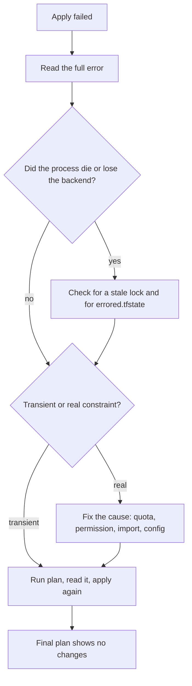

# Interview essentials, part 2: secrets, module design and recovering from failures

## In plain words

Flight instructors spend little time on what to do when everything works. They spend it on engine failures, crosswinds and instrument faults, because that is where a pilot's understanding is revealed, and because calm, practised recovery is what makes a pilot safe to fly with.

The second half of a Terraform interview has the same flavour. Once the interviewer is satisfied you understand the engine (state, plan, loops, drift, import, covered in part 1), the questions turn to judgement and to trouble: how you would keep a secret safe, how you would design a module others will depend on, and what you would do at the moment an apply dies halfway or a lock refuses to clear.

This lesson gives worked answers for those, then scenario questions of the kind used for more senior roles, with a method for answering any of them.

Why this matters for a job: recovery questions are the nearest an interview gets to watching you work. Engineers who answer them well tend to share one habit, which this lesson drills: before acting, find out what is true.

> **Before this lesson:** read [Interview essentials, part 1: state, plan and apply, count and for_each, drift and import](#/lesson/terraform/interview-core). The topics here are taught in full in [Secrets, part 2: resources, data sources, state files and plan files](#/lesson/terraform/secrets-resources-state), [Production-grade modules: small, composable, testable, versioned, and beyond](#/lesson/terraform/production-modules), [State surgery: moving, removing, importing and repairing](#/lesson/terraform/state-surgery) and [Terraform as a team, part 2: golden rules and a CI/CD pipeline](#/lesson/terraform/cicd-for-terraform).

## Question 6: "How do you handle secrets in Terraform?"

### Worked answer

> "I think about three places a secret can leak.
>
> First, the code. Nothing secret is ever written in a `.tf` or `.tfvars` file that is committed. Provider credentials come from the environment: single sign-on for people, and OIDC federation to a narrowly trusted IAM role for pipelines, so no long-lived keys are stored anywhere.
>
> Second, resource arguments. If a resource needs a secret, such as a database password, my first choice is for Terraform never to see it: let the service generate and rotate it in a secret store and pass around only the secret's ARN. If Terraform must supply the value, I read it from a secret store with a data source or pass it as a sensitive variable from the environment, or, on recent versions, use an ephemeral resource with a write-only argument so it is not persisted.
>
> Third, state and plan files, which people forget. Any secret that passes through an ordinary argument is stored in state in plain text. Marking it sensitive only masks the display. So the backend is encrypted, access to state is restricted to the pipeline and a few people, state is never committed, and plan files are treated as secrets as well. On OpenTofu I would also enable client-side state encryption.
>
> If a secret does leak, I rotate it first and investigate second."

### Follow-ups to expect

**"Does `sensitive = true` keep a value out of state?"** No. It masks the value in plan, apply and output display only.

**"Where does the pipeline get its cloud credentials?"** From an OIDC token exchange. The job presents a signed identity token; the cloud exchanges it for temporary credentials of a role whose trust policy is restricted to a specific repository and branch. Separate read-only and apply roles.

**"A colleague committed an access key an hour ago. What do you do?"** Deactivate and rotate the key immediately. Check the cloud audit logs for use of the key. Then remove it from history and add a pre-commit scanner. Rotation first, because cleaning the history does not help if someone has already copied it.

**"What is wrong with a `random_password` resource feeding a database?"** Nothing in principle, but the generated value is stored in state like any attribute, so state access still equals password access.

**"Why is `terraform_remote_state` a secrets concern?"** It requires read access to the entire source state, including any secrets in it, even though it exposes only outputs.

## Question 7: "How do you design a good Terraform module?"

### Worked answer

> "I treat a module like a function with a public interface.
>
> Scope: it does one thing, such as a network, a database or a service, small enough to understand, test and review. I avoid one giant module for a whole environment, because plans get slow, permissions get broad and the blast radius becomes everything.
>
> Interface: every dependency comes in as an input variable and everything a caller might need goes out as an output. No hidden lookups and no provider or backend blocks inside, so the caller decides the Region, account and network, and so the module can be deployed alone for testing. Variables have types, descriptions and validation. Things that matter for safety or cost are either required or default to the safe choice.
>
> Extensibility: separate resources instead of inline blocks, so callers can add a rule without changing the module. `for_each` over maps for collections, so adding an element does not disturb the others.
>
> Quality: an example for each module that doubles as documentation and as the target of automated tests; static checks on every change; a few tests that deploy.
>
> Lifecycle: semantic version tags, with breaking changes in a major version and `moved` blocks so a refactor does not recreate callers' resources. Environments pin exact versions and promote them from dev to prod."

### The design in one sketch

```hcl
# What a caller sees: a small, typed, documented interface
module "orders_db" {
  source = "git::https://github.com/harbour-books/infra-modules.git//postgres?ref=v2.3.0"

  name              = "harbour-prod"
  subnet_ids        = local.subnet_ids["data"]
  security_group_id = local.sg_ids["db"]
  instance_class    = "db.r6g.large"
  multi_az          = true
}

# What the module promises back
output "db_address" {
  value = module.orders_db.address
}
```

Six lines of input express everything that is specific to this use. Encryption, backups, private networking and password management are decided inside the module, once, for everyone.

### Follow-ups to expect

**"What makes a change to a module 'breaking'?"** Removing or renaming an input or output, adding a required input, changing a default so that existing infrastructure changes, or changing resource addresses without `moved` blocks.

**"How many variables should a module have?"** As few as express the real choices. A module that mirrors every provider argument adds indirection without value.

**"Why no provider blocks in modules?"** The caller cannot choose where it deploys, and removing the module later breaks destroy because the configuration that created its resources is gone.

**"Monorepo or one repository per module?"** Either can work. One repository with many modules is easier to change across modules but shares one version line unless tags are prefixed by module name; separate repositories give independent versions at the price of more overhead. State the trade-off instead of declaring a winner.

## Question 8: "An apply failed halfway. What do you do?"

This is the most revealing operational question. The wrong instinct is to run something immediately. The right instinct is to find out what is true.

### Worked answer

> "First I do nothing destructive, and I read the error, the whole message, because it usually says exactly what failed and why.
>
> Then I remember what Terraform guarantees: it does not roll back. Every resource that finished creating is real and is in state. The one that failed is either absent or, if it was created and a later step failed, marked tainted so it will be replaced.
>
> Next I classify the failure. If it is transient, such as an eventual-consistency 'not found' or API throttling, re-running apply is the fix. If it is a real constraint, such as a quota, a missing permission, a name that already exists or an invalid combination of settings, re-running will fail the same way and I have to fix the cause: raise the quota, add the permission, import the existing object or correct the configuration.
>
> Then I run `terraform plan`. It shows what remains, and I read it with the same care as any plan, because the half-applied world may make it look different from the original.
>
> Then I apply, and finish with one more plan that should show no changes.
>
> If the process itself was killed, there are two extra checks: whether a state lock was left behind, and whether Terraform wrote an `errored.tfstate` file because it could not save state to the backend."

### The decision tree



### Special cases to know

**A resource exists in the cloud but not in state.** This happens when the create call succeeded in the cloud but Terraform lost contact before recording it. The next apply fails with "already exists". Fix it by importing the object, or by deleting it by hand if it is safe and empty, then applying again.

**`errored.tfstate`.** If Terraform finishes changing infrastructure but cannot write state to the backend (the network dropped, credentials expired), it saves the state to a local file named `errored.tfstate` and tells you so. That file is the only record of what the interrupted run created. Once the backend is reachable again:

```bash
terraform state push errored.tfstate
```

Do not run another apply before pushing it, or Terraform will plan from the older state and try to create things twice.

**A tainted resource.** The plan shows it will be replaced. If you have verified it is in fact healthy, `terraform untaint ADDRESS` clears the mark.

**The fix is urgent and the full plan is frightening.** `-target=ADDRESS` limits an apply to particular resources. It is an emergency tool. Use it knowingly, say that you used it, and run a full plan afterwards to bring everything back into line.

## Question 9: "The state is locked. What do you do?"

### Worked answer

> "The lock exists to stop two runs writing state at once, so my default assumption is that it is doing its job and someone else is running.
>
> The error prints the lock's details: an ID, who holds it, on which host, for what operation and since when. I read that first. If it is a colleague or a pipeline run that is still going, I wait, or use `-lock-timeout` so my run waits for me.
>
> If the holder is a run that crashed or was cancelled, the lock is stale. I confirm that by checking the pipeline's run list or asking the person named. Only when I am sure nothing is writing do I run `terraform force-unlock` with the lock ID.
>
> Then, before anything else, I run `terraform plan`, because the run that died may have changed infrastructure without recording all of it.
>
> I never use `-lock=false` on shared state, and I would look at why the lock was left behind, usually a job that was cancelled mid-apply, and fix that: queue runs instead of cancelling them."

```bash
$ terraform plan
Error: Error acquiring the state lock

Lock Info:
  ID:        9c1e2f4a-7b3d-4e60-a1f2-8d5c6b7a9e01
  Path:      harbour-books-tfstate-prod/app/terraform.tfstate
  Operation: OperationTypeApply
  Who:       runner@gha-4412
  Created:   2026-05-02 14:07:55 UTC

$ terraform force-unlock 9c1e2f4a-7b3d-4e60-a1f2-8d5c6b7a9e01
Do you really want to force-unlock?
  Enter a value: yes

Terraform state has been successfully unlocked!

$ terraform plan     # always the next command
```

The lock information answers "who?" and "since when?". An apply by a pipeline runner two hours ago, when applies normally take four minutes, points to a dead run. The same lock created ninety seconds ago does not.

The simulation below encodes that judgement as a small decision function. Change the inputs and see how the recommendation moves.

```python-run
def advise(lock, now, typical_apply_seconds, holder_confirmed_dead):
    """lock: None or dict(id, who, operation, created). Times in seconds."""
    if lock is None:
        return "No lock: proceed normally."
    age = now - lock["created"]
    head = f"Locked by {lock['who']} for {lock['operation']}, {age}s ago."
    if holder_confirmed_dead:
        return (f"{head} Holder confirmed dead: terraform force-unlock {lock['id']}, "
                f"then terraform plan before anything else.")
    if age <= 3 * typical_apply_seconds:
        return f"{head} Within a normal run time: wait, or retry with -lock-timeout."
    return (f"{head} Much longer than a normal run ({typical_apply_seconds}s): probably stale, "
            f"but VERIFY with the holder or the pipeline run list before unlocking.")

lock = {"id": "9c1e2f4a", "who": "runner@gha-4412", "operation": "apply", "created": 1000}

print(advise(None, 1100, 240, False))
print(advise(lock, 1090, 240, False))
print(advise(lock, 1000 + 7200, 240, False))
print(advise(lock, 1000 + 7200, 240, True))
```

Note that the function never recommends unlocking on age alone. Age is a hint; confirmation is the requirement.

## Scenario questions

Senior interviews pose open situations. There is rarely one right answer. What is assessed is whether you clarify, weigh trade-offs and protect production. A method that works for all of them:

1. **Clarify.** What exists today? How critical is it? Who else is affected?
2. **Stop the bleeding** if something is on fire.
3. **Establish the facts**: state, plan, logs.
4. **Choose the least risky path**, and say what you rejected and why.
5. **Verify**, usually with an empty plan.
6. **Prevent recurrence.**

### Scenario A: "A one-line change produces a plan that replaces the production database."

> "I do not apply. I find the line marked 'forces replacement' in the plan to see which attribute triggered it. Often it is something unintended: a rename, an attribute fed by a variable whose default changed, or a provider upgrade that altered a default.
>
> If the change is not needed, I revert that attribute and confirm the plan is clean. If it is a provider or module upgrade, I pin back and read the changelog.
>
> If the change is truly required and cannot be done in place, such as enabling encryption on an unencrypted database, that is a migration project, not an apply: snapshot, restore to a new encrypted instance, switch the application over, verify, then retire the old one, with Terraform adopting the new instance through an import or a moved block.
>
> To prevent a repeat: `prevent_destroy` and deletion protection on stateful resources, and a plan policy in the pipeline that fails any plan deleting a database."

### Scenario B: "Our single Terraform state has 2,000 resources and plans take 25 minutes. What would you do?"

> "Split it, incrementally. I would first map the natural boundaries: by environment if they are mixed, then by component, grouped by rate of change and risk, such as network, data stores and each service.
>
> For each piece, starting with the least risky and most frequently changed: create a new root module with its own backend key, and move the resources across with `removed` blocks in the old configuration and `import` blocks in the new one, so that no infrastructure is touched. The success test for every step is a plan with zero infrastructure changes on both sides.
>
> Dependencies between the pieces become outputs read through remote state or data source lookups.
>
> I would do it behind a change freeze for the piece in flight, take a state backup before each move, and not attempt the whole thing in one go. The pay-off is faster plans, narrower permissions and a smaller blast radius."

### Scenario C: "Two teams need to change the same shared VPC module, and one team's change broke the other's environment."

> "The root cause is that both consume the module without version pinning, or from a shared path. I would put the module under semantic versioning: tagged releases, each environment pinned to an exact tag, changes promoted through dev before prod.
>
> A breaking change gets a major version and release notes; consumers upgrade when ready. Automated tests in the module's repository run against an example on every pull request, and a dependency-update bot opens upgrade pull requests in consumer repositories so they do not fall far behind.
>
> For the immediate incident: pin the broken environment back to the last good version and confirm with a plan."

### Scenario D: "How would you bring a hand-built AWS account under Terraform without downtime?"

> "Incrementally, with imports and no changes. I would inventory what exists, group it by component, and start with one that changes often and matters, because that is where code pays off soonest.
>
> For each group: write or generate the resource blocks, add import blocks, iterate until the plan shows only imports, apply, and from then on change that component only through code. I would avoid 'improving' anything in the same change as the import, since the goal of that step is a faithful description.
>
> In parallel, I would reduce console write access for what is now managed, add drift detection, and document the break-glass procedure. I would be open that this takes weeks to months and delivers value at each step."

> [!INTERVIEW]
> When a scenario question leaves you unsure, say what you would check first and why. "I would look at the plan and the lock info before deciding" is a better answer than a confident command. Interviewers are screening for people who will not make an incident worse.

> [!WARNING]
> **Safety.** Every recovery command in this lesson (`force-unlock`, `state push`, `untaint`, `-target`, `state rm`) bypasses a protection. In real work, take a state backup first, tell your team what you are about to do, and follow each one with a plan that you read in full. Used casually, these commands are how a small failure becomes a large one.

## Pitfalls in recovery answers

- **"I would run apply again."** Sometimes right, but only after reading the error and the new plan.
- **"I would run destroy and start over."** In production this is an outage and possibly data loss.
- **"I would force-unlock."** Without verifying the holder, this risks two writers and a corrupted state.
- **"I would edit the state file."** Use the state commands and blocks; mention backups.
- **"I would revert the commit to roll back."** A revert is a new change in the opposite direction; explain what it would destroy.
- **Forgetting `errored.tfstate`.** Knowing it exists marks real experience.
- **No prevention step.** End every incident answer with what you would change so it does not recur.

## Cheat sheet

| Situation | First move | Then |
|---|---|---|
| Apply failed | Read the full error | Classify, fix cause, plan, apply, verify with a clean plan |
| "Already exists" on create | The object is real but not in state | Import it, or delete it if safe, then apply |
| `errored.tfstate` written | Do not apply again | `terraform state push errored.tfstate`, then plan |
| State locked | Read the lock info | Wait, or verify the holder is dead, `force-unlock ID`, then plan |
| Resource tainted but healthy | Verify it | `terraform untaint ADDRESS` |
| One resource broken | Plan it | `terraform apply -replace=ADDRESS` |
| Plan replaces a database | Do not apply | Find the force-new attribute; revert or plan a migration |
| Secret leaked | Rotate it | Audit usage, clean history, add scanning |
| State corrupted | Stop all runs | Restore the previous object version from the versioned bucket |
| Huge slow state | Map boundaries | Split with `removed` and `import`, plan must show zero changes |

## Summary

- Secrets can leak through code, through resource arguments and through state and plan files; the strongest designs keep the secret out of Terraform entirely and treat state as sensitive.
- A good module does one thing, takes all dependencies as typed and validated inputs, returns useful outputs, contains no providers or hidden lookups, has an example and tests, and is released with semantic versions.
- After a failed apply: read the error, remember there is no rollback, classify transient versus real, fix, plan, apply and verify. Know `errored.tfstate`, taint and the "exists but not in state" case.
- A lock means someone may be writing. Read the lock info, verify before `force-unlock`, and plan immediately afterwards.
- For scenario questions: clarify, stabilise, establish facts, choose the least risky path, verify and prevent recurrence.

## Glossary

- **OIDC federation:** exchanging a signed identity token for short-lived cloud credentials.
- **Write-only argument:** a resource argument whose value is not stored in state.
- **Interface (module):** the inputs and outputs through which a module is used.
- **Breaking change:** a change that forces callers to modify their code or alters their infrastructure.
- **Transient error:** a temporary failure that succeeds on retry.
- **Tainted:** marked for replacement because creation did not fully succeed.
- **`errored.tfstate`:** a local file Terraform writes when it cannot save state to the backend.
- **Stale lock:** a lock left by a run that is no longer active.
- **`force-unlock`:** the command that removes a lock by its ID.
- **`-target`:** an option limiting an operation to specific addresses; for exceptional use.
- **Migration:** moving data or resources to a new form through planned, reversible steps.

## Check yourself

```quiz
[
  {"q": "An apply stops with a quota error on the fourth of six resources. You request a higher quota and it is granted. What does the next `terraform plan` show?",
   "options": ["Plan: 6 to add", "Plan: 3 to add, 0 to change, 0 to destroy.", "No changes", "Plan: 0 to add, 0 to change, 3 to destroy."], "answer": 1,
   "explain": "The first three resources exist and are in state. The fourth failed to create and the last two were never attempted, so three remain to add."},
  {"q": "An apply creates a bucket, but the connection drops before state is saved and no errored.tfstate could be pushed. The next apply fails with 'BucketAlreadyOwnedByYou'. What is the correct fix?",
   "options": ["Run destroy", "Import the existing bucket into state, then plan and apply", "Delete the state file", "Rename the bucket in the console"], "answer": 1,
   "explain": "The object is real but unrecorded. Importing it restores the mapping, after which the plan should show no change for it."},
  {"q": "Terraform prints that it wrote `errored.tfstate`. What should you do next?",
   "options": ["Run apply again immediately", "Delete the file", "Once the backend is reachable, run `terraform state push errored.tfstate`, then plan", "Commit it to Git"], "answer": 2,
   "explain": "The file holds the only record of the changes that run made. Push it to the backend before any further operation, or Terraform will plan from outdated state."},
  {"q": "The lock info shows an apply by a CI runner created 90 seconds ago; applies usually take 4 minutes. What should you do?",
   "options": ["force-unlock at once", "Wait or retry with -lock-timeout; the run is probably still in progress", "Run with -lock=false", "Delete the lock object from the bucket"], "answer": 1,
   "explain": "A recent lock within normal run time almost certainly belongs to a live run. Unlocking would allow two writers."},
  {"q": "After a verified `terraform force-unlock`, what is the first command to run?",
   "options": ["terraform apply -auto-approve", "terraform plan", "terraform destroy", "terraform init -upgrade"], "answer": 1,
   "explain": "The dead run may have changed infrastructure partway. A plan shows the current gap between code, state and reality before you change anything."},
  {"q": "A variable holding a database password is marked `sensitive = true`. Who can read the password?",
   "options": ["Nobody", "Anyone who can read the state file or a saved plan", "Only the person who ran apply", "Only AWS support"], "answer": 1,
   "explain": "Sensitive marking masks CLI output only. The value is stored in plain text in state and in plan files."},
  {"q": "Which module change is NOT breaking for existing callers?",
   "options": ["Removing an output", "Adding a new optional variable with a default that preserves current behaviour", "Renaming a resource without a moved block", "Adding a required variable"], "answer": 1,
   "explain": "An optional input whose default keeps behaviour unchanged requires nothing of existing callers and changes none of their infrastructure. That is a minor release."},
  {"q": "A plan for a one-line change shows `-/+ aws_db_instance.orders` with `# forces replacement` beside `storage_encrypted`. What is the right response?",
   "options": ["Apply during low traffic", "Do not apply; treat it as a migration: snapshot, restore to a new encrypted instance, switch over, then adopt it in Terraform", "Remove prevent_destroy and apply", "Use -target to apply only the database"], "answer": 1,
   "explain": "Replacement destroys the data. Enabling encryption on an existing database is a planned migration, not an in-place change."}
]
```

> **Source:** Brikman, Terraform: Up & Running 3e, ch. 6 (secrets), ch. 8 (production-grade modules), ch. 5 (gotchas: valid plans can fail) and ch. 10 (deployment: errors, retries and locks). Documentation: https://developer.hashicorp.com/terraform/cli/commands/force-unlock, https://developer.hashicorp.com/terraform/cli/state/recover, https://developer.hashicorp.com/terraform/language/state/sensitive-data and https://developer.hashicorp.com/terraform/language/modules/develop
