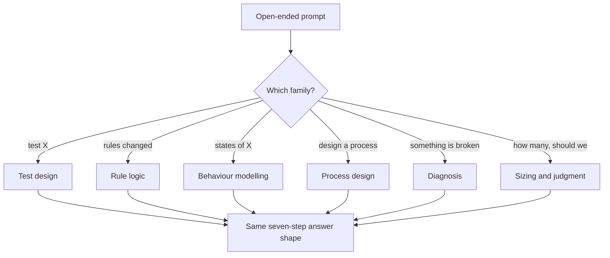

# How open-ended interviews work and what they score

> **Before this lesson:** nothing is required. This is the starting point of the track; no programming or testing knowledge is assumed.

## In plain words

A driving examiner does not mark you on arriving at the destination. Anyone can arrive. They watch *how* you drive: do you check the mirrors, signal, slow down for the school, recover calmly when another car cuts in? The route is only a stage on which those habits become visible.

An **open-ended interview question** works the same way. It is a question with no single correct answer — "how would you test a vending machine?", "the website is slow, what do you do?" — asked so that the interviewer can watch how you think when nobody hands you exact instructions. The person asking is the **interviewer**; you are the **candidate**. They are usually filling in a **rubric**: a list of behaviours to look for, such as "asked who the users are" or "ranked the risks".

This matters for a job because real engineering work arrives exactly like this — vague, incomplete and without a marking scheme. Learning to handle such questions is learning the daily work itself.

A coding interview has a finish line: the tests pass or they do not. An open-ended question has none. "How would you test a vending machine before it reaches customers?" can be answered in thirty seconds or thirty minutes, by a new graduate or by a principal engineer, and every one of those answers is "valid". That is exactly why companies ask it. The question is a stage on which you show how you think when nobody hands you a specification — which is what most of a real engineering job looks like.

This lesson explains what these interviews are for, the families of question you will meet, what the person across the table is writing in their notes, and the mistakes that sink otherwise capable candidates. The next lesson turns that into a step-by-step answering method.

## Why companies ask questions with no right answer

Think about the last week of any working engineer. Somebody reported "checkout feels slow sometimes". A product manager asked whether the new discount rule could ship on Friday. A teammate merged a change that broke the build for forty people. None of those arrived as a neat function signature. Each needed someone to work out what the real problem was, decide what mattered most, pick a sensible first step and explain the choice to other people.

Algorithm questions measure a narrow, important skill. Open-ended questions measure the rest:

- **Framing.** Can you turn a vague prompt into a concrete problem with a goal, users and limits?
- **Structure.** Can you divide a big, shapeless space into parts so that nothing obvious is missed?
- **Judgment.** With limited time, do you spend it on the things that matter most?
- **Depth.** When pushed on one part, do you actually know how it works?
- **Communication.** Can a listener follow you, interrupt you and redirect you without getting lost?

There is also a practical reason. These questions are hard to memorise. A candidate who has rehearsed two hundred coding problems may recognise the one in front of them; a candidate asked to test an elevator cannot recite an answer, because the interviewer will change the building, the budget or the failure halfway through.

> [!NOTE]
> "No single right answer" does not mean "no wrong answers". Listing forty test cases in random order, never asking who the users are, or proposing to fix a production outage by debugging for two hours before rolling back are all wrong in ways an interviewer can name precisely.

## The six families of question

Almost every open-ended engineering question belongs to one of six families. Recognising the family in the first ten seconds tells you which toolkit to reach for.

| Family | Typical prompt | What it really asks | Toolkit (module) |
|---|---|---|---|
| Test design | "How would you test a vending machine / a login page / a pen?" | Can you find what could go wrong and rank it? | Partitions, boundaries, state models, risk (2, 3) |
| Rule logic | "Here is a decision table. The policy changed — update it." | Can you reason exhaustively about combinations? | Decision tables (4) |
| Behaviour modelling | "Draw the states of an order / a door lock / a subscription." | Can you model a workflow and spot illegal moves? | State machines (5) |
| Process design | "Someone pushed buggy code to main. Design a process that copes." | Do you understand delivery as a system with feedback loops? | CI/CD, review, rollout (6) |
| Diagnosis | "The site is slow. What do you do?" | Can you narrow a problem methodically under pressure? | Hypothesis-driven triage (7) |
| Sizing and judgment | "How much storage does this need?" "Should we ship?" | Can you reason with numbers and uncertainty? | Estimation, metrics (8) |

The families overlap. "How would you test a self-checkout kiosk?" is test design, but a good answer draws a state machine, mentions a staged rollout and may estimate how many transactions a pilot store needs. That overlap is why this track teaches the tools separately first and then combines them in worked answers.



## What the interviewer is writing down

Interviewers rarely grade the content of your list. They grade behaviours, usually against a written rubric that their company trained them on. The wording differs from company to company, but the dimensions are remarkably stable. Here is a composite rubric, phrased the way a note-taker would phrase it.

| Dimension | Weak signal | Strong signal |
|---|---|---|
| Problem framing | Starts listing ideas immediately | Asks who uses it, what success means, what is out of scope |
| Assumptions | Silent; the interviewer has to guess | States them aloud and invites correction |
| Structure | A stream of items in the order they occurred to the candidate | Names 4–6 categories first, then fills them |
| Coverage | Only the happy path, or only one category | Functional, failure, abuse, non-functional and operational angles all appear |
| Prioritisation | Every item presented as equally important | Ranks by likelihood and impact; says what would be skipped and why |
| Depth | Stays abstract ("I would test security") | Picks an item and gets specific: inputs, expected result, how to observe it |
| Trade-offs | One "best" solution, no cost mentioned | Names what each choice costs in time, money, risk or complexity |
| Adaptability | Defends the first answer; ignores hints | Updates the plan when the interviewer adds a constraint |
| Communication | Long monologue or long silence | Signposts, checks in, summarises |

Two things about this table deserve emphasis.

First, **none of the rows requires specialist knowledge.** Someone who has never seen the inside of a vending machine can score well on every dimension, because the dimensions describe a way of working, not a set of facts. Knowledge helps most on the *depth* row, and even there a single well-chosen deep dive is enough.

Second, **the rows are scored from what you say aloud.** A brilliant prioritisation that happens silently in your head earns nothing. This is the most common gap between how good people are and how well they interview: they do the right thinking and never narrate it.

> [!INTERVIEW]
> Many interviewers are told to write down evidence, not impressions: literal things the candidate said or did. Make their job easy by saying the rubric out loud. "Let me state my assumptions", "I'll structure this into five areas", "If I only had one day I'd do these three" are sentences that copy straight into the feedback form.

## The shape of the session

A typical open-ended round lasts between twenty and forty-five minutes. It rarely feels like a presentation; it is closer to a guided conversation in which the interviewer steers you toward the parts they want evidence for.

| Phase | Share of time | What you do | What the interviewer does |
|---|---|---|---|
| Prompt | first minute | Listen, repeat the question in your own words | Reads the prompt, often deliberately vague |
| Framing | 10–15 % | Ask clarifying questions, state assumptions | Answers briefly, or says "you decide" |
| Structure | about 10 % | Lay out the map of the answer | Notes whether a map exists |
| Body | 50–60 % | Walk the map, rank, go deep on a few items | Probes: "what else?", "why that first?", "how exactly?" |
| Twist | 10–15 % | Adapt when a constraint changes | Adds a twist: half the budget, a new rule, an outage |
| Wrap | last two minutes | Summarise decisions and open risks | Asks whether you have questions |

The twist is not a sign that you are doing badly. It is a planned part of most interview guides, used to see whether your answer is a structure that can absorb change or a memorised list that shatters. Typical twists: "now you have one day instead of one month", "the machine will be installed outdoors", "the business added a loyalty tier — update your table", "the rollback also fails".

When the interviewer says "you decide" in response to a clarifying question, they are not being unhelpful. They are handing you the assumption row of the rubric. Pick something reasonable, say it, and move on.

## Ten failure modes and their fixes

These are the patterns that interviewers describe again and again in feedback. Each has a simple repair.

**1. The firehose.** The candidate begins listing test cases or ideas within five seconds and does not stop. The list may be good, but it has no shape, so the listener cannot tell what is missing. *Fix:* spend the first two minutes on questions and a map before producing any item.

**2. The interrogation.** The opposite problem: fifteen clarifying questions, each narrower than the last, and no answer in sight. *Fix:* ask three to five questions that would change your answer, then assume the rest out loud.

**3. Happy-path tunnel vision.** Every item describes the product working as designed: insert coin, press button, receive drink. *Fix:* for each feature, deliberately ask "what if it is wrong, missing, repeated, too early, too late, too big, or malicious?"

**4. Flat lists.** Twenty items, all delivered with the same weight. *Fix:* attach a rough priority to everything and say which three you would do first.

**5. Altitude lock.** Staying at ten thousand metres ("I'd do performance testing") or diving to ground level on the first item and never coming back up. *Fix:* breadth first across the whole map, then choose two places to descend, and announce both moves.

**6. Tool name-dropping.** "I'd use Selenium, Jenkins, Kubernetes and Datadog." Tools are not reasoning. *Fix:* describe what must be true and why; mention a tool only as an example of how.

**7. Ignoring the physical or human world.** For hardware prompts, forgetting power cuts, temperature, vandalism, accessibility, the person who restocks the machine. For process prompts, forgetting that people are tired, new or on holiday. *Fix:* always add an "environment and people" category.

**8. The single silver bullet.** "We only need more tests" or "we should require two approvals". Real processes are layered because every single layer leaks. *Fix:* answer process questions in layers: prevent, detect, contain, recover, learn.

**9. Fighting the twist.** Treating a new constraint as an attack and defending the original plan. *Fix:* say "good, that changes my priorities — here is what moves" and actually move something.

**10. No landing.** Time runs out mid-sentence. *Fix:* reserve the last minute; a three-sentence summary lifts the whole impression.

## One question, two candidates

Seeing the difference is more useful than reading about it. The prompt: *"How would you test a new office coffee machine before the company buys two hundred of them?"*

**Candidate A (ninety seconds):**

> "I'd test that it makes coffee. I'd try every drink. I'd check the buttons work, check the milk works, check it doesn't leak. I'd check what happens if there's no water. Performance testing too — make lots of coffees. And security. And I'd automate the tests."

Nothing in that answer is false. But notice what the interviewer can write: no questions asked, no structure, no priorities, "security" unexplained, nothing about who uses the machine or why two hundred units matters.

**Candidate B (first two minutes):**

> "Before I list tests, three questions. Who are the users — employees only, or visitors too? Is this an off-the-shelf machine we are evaluating, or one built for us? And what would make this purchase a failure: breakdowns, cost per cup, complaints about taste?
>
> *(Interviewer: off-the-shelf, employees, and the facilities team worries most about breakdowns and maintenance time.)*
>
> Then I'll treat this as an acceptance evaluation rather than product development, and I'll weight reliability and maintenance most heavily. My plan has five parts: core function, which is each drink made correctly; consumables and their empty states, meaning water, beans, milk, cups and the waste tray; endurance, because an office machine might make three hundred cups a day; cleaning and maintenance, since facilities will do that daily; and safety and environment, which covers hot surfaces, spills and power loss mid-brew. Since breakdowns are the main fear, I'd spend most effort on endurance and empty states. Let me go through each briefly and then go deep on endurance."

Candidate B has not yet named a single test case and is already ahead on framing, assumptions, structure and prioritisation. Everything said afterwards lands in a labelled box. When the interviewer later adds "half the offices are in a hard-water region", B has an obvious place to put it (maintenance: descaling interval, and endurance: scale build-up over a simulated month) while A has to start a new list.

The lesson is not that B is cleverer. B has a **procedure**, and procedures can be learned.

## Knowledge versus skill: how to study for this

Preparing for these rounds takes two different kinds of work, and most people do only the first.

**Knowledge** is the vocabulary of the toolkits: what a boundary value is, how a decision table is checked for completeness, what a canary release does, what a blameless review contains. You get it by reading and by solving small exercises. Modules 2 to 8 of this track supply it, and the coding problems attached to them make you apply each technique precisely — a table evaluator cannot be hand-waved.

**Skill** is producing a structured answer aloud, in real time, to a prompt you have not seen. Reading does almost nothing for it. You get it the way you get any performance skill: repetitions with feedback. Concretely:

1. **Attempt before reading.** Every worked question in this track hides its model answer in a collapsible block. Answer first — out loud or on paper, with a timer — and only then open it.
2. **Record yourself.** A phone recording of a ten-minute answer is uncomfortable to listen to and extremely informative. You will hear the missing structure immediately.
3. **Score against the rubric.** Use the nine-row table above (a fuller scoring sheet appears in the final module). Give yourself 0, 1 or 2 per row. Scores, not feelings, tell you what to practise.
4. **Vary the prompt.** After answering "test an elevator", change one thing — it is a hospital elevator; you have one day; it has already shipped — and answer again in three minutes. This trains the twist.
5. **Practise with a person when you can.** A friend who interrupts with "why?" and "what else?" reproduces most of the pressure.

A reasonable target is twenty to thirty spoken answers before an interview loop. The four-week plan in the last module spreads them out.

> [!TIP]
> You do not need a different method for each family of question. One answer shape — clarify, assume, structure, prioritise, go deep, weigh trade-offs, summarise — fits all six. Learning one shape well beats learning six badly.

## How this track is organised

| Module | You learn | You practise |
|---|---|---|
| 1 | What is scored and the seven-step answer shape | Spoken drills |
| 2 | Test design techniques | Boundary, partition, pairwise and risk problems |
| 3 | A template for "how would you test X?" | Ten fully worked products |
| 4 | Decision tables | Evaluating, checking, collapsing, updating tables |
| 5 | State machines | Simulators, coverage paths |
| 6 | Delivery process design | Revert sets, canary decisions, retry policies |
| 7 | Incident diagnosis | Hypothesis ordering |
| 8 | Estimation and product judgment | Capacity estimator |
| 9 | Question bank, practice plan, scoring sheet | Sixty-plus more prompts |

Work through the modules in order the first time. The worked answers in module 3 lean on the techniques of module 2, and the process questions in module 6 assume you can already think in terms of risk and states.

## Summary

- Open-ended questions exist to observe framing, structure, judgment, depth and communication — the parts of engineering that a coding problem cannot show.
- There are six families: test design, rule logic, behaviour modelling, process design, diagnosis, and sizing or judgment. One answer shape serves them all.
- Interviewers record behaviours against a rubric. Everything is scored from what you say aloud, so narrate your reasoning.
- Expect a twist. It checks that your answer is a structure that bends, not a recitation.
- The classic failures are a list with no shape, no priorities, only happy paths, and no closing summary.
- Study has two halves: knowledge (the toolkits) and skill (spoken repetitions with scoring). Do both.

## Glossary

| Term | Meaning |
|---|---|
| Open-ended question | A question with many acceptable answers, judged on reasoning |
| Interviewer / candidate | The person asking / the person being assessed |
| Rubric | A written list of behaviours an interviewer scores |
| Signal | Evidence an interviewer can write down about a candidate |
| Framing | Turning a vague prompt into a concrete problem with a goal and limits |
| Assumption | Something you take as true without being told, and say aloud |
| Prioritisation | Deciding what matters most and what to leave out |
| Trade-off | A choice where gaining one thing costs another |
| Twist | A changed constraint introduced part-way through an answer |
| Happy path | The case where everything works as intended |
| Failure mode | A typical way in which an answer, or a system, goes wrong |

## Check yourself

```quiz
[
  {"q": "What is the main thing an open-ended question lets an interviewer observe that a coding problem does not?",
   "options": ["Typing speed and syntax recall", "How the candidate frames, structures and prioritises an ambiguous problem", "Whether the candidate has memorised industry tools", "Knowledge of one specific product's internals"],
   "answer": 1,
   "explain": "The prompt is vague on purpose so that framing, structure, prioritisation and communication become visible."},
  {"q": "An interviewer answers your clarifying question with 'you decide'. What is the best response?",
   "options": ["Ask the same question again more precisely", "Refuse to continue until requirements are fixed", "State a reasonable assumption aloud and continue", "Silently pick an assumption and move on"],
   "answer": 2,
   "explain": "They are handing you the assumptions row of the rubric. Say the assumption so it can be scored and corrected."},
  {"q": "Halfway through, the interviewer says: 'Now assume you only have one day.' What is this?",
   "options": ["A sign the answer was poor", "A planned twist to see whether the plan can be re-prioritised", "A trick with no correct response", "A request to start again from the beginning"],
   "answer": 1,
   "explain": "Twists are a standard part of interview guides. The strong move is to say what moves up, what is dropped and why."},
  {"q": "Which opening earns the most rubric evidence in the first two minutes of 'How would you test a parking meter?'",
   "options": ["Listing fifteen test cases quickly", "Naming the automation framework you would use", "Asking who uses it and where, stating assumptions, then naming four or five areas you will cover", "Asking twenty detailed questions about the firmware"],
   "answer": 2,
   "explain": "Framing, assumptions and structure are three rubric rows, all earned before a single test case is named."},
  {"q": "A candidate says only 'I would also do security and performance testing.' Which rubric dimension is weakest?",
   "options": ["Depth", "Coverage", "Problem framing", "Adaptability"],
   "answer": 0,
   "explain": "The categories are mentioned, so coverage is touched, but nothing specific is said about inputs, expected results or how to observe them."},
  {"q": "Why does a process answer such as 'we only need two approvals on every change' score poorly?",
   "options": ["Two approvals is always too many", "It offers a single layer; real processes need prevention, detection, containment, recovery and learning", "Process questions are really coding questions", "Interviewers dislike code review"],
   "answer": 1,
   "explain": "Any single safeguard leaks. Strong answers are layered so that a miss in one layer is caught by the next."},
  {"q": "Which preparation activity builds the spoken skill these interviews need most directly?",
   "options": ["Reading model answers carefully", "Memorising lists of test cases for common products", "Timed answers aloud, recorded and scored against a rubric", "Watching interviews on video"],
   "answer": 2,
   "explain": "Producing a structured answer in real time is a performance skill; it improves through repetitions with feedback."},
  {"q": "Which statement about the scoring rubric is accurate?",
   "options": ["Most rows require specialist domain knowledge", "Rows are scored from what the candidate says and does, so unspoken reasoning earns nothing", "Only the final summary is scored", "The number of test cases listed is the main score"],
   "answer": 1,
   "explain": "Interviewers record evidence. Reasoning that stays in your head leaves nothing for them to write down."}
]
```

> **Source:** Original synthesis for this guide. Background reading: *Software Engineering at Google*, ch. 11 "Testing Overview" (https://abseil.io/resources/swe-book/html/ch11.html); ISTQB Certified Tester Foundation Level syllabus v4.0, ch. 1 and 4 (https://www.istqb.org/certifications/certified-tester-foundation-level); Google SRE Book, "Postmortem Culture" (https://sre.google/sre-book/postmortem-culture/).
