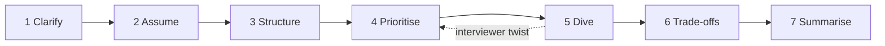

# A seven-step answer framework and how to practise it aloud

> **Before this lesson:** read [How open-ended interviews work and what they score](#/lesson/thinking/how-interviews-work), which explains what the interviewer is looking for. Nothing else is assumed.

## In plain words

A doctor meeting a new patient follows the same order every time, whatever the complaint: ask questions, state what they suspect, examine the likely areas first, look closely at the worrying one, explain the options and their risks, and sum up the plan. The order does not make them a good doctor, but it stops them forgetting something obvious on a busy day, and it lets the patient follow along.

A **framework** is a fixed order of steps like that, for answering a question. This lesson gives one with seven steps that fits every kind of open-ended question in this track. Its value is greatest exactly when you are nervous: you do not have to decide *how* to answer, only *what* to say at each step.

It matters at work as much as in interviews. The same seven steps are how an experienced engineer approaches any unclear request from a colleague.

The previous lesson showed what interviewers record. This one gives you a procedure that produces that evidence almost automatically. It has seven steps, it fits every family of open-ended question, and it is short enough to keep in your head while you are nervous.

**Clarify → Assume → Structure → Prioritise → Dive → Trade-offs → Summarise.**

A mnemonic if you want one: **"Careful Answers Start with Priorities, Depth, Trade-offs and a Summary."**



The dotted arrow matters: when the interviewer changes a constraint you do not restart, you return to step 4 and re-rank.

## Step 1 — Clarify the goal and the users

You are trying to learn three things: **what the thing is for, who touches it, and what "bad" looks like.** Limit yourself to three to five questions, and prefer questions whose answers would change your plan.

A reusable bank, grouped by what they reveal:

| You want to know | Ask |
|---|---|
| Purpose | "What is the main job this has to do? What would make it a failure?" |
| Users | "Who uses it — public, employees, children, other systems? Who maintains it?" |
| Scale | "One unit or thousands? Ten requests a day or ten thousand a second?" |
| Stage | "Is this a prototype, a pre-launch product, or already live?" |
| Constraints | "How much time and budget do I have? Any regulation or safety standard?" |
| My role | "Am I the only tester / the on-call engineer / designing for a team of fifty?" |

For diagnosis prompts the clarifying questions are different in flavour — they are the first measurements: "Since when? For everyone or for some users? Did anything change recently?" Module 7 treats those in detail.

**How to tell a good clarifying question from a bad one:** imagine both possible answers. If your plan would be the same either way, do not ask. "Is the vending machine indoors or outdoors?" is good — outdoors adds rain, heat, vandalism. "What colour is it?" is not.

## Step 2 — State assumptions

Whatever you did not ask, assume aloud. One sentence each, and offer the interviewer a chance to object.

> "I'll assume it accepts coins and cards but not banknotes, that it is installed indoors in offices, and that we have about a month before a pilot. Tell me if any of that is wrong."

Assumptions do three jobs. They shrink the problem to something answerable. They protect you: if you later skip banknote testing nobody can call it an omission. And they show that you know the difference between what you were told and what you invented, which is a quiet but real marker of engineering maturity.

## Step 3 — Structure the space

This is the step most candidates skip and the one with the highest return. Before any detail, announce the four to six areas your answer will cover. The areas come from a **lens** — a way of slicing the problem. Keep several lenses ready, because different prompts suit different ones.

| Lens | Slices | Good for |
|---|---|---|
| User journey | Each step the user takes, start to finish | Consumer products, apps, kiosks |
| Components | Each physical or logical part | Hardware, architectures |
| Data flow | Input → processing → storage → output | APIs, pipelines, models |
| Lifecycle | Install → use → maintain → fail → retire | Devices, long-lived services |
| Quality attributes | Function, performance, security, usability, reliability, compatibility | Any testing prompt, as a completeness check |
| Timeline of an incident | Prevent → detect → contain → recover → learn | Process and CI/CD prompts |
| Funnel | Narrow from widest scope to smallest | Diagnosis prompts |

You can combine two: the user journey for the main structure, quality attributes as a final sweep to catch what the journey missed. Say the structure in one breath, then number the parts so that you and the interviewer can refer to them: "Part three, payment."

> [!TIP]
> If you can write, write the headings down — on the whiteboard, shared document or paper. A visible map lets the interviewer steer ("let's go to part four") and lets you see at a glance which box is still empty.

## Step 4 — Prioritise by risk

Time is the scarce resource in the interview and in the real project it stands for. Rank the areas, or the items inside them, by a rough **risk = likelihood × impact** judgment, and say the ranking.

- *Likelihood:* how probable is a failure here? New code, complex logic, many combinations and external dependencies raise it.
- *Impact:* how bad is it if it fails? Money lost, safety, data loss, legal exposure and "affects every user" raise it.

You do not need numbers. Words work: "Payment is where money can be lost and where three systems meet, so it is my highest risk. The display brightness is low on both counts." What matters is that a ranking exists and that you can defend the top and the bottom of it.

Useful prioritising sentences:

- "If I had one day instead of one month, I would keep these three and drop the rest."
- "This is unlikely but catastrophic, so it stays near the top."
- "This is common but cosmetic, so it goes last."

## Step 5 — Dive deep on a few items

Now choose two or three high-risk items and get concrete. Depth means that a listener could go and do the thing from your description. For a test, that means **setup, input, expected result, and how you observe it**. For a process, it means **who does what, when, with what tool, and what happens when it fails**. For a diagnosis, **which measurement, what each outcome would mean, and what you do next**.

Compare:

- Shallow: "I'd test the payment timeout."
- Deep: "I start a card payment and disconnect the network after the terminal has sent the authorisation but before the reply arrives. The expected behaviour is no product dispensed, the display says the payment could not be confirmed, and within the bank's reversal window the hold disappears. I check three places: the machine's event log, the acquirer's sandbox dashboard, and that stock count is unchanged."

One dive like that is worth ten shallow bullets. Announce the change of altitude so that it reads as a choice: "I've covered the breadth; let me go deep on payment, because I ranked it first."

## Step 6 — Name the trade-offs

Every decision you made has a cost. Saying the cost is what distinguishes engineering from wishful thinking.

| Decision | You gain | You pay |
|---|---|---|
| Test every combination | Certainty | Time grows exponentially |
| Pairwise instead | Most interaction bugs for a fraction of the tests | May miss a rare three-way interaction |
| Require all tests before merge | Main stays green | Slower merges, queue pressure |
| Roll back first, debug later | Users recover quickly | The broken state is harder to inspect |
| Pilot in ten stores | Real-world evidence with limited exposure | A delayed full launch |

A handy pattern is "X, at the cost of Y, which I accept because Z". For example: "I'd automate the transaction logic tests but leave the coin mechanism to manual and rig testing, at the cost of slower regression on hardware, because simulated coins would not reveal jams anyway."

## Step 7 — Summarise

Thirty to sixty seconds, three parts:

1. **What I assumed and optimised for.**
2. **The top priorities and why.**
3. **What I left out or would do next, and the biggest open risk.**

> "To sum up: I treated this as a pre-launch office machine taking coins and cards. I'd spend most effort on payment integrity and the dispensing state machine, because that is where money and stock can diverge. I gave less attention to cosmetics and none to banknotes, which I assumed out. The largest remaining unknown is real-world coin jams, which is why I'd insist on a pilot before the full rollout."

A summary also repairs a messy middle. Interviewers write their notes at the end; give them a clean version to write.

## The framework on a complete example

**Prompt:** *"How would you test the ticket barrier of a new car park before it opens?"*

Try it yourself for five minutes before opening the answer.

<details><summary>Model answer</summary>

**Clarify.** "Is entry by paper ticket, number-plate recognition or both? Is it public pay-per-hour or permit holders only? One entrance or several? When does it open?" — Suppose the answers are: number-plate recognition with a paper-ticket fallback, public and paid, two entry lanes and two exits, opening in three weeks.

**Assume.** Payment happens at a pay station or by app before exit, not at the barrier. The barrier arm has a safety sensor loop. I am the test lead with two people and access to the site.

**Structure.** Lifecycle of one visit plus a sweep of quality attributes:

1. Entry — detect vehicle, read plate or issue ticket, raise and lower the arm
2. Stay — the record of the visit and the fee calculation
3. Exit — match plate or ticket to payment, open, close the record
4. Failure and abuse — power loss, camera failure, tailgating, lost ticket
5. Safety and environment — the arm and people, weather, night
6. Operations — attendants, remote override, reporting

**Prioritise.** Safety first because the impact is injury. Then exit, because a car that has paid and cannot leave blocks the lane behind it and creates the most visible failure. Then fee calculation, because it is money and has boundary logic. Cosmetics and reports last.

| Rank | Area | Likelihood | Impact | Reason |
|---|---|---|---|---|
| 1 | Arm safety sensor | Low | Severe | Arm must never descend on a vehicle or person |
| 2 | Exit matching | Medium | High | A paid car that is stuck blocks the lane |
| 3 | Fee boundaries | High | Medium | Time-band edges are classic off-by-one territory |
| 4 | Plate recognition fallback | High | Medium | Dirty, foreign or missing plates are common |
| 5 | Power and network loss | Medium | High | Must fail safe and recover its records |
| 6 | Reports, signage | Low | Low | Fixable after opening |

**Dive 1 — safety.** With the arm descending, place an obstacle in the sensor zone at three heights and positions. Expected: the arm stops and reverses within the specified time. Repeat with the sensor unplugged: the arm should refuse to lower at all — fail safe. Repeat during a power cut: the arm should be liftable by hand.

**Dive 2 — fee boundaries.** If the tariff is "free up to 15 minutes, then 2.00 per started hour, daily cap 12.00", I test at 14:59, 15:00, 15:01, 59:59, 60:00, 60:01 minutes, the stay at which the cap first applies and one minute either side, a stay crossing midnight, and a clock change. Each has one expected price that I calculate by hand first.

**Dive 3 — exit matching.** Paid and within the grace period → opens. Paid but grace period expired → refused, with a clear message and a way to pay the difference. Not paid → refused. Plate misread on entry but read correctly on exit → falls back to ticket; the attendant override is logged.

**Trade-offs.** Testing with real cars on site is slow but is the only way to learn about sunlight on the camera and the turning angle; I would automate the fee engine with table-driven tests and keep on-site testing for hardware and recognition. I would rather open one lane a week early as a soft launch than open everything untested in real traffic.

**Summary.** Assumed plate recognition with ticket fallback and pre-exit payment. Priorities: arm safety, exit matching, fee boundaries. Not covered in depth: reporting and the app. Biggest open risk: recognition accuracy in bad weather, so I would run a soft launch with an attendant present.

</details>

## Adapting the framework to each family

The seven steps stay; the content of steps 3 and 5 changes.

| Family | Step 3 structure | Step 5 dive looks like |
|---|---|---|
| Test design | Journey or components + quality attributes | Concrete test: setup, input, expected, observation |
| Rule logic | Conditions and actions; count the combinations | A filled-in table and a check for gaps and conflicts |
| Behaviour modelling | States, events, transitions | A drawn diagram and the illegal transitions |
| Process design | Prevent, detect, contain, recover, learn | One safeguard specified end to end |
| Diagnosis | Funnel: scope → recent change → layer → component | A hypothesis, the cheapest check, and what each result means |
| Sizing and judgment | Assumptions → formula → numbers → sanity check | The arithmetic, with units, and the decision it supports |

## Handling the hard moments

**"What else?"** The interviewer wants more coverage. Do not panic-list. Go back to your map, run a different lens across it ("let me sweep the quality attributes: I have not said anything about accessibility or localisation") and add from there.

**"Why that first?"** They are probing prioritisation. Answer with likelihood and impact, not with "it felt important".

**"How exactly?"** They want depth. Give setup, input, expected result and observation.

**You do not know something.** Say so plainly, then reason: "I haven't worked with coin validators. I'd expect them to measure diameter, thickness and metal signature, so I would test worn coins, foreign coins of similar size and washers." Honest reasoning from first principles scores far better than bluffing.

**You realise you missed something big.** Say it: "I've now noticed I left out power loss entirely. It belongs in failure handling, and I'd rank it second." Self-correction is recorded as a strength.

**Long silence.** Thinking time is fine if you announce it: "Give me twenty seconds to organise this." Unannounced silence reads as being stuck.

> [!INTERVIEW]
> A good check-in every few minutes is: "I can go deeper here or move to the next area — which is more useful to you?" It hands the interviewer the steering wheel, which they want, and it prevents you from spending ten minutes on something they have already ticked off.

## Practising aloud

Reading this lesson will not change how you answer. Speaking will. The drills below are ordered from easiest to hardest.

**Drill 1 — Two-minute openings (do ten).** Take any prompt from the question bank. Set a timer for two minutes. Do only steps 1 to 3: questions, assumptions, map. Stop. This isolates the part with the highest return and makes it automatic.

**Drill 2 — Lens switching (do five).** Take one prompt and produce three different maps in three minutes, using three lenses. You will find that each lens surfaces items the others hide.

**Drill 3 — One deep dive (do ten).** Pick a single item, such as "card payment times out", and speak for ninety seconds giving setup, input, expected result and observation. Record it. Listen for vague verbs: "check", "verify", "make sure" without saying *how*.

**Drill 4 — Full answer, twelve minutes (do ten).** All seven steps, recorded, timed. Afterwards score yourself on the nine rubric rows from the previous lesson with 0, 1 or 2.

**Drill 5 — The twist (do ten).** Immediately after a full answer, draw a twist at random — half the time; a new user group; a regulator is watching; it is already in production; the budget tripled — and give a ninety-second re-prioritisation.

A sensible first week is drills 1 and 2 daily; drills 3 to 5 follow once the opening feels natural. Keep a log with the date, prompt, total score and the one row you will work on next. Improvement on these rounds is surprisingly fast, because most candidates start with no method at all.

### Phrases worth rehearsing

- "Before I answer, a few questions that would change my approach."
- "Let me state what I'm assuming."
- "I'll organise this into five areas."
- "In priority order, because…"
- "Let me go deep on the riskiest one."
- "The cost of that choice is…"
- "That changes my ranking — here is what moves."
- "To summarise in three points."

They sound mechanical on the page. Spoken in your own voice, they sound like someone who is in control of the problem.

## Summary

- Seven steps: clarify, assume, structure, prioritise, dive, trade-offs, summarise. A twist sends you back to *prioritise*, not to the start.
- Ask only questions whose answers would change the plan; assume the rest aloud.
- Structure comes from a lens: journey, components, data flow, lifecycle, quality attributes, incident timeline or funnel.
- Rank by likelihood and impact in words; defend the top and the bottom.
- Depth means someone could carry out what you described.
- Every choice has a price — say it.
- The skill is built by timed, recorded, scored repetitions, starting with two-minute openings.

## Glossary

| Term | Meaning |
|---|---|
| Framework | A fixed sequence of steps for approaching a problem |
| Clarifying question | A question asked to remove ambiguity before answering |
| Scope | What is included in the problem, and what is left out |
| Lens | A way of dividing a problem into parts, such as by user journey or by component |
| Non-functional | Qualities such as speed, security and usability, as opposed to features |
| Risk | How likely a problem is, multiplied by how bad it would be |
| Deep dive | A detailed treatment of one item, concrete enough to act on |
| Trade-off | What a choice costs in exchange for what it gives |
| Signposting | Telling the listener what you are about to cover |
| Drill | A short repeated exercise that isolates one skill |

## Check yourself

```quiz
[
  {"q": "Which clarifying question is most worth asking about 'test a vending machine'?",
   "options": ["What brand of paint is used on the casing?", "Will it be installed indoors or outdoors?", "Who designed the logo?", "How many screws hold the door?"],
   "answer": 1,
   "explain": "The two possible answers lead to different plans: outdoors adds weather, temperature and vandalism. The others would not change the plan."},
  {"q": "When the interviewer adds a new constraint mid-answer, which step do you return to?",
   "options": ["Clarify — start again", "Prioritise — re-rank with the new constraint", "Summarise — end the answer", "None; continue as planned"],
   "answer": 1,
   "explain": "The structure usually survives; what changes is the ranking of what to do with limited resources."},
  {"q": "Which lens suits 'design a process for when buggy code reaches main'?",
   "options": ["User journey", "Component breakdown of the laptop", "Prevent, detect, contain, recover, learn", "Colour, size and material"],
   "answer": 2,
   "explain": "Process and incident prompts are naturally organised along the timeline of a failure."},
  {"q": "Which statement shows real depth?",
   "options": ["I would test edge cases.", "I would do thorough payment testing.", "I'd drop the network after the authorisation is sent, expect no product and a reversed hold, and confirm in the event log and the acquirer sandbox.", "I would use an automation tool for payments."],
   "answer": 2,
   "explain": "It gives setup, input, expected result and how the result is observed — enough for someone else to run it."},
  {"q": "What is the purpose of stating assumptions aloud?",
   "options": ["To fill time", "To narrow the problem, protect against 'you forgot X', and let the interviewer correct you", "To avoid having to prioritise", "To show you were not listening to the prompt"],
   "answer": 1,
   "explain": "Assumptions make the problem answerable and make your omissions deliberate rather than accidental."},
  {"q": "A candidate says: 'I'd automate the fee engine tests but keep hardware tests manual, at the cost of slower hardware regression.' Which step is this?",
   "options": ["Clarify", "Structure", "Trade-offs", "Summarise"],
   "answer": 2,
   "explain": "It names a decision together with what it costs — the pattern 'X at the cost of Y because Z'."},
  {"q": "You are asked about a component you have never worked with. Best response?",
   "options": ["Bluff confidently", "Skip it and hope it is not noticed", "Say you have not used it, then reason from first principles about how it probably works and what could fail", "Apologise and stop"],
   "answer": 2,
   "explain": "Honesty plus reasoning is recorded as a strength; bluffing collapses under the first follow-up question."},
  {"q": "Which practice drill isolates the highest-return part of the framework?",
   "options": ["Two-minute openings: questions, assumptions and a map only", "Memorising a full answer word for word", "Reading model answers silently", "Writing fifty test cases for one product"],
   "answer": 0,
   "explain": "The first three steps earn several rubric rows and shape everything that follows; drilling them alone makes them automatic."}
]
```

> **Source:** Original framework for this guide. Risk-based prioritisation and test technique vocabulary follow the ISTQB Foundation Level syllabus v4.0, ch. 4–5 (https://www.istqb.org/certifications/certified-tester-foundation-level). The prevent/detect/recover layering reflects *Software Engineering at Google*, ch. 23 "Continuous Integration" (https://abseil.io/resources/swe-book/html/ch23.html) and the Google SRE Book, "Managing Incidents" (https://sre.google/sre-book/managing-incidents/).
