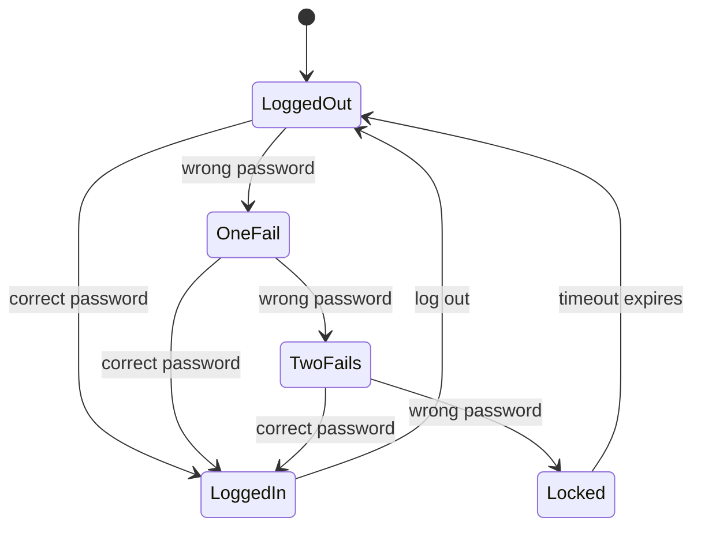

# Decision tables, state transitions and pairwise testing

> **Before this lesson:** read [Equivalence partitioning and boundary value analysis](#/lesson/thinking/partitions-boundaries). The powers of two (2, 4, 8, 16…) are the only arithmetic used.

## In plain words

Three everyday situations show what this lesson is about.

A cinema's price depends on your age, the day of the week and whether you hold a membership card — a *combination* of facts. A good way to be sure no combination is forgotten is to draw a grid with one row for each. That grid is a **decision table**.

A washing machine's Start button does different things depending on what the machine is doing at that moment — nothing if the door is open, begin if it is idle, pause if it is running. The machine has *memory*. A picture of the situations it can be in and the moves between them is a **state machine**.

A website must work in several browsers, on several kinds of phone, in several languages — far too many combinations to try them all. **Pairwise testing** picks a small set of combinations in which every *pair* of choices still meets at least once.

These three tools cover problems that single-input techniques cannot, and recognising which one a situation calls for is a skill interviewers look for.

Partitions and boundaries handle one input at a time. Real products misbehave when things *combine*: a member **and** a coupon **and** an express order; a button pressed **while** the door is open; Safari **on** an old phone **in** landscape. This lesson introduces the three techniques for combinations and sequences. Modules 4 and 5 return to the first two in depth; here the aim is to recognise which tool fits which kind of problem and to be able to use each at interview speed.

| Situation | Technique | Core question |
|---|---|---|
| The outcome depends on a combination of conditions | Decision table | "Have I covered every combination of the rules?" |
| The outcome depends on what happened before | State transition testing | "Have I covered every state and every move between states?" |
| Many independent options, too many to multiply out | Pairwise testing | "Has every pair of option values met at least once?" |

## Decision tables

### When to reach for one

Any time a requirement contains the words *if*, *and*, *or*, *unless*, *except*, you are looking at business rules, and prose is a terrible container for rules. A decision table lists the **conditions** (inputs to the decision), the **actions** (results), and one **rule** per column or row saying which combination of condition values leads to which actions.

### A small example

*A library lends a book if the member's card is valid and they have no overdue items. Staff may borrow even with overdue items. Nobody borrows on an invalid card.*

Three conditions, each true or false: card valid (C), has overdue items (O), is staff (S). With three yes/no conditions there are $2^3 = 8$ combinations. Write them all first — that is the discipline that makes the technique work.

| Rule | C: card valid | O: overdue | S: staff | Action |
|---|---|---|---|---|
| 1 | Y | N | N | lend |
| 2 | Y | N | Y | lend |
| 3 | Y | Y | N | refuse |
| 4 | Y | Y | Y | lend |
| 5 | N | N | N | refuse |
| 6 | N | N | Y | refuse |
| 7 | N | Y | N | refuse |
| 8 | N | Y | Y | refuse |

Each row is one test case with an unambiguous expected result. And the act of filling in row 6 forces a question the prose never answered: *a staff member whose card has expired — really refused?* The sentence "nobody borrows on an invalid card" says yes, but it is worth confirming. Decision tables find gaps and contradictions in requirements before any code exists, which is the cheapest moment to find them.

### Collapsing with don't-cares

Rows 5 to 8 all say "refuse" and differ only in O and S. When the card is invalid, the other two conditions do not matter. Replace them with a dash, meaning *don't care*:

| Rule | C | O | S | Action |
|---|---|---|---|---|
| A | N | – | – | refuse |
| B | Y | N | – | lend |
| C | Y | Y | Y | lend |
| D | Y | Y | N | refuse |

Four rules describe the same behaviour as eight. A rule with $d$ dashes stands for $2^d$ original combinations: A covers 4, B covers 2, C and D one each, and 4 + 2 + 1 + 1 = 8, so the collapsed table is still complete.

> [!WARNING]
> Collapsing is for reading and for reducing test count when risk is low. It hides an assumption: that the dashed conditions truly have no effect. If the "invalid card" path secretly logs differently for staff, a single test for rule A will not notice. For high-risk rules, test the full table.

### Using it in an interview

When the prompt has rules, say: "This is combinatorial, so I'll put it in a table to make sure I don't miss a case." Then (1) list the conditions, (2) say how many combinations exist, (3) fill them in, (4) point at any row the requirement does not clearly answer. Step 4 is where you earn the most.

The table can be executed as code, which is how rule engines work and what several problems in this track ask you to build.

```python-run
RULES = [            # (card_valid, overdue, staff) -> action ; '-' = don't care
    ("N--", "refuse"),
    ("YN-", "lend"),
    ("YYY", "lend"),
    ("YYN", "refuse"),
]

def decide(inp):
    hits = [action for pattern, action in RULES
            if all(p == "-" or p == c for p, c in zip(pattern, inp))]
    return hits

import itertools
for combo in itertools.product("YN", repeat=3):
    inp = "".join(combo)
    print(inp, "->", decide(inp))
```

Every input prints exactly one action. Zero would be a gap; two different ones would be a contradiction.

## State transition testing

### When to reach for it

Use it when the same input produces different results depending on history. Pressing "select" on a vending machine does nothing with no credit and dispenses a drink with enough credit. The button is the same; the **state** differs. Devices, logins, orders, subscriptions, documents moving through approval, network connections — all are state machines.

### The four ingredients

- **States:** the distinct situations the system can be in (a finite, named list).
- **Events:** things that happen to it (a coin, a button, a timeout).
- **Transitions:** "in state S, on event E, go to state T".
- **Actions / guards:** what the system does during a transition, and any condition that must hold for it.

Here is an account-lockout model: three wrong passwords lock the account; a correct password resets the count; a locked account unlocks after a timeout.



### The state table reveals the invalid transitions

A diagram shows what *can* happen. A **state table** — every state against every event — also shows what the designers never drew.

| State | correct pw | wrong pw | timeout | log out |
|---|---|---|---|---|
| LoggedOut | LoggedIn | OneFail | — | — |
| OneFail | LoggedIn | TwoFails | — ? | — |
| TwoFails | LoggedIn | Locked | — ? | — |
| Locked | **?** | **?** | LoggedOut | — |
| LoggedIn | — | — | — ? | LoggedOut |

Each empty cell is a question. The bold ones are the most interesting: *what happens when a locked user types the correct password?* It must be refused — otherwise lockout is meaningless — and ideally the message does not reveal that the password was right. *Does a wrong password while locked restart the timer?* *Do failure counts expire if the user walks away for an hour?* *Does a logged-in session time out?* None of these appear in the one-sentence requirement. Four out of five interview follow-ups about login come straight from the empty cells of this table.

### Coverage levels

How much state testing is enough? Three standard yardsticks, in increasing strength:

| Coverage | Requirement | For the lockout model |
|---|---|---|
| All states | Every state is visited at least once | One path reaching Locked plus one reaching LoggedIn |
| Valid transitions (0-switch) | Every arrow is taken at least once | All 8 arrows; several paths |
| All transitions | Every valid arrow, **and** every invalid (state, event) pair is attempted | Also the "—" cells: confirm they are rejected or ignored |

"All states" is weak: you can visit every state while skipping most arrows. Valid-transition coverage is the usual minimum. Testing invalid transitions is where security and robustness defects are found, so for anything safety- or money-related, go to the third level.

A set of paths achieving valid-transition coverage here:

1. wrong, wrong, wrong, *(wait)* timeout → covers LoggedOut→OneFail→TwoFails→Locked→LoggedOut
2. correct, log out → LoggedOut→LoggedIn→LoggedOut
3. wrong, correct → OneFail→LoggedIn
4. wrong, wrong, correct → TwoFails→LoggedIn

```python-run
T = {("LoggedOut","ok"):"LoggedIn", ("LoggedOut","bad"):"OneFail",
     ("OneFail","ok"):"LoggedIn",   ("OneFail","bad"):"TwoFails",
     ("TwoFails","ok"):"LoggedIn",  ("TwoFails","bad"):"Locked",
     ("Locked","timeout"):"LoggedOut", ("LoggedIn","logout"):"LoggedOut"}

paths = [["bad","bad","bad","timeout"], ["ok","logout"], ["bad","ok"], ["bad","bad","ok"]]
covered = set()
for p in paths:
    s = "LoggedOut"
    for e in p:
        covered.add((s, e)); s = T[(s, e)]
print(f"covered {len(covered)} of {len(T)} transitions")
print("missing:", set(T) - covered)
```

## Pairwise (all-pairs) testing

### The combinatorial explosion

A checkout page must work with 4 browsers, 3 operating systems, 3 payment methods, 2 languages and 2 account types. Testing every combination needs 4 × 3 × 3 × 2 × 2 = 144 runs. Add a sixth option with five values and it is 720. Nobody has time.

### The observation that rescues you

Studies of real defect reports have repeatedly found that most failures are triggered by a single option value or by the *interaction of two* values — "fails with PayPal on Safari" — and that failures needing three or more specific values at once are progressively rarer. So a suite in which **every pair of values from every pair of parameters appears together at least once** catches a large share of interaction defects at a small fraction of the cost.

### How small?

The lower bound is the product of the two largest parameter sizes — here 4 × 3 = 12 — because every browser must meet every operating system. Good tools get close to that bound: about 12 to 14 tests instead of 144.

A tiny example makes the trick visible. Three switches, each on or off: 8 combinations. These four tests cover all pairs:

| Test | A | B | C |
|---|---|---|---|
| 1 | off | off | off |
| 2 | off | on | on |
| 3 | on | off | on |
| 4 | on | on | off |

Check the pair (A, C): off/off in test 1, off/on in test 2, on/on in test 3, on/off in test 4. The same holds for (A, B) and (B, C). Each test does triple duty, covering one pair for each of the three parameter pairs.

```python-run
import itertools

def uncovered(levels, suite):
    need = {(i, j, a, b) for i in range(len(levels)) for j in range(i + 1, len(levels))
            for a in range(levels[i]) for b in range(levels[j])}
    for t in suite:
        for i in range(len(levels)):
            for j in range(i + 1, len(levels)):
                need.discard((i, j, t[i], t[j]))
    return need

def greedy(levels):
    need = uncovered(levels, [])
    candidates = list(itertools.product(*[range(k) for k in levels]))
    suite = []
    while need:
        best = max(candidates, key=lambda c: sum((i, j, c[i], c[j]) in need
                   for i in range(len(c)) for j in range(i + 1, len(c))))
        suite.append(best)
        need = uncovered(levels, suite)
    return suite

levels = [4, 3, 3, 2, 2]     # browsers, OS, payment, language, account type
suite = greedy(levels)
print("all combinations:", 4 * 3 * 3 * 2 * 2)
print("pairwise suite:  ", len(suite))
for t in suite: print(t)
```

### Limits you should state

- **It samples; it does not prove.** A defect needing three specific values together may escape. For high-risk areas add targeted three-way tests or the full combination for the risky subset.
- **Constraints exist.** Safari on Windows is not a real configuration; the generator must be told to exclude impossible pairs.
- **Parameters must be genuinely independent options.** If the outcome is a business rule over the parameters, you want a decision table, not a sample.
- **Choose values with partitioning first.** Pairwise tells you how to combine values, not which values deserve to be on the list.

> [!INTERVIEW]
> The moment an interviewer says "it has to work on all these browsers and devices and languages", the expected move is: "the full matrix is N combinations, which is not feasible; I'd cover all pairs, which needs roughly the product of the two largest dimensions, and add the top three real-world configurations from our analytics explicitly." Mentioning usage data for the explicit additions shows that you combine a technique with judgment.

## Choosing between them

A short exercise. For each prompt decide which technique leads. Answer before opening.

1. *Shipping is free for orders over 50, or for members; express costs extra unless the member is Gold.*
2. *A document goes draft → in review → approved → published, and can be sent back.*
3. *The mobile app must be tested across 5 OS versions, 4 screen sizes, 3 network types and 2 orientations.*
4. *A turnstile takes a ticket and lets one person through.*
5. *A discount code field accepts 6–10 alphanumeric characters.*

<details><summary>Model answer</summary>

1. **Decision table.** The words *or*, *unless* signal rules over combinations: conditions are order over 50, is member, is Gold, wants express. Sixteen combinations, some impossible (Gold but not a member), which the table makes you notice.
2. **State transition.** The outcome of "approve" depends on the current status. Draw states and events, then ask about every empty cell: can a published document be edited? Can a draft be published directly?
3. **Pairwise.** 5 × 4 × 3 × 2 = 120 configurations of independent options; all-pairs needs about 20. Add the two or three most popular real devices explicitly.
4. **State transition** (locked / unlocked), with a pinch of boundary thinking: two people on one ticket, a ticket inserted while already unlocked.
5. **Partitions and boundaries.** A single ordered input: lengths 5, 6, 10, 11; plus character classes (letters, digits, symbols, spaces, lowercase versus uppercase).

Real products need more than one. A vending machine has a decision table (which coins and payment types are accepted under which conditions), a state machine (idle, has credit, dispensing, out of service) and boundaries (exact price, maximum credit). Naming which technique you are applying to which part of the product is itself a strong structuring move.

</details>

## Summary

- **Decision tables** make rule combinations explicit: conditions, actions, one rule per combination, $2^n$ rows for $n$ yes/no conditions. Filling them in exposes gaps and contradictions in the requirement. Don't-cares collapse rows; a rule with $d$ dashes covers $2^d$ combinations.
- **State transition testing** models history: states, events, transitions. The state table (every state × every event) reveals undefined and invalid moves. Coverage grows from all states, to all valid transitions, to all transitions including invalid ones.
- **Pairwise testing** covers every pair of option values with roughly (largest × second largest) tests instead of the full product. It is a sample, needs constraints, and should be supplemented where risk is high.
- Pick by the shape of the problem: rules → table; history → states; independent options → pairs; a single ordered input → boundaries.

## Glossary

| Term | Meaning |
|---|---|
| Condition | A yes/no fact that a decision depends on |
| Action | What the system does as a result of a rule |
| Rule | One combination of condition values together with its actions |
| Decision table | A grid listing every rule |
| Don't-care (dash) | A mark showing that a condition does not affect a rule |
| State | A situation a system stays in until something happens |
| Event | Something that happens and may cause a change of state |
| Transition | A move from one state to another |
| State table | A grid of every state against every event |
| 0-switch coverage | Every valid transition exercised at least once |
| Pairwise (all-pairs) testing | Choosing tests so that every pair of option values appears together |
| Combinatorial explosion | The rapid growth in combinations as options are added |

## Check yourself

```quiz
[
  {"q": "A decision has 5 independent yes/no conditions. How many rows does the full table have?",
   "options": ["10", "25", "32", "120"],
   "answer": 2,
   "explain": "Each condition doubles the combinations: 2^5 = 32."},
  {"q": "In a collapsed table over 4 conditions, a rule reads 'Y - - N'. How many full combinations does it represent?",
   "options": ["1", "2", "4", "8"],
   "answer": 2,
   "explain": "Two don't-care positions, each of which can be Y or N: 2^2 = 4."},
  {"q": "What is the main benefit of writing the state table (every state against every event) in addition to the diagram?",
   "options": ["It looks more formal", "Empty cells expose undefined or invalid transitions the diagram never mentions", "It reduces the number of states", "It replaces the need for tests"],
   "answer": 1,
   "explain": "A diagram only shows what was designed. The table makes every unconsidered state-event pair visible as a question."},
  {"q": "Which coverage level requires attempting events that should NOT be accepted in a given state?",
   "options": ["All states", "Valid transitions (0-switch)", "All transitions", "Statement coverage"],
   "answer": 2,
   "explain": "All-transitions coverage includes the invalid state-event pairs as well as every valid arrow."},
  {"q": "Parameters have 6, 5, 3 and 2 values. What is the minimum possible size of a pairwise suite?",
   "options": ["16", "30", "180", "11"],
   "answer": 1,
   "explain": "Every value of the largest parameter must meet every value of the second largest: 6 × 5 = 30 is the lower bound."},
  {"q": "Why is pairwise testing a poor fit for 'free shipping if member OR order over 50, unless the item is oversized'?",
   "options": ["It needs more than two parameters", "The outcome is a business rule over the conditions, so every combination has a defined result that should be checked", "Pairwise cannot handle booleans", "It is only for hardware"],
   "answer": 1,
   "explain": "Rules need a decision table. Pairwise samples combinations of independent options; it would skip rule combinations that matter."},
  {"q": "A locked account receives the correct password. Where would this case surface during test design?",
   "options": ["Boundary analysis of the password length", "An empty or questionable cell in the state table", "Pairwise generation", "It cannot be found by any technique"],
   "answer": 1,
   "explain": "It is the (Locked, correct password) cell: an event arriving in a state where the simple requirement says nothing."},
  {"q": "Which statement about pairwise suites is true?",
   "options": ["They guarantee all three-way interactions are covered", "They cover every pair of values at least once and may miss defects needing three specific values together", "They always contain the full Cartesian product", "They remove the need to choose values carefully"],
   "answer": 1,
   "explain": "Pairwise is a deliberate sample. It should be supplemented for high-risk combinations and fed with well-chosen values."}
]
```

> **Source:** ISTQB Certified Tester Foundation Level syllabus v4.0, sections 4.2.3 "Decision Table Testing" and 4.2.4 "State Transition Testing" (https://www.istqb.org/certifications/certified-tester-foundation-level). Combinatorial interaction findings summarised from NIST's Automated Combinatorial Testing for Software project (https://csrc.nist.gov/projects/automated-combinatorial-testing-for-software). All examples and wording are original.
