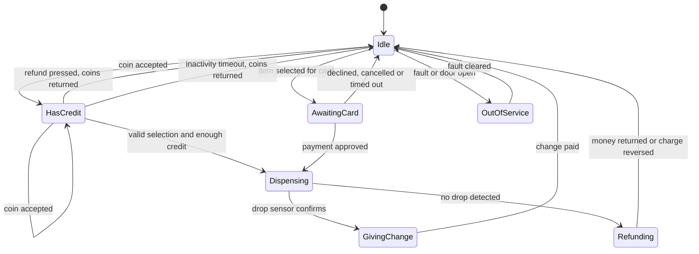

# A repeatable template, and the vending machine in full

> **Before this lesson:** read the three technique lessons, ending with [Exploratory testing, risk and non-functional categories](#/lesson/thinking/exploratory-risk-nonfunctional). They supply the vocabulary used here.

## In plain words

Before a flight, pilots walk round the aircraft with a checklist. The checklist is the same for every flight and every aircraft type they fly; only the findings differ. It exists so that a tired or hurried person still looks at everything that matters, in a sensible order.

This lesson gives you that kind of checklist for one of the commonest interview prompts: "how would you test X?", where X may be a toaster or a banking app. A **template** is a reusable outline that you fill in for each new object. Having one means you never start from a blank page.

The lesson then fills the template in completely for a **vending machine** — a machine that takes money and gives out snacks or drinks — because it is the classic example and contains a little of everything: buttons, money, moving parts, software and people who try to cheat it.

"How would you test X?" is the most common open-ended prompt in engineering interviews, and X can be anything: a pen, an elevator, a login page, a recommendation model. You cannot prepare an answer per object. You can prepare one **template** that produces a good answer for any object, and then practise it until filling it in is routine. This lesson gives the template and applies it, at full length, to the classic: *a newly designed vending machine, before it reaches customers.*

## The test-anything template

The template is the seven-step framework from module 1 with the middle steps specialised for testing.

| # | Step | What you produce |
|---|---|---|
| 1 | **Purpose and users** | Who uses it, who maintains it, what failure means |
| 2 | **Assumptions and scope** | What is in, what is out, what stage it is at |
| 3 | **Decompose** | 5–7 areas: components or user journey |
| 4 | **Model the behaviour** | A state machine, a decision table, or both, for the core logic |
| 5 | **Enumerate by area** | Normal use → boundaries → failures → abuse |
| 6 | **Non-functional sweep** | Performance, reliability, security, usability, accessibility, compatibility, localisation, safety, operability |
| 7 | **Prioritise** | A ranked table with likelihood, impact and how each is tested |
| 8 | **Levels and environments** | What is tested on a bench, in a lab, in simulation, in the field |
| 9 | **Exit and rollout** | What "ready" means; pilot, monitoring, rollback |
| 10 | **Summary** | Top risks, gaps, recommendation |

Inside step 5, run the same four passes on every area. They are worth memorising as a rhythm:

1. **Normal use** — the product doing its job.
2. **Boundaries** — edges of every quantity: zero, one, maximum, one over.
3. **Failures** — things that break or go missing: power, network, parts, supplies.
4. **Abuse** — people trying to cheat, break or misuse it, on purpose or by accident.

> [!TIP]
> If your mind goes blank, say the four passes out loud for the area you are on: "Normal use, boundaries, failures, abuse." Each word reliably triggers two or three ideas.

Physical products need three additions that digital ones do not: the **environment** (heat, cold, damp, dust, vibration, sunlight), **wear over time** (cycles, corrosion, drift), and **physical safety**. Digital products need their own three: **scale**, **concurrency**, and **data integrity**. Keep both triples in mind and use the one that fits.

## The vending machine: try it first

**Prompt:** *"Your company has designed a new vending machine. How would you test it before it reaches customers?"*

Set a timer for twelve minutes and answer aloud or on paper using the template. Then compare with the model answer below. It is longer than you could say in an interview; it is written to show the whole space so that you can see what to select from.

<details><summary>Model answer — steps 1 to 4: framing and model</summary>

### 1. Purpose and users

Questions I would ask:

- What does it sell — cold drinks, snacks, hot food, anything needing refrigeration?
- How do people pay — coins, notes, cards, phone?
- Where will it be installed — indoors, outdoors, unattended sites?
- Is the machine connected (remote stock and fault reporting)?
- How many units, and by when?

Users are not only customers. I count four groups: **customers** (including children, elderly people and wheelchair users), **restockers**, **service technicians**, and the **operator's back office** receiving sales and fault data. Failure, for the business, means: taking money without giving product, giving product without taking money, hurting someone, or being out of service.

### 2. Assumptions and scope

- Sells chilled bottled drinks and packaged snacks from spiral trays.
- Accepts coins (gives change), contactless cards and phones; no banknotes.
- Indoor sites such as offices and stations; mains powered.
- Reports sales, stock and faults to a cloud service over mobile data.
- First production prototypes exist; a pilot of twenty machines is planned before a run of two thousand.
- In scope: the machine and its firmware, and the integration with payment and telemetry. Out of scope: the operator's accounting system.

### 3. Decomposition

1. Product selection and user interface
2. Payment — coins and change; card and phone
3. Dispensing mechanism and delivery bin
4. Inventory and pricing
5. Control logic (the state machine tying the above together)
6. Refrigeration, power and environment
7. Connectivity and back office
8. Service and restocking operations

### 4. Behaviour model

The core logic is a state machine. Drawing it early pays off, because most serious defects are transitions nobody considered.



Then the state table, every state against every event, to find the unconsidered cells:

| State | coin | select | refund | card tap | door opened | power lost |
|---|---|---|---|---|---|---|
| Idle | → HasCredit | show price | nothing | ? ignore or prompt | → OutOfService | safe restart |
| HasCredit | add credit | vend or "need more" | return coins | **? mixed payment** | **? return coins first** | **? credit remembered** |
| AwaitingCard | **? reject coin** | ? change selection | cancel | authorise | **? cancel payment** | **? charge reversed** |
| Dispensing | **? return coin** | ignore | **ignore — cannot cancel** | ignore | **? stop motor** | **? paid but no product** |
| GivingChange | ? | ignore | ignore | ignore | ? | **? change owed** |
| OutOfService | **reject coin** | message | nothing | refuse | — | — |

Every bold cell is a test and usually also a question for the designers. The most valuable ones: a coin inserted while the motor is turning; the door opened with credit on the display; power lost between payment approval and the product dropping.

There is also a small decision table for the selection moment:

| Rule | Item in stock | Credit ≥ price | Can make change | Result |
|---|---|---|---|---|
| 1 | N | – | – | "Sold out", keep credit |
| 2 | Y | N | – | Show amount still needed |
| 3 | Y | Y | N | "Exact change only", keep credit |
| 4 | Y | Y | Y | Vend, return change |

</details>

<details><summary>Model answer — step 5: tests by area</summary>

### Selection and interface

- *Normal:* every button or screen position maps to the right tray; price is displayed before commitment.
- *Boundaries:* first and last tray; an item code that does not exist; maximum digits on a keypad.
- *Failures:* a stuck button; unresponsive touch area; display partly failed.
- *Abuse:* rapid repeated presses; two buttons at once; pressing during dispensing.

### Coin payment and change

Equivalence classes of things put in the slot: each accepted denomination; valid currency the machine does not take; foreign coins of similar size and weight; worn, bent or dirty coins; non-coins (washers, tokens, a coin on a thread).

- *Normal:* each denomination credited correctly; combinations sum correctly; change is the right amount with a sensible mix of coins.
- *Boundaries:* credit exactly equal to price, one unit under, one unit over; maximum credit the machine will hold; the last coin in a change tube; a full cash box.
- *Failures:* coin jam in the validator; a change tube empty — the machine must switch to "exact change only" **before** taking money, not after; a coin inserted during power loss.
- *Abuse:* coin on a string; inserting coins and pressing refund repeatedly to swap bad coins for good ones; tilting or striking the machine to shake coins loose.

### Card and phone payment

- *Normal:* approve, vend, correct amount charged once; each card scheme and wallet.
- *Boundaries:* price at the contactless limit; price of zero (a free-vend promotion).
- *Failures:* declined card; no network before authorisation (should offer coins only); network lost **after** the request was sent — the outcome is unknown, so the machine must not vend and must ensure a reversal; approval arrives after the machine timed out; acquirer returns an error.
- *Abuse:* tapping two cards; tapping again during dispensing (no double charge); a skimming device attached to the reader — physical inspection points and tamper evidence.

The single most important payment property is **atomicity**: money taken if and only if product delivered. I would write it on the board and test every way of interrupting the sequence between "charge" and "drop confirmed".

### Dispensing

- *Normal:* each tray delivers exactly one item to the bin; the drop sensor confirms.
- *Boundaries:* lightest and heaviest product, tallest and smallest; the last item in a spiral; the top tray (longest fall, fizzy drinks) and the bottom tray.
- *Failures:* item hangs on the spiral and does not fall — the sensor reports no drop, so the customer is refunded or offered another choice; two items fall; motor stalls; the bin flap is blocked by a previous item.
- *Abuse:* reaching up through the flap; rocking the machine to dislodge a hanging item (also a safety matter).

### Inventory and pricing

- *Normal:* stock counts decrease per vend; prices match the configured list; a price change pushed remotely takes effect at a defined moment.
- *Boundaries:* stock of one, then zero → sold-out indication; a tray configured with zero capacity; price of the smallest and largest representable amount.
- *Failures:* count disagrees with reality after a mis-vend; price update arrives mid-transaction (the customer pays the price they were shown).
- *Abuse:* a restocker loads the wrong product into a tray — detectable only by audit, so the planogram check in the service menu matters.

### Refrigeration, power and environment

- *Normal:* product temperature held within range in the specified ambient range.
- *Boundaries:* minimum and maximum rated ambient temperature and humidity; door opened for a full restock and the time to recover temperature.
- *Failures:* compressor fails — for perishable items the machine must lock those selections once temperature has been out of range for too long; power cut at each state of the state machine; brown-out and repeated rapid power cycling; mains voltage tolerance.
- *Environment:* condensation on the glass and electronics; dust on the drop sensor; vibration in a railway station; sunlight on the screen.

### Connectivity and back office

- *Normal:* each sale, stock level and fault is reported once.
- *Failures:* offline for a week — sales are stored and uploaded without loss or duplication; clock drift; a firmware update interrupted halfway must leave the machine on a working version.
- *Abuse:* someone plugs into the service port; unsigned firmware must be refused.

### Service and restocking

- Door-open detection puts the machine out of service and never vends with the door open.
- Restock and cash-collection flows; technician diagnostics; error codes that mean something.
- Time to restock a full machine; whether a tray can be loaded backwards.

</details>

<details><summary>Model answer — steps 6 to 10: sweep, priorities, rollout</summary>

### 6. Non-functional sweep

| Category | What I would check |
|---|---|
| Performance | Selection-to-product time; payment authorisation time on a weak signal; a lunchtime queue of fifty consecutive vends |
| Reliability | Tens of thousands of vend cycles on a rig; coin mechanism endurance; weeks of continuous running for memory or log growth |
| Security | Cash box and door locks; payment standard compliance; signed firmware; service-menu access codes |
| Usability | First-time users complete a purchase without help; messages for sold out, exact change and declined card are understood |
| Accessibility | Reach heights for controls and the delivery bin; tactile keys; audio or high-contrast feedback |
| Compatibility | Card schemes and wallets; coin series including newly issued coins; backend API versions |
| Localisation | Currency, language, decimal separators, date formats |
| Safety | Tip-over stability when rocked or with the door open; pinch points at the flap; electrical safety with spilled liquid; sharp edges; glass |
| Operability | Remote fault alerts are accurate; logs sufficient to settle a customer dispute |

### 7. Prioritised test plan

| Rank | Risk | L | I | How tested | Level |
|---|---|---|---|---|---|
| 1 | Tip-over or electrical hazard | 2 | 5 | Stability and electrical safety tests to the applicable standard | Certified lab |
| 2 | Money taken, no product (hang, power loss, network loss mid-payment) | 4 | 4 | Fault injection at every transition; drop-sensor tests with every product shape | Bench + rig |
| 3 | Product without payment or wrong change | 3 | 4 | State-table invalid transitions; abuse session; change boundaries | Bench |
| 4 | Card charged twice or reversal not sent | 2 | 5 | Payment sandbox with scripted failures and delayed replies | Simulation |
| 5 | Coin jams and rejects of good coins | 4 | 3 | Thousands of mixed real coins, including worn ones | Rig |
| 6 | Perishables sold after cooling failure | 2 | 5 | Simulated compressor fault; temperature-lock logic | Bench + chamber |
| 7 | Lost or duplicated sales while offline | 3 | 3 | Disconnect for long periods; reconcile counts | Simulation |
| 8 | Stock miscount and sold-out handling | 3 | 2 | Decision-table tests around last item | Bench |
| 9 | Interface, localisation, cosmetics | 3 | 1 | Usability sessions; checklist | Bench |

Safety is ranked first despite its modest likelihood, because the impact is injury and the consequence is irreversible.

### 8. Levels and environments

- **Unit and simulation:** control logic and pricing run against simulated coin, card and motor hardware; thousands of scripted event sequences, including every cell of the state table, run in minutes on every code change.
- **Hardware bench:** real validator, reader, motors and sensors on a table, driven manually and by scripts.
- **Endurance rig:** a machine cycled automatically day and night.
- **Environmental chamber and safety lab:** temperature, humidity, electrical and stability tests.
- **Exploratory sessions:** chartered, time-boxed, with people encouraged to cheat the machine.
- **Field pilot.**

### 9. Exit criteria and rollout

Bench testing cannot reproduce real coins, real cards, real hands and real sites. So "ready" has two gates.

*Gate 1 — ready for pilot:* no open safety or money-integrity defects; every state-table cell has a defined and tested behaviour; endurance target reached without a critical fault.

*Gate 2 — ready for volume:* a pilot of about twenty machines at varied sites for four to six weeks, with daily reconciliation of **cash and card receipts against reported sales against stock removed**. Metrics I would agree in advance: vend success rate, refund rate, out-of-service hours per machine, mis-vends per thousand, customer complaints, and unexplained cash differences. Each has a threshold that pauses the rollout.

Then staged production — a hundred machines, then the rest — with remote monitoring and the ability to push a firmware fix or disable a selection remotely.

### 10. Summary

"I assumed an indoor, connected machine taking coins and cards. I modelled the control logic as a state machine and used its table to find undefined situations. My top priorities are physical safety and the guarantee that money and product always move together, tested by injecting failures at every step of a transaction. Lower priority went to cosmetics. What bench testing cannot tell us is how real-world coins, connectivity and behaviour affect it, so I would not approve volume production without a reconciled pilot."

</details>

## What to actually say in ten minutes

The model answer is a map of the territory, not a script. A good spoken answer selects from it. Roughly:

| Minute | Content |
|---|---|
| 0–1 | Three or four questions; state assumptions |
| 1–2 | "Four user groups. Eight areas." — name them |
| 2–3 | Sketch the state machine; point at two undefined cells |
| 3–6 | Walk the areas quickly with the four passes; one or two items each |
| 6–8 | Deep dive: money-and-product atomicity under interruption |
| 8–9 | Non-functional sweep in one breath; safety called out |
| 9–10 | Priorities, the pilot with reconciliation, summary |

> [!INTERVIEW]
> Three ideas separate strong vending-machine answers from average ones. (1) **Atomicity** — the phrase "money if and only if product". (2) **The undefined transitions** — coin during dispensing, power loss after payment. (3) **A pilot with reconciliation** — admitting that lab tests are not enough and saying exactly what would be measured in the field. If you say nothing else in depth, say those.

### Likely twists and how to absorb them

- **"You have one week, not three months."** Keep safety certification (non-negotiable), transaction atomicity and the state-table tests in simulation. Drop endurance and localisation, replace them with supplier data and a longer, smaller pilot. Say which risk you are accepting.
- **"It will be installed outdoors."** Environment moves up: rain ingress, direct sun on the screen and the cooling load, cold-weather behaviour of the screen and coin mechanism, vandalism, condensation. Payment over mobile data becomes less reliable, so offline handling moves up too.
- **"It only takes cards."** Remove coins and change; the remaining money risk is concentrated in authorisation, reversal and duplicate charges, and network dependence becomes a single point of failure — what does the machine do offline?
- **"A customer says they were charged and got nothing."** Now it is a diagnosis question: what logs exist (payment, motor, drop sensor) and can they settle the dispute? If not, operability was under-tested.

## Summary

- One template handles any "test X" prompt: purpose and users; assumptions; decompose; model; enumerate with *normal, boundaries, failures, abuse*; non-functional sweep; prioritise; levels; exit and rollout; summary.
- Physical products add environment, wear and safety. Digital products add scale, concurrency and data integrity.
- For the vending machine, the state table exposes the important tests, and the key property is that money and product move together.
- Finish with a ranked table and a pilot with measurable gates, not with a longer list.

## Glossary

| Term | Meaning |
|---|---|
| Template | A reusable outline to be filled in for each new problem |
| Decompose | To break something into its parts |
| Invariant | A statement that must always be true |
| Atomic | Happening completely or not at all |
| Fault injection | Deliberately causing a failure to see how a system copes |
| Endurance test | Running something for many cycles to find wear and slow faults |
| Test level | Where a test runs: on a component, a test bench, a full system or in the field |
| Exit criteria | The conditions that must be met before moving to the next stage |
| Pilot | A small real-world trial before a full launch |
| Reconciliation | Checking that independent records, such as cash and sales, agree |
| Telemetry | Data a device reports automatically to its operator |

## Check yourself

```quiz
[
  {"q": "What are the four passes to run over each area of a product?",
   "options": ["Unit, integration, system, acceptance", "Normal use, boundaries, failures, abuse", "Plan, do, check, act", "Alpha, beta, gamma, release"],
   "answer": 1,
   "explain": "The four passes move from the product working as intended to its edges, to things breaking, to people misusing it."},
  {"q": "Which property is the most important one to state for vending-machine payment?",
   "options": ["Payments should be fast", "Money is taken if and only if the product is delivered", "The card reader should be blue", "Coins should be sorted by size"],
   "answer": 1,
   "explain": "Atomicity of charge and delivery is where customers lose money or the operator loses stock; every interruption between the two steps must be tested."},
  {"q": "A change tube runs empty. When should the machine indicate 'exact change only'?",
   "options": ["After taking the customer's money", "Before accepting money for a purchase that would need that change", "Only when a technician asks", "Never; it should keep the change owed"],
   "answer": 1,
   "explain": "Warning after the coins are taken leaves the machine owing money it cannot pay."},
  {"q": "Why is physical safety ranked first even though its likelihood score is low?",
   "options": ["Safety tests are cheap", "Its impact is injury and is irreversible, so maximum-impact items are tested regardless of score", "It is alphabetically first", "Interviewers only care about safety"],
   "answer": 1,
   "explain": "Risk scoring is corrected for catastrophic, irreversible outcomes."},
  {"q": "What can a field pilot reveal that bench testing cannot?",
   "options": ["Whether the unit tests compile", "Behaviour with real coins, cards, connectivity, sites and people over weeks", "The price list", "The firmware version number"],
   "answer": 1,
   "explain": "Real-world variety and duration cannot be reproduced on a bench; reconciliation of cash, sales and stock in the pilot measures it."},
  {"q": "The interviewer says the machine will now be outdoors. What is the best response?",
   "options": ["Start the whole answer again", "Say nothing changes", "Raise environmental, vandalism and connectivity risks in the ranking and say what moves down", "Argue that outdoor installation is a bad idea"],
   "answer": 2,
   "explain": "A twist is absorbed by re-prioritising within the existing structure."},
  {"q": "Which cell of the state table is the most valuable to test?",
   "options": ["Idle + coin", "HasCredit + coin", "Dispensing + power lost", "Idle + select"],
   "answer": 2,
   "explain": "Payment has been taken and the product may or may not have dropped; the designers must define recovery and the test must confirm it."},
  {"q": "Which three extra concerns do physical products add compared with software-only products?",
   "options": ["Scale, concurrency, data integrity", "Environment, wear over time, physical safety", "Syntax, style, naming", "Branches, merges, tags"],
   "answer": 1,
   "explain": "Heat, damp and dust; cycles and corrosion; and the chance of hurting someone are specific to physical things."}
]
```

> **Source:** Original worked example. Techniques applied follow the ISTQB Foundation Level syllabus v4.0, ch. 4 (state transition, decision table, boundary value and experience-based techniques) and ch. 5 (risk-based testing) (https://www.istqb.org/certifications/certified-tester-foundation-level). Staged rollout ideas follow Martin Fowler, "Canary Release" (https://martinfowler.com/bliki/CanaryRelease.html) and the Google SRE Book, "Testing for Reliability" (https://sre.google/sre-book/testing-reliability/).
