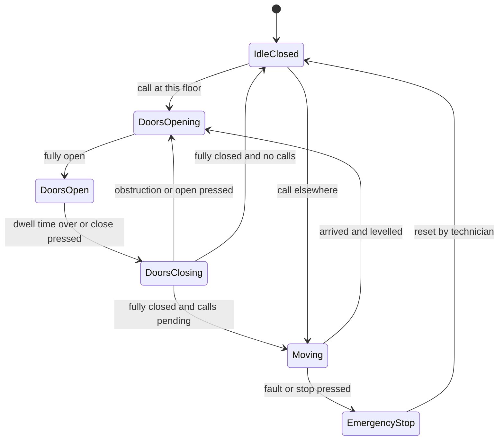

# Testing physical products: elevator, ATM, pen and self-checkout kiosk

> **Before this lesson:** read [A repeatable template, and the vending machine in full](#/lesson/thinking/template-vending-machine). The same template is applied here four more times.

## In plain words

A carpenter who has built one good table can build a chair, a shelf and a door with the same few skills: measure, cut, join, check that it is square. The pieces differ; the craft does not.

This lesson shows the testing template doing the same across four physical things — an elevator (a lift), a cash machine, a pen and a supermarket self-checkout. Each brings out a different concern: the elevator is about **safety**; the cash machine about money and people who try to steal it; the pen about finding structure in something that seems too trivial to test; the self-checkout about ordinary shoppers doing unexpected things.

Working through several examples is how the template stops being something you remember and becomes something you do. In interviews, the object is chosen to be unfamiliar on purpose, so the ability to apply one method to anything is exactly what is being assessed.

This lesson applies the template from the previous one to four more physical prompts. They were chosen because each stresses a different part of the template: the **elevator** is about safety and scheduling; the **ATM** is about money, security and an external network; the **pen** is the famous "trivial object" question that tests whether you can find structure where none is given; and the **self-checkout kiosk** combines hardware, software, weight sensors and human behaviour.

For each one, attempt your own answer first — eight to ten minutes, aloud, with a timer — and only then open the model answer. Compare structure before content: did you ask about users, did you have a map, did you rank?

A reminder of the template: purpose and users → assumptions → decompose → model → *normal, boundaries, failures, abuse* per area → non-functional sweep → prioritised table → levels and environments → exit and rollout → summary.

## 1. The elevator

**Prompt:** *"How would you test an elevator?"*

What the interviewer is looking for: that you put safety first without being told, that you see a state machine with a scheduler on top, and that you remember the people inside it.

<details><summary>Model answer</summary>

**Clarify.** What kind of building — a four-floor office, a hospital, a sixty-floor tower? One car or a bank of several? Passenger or freight? Am I testing a new design or commissioning one installation? Are there special modes: fire service, priority for staff, accessibility features?

**Assume.** A single passenger car in a ten-floor office, new controller software on proven mechanical hardware. Regulatory certification of the mechanical safety system is done by an accredited body; my job is the control system and the overall behaviour, but I still verify that safety functions respond.

**Users.** Passengers (including wheelchair users, people with prams, visually impaired people, children), maintenance technicians, building security, and emergency services.

**Decompose.**

1. Safety systems — door interlocks, obstruction sensors, overload, emergency brake, alarm and intercom
2. Doors — open, close, hold, reopen
3. Movement and levelling — stopping flush with the floor, acceleration, speed
4. Call handling and scheduling — hall buttons, car buttons, the order of stops
5. Indicators and controls — displays, chimes, button lights, voice announcements
6. Special modes — fire recall, independent service, power-failure rescue, maintenance
7. Environment and endurance — load, temperature, cycles

**Model.** States of the car: idle with doors closed, doors opening, doors open, doors closing, moving up, moving down, out of service, emergency stop.



The invariant I would write beside the diagram: **the car never moves unless every door is closed and locked, and no door opens unless the car is level at a floor.** Every test of an invalid transition is an attempt to break that sentence.

**Tests by area (four passes).**

- *Doors.* Normal: open and close at each floor. Boundaries: an obstruction at the last centimetre of closing; hold-open at its maximum duration. Failures: sensor failed (doors must not close with force, or must go out of service); doors blocked repeatedly (nudging mode, alarm). Abuse: forcing doors apart; holding them for minutes.
- *Movement.* Normal: travel between every pair of adjacent floors and the longest run. Boundaries: top and bottom floor (must not overrun); levelling accuracy at empty and full load; exactly rated load, slightly over (overload indication, refuses to move). Failures: power loss between floors (brake holds; rescue procedure moves to the nearest floor); position sensor fault.
- *Scheduling.* Normal: with the car going up and calls at 3, 7 and 5, it stops at 3, 5, 7 in travel order, then serves down calls. Boundaries: no calls; every button pressed; a call for the current floor. Failures: a stuck hall button. Abuse: a child pressing every floor; someone pressing a button and walking away. Fairness: a call at the lowest floor must not starve while traffic bounces between upper floors.
- *Special modes.* Fire recall returns the car to the designated floor, ignores other calls and opens the doors. Independent service responds only to car buttons. Each mode is entered from every state, including mid-travel.

**Non-functional sweep.** Performance: waiting time and journey time under a morning rush simulation. Reliability: tens of thousands of door cycles. Accessibility: button height, braille, audible floor announcements, door dwell long enough for a wheelchair. Usability: is it obvious which way the arriving car is going? Safety runs through everything. Operability: fault codes and remote monitoring.

**Prioritised plan.**

| Rank | Risk | L | I | How |
|---|---|---|---|---|
| 1 | Car moves with a door open, or door opens between floors | 1 | 5 | Fault injection on interlock signals; every invalid transition |
| 2 | Doors close on a person | 2 | 5 | Obstruction tests at several heights and speeds; sensor-fail behaviour |
| 3 | Passengers trapped: power loss, fault between floors | 2 | 4 | Power-cut tests in each state; alarm and intercom checks |
| 4 | Overload not detected | 2 | 4 | Calibrated weights around the rated load |
| 5 | Fire recall fails | 1 | 5 | Trigger in every state |
| 6 | Scheduling starvation or wrong order | 3 | 2 | Simulation with thousands of generated call patterns |
| 7 | Poor levelling (trip hazard) | 3 | 3 | Measure at each floor, empty and loaded |
| 8 | Indicators wrong | 3 | 1 | Checklist |

**Levels.** Scheduling and state logic in simulation against a virtual shaft, where I can run thousands of random call sequences and check the invariant after every step. Hardware-in-the-loop for the controller with real door operators. On-site commissioning for levelling, load and timing.

**Summary.** Safety invariants first, tested by trying to violate them; trapped-passenger scenarios second; scheduling quality in simulation; a commissioning checklist on site before handover.

</details>

## 2. The ATM

**Prompt:** *"How would you test an ATM?"*

Expect follow-ups on money integrity ("the cash jammed halfway out") and on security. Notice how similar the core is to the vending machine: a transaction that must be atomic, sitting on a state machine.

<details><summary>Model answer</summary>

**Clarify.** Which functions — withdrawal only, or also balance, deposit, transfer, PIN change? Is it our bank's machine serving other banks' cards too? New hardware, new software, or both? Indoor branch or street wall?

**Assume.** Cash withdrawal, balance enquiry and PIN change; accepts our cards and those of other networks; street installation; software is new, hardware is an existing model.

**Users.** Customers (including visually impaired users with headphones), cash-replenishment staff, technicians, the bank's fraud and operations teams — and criminals, who are effectively a user group to design tests around.

**Decompose.** (1) Card handling and authentication, (2) transaction logic and limits, (3) cash dispensing, (4) host communication, (5) receipts, screen and keypad, (6) security, physical and logical, (7) operations — replenishment, monitoring, journals.

**Model.** States: idle → card inserted → PIN entry → menu → amount entry → authorising → dispensing → card and cash presented → idle; with side exits to card retained and out of service.

The key decision table, for a withdrawal request:

| Rule | PIN ok | Within daily limit | Funds sufficient | Notes available | Outcome |
|---|---|---|---|---|---|
| 1 | N | – | – | – | Refuse; count the attempt; retain card on the third |
| 2 | Y | N | – | – | Refuse: limit exceeded |
| 3 | Y | Y | N | – | Refuse: insufficient funds |
| 4 | Y | Y | Y | N | Refuse or offer another amount |
| 5 | Y | Y | Y | Y | Dispense; debit account |

**Tests by area.**

- *Authentication.* Normal: correct PIN. Boundaries: first, second, third wrong PIN; wrong, wrong, right — does the counter reset? PIN of minimum and maximum length. Failures: unreadable chip, expired card, card reported stolen. Abuse: shoulder-surfing protections (masked entry, timeout), card left in the slot (retract after timeout).
- *Amount and limits.* Partitions: valid multiple of the smallest note; not a multiple; zero; above per-transaction limit; above remaining daily limit; above balance. Boundaries: exactly the limit, one note above; exactly the balance. A withdrawal that crosses midnight for daily-limit reset.
- *Dispensing.* Normal: the right count of each denomination. Boundaries: last note in a cassette; an amount that needs a mix (60 from 50s and 20s cannot use a 50). Failures: note jam, double-pick, cassette empty mid-transaction. **Cash presented but not taken**: retract after the timeout, record it, and reverse or flag the debit. **Partial dispense**: account must reflect exactly what left the machine.
- *Host communication.* Network lost before the request (clean refusal), after the request but before the reply (unknown outcome — do not dispense; send a reversal), after dispensing but before confirmation (must still record). Slow host: timeout handling. Duplicate messages must not debit twice.
- *Security.* Physical: skimmer detection on the card slot, PIN-pad tamper response, safe and enclosure. Logical: PIN encrypted at the keypad, no sensitive data in logs or on receipts, software integrity at boot, no keyboard escape into the operating system.
- *Operations.* Replenishment counts reconcile with dispensed totals; the electronic journal can reconstruct any disputed transaction.

**Non-functional sweep.** Performance: time per transaction, since queues form. Reliability: thousands of dispense cycles with used and new notes. Accessibility: audio guidance, tactile keys, screen contrast, reach. Localisation: language selection, currencies for foreign cards. Environment: sunlight on screen, rain, cold. Compliance: card-scheme certification.

**Prioritised plan.**

| Rank | Risk | L | I | How |
|---|---|---|---|---|
| 1 | Account debited, cash not delivered (or the reverse) | 3 | 5 | Interrupt every step between authorise and take-cash; reconcile journal, host and cassette counts |
| 2 | PIN or card data exposed | 2 | 5 | Security review, tamper tests, log inspection, penetration test |
| 3 | Wrong amount dispensed | 2 | 5 | Denomination mix tests; note-quality endurance |
| 4 | Limits bypassed | 2 | 4 | Boundary and decision-table tests, repeated small withdrawals, midnight |
| 5 | Card wrongly retained, or not retained when stolen | 3 | 3 | Counter tests; hot-card list |
| 6 | Unavailable: jams, comms loss | 4 | 2 | Endurance and fault recovery |
| 7 | Receipt and screen errors | 3 | 1 | Checklist |

**Levels and rollout.** Host simulator for scripted responses and delays; test cards for each network; a hardware rig for the dispenser; then a single branch machine under daily reconciliation before wider deployment.

**Summary.** Like the vending machine, the central property is atomicity between the ledger and the physical cash, proven by reconciliation after injected failures; security is the second pillar because the machine is a public target.

</details>

> [!INTERVIEW]
> Follow-up you should expect: *"The customer says the machine debited them but gave no cash."* A strong reply does not guess. It says which three records should agree — the host's transaction, the machine's journal (including the "notes presented" and "notes taken or retracted" sensor events) and the cassette counts at the next replenishment — and that the design must make all three available. Testing that those records are complete *is* a test case.

## 3. The pen

**Prompt:** *"How would you test a pen?"*

This question exists to see what you do when the object is too simple to hide behind. Weak answers list "write with it, drop it, leave the cap off". Strong answers ask who it is for — because a child's felt-tip, a surgeon's skin marker, a ballpoint sold by the thousand and a pen for use in space have almost nothing in common — and then find structure.

<details><summary>Model answer</summary>

**Clarify.** What kind of pen — ballpoint, gel, fountain, marker? Who is it for? Is it disposable or refillable? Are we the manufacturer testing a design before mass production, or a buyer choosing a supplier? Any standards that apply (for example, safety rules for products children may put in their mouths)?

**Assume.** A retractable ballpoint with a clip, sold in multipacks to offices and schools; we are the manufacturer about to start mass production. Because schools are a market, child safety matters.

**Decompose by component, then by lifecycle.**

Components: ink and refill; tip (ball and socket); barrel and grip; retract mechanism (button, spring, cam); clip; packaging and printing.

Lifecycle: manufacture → transport and storage → first use → daily use → misuse → running out → disposal.

**Functional tests.**

- *Writing — normal.* Starts writing on the first stroke; line is continuous and of the stated width and colour; no blobs or skips.
- *Writing — partitions of surface.* Plain paper, glossy paper, cardboard, thermal receipts, slightly greasy paper, sticky notes. Angle of the pen: upright, slanted, upside down against a wall (ballpoints rely on gravity). Speed: slow signature, fast scribble. Pressure: light and heavy; does it tear paper or emboss the page below?
- *Writing — boundaries.* **Write-out length:** how many metres until the ink ends, against the claim. The first stroke after long storage; the last metre before it runs dry — does it fade gradually or fail suddenly?
- *Ink behaviour.* Drying time and smudging, especially for left-handed writers; resistance to water and light; bleed-through; does it leak in a pocket when warm, or in an aircraft cabin at reduced pressure?
- *Mechanism.* Click cycles to failure — a state machine with two states, extended and retracted, and the invalid states "half-latched" and "jammed". Does the tip retract fully so it cannot mark a pocket?
- *Clip.* Grip force on thin and thick material; fatigue when bent outward; snapping.

**Failures and abuse.** Dropped tip-first onto a hard floor (the classic way to kill a ballpoint); stepped on; chewed; left in a hot car or a freezer; used as a lever or a stylus; taken apart and reassembled.

**Non-functional sweep.**

- *Safety.* Small parts and choking; a vented cap if there is a cap; non-toxic ink and plastics; no sharp edges when broken.
- *Usability and comfort.* Grip diameter, weight and balance during a long exam; noise of the click.
- *Accessibility.* Usable with reduced grip strength; left-handed use.
- *Reliability.* Shelf life: does it write after two years in a drawer?
- *Environment.* Temperature and humidity ranges in shipping.
- *Manufacturing consistency.* The design may be good and the ten-thousandth unit bad, so sample from production batches and measure the defect rate.
- *Compliance and sustainability.* Labelling; recyclability if claimed.

**Prioritised plan.**

| Rank | Risk | L | I | How |
|---|---|---|---|---|
| 1 | Child safety: toxic material or choking part | 1 | 5 | Certified lab tests to the applicable toy and stationery safety standards |
| 2 | Leaks, staining clothes and bags | 3 | 4 | Heat, pressure and orientation tests on a batch sample |
| 3 | Fails to write or skips | 3 | 4 | Automated writing machine on standard paper; start-up after storage |
| 4 | Write-out length below the claim | 2 | 3 | Writing machine to exhaustion, several samples |
| 5 | Mechanism or clip breaks early | 3 | 2 | Cycle rig; bend fatigue |
| 6 | Batch-to-batch variation | 3 | 3 | Statistical sampling from the production line |
| 7 | Comfort and appearance | 2 | 1 | User panel |

**Trade-off.** A thinner ink flows and starts better but smudges and leaks more; a stiffer spring gives a satisfying click and wears the cam sooner. I would test at the extremes of each tolerance, not only at the nominal design.

**Summary.** I turned a simple object into components and a lifecycle, ranked child safety and leakage above writing quality, and added production sampling because for a mass-produced item the *process* is part of the product.

</details>

The transferable lesson: when the object seems trivial, the structure comes from **who uses it, what it is made of, and what happens to it over its life**. The same three questions work for a chair, a stapler, a water bottle or a toaster.

## 4. The self-checkout kiosk

**Prompt:** *"A supermarket is introducing self-checkout kiosks. How would you test one before rollout?"*

This is the richest of the four: scanner, scale, touch screen, payment, a store backend, age-restricted items, theft — and stressed shoppers.

<details><summary>Model answer</summary>

**Clarify.** Which payment types? Is there a bagging-area scale for theft control? Do loose items (fruit, bread) need weighing or lookup? Are age-restricted and security-tagged items sold? How many kiosks per attendant?

**Assume.** Barcode scanner with integrated scale, bagging-area scale, touch screen, card and phone payment plus cash at some units, one attendant per six kiosks with an override device, connected to the store's price and stock system.

**Users.** Shoppers of every age and ability, attendants, store managers, technicians, and loss-prevention staff.

**Decompose by journey.**

1. Start — language, own bags, loyalty card
2. Add items — scan, weigh, look up, quantity
3. Bagging verification — expected weight versus measured
4. Exceptions — age check, security tag, void an item, price query
5. Discounts — promotions, coupons, loyalty
6. Payment and receipt
7. Attendant functions and store backend

**Model.** States: idle → scanning ↔ awaiting bagging → (assistance needed) → payment → receipt → idle. The events that cause trouble are the ones arriving in the wrong state: an item placed in the bagging area without a scan; a scan while assistance is pending; walking away mid-transaction (timeout, and what happens to the half-finished basket?).

**Tests by area.**

- *Scanning.* Partitions of barcode: standard, small, damaged, creased, on a curved bottle, on a frozen bag with frost, a price-embedded barcode from the deli counter, an unknown code. Boundaries: the same item scanned 50 times; a basket of 200 lines; quantity entry of 0, 1, 99. Abuse: two items held together so one barcode reads; a cheap barcode stuck over an expensive one.
- *Weighing and bagging.* Normal: weight within tolerance of the catalogue weight. Boundaries: very light items (a greeting card), very heavy (a case of water), items at the edge of tolerance; the scale's maximum load with a full bag. Failures: shopper's own bag weight; a child leaning on the scale; a scale drifting out of calibration. Abuse: scanning bananas, bagging steak; selecting "carrots" for avocados. Too strict a tolerance causes constant "unexpected item" alerts; too loose invites theft — a trade-off to tune with real data.
- *Exceptions.* Alcohol triggers attendant approval and cannot be bypassed; a voided item must be removed from the bag (weight decreases); the attendant override is logged with identity.
- *Discounts.* A decision table: multi-buy offers, coupons, loyalty prices and manager reductions — which stack and which exclude each other. Boundaries: the third item of "3 for 2"; a coupon worth more than the basket; an offer expiring at midnight during the transaction.
- *Payment.* The same atomicity tests as before: declined, network loss, double tap, partial payment with a gift card then card for the rest, cash without exact change.
- *Backend.* Price change during a transaction; store system offline (can it continue with cached prices, and do sales reconcile later?); stock decremented exactly once.

**Non-functional sweep.** Performance: scan-to-beep latency — more than a fraction of a second and shoppers double-scan. Reliability: a full trading day without restart. Usability: first-time users finish unaided; error messages say what to do next. Accessibility: screen height, audio prompts, contrast, time allowed. Localisation: languages. Security: payment standards, locked operating system, service ports. Safety: scanner laser class, trailing cables, scale pinch points. Operability: remote health monitoring, receipt-paper alerts.

**Prioritised plan.**

| Rank | Risk | L | I | How |
|---|---|---|---|---|
| 1 | Wrong total: price, promotion or weight error | 4 | 4 | Decision-table and boundary tests against the pricing engine; compare with the staffed tills |
| 2 | Payment taken and sale not recorded, or double charge | 2 | 5 | Fault injection through the payment sequence; reconciliation |
| 3 | Age-restricted sale without approval | 2 | 5 | Every path to payment with a restricted item, including voids and suspends |
| 4 | False "unexpected item" alerts make the kiosk unusable | 5 | 3 | Field data on tolerance; many real products |
| 5 | Theft paths | 4 | 3 | Adversarial exploratory sessions with loss-prevention staff |
| 6 | Slow or frozen kiosk at peak | 3 | 3 | Soak test, peak simulation |
| 7 | Accessibility barriers | 3 | 3 | Sessions with users with disabilities |
| 8 | Receipt and cosmetic issues | 3 | 1 | Checklist |

**Rollout.** One store, two kiosks, with staffed tills alongside. Compare each day: sales per kiosk, interventions per hundred transactions, average transaction time, shrinkage against the store's baseline, abandonment rate. Tune the weight tolerance from that data before expanding to more stores.

**Summary.** Correct totals and payment integrity first, legal compliance on restricted items next, then the human factors — false alerts and theft — which only a real store can measure, hence a pilot with intervention rate and shrinkage as the gate.

</details>

## Patterns across the four

Put the four answers side by side and the reusable pieces stand out.

| Pattern | Elevator | ATM | Pen | Kiosk |
|---|---|---|---|---|
| A single invariant to state aloud | Never move with a door open | Debit if and only if cash delivered | Never leak | Total charged equals items taken |
| The model | State machine | State machine + decision table | Two-state mechanism; lifecycle | Journey state machine + discount table |
| The top risk | Injury | Money and data | Child safety | Wrong totals |
| What only the field can show | Real traffic patterns | Note quality, fraud | Batch variation | Shopper behaviour, theft |
| Typical twist | "It's in a hospital" | "Cash jammed halfway" | "It's for astronauts" | "Shrinkage doubled" |

Whenever you can state an **invariant** — a sentence that must always be true — do so early. It gives your tests a target (try to make the sentence false) and it is the kind of statement interviewers write down verbatim.

## Summary

- The same template handled four very different objects; what changed was the lens (components for the pen, journey for the kiosk) and the top risk.
- Ask who the users are first; for simple objects that question creates most of the structure.
- State an invariant and design tests that try to violate it.
- Safety and money outrank convenience; human behaviour and manufacturing variation can only be measured in the field, so every answer ends with a pilot and named metrics.

## Glossary

| Term | Meaning |
|---|---|
| Invariant | A statement that must always hold, such as 'never move with a door open' |
| Interlock | A mechanism that prevents an unsafe combination of actions |
| Fail-safe | Designed so that a failure leaves the system in a safe condition |
| Scheduling | Deciding the order in which requests are served |
| Starvation | A request waiting indefinitely because others are always served first |
| Skimmer | A device illegally attached to a card reader to copy cards |
| Journal | A machine's own record of every step of every transaction |
| Write-out length | How far a pen writes before running out of ink |
| Tolerance | The permitted difference between an expected and a measured value |
| Shrinkage | Stock lost to theft, damage or error |
| Commissioning | Checking an installation on site before handing it over |

## Check yourself

```quiz
[
  {"q": "Which statement is the best invariant to give for an elevator?",
   "options": ["The elevator should be fast", "The car never moves unless all doors are closed and locked, and no door opens unless the car is level at a floor", "Buttons should light up", "The elevator should serve the nearest call first"],
   "answer": 1,
   "explain": "An invariant is a property that must always hold; tests then try to break it through invalid transitions and injected faults."},
  {"q": "In the pen question, what creates most of the structure when the object looks trivial?",
   "options": ["Listing as many random tests as possible", "Asking who uses it, what it is made of, and what happens over its life", "Naming test tools", "Refusing the question as unserious"],
   "answer": 1,
   "explain": "Users, components and lifecycle turn a simple object into a structured space of risks."},
  {"q": "An ATM customer does not take the presented cash. What must be tested?",
   "options": ["Nothing; it is the customer's problem", "The cash is retracted after a timeout, the event is recorded, and the debit is reversed or flagged", "The machine shuts down permanently", "The cash is left out for the next customer"],
   "answer": 1,
   "explain": "Presented-but-not-taken is a classic atomicity case; journal, host and cassette counts must stay consistent."},
  {"q": "Why does the pen plan include sampling from production batches?",
   "options": ["Because design testing is unnecessary", "A sound design can still be manufactured inconsistently, so the process is part of the product", "To increase the number of tests", "Because pens are expensive"],
   "answer": 1,
   "explain": "For mass-produced goods, defects often come from variation in materials and assembly, not from the design."},
  {"q": "A kiosk's bagging-scale tolerance is made stricter. What is the expected trade-off?",
   "options": ["Fewer theft opportunities but more false 'unexpected item' alerts", "More theft and fewer alerts", "No change", "Faster scanning"],
   "answer": 0,
   "explain": "Tight tolerance catches substitutions but flags honest variation; the setting should be tuned with field data."},
  {"q": "Which elevator scheduling defect is found best by simulation with thousands of generated call patterns?",
   "options": ["A dim button light", "A floor that is starved of service under certain traffic", "A scratched panel", "A loud chime"],
   "answer": 1,
   "explain": "Fairness and starvation depend on sequences of calls, which simulation can generate in volume."},
  {"q": "What is common to the top-priority tests of the vending machine, ATM and kiosk?",
   "options": ["They are all about screen brightness", "They interrupt the transaction between taking payment and delivering goods, then reconcile the records", "They measure colour accuracy", "They are all performance tests"],
   "answer": 1,
   "explain": "All three have a money-and-goods exchange that must be atomic, so fault injection around that step ranks highest."},
  {"q": "The interviewer says the elevator is in a hospital. What should move up the ranking?",
   "options": ["Advertising screens", "Priority and emergency modes, door dwell time for beds, hygiene, reliability with no alternative route", "Background music", "Nothing changes"],
   "answer": 1,
   "explain": "The users and stakes changed: beds, staff priority and continuous availability become important."}
]
```

> **Source:** Original worked examples. Techniques follow the ISTQB Foundation Level syllabus v4.0, ch. 4–5 (https://www.istqb.org/certifications/certified-tester-foundation-level). Reliability and staged-rollout ideas draw on the Google SRE Book, "Testing for Reliability" (https://sre.google/sre-book/testing-reliability/) and Martin Fowler, "Canary Release" (https://martinfowler.com/bliki/CanaryRelease.html).
