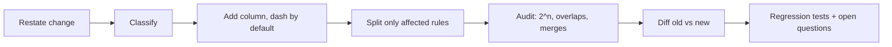

# Updating a table when the rules change

> **Before this lesson:** read [Building a decision table from requirements](#/lesson/thinking/building-decision-tables) and [Collapsing tables, contradictions and gaps](#/lesson/thinking/collapse-contradictions-gaps).

## In plain words

A school has a uniform policy that everyone understands. Then a new rule arrives: "From Monday, sports kit may be worn on days with a games lesson." It sounds small. But what about pupils with games *and* a school photograph that day? Does it apply to the sixth form, who had no uniform anyway? The person who wrote the new rule was thinking about one situation; the policy has to work for all of them.

That is the task in this lesson. You are given a decision table that works, and an **amendment** — a change to the rules — and you must fold the amendment in so that everything that was true stays true, the new rule takes effect, and the cases its author forgot are brought into the open.

It is one of the most realistic exercises an interviewer can set, because it is what most work on existing systems consists of: rules are not written once, they are changed again and again.

The exercise that gives this module its place in interviews is short to state: *"Here is the current decision table. The business has changed the policy. Update the table."* It imitates the most common real maintenance task there is. Rules do not arrive once; they arrive as a stream of amendments, each written by someone thinking only about the new case. Your job is to fold the amendment in without breaking what was already true, and to notice what the amendment forgot to say.

## The four kinds of change

Every amendment is one of four kinds, or a mix.

| Kind | Example | Effect on the table |
|---|---|---|
| **New condition** | "Orders to remote areas pay a surcharge" | Input space doubles; every old rule must take a position on the new condition |
| **New value of a condition** | A third membership tier | One condition gains a value; rows multiply |
| **Changed action** | "Free shipping threshold applies to members only" | Same rows, different entries |
| **New action** | "Also send a notification" | A new action column; decide which rules trigger it |

A new condition is the hard one, and it is what interviewers usually pick.

## A six-step method

1. **Restate the change as a rule in table language.** Which condition, which values, which action. If you cannot, you do not yet understand the change.
2. **Classify it** using the four kinds.
3. **Expand the table.** For a new condition: every existing rule gets a dash in the new column by default — meaning "unaffected" — and only rules the change touches are split into a Y row and an N row.
4. **Apply the change** to the affected rows.
5. **Re-audit**: count against the new $2^n$, check overlaps, look for merges.
6. **Diff old against new** and list the inputs whose outcome changed. That list is the regression-test set, and it is how you prove the change did only what was asked.

Step 3 is where discipline pays. The lazy alternatives both cause defects: appending a new rule with dashes in every old column creates contradictions (as the previous lesson showed), and mechanically splitting every rule doubles the table for no benefit.



Step 6 can be automated. Two tables are compared by behaviour, never by text:

```python-run
import itertools

def run(table, inp, default="none"):
    for pattern, action in table:
        if all(p == "-" or p == c for p, c in zip(pattern, inp)):
            return action
    return default

def diff(n, old, new):
    out = []
    for combo in itertools.product("NY", repeat=n):
        s = "".join(combo)
        a, b = run(old, s), run(new, s)
        if a != b:
            out.append((s, a, b))
    return out

# conditions: member, order over 50.   New third condition: remote area
old = [("Y-", "free"), ("NY", "free"), ("NN", "4.99")]
old_widened = [(p + "-", a) for p, a in old]                # same behaviour, 3 columns
new = [("Y-Y", "3.00"), ("Y-N", "free"), ("NYY", "3.00"), ("NYN", "free"),
       ("NNY", "7.99"), ("NNN", "4.99")]
for row in diff(3, old_widened, new):
    print(row)
```

Only the three inputs with "remote = Y" changed, which is exactly what the amendment intended.

Below are five exercises in increasing difficulty. For each, write the updated table and the list of changed inputs before opening the answer.

## Exercise 1 — Shipping fees

**Current policy** (M = member, O = order over 50):

| Rule | M | O | Shipping |
|---|---|---|---|
| 1 | Y | – | free |
| 2 | N | Y | free |
| 3 | N | N | 4.99 |

**Change:** *"Deliveries to remote areas cost us more. Charge a remote-area surcharge of 3.00 on top of normal shipping."*

<details><summary>Model answer</summary>

**Restate.** New condition R = "destination is remote". When R = Y, shipping = normal shipping + 3.00.

**Classify.** New condition; it touches every rule, because "on top of normal shipping" applies to all three outcomes.

**Expand and apply.**

| Rule | M | O | R | Shipping |
|---|---|---|---|---|
| 1a | Y | – | N | free |
| 1b | Y | – | Y | 3.00 |
| 2a | N | Y | N | free |
| 2b | N | Y | Y | 3.00 |
| 3a | N | N | N | 4.99 |
| 3b | N | N | Y | 7.99 |

**Audit.** 2 + 2 + 1 + 1 + 1 + 1 = 8 = $2^3$; every pair clashes on some position; complete and consistent. Rules 1a and 2a could be written as overlapping `Y – N` and `– Y N`, but the count stays at two.

**The question the change forgot.** "Free shipping" was a promise to members. Is a member in a remote area still told "free shipping" and then charged 3.00? Two readings: (a) the surcharge always applies — the table above; (b) free means free, and the surcharge applies only when shipping was already being charged — then only rule 3 splits. I would present (a), flag (b), and ask. I would also ask how "remote" is determined (a postcode list) since that is a new data dependency with its own boundary cases.

**Changed inputs.** `Y Y Y`, `Y N Y`, `N Y Y`, `N N Y` — every input with R = Y; none with R = N. Four regression tests for the change, four to confirm nothing else moved.

</details>

## Exercise 2 — Loan approval

**Current policy** (C = credit score at least 700, I = income verified, D = debt ratio under 40 %):

| Rule | C | I | D | Decision |
|---|---|---|---|---|
| 1 | Y | Y | Y | approve |
| 2 | Y | Y | N | manual review |
| 3 | Y | N | – | manual review |
| 4 | N | Y | Y | manual review |
| 5 | N | Y | N | reject |
| 6 | N | N | – | reject |

**Change:** *"Following a regulator's instruction, applicants on the sanctions watch list must never be approved automatically or sent to routine manual review; they go to the compliance team."*

<details><summary>Model answer</summary>

**Restate.** New condition W = "on watch list". When W = Y: decisions "approve" and "manual review" become "compliance referral".

**The decision hiding in the wording.** What about rules 5 and 6, which already reject? The instruction says "never approved or sent to routine review" — a rejection satisfies it. But the compliance team may want to *know* about every watch-listed applicant, even rejected ones. That is a question. I will take the literal reading and flag it.

**Expand and apply.** Rules whose action is affected split; the rest take a dash.

| Rule | C | I | D | W | Decision |
|---|---|---|---|---|---|
| 1a | Y | Y | Y | Y | compliance referral |
| 1b | Y | Y | Y | N | approve |
| 2a | Y | Y | N | Y | compliance referral |
| 2b | Y | Y | N | N | manual review |
| 3a | Y | N | – | Y | compliance referral |
| 3b | Y | N | – | N | manual review |
| 4a | N | Y | Y | Y | compliance referral |
| 4b | N | Y | Y | N | manual review |
| 5 | N | Y | N | – | reject |
| 6 | N | N | – | – | reject |

**Audit.** 1 + 1 + 1 + 1 + 2 + 2 + 1 + 1 + 2 + 4 = 16 = $2^4$. No overlaps.

**Collapse.** Rules 1a, 2a and 3a together cover every input with C = Y and W = Y → `Y – – Y → compliance referral`. With 4a, the referral rules are `Y – – Y` and `N Y Y Y`: eight rules in total.

**Why not one rule on top?** In a first-match engine the tempting edit is to insert `– – – Y → compliance referral` as the first line. That also sends already-rejected applicants to compliance — a behaviour change beyond the instruction — and it relies on ordering. If the business *wants* that, it is the simplest table; but it should be chosen, not stumbled into.

**Changed inputs.** The five inputs with W = Y and an old decision of approve or review: `YYYY`, `YYNY`, `YNYY`, `YNNY`, `NYYY`. The three watch-listed inputs that were already rejected are unchanged, as are all eight with W = N.

**Non-table follow-ups.** Where does the watch-list flag come from, how fresh is it, and what happens if the lookup service is down — fail closed (refer everything) or fail open? For a regulatory rule the safe default is to fail closed.

</details>

> [!INTERVIEW]
> The pattern in exercise 2 — an override that applies to *some* existing outcomes — is the single most common "rules changed" exercise. The winning move is to say: "the new condition is irrelevant to rules whose outcome it does not change, so those get a don't-care; I only split the rules it affects." Then show the changed-input list.

## Exercise 3 — Access control

**Current policy** for opening a document (O = user is the owner, S = document is shared with the user's team, A = user is an administrator):

| Rule | O | S | A | Access |
|---|---|---|---|---|
| 1 | Y | – | – | edit |
| 2 | N | Y | – | view |
| 3 | N | N | Y | view |
| 4 | N | N | N | deny |

**Change:** *"Documents can now be marked confidential. Confidential documents are visible only to their owner; administrators may see that the document exists but not its contents."*

<details><summary>Model answer</summary>

**Restate.** New condition K = "document is confidential". When K = Y: the owner keeps edit; team sharing no longer grants view; administrators get a new, weaker access level.

**Classify.** A new condition **and** a new action value ("metadata only"). Two kinds at once.

**Expand and apply.**

| Rule | O | S | A | K | Access |
|---|---|---|---|---|---|
| 1 | Y | – | – | – | edit |
| 2 | N | Y | – | N | view |
| 3 | N | N | Y | N | view |
| 4 | N | N | N | – | deny |
| 5 | N | – | Y | Y | metadata only |
| 6 | N | Y | N | Y | deny |

**Audit.** 8 + 2 + 1 + 2 + 2 + 1 = 16. Pairwise: 2 versus 5 clash on K; 3 versus 5 clash on K; 4 versus 5 clash on A; 4 versus 6 clash on S; 5 versus 6 clash on A. Complete and consistent.

**What the change forgot.**

- A user who is on the shared team **and** an administrator, for a confidential document (`N Y Y Y`): rule 5 gives metadata only. Reasonable, but nobody said so.
- Can a confidential document be *shared* at all? If marking it confidential should remove the sharing, then S = Y, K = Y is infeasible and the system must enforce that — otherwise rule 6 is the safety net.
- Who may set or clear the confidential flag? If an administrator can clear it, the restriction is decorative. This is outside the table and matters more than anything in it.
- Existing open sessions, cached copies, search indexes and notification emails that already contain the content: a rule change in an access table does not retract data already delivered.

**Changed inputs.** Old outcome → new, for K = Y: `NYNY` view → deny; `NYYY` view → metadata; `NNYY` view → metadata. Owners and non-privileged outsiders are unchanged. For a security change I would also test *every* row, since a wrongly granted access is the expensive direction of error.

**Design note.** Access tables should default to deny. If a gap ever appears, the outcome should be the safe one, so I would implement this as explicit grant rules followed by a final catch-all deny.

</details>

## Exercise 4 — Discount stacking

**Current policy.** A shop has three independent promotions. L = loyalty member (5 % off), V = valid voucher code (10 % off), S = item is in the seasonal sale (20 % off). All that apply are added together.

| L | V | S | Discount |
|---|---|---|---|
| N | N | N | 0 % |
| Y | N | N | 5 % |
| N | Y | N | 10 % |
| Y | Y | N | 15 % |
| N | N | Y | 20 % |
| Y | N | Y | 25 % |
| N | Y | Y | 30 % |
| Y | Y | Y | 35 % |

**Change:** *"Margins are too thin. Voucher codes can no longer be combined with the seasonal sale; the customer gets whichever of the two is better. Loyalty still stacks. Also, no order may receive more than 25 % in total."*

<details><summary>Model answer</summary>

**Restate.** Two amendments. (1) When V and S are both Y, use the larger of the two instead of the sum. (2) A cap of 25 % on the total.

**Classify.** No new condition. Changed actions, with an interaction between the two amendments that must be ordered: apply the exclusion first, then loyalty, then the cap.

**Apply.**

| L | V | S | Before | After exclusion | After cap | Changed? |
|---|---|---|---|---|---|---|
| N | N | N | 0 | 0 | 0 | |
| Y | N | N | 5 | 5 | 5 | |
| N | Y | N | 10 | 10 | 10 | |
| Y | Y | N | 15 | 15 | 15 | |
| N | N | Y | 20 | 20 | 20 | |
| Y | N | Y | 25 | 25 | 25 | |
| N | Y | Y | 30 | 20 | 20 | yes |
| Y | Y | Y | 35 | 25 | 25 | yes |

**Observation worth saying aloud.** With today's percentages, the cap changes nothing: after the exclusion the maximum is already 25 %. The cap is redundant *now* and becomes active only if someone later raises a percentage. That is useful to tell the business — and it means the cap rule has no test that can fail today unless I construct one with different numbers. I would add a test with a hypothetical 30 % sale so that the cap logic is exercised.

**Questions.**

- "Whichever is better" — better for the customer in percentage, or in money? If the voucher is a fixed amount rather than a percentage, the comparison depends on the basket.
- Is the voucher *consumed* when the sale discount wins? Customers will be angry if a single-use code is burned for nothing; it should be kept.
- Does the exclusion apply per item or per order? A basket can contain sale and non-sale items; the natural reading is per item: the voucher applies to non-sale items only.
- Is "25 %" inclusive? Exactly 25 % is allowed by "no more than".
- Are discounts added or compounded? 5 % then 20 % compounded is 24 %, not 25 %. The old table says added; confirm that the code agrees.

**Changed inputs.** Only `N Y Y` and `Y Y Y`. Six inputs must be shown unchanged.

</details>

## Exercise 5 — Refund policy

**Current policy** (T = within 30 days of purchase, U = item unopened, R = has receipt):

| Rule | T | U | R | Outcome |
|---|---|---|---|---|
| 1 | Y | Y | Y | full refund |
| 2 | Y | Y | N | store credit |
| 3 | Y | N | Y | store credit |
| 4 | Y | N | N | no refund |
| 5 | N | – | – | no refund |

**Change:** *"Two updates. First, consumer law requires that faulty items can be returned for a full refund for up to two years, opened or not; proof of purchase is still required. Second, to reward loyalty, members get 60 days instead of 30."*

<details><summary>Model answer</summary>

**Restate.** Two new conditions: F = "item is faulty" and M = "customer is a member". And condition T changes meaning: the window is 30 days for non-members and 60 for members. The faulty rule introduces a second, longer window of two years.

**Simplify before expanding.** Five yes/no conditions would give 32 rows, and the time conditions interact. A cleaner model replaces T with a three-valued *age band* that already accounts for membership:

- **in window** — within 30 days, or within 60 days for a member
- **late** — past the window but within two years
- **expired** — more than two years

Membership then disappears from the table: it is absorbed into how the band is computed. Conditions: age band (3 values) × U × R × F → 3 × 2 × 2 × 2 = 24 combinations.

**Apply the sentences.**

1. Faulty, with receipt, not expired → full refund, regardless of opened state.
2. Otherwise the old table applies inside the window.
3. Outside the window and not covered by the faulty rule → no refund.

| Rule | Age band | U | R | F | Outcome | Covers |
|---|---|---|---|---|---|---|
| 1 | in window or late | – | Y | Y | full refund | 4 |
| 2 | in window | Y | Y | N | full refund | 1 |
| 3 | in window | Y | N | – | store credit | 2 |
| 4 | in window | N | Y | N | store credit | 1 |
| 5 | in window | N | N | – | no refund | 2 |
| 6 | late | – | Y | N | no refund | 2 |
| 7 | late | – | N | – | no refund | 4 |
| 8 | expired | – | – | – | no refund | 8 |

Total 4 + 1 + 2 + 1 + 2 + 2 + 4 + 8 = 24. Complete.

**What the change forgot.**

- Rule 3 with F = Y: a **faulty, unopened** item inside the window **without a receipt** gets store credit under the old rule. Fine. But rule 5 with F = Y: faulty, opened, in window, no receipt → no refund. The law says "proof of purchase", which may be broader than a paper receipt — a card statement or an order number. The condition R probably needs redefining.
- Who decides "faulty", and what about damage caused by the customer? That is a judgment step feeding the table.
- Does the member window depend on membership at purchase or at return?
- Boundaries: day 30, 31, 60, 61 and the two-year mark, each for members and non-members — eight or more boundary tests the table alone does not show.

**Changed outcomes versus the old policy.** (a) Members between day 31 and 60 now fall "in window": three outcomes improve. (b) Faulty items with a receipt: opened ones inside the window move from store credit to full refund; all those between the window and two years move from no refund to full refund. Everything else must be unchanged, including every non-member, non-faulty case.

**Lesson.** When an amendment changes a *threshold* by customer type, do not add a condition — redefine the banded condition. The table stays small and the complexity moves into one well-tested function that computes the band.

</details>

## Patterns to carry away

| Situation | Move |
|---|---|
| A new condition affects only some outcomes | Dash for unaffected rules; split affected ones |
| A new condition affects everything | Split every rule — and ask whether "everything" is truly intended |
| An override ("always", "never", "regardless") | Check each existing outcome against it; ask about those it does not literally cover |
| Two amendments at once | Decide and state the order of application; look for one making the other redundant |
| A threshold varies by customer type | Fold it into a banded condition instead of adding a condition |
| First-match table | Resist "insert a rule at the top" until you have diffed the behaviour |
| Any change | Finish with the list of changed inputs, the list of unchanged ones you would regression-test, and open questions |

## Summary

- Classify the amendment: new condition, new value, changed action, new action.
- Add the new column with don't-cares by default and split only the affected rules; then re-audit against the new $2^n$.
- Diff old and new behaviour over every input; the differences are the regression tests and the proof that nothing else moved.
- Amendments are written with only the new case in mind. Look for what they forgot: interaction with existing promises, data sources for the new condition, failure defaults, and boundaries.
- Present your reading, flag the alternative, and ask.

## Glossary

| Term | Meaning |
|---|---|
| Amendment | A change to an existing set of rules |
| Policy | The set of business rules a system applies |
| Override | A rule that takes precedence over others when it applies |
| Expand | To add a condition and give every existing rule a position on it |
| Split a rule | Replace one rule by two that differ in the new condition |
| Diff | The list of inputs whose outcome differs between two versions |
| Regression test | A test confirming that behaviour which should not have changed has not |
| Fail closed | Choosing the safe outcome when a check cannot be completed |
| Banded condition | A condition whose values are ranges, such as 'in window', 'late', 'expired' |
| Default deny | Refusing anything that no rule explicitly allows |

## Check yourself

```quiz
[
  {"q": "A new yes/no condition is added to a table with 3 conditions. How many inputs must the updated table cover?",
   "options": ["6", "8", "12", "16"],
   "answer": 3,
   "explain": "The input space doubles from 2^3 = 8 to 2^4 = 16."},
  {"q": "The new condition changes the outcome of only two of six existing rules. What is the best way to extend the other four?",
   "options": ["Split each into Y and N rows", "Give them a don't-care in the new column", "Delete them", "Move them to the bottom"],
   "answer": 1,
   "explain": "A dash states that the new condition is irrelevant to those rules and keeps the table small."},
  {"q": "Why is 'append one new rule with dashes in all the old columns' risky?",
   "options": ["It makes the table too short", "It overlaps every compatible existing rule, creating contradictions or unintended overrides", "Dashes are not allowed in new rules", "It always creates gaps"],
   "answer": 1,
   "explain": "The broad rule collides with existing rules; in a first-match list it may also change more outcomes than intended."},
  {"q": "After updating a table, what does the old-versus-new diff give you?",
   "options": ["The number of conditions", "The exact inputs whose outcome changed, which are the regression tests for the change", "A proof that the new policy is profitable", "The collapsed table"],
   "answer": 1,
   "explain": "Comparing behaviour over all inputs shows precisely what changed and that nothing else did."},
  {"q": "In the discount exercise, the 25% cap changed no outcome. What should you do?",
   "options": ["Leave the cap untested", "Remove the cap from the policy silently", "Tell the business it is currently redundant and add a test with different numbers so the cap logic is exercised", "Lower the cap until it changes something"],
   "answer": 2,
   "explain": "A rule that cannot currently trigger still needs a test, and its redundancy is useful information for its owners."},
  {"q": "A change says members get a 60-day return window instead of 30. What keeps the table smallest?",
   "options": ["Add a 'member' condition and a second time condition", "Redefine the time condition as a band that already takes membership into account", "Duplicate the whole table for members", "Ignore membership"],
   "answer": 1,
   "explain": "Folding the varying threshold into one banded condition avoids multiplying rows; the band computation gets its own boundary tests."},
  {"q": "An instruction says watch-listed applicants must 'never be approved or sent to routine review'. Existing rules already reject some of them. What is the right handling?",
   "options": ["Assume rejected applicants must also be referred", "Assume nothing changes for anyone", "Leave rejections unchanged under the literal reading, and ask whether compliance wants to see them too", "Approve them"],
   "answer": 2,
   "explain": "The literal rule is satisfied by a rejection, but the intent may be broader; state your reading and raise the question."},
  {"q": "For an access-control table, which default is safest when an input matches no rule?",
   "options": ["Allow", "Deny", "Allow for administrators", "Ask the user"],
   "answer": 1,
   "explain": "A gap should fail closed so that an unconsidered case cannot grant access."}
]
```

> **Source:** ISTQB Certified Tester Foundation Level syllabus v4.0, section 4.2.3 "Decision Table Testing" (https://www.istqb.org/certifications/certified-tester-foundation-level). Incremental-change approach related to Martin Fowler, "Parallel Change" (https://martinfowler.com/bliki/ParallelChange.html). Exercises and wording are original.
