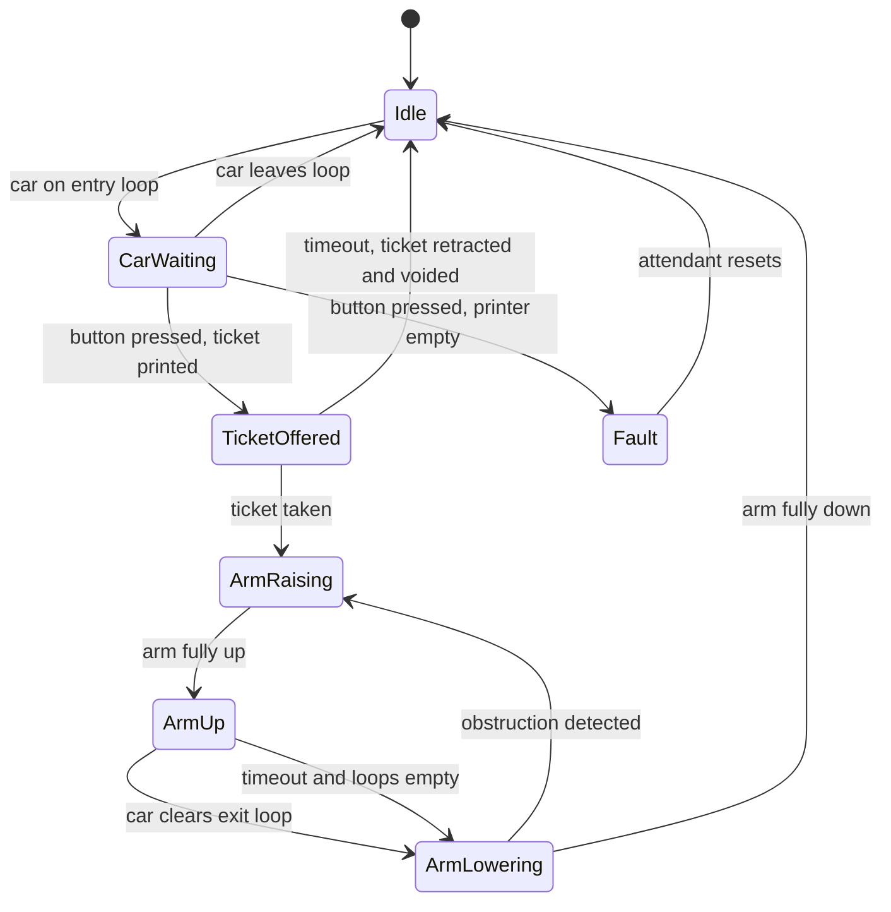
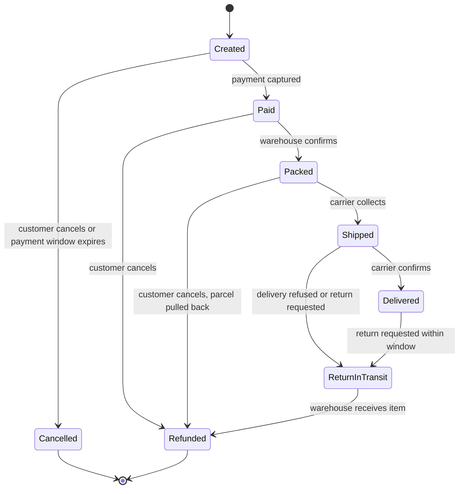
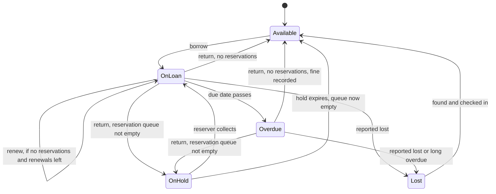

# Modelling a device as a state machine

> **Before this lesson:** read [Decision tables, state transitions and pairwise testing](#/lesson/thinking/tables-states-pairwise), which introduces states and transitions briefly. No programming is needed until the final section.

## In plain words

A traffic light is always in exactly one situation: red, red-and-amber, green or amber. It stays there until something happens — a timer runs out — and then it moves to another situation, following fixed rules. It never jumps from green straight to red-and-amber. If you drew a circle for each colour and an arrow for each permitted change, you would have a complete picture of how the light behaves.

That picture is a **state machine**. A **state** is a situation the thing stays in; an **event** is something that happens to it; a **transition** is the move from one state to another that the event causes. A door (open, closed, locked), an online order (placed, paid, shipped, delivered) and a login (signed out, signed in, locked out) can all be drawn this way.

It is worth learning because a great many expensive software faults are state faults — the refund issued twice, the door that opens while the lift is moving — and because "draw the states of X" is a very common interview request.

"Draw the states of an order." "Model a traffic light." "Walk me through the life of a support ticket." These prompts ask for a **state machine**: a picture of everything a thing can be and every way it can change. The skill is prized because so many production bugs are state bugs — the refund issued twice, the door that opens while the car is moving, the subscription that is both cancelled and billed. A candidate who can draw a clean model in three minutes, and then find the holes in it, demonstrates in a small space the kind of thinking that prevents those bugs.

This lesson is about building the model. The next is about getting tests out of it.

## Vocabulary

| Term | Meaning | Example (a microwave oven) |
|---|---|---|
| **State** | A situation that persists until something happens; the system behaves differently in different states | Idle, Cooking, Paused, Door open |
| **Event** | Something that happens at a moment: an input, a timer, a message | Start pressed, door opened, timer reaches zero |
| **Transition** | A move from one state to another, caused by an event | Cooking → Paused on "door opened" |
| **Guard** | A condition that must be true for the transition to fire | Start works only if the time is greater than zero |
| **Action** | Something the system does during a transition or while in a state | Turn the magnetron off; beep three times |
| **Initial state** | Where the machine starts | Idle |
| **Final state** | A state with no way out, if any | (none; an oven runs for ever) |

A transition label is conventionally written `event [guard] / action`, for example `start [time > 0] / magnetron on`.

## How to find the states

Beginners draw too many states or too few. Three tests help.

**Test 1 — Does behaviour differ?** Two situations are different states only if at least one event is handled differently in them. "Cooking with 30 seconds left" and "cooking with 29 seconds left" respond identically to every event, so they are one state with a variable (the remaining time), not two states.

**Test 2 — Is it a noun or adjective for the thing?** States read naturally as "the order is *paid*", "the door is *locked*". If your label is a verb ("pay", "press start"), you have written an event.

**Test 3 — Does it last?** A state persists for a while. Something that happens instantly on the way from A to B is an action on the transition, not a state — unless it can fail or be interrupted, in which case it deserves to be a state. "Dispensing" in a vending machine takes two seconds, can be interrupted by a power cut, and is therefore a state.

### States versus variables

Real systems have data: credit amount, items in stock, failed-login count. If you make every value a state, the diagram explodes. The practical split:

- **States** capture the *mode* of behaviour: what the system will do in response to events.
- **Variables** (also called extended state) hold quantities, and appear in guards and actions.

A vending machine with credit from 0 to 500 does not have 501 states. It has "Idle" (credit = 0) and "Has credit" (credit > 0), with `credit` as a variable and guards such as `[credit >= price]`.

The opposite mistake exists too: hiding a real mode inside a variable. If "failed attempts = 3" means the account is locked and behaves completely differently, "Locked" should be a state.

## A five-step construction method

1. **List the events first.** Everything that can happen to the thing: user inputs, timers, messages from other systems, failures. Events are easier to brainstorm than states.
2. **Walk the happy path** and name each resting point. Those are your first states.
3. **Add the unhappy exits**: cancel, timeout, error, power loss, for each state.
4. **Build the state–event table** and consider every cell.
5. **Write the invariants**: sentences that must be true in each state.

We will apply them to a concrete prompt.

## Worked example: a parking-garage barrier

**Prompt:** *"Model the entry barrier of a car park: a driver arrives, takes a ticket, the arm lifts, the car passes, the arm lowers."*

**Step 1 — Events.** Car arrives on the entry loop; ticket button pressed; ticket taken; car clears the exit loop; arm fully up; arm fully down; timeout; obstruction sensor triggers; ticket printer empty; power lost; attendant override.

**Step 2 — Happy path.** Idle → Car waiting → Ticket offered → Arm raising → Arm up → Arm lowering → Idle.

**Step 3 — Unhappy exits.** The driver presses the button and never takes the ticket. The driver takes the ticket and reverses out. A second car tailgates. Something is under the arm while it lowers. The printer is empty.



**Step 4 — The table.** Rows are states, columns are events. A cell holds the next state, "ignore", or a question mark.

| State | car arrives | button | ticket taken | exit loop cleared | obstruction | timeout | power lost |
|---|---|---|---|---|---|---|---|
| Idle | CarWaiting | ignore | — | — | — | — | arm stays down |
| CarWaiting | — | TicketOffered | — | — | — | ? stays | ? |
| TicketOffered | **? second car** | ignore (no second ticket) | ArmRaising | — | — | Idle, void ticket | **? ticket issued** |
| ArmRaising | ? | ignore | — | **? car already through** | — | ? Fault if arm stuck | **? arm halfway** |
| ArmUp | **? tailgater** | ignore | — | ArmLowering | — | ArmLowering if clear | **? arm up** |
| ArmLowering | **? next car arrives** | **? queue or ignore** | — | — | ArmRaising | ? Fault | **? arm halfway** |
| Fault | ignore | ignore | — | — | — | — | — |

The diagram had thirteen arrows. The table has forty-nine cells, and about a dozen hold real questions. Three worth discussing:

- **ArmUp + another car arrives (tailgating).** One ticket, two cars in. Does the system detect it (the loops count two vehicles), and what does it do — alarm, photograph, nothing? This is a revenue and security decision that the happy path never raises.
- **ArmLowering + button pressed.** The next driver is already at the machine. Ignoring the press is safe but irritating; issuing a ticket immediately risks raising the arm with unclear state. The usual design: finish lowering, then enter CarWaiting.
- **Power lost with the arm up or halfway.** Does the arm fall (dangerous), stay (free entry until power returns), or can it be pushed by hand? And on restart, which state does the controller assume?

**Step 5 — Invariants.**

- The arm is moving down **only if** the obstruction sensor is clear.
- At most one unvoided ticket exists per barrier cycle.
- The arm is fully down in Idle.
- A ticket that was not taken is voided, so it cannot be used later for a free exit.

> [!INTERVIEW]
> After drawing, say: "The diagram shows what I intend. Let me check what I have not said, by going through each state and asking what every event does there." Then pick two or three question-mark cells and discuss them. This two-phase move — draw, then interrogate — is what interviewers are hoping for.

## Workflows are state machines too

The same method models business objects. Here is an online order.



Questions that the table for this model raises:

- **Paid + payment captured again.** Payment providers resend notifications. The second one must be ignored, not treated as a second payment. This is the classic *duplicate event* cell, and it exists in every workflow fed by messages.
- **Shipped + customer cancels.** Too late to pull the parcel. Is cancellation refused, or converted into a return?
- **Events out of order.** "Delivered" arrives from the carrier before "Shipped" because of a delay in a queue. Does the order jump to Delivered, or reject the event and stay stuck?
- **Delivered is not final.** Returns are possible for a window; after that the order is effectively closed. Is "Closed" a state worth adding, triggered by a timer?
- **Refunded + refund again.** Must be impossible: one of the commonest costly bugs.

Notice that for workflows the dangerous cells are mostly about **message delivery** — duplicates, delays, reordering — where for devices they are mostly about **physics and timing**.

## Keeping models manageable

**Hierarchy.** If many states share the same transition (every state goes to "Out of service" on a fault), draw one outer state "In service" containing them, with a single arrow out. Mermaid supports nested states; on a whiteboard, a box around the group and one arrow is enough.

**Separate concerns.** A vending machine has a payment aspect and a cooling aspect that evolve independently. Model them as two small machines, not one product machine with (payment states × cooling states) nodes. Mention where they interact: cooling failure for long enough forces the payment machine out of service.

**Level of detail.** Match the question. "Model an elevator" for a general interview needs perhaps six states. Do not start with motor-controller phases.

**Naming.** Use consistent adjectives for states and past-tense or noun phrases for events ("payment captured", "door opened"). Mixed naming is the first sign of a confused model.

## From diagram to code

A state machine is a lookup table, which makes it easy to implement and to test.

```python-run
TRANSITIONS = {
    ("Created", "payment_captured"): "Paid",
    ("Created", "cancel"): "Cancelled",
    ("Paid", "packed"): "Packed",
    ("Paid", "cancel"): "Refunded",
    ("Packed", "collected"): "Shipped",
    ("Packed", "cancel"): "Refunded",
    ("Shipped", "delivered"): "Delivered",
    ("Shipped", "return_requested"): "ReturnInTransit",
    ("Delivered", "return_requested"): "ReturnInTransit",
    ("ReturnInTransit", "received"): "Refunded",
}
IGNORED = {("Paid", "payment_captured")}      # duplicate notification: safe no-op

def run(events, state="Created"):
    for i, e in enumerate(events):
        if (state, e) in IGNORED:
            continue
        if (state, e) not in TRANSITIONS:
            return f"REJECTED event {i} '{e}' in state {state}"
        state = TRANSITIONS[(state, e)]
    return state

print(run(["payment_captured", "packed", "collected", "delivered"]))
print(run(["payment_captured", "payment_captured", "packed"]))
print(run(["payment_captured", "collected"]))
print(run(["cancel", "payment_captured"]))
```

Two design points to voice in an interview:

1. **Explicit is better than implicit.** Unknown (state, event) pairs are rejected and logged, never silently accepted. Deliberate no-ops are listed separately, so "ignored on purpose" is distinguishable from "nobody thought of this".
2. **One place owns the transitions.** If status changes are scattered across the code as `order.status = "shipped"`, nobody can see the machine and illegal moves creep in. A single transition function is where invariants are enforced.

## Practice

**Prompt:** *"Model a library book from the library's point of view: it can be borrowed, returned, reserved by another reader, renewed, become overdue, and be reported lost."* Draw the states and transitions, then list at least four table questions. Then open the answer.

<details><summary>Model answer</summary>

**Events.** Borrow, return, reserve, cancel reservation, renew, due date passes, reported lost, found, reserved copy collected, hold period expires.

**States.**

- *Available* — on the shelf
- *On loan* — with a reader, not yet due
- *Overdue* — with a reader, past the due date
- *On hold* — returned and waiting at the desk for the reader who reserved it
- *Lost* — reported missing

"Reserved" is tempting as a state, but a book can be on loan *and* reserved by someone else. So reservation is a **variable** — a queue of waiting readers — that guards transitions.



**Table questions.**

1. *Overdue + renew.* Allowed (resetting the due date and waiving the fine?) or refused? Most libraries refuse or allow with the fine kept.
2. *OnLoan + renew when someone has reserved it.* The guard says no; the reader should be told why.
3. *OnHold + hold expires with more people in the queue.* It should stay On hold for the *next* reader — a self-transition that the first sketch missed.
4. *Available + reserve.* Is reserving a book that is on the shelf allowed? If so it must go to On hold straight away, or another reader may borrow it first.
5. *Lost + return.* The reader finds the book and brings it back after paying for it. Refund the charge? The transition exists ("found"); the money rule is a separate question.
6. *OnLoan + borrow.* Must be rejected — but with a self-checkout kiosk and a mis-scanned barcode it will be attempted. Reject and alert.
7. *Any state + book withdrawn from stock.* A final state "Withdrawn" is missing from the model.

**Invariants.** A book is with at most one reader. A book On hold is assigned to the head of the queue. A fine accrues only in Overdue.

**What I would say.** "Five states, with reservations as a queue rather than a state, because a book can be borrowed and reserved at once. The interesting cells are renewals against reservations and what happens when a hold expires."

</details>

## Summary

- A state machine has states (lasting modes), events (things that happen), transitions, guards and actions.
- Two situations are separate states only if some event is handled differently in them; quantities belong in variables with guards.
- Build in five steps: events, happy path, unhappy exits, state–event table, invariants.
- The diagram shows intent; the table shows omissions. Expect a quarter of its cells to be questions.
- Devices hide their bugs in timing and physics; workflows hide theirs in duplicate, late and out-of-order messages.
- In code, keep transitions in one table, reject unknown pairs loudly, and list intentional no-ops explicitly.

## Glossary

| Term | Meaning |
|---|---|
| State machine | A model of the situations a thing can be in and the moves between them |
| State | A situation that persists until an event occurs |
| Event | Something that happens at a moment and may cause a change |
| Transition | A move from one state to another, triggered by an event |
| Guard | A condition that must be true for a transition to happen |
| Action | What the system does during a transition |
| Initial / final state | Where the machine starts / a state with no way out |
| Extended state (variable) | A stored quantity, such as credit, used in guards |
| State table | A grid showing, for every state and event, what happens |
| Invariant | A statement that must be true in a given state or always |
| Duplicate event | The same event delivered more than once |

## Check yourself

```quiz
[
  {"q": "Which of these is an event rather than a state?",
   "options": ["Locked", "Door opened", "Dispensing", "Overdue"],
   "answer": 1,
   "explain": "An event happens at a moment and triggers a transition. The others describe situations that persist."},
  {"q": "A vending machine holds credit between 0 and 500 cents. How should credit be modelled?",
   "options": ["501 separate states", "As a variable used in guards, with states such as Idle and HasCredit", "As an event", "It should be ignored"],
   "answer": 1,
   "explain": "States capture modes of behaviour; quantities are extended-state variables referenced by guards like credit >= price."},
  {"q": "When are two situations genuinely different states?",
   "options": ["When they happen at different times", "When at least one event is handled differently in them", "When they have different names", "Always"],
   "answer": 1,
   "explain": "If every event leads to the same response, the situations are behaviourally identical and should be one state."},
  {"q": "What does the label 'start [time > 0] / heater on' mean?",
   "options": ["Event 'start', guard 'time > 0', action 'heater on'", "State 'start', event 'time', guard 'heater on'", "Three separate transitions", "A final state"],
   "answer": 0,
   "explain": "The convention is event [guard] / action."},
  {"q": "A payment provider sends the 'payment captured' notification twice. Where does this show up in the model?",
   "options": ["Nowhere; it cannot happen", "In the (Paid, payment captured) cell, which should be a deliberate no-op", "As a new state 'PaidTwice'", "As a guard on shipping"],
   "answer": 1,
   "explain": "Duplicate events are a table cell: an event arriving in a state where it has already been applied."},
  {"q": "Why keep all transitions in a single table or function in code?",
   "options": ["It is shorter to type", "Illegal transitions can be rejected in one place and the machine stays visible", "It makes the program slower", "Because diagrams require it"],
   "answer": 1,
   "explain": "Scattered status assignments let illegal moves slip in; a single owner enforces the invariants."},
  {"q": "A cooling subsystem and a payment subsystem evolve mostly independently. What is the best modelling choice?",
   "options": ["One machine with every combination of their states", "Two small machines, with their interaction noted", "Ignore cooling", "Merge them into a single state"],
   "answer": 1,
   "explain": "Independent concerns modelled together multiply states; separate machines stay readable."},
  {"q": "In the library model, why is 'reserved' a variable instead of a state?",
   "options": ["Because reservations are rare", "A book can be on loan and reserved by someone else at the same time", "Because states cannot have names with 'ed'", "Because mermaid cannot draw it"],
   "answer": 1,
   "explain": "Reservation is orthogonal to where the book is; modelling it as a queue lets it guard transitions from several states."}
]
```

> **Source:** ISTQB Certified Tester Foundation Level syllabus v4.0, section 4.2.4 "State Transition Testing" (https://www.istqb.org/certifications/certified-tester-foundation-level). Statechart notation follows common UML usage as rendered by Mermaid (https://mermaid.js.org/syntax/stateDiagram.html). Examples and wording are original.
