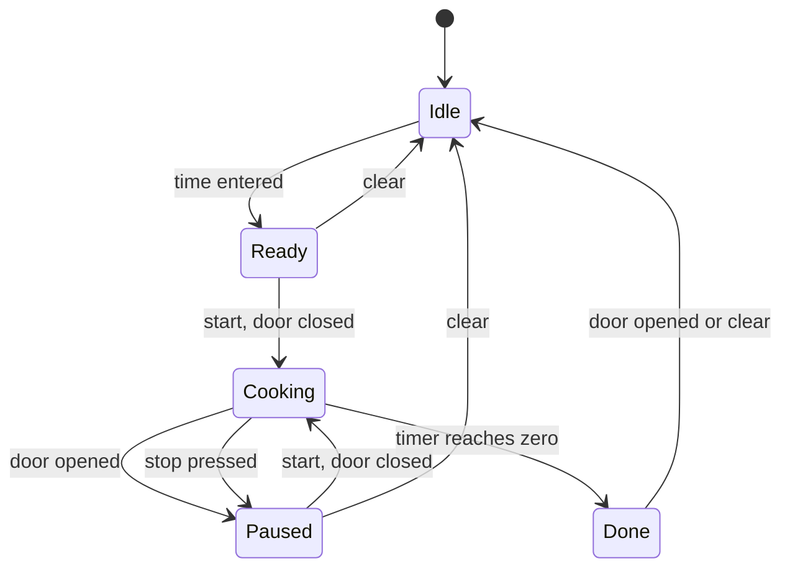
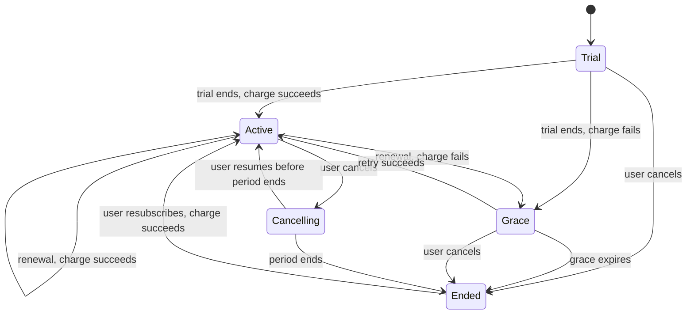

# Deriving test paths and invalid transitions

> **Before this lesson:** read [Modelling a device as a state machine](#/lesson/thinking/modelling-state-machines). You should be able to read a state diagram and a state table.

## In plain words

Suppose you have a map of a small town and want to be sure every street is passable before a parade. One option is to visit every *square* once. A better one is to walk down every *street* at least once. Better still, you also try the turns that are forbidden — the wrong way down a one-way street — to check that the barriers are really there.

A state diagram is such a map: states are the squares, transitions are the streets. This lesson is about planning the walks. A **test path** is a sequence of events that takes the system through chosen states and transitions. **Coverage** says how much of the map your walks have touched. And **invalid transitions** — events that should *not* be accepted in a given state — are the one-way streets, where many of the most serious faults hide.

After "draw the states", an interviewer's next question is nearly always "and how would you test that?" This lesson is the answer.

A state model is half a deliverable. The other half is the set of tests that the model implies, and the interviewer's natural follow-up to "draw the states" is "good — now how would you test it?" This lesson gives a mechanical way to go from a diagram to test sequences, explains the coverage levels you can claim, and shows how to treat the transitions that are *not* in the diagram, which is where the expensive defects usually are.

## What a state-based test looks like

A test for a state machine is a **sequence**, not a single input. Each test has:

1. a **starting state**, and the steps that put the system there;
2. a list of **events** to apply in order;
3. after each event, the **expected state** and **expected actions or outputs**;
4. a way to **observe** the state — a display, an API field, a log line, a database row.

Point 4 is often the hard part in practice. If the state cannot be seen directly, you infer it from the response to a probe event: a turnstile that you cannot inspect is "unlocked" if a push turns it.

We will use a microwave oven as the running example.



Five states, nine transitions.

## Coverage levels

Coverage answers "how much of the model have my tests exercised?" The ISTQB syllabus names three levels; a fourth is common in practice.

| Level | Requirement | Strength |
|---|---|---|
| **All states** | Every state is entered at least once | Weakest; can skip most transitions |
| **Valid transitions (0-switch)** | Every transition in the diagram is taken at least once | The usual minimum |
| **All transitions** | Every valid transition, plus an attempt at every invalid (state, event) pair | Needed for safety, security, money |
| **Transition pairs (1-switch)** | Every sequence of two consecutive transitions is taken | Finds bugs that depend on how a state was reached |

### All states

One sequence visits all five: *time entered → start → door opened → start → (wait) timer zero*. That is Idle, Ready, Cooking, Paused, Cooking, Done. Five states with five events — and it has skipped `clear` from Ready, `stop`, `clear` from Paused, and leaving Done. All-states coverage alone would let a broken Clear button ship.

### Valid transitions

Every arrow at least once. A simple recipe that always works:

> For each transition, find the shortest path from the start state to the transition's source state, then append the transition's event.

It produces one test per transition. The tests are short and independent, so a failure points straight at one arrow. The cost is repetition of the opening steps.

For the microwave:

| # | Path to source | Then | Covers |
|---|---|---|---|
| 1 | — | time entered | Idle → Ready |
| 2 | time entered | clear | Ready → Idle |
| 3 | time entered | start | Ready → Cooking |
| 4 | time entered, start | door opened | Cooking → Paused |
| 5 | time entered, start | stop | Cooking → Paused (stop) |
| 6 | time entered, start, stop | start | Paused → Cooking |
| 7 | time entered, start, stop | clear | Paused → Idle |
| 8 | time entered, start | wait for zero | Cooking → Done |
| 9 | time entered, start, wait | door opened | Done → Idle |

The alternative is to chain transitions into a few long tours. Three sequences cover all nine arrows:

- A: time entered, clear *(1, 2)*
- B: time entered, start, door opened, start, stop, clear *(1, 3, 4, 6, 5, 7)*
- C: time entered, start, wait, door opened *(1, 3, 8, 9)*

Fewer set-ups, quicker to run — but when step four of tour B fails, steps five and six are never executed, and their transitions are silently untested until the fix. Short independent tests localise failures; long tours save time. For automated tests, where set-up is cheap, prefer short. For manual tests on hardware, where each reset costs minutes, prefer tours.

```python-run
from collections import deque

T = [("Idle","time","Ready"), ("Ready","clear","Idle"), ("Ready","start","Cooking"),
     ("Cooking","door","Paused"), ("Cooking","stop","Paused"), ("Paused","start","Cooking"),
     ("Paused","clear","Idle"), ("Cooking","zero","Done"), ("Done","door","Idle")]

def shortest_paths(start):
    path, queue = {start: []}, deque([start])
    while queue:
        s = queue.popleft()
        for a, e, b in T:
            if a == s and b not in path:
                path[b] = path[s] + [e]
                queue.append(b)
    return path

paths = shortest_paths("Idle")
for a, e, b in T:
    print(f"{a:8s} --{e:5s}--> {b:8s}  test: {paths[a] + [e]}")
```

That is the algorithm behind the "Cover Every Transition" problem in this module.

### Transition pairs

Some defects appear only when a state is reached in a particular way. Suppose Paused → Cooking forgets to restore the remaining time when the pause came from *stop* but works when it came from *door opened*. Each individual transition passes its test; the pair *stop, start* fails. 1-switch coverage requires every such pair: for each state, every incoming transition combined with every outgoing one.

Count for the microwave: Paused has 2 ways in and 2 ways out → 4 pairs; Cooking has 2 in and 3 out → 6; Ready 1 × 2 = 2; Idle 3 × 1 = 3 (ignoring the initial arrow); Done 1 × 1 = 1. Sixteen pairs against nine single transitions. The growth is why 1-switch is reserved for the risky core of a model.

## Invalid transitions: testing what should not happen

The diagram's nine arrows amount to ten legal (state, event) pairs, because the arrow out of Done carries two events. With five states and six distinct events (time entered, clear, start, stop, door opened, timer zero), there are thirty pairs in total. The other twenty are not drawn. For each, exactly one of these should be true:

- **Ignored** — nothing happens (pressing Stop in Idle).
- **Rejected with feedback** — a beep or message (pressing Start with no time set).
- **Impossible by construction** — the event cannot physically occur (timer zero in Idle).
- **A missing transition** — it should do something and nobody specified it.

| State | time entered | clear | start | stop | door opened | timer zero |
|---|---|---|---|---|---|---|
| Idle | → Ready | ignore | **reject: no time** | ignore | **? light on, stay Idle** | impossible |
| Ready | **? replace time** | → Idle | → Cooking **[door closed]** | ignore | **? stay Ready** | impossible |
| Cooking | **? add time or ignore** | **? ignore or stop** | **? +30 s feature** | → Paused | → Paused | → Done |
| Paused | **? change time** | → Idle | → Cooking **[door closed]** | ignore | **? already open** | **must not happen: timer frozen** |
| Done | **? → Ready** | → Idle | **? repeat** | ignore | → Idle | impossible |

Several findings fall out immediately.

**The guard is the safety property.** `start` is legal in Ready and Paused only with the door closed. The invalid version — start with the door open — is the single most important test of the whole appliance: the magnetron must not run. The transition's *negative* is worth more than its positive.

**Paused + timer zero.** If the timer keeps counting while paused, the oven will jump to Done with uncooked food, or worse, resume at zero. The test: pause with ten seconds left, wait thirty seconds, resume, and confirm ten seconds remain.

**Cooking + door opened must cut power at once**, independent of software. A good answer mentions that the hardware interlock should make this true even if the controller has crashed, and that the test therefore includes "controller hung, open the door".

**Unspecified conveniences.** Entering more time while cooking, or pressing Start again to add thirty seconds, are features on real ovens. The table makes you ask whether they exist.

### How to test an invalid transition

1. Drive the system to the state.
2. Apply the event.
3. Check the **state did not change** (probe it with an event whose response differs between states).
4. Check **no side effect** occurred — no heating, no charge, no message sent, no counter changed.
5. Check any required **feedback** — an error tone or message.
6. Check the system **still works afterwards** by completing a valid sequence. A machine that ignores a bad event and then hangs has not passed.

Step 4 is the one people skip. An "ignored" duplicate payment event that leaves the order in the right state but has already sent a second receipt email is a defect.

> [!WARNING]
> Never combine several invalid events in one test. If the first one corrupts the state, every later check is meaningless. One invalid event per test, surrounded by valid steps before and after.

## Choosing how far to go

Risk decides. A rule of thumb:

| Part of the model | Coverage to aim for |
|---|---|
| Cosmetic or convenience behaviour | All states, or valid transitions via one or two tours |
| Ordinary business workflow | Valid transitions, plus invalid ones around money and cancellation |
| Safety, security, payment, irreversible actions | All transitions including every invalid pair; transition pairs around the critical states |

Also consider three kinds of test that coverage criteria do not generate by themselves:

- **Timing.** Events at the edge of a timeout; two events almost simultaneously (door opened at the instant the timer reaches zero — which wins?). Pick a rule and test both orders.
- **Repetition.** The same cycle a thousand times: leaks, counters that overflow, wear.
- **Recovery.** Power loss or restart in every state: which state does the system come back in, and is that safe? For the oven, the only acceptable answer after power returns is "not cooking".

## Shortest tours

Sometimes you want one sequence that visits everything — for a demonstration, a smoke test or a manual walkthrough on expensive equipment. Two classic questions arise.

**Shortest sequence visiting every state.** You need to remember which states have been seen, so the search is over pairs (current state, set of visited states). Breadth-first search on those pairs gives the minimum. For the microwave from Idle: time entered, start, stop, start, wait → Idle, Ready, Cooking, Paused, Cooking, Done: five events. Four would suffice only if a path with no revisits existed; here Paused and Done both hang off Cooking, so one revisit is forced.

**Shortest sequence covering every transition.** This is the route-inspection problem: if the graph has a closed walk using each arrow once, it is the answer; otherwise some arrows must be repeated. In an interview it is enough to say that you would chain transitions greedily into tours and accept a few repeats.

Also check **reachability** before deriving anything: a state that cannot be reached from the start is a modelling error or dead code, and a state from which the initial state can never be reached again (other than deliberate final states) is a trap worth questioning.

## Worked exercise

**Prompt:** *"A subscription has these rules. A new user starts a 14-day trial. When the trial ends, we charge the card: on success the subscription becomes active; on failure it enters a 7-day grace period with retries, and is cancelled if still unpaid at the end. An active subscription renews monthly the same way. The user can cancel at any time; access continues to the end of the period already paid for. A cancelled user can resubscribe."* Draw the model, then give (a) a valid-transition test set and (b) the five invalid or unspecified pairs you consider most important.

<details><summary>Model answer</summary>

**States.** Trial, Active, Grace (payment failed, retrying), Cancelling (cancelled by the user, access until period end), Ended.

**Events.** Trial ends, renewal date reached, charge succeeds, charge fails, grace period expires, user cancels, period ends, user resubscribes.

The charge is asynchronous, so strictly there is a short "Charging" state between the date trigger and the result. I fold it into the transition here and mention that a fuller model would show it, because a cancel that arrives *while* a charge is in flight is a real hazard.



**(a) Valid-transition tests** (short, independent; time is controlled by a test clock):

| # | Sequence | Covers |
|---|---|---|
| 1 | trial ends + charge ok | Trial → Active |
| 2 | trial ends + charge fails | Trial → Grace |
| 3 | cancel during trial | Trial → Ended |
| 4 | 1, then renewal + ok | Active → Active |
| 5 | 1, then renewal + fail | Active → Grace |
| 6 | 1, then cancel | Active → Cancelling |
| 7 | 2, then retry ok | Grace → Active |
| 8 | 2, then 7 days pass | Grace → Ended (expiry) |
| 9 | 2, then cancel | Grace → Ended (cancel) |
| 10 | 6, then period ends | Cancelling → Ended |
| 11 | 6, then resume | Cancelling → Active |
| 12 | 3, then resubscribe + ok | Ended → Active |

Each test also checks the *actions*: was the card charged exactly once, for the right amount; was access granted or removed; was the right email sent.

**(b) Most important invalid or unspecified pairs.**

1. **Cancelling + renewal date reached.** Must **not** charge. This is the bug that produces "I cancelled and you billed me" complaints and chargebacks. Highest priority.
2. **Ended + retry succeeds.** A queued retry from the grace period fires after the subscription was cancelled. The retry must be cancelled or refused; otherwise the user is charged for a dead subscription.
3. **Active + charge succeeds twice** (duplicate webhook). The second notification must not extend the period twice or create two invoices.
4. **Trial + user resubscribes / Ended + trial.** Can a returning user get a second free trial by cancelling and signing up again? A policy question the model exposes.
5. **Grace + renewal date reached.** If grace lasts into the next cycle (or if the periods are shortened in configuration), do two charges stack?

Also unspecified: resubscribing when the charge **fails** from Ended (stay Ended, presumably); what "access" means in Grace (most services allow it; the requirement is silent); and cancelling during a charge in flight.

**Timing tests.** Cancel one second before and one second after the renewal instant. Grace expiring at the same moment a retry succeeds — decide which wins (success should) and test both orders. Month lengths: a subscription started on 31 January renews on which day in February?

**Summary sentence.** "Twelve tests cover every arrow. The risk is concentrated in the arrows that are not there — charging someone who has cancelled, and stale retries — so I would cover every invalid pair involving a charge event, and run the timing cases around the renewal instant."

</details>

> [!INTERVIEW]
> When you list invalid transitions, lead with the one that costs money or safety and say why. "Cancelling plus renewal must not charge" is a far better opening than reading the table left to right.

## Summary

- A state-based test is a sequence with a start state, events, expected states and outputs, and a way to observe the state.
- Coverage levels: all states < valid transitions (0-switch) < all transitions (with invalid pairs); transition pairs (1-switch) catch history-dependent bugs.
- Shortest path to the source plus the event gives one independent test per transition; tours trade failure localisation for speed.
- Enumerate every undrawn (state, event) pair and classify it: ignored, rejected, impossible or missing. Test that state, side effects and later behaviour are all unaffected.
- Guards on safety-critical transitions deserve negative tests above all others.
- Add timing, repetition and recovery tests; coverage criteria do not produce them.

## Glossary

| Term | Meaning |
|---|---|
| Test path (sequence) | A series of events applied in order, with the expected state after each |
| Coverage | How much of a model the tests have exercised |
| All-states coverage | Every state visited at least once |
| Valid-transition (0-switch) coverage | Every drawn transition taken at least once |
| All-transitions coverage | Every valid transition taken and every invalid one attempted |
| Transition pair (1-switch) | Two consecutive transitions tested together |
| Invalid transition | An event that should be rejected or ignored in a given state |
| Side effect | A change other than the state itself, such as a charge or a message |
| Tour | One long sequence covering many transitions |
| Reachability | Whether a state can be reached from the start |
| Probe event | An event used to reveal which state the system is in |

## Check yourself

```quiz
[
  {"q": "A model has 6 states and 5 distinct events, with 11 transitions drawn. How many (state, event) pairs are not drawn?",
   "options": ["11", "19", "30", "41"],
   "answer": 1,
   "explain": "6 × 5 = 30 pairs in total; 30 − 11 = 19 are undrawn and each needs a decision."},
  {"q": "Which coverage level is the weakest?",
   "options": ["All transitions", "Valid transitions (0-switch)", "All states", "Transition pairs (1-switch)"],
   "answer": 2,
   "explain": "Every state can be visited while leaving many transitions untried."},
  {"q": "What is the advantage of one short test per transition over a few long tours?",
   "options": ["Fewer set-up steps", "A failure points at one transition and does not block the rest of the checks", "It needs no starting state", "It covers transition pairs automatically"],
   "answer": 1,
   "explain": "Independent tests localise failures; a failing step in a long tour leaves later transitions untested."},
  {"q": "Resuming from pause loses the remaining time only when the pause was caused by the Stop button. Which coverage would be designed to catch this?",
   "options": ["All states", "Valid transitions", "Transition pairs (1-switch)", "None"],
   "answer": 2,
   "explain": "The defect depends on the pair (stop, start); each transition alone can pass."},
  {"q": "When testing an 'ignored' invalid event, which check is most often forgotten?",
   "options": ["That the event was sent", "That no side effect occurred, such as a charge, message or counter change", "That the test has a name", "That the diagram is pretty"],
   "answer": 1,
   "explain": "The state may be unchanged while a side effect has already happened."},
  {"q": "For a microwave, which is the most important negative test?",
   "options": ["Stop pressed in Idle", "Start with the door open must not turn the magnetron on", "Clear pressed twice", "Time entered as 00:00"],
   "answer": 1,
   "explain": "It is the guard on a safety-critical transition; its violation can injure someone."},
  {"q": "Why should a test contain only one invalid event?",
   "options": ["Tests must be short by law", "If the first invalid event corrupts the state, later checks tell you nothing", "Invalid events are expensive", "It is easier to draw"],
   "answer": 1,
   "explain": "Each invalid event is surrounded by valid steps so that its effect can be judged in isolation."},
  {"q": "In the subscription model, which undrawn pair is the highest priority?",
   "options": ["Trial + period ends", "Cancelling + renewal date reached (must not charge)", "Ended + user cancels", "Active + trial ends"],
   "answer": 1,
   "explain": "Charging a customer who has cancelled is a direct financial and trust failure."}
]
```

> **Source:** ISTQB Certified Tester Foundation Level syllabus v4.0, section 4.2.4 "State Transition Testing" — coverage criteria all states, valid transitions and all transitions (https://www.istqb.org/certifications/certified-tester-foundation-level). Examples, algorithms and wording are original.
