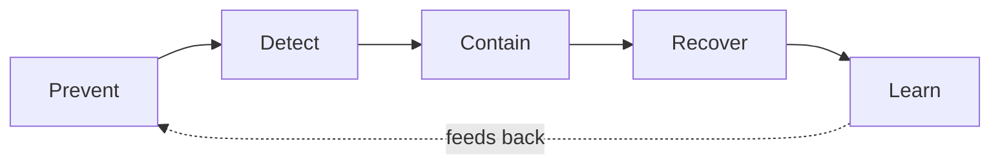
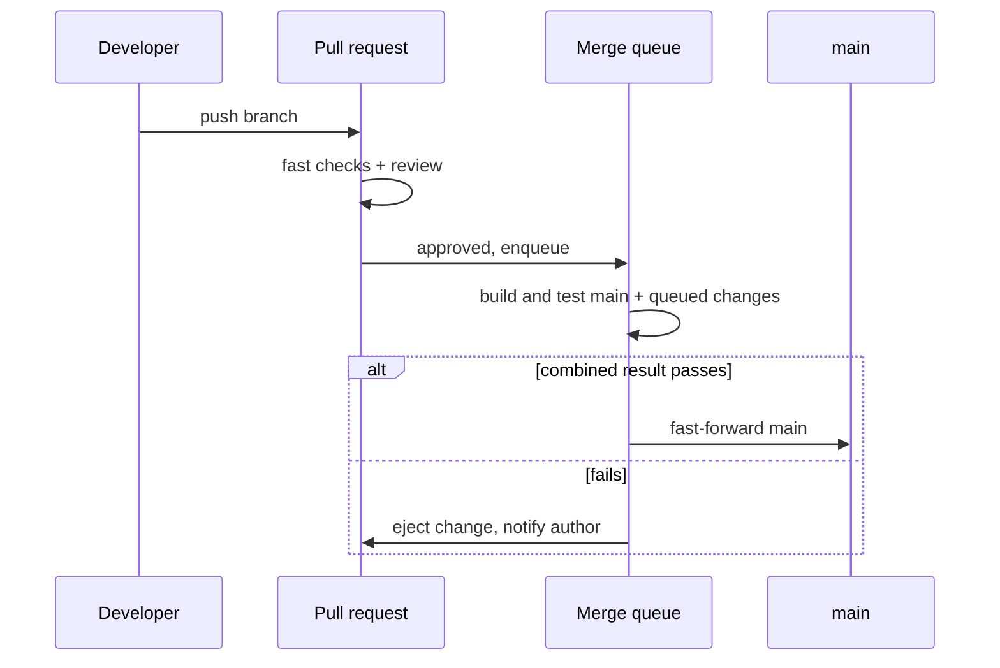

# Buggy code on main: designing a process that copes

> **Before this lesson:** read [A seven-step answer framework](#/lesson/thinking/answer-framework). No experience of software delivery is assumed; every term is explained as it appears.

## In plain words

Picture a large shared kitchen where twenty cooks contribute to one big pot of soup that is served to customers all day. If one cook tips in a spoonful of salt instead of sugar, everyone's soup is spoiled until someone notices. A sensible kitchen has several safeguards: each cook tastes their own addition first; a second cook checks it; a small bowl is served and tasted before the whole pot goes out; and there is always a way to go back to the soup as it was ten minutes ago.

Software teams work the same way. The shared pot is the **main branch** — the single agreed copy of the code that everyone builds on. Adding your work to it is **merging**. **CI/CD** (continuous integration and continuous delivery) is the name for the automatic machinery that checks each addition and sends the result to customers: CI builds and tests every change; CD releases it.

The interview question "someone pushed buggy code to main — design a process that copes" asks you to design that kitchen's safeguards. It matters because a team that handles mistakes well can move quickly, and one that handles them badly either breaks things constantly or becomes too afraid to change anything.

*"Someone pushed buggy code to the main branch. Design a CI/CD process that copes with this."* The prompt sounds like a request for a tool list. It is really a systems-design question about people and feedback loops, and the word that matters is **copes**. No process stops every bug. A good one makes bugs rare, finds them in minutes, limits how far they travel, makes undoing them boring, and learns from each one.

## The answer shape for every process question

Use the timeline of a failure as your structure. It works for this prompt and for every other one in this module.

| Layer | Question | Typical mechanisms |
|---|---|---|
| **Prevent** | How do we make it less likely? | Review, required checks, small changes, merge queue |
| **Detect** | How fast do we find out? | Post-merge CI, canary analysis, monitoring, alerts |
| **Contain** | How do we limit the damage? | Staged rollout, feature flags, blocking deploys from a red build |
| **Recover** | How do we get back to good? | Revert first, rollback, roll forward a fix |
| **Learn** | How do we stop the same thing recurring? | Blameless review, a new test, a process fix |



Two principles to say out loud before any detail:

1. **Defence in depth.** Each layer leaks; you want several cheap layers, not one perfect gate.
2. **Speed of recovery beats rarity of failure.** A team that breaks main once a week and fixes it in ten minutes is healthier than one that breaks it monthly and takes a day. The DORA research measures exactly this pairing: throughput (change lead time, deployment frequency, recovery time for failed deployments) together with instability (change fail rate, rework rate), and reports that high performers do well on both — speed and stability are not opposites.

## Clarify first

- **What does "buggy" mean here?** Does the build not compile, do tests fail, or do tests pass while users see a defect? Each is caught by a different layer.
- **Did it only reach main, or was it deployed?** If main deploys automatically, the two are the same event.
- **How did it get there?** A direct push with no review, a reviewed pull request, or two individually good changes that conflict in behaviour?
- **Team and scale?** Five engineers on one service, or five hundred on a monorepo? The merge queue matters far more at the second scale.

State an assumption: "I'll assume a team of about thirty, trunk-based development, pull requests, CI that takes fifteen minutes, and continuous deployment to production several times a day."

## Layer 1 — Prevent

**Protected main, no direct pushes.** Every change arrives through a pull request. Administrators are not exempt; emergency access exists and is audited.

**Required checks before merge.** The build, the fast tests, linters and static analysis must pass. The key design choice is *which* tests run before merge. *Software Engineering at Google* describes the split: pre-submit runs fast, reliable tests so that engineers are not blocked; slower and larger tests run after submission, where some instability can be tolerated if managed. A pre-merge suite that takes an hour will be bypassed or will push people into giant batched changes — which are riskier.

**Code review.** At least one reviewer who understands the area; ownership rules for sensitive paths. Review catches design and intent problems that tests cannot, and spreads knowledge; it is not a reliable bug filter, so do not rest the process on it.

**Small, frequent changes.** Trunk-based development keeps branches short-lived — hours to a couple of days — so each merge is small, easy to review and easy to revert. Unfinished work is hidden behind feature flags or built behind an abstraction rather than kept on a long branch.

**A merge queue.** This closes the subtle hole. Pull request A passes CI against yesterday's main. So does B. Each is fine alone; together they break — A renamed a function that B calls. Both merge, and main is red although every check was green. A merge queue tests each change *on top of the changes ahead of it* and merges only if that combination passes, so main is only ever advanced to a tested state.



Trade-off to name: the queue adds latency and its own failure mode (a flaky test ejects innocent changes), so it only pays off when the pre-merge suite is fast and reliable.

## Layer 2 — Detect

Prevention will miss things, especially behavioural bugs that tests do not cover.

- **Post-merge CI on every commit to main**, running the full suite, including slower integration tests. If commits are batched for cost, the system must be able to find the culprit by splitting the batch and re-running — automated bisection.
- **An owner for red.** A rotating role — a build sheriff or build cop — whose job is to notice a red main and drive it back to green. Without a named owner, everyone assumes someone else is looking.
- **Loud, routed notification.** The author and the sheriff are told directly; a red main is visible to the team.
- **In production: canary analysis and monitoring.** The new version serves a small share of traffic first and its error rate, latency and business metrics are compared with the old version's. Alerts are tied to user-facing symptoms — error rate, latency, failed checkouts — because causes are endless and symptoms are few.

The number to quote is **time to detect**. A failing unit test: minutes. A canary breach: tens of minutes. A customer email: hours or days. Each bug that reaches the last category is a prompt to add a detector earlier.

## Layer 3 — Contain

- **A red main blocks deployment and blocks further merges** (apart from the fix or the revert). Otherwise new changes pile on top of a broken base, hiding further breakages and making the revert harder.
- **Staged rollout.** Deploy to an internal environment, then a canary slice, then progressively wider. Martin Fowler's description of canary release is the model: route a small subset of users to the new version, watch, widen as confidence grows, and route them back if it misbehaves.
- **Feature flags decouple deploy from release.** The code ships switched off, is turned on for staff, then one percent, then everyone. If it misbehaves, turning the flag off takes seconds and needs no deploy. Fowler's catalogue calls the short-lived kind *release toggles* and the kill-switch kind *ops toggles*, and warns that every flag carries a cost: remove release flags promptly, or they become debt.
- **Blast-radius limits.** Roll out one region or one cell at a time, so a bad change cannot take everything down at once.

## Layer 4 — Recover

This is where the strongest signal in the interview is earned:

> **Revert first, diagnose second.**

When main is red or production is degraded, the fastest safe path back to a known good state is to undo the change. Debugging forward under pressure, with the team blocked, is slow and produces rushed fixes that add new bugs. The Google book puts it plainly: rolling back is usually the quickest way to restore a good state, and tests give confidence to change while rollbacks give confidence to undo.

A concrete policy:

1. The sheriff or the author reverts the culprit commit within a fixed time — say fifteen minutes of main going red — without needing the author's permission. A revert is not a judgment on the author.
2. The revert goes through the same pipeline, on an expedited path.
3. The author fixes the problem on a branch, with a new test that would have caught it, and re-lands.
4. If the bug is live: turn off the flag if there is one; otherwise roll back the deployment to the previous version; only then investigate.

**When is rolling forward right?** When a revert is impossible or more dangerous: an irreversible data migration has already run, the bad commit is buried under dependent changes, or the fix is a one-line change that is clearly correct. Say that you would decide by asking "which path restores service soonest with least risk?" — and that designing changes to be revertible (backward-compatible schema changes, flags) is what keeps the cheap option open.

**Which commit?** If several landed, bisect: test the midpoint, halve the range, repeat. With a failing-test matrix (which tests fail with which commits reverted), choose the smallest set of reverts that turns everything green.

## Layer 5 — Learn

For anything that reached users or blocked the team for long, hold a **blameless review**. The Google SRE book defines the spirit: assume everyone acted reasonably with the information they had, and look for the gaps in systems and process that allowed the mistake, because people cannot be "fixed" but systems can. The write-up records impact, timeline, contributing causes, what went well, and action items with owners and dates.

Ask five questions of every escape:

| Question | Possible action |
|---|---|
| Why did review not catch it? | Ownership rule; checklist item; smaller changes |
| Why did pre-merge checks not catch it? | Add a test; add it to the required set |
| Why did the merge queue or post-merge CI not catch it? | Missing integration test; flaky test hiding it |
| Why did the canary not catch it? | Missing metric; slice too small; too short a soak |
| Why did recovery take as long as it did? | No runbook; unclear authority to revert; slow pipeline |

Then track the trend with a few metrics: how often main is red and for how long, change fail rate, time to restore, and pipeline duration.

## The model answer, at interview length

Try a five-minute spoken answer before opening this.

<details><summary>Model answer</summary>

"First, what kind of buggy — a compile break, a failing test, or a behavioural bug that passed everything? And did it deploy? I'll assume it passed checks, merged, and our pipeline deploys main automatically, on a team of thirty.

My goal is not zero bugs on main; it is that a bad change is unlikely, found in minutes, limited in reach, and trivial to undo. I'll go through five layers.

**Prevent.** Main is protected: no direct pushes, changes arrive by pull request with a required review and required fast checks — build, unit tests, lint — kept under about ten minutes so nobody is tempted to bypass them. I'd add a merge queue so each change is tested on top of the latest main plus the changes ahead of it; that removes the case where two green pull requests break each other. And I'd keep changes small with trunk-based development and flags for unfinished work.

**Detect.** The full suite runs on main after every merge. A rotating build sheriff owns a red build. In production, deploys go to a canary first with automatic comparison of error rate and latency, and alerts are on user-visible symptoms.

**Contain.** While main is red, merges and deploys are frozen except for the revert. Rollouts are staged — internal, one percent, ten, everyone — and risky features sit behind flags so they can be switched off without a deploy.

**Recover.** The rule is revert first. If main is red for fifteen minutes the sheriff reverts the culprit, found by bisection if needed, with no blame attached. If it is live, flag off or roll back, then investigate. We roll forward only when a revert is unsafe, such as after an irreversible migration — which is why I'd require migrations to be backward compatible.

**Learn.** A blameless review for anything user-visible: which layer should have caught it, and one concrete action per layer — usually a new test plus one process change. I'd watch change fail rate and time to restore over time.

The trade-off is speed: every gate adds minutes. I'd keep the pre-merge gate fast and put the slower checks after merge and in the canary, accepting that a few bugs reach main in exchange for a team that can still ship many times a day."

</details>

## Likely follow-ups

**"The revert itself fails or conflicts."** Later commits depend on the bad one. Options: revert the dependent commits too (the smallest set that restores green), or roll forward with a minimal fix reviewed by a second person. Meanwhile production stays on the last good build because the pipeline never deployed the red one.

**"The author says it's a one-line fix, don't revert."** Offer a time box: if the fix is not merged and green in fifteen minutes, revert. Thirty blocked engineers cost more than one person's inconvenience.

**"Tests passed. How was it buggy?"** A coverage gap: untested behaviour, an environment difference, a configuration or data dependency, or a flaky test that was retried into green. The fix belongs in "learn": a regression test at the lowest level that reproduces it.

**"Isn't a merge queue too slow for a hundred merges a day?"** Queues batch: test several changes together, merge all if green, bisect the batch if red. Keep pre-merge checks fast and select tests by what the change affects.

**"A small team of three — is all this overkill?"** Scale it down, keep the shape: branch protection, one required check, automatic deploy with one-click rollback, and a habit of reverting first. Skip the queue and the sheriff rota.

> [!INTERVIEW]
> If you remember four phrases from this lesson, make them: **"layers, because each one leaks"**, **"merge queue for semantic conflicts"**, **"revert first, diagnose second"** and **"blameless review asking which layer should have caught it"**. Together they cover prevention, containment, recovery and learning.

## Summary

- Structure process answers as prevent, detect, contain, recover, learn.
- Prevention: protected main, fast required checks, review, small changes, a merge queue for changes that only break in combination.
- Detection: post-merge CI with an owner, canaries, symptom-based alerts. Measure time to detect.
- Containment: freeze on red, staged rollouts, feature flags.
- Recovery: revert or roll back first; roll forward only when undoing is unsafe; bisect to find the culprit.
- Learning: blameless review, one action per leaking layer, and a few trend metrics.

## Glossary

| Term | Meaning |
|---|---|
| Repository | The store holding a project's code and its history |
| Branch | A separate line of work within a repository |
| Main (trunk) | The shared branch that everyone builds on and releases from |
| Commit | One saved change to the code |
| Pull request | A proposed change submitted for checks and review before merging |
| Merge | Combining a change into a branch |
| CI (continuous integration) | Automatically building and testing every change |
| CD (continuous delivery/deployment) | Automatically releasing changes that pass the checks |
| Merge queue | A system that tests each change on top of those ahead of it before merging |
| Revert | A new change that undoes an earlier one |
| Canary | A small share of users or servers given a new version first |
| Feature flag | A switch that turns a feature on or off without a new release |
| Blameless review | A discussion of an incident that looks for system causes, not culprits |
| Bisection | Finding the faulty change by repeatedly halving the range of suspects |

## Check yourself

```quiz
[
  {"q": "Two pull requests each pass CI on their own, both merge, and main is broken. Which mechanism is designed to prevent this?",
   "options": ["A second code reviewer", "A merge queue that tests each change on top of the changes ahead of it", "A longer unit test suite", "A nightly build"],
   "answer": 1,
   "explain": "The failure is a semantic conflict between changes tested against an outdated base; the queue tests the real combination before advancing main."},
  {"q": "Main has been red for twenty minutes and the author is still investigating. What does a 'revert first' policy say?",
   "options": ["Wait for the author's fix however long it takes", "Revert the culprit now to restore green; the author re-lands with a fix and a test", "Disable the failing tests", "Deploy anyway"],
   "answer": 1,
   "explain": "Restoring a known good state unblocks everyone; diagnosis continues off the critical path."},
  {"q": "When is rolling forward with a fix preferable to reverting?",
   "options": ["Always", "When the revert is unsafe or impossible, for example after an irreversible data migration", "When the author prefers it", "Never"],
   "answer": 1,
   "explain": "Choose the path that restores service soonest with least risk; some changes cannot be cleanly undone."},
  {"q": "Why keep the pre-merge check suite fast?",
   "options": ["Fast tests find more bugs", "Slow gates get bypassed or push engineers toward large, risky batched changes", "CI servers are cheap", "Reviewers dislike waiting for no reason"],
   "answer": 1,
   "explain": "Fast, reliable pre-merge checks keep changes small and the gate respected; slower tests run after merge."},
  {"q": "What does a feature flag add that a deployment rollback does not?",
   "options": ["It compiles faster", "The feature can be switched off in seconds without a deploy, and enabled gradually per audience", "It removes the need for tests", "It makes code permanent"],
   "answer": 1,
   "explain": "Flags separate release from deployment, giving a fast kill switch and progressive exposure."},
  {"q": "What is the purpose of a blameless review?",
   "options": ["To find who to discipline", "To find which system or process gaps let the problem through and fix those", "To delay the next release", "To record the author's name"],
   "answer": 1,
   "explain": "It assumes people acted reasonably and looks for systemic causes, so that people report problems openly."},
  {"q": "Which pair reflects the DORA view of delivery performance?",
   "options": ["Lines of code and hours worked", "Throughput measures together with instability measures, which tend to improve together", "Number of meetings and number of tools", "Test count and coverage only"],
   "answer": 1,
   "explain": "Change lead time, deployment frequency and recovery time sit alongside change fail rate and rework rate; high performers do well on both sides."},
  {"q": "While main is red, why freeze other merges?",
   "options": ["To punish the team", "New changes stacked on a broken base hide further failures and complicate the revert", "CI cannot run in parallel", "Because reviews are paused"],
   "answer": 1,
   "explain": "Keeping the base clean makes the culprit easy to isolate and undo."}
]
```

> **Source:** *Software Engineering at Google*, ch. 23 "Continuous Integration" and ch. 9 "Code Review" (https://abseil.io/resources/swe-book/html/ch23.html, https://abseil.io/resources/swe-book/html/ch09.html); Google SRE Book, "Postmortem Culture: Learning from Failure" (https://sre.google/sre-book/postmortem-culture/); Martin Fowler, "Canary Release" (https://martinfowler.com/bliki/CanaryRelease.html) and Pete Hodgson, "Feature Toggles" (https://martinfowler.com/articles/feature-toggles.html); Trunk Based Development (https://trunkbaseddevelopment.com/); DORA software delivery metrics (https://dora.dev/guides/dora-metrics-four-keys/). All wording and examples are original.
