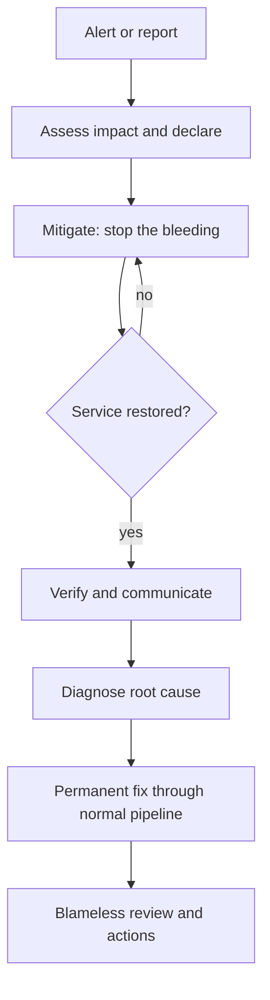
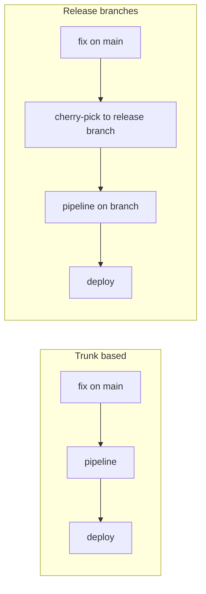

# A bad deploy in production and the hotfix flow

> **Before this lesson:** read [Buggy code on main](#/lesson/thinking/buggy-code-on-main) for the vocabulary of branches, deploys, canaries and feature flags.

## In plain words

A pipe bursts in your kitchen. You do not begin by working out why it burst. You turn off the water at the mains. Then you mop up, then you find the cause, then you fix the pipe properly, and afterwards you ask whether the other pipes are equally old. Getting that order wrong — studying the crack while the kitchen floods — is the most natural mistake in the world.

This lesson is about the software version. A **deploy** (or deployment) is the act of putting a new version of a program into live use; **production** is the live system real customers use. Sometimes a deploy goes wrong and customers start seeing errors. The question "a deploy went out twenty minutes ago and errors are rising — what do you do?" tests whether you turn off the water first. Going back to the previous version is called a **rollback**.

The second half covers the **hotfix**: an urgent repair that cannot wait for the normal schedule. Both topics show an interviewer how you behave under pressure, which is why they are asked so often.

The previous lesson kept a bad change from spreading. This one starts later: the change is **live and users are hurting**. Two prompts cover the territory — *"a deploy went out twenty minutes ago and errors are climbing; what do you do?"* and *"how should urgent fixes reach production?"* Both test whether you put restoring service ahead of understanding, and whether your "fast path" is still a safe path.

## The order of operations

Under pressure people do things in the order that feels natural: investigate, understand, fix. The correct order is nearly the reverse.



**Mitigation comes before diagnosis.** You do not need to know *why* the new version is failing to know that the old version was not. Google's SRE guidance on troubleshooting makes the same point: the first duty in a major problem is to make the system work as well as it can, and stabilising the service comes ahead of finding the root cause.

## Step 1 — Assess and declare (two minutes)

Three quick questions:

- **How bad?** Error rate, share of users affected, which functions. Is money or data being lost?
- **Since when?** Line up the start of the symptoms with the deploy timeline. A graph where errors rise at the minute of the rollout is strong evidence.
- **Is it still spreading?** If a staged rollout is in progress, **pause it** immediately.

Then say out loud that it is an incident. The SRE book suggests declaring when a second team is needed, when the problem is visible to customers, or when it is unsolved after an hour of concentrated effort — and that declaring early is better than late. Declaring gives the situation an owner and a channel.

For anything beyond a small problem, separate the roles. One person is **incident commander**, holding the overall picture and making decisions. One or more do the **operational work** — the only people changing the system. One handles **communication** to stakeholders. The point of the split is that the person typing rollback commands is not also answering questions from five managers.

## Step 2 — Mitigate

Choose the fastest safe option, roughly in this order:

| Option | Speed | When it fits | Watch out for |
|---|---|---|---|
| **Turn off a feature flag** | Seconds | The fault is in a flagged feature | Flag state cached in clients |
| **Stop or shift traffic** | Seconds to minutes | Canary or blue-green: route users back to the old version | Old capacity must still exist |
| **Roll back the deployment** | Minutes | The previous build is known good | Schema or data changes that the old code cannot read |
| **Scale or shed load** | Minutes | The new version is correct but overloaded | Treats the symptom only |
| **Roll forward a fix** | Tens of minutes or more | Rollback impossible | Rushed code under stress |

**Blue-green** deployment keeps two complete environments: the live one and the idle one. A release is installed on the idle side, tested, and then traffic is switched; going back is switching again. **Canary** release sends a growing fraction of traffic to the new version. Both make the mitigation a routing change, which is why they are worth their cost.

The rollback question that separates careful answers from careless ones: **"Is it safe to go back?"** If the new release migrated the database — dropped a column, changed a format, wrote records the old code cannot parse — the old version may crash or corrupt data. This is why migrations should be backward compatible: the *expand, migrate, contract* sequence adds the new structure alongside the old, moves readers and writers over, and removes the old structure only in a later release. With that discipline, any single release can be rolled back.

Also remember **data repair**. Rolling back stops new damage; it does not undo damage done. Orders written with a wrong total during those twenty minutes still exist.

## Step 3 — Verify and communicate

Confirm with the same graphs that raised the alarm: error rate back to baseline, latency normal, a synthetic transaction succeeding. Do not rely on "the rollback command finished".

Communicate in short, regular updates with a fixed shape:

> **What is happening** (in user terms) · **who is affected** · **what we have done** · **current state** · **next update at** (a time).

"Checkout errors affected about 8 % of orders from 14:02 to 14:26. We rolled back the 14:00 release and errors have returned to normal. We are now checking for orders that need correcting. Next update 15:00." Silence makes stakeholders invent their own story.

## Step 4 — Diagnose and fix properly

With users safe, there is time. Reproduce the failure, compare the diff, read the logs for the affected requests, and find why tests and the canary did not catch it. The fix then travels through the *normal* pipeline with a regression test.

## Step 5 — Review

A blameless write-up: impact, timeline, what triggered it, why detection took as long as it did, what went well, and actions. Typical triggers for requiring one are user-visible downtime or degradation over a threshold, any data loss, a manual intervention such as a rollback, a slow resolution, or a monitoring failure.

## Worked answer: errors after a deploy

**Prompt:** *"You are on call. A deploy finished twenty minutes ago. The 5xx error rate has gone from 0.1 % to 4 % and is rising. Walk me through what you do."* Answer aloud for four minutes, then compare.

<details><summary>Model answer</summary>

"First thirty seconds: I look at the dashboard to confirm it is real and size it — 4 % of all requests, or 100 % of one endpoint? — and I check whether the rise lines up with the deploy. I also check whether the rollout is complete or still progressing; if it is still going, I pause it.

It is user-visible, so I declare an incident in the on-call channel and say I am taking command until someone else does. If others join, I ask one person to handle updates so I can work.

**Mitigation.** The timing points at the deploy, so I roll back without waiting to understand the bug. Before pressing the button I check one thing: did this release include a database migration or a change in data format? If not, rollback is safe and I start it. If it did, I check whether the old version can run against the new schema; our rule is that migrations are backward compatible, so it should. If the change is behind a feature flag, I turn the flag off instead, because it is faster.

While the rollback runs, I watch the error rate by version. If the old instances are healthy and the new ones are failing, that confirms the cause.

**Verify.** Error rate back to 0.1 %, latency normal, a test purchase succeeds. I post an update: what users saw, for how long, what we did, and that we are now assessing data impact.

**If the rollback does not help**, then my hypothesis was wrong: the deploy was a coincidence. I widen the search — a dependency, a configuration push, an expired certificate, a traffic spike — ordering checks by likelihood and cost.

**Afterwards.** I work out what the bad version did to data during the window: failed requests are an inconvenience; half-completed writes need repair, and I would write a script reviewed by a second person. Then root cause from the diff and logs, a fix with a test through the normal pipeline, and a blameless review. The key review question: this reached all users — why did the canary not stop it? Either there was no canary, the canary slice saw too little traffic for the error to register, or the automated check did not watch this metric. That gap is the main action item."

</details>

> [!INTERVIEW]
> Two details make this answer stand out: checking **whether rollback is safe** before doing it (schema and data compatibility), and saying what you would do **if the rollback does not fix it**. The second shows that you treat "the deploy caused it" as a hypothesis, not a fact.

## The hotfix flow

**Prompt:** *"A critical bug is in production. The normal release takes a day of checks. How should an urgent fix get out?"*

The temptation is a bypass: skip review, skip tests, patch the server by hand. Each of those is how a second incident starts — and a hand-patched server silently loses the fix at the next deploy. The principle:

> **The emergency path is the normal path with the waiting removed, not with the checks removed.**

If your pipeline is fast and automated, the hotfix path and the normal path are the same thing. The need for a special process is a symptom of a slow pipeline.

<details><summary>Model answer</summary>

**First, do you need a hotfix at all?** If the bug arrived with a recent release, roll back or turn off the flag; the fix can then take the ordinary route. A hotfix is for when there is nothing good to go back to: the bug is old and newly discovered, such as a security hole, or a rollback is impossible.

**A hotfix process.**

1. **Smallest possible change.** Fix the bug and nothing else. No refactoring, no "while I'm here".
2. **Branch from what is actually in production.** With trunk-based development and frequent deploys, that is main. If production is behind main (a release branch model), branch from the release tag — you do not want to ship three days of unreleased work along with the fix.
3. **Review still happens** — one reviewer, pulled in immediately, synchronously if needed. A second pair of eyes is most valuable exactly when the author is stressed.
4. **Automated checks still run**: build, the fast suite, and a new test reproducing the bug. What is skipped are *waiting periods*: the long soak, the scheduled release window, the manual sign-off queue. Slow suites can run in parallel with the rollout and stop it if they fail.
5. **Staged rollout, compressed.** A canary for minutes rather than hours, with the specific failing metric watched by a person.
6. **Port the fix everywhere.** If it went to a release branch, apply the same commit to main the same day, or the bug returns in the next release. The trunk-based guidance is to fix on trunk first and cherry-pick to the release branch, precisely to prevent this regression.
7. **Record and review.** Every use of the emergency path is logged — who, why, what was skipped — and looked at afterwards. If the path is used often, the normal pipeline is too slow.

**Guard rails.** Who may invoke it (the on-call engineer plus one approver); what qualifies (security exposure, data loss, a major function down); what is never skipped (review, build, the regression test).

**Trade-off.** Speed against assurance. I accept a shorter soak because the alternative is known harm continuing, and I compensate with a narrow change, a human watching the canary, and a ready rollback.

</details>

### Hotfix under two branching models



In both, the fix exists on main. The dangerous variant — fixing only on the release branch and "merging back later" — is the one to name and reject.

## More follow-ups, briefly

**"The rollback failed halfway."** Half the fleet is on each version. Stop, do not improvise; route traffic to whichever version is healthy, then finish moving in one direction. This is why deploy tooling should make both directions the same well-exercised operation.

**"There is no previous version to roll back to"** (first launch, or the old one is incompatible). Then mitigation means degrading: disable the failing feature, serve cached or read-only responses, shed load, show a maintenance page for one function rather than letting the whole product fail.

**"It only fails for 2 % of users."** Find what they share — region, device, account type, a feature flag — because that both suggests the cause and allows a targeted mitigation (turn it off for them).

**"How do you know the deploy caused it?"** Correlation in time; errors concentrated on new-version instances; errors in code paths touched by the diff. If none of those hold, keep the deploy as one hypothesis among several.

**"Management wants the feature back today."** Separate the decisions: users are safe now; re-release happens when the fix has a test, has been reviewed, and goes out behind a flag to a small audience first. Give a time estimate with its assumptions.

## Summary

- Order: assess, declare, mitigate, verify, communicate, then diagnose, fix properly and review.
- Mitigation options from fastest: flag off, shift traffic, roll back, shed load, roll forward.
- Check that rollback is safe: backward-compatible migrations (expand, migrate, contract) keep it so. Rolling back does not repair data already damaged.
- Split incident roles when more than one person is involved; send short structured updates at promised times.
- A hotfix path removes waiting, not checks: smallest change, review, automated tests, compressed canary, fix present on main, usage logged.

## Glossary

| Term | Meaning |
|---|---|
| Production | The live system used by real customers |
| Deploy | To put a version of software into use |
| Rollback | Returning to the previous version |
| Roll forward | Fixing a problem by releasing a new corrected version |
| Mitigation | An action that reduces harm before the cause is understood |
| Incident | An event that degrades or interrupts a service |
| Incident commander | The person coordinating the response to an incident |
| Blue-green deployment | Two full environments, with traffic switched between them |
| Canary release | Sending a small, growing share of traffic to a new version |
| Schema migration | A change to the structure of a database |
| Backward compatible | Still working with the previous version |
| Hotfix | An urgent fix released outside the normal schedule |
| Cherry-pick | Copying one specific commit onto another branch |

## Check yourself

```quiz
[
  {"q": "Errors rose right after a deploy. What should happen before root-cause analysis?",
   "options": ["Read the entire diff carefully", "Mitigate: pause the rollout and roll back or turn the flag off", "Write the postmortem", "Add more logging and redeploy"],
   "answer": 1,
   "explain": "Restoring service comes first; understanding can wait until users are safe."},
  {"q": "What must be checked before rolling back a release?",
   "options": ["Whether the author agrees", "Whether the old version can run against the current schema and data", "Whether it is a weekday", "Whether the changelog is updated"],
   "answer": 1,
   "explain": "If the release changed data in a way the old code cannot handle, rollback could make things worse."},
  {"q": "What does 'expand, migrate, contract' achieve?",
   "options": ["Smaller binaries", "Each release stays compatible with the previous one, so any single release can be rolled back", "Faster unit tests", "Fewer code reviews"],
   "answer": 1,
   "explain": "New structures are added alongside old ones and old ones are removed only after everything has moved, keeping each step reversible."},
  {"q": "In incident response, why separate the incident commander from the person doing operational work?",
   "options": ["To give more people something to do", "So the person changing the system is not also coordinating and answering questions", "Because regulations demand two people", "To slow things down deliberately"],
   "answer": 1,
   "explain": "Clear roles prevent conflicting actions and let each person concentrate."},
  {"q": "Which statement about a good hotfix process is right?",
   "options": ["It skips review to save time", "It patches the production server by hand", "It keeps review and automated checks but removes waiting periods", "It bundles other pending improvements"],
   "answer": 2,
   "explain": "The emergency path is the normal path minus the queues; skipping checks invites a second incident."},
  {"q": "A fix was applied only to the release branch. What is the risk?",
   "options": ["None", "The bug reappears in the next release cut from main", "The release branch becomes read-only", "The canary stops working"],
   "answer": 1,
   "explain": "Unless the fix also lands on main, the next release is built without it."},
  {"q": "You rolled back and the error rate did not improve. What does that tell you?",
   "options": ["The rollback tool is broken for certain", "The deploy was probably not the cause; widen the hypotheses", "Roll back again", "Nothing"],
   "answer": 1,
   "explain": "A mitigation that does not help is evidence against the hypothesis that motivated it."},
  {"q": "Which update is best during an incident?",
   "options": ["'We are looking into it.'", "'Checkout errors affect about 8% of orders since 14:02; we rolled back at 14:20 and errors are falling; next update 14:45.'", "'Everything is fine.'", "A link to the raw logs"],
   "answer": 1,
   "explain": "It states impact, action, current state and when the next update will come."}
]
```

> **Source:** Google SRE Book, "Managing Incidents" (https://sre.google/sre-book/managing-incidents/), "Effective Troubleshooting" (https://sre.google/sre-book/effective-troubleshooting/) and "Postmortem Culture" (https://sre.google/sre-book/postmortem-culture/); Martin Fowler, "Blue Green Deployment" (https://martinfowler.com/bliki/BlueGreenDeployment.html), "Canary Release" (https://martinfowler.com/bliki/CanaryRelease.html) and Danilo Sato, "Parallel Change" (https://martinfowler.com/bliki/ParallelChange.html); Trunk Based Development, "Branch for release" (https://trunkbaseddevelopment.com/branch-for-release/). Wording and examples are original.
