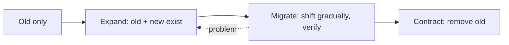

# Migration and rollout planning

> **Before this lesson:** read [A bad deploy in production and the hotfix flow](#/lesson/thinking/bad-deploy-hotfix), which introduces rollbacks and backward-compatible changes. Knowing what a database table is helps; nothing more is assumed.

## In plain words

A railway company needs to replace an old bridge. It cannot close the line for a year. So it builds the new bridge alongside the old one, runs a few test trains across it, then moves trains over a few at a time while watching closely, keeps the old bridge standing for a while in case something is wrong, and only then takes the old one down.

A **migration** in software is the same kind of operation: moving from an old thing to a new thing — a new database, a new version of an interface, a new way of storing data — while the service keeps running and without losing anything. A **rollout** is the gradual release of something new to more and more users.

Interviewers like these questions because a wrong answer is easy and tempting: "stop everything on Sunday night, copy the data, start the new system." This lesson shows the pattern that almost every safe migration follows, and applies it to five common cases.

*"Move this service to a new database with zero downtime." "Deprecate version 1 of our API." "Roll this risky feature out safely." "Backfill a new column for two billion rows."* Migration prompts ask for a plan in which **every step is small, observable and reversible**, and in which old and new run side by side for a while. Candidates who answer "take a maintenance window, copy the data, switch over" have described the one approach the question excludes.

## The universal shape: expand, migrate, contract

Almost every safe migration is an instance of one pattern, known as *parallel change* or *expand and contract*:

1. **Expand** — add the new thing next to the old one. Nothing uses it yet. Nothing breaks.
2. **Migrate** — move users, callers, traffic or data from old to new, gradually, checking as you go. Usually the longest phase.
3. **Contract** — when nothing uses the old thing, remove it.



Its virtue is that you can release at any point and step backwards at any point before the contraction. Its cost is running two things at once — more code paths, more storage, more to test — and the standing temptation to never finish. A migration that stalls at ninety percent leaves the system more complicated than before it began, so the contract phase needs an owner and a date.

## A planning checklist

Use this as the structure for any migration answer.

| Question | Why |
|---|---|
| What exactly changes, and what must not? | Scope; the invariants to protect |
| Who and what depends on the old thing? | You cannot migrate callers you have not found |
| Can old and new coexist? How? | The heart of the design |
| What is the unit of rollout? | Percentage of traffic, tenant, region, table |
| How do we verify at each step? | Comparison, reconciliation, metrics |
| How do we go back, and until when can we? | The point of no return must be explicit and late |
| What is the order of steps and who signs off each? | A runbook, not a hope |
| How do we finish? | Clean-up is part of the plan |

## Worked answer 1 — Move to a new database with zero downtime

**Prompt:** *"Our orders service uses database A. We want it on database B. No downtime, no lost orders."* Sketch a plan before opening.

<details><summary>Model answer</summary>

**Clarify.** How much data, and what write rate? Same data model or a redesign? Are there other readers of database A — reports, other services? What consistency does the product need — is a few seconds of difference between old and new tolerable during the move? How long may the whole migration take?

**Assume.** 500 GB, a few hundred writes per second, schema changes are modest, one service writes but two analytics jobs read, and we have weeks.

**The invariant.** At every moment exactly one database is the *source of truth* for reads that matter, and the switch of that role is a single, reversible configuration change.

**Phases.**

| # | Phase | What happens | Verify | Back out |
|---|---|---|---|---|
| 0 | Prepare | Inventory every reader and writer of A; put data access behind one interface in the code; add metrics | All access goes through the interface | n/a |
| 1 | Expand | Create schema in B. Nothing reads it | — | Drop B |
| 2 | Dual write | Service writes to A (authoritative) and also to B. A failure writing to B is logged and queued for retry; it never fails the user's request | B write error rate; lag | Turn off dual write |
| 3 | Backfill | Copy historical rows from A to B in batches, idempotently, without overwriting newer dual-written data | Row counts; progress | Stop the job |
| 4 | Reconcile | Compare A and B continuously: counts, checksums per range, sampled row-by-row. Fix differences and find their cause | Mismatch rate trending to zero and staying there | — |
| 5 | Shadow read | For a sample of real reads, query both, serve A's answer, log any difference | Diff rate ≈ 0; B latency acceptable | Turn off |
| 6 | Cut over reads | Behind a flag, serve reads from B for 1 % → 10 % → 100 % | Error rate, latency, business metrics | Flip the flag back |
| 7 | Switch authority | B becomes the source of truth; keep writing to A as well, so that A stays a valid fallback | Reconciliation in the other direction | Flip authority back |
| 8 | Contract | After a soak period, stop writing to A; archive; remove the dual-write code; migrate the analytics jobs | Nothing reads A (check its query log) | **Point of no return** |

**The hard parts, named.**

- *Dual writes are not atomic.* A write can succeed in A and fail in B. That is why A stays authoritative, failures are queued and retried, and reconciliation runs continuously. A sturdier alternative is change data capture: tail A's log and replay it into B, so there is one write path and B follows.
- *Backfill versus live writes.* If the backfill copies an old version of a row after a newer dual write has landed, it would clobber it. Use "insert if absent" or compare a version or updated-at field.
- *Ordering and deletes.* Updates applied out of order, and rows deleted in A during the copy, are the classic sources of drift; reconciliation exists to catch them.
- *Other readers.* The analytics jobs break silently at step 8 unless they were found at step 0.
- *Capacity.* Dual writing roughly doubles write load on the application path; B must be sized and load-tested before step 6.

**Trade-offs.** This takes weeks and adds temporary complexity. A maintenance window would be simpler — and if the business can truly accept an hour offline at 3 a.m., it is a legitimate choice. I would offer both and let the downtime cost decide.

**Summary.** Dual write with A authoritative, idempotent backfill, continuous reconciliation, shadow reads, a flagged percentage cut-over, then authority switch with A kept in sync as a fallback, and removal only after a soak.

</details>

> [!INTERVIEW]
> The phrase that earns the most here is **"shadow reads and reconciliation before any user sees the new system"**. It shows that you verify with production traffic at zero user risk, rather than trusting the copy job.

## Worked answer 2 — A backward-incompatible schema change

**Prompt:** *"Rename the column `fullname` to `display_name` in a table that a continuously deployed service uses."*

The trap: deploying code and running the migration are not simultaneous. During a rolling deploy, old and new versions of the code run at the same time, so the schema must work with both.

<details><summary>Model answer</summary>

Never a single `RENAME`. Five small releases, each compatible with the one before:

| Step | Schema | Code | Safe to roll back? |
|---|---|---|---|
| 1 Expand | Add `display_name` (nullable) | unchanged | Yes |
| 2 Dual write | — | Write both columns; read `fullname` | Yes |
| 3 Backfill | Copy `fullname` → `display_name` for old rows, in batches | — | Yes |
| 4 Switch reads | — | Read `display_name`; still write both | Yes |
| 5 Stop old writes | — | Write only `display_name` | Yes, with care |
| 6 Contract | Drop `fullname` | — | No — last, after a soak |

Rules I would state: a migration must be compatible with the previous version of the code and the next; destructive changes (drop, tighten a constraint) come last and alone; adding a column with a default or an index on a large table may lock it, so use the database's online or concurrent option and test on a production-sized copy; and every other reader of the table — reports, exports — has to be found first.

</details>

## Worked answer 3 — Backfill two billion rows

**Prompt:** *"A new column needs a computed value for every existing row. The table has two billion rows and serves live traffic."*

<details><summary>Model answer</summary>

**Design properties.**

- **Batched.** A few thousand rows per transaction, never one giant update that holds locks and bloats the log.
- **Throttled.** Pause between batches; back off automatically when replication lag, lock waits or latency rise; run faster off-peak.
- **Idempotent.** Re-running a batch gives the same result, so a crash or a retry is harmless: `UPDATE … WHERE new_col IS NULL`.
- **Resumable.** Walk the primary key in ranges and checkpoint the last key done.
- **Safe with live writes.** New and updated rows get the value from the application (dual write is deployed *before* the backfill starts), so the backfill only fills history and never overwrites a fresher value.
- **Observable.** Progress, rate, errors and estimated finish on a dashboard; a kill switch.
- **Verified.** Afterwards, count rows still null, and sample-check computed values against an independent calculation.

**Rehearse** on a copy of production to measure rate and impact. Two billion rows at 5,000 rows per second is about 4.6 days; plan for that, not for an afternoon.

**Order.** Add the column → deploy dual write → backfill → verify → add the NOT NULL constraint or the index → switch reads.

**Failure plan.** If the computation was wrong, the same batch framework re-runs with a corrected function; keep the old data until verification passes.

</details>

## Worked answer 4 — Deprecate an API version

**Prompt:** *"We want to retire v1 of a public API used by several hundred external customers."*

Here the migrate phase belongs to other people, so the plan is mostly communication and measurement.

<details><summary>Model answer</summary>

1. **Know who uses it.** Per-customer, per-endpoint usage from the logs. Without this you cannot plan or know when you are done.
2. **Make v2 a real replacement.** Feature parity for everything in use, a migration guide mapping each v1 call to v2, client-library support, a sandbox.
3. **Announce with dates.** A deprecation notice, a period when v1 is still fully supported, and a fixed sunset date — long for external customers (many months), short for internal callers. Publish it in documentation, a changelog and by direct contact with the owners of the top integrations.
4. **Signal in-band.** Deprecation and sunset headers on every v1 response; warnings in the client library and the developer dashboard.
5. **Stop the bleeding.** No new customers on v1: new API keys get v2 only.
6. **Track and chase.** A weekly burn-down of v1 traffic by customer; personal outreach to the long tail; offer help to the biggest.
7. **Brown-outs.** Close to the date, turn v1 off for short scheduled windows — a few minutes, then an hour — so that forgotten integrations fail loudly while a quick recovery is still possible. Announce them in advance.
8. **Sunset.** Return a clear error (410 Gone with a link to the guide), not a timeout. Keep the ability to re-enable briefly for an emergency.
9. **Contract.** Remove the v1 code, tests, documentation and infrastructure.

**Trade-offs.** A longer window is kinder to customers and costs us longer double maintenance; a very large customer may get an extension, which should be explicit, time-limited and possibly paid. And where possible, avoid needing versions at all: additive, backward-compatible changes do not require anyone to migrate.

</details>

## Worked answer 5 — Roll out a risky feature behind a flag

**Prompt:** *"A rewritten pricing engine is ready. How do you release it?"*

<details><summary>Model answer</summary>

**Separate deploy from release.** The code ships dark, behind a flag that selects old or new engine per request.

| Stage | Audience | Gate to proceed |
|---|---|---|
| 0 | **Shadow mode**: run both engines on live requests, serve the old result, log differences | Every difference explained or fixed; latency within budget |
| 1 | Internal staff | No defects reported for some days |
| 2 | 1 % of users, chosen stably (the same user always gets the same engine) | Guardrails hold: errors, latency, conversion, revenue per order, support contacts |
| 3 | 5 % → 25 % → 50 % | Same, with enough traffic for the metrics to be meaningful |
| 4 | 100 % | Soak for a full business cycle, including a weekend and a month-end |
| 5 | Remove the flag and the old engine | Scheduled at stage 0 |

**Rules.** Each stage has pre-agreed numeric criteria and a named person who decides. A breach means the flag goes back — no debate first. Assignment is sticky so that a customer does not see prices flip between page loads. Exclude or handle specially anything where a mid-flight switch is dangerous, such as orders already in the checkout. Configuration changes to flags are themselves reviewed and audited, because a flag flip is a production change.

**Why shadow first.** For a pricing engine, correctness is checkable: the old engine is an oracle. Days of shadow comparison find the edge cases before a single customer is charged a different price.

**Clean-up.** Fowler's taxonomy treats this as a release toggle — meant to live for weeks. A stale flag is untested code paths and a future incident, so its removal is a ticket created on day one.

</details>

## Choosing a rollout unit

| Unit | Good for | Caveat |
|---|---|---|
| Percentage of requests | Stateless read paths | A user may flip between versions |
| Percentage of users (sticky) | User-visible behaviour | Needs stable hashing of the user ID |
| Tenant or customer | Business software | Start with small, friendly tenants |
| Region or data centre | Infrastructure changes | Regions differ; one is not a full test |
| Internal staff first | Almost everything | Staff are not typical users |
| Table or shard | Data migrations | Hot shards behave differently |

## Common mistakes to name

- **Big bang.** Everything switches at once and the rollback is "restore from backup".
- **No inventory.** The forgotten cron job or analytics query that still reads the old table.
- **Unverified copy.** Trusting that the migration script was correct without reconciliation.
- **Point of no return too early.** Dropping the old column in the same release that adds the new one.
- **Never contracting.** Two systems for ever, both half-maintained.
- **Ignoring the mixed-version window.** During a rolling deploy both code versions run; both must work with the schema.
- **Untested rollback.** A rollback procedure that has never been run is a hope.

## Summary

- Safe migrations are expand → migrate → contract, with old and new coexisting and the irreversible step last.
- Plan with eight questions: scope, dependants, coexistence, rollout unit, verification, rollback, sequencing, finishing.
- Database moves: dual write or change capture, idempotent backfill, reconciliation, shadow reads, flagged cut-over, authority switch with a fallback, then removal.
- Schema changes: several compatible releases, destructive step last.
- Backfills: batched, throttled, idempotent, resumable, observable, verified.
- API deprecation: measure usage, provide the replacement, announce dates, signal in-band, burn down, brown-out, sunset.
- Flag rollouts: shadow, staff, small sticky percentage, widening with numeric gates, and scheduled flag removal.

## Glossary

| Term | Meaning |
|---|---|
| Migration | Moving from an old system, structure or version to a new one |
| Rollout | Releasing a change gradually to more users |
| Parallel change (expand and contract) | Add the new, move usage across, then remove the old |
| Dual write | Writing to both old and new stores during a migration |
| Backfill | Filling in data for records that already exist |
| Reconciliation | Comparing two stores to find and fix differences |
| Shadow read | Querying the new system alongside the old and comparing, without using its answer |
| Cut-over | The moment the new system becomes the one in use |
| Source of truth | The store that is authoritative when copies disagree |
| Point of no return | The step after which going back is no longer possible |
| Deprecation | Announcing that something will be removed and should no longer be used |
| Brown-out | Deliberately switching an old service off for short periods before its removal |
| Idempotent | Safe to run more than once with the same result |

## Check yourself

```quiz
[
  {"q": "What are the three phases of a parallel change?",
   "options": ["Plan, code, test", "Expand, migrate, contract", "Build, ship, forget", "Lock, copy, unlock"],
   "answer": 1,
   "explain": "Add the new alongside the old, move usage gradually, then remove the old."},
  {"q": "Why can a column not be renamed directly in one release of a continuously deployed service?",
   "options": ["Databases cannot rename columns", "During a rolling deploy old and new code run together and one of them would reference a column that does not exist", "Renames are slow", "It breaks the linter"],
   "answer": 1,
   "explain": "The schema must be compatible with both code versions that are live during the deploy."},
  {"q": "In a dual-write database migration, why does the old database stay authoritative at first?",
   "options": ["It is faster", "Writes to the two stores are not atomic, so one must be the trusted source while differences are detected and repaired", "The new one has no indexes", "For licensing reasons"],
   "answer": 1,
   "explain": "A write may succeed in one store and fail in the other; a single source of truth plus reconciliation handles this."},
  {"q": "What do shadow reads provide?",
   "options": ["Faster responses", "Verification of the new system against real traffic with no user-visible risk", "A backup", "Lower costs"],
   "answer": 1,
   "explain": "Both systems are queried, the old answer is served, and differences are logged for investigation."},
  {"q": "Which property lets a crashed backfill be safely restarted?",
   "options": ["It is written in SQL", "Idempotence and checkpointed progress", "It runs at night", "It uses one large transaction"],
   "answer": 1,
   "explain": "Idempotent batches can be re-applied harmlessly and checkpoints avoid starting over."},
  {"q": "What is a brown-out in API deprecation?",
   "options": ["A power failure", "Deliberately turning the old version off for short announced windows before the final shutdown", "A slow response", "A change of colour scheme"],
   "answer": 1,
   "explain": "It makes forgotten integrations fail visibly while recovery is still quick."},
  {"q": "Why assign users to a flagged feature with a stable hash of the user ID?",
   "options": ["It is more random", "So the same user consistently sees the same variant instead of flipping between them", "To save memory", "To avoid logging"],
   "answer": 1,
   "explain": "Sticky assignment prevents confusing changes between requests and keeps metrics attributable."},
  {"q": "Where should the irreversible step of a migration be placed?",
   "options": ["First, to get it over with", "Last, alone, after a soak period with verified fallbacks", "In the middle", "It does not matter"],
   "answer": 1,
   "explain": "Keeping the point of no return late preserves cheap rollback for as long as possible."}
]
```

> **Source:** Danilo Sato, "Parallel Change" (https://martinfowler.com/bliki/ParallelChange.html); Pramod Sadalage and Martin Fowler, "Evolutionary Database Design" (https://martinfowler.com/articles/evodb.html); Pete Hodgson, "Feature Toggles" (https://martinfowler.com/articles/feature-toggles.html); Martin Fowler, "Canary Release" (https://martinfowler.com/bliki/CanaryRelease.html) and "Strangler Fig" (https://martinfowler.com/bliki/StranglerFigApplication.html); Google API Improvement Proposals on compatibility and versioning (https://google.aip.dev/180, https://google.aip.dev/185). Plans, tables and wording are original.
