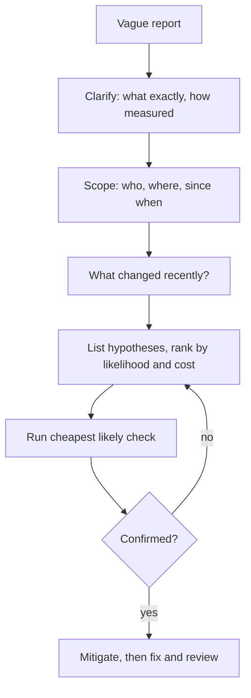
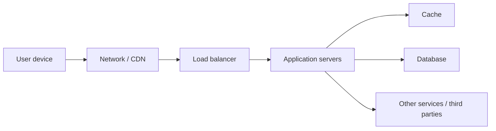

# Hypothesis-driven triage: "the site is slow" and "the nightly job failed"

> **Before this lesson:** you should know the seven-step answer shape from [A seven-step answer framework](#/lesson/thinking/answer-framework) and the idea of ranking by likelihood and impact from [Exploratory testing, risk and non-functional categories](#/lesson/thinking/exploratory-risk-nonfunctional). No knowledge of servers or databases is assumed; every term is explained when it first appears.

## In plain words

Your car will not start. A good mechanic does not begin by taking the engine apart. They ask a few questions — "does it make any sound when you turn the key? did it work yesterday? did anything change?" — and then check the cheap, likely things first: the battery, the fuel gauge. Only if those are fine do they open the bonnet further. They are guessing, but in an organised way: each guess is a **hypothesis** (a possible explanation that can be checked), and each check either confirms it or crosses it off.

Debugging questions in interviews — *"the site is slow, what do you do?"* — are asking whether you work like that mechanic. Nobody expects you to know the answer; there is none, because the interviewer invents the system as you go. They want to see **triage**: the habit of sorting possibilities quickly and deciding what to look at first. In a job, this is the difference between an outage that lasts ten minutes and one that lasts three hours.

## The method in six moves

1. **Clarify the symptom.** Turn a vague complaint into something measurable.
2. **Scope it.** Who is affected and who is not? Since when?
3. **Look for what changed.** Most new problems follow a change.
4. **List hypotheses** and rank them by *how likely* and *how cheap to check*.
5. **Test one at a time**, cheapest and likeliest first; narrow down.
6. **Mitigate early, communicate throughout**, and fix the cause afterwards.



The same loop appears in the Google SRE book's chapter on troubleshooting: start from a problem report, triage, examine, diagnose, test and treat. The book also names the classic mistakes — chasing symptoms that are not relevant, assuming the cause is the same as last time, and mistaking a coincidence for a cause.

### Move 1 — Clarify the symptom

"Slow" is a feeling. You need a number.

- **What is slow?** One page, every page, or one button?
- **How slow, compared with what?** "The search page took 300 milliseconds last week and takes 4 seconds now."
- **How do we know?** A user complaint, an **alert** (an automatic warning fired when a measurement crosses a limit), or a **dashboard** (a screen of live graphs)?

A small piece of vocabulary helps here. **Latency** is the time one request takes. Teams usually quote it as a **percentile**: "p95 latency is 800 ms" means 95 out of every 100 requests finished within 800 milliseconds and the slowest 5 took longer. Percentiles matter because an average hides suffering: if 95 requests take 0.1 s and 5 take 10 s, the average is about 0.6 s, which sounds fine, while one user in twenty waits ten seconds.

### Move 2 — Scope it

Scoping questions cut the search space in half each time, like the game of twenty questions.

| Question | If yes, it suggests | If no, it suggests |
|---|---|---|
| Everyone, or some users? | A shared component | Something those users have in common |
| All pages, or one? | Infrastructure, network, a shared database | The code or data for that page |
| All regions? | A global dependency or a release | One data centre, a regional network |
| Constant, or at certain times? | A fault | Load, or a scheduled job |
| Started suddenly? | A change or a failure | Gradual growth: data, traffic, a leak |

### Move 3 — What changed?

Systems that worked yesterday and fail today usually had something change in between. Ask about four kinds of change:

- **Code** — a **deploy** (a new version of the software being put live).
- **Configuration** — a setting, a **feature flag** (a switch that turns a feature on without a new deploy), a certificate expiring.
- **Data** — a table that grew past some size, an unusual customer, a bad input file.
- **Traffic** — a marketing campaign, a **bot** (an automated program making requests), a retry storm.

If a change lines up in time with the start of the symptom, undo it first and investigate second.

### Move 4 — Rank hypotheses by likelihood and cost

Suppose you believe a recent deploy is 50 % likely to be the cause and takes two minutes to check, a database problem is 30 % likely and takes ten minutes, and a network name problem is 20 % likely and takes one minute. What order?

Not strictly by likelihood. A check that is cheap deserves to go early even if it is less likely, because it costs almost nothing to rule out. The rule that minimises expected time is: **highest likelihood ÷ cost first.**

| Hypothesis | Likelihood | Cost (min) | Ratio | Order |
|---|---|---|---|---|
| Bad deploy | 50 % | 2 | 25 | 1st |
| Network names (DNS) | 20 % | 1 | 20 | 2nd |
| Database overloaded | 30 % | 10 | 3 | 3rd |

```python-run
hyps = [("bad deploy", 50, 2), ("db overload", 30, 10), ("dns", 20, 1)]

def expected_minutes(order):
    elapsed, total = 0, 0.0
    for name, p, cost in order:
        elapsed += cost                 # time spent so far when this check finishes
        total += p / 100 * elapsed      # chance this was the cause x time to reach it
    return total

by_likelihood = sorted(hyps, key=lambda h: -h[1])
by_ratio = sorted(hyps, key=lambda h: -h[1] / h[2])
print("by likelihood:", [h[0] for h in by_likelihood], expected_minutes(by_likelihood))
print("by ratio:     ", [h[0] for h in by_ratio], expected_minutes(by_ratio))
```

The first line sorts by likelihood only; the second by the ratio. The printed numbers are the average minutes until the cause is found. The ratio order is quicker (5.5 against 7.2 minutes), and the gap grows when costs differ more. You will implement this ordering in the problem *Order Incident Hypotheses by Probability and Cost*.

In an interview you do not calculate. You say: "The deploy is both likely and quick to check, so that first. DNS is unlikely, but it takes one command, so I'd rule it out next. The database is plausible but slower to investigate, so third."

### Move 5 — Narrow down by layers

When no change explains it, walk the path a request takes and find where the time goes. A typical web request passes through:



Short definitions: a **CDN** (content delivery network) is a set of servers around the world that hand out copies of files from near the user. A **load balancer** shares incoming requests among several servers. A **cache** is a fast store that keeps recent answers so they need not be computed again. A **third party** is someone else's service that yours calls, such as a payment provider.

For each layer there are four standard things to look at, sometimes called the golden signals: **latency** (how long), **traffic** (how much), **errors** (how many fail), and **saturation** (how full — processor, memory, disk, connections). A layer whose saturation is near 100 % is a suspect; a layer whose latency rose while those behind it stayed flat is where the time is being lost.

A **trace** is the best single tool if it exists: a record of one request showing how long each step took. One slow trace often answers the question in a minute.

### Move 6 — Mitigate and communicate

If users are suffering, do something that helps before you understand everything: roll back the deploy, add servers, turn off an expensive feature, block an abusive client. And tell people: what is affected, what you are doing, when you will update them next.

## Worked question 1 — "The site is slow"

Try a five-minute spoken answer first.

<details><summary>Model answer</summary>

"I'd start with questions. What is slow — the whole site or one page? How slow, measured how — do we have latency graphs, or one customer's report? Since when? Is it everyone or a subset?

*(Interviewer: p95 latency for the product page went from 300 ms to 3 s, starting at about 10:00 today, for all users.)*

That is sudden, global and limited to one page. Sudden means I look for a change; one page means it is probably not the network or the load balancer, which every page shares.

**Changes first.** Was there a deploy, a configuration or flag change, or a data import around 10:00? If a deploy touched the product page, I'd roll it back now and see whether latency recovers — two minutes, and it both tests the hypothesis and fixes the problem.

**If no change**, I rank what remains:

1. *The database query behind that page is slow* — likely; this page depends on it and pages that do not are fine. Check: the slow-query log and database processor use. Possible reasons: a missing or dropped index (an index is a lookup structure that lets the database find rows without reading the whole table), a table that grew past a tipping point, or a lock held by another job.
2. *The cache is not working* — quite likely and quick to check: look at the cache hit rate (the share of requests answered from the cache). If it fell from 95 % to 0 % at 10:00, every request is going to the database.
3. *A service the page calls is slow* — say a recommendations or pricing service. Check: its latency graph, or one trace of a slow request.
4. *Traffic spike on that page* — a campaign or a bot. Check: the request-rate graph.
5. *The application servers are saturated* — processor or memory. Less likely, since other pages are fine.

A single trace would short-cut all five: it shows which step takes the three seconds.

**Mitigate while investigating.** If it is the database, I might turn off a non-essential widget on the page; if a dependency, set a short timeout and show the page without it; if traffic, rate-limit the offender.

**Afterwards.** Fix the cause — add the index, repair the cache, set timeouts — add an alert so that we hear about this from a graph and not from customers, and write up what happened."

</details>

> [!INTERVIEW]
> Notice the answer never says "I'd check the logs" on its own. **Which** log, looking for **what**, and what each outcome would **mean**. Vague checking is the most common weakness in debugging answers.

### Variations the interviewer may add

- **"It's slow only for some users."** Find what they share: region, device, browser, account size (a customer with 50,000 items in their basket), a flag.
- **"It got slower gradually over a month."** Growth: data volume, missing clean-up, a memory leak, a query that scales badly.
- **"It's slow every day at 02:00."** A scheduled job competing for the database.
- **"Server-side graphs look fine."** Then the time is spent outside your servers: the user's network, a CDN problem, heavy scripts or images in the page. Measure in the browser.

## Worked question 2 — "The nightly job failed"

A **batch job** is a program that runs on a schedule with no user watching — for instance, every night it reads the day's orders and produces a sales report. A **pipeline** is several such steps chained together, each feeding the next.

Batch failures differ from a slow website in three ways: nobody is waiting on a screen, but people **downstream** (those who use the output) are affected in the morning; a job may fail *silently* — finish "successfully" with wrong or missing data; and re-running it may be unsafe.

<details><summary>Model answer</summary>

"Questions first. What does the job do and who uses its output — is anything customer-facing waiting on it? Did it crash, time out, or finish with bad output? Is this the first failure? What is the deadline for the result?

*(Interviewer: it loads yesterday's orders into the reporting database; finance needs it by 08:00; it failed at 02:13 with an error; it has run fine for months.)*

**Impact and time box.** It is 03:00, the deadline is 08:00, a normal run takes forty minutes. So I have a few hours, and my first duty is to tell the finance contact that the load is late and when I will update them.

**Read the error.** The log's last lines and the step that failed tell me which family this is:

| Family | Typical message | Likely cause |
|---|---|---|
| Input | "file not found", "unexpected column", parse error | The upstream system delivered late, empty, or in a changed format |
| Data | "duplicate key", "null value", "value too long" | One bad record; a new kind of value |
| Resources | "out of memory", "disk full", timeout | Data grew; another job competing |
| Dependencies | "connection refused", "authentication failed" | A database down; an expired password or certificate |
| Code | A stack trace in our own function | A deploy yesterday |
| Platform | The scheduler did not start it; machine lost | Infrastructure |

**What changed?** A deploy of the job, a schema change (a change in the structure of a table) upstream, a credential rotation, an unusually large day such as a sale.

**Rank and check.** Suppose the error is 'duplicate key'. Hypotheses: yesterday's run half-completed and tonight's is re-inserting; or the source sent the same order twice; or a retry inside the job. Cheapest check: count rows already loaded for that date.

**Before re-running, ask: is it safe to run twice?** A job is **idempotent** if running it again gives the same result as running it once. If this job appends rows, a re-run doubles yesterday's sales. So either the job deletes that day's partial rows first, or I clean up by hand, with care, before restarting.

**Mitigate.** Fix or skip the bad record (set it aside in a 'quarantine' table for later), re-run, and verify the output — row counts and totals against the source — before telling finance it is ready. A job that finishes is not the same as a job that is right.

**Afterwards.** Make the job idempotent; add input validation that fails early with a clear message; alert on failure *and* on lateness and on suspicious output such as zero rows; record the incident."

</details>

### The silent failure

The most dangerous batch problem is the one with no error. The job reports success; the report shows zero sales for a region because an upstream file was empty. Defences worth naming:

- **Checks on the output**: row counts within an expected range of yesterday's; totals reconcile with the source; no unexpected nulls.
- **Freshness alerts**: warn when data is older than it should be, not only when a job crashes.
- **Fail loudly on bad input**: an empty file should stop the pipeline, not flow through it.

## Communicating while you debug

A short, regular update beats a perfect explanation later. Use four parts:

> **Impact** — what users or teams see. **Status** — what we know and have done. **Next** — what we are doing now. **When** — time of the next update.

Example: "Product pages are loading slowly for all users since 10:00. We have ruled out this morning's deploy and are investigating the database. Next update at 10:45."

Say what you do not know. "We do not yet know the cause" is a respectable sentence; a confident wrong explanation is not.

## Common mistakes

- **Diving into one theory** without scoping. Ten minutes on database tuning when only users in one country are affected.
- **Checking things in the order they come to mind** instead of by likelihood and cost.
- **Changing several things at once**, so you cannot tell which one helped.
- **Trusting coincidence.** "We deployed at 09:58" is a lead, not a verdict; confirm by rolling back or by evidence.
- **Assuming it is the same as last time.**
- **Fixing without mitigating**, while users wait.
- **Going silent.**

## Summary

- Triage is organised guessing: clarify, scope, look for changes, list and rank hypotheses, test one at a time, mitigate and communicate.
- Scope questions halve the search: who, where, when, sudden or gradual.
- Order checks by likelihood divided by cost.
- Without a guilty change, follow the request through its layers and look at latency, traffic, errors and saturation in each.
- For batch jobs: read the error family, ask whether a re-run is safe, verify the output, and guard against silent failures.

## Glossary

| Term | Meaning |
|---|---|
| Hypothesis | A possible explanation that can be checked |
| Triage | Sorting problems or possibilities quickly to decide what to handle first |
| Latency | The time taken to answer one request |
| Percentile (p95) | The value that 95 % of measurements fall at or below |
| Deploy | Putting a new version of software into live use |
| Feature flag | A switch that turns behaviour on or off without a new deploy |
| Cache | A fast store of recent results, used to avoid repeating work |
| Load balancer | A component that spreads requests over several servers |
| Saturation | How close a resource is to being completely used |
| Trace | A record of one request showing the time spent in each step |
| Batch job | A program run on a schedule with no user waiting |
| Idempotent | Giving the same result whether run once or several times |
| Mitigation | An action that reduces harm now, before the cause is fixed |

## Check yourself

```quiz
[
  {"q": "A colleague says 'the site is slow'. What is the best first step?",
   "options": ["Restart the database", "Ask what exactly is slow, how it was measured, since when and for whom", "Read all the code", "Add more servers"],
   "answer": 1,
   "explain": "A vague symptom must become something measurable and scoped before any theory is worth testing."},
  {"q": "p95 latency is 2 seconds. What does that mean?",
   "options": ["The average request takes 2 seconds", "95% of requests finish within 2 seconds; 5% take longer", "95 requests failed", "The fastest request took 2 seconds"],
   "answer": 1,
   "explain": "A percentile is the value below which that share of measurements fall; it exposes the slow tail that an average hides."},
  {"q": "Hypothesis A is 60% likely and takes 30 minutes to check. Hypothesis B is 20% likely and takes 1 minute. Which first?",
   "options": ["A, because it is more likely", "B, because its likelihood-to-cost ratio is higher", "Both at once", "Neither"],
   "answer": 1,
   "explain": "60/30 = 2 for A and 20/1 = 20 for B. A cheap check is worth doing early even when less likely."},
  {"q": "Only the checkout page is slow; every other page is fine. Which is least likely to be the cause?",
   "options": ["A slow query used by checkout", "A slow payment provider", "The shared load balancer", "A recent change to checkout code"],
   "answer": 2,
   "explain": "All pages pass through the load balancer, so a fault there would not single out one page."},
  {"q": "A nightly job that appends rows failed halfway. Why should you not immediately re-run it?",
   "options": ["Jobs can only run once per day", "If it is not idempotent, the re-run may duplicate the rows already written", "The logs would be overwritten", "It would be too fast"],
   "answer": 1,
   "explain": "Re-running a non-idempotent job can double-count; clean up partial output or make the job safe to repeat."},
  {"q": "A job reports success but the report shows zero sales. Which safeguard targets this?",
   "options": ["More retries", "Checks on the output such as row counts against an expected range", "A faster machine", "A longer timeout"],
   "answer": 1,
   "explain": "Silent failures need validation of results and freshness, not only crash detection."},
  {"q": "Which update is most useful during an investigation?",
   "options": ["'Still looking.'", "'Product pages are slow for everyone since 10:00; the deploy is ruled out; we are examining the database; next update 10:45.'", "'It is probably fine.'", "No update until the cause is known"],
   "answer": 1,
   "explain": "It gives impact, status, next step and the time of the next update."}
]
```

> **Source:** Google SRE Book, "Effective Troubleshooting" (https://sre.google/sre-book/effective-troubleshooting/), "Monitoring Distributed Systems" — the four golden signals (https://sre.google/sre-book/monitoring-distributed-systems/) and "Managing Incidents" (https://sre.google/sre-book/managing-incidents/). Method, examples and wording are original.
