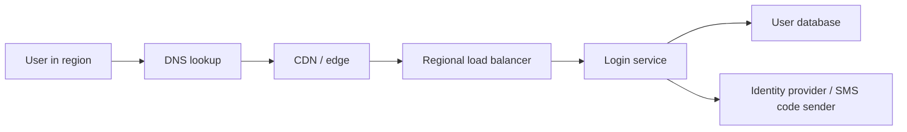
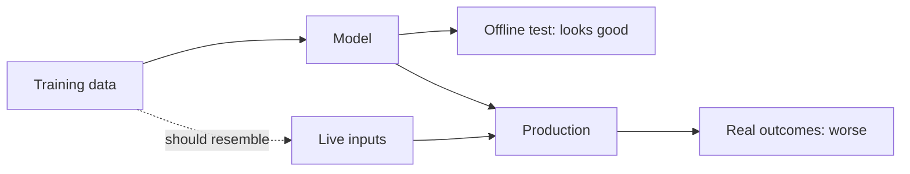

# "Users in one region cannot log in" and "the model's accuracy dropped"

> **Before this lesson:** read [Hypothesis-driven triage](#/lesson/thinking/hypothesis-triage) first. It teaches the six moves — clarify, scope, what changed, rank hypotheses, test, mitigate — that this lesson applies to two harder cases.

## In plain words

A town's water has gone off, but only on the east side. That one fact is a gift. The reservoir and the main pump must be working, because the west side has water; the fault lies in something only the east side uses — a particular pipe or valve. Engineers call this *using the difference*: when a problem hits some people and not others, the cause is hiding in whatever the two groups do **not** share.

This lesson practises that idea on two interview favourites. The first is a partial outage: users in one part of the world cannot sign in. The second is quieter and newer: a **machine-learning model** — a program that learned its behaviour from examples instead of being given explicit rules — has started giving worse answers after an update. Both reward the same habit: compare what works with what does not.

## Part 1 — Users in one region cannot log in

### The path of a login

To reason about what could break, picture what happens when someone signs in. Each step is a place a regional fault can live.



In one sentence each: **DNS** (the Domain Name System) is the internet's address book, turning a name such as `example.com` into a numeric address. The **edge** or **CDN** is a set of servers close to users that receive requests first. A **region** is a group of data centres in one geographic area; large services run copies of themselves in several. An **identity provider** is a separate service that confirms who someone is — "Sign in with Google" is one — and an **SMS sender** delivers one-time codes to phones. A **TLS certificate** is the digital identity card a website shows to browsers; when it expires, browsers refuse to connect.

### Scope: what does "one region" mean?

This is the first clarifying question, because the phrase is ambiguous in a useful way.

| Meaning | Points towards |
|---|---|
| Users *physically located* there | Network routes, DNS, CDN edge, local internet providers, government blocking |
| Users whose *accounts are stored* there | That region's database or login service |
| Users served by *our data centre* there | A deploy or configuration applied to that region only |
| Users with phone numbers from that country | The SMS provider or a telecom carrier |

Follow with: is it all users in the region or some? Only login, or everything? Web and mobile app? Since when? What do they see — an error message, an endless spinner, "wrong password"?

### Worked answer

Give yourself five minutes aloud, then compare.

<details><summary>Model answer</summary>

"I'd ask what 'region' means here — where the users are, or which of our data centres serves them — and what exactly they see. And whether it is only login.

*(Interviewer: users in Brazil; web and app; since about an hour ago; they get an error after submitting the password; users elsewhere are fine; logged-in Brazilian users can keep browsing.)*

That is very informative. Already-signed-in users can browse, so the network path from Brazil to us works and the site is up. The failure is specific to the *act of logging in*, for that region. I'll compare the working case with the failing one: what does a Brazilian login use that a German login does not?

**Did anything change an hour ago?** A regional deploy, a configuration push, a flag enabled for Brazil, a certificate renewal. If our rollouts go region by region and South America received a release an hour ago, I'd roll that region back first — it is both the likeliest cause and the fastest test.

**If nothing changed, hypotheses ranked by likelihood and cost:**

1. *The login service or its database in that region is unhealthy.* Check: error rate and latency of the login endpoint, split by region. Cheap — one dashboard.
2. *A dependency used at login is failing there* — for example, the second step sends a code by SMS and the carrier or provider serving Brazil is down. Check: delivery success by country; whether users without two-step login succeed.
3. *A regional rule is rejecting them* — a fraud or rate-limiting rule (a limit on how many attempts are allowed) triggered by a burst from Brazilian addresses, perhaps an attack. Check: the count of blocked requests by rule and country.
4. *Data for those accounts* — a failed migration of the shard holding those users. A **shard** is one slice of a database that has been split up to spread load. Check: errors by shard.
5. *Network or DNS in that region* — unlikely given that browsing works, but a login-specific hostname could be affected. Check: resolve and connect from a probe in Brazil.

The error message and one failing request's log entry would probably pick between these in a minute, so I'd look at a real failed attempt early.

**Mitigation**, depending on the finding: roll back the regional release; route Brazilian logins to a healthy region (accepting slower responses); switch to the backup SMS provider or allow an alternative second factor; loosen the mis-firing rule. I would avoid any mitigation that weakens security broadly — I would not turn off two-step verification for everyone.

**Communication.** A status-page note for affected users, an update to support staff with what to tell callers, and regular internal updates.

**Afterwards.** Why did we learn this from users? Add a **synthetic probe** — an automatic test login run every minute from each region — and alerts on login success rate per region, not only globally: a 100 % failure in one country can vanish inside a healthy global average."

</details>

> [!INTERVIEW]
> The last sentence of that answer is a favourite follow-up: *"Why didn't monitoring catch it?"* Averages over everything hide failures in small groups. The standard remedy is to **slice** — to split a measurement by region, device, version and customer type — and alert on the worst slice.

### The general technique: differential diagnosis

Draw two columns, *works* and *fails*, and list what each uses. Cross out everything in both columns. The culprit is in what remains.

| | Works (Germany) | Fails (Brazil) |
|---|---|---|
| Login code version | v42 | **v43 (rolled out an hour ago)** |
| Database | EU cluster | SA cluster |
| SMS provider | Provider A | **Provider B** |
| CDN | same | same |

Two candidates remain. That is a two-step investigation instead of a twenty-step one.

## Part 2 — The model's accuracy dropped after deploy

### The minimum of machine learning you need

A **model** learns patterns from **training data** (past examples with known answers) and then makes **predictions** on new inputs. The inputs are described by **features** — measurable properties such as "number of purchases last month". **Accuracy** is the share of predictions that are right; real systems often use other measures, but the reasoning is the same. A **label** is the correct answer for an example, which may only become known later (was the transaction truly fraud?).

What makes this different from ordinary software: the model's behaviour comes from **code + data + trained weights**, so a drop in quality can come from any of the three — or from the world changing while all three stayed the same.

### Four families of cause

| Family | What happened | Everyday comparison |
|---|---|---|
| **The measurement is wrong** | The model is fine; the way accuracy is computed changed or broke | The bathroom scale is broken, not your diet |
| **The inputs are wrong** | A feature arrives missing, in different units, or computed differently in production than in training (*training–serving skew*) | A recipe written in grams, cooked using ounces |
| **The model is wrong** | A bad training run, the wrong version deployed, a bug in preprocessing | The wrong edition of the textbook was printed |
| **The world changed** | Users or data now behave differently from the training period (*drift*) | A weather forecaster trained only on summer, now facing winter |

### Worked answer

<details><summary>Model answer</summary>

"Questions. Which metric dropped, from what to what, and where is it measured — on a fixed offline test set or on live traffic? Did it drop exactly at the deploy? What was deployed — a new model, new serving code, or both? Is the drop across the board or in particular groups?

*(Interviewer: a fraud-detection model; live precision fell from 90 % to 70 % the day a retrained model went out; the offline test before release looked good.)*

**Precision** here means: of the transactions the model flags as fraud, the share that really are. So we now have many more false alarms. Good offline, bad online, starting at the deploy — that pattern points first at a difference between the training environment and production.

**Mitigate first.** The previous model is known to be good, so I roll back to it. A rule of model deployment is that the last version must stay ready for that. If quality returns, the new model or its serving path is at fault; if not, the cause is elsewhere and the deploy was a coincidence.

**Then diagnose, cheapest and likeliest first:**

1. *Is the measurement right?* Did the metric's definition, the labels or the dashboard change the same day? Are labels for recent days still incomplete — fraud is often confirmed weeks later, which makes new periods look odd? Five minutes to check.
2. *Training–serving skew.* Take a sample of live requests, log the feature values the model received, and compare them with the same features computed by the training pipeline. Typical finds: a feature that is empty in production, a currency in cents instead of units, a category spelled differently, a time-zone shift. This is my leading hypothesis.
3. *Leakage in training.* **Data leakage** means the model was trained with information it will not have at prediction time — for instance a field filled in only after a fraud investigation. It makes offline scores look brilliant and live results poor. Check: which features became much more important in the new model, and when each is populated.
4. *Evaluation set problems.* Was the test set a random sample that overlaps in time or customers with the training set? Evaluate on a later period instead.
5. *A slice problem.* Split the metric by country, payment type, device, new versus old customers. If the entire drop sits in one slice — say a new payment method — the cause is local.
6. *Drift.* Compare the distribution of each input this week with the training period. A marketing campaign or a new market can shift the population. Drift usually appears gradually, not on a deploy day, so I rank it lower here.
7. *The threshold.* The model outputs a score, and a cut-off turns it into a decision. A retrained model's scores can be scaled differently, so the old cut-off now flags far more transactions. Quick to check and easy to overlook.

**Fix and prevent.** Whatever the cause, the release process let it through. I would add: automatic comparison of training and serving features; a **shadow** period in which the new model scores live traffic without acting, so its decisions can be compared with the old model's; a gradual rollout to a small share of traffic with a guardrail on precision; and monitoring of input distributions and of the share of transactions flagged."

</details>

### Why "it worked offline" proves little



The offline test says: *on data like the training data, the model does well.* Production asks: *on today's real inputs, computed by the serving code, does it do well?* The dotted line is an assumption. Every cause in the table above is a way that assumption fails.

### Variations

- **"Accuracy decayed slowly over six months with no deploy."** Drift. Retrain on recent data, and set up scheduled retraining and monitoring.
- **"Overall accuracy is the same but customers complain."** A slice got worse while another improved; or the errors moved to cases that matter more.
- **"We have no labels yet."** Monitor proxies: the distribution of predictions, the rate of flagged items, user overrides and complaints.
- **"The model is a large language model and answers got worse."** The same four families: evaluation method, inputs (the prompt, the retrieved documents), the model version (the provider changed it), and the world (new kinds of question). The lesson on evaluating language-model features goes deeper.

## Communication under pressure

Whether the outage is a region or a model, the people around you need the same three things.

1. **Early acknowledgement.** "We are aware and investigating" within minutes.
2. **Honest scope.** Who is affected and who is not. "Logins from Brazil are failing; other regions and already signed-in users are unaffected."
3. **A next update time**, kept even if there is nothing new.

Adapt the wording to the audience: customers want impact and what to do; support staff want a script; managers want risk and time estimates; engineers want evidence and the current hypothesis. When you hand over to a colleague, do it explicitly — say what you know, what you have tried, and that they now own it, and wait for them to confirm.

## Summary

- When a problem affects only some users, list what the working and failing groups use and cancel what is common; the cause is in the difference.
- Clarify what "region" means; facts such as "signed-in users are fine" eliminate whole layers.
- Global averages hide local failures; slice metrics and probe from each region.
- For a model, sort causes into measurement, inputs, model and world. "Good offline, bad online at deploy" points to training–serving skew, leakage or a threshold.
- Roll back to the last good version first; add shadow runs, gradual rollouts and input monitoring afterwards.
- Communicate early, state scope honestly, promise and keep update times.

## Glossary

| Term | Meaning |
|---|---|
| Region | A group of data centres in one geographic area running a copy of a service |
| DNS | The system that turns a site name into a numeric network address |
| TLS certificate | A site's digital identity document, with an expiry date |
| Identity provider | A service that verifies who a user is on behalf of other sites |
| Shard | One piece of a database that has been split to spread load |
| Synthetic probe | An automatic test that imitates a user at regular intervals |
| Slice | A measurement restricted to one group, such as one country |
| Model | A program whose behaviour was learned from examples |
| Feature | A measurable input property given to a model |
| Label | The correct answer for an example |
| Precision | Of the items a model flags, the share that are truly positive |
| Training–serving skew | A difference between how inputs are prepared in training and in production |
| Data leakage | Training on information that will not be available when predicting |
| Drift | A change over time in the data a model receives or in what the right answers are |
| Shadow mode | Running a new version on live inputs without using its output |

## Check yourself

```quiz
[
  {"q": "Users in one country cannot log in, but those already signed in can browse normally. What does that rule out first?",
   "options": ["A problem in the login step", "A general network failure between that country and the site", "A failing SMS provider", "A regional release of the login service"],
   "answer": 1,
   "explain": "Browsing works, so requests from that country reach the site; the fault is specific to logging in."},
  {"q": "What is the idea behind differential diagnosis?",
   "options": ["Check everything alphabetically", "List what the working and failing cases use, cancel what they share, and examine the differences", "Restart each server in turn", "Ask users to try again later"],
   "answer": 1,
   "explain": "Anything common to both groups cannot explain why only one fails."},
  {"q": "Login is completely broken in one small country, yet the global success-rate alert stays silent. Why?",
   "options": ["Alerts never work", "The country is a small share of traffic, so the global average barely moves", "Logins are not measured", "The country has no internet"],
   "answer": 1,
   "explain": "Aggregates hide failures in small groups; alert on per-region slices and synthetic probes."},
  {"q": "A model scores well in offline tests and badly in production from the day it is deployed. Which cause fits best?",
   "options": ["Gradual drift over months", "Training–serving skew or leakage", "Users lost interest", "The servers are too fast"],
   "answer": 1,
   "explain": "An immediate gap between offline and online points to inputs or information differing between training and serving."},
  {"q": "What is data leakage in model training?",
   "options": ["Customer data posted publicly", "Training with information that will not exist at prediction time, which inflates offline scores", "Losing rows during a copy", "Memory running out"],
   "answer": 1,
   "explain": "A feature filled in after the outcome is known makes the model look better than it can be in real use."},
  {"q": "What should be done first when a newly deployed model performs badly and the previous one was fine?",
   "options": ["Retrain for a week", "Roll back to the previous model, then investigate", "Delete the monitoring", "Raise the threshold at random"],
   "answer": 1,
   "explain": "Restore the known good state, which also tests whether the new model is the cause."},
  {"q": "Which update best serves customers during a regional login outage?",
   "options": ["A detailed explanation of database shards", "'Sign-in is failing for users in Brazil; other regions are unaffected; we are working on it; next update at 15:30.'", "Nothing until fixed", "'There may or may not be an issue.'"],
   "answer": 1,
   "explain": "It states the scope honestly, in user terms, and commits to a time for the next update."}
]
```

> **Source:** Google SRE Book, "Effective Troubleshooting" (https://sre.google/sre-book/effective-troubleshooting/), "Monitoring Distributed Systems" (https://sre.google/sre-book/monitoring-distributed-systems/) and "Managing Incidents" (https://sre.google/sre-book/managing-incidents/); Martin Zinkevich, "Rules of Machine Learning" — training–serving skew, silent failures and monitoring (https://developers.google.com/machine-learning/guides/rules-of-ml). Examples and wording are original.
