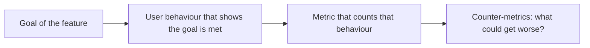

# Metrics, experiments and "a number moved — why?"

> **Before this lesson:** basic percentages are enough. The slicing idea from [Users in one region cannot log in](#/lesson/thinking/region-login-model-accuracy) is used again here.

## In plain words

A café owner changes the menu board and wants to know whether it helped. "Sales felt busier this week" is not evidence — it was also sunny, and a school nearby had a holiday. To know, the owner needs three things: a **number that stands for success** (say, average spend per customer), a **fair comparison** (some customers see the new board and similar customers see the old one, during the same days), and a way to tell a **real difference from luck**.

Those three things are what this lesson is about. A **metric** is a number you track to tell how something is doing. An **experiment**, often called an **A/B test**, shows two versions to two randomly chosen groups at the same time and compares the metric. Engineers are asked about both because modern teams decide what to build and whether to keep it by looking at data — and an engineer who cannot say how a feature's success would be measured cannot tell whether their own work mattered.

Three question types appear: *"how would you measure success for X?"*, *"design an experiment for X"*, and *"this metric dropped 10 % — why?"*

## Part 1 — Defining success metrics

### From goal to number

Never start with a number. Start with the goal, then ask what users would *do* differently if the goal were met, then find a number that counts that.



**Example.** A music app adds "download for offline listening".

- *Goal:* let people listen where there is no connection, so that they use the app more and stay subscribed.
- *Behaviour:* they download songs, and they play them while offline.
- *Metrics:* share of users who download at least once; minutes of offline listening per user per week; and, further out, whether these users cancel less.

### Three kinds of metric

| Kind | Purpose | Example for offline downloads |
|---|---|---|
| **Primary (success) metric** | The one number the feature is meant to move | Weekly listening minutes per user |
| **Supporting metrics** | Show *how* it is working, step by step | % of users who download; downloads per user; offline plays |
| **Guardrail (counter) metrics** | Things that must **not** get worse | App crashes, storage complaints, battery use, cancellations, support tickets |

Guardrails are what distinguish a careful answer. Almost any metric can be improved by damaging something else: more notifications raise visits and also uninstalls; a stricter fraud filter cuts fraud and also blocks honest customers. Naming what could be harmed shows judgment.

### What makes a metric good

- **Tied to the goal.** If it goes up, is the user or the business truly better off?
- **Sensitive.** It can move within the period you will watch. "Yearly renewals" is important and far too slow for a two-week test, so you also choose a faster stand-in.
- **Attributable.** You can connect a change in it to your feature.
- **Hard to game.** "Number of messages sent" can be raised by making people send two messages where one would do.
- **A rate where possible.** "Purchases per visitor" survives a busy week; "total purchases" does not.

A number that looks impressive and tells you nothing about success — total sign-ups ever, page views — is called a **vanity metric**.

### The funnel

Many products are a sequence of steps, each losing some people: see the product → add to basket → start checkout → pay. This narrowing sequence is a **funnel**, and the share that passes each step is a **conversion rate**. A funnel shows *where* a feature helped or where users give up, which a single end number cannot.

<details><summary>Worked question — "How would you measure the success of a new 'save for later' button on a shopping site?"</summary>

**Clarify the goal.** Why was it built? Suppose: shoppers abandon baskets because they are not ready to buy; saving items should bring them back to buy later.

**Behaviour we hope for.** People save items; they return; they buy saved items.

**Primary metric.** Purchases per visitor over a period long enough to include the return visit — say 30 days — because the benefit is delayed.

**Supporting metrics (the funnel of the feature).** Share of visitors who use the button; items saved per user; share of saved items later viewed; share later bought; time from save to purchase.

**Guardrails.** Immediate purchases — the main danger is that people who would have bought *now* save instead and never return, so short-term revenue per visitor must not fall beyond a set limit. Also page speed, and returns or cancellations.

**A faster stand-in.** Thirty days is slow for decisions, so I would watch return visits within seven days as an early signal, having checked from past data that it predicts purchases.

**How I would judge.** An A/B test: half of visitors get the button. Success is higher 30-day purchases per visitor with no meaningful loss in immediate revenue.

**Ways I could be fooled.** Enthusiastic early adopters are not typical; a novelty effect can fade; and "items saved" going up proves only that the button is visible.

</details>

## Part 2 — Designing an A/B test

### Why random groups

If you launch a feature on Monday and sales rise, was it the feature, payday, the weather or an advertisement? You cannot know. If instead you **randomly** put each user into one of two groups — **control** (the old version, "A") and **treatment** (the new version, "B") — then everything else affects both groups equally, and the difference between them is caused by the feature. Randomisation is the entire trick.

### The design checklist

| # | Decide | Notes |
|---|---|---|
| 1 | **Hypothesis** | "Showing delivery dates on the product page will raise purchases per visitor." Written before looking at data |
| 2 | **Unit of randomisation** | Usually the user, so one person always sees the same version |
| 3 | **Primary metric and guardrails** | One primary. Many primaries invite cherry-picking |
| 4 | **Smallest effect worth detecting** | A lift too small to matter is not worth a long test |
| 5 | **Sample size and duration** | Enough users to see that effect; at least one or two full weeks to cover weekday patterns |
| 6 | **Split** | Often 50/50; a small share first if the change is risky |
| 7 | **Decision rule** | What result leads to shipping, what to stopping — agreed in advance |
| 8 | **Checks** | Are the groups the expected sizes? Did both get the right version? |

### Reading the result: was it luck?

Even if a change does nothing, two random groups will not have identical numbers. So the question is whether the gap is larger than chance alone would usually produce.

The usual language: the **null hypothesis** is the assumption that the change has no effect. The **p-value** is the probability of seeing a gap at least this large *if the null hypothesis were true*. A small p-value — by convention below 0.05 — means such a gap would be rare by luck, and the result is called **statistically significant**. A **confidence interval** is the range in which the true effect plausibly lies; it is more informative than a yes-or-no verdict.

Here is the standard calculation for comparing two conversion rates, written out so that each step can be seen.

```python-run
import math

def ab_test(visitors_a, conversions_a, visitors_b, conversions_b):
    pa = conversions_a / visitors_a                 # conversion rate of control
    pb = conversions_b / visitors_b                 # conversion rate of treatment
    pooled = (conversions_a + conversions_b) / (visitors_a + visitors_b)
    se = math.sqrt(pooled * (1 - pooled) * (1 / visitors_a + 1 / visitors_b))
    z = (pb - pa) / se                              # gap measured in "standard errors"
    p_value = math.erfc(abs(z) / math.sqrt(2))      # two-sided
    return pa, pb, z, p_value

for args in [(10_000, 500, 10_000, 580), (1_000, 50, 1_000, 58), (100_000, 5_000, 100_000, 5_250)]:
    pa, pb, z, p = ab_test(*args)
    print(f"{args}: A={pa:.2%} B={pb:.2%} z={z:.2f} p={p:.3f} -> {'significant' if p < 0.05 else 'not significant'}")
```

What the lines do: `pa` and `pb` are the two rates. `pooled` is the rate if both groups are combined, used to estimate how much random wobble to expect. `se`, the **standard error**, is the typical size of a gap produced by chance alone. `z` says how many of those typical gaps the observed gap is worth; beyond about 2, luck becomes an unlikely explanation. `p_value` turns `z` into a probability.

Look at the output. The first two cases have the same rates — 5.0 % against 5.8 % — and only the first is significant, because it has ten times the visitors. The third has a small lift (5.00 % to 5.25 %) that is significant with 100,000 visitors per group. Two lessons: **sample size decides what you can see**, and **significant is not the same as important** — whether a 0.25-point lift is worth the feature's cost is a business judgment.

### Traps to name

- **Peeking.** Checking every day and stopping the moment p dips below 0.05 hugely inflates false positives. Fix the duration in advance, or use a method built for continuous monitoring.
- **Too many metrics.** Test twenty metrics and one will look significant by chance. Keep one primary metric.
- **Novelty effect.** People click a new thing because it is new. Run long enough for the curiosity to fade.
- **Sample-ratio mismatch.** A planned 50/50 split that turns out 52/48 signals a bug in assignment or logging; the result cannot be trusted until it is explained.
- **Interference.** If users affect each other — a marketplace, a social network — treating half of them changes the experience of the other half. Randomise by region or cluster instead.
- **Simpson's paradox.** A result can reverse when groups are combined, if the mix of segments differs between the arms.
- **A win on the primary, a loss on a guardrail.** Not a win.

<details><summary>Worked question — "Design an experiment for a redesigned checkout page"</summary>

**Hypothesis.** The single-page checkout raises the share of started checkouts that end in payment.

**Unit.** User, assigned by a stable hash of the user identifier so the same person always sees the same version, on any device where they are signed in.

**Primary metric.** Checkout conversion: completed payments ÷ users who started checkout.

**Guardrails.** Revenue per visitor (conversion could rise while basket size falls), payment error rate, page load time, refund rate, support contacts.

**Size and duration.** Baseline conversion is, say, 60 %; the smallest lift worth shipping is one percentage point. That needs tens of thousands of users per group — I would compute the exact figure — and I would run two full weeks to cover two weekends, even if the count is reached sooner.

**Rollout.** Checkout handles money, so start at 5 % for a day watching errors only; then 50/50.

**Decision rule, written beforehand.** Ship if the primary metric improves significantly and no guardrail is significantly worse. If the result is flat, ship only if the new page has other benefits, such as being easier to maintain. If negative, stop and examine the segments.

**Checks.** Group sizes match the planned split; both versions log events identically (a redesign often changes the logging, which fakes a difference); results by device and by new versus returning customers.

**Afterwards.** Keep a small **holdback** — a few percent of users left on the old page for a month — to confirm that the gain lasts.

</details>

> [!INTERVIEW]
> When asked to design an experiment, the answer that impresses is rarely the statistics. It is saying, before any data exists, **what result would make you ship, what would make you stop, and which metric must not get worse**.

## Part 3 — "A metric moved. Why?"

**Prompt:** *"Daily active users fell 10 % compared with last week. What do you do?"* This is debugging, applied to a number. Use a fixed order.

**1. Is it real?** Before explaining a drop, check that it happened. Did tracking break? Did a definition change? Is the data pipeline late? Does an independent source — server logs, payments — agree? A surprising share of "metric drops" are measurement faults.

**2. What is the shape and timing?** Sudden or gradual; one day or sustained. Compare with the same weekday last week and the same week last year.

**3. Is it expected?** A public holiday, the end of a promotion, school term, a seasonal pattern, or last week being unusually *high*.

**4. Slice it.** Split by platform, app version, country, new versus returning users, acquisition channel, and step of the funnel. A drop concentrated in one slice localises the cause; a drop spread evenly suggests something global or external.

**5. Internal changes.** Releases, experiments switched on, pricing, marketing spend, notification schedules.

**6. External changes.** A competitor, an app-store or search-ranking change, an outage at a partner, news.

A small numerical example shows why slicing matters.

```python-run
last_week = {"iOS": 400_000, "Android": 500_000, "Web": 100_000}
this_week = {"iOS": 398_000, "Android": 404_000, "Web": 98_000}

total_change = sum(this_week.values()) - sum(last_week.values())
print(f"total: {sum(last_week.values()):,} -> {sum(this_week.values()):,} ({total_change / sum(last_week.values()):+.1%})")
for k in last_week:
    change = this_week[k] - last_week[k]
    print(f"{k:8s} {change:+9,}  own change {change / last_week[k]:+6.1%}  share of total drop {change / total_change:5.1%}")
```

The total fell 10 %. iOS and Web each lost at most 2 % of their own users; Android lost 19 % and accounts for 96 % of the whole drop. The question has changed from "why are users leaving?" to "what happened on Android?" — probably a bad release or a store problem. The problem *Attribute a Metric Drop by Segment* asks you to code this.

<details><summary>Worked question — "Sign-ups dropped 20 % yesterday"</summary>

"First, is it real — do the database rows of new accounts show the same fall as the dashboard? Assume yes.

Sudden, one day, 20 %. I'd check the calendar (holiday?) and compare with the same weekday in earlier weeks.

Then the funnel: visits to the sign-up page → form started → form submitted → email confirmed. If visits fell, the cause is upstream — marketing, search ranking, a broken link from the home page. If visits held and submissions fell, the cause is the form — a release, a validation bug, a third-party verification step failing. If submissions held and confirmations fell, the cause is email delivery.

Then slices: by device, browser, country and traffic source. If it is all in one browser, a front-end bug; in one country, an SMS or payment provider; in one traffic source, a paused advertising campaign.

Then changes: what was released or switched on yesterday.

Suppose the funnel shows visits normal and form submissions down 60 % on mobile Safari only, starting at 15:00 — the time of a front-end release. Mitigation: roll that release back. Then confirm sign-ups recover, estimate how many were lost, and add an alert on sign-up conversion by browser.

If nothing internal explains it, I'd look outward: a search-engine change or a competitor's promotion."

</details>

## Summary

- Derive metrics from the goal and the behaviour that shows it; choose one primary metric, supporting funnel metrics, and guardrails for what must not get worse.
- Good metrics are tied to the goal, sensitive, attributable, hard to game, and usually rates.
- An A/B test uses random groups so that the only systematic difference is the change. Decide the hypothesis, unit, metric, sample, duration and decision rule in advance.
- A p-value says how surprising the gap would be if the change did nothing; sample size determines what is detectable; significant does not mean important.
- Beware peeking, many metrics, novelty, sample-ratio mismatch and interference.
- For a moved metric: is it real, what shape, is it expected, slice it, internal changes, external changes.

## Glossary

| Term | Meaning |
|---|---|
| Metric | A number tracked to show how something is doing |
| Primary metric | The one number a change is intended to improve |
| Guardrail metric | A number that must not get worse while improving the primary one |
| Vanity metric | An impressive-looking number that does not reflect success |
| Funnel | A sequence of steps in which some users drop out at each |
| Conversion rate | The share of people who complete a step or goal |
| A/B test | An experiment comparing two versions shown to random groups |
| Control / treatment | The group with the old version / the group with the new one |
| Null hypothesis | The assumption that the change has no effect |
| p-value | The chance of a gap at least this large if the null hypothesis holds |
| Statistically significant | Unlikely to be explained by chance alone, by a chosen threshold |
| Confidence interval | The range in which the true effect plausibly lies |
| Novelty effect | A temporary change in behaviour because something is new |
| Holdback | A small group kept on the old version to measure long-term effect |

## Check yourself

```quiz
[
  {"q": "A team adds more notifications; daily visits rise. Which is the most important guardrail to check?",
   "options": ["The number of notifications sent", "Uninstalls and notification opt-outs", "The colour of the icon", "Total sign-ups ever"],
   "answer": 1,
   "explain": "The change could raise visits while driving users away; guardrails catch harm caused by improving the primary metric."},
  {"q": "Why are users assigned to A and B at random?",
   "options": ["It is cheaper", "So that everything except the change affects both groups equally", "To hide the feature", "Random numbers are required by law"],
   "answer": 1,
   "explain": "Randomisation balances outside influences, so a difference between groups can be attributed to the change."},
  {"q": "Two tests both show 5.0% versus 5.6% conversion. One has 1,000 users per group, the other 10,000. Which statement is true?",
   "options": ["Both are equally convincing", "The larger test gives stronger evidence that the difference is real", "The smaller test is better", "Neither can be analysed"],
   "answer": 1,
   "explain": "More data shrinks the random wobble, so the same gap is less likely to be luck."},
  {"q": "What does a p-value of 0.03 mean?",
   "options": ["There is a 97% chance the feature works", "If the change had no effect, a gap at least this large would occur about 3% of the time", "The effect is 3%", "3% of users disliked it"],
   "answer": 1,
   "explain": "It measures how surprising the data would be under 'no effect', not the probability that the feature is good."},
  {"q": "A team checks results daily and stops the test the first time p falls below 0.05. What is wrong?",
   "options": ["Nothing", "Peeking: repeated looks greatly increase the chance of a false positive", "The test ran too long", "They used too many users"],
   "answer": 1,
   "explain": "Each look is another chance for noise to cross the threshold; fix the duration or use a sequential method."},
  {"q": "Daily active users drop 10%. What is the first thing to establish?",
   "options": ["Which engineer to blame", "Whether the drop is real or a measurement problem", "A new marketing plan", "A redesign of the home page"],
   "answer": 1,
   "explain": "Broken tracking or a late pipeline often produce apparent drops; confirm with an independent source first."},
  {"q": "The whole of a metric's drop sits in one app version on one platform. What does that suggest?",
   "options": ["A seasonal effect", "A problem specific to that release", "A global economic change", "Nothing useful"],
   "answer": 1,
   "explain": "A drop concentrated in one slice points to a cause local to that slice, such as a faulty release."}
]
```

> **Source:** Ron Kohavi, Diane Tang and Ya Xu's public summaries on trustworthy online experiments (https://experimentguide.com/) and Microsoft's Experimentation Platform articles on sample-ratio mismatch and guardrail metrics (https://www.microsoft.com/en-us/research/group/experimentation-platform-exp/); DORA guidance on choosing measures (https://dora.dev/guides/dora-metrics-four-keys/). Examples, code and wording are original.
