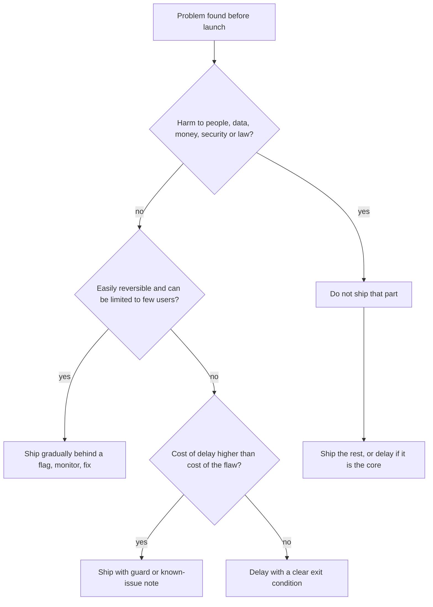

# "Should we ship it?" and product-sense questions for engineers

> **Before this lesson:** read [Metrics, experiments and "a number moved — why?"](#/lesson/thinking/metrics-experiments) for the vocabulary of metrics and guardrails, and [Exploratory testing, risk and non-functional categories](#/lesson/thinking/exploratory-risk-nonfunctional) for likelihood × impact.

## In plain words

You have baked a cake for a friend's birthday and one corner is slightly burnt. Do you bring it? You weigh a few things almost without noticing: how bad is the flaw, will anyone mind, is there time to bake another, and what happens if you turn up with nothing. You might cut the corner off and bring it. That small decision has the full shape of a **ship decision**: something is ready but imperfect, waiting has a cost, releasing has a risk, and there are usually options in between "yes" and "no".

"To **ship**" means to release something to real users. Interviewers ask *"it's the day before launch and you find a bug — do you ship?"* and broader **product-sense** questions — *"how would you improve this feature?"*, *"what would you build first?"* — to find out whether you think about users and consequences, or only about code. In a job, engineers make these calls weekly, often without a manager in the room.

## Part 1 — The ship decision

### The four things to weigh

Every go/no-go reduces to four questions.

| Question | What to find out |
|---|---|
| **How bad is the problem?** | Who is affected, how often, how severely, and is there a workaround? |
| **Can it be undone?** | If we are wrong, how fast can we reverse it, and is any damage permanent? |
| **What does waiting cost?** | A contract date, a marketing launch, a competitor, a team blocked, or nothing much |
| **What are the options between yes and no?** | Ship part of it, ship to few users, ship switched off, ship with a warning |

The second question deserves the most attention. Decisions come in two kinds. A **reversible** decision is a door you can walk back through: a web feature behind a switch can be turned off in a minute. An **irreversible** one is a door that locks behind you: deleting data, sending an email to a million people, charging cards, releasing a mobile app version that users must choose to update, shipping a physical device. Reversible decisions can be made quickly with partial information; irreversible ones deserve slowness and evidence.

### A severity scale you can say aloud

| Level | Meaning | Example | Usual decision |
|---|---|---|---|
| **Blocker** | Harm to people, data loss, money wrong, security hole, legal breach, core function broken for many | Orders charged twice | Do not ship |
| **Major** | Important function broken for some, no good workaround | Search fails for names with accents | Fix first, or ship without that part |
| **Minor** | Works, with friction; a workaround exists | Sort order resets after refresh | Ship, fix soon |
| **Cosmetic** | Looks wrong, works right | A misaligned icon | Ship |

Multiply by **reach**: a major bug that touches one user in ten thousand may rank below a minor one that annoys everybody.

### The options in between

"Ship or don't" is almost always a false choice. Know the menu:

- **Ship behind a feature flag, switched off**, and turn it on when fixed. The release train is not delayed.
- **Ship to a small percentage** or to internal staff first, and watch.
- **Ship without the broken part** — remove or hide the one feature.
- **Ship with a guard** — block the dangerous case with a clear message ("exports over 10,000 rows are temporarily unavailable").
- **Ship with a known-issue note** and a committed fix date, when the affected users can be told directly.
- **Delay briefly** with a precise plan: what must be true to ship, who is doing it, and by when.

### A decision flow



### Who decides

An engineer rarely owns the decision alone, and saying so is part of a good answer. Your job is to make the trade-off visible: describe the flaw precisely, give the options with their risks, recommend one, and take it to whoever owns the outcome — usually the product owner or manager. Deciding silently in either direction (quietly shipping a known bug, or quietly blocking a launch) is the wrong move.

<details><summary>Worked question 1 — "It is 5 p.m. the day before a launch that marketing has announced. You find a bug: the new invoice page shows the wrong tax for customers in one small country."</summary>

"Let me size it before deciding. Wrong tax *displayed* only, or wrong tax *charged*? How many customers are in that country? Can the page be released without them? Is the invoice a legal document there?

*(Interviewer: displayed and charged; about 0.5 % of customers; yes, invoices are legal documents.)*

Then this is a blocker for that segment: money is wrong and there is legal exposure. Reach is small but severity is the highest kind, and it is not cleanly reversible — once a wrong invoice has been issued and paid we would need refunds and corrected documents.

But it does not have to block the launch. Options:

1. **Launch for everyone except that country**, which stays on the old invoice page behind a flag. Marketing's date holds for 99.5 % of customers.
2. Fix tonight and launch for all. I would resist that: a tax calculation changed in a hurry, on the evening before launch, with nobody fresh to review it, is how a small bug becomes a large one.
3. Delay the whole launch. This costs the most and protects no additional customers compared with option 1.

I recommend option 1. I'd confirm the flag can separate by country and that the old page still works there; add a test for that country's tax rule; fix properly tomorrow with review; and enable the country in a few days.

I'd bring this to the product owner within the hour, with the three options and my recommendation, and tell support so they can answer questions from that country.

Afterwards I'd ask why we found this the day before: tax rules per country evidently lacked test coverage, so I would add a table-driven test over every supported country."

</details>

<details><summary>Worked question 2 — "An A/B test of a new recommendation widget shows +2 % revenue per visitor, and page load time is 300 ms slower. Ship?"</summary>

"Not yet, and not 'no' either. First I'd check the result is trustworthy: was the test long enough, are the group sizes as planned, is +2 % statistically significant and what is its confidence interval? If the interval is −0.5 % to +4.5 %, the win is uncertain.

Second, the latency. 300 ms is a guardrail breach in most teams, and slower pages tend to cost engagement over time in ways a two-week test may not show. It may also be worse on slow phones — I'd look at the slow end of the latency distribution and at mobile users separately.

Third, are the two linked? Often the slowdown is an implementation detail: the widget loads before the rest of the page. If it can load after the main content, or its data can be cached, we may keep the +2 % and lose most of the 300 ms.

So my recommendation: do not ship as it stands; spend a few days on making the widget load lazily; rerun with latency as an explicit guardrail. If the gain holds and the slowdown is under, say, 50 ms, ship. If the slowdown cannot be removed, it becomes a real trade-off for the product owner — and I would supply the long-term evidence on latency to inform it, and suggest a holdback group to measure the lasting effect."

</details>

<details><summary>Worked question 3 — "Tests pass, but you have a bad feeling about a change to the payment retry logic. It is Friday afternoon. Ship?"</summary>

"A feeling is information; I would turn it into something checkable. What exactly worries me — a case not tested, an interaction with another service, behaviour under failure? If I can name it, I can write the test or ask a colleague to review that part.

On timing: this is payment logic, mistakes mean double charges, and those are not reversible by a rollback — the money has moved. On Friday afternoon fewer people are around to notice and respond for two days. There is no stated deadline. So the cost of waiting until Monday is close to zero and the cost of being wrong is high and partly irreversible. I would wait.

If there *were* a deadline, I would ship in the safest shape: behind a flag, enabled for a tiny percentage, with an alert on duplicate charges and someone explicitly on watch.

More generally, 'no risky deploys on Friday' is a symptom. A team with strong automated checks, gradual rollouts and fast rollback can deploy on any day. The aim is to make changes safe, not to pick lucky days — but until that safety exists, caution is rational."

</details>

> [!INTERVIEW]
> The pattern that wins ship questions: **size the problem, ask about reversibility, list options between yes and no, recommend one, and say who you would take it to.** A flat "never ship with bugs" sounds principled and is not how any real product is released; a flat "ship it, we can fix later" ignores harm.

## Part 2 — Product sense for engineers

Product-sense questions come in a few forms: *"How would you improve X?"*, *"What would you build for these users?"*, *"Which of these features first?"*, *"Tell me about a product you like and what you would change."* Engineers are not expected to answer like a product manager, but they are expected to start from users and to connect ideas to cost.

### A five-step shape

1. **Goal.** What is this product or feature for, and what does the company want from it?
2. **Users.** Who are the main groups? Pick one to focus on, and say why.
3. **Problems.** What gets in that group's way? List several; choose the most painful or most frequent.
4. **Solutions.** Offer two or three, from small to ambitious. For each: what it costs to build, what could go wrong.
5. **Choose and measure.** Pick one, say why, and name the metric and guardrail that would tell you it worked.

The engineer's advantage is step 4. You can say which idea is a week of work and which is a quarter, which needs data that does not exist, and which carries risk — something a pure product answer cannot.

### Impact against effort

A quick way to compare ideas is to place each on two scales.

| | Low effort | High effort |
|---|---|---|
| **High impact** | Do first | Plan carefully; split into stages |
| **Low impact** | Do when convenient | Avoid |

Add **confidence** — how sure are we of the impact? — and you have the reasoning behind most prioritisation scores. A cheap test that raises confidence (a prototype, five user interviews, a fake door that measures clicks on a feature not yet built) is often the best first step.

<details><summary>Worked question 4 — "How would you improve the search on a recipe website?"</summary>

"**Goal.** People come to find something to cook; the site earns from visits and subscriptions. So good search means people find a recipe they then cook, and come back.

**Users.** Roughly three groups: someone who knows the dish they want ('lasagne'); someone with ingredients to use up ('chicken, leeks'); someone browsing for ideas ('quick vegetarian dinner'). I'll focus on the second, because ordinary keyword search serves it worst and it is a frequent, practical need.

**Problems for that group.** Results include recipes needing ten other ingredients they lack. They cannot say what to exclude. Synonyms fail — 'courgette' against 'zucchini'. Results ignore time available.

**Solutions.**

1. *Small:* synonym handling and tolerance of spelling mistakes. A week or two; low risk; helps every group.
2. *Medium:* a 'what I have' mode — enter ingredients, rank recipes by how few *extra* ingredients they need, with filters for time and diet. A few weeks; needs recipe ingredients as clean structured data, which is the hidden cost — if ingredients are free text I must first parse them.
3. *Ambitious:* a saved pantry and personalised suggestions. Months; requires accounts and a new habit from users; uncertain.

**Choice.** Start with 1, because it is cheap and certain. Then build 2, but first check the data quality, since that decides whether it takes three weeks or three months.

**Measure.** Primary: share of searches that lead to a recipe being opened and kept open for a while, or saved — a stand-in for 'found something to cook'. Supporting: searches with zero results; repeated searches in one session, which signal failure. Guardrails: search speed, and overall visits per user.

**Risk.** Ranking by 'fewest missing ingredients' may surface dull recipes; I would test it against the current ranking."

</details>

### Questions about your own taste

*"Tell me about a product you like"* is easier with a prepared shape: what it is for, who it serves, one thing it does unusually well **and why that works**, one thing you would change, and how you would know the change helped. Choose something you truly use; prepared enthusiasm is easy to spot.

### Common mistakes in product answers

- **Jumping to a solution** before naming a user or a problem.
- **Designing for yourself.** You are probably not the typical user.
- **Feature lists** with no reason to prefer one.
- **Ignoring cost.** Engineers who propose a "simple" feature that needs a year of data work lose credibility.
- **No measure of success.**
- **No downside.** Every feature costs something: complexity, maintenance, a slower page, a confused existing user.

## Summary

- A ship decision weighs severity × reach, reversibility, the cost of waiting, and the options between yes and no.
- Irreversible effects — money, data, messages, app-store releases, hardware — deserve caution; reversible changes can go out gradually.
- Use the menu: flag off, small percentage, remove the part, guard the case, known-issue note, short delay with an exit condition.
- Make the trade-off visible and take a recommendation to the owner; do not decide silently.
- Product answers follow goal → users → problems → solutions → choice and measure, and the engineer adds cost and risk.

## Glossary

| Term | Meaning |
|---|---|
| Ship | Release something to real users |
| Go/no-go | The decision to release or hold |
| Reversible decision | One that can be undone quickly and cheaply |
| Irreversible decision | One whose effects cannot be taken back |
| Severity | How bad a problem is for an affected user |
| Reach | How many users a problem or feature touches |
| Workaround | Another way for a user to get the job done despite a flaw |
| Known issue | A documented flaw that users are told about |
| Product sense | Judgment about what is worth building for users |
| Impact / effort | The benefit of a change set against the work it needs |
| Fake door | A test that measures interest in a feature before building it |
| Stakeholder | Someone affected by or responsible for a decision |

## Check yourself

```quiz
[
  {"q": "Which fact should weigh most heavily against shipping a risky change quickly?",
   "options": ["It is Tuesday", "Its effects cannot be undone if it goes wrong", "The code has comments", "The team is small"],
   "answer": 1,
   "explain": "Irreversible effects such as charges or deleted data cannot be fixed by rolling back, so they call for more evidence."},
  {"q": "A bug affects 0.5% of customers but charges them the wrong tax. How should it be classed?",
   "options": ["Cosmetic, because few are affected", "A blocker for that segment, because money and legal documents are wrong", "Minor", "Not a bug"],
   "answer": 1,
   "explain": "Small reach does not lower the severity of incorrect charges; the fix is to exclude that segment, not to ignore it."},
  {"q": "Which is an option between 'ship' and 'do not ship'?",
   "options": ["Release behind a flag to 1% of users and monitor", "Cancel the project", "Hide the bug report", "Skip the tests"],
   "answer": 0,
   "explain": "Gradual, switchable release limits exposure while still moving forward."},
  {"q": "An experiment shows more revenue and a slower page. What is the best next step?",
   "options": ["Ship immediately", "Reject permanently", "Check the result's reliability and see whether the slowdown can be removed while keeping the gain", "Ignore the latency"],
   "answer": 2,
   "explain": "A guardrail breach is not a clean win; often the cost is an implementation detail that can be fixed."},
  {"q": "You find a serious flaw the evening before a launch. What should you do with the decision?",
   "options": ["Quietly ship and hope", "Quietly block the launch", "Describe the flaw, lay out options with risks, recommend one, and take it to the decision owner", "Wait until asked"],
   "answer": 2,
   "explain": "The engineer's duty is to make the trade-off visible and recommend; the outcome's owner decides."},
  {"q": "In a product-improvement answer, what should come before proposing features?",
   "options": ["The technology stack", "The goal, the user group and the problem being solved", "The colour scheme", "The launch date"],
   "answer": 1,
   "explain": "Solutions only make sense relative to a user and a problem."},
  {"q": "What does an engineer add to a product discussion that others often cannot?",
   "options": ["Opinions about fonts", "A realistic view of the cost, hidden dependencies and risk of each idea", "Sales forecasts", "Legal advice"],
   "answer": 1,
   "explain": "Knowing which idea takes a week and which needs months of data work changes which idea is best."}
]
```

> **Source:** Feature-flag and gradual-release options follow Pete Hodgson, "Feature Toggles" (https://martinfowler.com/articles/feature-toggles.html) and Martin Fowler, "Canary Release" (https://martinfowler.com/bliki/CanaryRelease.html); the framing of risk tolerance and release decisions draws on the Google SRE Book, "Embracing Risk" (https://sre.google/sre-book/embracing-risk/). Scenarios and wording are original.
