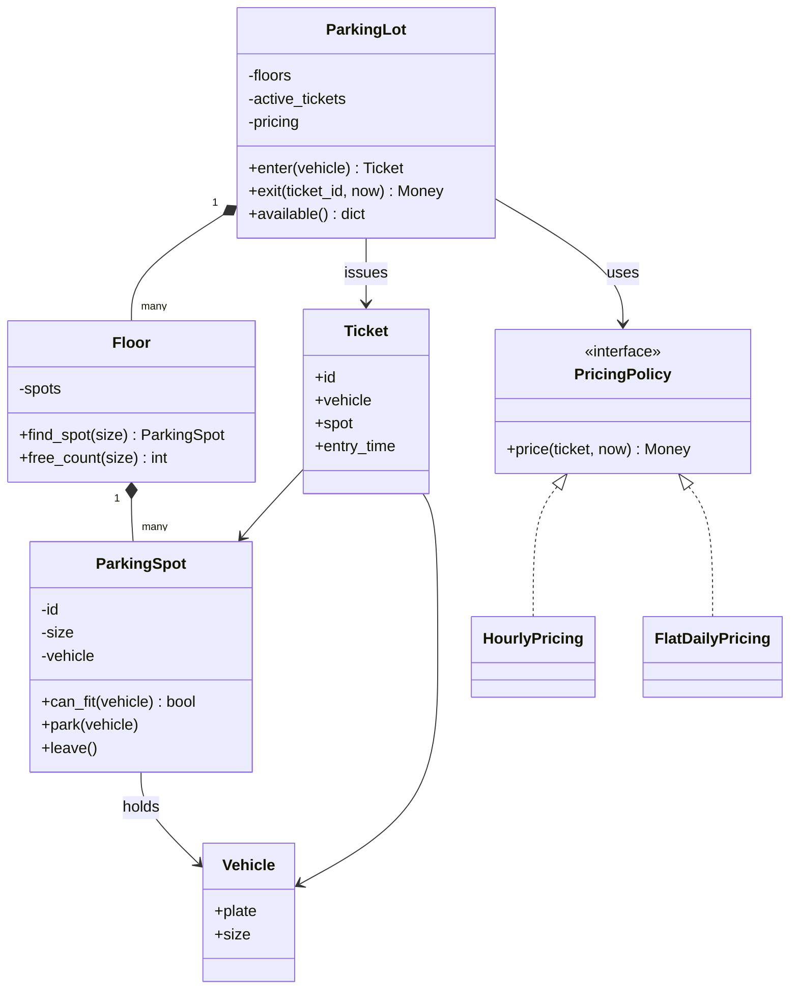
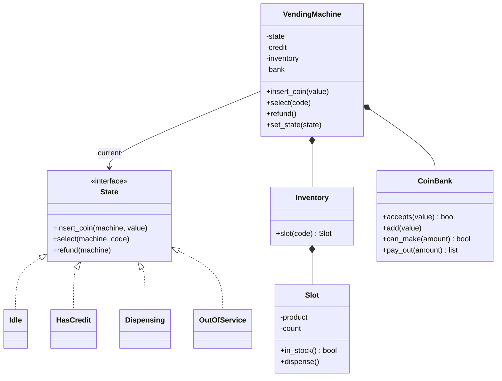

# Object-oriented design questions: a framework, a parking lot and a vending machine

> **Before this lesson:** you should be able to read a short Python function. Knowing what a state machine is helps — see [Modelling a device as a state machine](#/lesson/thinking/modelling-state-machines). Classes are explained from zero here.

## In plain words

Imagine organising a school play. You do not write one enormous instruction sheet covering everything. You hand out **roles**: the lighting person knows about lights, the prompter knows the script, the stage manager tells the others when to act. Each role keeps its own notes and has a short list of things it can be asked to do. If the lighting changes, only the lighting person's notes change.

**Object-oriented design** organises a program the same way. You split the problem into roles — called **classes** — decide what each one knows and what it can do, and decide who talks to whom. Interview prompts such as *"design a parking lot"* or *"design the classes for a vending machine"* ask you to do that division out loud. These are often called **low-level design** questions: they are about the shape of the code inside one program, not about servers and networks. They show whether the code you write on the job will be something colleagues can extend without fear.

## The vocabulary, built up in small steps

**Step 1 — a class and an object.** A **class** is a template describing a kind of thing: what data it holds and what it can do. An **object** (or *instance*) is one actual thing made from the template. `Car` is a class; your neighbour's red hatchback is an object.

```python-run
class Car:                                # the template
    def __init__(self, plate):            # runs when a new Car is made
        self.plate = plate                # data this car remembers (an attribute)

    def describe(self):                   # something a car can do (a method)
        return "Car " + self.plate

a = Car("AB-123")                         # make one object
b = Car("ZX-987")                         # and another, with its own data
print(a.describe(), "|", b.describe())
```

`__init__` is the set-up method that Python calls when you write `Car("AB-123")`. `self` means "this particular object". An **attribute** is a piece of data stored on an object; a **method** is a function that belongs to a class. The output shows two objects from one template, each with its own plate.

**Step 2 — encapsulation.** An object should guard its own data and offer methods to change it, so that the rules live in one place. A parking spot should not let outsiders set `occupied = True` directly; it should offer `park(vehicle)`, which can refuse if the spot is taken. Hiding the details behind methods is called **encapsulation**.

**Step 3 — relationships.** Classes relate in three main ways.

| Relationship | Reads as | Example |
|---|---|---|
| **Has-a** (composition) | A contains or owns B | A parking lot *has* floors; a floor *has* spots |
| **Uses** (association) | A calls B to get work done | A lot *uses* a pricing policy |
| **Is-a** (inheritance) | A is a special kind of B | A motorcycle *is a* vehicle |

**Inheritance** lets a class take over the attributes and methods of a more general one. It is the best-known feature and the most over-used. A sound default: prefer *has-a* and *uses*; reach for *is-a* only when the special kind truly can stand in anywhere the general kind is expected.

**Step 4 — interfaces and polymorphism.** An **interface** is a promise: "anything of this kind has these methods." If `HourlyPricing` and `FlatPricing` both offer `price(minutes)`, the lot can call `policy.price(…)` without knowing which one it holds. Different classes answering the same call in their own way is **polymorphism**. It is what lets you add a new behaviour by writing a new class, without editing the old ones.

## A six-step framework for any design prompt

1. **Clarify requirements** — what must it do, and what is out of scope?
2. **List the use cases** — the handful of things actors do with it.
3. **Find the entities** — the nouns become candidate classes.
4. **Assign responsibilities** — who knows what; who does what.
5. **Draw relationships and key methods** — a class diagram and a walk-through of one use case.
6. **Stress it** — extensions, edge cases, concurrency, testing.

A trick for step 3: write the requirements as sentences and underline the **nouns** (candidate classes and attributes) and the **verbs** (candidate methods). Then throw away nouns that carry no behaviour or data of their own.

A trick for step 4, worth saying in an interview: **each class should have one reason to change.** If parking fees change, only pricing code should need editing; if a new vehicle type arrives, only vehicle and spot-matching code. This is the *single-responsibility principle*, the first of a well-known set of five design guidelines abbreviated SOLID. Two more from that set come up constantly: *open for extension, closed for modification* (add behaviour by adding a class, not by editing a long `if` chain), and *depend on interfaces, not concrete classes*.

## Worked design 1 — A parking lot

**Prompt:** *"Design a parking lot."* Spend ten minutes on your own design before opening the answer.

<details><summary>Model answer</summary>

### 1. Clarify

- One level or several? Different vehicle sizes? Different spot sizes?
- Is payment in scope — hourly, flat, free?
- Entry and exit with tickets? Several gates?
- Do we need to show free-spot counts?
- Reservations, electric charging, monthly passes? (Probably out of scope; I'll mention where they would fit.)

**Assume:** several floors; spots of three sizes — motorcycle, compact, large; vehicles are motorcycles, cars and trucks; a ticket is issued at entry and the fee is calculated at exit from the duration; displays show free spots per floor.

### 2. Use cases

1. A vehicle arrives → the system finds a suitable free spot, marks it occupied, issues a ticket.
2. A vehicle leaves → the system computes the fee from the ticket, takes payment, frees the spot.
3. Anyone asks how many spots of each kind are free.
4. The lot is full → entry is refused.

### 3–4. Entities and responsibilities

| Class | Knows | Does |
|---|---|---|
| `Vehicle` | Plate, size | — (a plain data holder) |
| `ParkingSpot` | Its id, size, floor, current vehicle | `can_fit(vehicle)`, `park`, `leave` |
| `Floor` | Its spots | Find a free spot for a size; count free spots |
| `Ticket` | Id, vehicle, spot, entry time, exit time | — |
| `PricingPolicy` (interface) | Rates | `price(ticket) → amount` |
| `ParkingLot` | Floors, active tickets, pricing policy | `enter(vehicle) → ticket`, `exit(ticket) → fee`, `available()` |

Things I deliberately did **not** make classes: `Car`, `Truck` and `Motorcycle` as separate subclasses. They differ only in size, so one `Vehicle` with a `size` value is enough. Subclasses would earn their place only if the kinds behaved differently.

### 5. Class diagram



Reading the arrows: a filled diamond (`*--`) means "is made of"; a plain arrow means "refers to"; a dashed arrow with a triangle (`<|..`) means "implements this interface".

### Walk-through of "vehicle arrives"

`ParkingLot.enter(vehicle)` asks each floor in turn for `find_spot(vehicle.size)`. The floor returns the first free spot whose size is at least the vehicle's size, preferring the smallest that fits so that large spots are not wasted on motorcycles. The lot calls `spot.park(vehicle)`, creates a `Ticket` with the current time, stores it in `active_tickets`, and returns it. If no floor has a spot, it raises a "lot full" error.

### Key rules and where they live

- *Which vehicle fits which spot* → `ParkingSpot.can_fit`. A motorcycle fits anywhere; a car needs compact or large; a truck needs large.
- *How much to charge* → the `PricingPolicy` object. Changing from hourly to flat pricing means passing a different policy object; `ParkingLot` is not edited. This arrangement — a family of interchangeable algorithms behind one interface — is the **strategy pattern**. A **design pattern** is a named, reusable solution to a problem that keeps recurring.
- *Whether a spot is free* → the spot itself; nobody else flips that flag.

### 6. Stress it

- **A new vehicle type (electric car needing a charger).** Add a `features` set to `ParkingSpot` and a requirement on the vehicle; `can_fit` checks both. No other class changes.
- **A new pricing rule (first 15 minutes free, weekend rates).** A new `PricingPolicy` class.
- **Finding a spot quickly in a 5,000-spot lot.** Keep, per floor and per size, a collection of free spots, so that finding one does not scan every spot.
- **Two gates at the same moment.** Two cars could be given the same spot. The find-and-mark step must be **atomic** — done as one indivisible action — for instance by a lock around it, or by letting the database refuse the second claim.
- **Lost ticket.** `exit` needs a path that looks up by plate and applies a lost-ticket fee.
- **Testing.** Pricing can be tested alone with made-up tickets; passing the current time in as a parameter (`now`) instead of reading the clock inside makes tests repeatable.

</details>

### The same design as running code

A small version, enough to exercise the main path. Read the comments, run it, then try changing the pricing object.

```python-run
SIZES = {"motorcycle": 1, "compact": 2, "large": 3}

class HourlyPricing:
    def __init__(self, per_hour): self.per_hour = per_hour
    def price(self, minutes):                      # every started hour is charged
        return -(-minutes // 60) * self.per_hour   # ceiling division

class FlatPricing:
    def __init__(self, fee): self.fee = fee
    def price(self, minutes): return self.fee

class ParkingLot:
    def __init__(self, spots, pricing):
        self.spots = spots                         # list of (spot_id, size_name)
        self.occupied = {}                         # spot_id -> plate
        self.tickets = {}                          # plate -> (spot_id, entry_minute)
        self.pricing = pricing

    def enter(self, plate, vehicle_size, now):
        fits = [s for s in self.spots
                if s[0] not in self.occupied and SIZES[s[1]] >= SIZES[vehicle_size]]
        if not fits:
            return "FULL"
        spot = min(fits, key=lambda s: SIZES[s[1]])    # smallest spot that fits
        self.occupied[spot[0]] = plate
        self.tickets[plate] = (spot[0], now)
        return spot[0]

    def exit(self, plate, now):
        spot_id, entered = self.tickets.pop(plate)
        del self.occupied[spot_id]
        return self.pricing.price(now - entered)

lot = ParkingLot([("A1", "motorcycle"), ("A2", "compact"), ("A3", "large")], HourlyPricing(3))
print(lot.enter("BIKE-1", "motorcycle", 0))    # A1
print(lot.enter("CAR-1", "compact", 5))        # A2
print(lot.enter("CAR-2", "compact", 6))        # A3: the compact spot is taken, large still fits
print(lot.enter("CAR-3", "compact", 7))        # FULL
print(lot.exit("CAR-1", 130))                  # 125 minutes -> 3 started hours -> 9
print(lot.enter("CAR-3", "compact", 131))      # A2 is free again
```

The lot never contains an `if pricing_type == "hourly"` test. It calls `self.pricing.price(...)` and whatever object was supplied answers. Replace `HourlyPricing(3)` with `FlatPricing(10)` and nothing else has to change.

## Worked design 2 — Vending machine classes

**Prompt:** *"Design the classes for a vending machine."* The earlier lesson tested a vending machine; now you build its software skeleton.

<details><summary>Model answer</summary>

### Clarify and assume

Coins and cards, or coins only? Does it give change? How many products? Is there an operator mode for restocking? **Assume:** coins only with change, products in numbered slots with a price and a count, a refund button, and an operator who restocks and collects cash.

### Use cases

Insert coin; select product; get refund; restock (operator); collect cash (operator).

### Entities

| Class | Responsibility |
|---|---|
| `Product` | Name and price |
| `Slot` | One product type and how many are left; `dispense()` |
| `Inventory` | All slots; look up by code; is it in stock? |
| `CoinBank` | Coins held, by denomination; can it make this change? give change |
| `VendingMachine` | Current credit and current **state**; receives every event and delegates |
| `State` (interface) | What each event does *in this state* |

### The central idea: one class per state

The machine behaves differently depending on its situation: pressing "select" with no credit shows a price; with enough credit it dispenses. The naive code is a tangle of `if state == …` inside every method. The cleaner design is the **state pattern**: make each state its own small class with the same set of methods, and let the machine forward every event to its current state object.



### Walk-through of "select" in `HasCredit`

1. `machine.select("B4")` calls `self.state.select(self, "B4")`.
2. `HasCredit.select` asks the inventory for the slot. Unknown code → show "invalid". Not in stock → "sold out", stay in `HasCredit`.
3. Credit below price → show the amount still needed.
4. Ask `bank.can_make(credit − price)`. If not → "exact change only".
5. Otherwise set state to `Dispensing`, call `slot.dispense()`, pay out change, set credit to zero, set state to `Idle`.

In `Idle`, `select` only displays the price. In `Dispensing`, `insert_coin` returns the coin and `refund` does nothing. Each of those is two lines in its own class, instead of another branch in a growing method.

### Why this is worth the extra classes

- Every cell of the state–event table from the state-machine lessons has an obvious home: method *event* of class *state*.
- Adding a state — `CardPayment`, `Maintenance` — is a new class; existing states are untouched.
- Each state can be tested alone.

**Trade-off to say aloud:** for a machine with three states and three events, a plain transition table — a dictionary from (state, event) to a function — is shorter and perfectly good. The state pattern pays off as the behaviour per state grows. Choosing the lighter tool for the smaller problem is itself good design.

### Stress it

- **Card payments.** Add a `PaymentMethod` interface with `CoinPayment` and `CardPayment`; the machine talks to the interface.
- **Power loss during `Dispensing`.** Persist credit and state so that on restart the machine can refund or complete.
- **Operator actions** belong to a separate `OperatorPanel` class with its own access check, so that customer-facing code cannot restock by accident.
- **Testing.** Give the machine a fake `CoinBank` and `Inventory` so that tests need no hardware.

</details>

> [!INTERVIEW]
> Two sentences reliably raise a design answer: **"I'll keep the rule in the class that owns the data"** and **"I'd put that behind an interface so a new variant is a new class, not an edit."** And one keeps it honest: **"for this size of problem, a simpler structure would do — here is when I'd upgrade."**

## Common mistakes

- **Classes for everything.** `Car`, `Truck`, `Bike`, `Wheel`, `Door`… when the problem only needs a size.
- **One giant class** — `ParkingLotManager` that knows prices, spots, tickets and printing.
- **Inheritance by reflex**, producing deep family trees that are hard to change.
- **Data bags with all logic elsewhere** — objects that hold data while some "manager" pokes at their fields.
- **No walk-through.** A diagram that has never carried a use case from start to finish usually has a gap.
- **Ignoring two things happening at once.**
- **Pattern name-dropping** without saying which problem the pattern solves here.

## Summary

- A class is a template with data and methods; objects are made from it. Keep each object in charge of its own data.
- Relationships: has-a, uses, is-a — prefer the first two.
- Framework: clarify → use cases → entities → responsibilities → diagram and walk-through → stress test.
- Give each class one reason to change; put variation behind an interface.
- Parking lot: spots decide fit, a pricing strategy decides fees, the lot coordinates; claiming a spot must be atomic.
- Vending machine: a state object per mode keeps per-state behaviour separate; a transition table is the lighter alternative.

## Glossary

| Term | Meaning |
|---|---|
| Class | A template describing the data and behaviour of a kind of thing |
| Object / instance | One concrete thing created from a class |
| Attribute | A piece of data stored on an object |
| Method | A function that belongs to a class |
| Encapsulation | Keeping an object's data behind its methods |
| Composition (has-a) | One object containing or owning another |
| Inheritance (is-a) | A class taking over the features of a more general class |
| Interface | A list of methods that a class promises to provide |
| Polymorphism | Different classes responding to the same call in their own way |
| Design pattern | A named, reusable solution to a recurring design problem |
| Strategy pattern | Interchangeable algorithms behind one interface |
| State pattern | One class per state, with the object delegating to its current state |
| Single-responsibility principle | A class should have only one reason to change |
| Atomic | Done as a single indivisible step |

## Check yourself

```quiz
[
  {"q": "What is the difference between a class and an object?",
   "options": ["They are the same thing", "A class is a template; an object is one concrete thing made from it", "An object is a template; a class is a copy", "A class is always larger"],
   "answer": 1,
   "explain": "The class describes a kind of thing; each object has its own data following that description."},
  {"q": "A parking lot contains floors, and floors contain spots. Which relationship is this?",
   "options": ["Is-a (inheritance)", "Has-a (composition)", "Polymorphism", "Encapsulation"],
   "answer": 1,
   "explain": "The lot is made of floors and floors are made of spots; nothing here is a special kind of something else."},
  {"q": "Cars, trucks and motorcycles differ only in size in this problem. What is the simplest sound design?",
   "options": ["Three subclasses with no extra behaviour", "One Vehicle class with a size attribute", "A class per plate number", "No vehicle representation at all"],
   "answer": 1,
   "explain": "Subclasses earn their place when behaviour differs; a single attribute covers a difference in data."},
  {"q": "Pricing may be hourly today and flat tomorrow. Which design keeps ParkingLot unchanged when pricing changes?",
   "options": ["An if-chain inside ParkingLot.exit", "A PricingPolicy interface with one class per pricing rule", "Hard-coding the rate", "Copying ParkingLot for each rule"],
   "answer": 1,
   "explain": "The strategy pattern puts each algorithm in its own class behind a shared interface, so adding a rule adds a class."},
  {"q": "Why does the vending machine design give each state its own class?",
   "options": ["To have more files", "So behaviour for each state-event pair lives in one small, separate place instead of a tangle of conditionals", "Because Python requires it", "To avoid storing credit"],
   "answer": 1,
   "explain": "The state pattern makes each mode's behaviour explicit and lets new states be added without editing old ones."},
  {"q": "Two entry gates could assign the same free spot to two cars. What property must 'find and mark a spot' have?",
   "options": ["It must be recursive", "It must be atomic", "It must be inherited", "It must be static"],
   "answer": 1,
   "explain": "Finding and claiming must happen as one indivisible action so that no second request can slip in between."},
  {"q": "After drawing a class diagram, what is the best way to check it?",
   "options": ["Count the classes", "Walk one use case through it step by step, naming which object calls which method", "Add more inheritance", "Rename the classes"],
   "answer": 1,
   "explain": "Tracing a real scenario exposes missing responsibilities and awkward dependencies."}
]
```

> **Source:** Object-oriented design practice questions (parking lot, call centre, chat server) listed in Donne Martin's System Design Primer (https://github.com/donnemartin/system-design-primer); design principles and pattern names as described in Martin Fowler's writing on design (https://martinfowler.com/tags/object%20collaboration%20design.html) and *Software Engineering at Google*, ch. 9 on what reviewers look for in design (https://abseil.io/resources/swe-book/html/ch09.html); Mermaid class-diagram notation (https://mermaid.js.org/syntax/classDiagram.html). Designs, code and wording are original.
