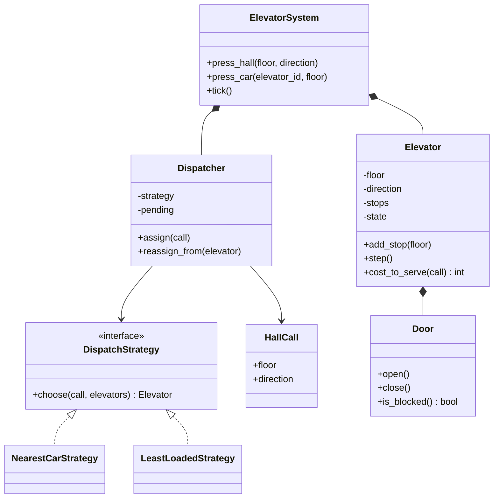
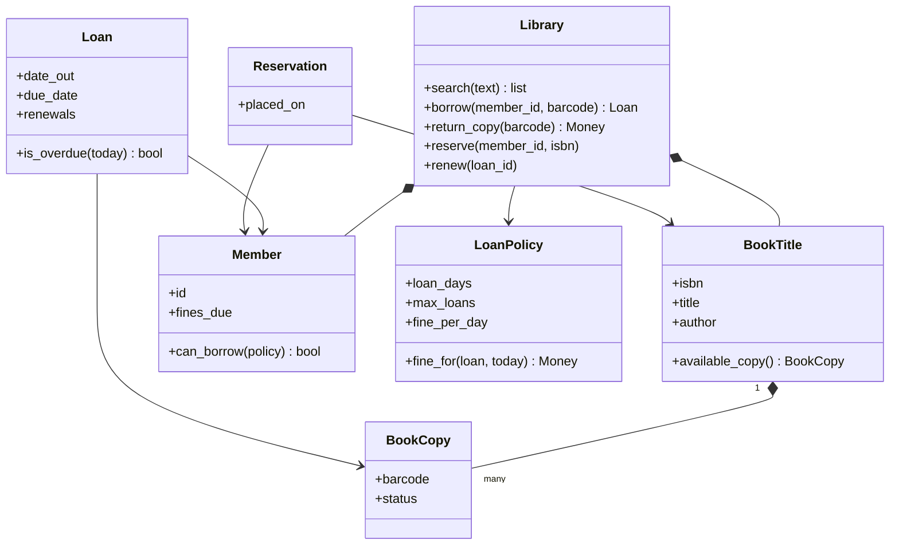
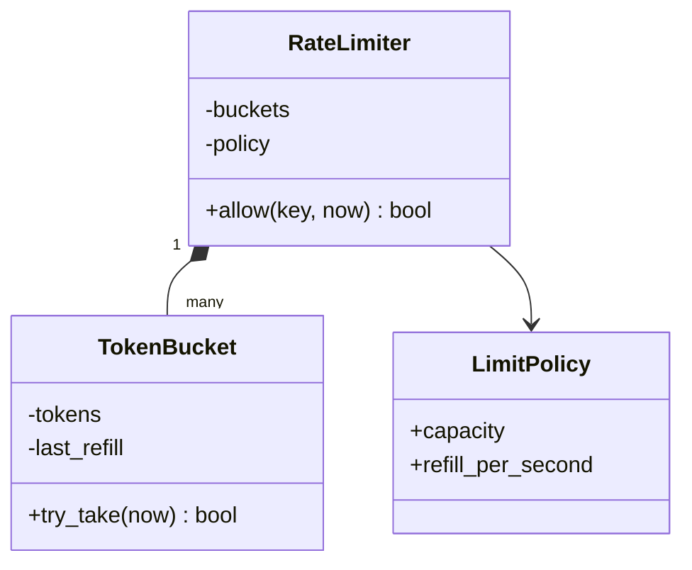

# More object-design answers: elevator controller, library system and a rate limiter

> **Before this lesson:** read [Object-oriented design questions: a framework](#/lesson/thinking/object-design-framework), which defines class, object, interface, composition and the six-step framework used here.

## In plain words

Learning to cook one dish from a recipe does not make you a cook; cooking three different dishes with the same handful of techniques starts to. This lesson is the second and third dish. The six steps stay the same — clarify, use cases, entities, responsibilities, diagram and walk-through, stress test — and you will see the same few ideas return: *keep each rule with the data it concerns*, *put the part that varies behind an interface*, and *protect anything two people can touch at once*.

The three prompts were chosen because each leans on a different muscle. An **elevator controller** is mostly about a decision that changes over time (which floor next?). A **library system** is about records and rules between them. A **rate limiter** is a small, precise component where correctness and time matter — it limits how many requests a user may make in a period, like a bouncer counting people into a club.

A reminder of the framework:

| Step | Question |
|---|---|
| 1 Clarify | What must it do? What is out of scope? |
| 2 Use cases | Who does what with it? |
| 3 Entities | Which nouns deserve to be classes? |
| 4 Responsibilities | Who knows what, who does what? |
| 5 Diagram + walk-through | How do the objects cooperate for one use case? |
| 6 Stress | Extensions, edge cases, concurrency, testing |

## Worked design 1 — An elevator controller

**Prompt:** *"Design the software that controls the elevators in a building."* Try ten minutes yourself first.

<details><summary>Model answer</summary>

### 1. Clarify

- One car or several? How many floors?
- Buttons: an up and a down button on each floor (a **hall call**), and floor buttons inside the car (a **car call**)?
- Any special modes — fire service, maintenance, weight limit?
- Are we writing the motor and door control, or deciding where cars go?

**Assume:** a building with several cars and up to forty floors; hall calls have a direction; the controller decides which car answers each call and in which order each car stops. Motor and door hardware are behind an interface that we command.

### 2. Use cases

1. A person presses "up" on floor 7 → some car is assigned and arrives.
2. A passenger inside presses 12 → that car adds floor 12 to its stops.
3. A car arrives at a floor → doors open, waiting calls for that floor and direction are cleared.
4. A car goes out of service → its hall calls are given to other cars.

### 3–4. Entities and responsibilities

| Class | Knows | Does |
|---|---|---|
| `HallCall` | Floor, direction, time pressed | — |
| `Elevator` | Current floor, direction, door state, set of stops, load | `add_stop`, `step()` — advance one tick, `next_stop()` |
| `Door` | Open or closed | `open`, `close`, reports obstruction |
| `Dispatcher` | All elevators, unassigned hall calls | `assign(call)` — choose a car |
| `DispatchStrategy` (interface) | — | `choose(call, elevators) → Elevator` |
| `ElevatorSystem` | The dispatcher and the cars | Entry point for button presses and the clock |

Two separate decisions are hiding in "which floor next", and separating them is the key design move:

- **Dispatching** — *which car* answers a hall call. A whole-building decision → `Dispatcher` with a pluggable strategy.
- **Scheduling within a car** — *in what order* one car visits its stops. A per-car decision → inside `Elevator`.

### 5. Diagram



### The scheduling rule inside one car

The usual rule is the one a sensible lift follows: **keep going in the current direction while there are stops ahead; then reverse.** It is called LOOK (and its relative SCAN, which always runs to the end of the shaft). It avoids the starvation that "nearest request first" causes — a car bouncing between floors 2 and 3 while someone waits on 30.

Each car is also a small state machine: `Idle`, `MovingUp`, `MovingDown`, `DoorsOpen`, `OutOfService`, with the safety rule from the testing lesson: never move unless the doors are closed.

### Walk-through: "up" pressed on floor 7

1. `ElevatorSystem.press_hall(7, up)` creates a `HallCall` and passes it to the `Dispatcher`.
2. The dispatcher asks its strategy to `choose`. A reasonable strategy asks every car for `cost_to_serve(call)` — an estimate of how long until it could arrive — and picks the lowest. A car already travelling up from floor 3 has a low cost; a car going down from floor 9 must finish its trip first, so its cost is higher.
3. The chosen car gets `add_stop(7)`.
4. On each `tick()`, cars move one step. When the car reaches 7 it opens its doors, and the call is cleared.

### 6. Stress it

- **A better dispatch rule** (rush-hour mode that parks idle cars at the lobby) → a new `DispatchStrategy` class.
- **A full car** should not answer hall calls: `cost_to_serve` returns "cannot" when load is near the limit.
- **A car fails mid-journey** → `Dispatcher.reassign_from(elevator)` hands its hall calls to others. Car calls cannot be reassigned; passengers must be let out at the nearest floor.
- **The same button pressed five times** → hall calls are a set keyed by (floor, direction), so repeats change nothing.
- **Fire mode** overrides everything: all cars return to the ground floor. This is a state on the system, checked before normal dispatch.
- **Testing.** Because `tick()` advances time explicitly, a test can press buttons, run 100 ticks, and assert on the order of stops and the waiting times — no real clock, no hardware.

</details>

A small runnable version of the per-car rule:

```python-run
def look_order(start, direction, requests):
    floors = set(requests)                                   # each floor once
    above = sorted(f for f in floors if f > start)           # visited going up, ascending
    below = sorted((f for f in floors if f < start), reverse=True)   # going down, descending
    here = [start] if start in floors else []
    return here + (above + below if direction == "up" else below + above)

print(look_order(5, "up", [3, 8, 6, 1, 8]))     # [6, 8, 3, 1]
print(look_order(5, "down", [3, 8, 6, 1, 8]))   # [3, 1, 6, 8]
```

The function splits the requested floors into those above and those below the car, sorts each in travel order, and joins them according to the current direction. The first call sweeps up to 8 before coming down.

## Worked design 2 — A library system

**Prompt:** *"Design a library management system."* A classic because its difficulty is hidden in one distinction.

<details><summary>Model answer</summary>

### 1. Clarify

Borrowing, returning, reserving, renewing, fines? Several branches? Staff accounts? E-books? Search? **Assume:** one branch; members borrow physical books for 21 days, up to five at a time; they can renew once if nobody has reserved the book; late returns incur a daily fine; members can reserve a title that is out.

### 2. Use cases

Search the catalogue; borrow; return; renew; reserve; pay a fine; staff add or remove copies.

### 3. The distinction that matters: title versus copy

A library may own four copies of the same novel. "The novel" has a title, author and ISBN (the standard book number). Each **physical copy** has its own barcode and its own status. Mixing them into one `Book` class is the classic mistake: you cannot then say "three of four copies are out".

- `BookTitle` — what the catalogue lists.
- `BookCopy` — one physical item; refers to its title.

Reservations attach to a **title** ("any copy will do"); loans attach to a **copy** ("this exact one").

### 4. Entities and responsibilities

| Class | Knows | Does |
|---|---|---|
| `BookTitle` | ISBN, title, author, its copies, its reservation queue | `available_copy()`, `add_reservation(member)` |
| `BookCopy` | Barcode, status (available, on loan, on hold, lost) | `check_out`, `check_in` |
| `Member` | Id, name, active loans, unpaid fines | `can_borrow()` |
| `Loan` | Copy, member, date out, due date, date returned, renewals used | `is_overdue(today)`, `renew()` |
| `Reservation` | Title, member, date placed | — |
| `LoanPolicy` | Loan length, maximum loans, renewals allowed, fine per day | `due_date(…)`, `fine_for(loan, today)` |
| `Library` | The catalogue and members | `borrow(member, barcode)`, `return_copy(barcode)`, `reserve(member, isbn)`, `search(text)` |

Why is `Loan` a class and not a field on the copy? Because a loan has its own data (dates, renewals) and its own life — and because the library wants the *history* of loans, not only the current one. When a relationship between two things has data of its own, give it a class.

Why `LoanPolicy`? All the numbers that the librarians will want to change — 21 days, five books, the fine — live in one object. A children's membership or a staff membership can be a different policy without touching the borrowing code.

### 5. Diagram



### Walk-through: returning a book

1. Staff scan the barcode → `Library.return_copy(barcode)`.
2. Find the open `Loan` for that copy; set its return date.
3. Ask `LoanPolicy.fine_for(loan, today)`; add any fine to the member.
4. Look at the title's reservation queue. If someone is waiting, set the copy's status to *on hold* for the first person and notify them; otherwise set it to *available*.

Step 4 is the one candidates forget; it is where reservations become real.

### Rules and their homes

- "At most five loans and no large unpaid fines" → `Member.can_borrow(policy)`.
- "Renew only if nobody has reserved the title and a renewal remains" → checked in `Library.renew`, using the title's queue and the loan's counter.
- "A copy on hold may be borrowed only by the member it is held for" → `BookCopy.check_out`.

### 6. Stress it

- **Two members try to borrow the last copy at two desks.** The check "is it available?" and the change "mark it on loan" must be one atomic step, or both succeed. In a database-backed system, update the row *only if* its status is still available and see whether a row was changed.
- **E-books** have no physical copies but a licence count: a new kind of lendable item. Introduce an interface `Lendable` implemented by `BookCopy` and `EbookLicence`.
- **Several branches**: add `Branch`; a copy belongs to a branch; reservations may specify a pick-up branch.
- **Search at scale** is a different component (an index); the `Library` class would delegate to it.
- **History and privacy**: loan history is useful for the library and sensitive for members; decide how long to keep it.
- **Testing**: pass `today` into methods instead of reading the system date, so that overdue rules can be tested for any day.

</details>

## Worked design 3 — A rate limiter class

**Prompt:** *"Design a rate limiter: a component that allows each user at most N requests per time window."* Smaller than the others; the interviewer wants precision.

<details><summary>Model answer</summary>

### 1. Clarify

- Limit per what — user, API key, IP address?
- What should happen over the limit — reject, delay, or queue?
- Is a short burst acceptable? ("100 per minute" — may all 100 arrive in the first second?)
- One server or many sharing the limit?
- How exact must it be?

**Assume:** per-user limit, reject when over, bursts up to a set size allowed, one process to start with, then discuss many servers.

### 2. Interface first

A good component design starts from how it is used:

```text
limiter.allow(user_id, now) -> True or False
```

Passing `now` in, instead of reading the clock inside, makes the class testable — a point worth making aloud.

### 3. The algorithm choices

| Algorithm | Idea | Good | Weak |
|---|---|---|---|
| **Fixed window** | Count requests in each calendar minute | Tiny memory, easy | Twice the limit can pass around a boundary: 100 at 0:59 and 100 at 1:00 |
| **Sliding log** | Remember the time of every recent request | Exact | Memory grows with the limit |
| **Sliding window counter** | Blend this window's and the previous window's counts | Close to exact, small | Approximate |
| **Token bucket** | A bucket holds up to *capacity* tokens, refilled at a steady rate; each request takes one | Allows controlled bursts; two numbers per user | Slightly harder to explain |

The **token bucket** is the usual choice. Picture a jar of tokens. Tokens drip in at a steady rate up to the jar's capacity. Each request must take a token; if the jar is empty the request is refused. A quiet user builds up a small reserve and may then make a short burst — but never more than the jar holds.

### 4. Classes

| Class | Responsibility |
|---|---|
| `TokenBucket` | Tokens and last refill time for **one** key; `try_take(now)` |
| `RateLimiter` | A map from key to its bucket; creates buckets on first use; `allow(key, now)` |
| `LimitPolicy` | Capacity and refill rate — possibly different per customer plan |
| `RateLimitAlgorithm` (interface, optional) | Lets fixed-window or sliding-log variants replace the bucket |



### 5. The key trick: refill lazily

There is no timer adding tokens every second for every user. When a request arrives, compute how many tokens *would have* dripped in since the last request, add them (capped at capacity), then try to take one.

### 6. Stress it

- **Two requests for the same user at the same instant** (two threads). Both might read "1 token left" and both take it. The read-modify-write inside `try_take` must be atomic — a lock per bucket, or an atomic operation in the store.
- **Many servers.** A bucket in each server's memory gives each server its own limit, so the real limit is multiplied by the number of servers. Put the buckets in a shared fast store and perform refill-and-take as a single atomic operation there. Trade-off: one network call per request, and a decision about what to do if that store is down — *fail open* (allow everything, risking overload) or *fail closed* (reject everything, causing an outage). For most public APIs, fail open with an alert is the usual choice; for protecting something fragile, fail closed.
- **Memory.** Millions of users means millions of buckets; remove buckets that have been full and idle for a while.
- **Telling the caller.** A rejected request should say when to retry — in web APIs, status 429 with a `Retry-After` value.
- **Different limits** per plan → `LimitPolicy` looked up per key.
- **Testing.** With `now` as a parameter, a test can check: the bucket starts full; requests beyond capacity are refused; after exactly one refill interval one more is allowed; a long idle period does not overfill.

</details>

The whole thing in runnable form:

```python-run
class TokenBucket:
    def __init__(self, capacity, refill_per_second, now):
        self.capacity = capacity
        self.rate = refill_per_second
        self.tokens = capacity              # start full
        self.last = now

    def try_take(self, now):
        earned = (now - self.last) * self.rate          # tokens dripped in since last time
        self.tokens = min(self.capacity, self.tokens + earned)   # never above capacity
        self.last = now
        if self.tokens >= 1:
            self.tokens -= 1
            return True
        return False

class RateLimiter:
    def __init__(self, capacity, refill_per_second):
        self.capacity, self.rate = capacity, refill_per_second
        self.buckets = {}                   # key -> TokenBucket

    def allow(self, key, now):
        if key not in self.buckets:         # first request from this key
            self.buckets[key] = TokenBucket(self.capacity, self.rate, now)
        return self.buckets[key].try_take(now)

limiter = RateLimiter(capacity=2, refill_per_second=1)
for t in [0, 0, 0, 1, 1, 5, 5, 5]:
    print(t, "alice", limiter.allow("alice", t))
print(0, "bob  ", limiter.allow("bob", 0))   # bob has his own bucket
```

Read the output against the rule. At time 0 Alice's bucket holds 2: two requests pass, the third is refused. At time 1 one token has dripped in: one passes, one is refused. By time 5 four seconds have passed, but the bucket is capped at 2, so only two pass. Bob is unaffected by Alice. The problem *Token-Bucket Rate Limiter Outcome* asks you to write this logic yourself.

> [!INTERVIEW]
> For a small-component prompt like the rate limiter, the order **interface → algorithm options with trade-offs → chosen design → concurrency → distribution → failure mode** fills fifteen minutes with exactly what interviewers hope to hear. Starting with the method signature is a strong opening move.

## What the three designs share

| Idea | Elevator | Library | Rate limiter |
|---|---|---|---|
| Split two decisions that look like one | Dispatching vs per-car scheduling | Title vs copy | Policy vs bucket mechanics |
| Variation behind an interface | `DispatchStrategy` | `LoanPolicy`, `Lendable` | `RateLimitAlgorithm` |
| A relationship with its own data becomes a class | `HallCall` | `Loan`, `Reservation` | — |
| Time passed in, not read inside | `tick()` | `today` | `now` |
| The step that must be atomic | Assigning a call to one car | Borrowing the last copy | Refill-and-take |

## Summary

- Elevator: separate *which car* (dispatcher, strategy) from *which stop next* (LOOK inside each car); handle failure by reassigning hall calls.
- Library: distinguish title from copy; loans and reservations are classes of their own; policy numbers live in one object; a return must check the reservation queue.
- Rate limiter: begin with `allow(key, now)`; compare algorithms; a token bucket with lazy refill; atomic update; shared store and a fail-open or fail-closed decision when distributed.
- Across all three: split decisions, hide variation behind interfaces, inject time, and name the atomic step.

## Glossary

| Term | Meaning |
|---|---|
| Hall call | A request made from a floor's up or down button |
| Car call | A request made from a button inside the elevator |
| Dispatching | Choosing which elevator answers a hall call |
| LOOK | Serving all stops in the current direction before reversing |
| Starvation | A request waiting indefinitely because others keep being served first |
| ISBN | The standard identifying number of a book title |
| Rate limiter | A component that restricts how many requests are allowed in a period |
| Token bucket | A limiter in which requests spend tokens that refill at a steady rate |
| Burst | Several requests arriving close together |
| Lazy refill | Computing accumulated tokens when a request arrives, not on a timer |
| Fail open / fail closed | Allowing everything, or refusing everything, when a dependency is down |
| Dependency injection | Supplying an object with the things it needs (a clock, a policy) from outside |

## Check yourself

```quiz
[
  {"q": "In the elevator design, which two decisions are kept in separate places?",
   "options": ["Door colour and button shape", "Which car answers a hall call, and the order in which one car visits its stops", "Floor count and car count", "Speed and weight"],
   "answer": 1,
   "explain": "Dispatching is a building-wide decision in the dispatcher; stop ordering is a per-car decision inside the elevator."},
  {"q": "Why is 'serve the nearest request first' a poor scheduling rule for an elevator?",
   "options": ["It is too slow to compute", "A far-away request can be starved while the car serves a cluster of nearby ones", "It uses too much memory", "It breaks the doors"],
   "answer": 1,
   "explain": "LOOK avoids starvation by sweeping in one direction through all pending stops before reversing."},
  {"q": "A library owns four copies of one novel. What is the right modelling?",
   "options": ["One Book object with a counter and nothing else", "A BookTitle with four BookCopy objects, each with its own barcode and status", "Four unrelated Book objects with duplicated title data", "No objects, only a list of names"],
   "answer": 1,
   "explain": "Catalogue information belongs to the title; status and loans belong to individual copies."},
  {"q": "Why is Loan a class of its own?",
   "options": ["To make the diagram larger", "The relationship between member and copy has its own data and history: dates, renewals, return", "Because every noun must be a class", "Because members cannot hold data"],
   "answer": 1,
   "explain": "When a relationship carries data and you want its history, it deserves a class."},
  {"q": "What is the weakness of a fixed-window rate limiter?",
   "options": ["It uses too much memory", "Up to twice the limit can pass around a window boundary", "It never allows any request", "It cannot count"],
   "answer": 1,
   "explain": "A full allowance at the end of one window and another at the start of the next arrive back to back."},
  {"q": "Why does allow(key, now) take the time as a parameter?",
   "options": ["Clocks are unreliable in Python", "So tests can supply any time and check behaviour deterministically", "To make calls longer", "Because time zones differ"],
   "answer": 1,
   "explain": "Injecting time removes hidden dependence on the real clock and makes edge cases easy to test."},
  {"q": "Ten servers each keep rate-limit buckets in their own memory with a limit of 100 per minute. What is the effective limit?",
   "options": ["100", "10", "Up to 1,000", "Zero"],
   "answer": 2,
   "explain": "Each server enforces its own limit independently; a shared store with an atomic update is needed for a true global limit."}
]
```

> **Source:** Object-oriented design practice list in Donne Martin's System Design Primer (https://github.com/donnemartin/system-design-primer); retry-and-limit behaviour for APIs follows Google API Improvement Proposals (https://google.aip.dev/194) and the Google SRE Book, "Handling Overload" (https://sre.google/sre-book/handling-overload/); Mermaid class-diagram notation (https://mermaid.js.org/syntax/classDiagram.html). Designs, code and wording are original.
